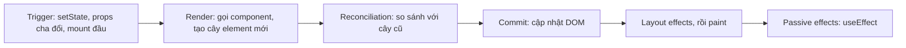
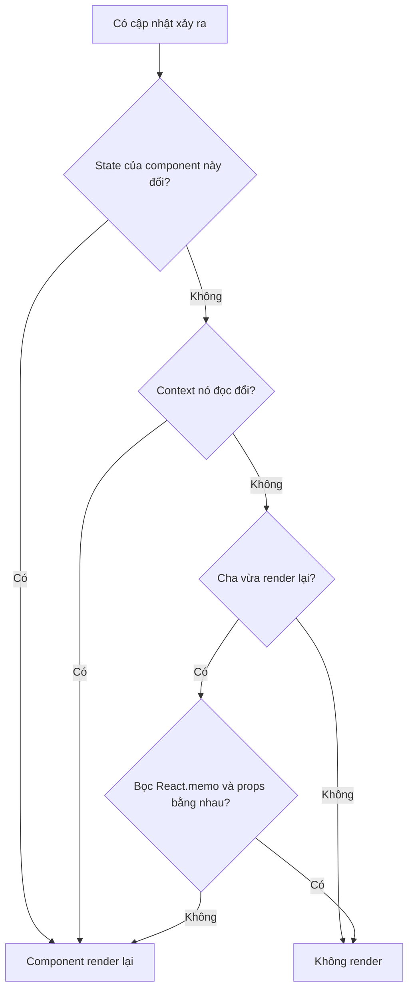
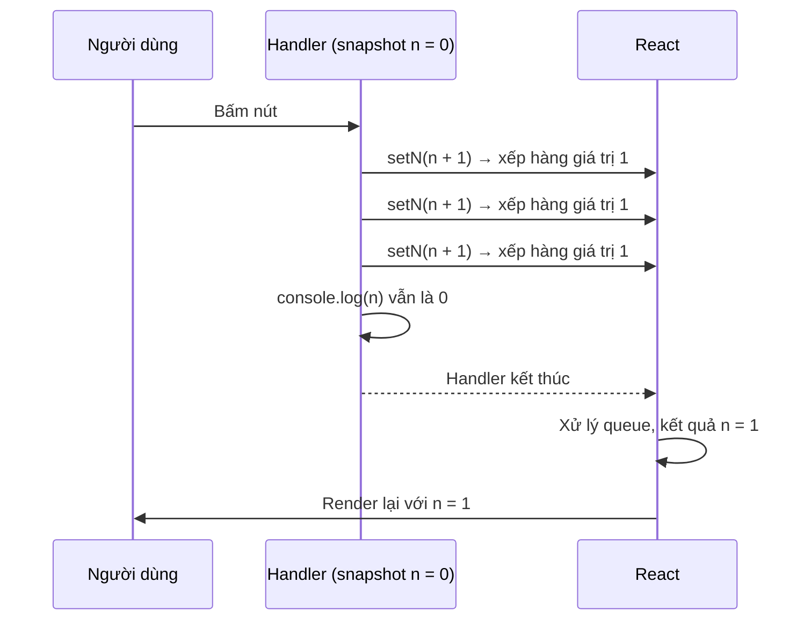

# Lý thuyết 1: Tư duy React và render

Bài nền tảng của cả bộ tài liệu. Mọi bài sau (hooks, memo, concurrent, RSC) đều dựa trên mô hình render ở đây.

## React làm gì cho bạn?

React mô tả UI theo kiểu **khai báo**: UI là kết quả của một hàm nhận vào props, state và context. Bạn không ra lệnh "tìm thẻ này, đổi chữ kia" mà chỉ nói "với dữ liệu này thì UI trông như vậy". Mỗi khi dữ liệu đổi, React gọi lại hàm component (gọi là **render**), so sánh cây mô tả mới với cây cũ (**reconciliation**), rồi chỉ cập nhật đúng phần DOM thay đổi (**commit**). Hãy hình dung bạn đưa bản vẽ mới cho thợ xây: thợ tự so với bản vẽ cũ và chỉ đục sửa chỗ khác nhau, bạn không cần chỉ từng viên gạch.

## Vì sao phải hiểu mô hình này?

Hầu hết bug và vấn đề hiệu năng của React đều đến từ ba chỗ hiểu sai: khi nào component được gọi lại, vì sao state không đổi ngay sau khi gọi `setState`, và vì sao `key` sai làm mất state. Nếu nắm chắc mô hình trong bài này, bạn sẽ giải thích được những hành vi "lạ" như effect chạy hai lần ở dev, `console.log` in giá trị cũ, hay ô input mất focus mỗi lần gõ. Các bài sau (hooks, memo, concurrent, RSC) đều xây trên nền này.

## Khi nào dùng, và cách nhớ

Bạn dùng kiến thức này mỗi khi viết component, debug re-render thừa, xử lý danh sách động, hoặc giải thích hành vi của `setState` và StrictMode. Bốn điều cần nhớ: (1) mỗi lần cập nhật đi qua ba pha trigger, render, commit; (2) render phải thuần; (3) không sửa state tại chỗ; (4) state là ảnh chụp (snapshot) của mỗi lần render, và `key` là danh tính của phần tử.

## Các khái niệm cần biết

- **Component**: một hàm trả về JSX, mô tả một mảnh UI. React gọi hàm này để biết UI hiện tại trông thế nào.
- **Element**: object thuần mô tả "muốn có một thẻ/component loại này với props này". JSX chỉ là cú pháp tạo element. Chúng rẻ để tạo, khác với node DOM thật.
- **Reconciliation**: thuật toán so sánh cây element mới với cây cũ để quyết định giữ, cập nhật hay hủy node. Dùng mỗi lần render để giảm số thao tác DOM.
- **Commit**: pha duy nhất React thật sự sửa DOM, gắn ref và chạy layout effect. Sync và không bị bỏ dở.
- **Side effect**: mọi việc ra ngoài phạm vi tính JSX (gọi API, sửa DOM, subscribe, đặt timer). Phải đặt trong event handler hoặc `useEffect`, không đặt trong thân render.
- **Pure (thuần)**: cùng đầu vào thì cùng đầu ra và không tác động ra ngoài. Render thuần thì React mới tự do gọi lại, bỏ dở hoặc gọi hai lần mà không gây hậu quả.
- **Snapshot**: giá trị state, props bị "đóng băng" trong một lần render; mọi hàm tạo ra trong lần render đó đều thấy cùng giá trị.
- **Batching**: gom nhiều lần `setState` thành một lần render để tránh render thừa.
- **Updater function**: dạng `setN(prev => prev + 1)`, nhận giá trị mới nhất đang chờ xử lý thay vì giá trị của snapshot.

**Tóm tắt:**

- React làm việc theo ba pha trigger, render, commit; render chỉ tính ra cây element, chỉ commit mới chạm DOM.
- Render phải thuần: UI = f(props, state, context), nên React có quyền gọi lại, bỏ dở hoặc gọi hai lần mà không gây hậu quả.
- Một component render lại vì ba nguyên nhân: state của nó đổi, cha render lại, hoặc context nó đọc đổi.
- Mặc định cha render thì mọi con render theo; chỉ `React.memo` mới chặn được.
- Danh tính component trong cây gồm type, vị trí và key; khác type hoặc key thì unmount và mất state.
- State là snapshot, `setState` chỉ lên lịch render mới, nên giá trị mới phụ thuộc giá trị cũ thì dùng updater `setN(prev => prev + 1)`.
- Không sửa trực tiếp object hoặc mảng trong state; React 18 gộp (batch) mọi cập nhật tự động.

## Declarative so với imperative

Imperative: bạn ra lệnh từng bước để DOM chuyển từ state A sang B (`el.classList.add`, `el.textContent = ...`). Declarative: bạn mô tả UI **trông như thế nào** với mỗi state, React tự tính các bước chuyển.

```tsx
// Declarative: không tự chạm DOM
function Badge({ unread }: { unread: number }) {
  return unread > 0 ? <span className="badge">{unread}</span> : null;
}
```

## Ba pha: trigger, render, commit



| Pha | Việc xảy ra | Chạm DOM? | Có thể bị bỏ dở? |
|---|---|---|---|
| Render | Gọi hàm component, tính JSX | Không | Có (concurrent, StrictMode) |
| Commit | Áp thay đổi lên DOM, gắn ref, chạy layout effect | Có | Không, sync |
| Effect | Chạy `useEffect` sau paint | Có thể | Không |

Quy tắc nhớ: **render không có nghĩa là DOM thay đổi**. Component render lại mà output giống hệt thì commit không làm gì với DOM.

**Nền tảng:** React làm việc theo ba pha trigger, render, commit. Render chỉ là gọi hàm component để tính ra cây element (thuần tính toán, có thể bị bỏ dở hoặc gọi lại); chỉ commit mới chạm DOM và là sync. Mọi thứ về hooks, memo, concurrent đều dựa trên sự tách biệt "tính" và "áp" này.

Component re-render khi: (1) state của chính nó đổi, (2) cha nó render lại (kể cả props không đổi, trừ khi có `React.memo`), (3) context nó đọc đổi. Props đổi **không phải** là nguyên nhân độc lập; nguyên nhân thật là cha render lại.

**Phải thuộc:** Ba nguyên nhân khiến component render lại: state của chính nó đổi, cha render lại, context nó đọc đổi. Mặc định cha render thì mọi con render theo, chỉ `React.memo` (props bằng nhau theo `Object.is` từng prop) mới chặn được.

Sơ đồ dưới đây tóm tắt cách quyết định một component có bị gọi lại hay không khi có một lần cập nhật.



Đọc sơ đồ: điểm mấu chốt là nhánh "cha render lại". Mặc định, cha render thì toàn bộ con cũng render, bất kể props có đổi hay không. `React.memo` là cách chủ động chặn nhánh này (xem [Bài 10](/go?p=09-React%2Fhard%2Flt-10-hieu-nang-kien-truc.md)). Render lại không đồng nghĩa DOM đổi, nên một lần re-render thừa thường chỉ tốn CPU chứ không gây nhấp nháy.

## Render phải thuần (pure)

Với cùng props, state, context, component phải trả cùng JSX và không có side effect quan sát được.

**Nền tảng:** UI = f(props, state, context). Vì render là hàm thuần nên React mới có quyền gọi lại, bỏ dở hoặc gọi hai lần mà không gây hậu quả; side effect chỉ được đặt trong event handler hoặc `useEffect`.

```tsx
let count = 0;
function Bad() {
  count++;                 // sai: sửa biến ngoài trong render
  return <p>{count}</p>;
}

function Good({ items }: { items: string[] }) {
  const sorted = [...items].sort(); // sao chép trước khi sort, không sửa props
  return <ul>{sorted.map(s => <li key={s}>{s}</li>)}</ul>;
}
```

Side effect (gọi API, sửa DOM, subscribe, ghi log quan trọng) đặt trong event handler hoặc `useEffect`. Khởi tạo biến cục bộ trong render (mutate object tạo mới trong cùng lần render) là chấp nhận được.

Vì sao phải khắt khe như vậy? Vì React có quyền gọi render nhiều lần, bỏ dở giữa chừng (concurrent) hoặc gọi hai lần (StrictMode). Nếu render có side effect, hiện tượng bạn gặp là số đếm nhảy lung tung, request gửi thừa, hoặc UI hiển thị không nhất quán giữa các lần chạy.

## StrictMode gọi hai lần

Ở môi trường development, `<StrictMode>` gọi **hai lần**: thân component, hàm khởi tạo `useState`, `useMemo`, `useReducer`, và updater function. Mục đích: lộ ra render không thuần. React 18 còn mô phỏng mount, unmount, mount lại để kiểm tra cleanup của effect (effect chạy thêm một vòng setup, cleanup, setup). Production không có hành vi này.

Nếu một effect hỏng khi chạy hai lần (ví dụ gửi analytics hai lần, kết nối không đóng), lỗi nằm ở thiếu cleanup, không phải ở StrictMode. Ghi chú 18 và 19: ở React 19, khi double render, React tái sử dụng kết quả `useMemo` và `useCallback` từ lần render đầu của lần gọi kép (thay đổi nhỏ so với 18); đừng dựa vào chi tiết này.

## Reconciliation và key

React so sánh hai cây theo heuristic O(n):

1. Hai element khác **type** (`div` thành `span`, hoặc `A` thành `B`) thì hủy cây con cũ (unmount, mất state) và dựng mới.
2. Cùng type thì giữ instance, cập nhật props, rồi đệ quy xuống con.
3. Với danh sách, **key** cho biết phần tử nào là "cùng một thực thể" giữa hai lần render.

**Phải thuộc:** Danh tính của một component trong cây gồm type, vị trí và key. Khác type hoặc khác key thì unmount và mất state; cùng type và key thì giữ state. Key phải ổn định và duy nhất giữa các anh em, không dùng index cho danh sách động và không dùng giá trị ngẫu nhiên.

```tsx
// Sai: index làm key khi danh sách có thể chèn, xóa, sắp xếp lại
todos.map((t, i) => <TodoRow key={i} todo={t} />);

// Đúng: id ổn định, duy nhất trong cùng danh sách anh em
todos.map(t => <TodoRow key={t.id} todo={t} />);
```

Dùng index làm key khi xóa phần tử đầu: state nội bộ (ô input, state expand) "trượt" sang dòng sai vì React thấy key 0 vẫn tồn tại. Đừng dùng `Math.random()` hay `crypto.randomUUID()` trong render làm key: mỗi lần render ra key mới, toàn bộ dòng bị unmount và mount lại.

Mẹo có chủ đích: đổi `key` để **reset state** của một component.

```tsx
// Đổi userId thì ProfileForm được dựng lại hoàn toàn, state sạch
<ProfileForm key={userId} userId={userId} />
```

Một bẫy liên quan: định nghĩa component bên trong component khác. Mỗi lần cha render, `Inner` là một function mới nên type khác, React unmount và mount lại `Inner`, mất state và focus.

```tsx
function Parent() {
  const Inner = () => <input />; // sai: type mới mỗi lần render
  return <Inner />;
}
```

## State là snapshot, và bất biến

State trong một lần render là hằng số. `setState` không đổi biến hiện tại, nó **lên lịch** một lần render mới với giá trị mới.

```tsx
function Counter() {
  const [n, setN] = useState(0);
  function handle() {
    setN(n + 1);
    setN(n + 1);
    setN(n + 1);
    console.log(n); // vẫn là giá trị cũ
  }
  // bấm một lần: n chỉ lên 1, vì cả ba gọi đều dùng n của snapshot này
  return <button onClick={handle}>{n}</button>;
}
```

Muốn cộng dồn dùng updater: `setN(prev => prev + 1)` ba lần cho kết quả +3.

**Phải thuộc:** State là snapshot: trong một lần render giá trị không đổi, `setState` chỉ lên lịch render mới. Khi giá trị mới phụ thuộc giá trị cũ thì dùng updater `setN(prev => prev + 1)`; không bao giờ sửa trực tiếp object hoặc mảng trong state.

Vấn đề đặt ra là vì sao hai cách viết cho kết quả khác nhau. Flow sau cho thấy React xếp hàng các cập nhật rồi mới xử lý sau khi handler kết thúc.



Đọc sơ đồ: với `setN(n + 1)`, cả ba lệnh đều tính từ `n = 0` của snapshot hiện tại nên cùng ra 1. Với updater `prev => prev + 1`, React truyền kết quả của bước trước vào bước sau, nên ra 3. Dùng updater khi giá trị mới phụ thuộc giá trị trước; dùng giá trị trực tiếp khi bạn đặt một giá trị cố định (ví dụ `setOpen(false)`).

**Bất biến (immutability)** nghĩa là không bao giờ sửa trực tiếp giá trị đã có, mà tạo giá trị mới. Lý do: React chỉ so sánh tham chiếu để biết state có đổi không, nên sửa tại chỗ khiến React không thấy gì và UI đứng yên. Cụ thể: không sửa object hoặc mảng trong state, tạo bản sao mới. React dùng `Object.is` để so sánh state mới và cũ; nếu cùng tham chiếu thì bỏ qua render.

```tsx
const [user, setUser] = useState({ name: "An", tags: ["a"] });
user.name = "Binh";                       // sai: cùng tham chiếu, không render
setUser({ ...user, name: "Binh" });       // đúng
setUser(u => ({ ...u, tags: [...u.tags, "b"] })); // mảng lồng nhau cũng sao chép
```

## Batching

React gom nhiều lần `setState` trong cùng một tick thành **một** lần render.

| Phiên bản | Hành vi |
|---|---|
| React 17 | Chỉ batch trong event handler của React. Trong `setTimeout`, promise, native handler thì mỗi `setState` render riêng |
| React 18+ (`createRoot`) | **Automatic batching**: batch ở mọi nơi, kể cả timeout, promise |

Cần render sync ngay (hiếm) thì dùng `flushSync` từ `react-dom`. Có thể giải thích chi tiết hơn ở [Bài 8](/go?p=09-React%2Fhard%2Flt-08-fiber-concurrent.md).

## Event và cập nhật

Event handler được gắn vào root container (delegation), nhận `SyntheticEvent`. Từ React 17 không còn event pooling, truy cập `e` async an toàn. Handler không phải render: trong handler được phép có side effect.

## Bẫy thường gặp

| Bẫy | Hậu quả | Cách sửa |
|---|---|---|
| Key là index với danh sách động | State trượt sai dòng | Dùng id ổn định |
| Định nghĩa component trong component | Mất state và focus mỗi render | Đưa ra ngoài hoặc truyền props |
| Sửa state tại chỗ (`push`, gán property) | UI không cập nhật, memo hỏng | Tạo bản sao mới |
| Đọc state ngay sau `setState` | Thấy giá trị cũ | Dùng giá trị tính sẵn hoặc effect/updater |
| Side effect trong render | Chạy hai lần trong StrictMode, lỗi concurrent | Chuyển sang handler hoặc effect |
| `key` ngẫu nhiên | Unmount/mount toàn bộ dòng | Key ổn định |
| `{count && <X/>}` với `count = 0` | In ra chữ `0` | `count > 0 && ...` hoặc ba ngôi |
| Cho rằng props đổi mới re-render | Hiểu sai nguyên nhân | Cha render lại là đủ |

## Câu hỏi phỏng vấn thường gặp

Mỗi câu theo chuỗi: câu hỏi, gợi ý suy luận, lập luận, đáp án ngắn, kiến thức cần nhớ. Hãy tự trả lời trước khi đọc tiếp.

### 1. Component render lại thì DOM có chắc chắn bị cập nhật không? Render và commit khác nhau thế nào?

**Gợi ý suy luận:**
- "Render" của React là gọi hàm component để làm ra thứ gì (cây element mô tả UI)?
- Muốn biết cái gì cần đổi trên DOM thì phải so sánh gì với gì?
- Nếu hai cây giống hệt nhau thì còn gì để áp lên DOM?

**Lập luận:** Gọi component chỉ tạo ra mô tả UI (cây element), chưa chạm DOM. React so mô tả mới với mô tả cũ, tính ra phần khác biệt, rồi mới áp phần khác biệt đó lên DOM ở pha commit. Nếu output giống hệt, phần khác biệt rỗng nên commit không đổi DOM. Vậy render lại không đồng nghĩa DOM đổi.

**Đáp án ngắn:** Render là gọi component tính cây element; commit mới áp lên DOM. Không chắc DOM đổi: output giống thì DOM giữ nguyên.

**Nhớ:** render = tính, commit = áp. Xem phần "Ba pha: trigger, render, commit" ở trên.

### 2. Khi nào một component re-render?

**Gợi ý suy luận:**
- Cái gì khởi động một lần render mới: ai gọi `setState`?
- Khi cha render, các con được gọi lại hay không, kể cả khi props không đổi?
- Context thay giá trị thì ai đang "đăng ký" theo dõi?

**Lập luận:** Render được kích hoạt khi state của chính nó đổi. Khi cha render, React gọi lại các con mặc định (không so props trừ khi bọc `memo`), nên con render lại theo cha. Consumer của context render khi value đổi. Props đổi chỉ là hệ quả của việc cha render lại, không phải nguyên nhân độc lập.

**Đáp án ngắn:** State đổi, cha render lại, context đổi. Props đổi chỉ là hệ quả của cha render.

**Nhớ:** re-render lan xuống theo cây từ nơi state đổi.

### 3. Vì sao list cần `key`, và vì sao dùng index làm key có thể sai?

**Gợi ý suy luận:**
- Khi danh sách đổi, React cần biết phần tử mới "là" phần tử nào cũ: dùng thông tin gì để khớp?
- State của một component con gắn với cái gì: vị trí hay danh tính?
- Chèn hoặc xóa ở đầu danh sách thì index của các phần tử còn lại thế nào?

**Lập luận:** Key là danh tính ổn định của phần tử giữa hai lần render, để React khớp đúng cũ với mới và giữ đúng state. Nếu dùng index, danh tính bị gắn với vị trí. Chèn, xóa hay đảo làm index dịch đi, nên state (ô input, state mở rộng) bị gắn nhầm vào phần tử khác.

**Đáp án ngắn:** Key định danh thực thể giữa hai lần render; index gắn danh tính với vị trí nên khi chèn, xóa, đảo thì state gắn nhầm.

**Nhớ:** key = danh tính, dùng id ổn định. Xem phần "Reconciliation và key".

### 4. Vì sao `setCount(count + 1)` gọi ba lần liên tiếp chỉ tăng 1?

**Gợi ý suy luận:**
- Trong một lần render, biến `count` có đổi giá trị khi bạn gọi `setCount` không?
- Ba lệnh cùng đọc `count` thì thấy giá trị nào?
- Cách nào cho React biết "tăng dựa trên giá trị mới nhất"?

**Lập luận:** State là snapshot của lần render hiện tại, không đổi giữa chừng. Cả ba lệnh đọc cùng `count`, cùng đặt ra `count + 1` giống nhau, nên kết quả chỉ tăng 1. Muốn tính dựa trên giá trị đang chờ thì đưa hàm vào: `setCount(c => c + 1)`, React chạy lần lượt qua queue.

**Đáp án ngắn:** State là snapshot; cả ba dùng cùng giá trị. Dùng updater function.

**Nhớ:** state trong một render là hằng số. Xem phần "State là snapshot, và bất biến".

### 5. Automatic batching trong React 18 là gì, khác trước ra sao?

**Gợi ý suy luận:**
- Mỗi `setState` render ngay hay có thể gom lại? Gom lại có lợi gì?
- Trước React 18, việc gom chỉ làm được ở đâu (nơi React kiểm soát: event handler)?
- Trong `setTimeout` hay promise, React có nắm được "khi nào xong" không?

**Lập luận:** Render nhiều lần liên tiếp tốn công, nên React gom các `setState` thành một render. Trước 18, chỉ gom trong event handler của React; trong timeout, promise thì mỗi `setState` render riêng. React 18 với `createRoot` gom ở mọi nơi trong cùng một tick.

**Đáp án ngắn:** Gom mọi `setState` trong cùng tick thành một render, kể cả trong timeout và promise; trước đó chỉ trong handler React.

**Nhớ:** muốn render ngay thì `flushSync`. Xem phần "Batching".

### 6. Vì sao ở dev effect chạy hai lần? StrictMode làm gì?

**Gợi ý suy luận:**
- Nếu render phải thuần thì gọi nó hai lần với cùng input sẽ cho gì? Nếu không thuần thì lộ ra thế nào?
- Component có thể bị unmount rồi mount lại (ví dụ ẩn, hiện): effect có chịu được không nếu thiếu cleanup?
- Điều này cần ở production không?

**Lập luận:** StrictMode cố tình gọi render hai lần để lộ phần không thuần, và mô phỏng unmount rồi mount lại để lộ effect thiếu cleanup. Kết quả: thấy hành vi lặp ngay khi dev thay vì gặp bug khó đoán sau này. Chỉ chạy ở dev.

**Đáp án ngắn:** Gọi kép render để lộ impurity, mô phỏng mount lại để lộ thiếu cleanup. Chỉ dev.

**Nhớ:** sửa bằng cleanup đúng, không tắt StrictMode. Xem phần "StrictMode gọi hai lần".

### 7. Đổi `key` để reset state của component có ổn không?

**Gợi ý suy luận:**
- React coi hai element là "cùng một" component dựa vào gì (type và key tại cùng vị trí)?
- Nếu key đổi thì React xử lý cây con cũ ra sao?

**Lập luận:** Danh tính gồm type và key. Key đổi nghĩa là danh tính khác, nên React unmount cây cũ (bỏ state) và mount cây mới. Vì vậy đổi key là cách hợp lệ để reset state, ví dụ khi đổi người dùng đang xem.

**Đáp án ngắn:** Có, là kỹ thuật hợp lệ: React coi đó là component khác nên dựng lại.

**Nhớ:** key không chỉ cho list. Xem phần "Reconciliation và key".

### 8. Vì sao không nên định nghĩa component bên trong component khác?

**Gợi ý suy luận:**
- Mỗi lần component cha render, hàm con được định nghĩa bên trong có là cùng một hàm không?
- React so danh tính theo `type`: type đổi thì sao?
- Hệ quả với state và DOM của con?

**Lập luận:** Mỗi lần cha render tạo ra một hàm mới, tức type mới. React thấy type khác nên unmount con cũ và mount con mới, mất state, DOM dựng lại, và con luôn chạy lại hoàn toàn. Hãy định nghĩa component ở cấp module.

**Đáp án ngắn:** Type mới mỗi render nên bị unmount, mount lại và mất state.

**Nhớ:** danh tính component = type + vị trí + key.

Tiếp theo: [Bài 2: Hooks cơ bản](/go?p=09-React%2Feasy%2Flt-02-hooks-co-ban.md).

