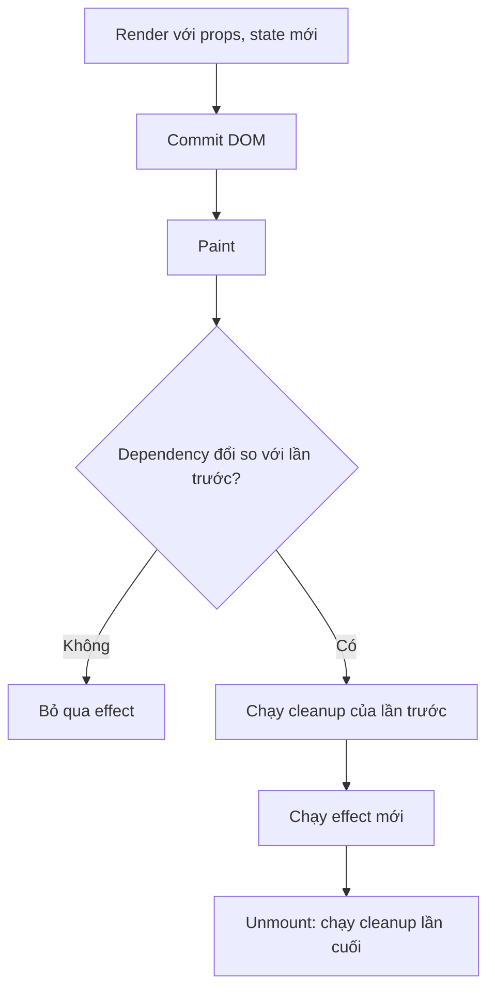
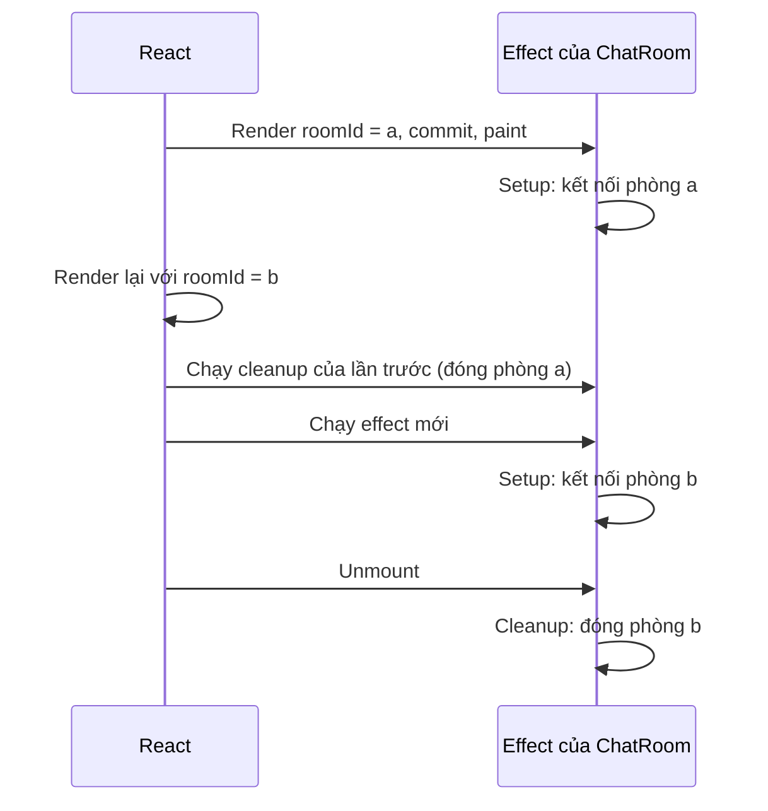

# Lý thuyết 2: Hooks cơ bản

Bài này đào sâu `useState`, `useEffect`, `useRef` ở mức cơ chế. Cần nắm [Bài 1](/go?p=09-React%2Feasy%2Flt-01-tu-duy-react-render.md) trước (state là snapshot).

## Hooks là gì và vì sao có chúng?

Function component chỉ là một hàm được gọi lại mỗi lần render, nên bản thân nó không nhớ được gì giữa hai lần gọi. **Hooks** là các hàm đặc biệt (tên bắt đầu bằng `use`) cho phép component "móc" vào khả năng của React: giữ state qua các lần render (`useState`), sync với hệ thống bên ngoài như mạng, timer, DOM (`useEffect`), và giữ một giá trị bền vững mà không kích hoạt render (`useRef`). Ẩn dụ: component là một nhân viên đổi ca liên tục, còn hooks là cuốn sổ giao ca mà React giữ giùm để ca sau đọc lại được.

Bạn dùng hooks trong mọi component có tương tác hoặc tích hợp bên ngoài: gọi API, timer, subscription, thao tác DOM. Phần lớn bug thực tế xoay quanh bốn lỗi: stale closure, dependency sai, dùng effect sai mục đích (sync state với state), và dùng ref thay cho state. Vì vậy ba nguyên tắc nên nhớ: dùng updater khi state mới phụ thuộc state cũ; coi effect là cơ chế **sync với hệ thống ngoài** (khai báo đủ dependency, luôn viết cleanup); và ưu tiên tính toán ngay trong render thay vì dùng effect.

## Các khái niệm cần biết

- **Updater function**: hàm `prev => next` truyền vào `setState`. React gọi nó với giá trị mới nhất trong queue, nên an toàn khi gọi nhiều lần liên tiếp hoặc trong callback async.
- **Lazy initializer**: truyền một hàm vào `useState(() => ...)` để React chỉ chạy nó ở lần mount đầu tiên. Dùng khi khởi tạo tốn kém.
- **Dependency array**: mảng giá trị mà effect phụ thuộc. React so sánh từng phần tử bằng `Object.is` giữa hai lần render; không đổi thì bỏ qua effect.
- **Cleanup**: hàm effect trả về, dùng để hoàn tác việc effect đã làm (đóng kết nối, gỡ listener, hủy timer). Quên cleanup gây rò rỉ và race condition.
- **Closure và stale closure**: hàm "nhớ" biến ở nơi nó được tạo. Stale closure là khi hàm nhớ giá trị của một render cũ, nên đọc ra dữ liệu lỗi thời.
- **Race condition**: hai thao tác async kết thúc sai thứ tự ngoài ý muốn, ví dụ response của request cũ đến muộn và ghi đè kết quả mới.
- **Ref**: object `{ current }` không đổi danh tính qua các lần render và đổi giá trị không gây render.
- **`AbortController`**: API trình duyệt để hủy một `fetch` đang chạy.

**Tóm tắt:**

- Hooks cho function component khả năng giữ state và sync với hệ thống ngoài; chúng được nhận diện bằng thứ tự gọi.
- `useState(init)` chỉ dùng `init` ở lần mount; muốn lazy phải truyền hàm, và dùng updater khi giá trị mới phụ thuộc giá trị cũ.
- Effect là cơ chế sync component với hệ thống ngoài React, không phải chỗ để suy ra state.
- Dependency array quyết định khi nào effect chạy lại, và cleanup chạy trước effect kế tiếp hoặc khi unmount, dùng giá trị của render cũ.
- Closure chụp giá trị của render sinh ra nó, nên effect `[]` mãi thấy giá trị cũ; đó là gốc của stale closure.
- Fetch trong effect phải có cleanup (cờ `ignore` hoặc `AbortController`) để tránh race condition.
- `useRef` giữ giá trị ổn định qua các lần render mà không gây render; UI cần cập nhật thì dùng state.

## useState

```tsx
const [count, setCount] = useState(0);
// lazy init: chỉ chạy lần mount
const [data, setData] = useState(() => expensiveInit());
// updater: dựa vào state mới nhất trong queue
setCount(c => c + 1);
```

| Dạng | Khi dùng |
|---|---|
| `setX(value)` | Giá trị mới không phụ thuộc giá trị cũ |
| `setX(prev => ...)` | Phụ thuộc giá trị cũ, hoặc gọi nhiều lần liên tiếp, hoặc trong callback async |
| `useState(() => init())` | Khởi tạo tốn kém (parse localStorage, tính toán lớn) |

Cách đọc bảng: nếu giá trị mới là hằng số (như `setOpen(false)`) thì truyền thẳng; nếu nó được tính từ giá trị cũ (`count + 1`, thêm phần tử vào mảng) thì dùng updater để không dính snapshot cũ.

Lưu ý: `useState(expensive())` vẫn gọi `expensive()` ở **mọi** lần render (chỉ bỏ kết quả). Truyền hàm để lazy. Updater và initializer phải thuần. Nếu set đúng giá trị hiện tại (`Object.is`), React có thể bỏ qua render con nhưng đôi khi vẫn gọi lại component đó một lần nữa.

**Phải thuộc:** `useState(init)` chỉ dùng `init` ở lần mount, nhưng nếu `init` là biểu thức gọi hàm thì hàm vẫn chạy mỗi render; muốn lazy phải truyền hàm `useState(() => init())`. Dùng `setX(prev => ...)` khi giá trị mới phụ thuộc giá trị cũ.

## Lifecycle effect



Cách nghĩ đúng: mỗi lần render có **effect riêng** nhìn thấy props và state của chính render đó. Không phải "componentDidUpdate". Câu hỏi nên đặt là "effect này sync với cái gì, và cần chạy lại khi giá trị nào đổi?", không phải "chạy khi nào".

**Nền tảng:** Effect là cơ chế sync component với một hệ thống bên ngoài React (mạng, DOM API ngoài, timer, subscription), không phải chỗ để suy ra state. Mỗi lần render có một effect riêng nhìn thấy props và state của chính lần render đó, và mỗi effect cần một cleanup đối xứng với setup.

| Dependency | Hành vi |
|---|---|
| Không truyền | Chạy sau mỗi render |
| `[]` | Chạy sau mount, cleanup khi unmount |
| `[a, b]` | Chạy khi `a` hoặc `b` đổi (so `Object.is`) |

Cleanup chạy **trước** lần chạy effect kế tiếp (với giá trị cũ) và khi unmount.

**Phải thuộc:** Dependency array: không truyền thì chạy sau mỗi render; `[]` thì chạy sau mount và cleanup khi unmount; `[a, b]` thì chạy lại khi `a` hoặc `b` đổi theo `Object.is`. Cleanup chạy trước lần effect kế tiếp và khi unmount, dùng giá trị của render cũ.

Hãy xem chuyện gì xảy ra theo thời gian khi `roomId` đổi từ `"a"` sang `"b"` trong ví dụ `ChatRoom` bên dưới.



Đọc sơ đồ: cleanup luôn "dọn" đúng thứ mà effect cùng render đã dựng lên, rồi mới đến setup mới. Nhờ vậy không bao giờ có hai kết nối chồng nhau. Khi nào dùng `[]`: khi effect thật sự không phụ thuộc giá trị nào của component. Khi nào không: nếu effect đọc props hoặc state mà bạn vẫn để `[]`, bạn sẽ gặp stale closure ở mục tiếp theo.

```tsx
function ChatRoom({ roomId }: { roomId: string }) {
  useEffect(() => {
    const conn = createConnection(roomId);
    conn.connect();
    return () => conn.disconnect(); // cleanup: đóng đúng kết nối của roomId này
  }, [roomId]);
  return null;
}
```

## Stale closure

Hàm được tạo trong một render "đóng" (capture) giá trị của render đó. Nếu effect dùng giá trị mà không liệt kê trong dependency thì nó đọc giá trị cũ.

**Nền tảng:** Closure chụp giá trị của render sinh ra nó, nên hàm trong effect `[]` mãi thấy props và state của lần render đầu. Đây là gốc của stale closure và là lý do dependency array phải liệt kê đủ giá trị effect dùng.

```tsx
function Timer() {
  const [n, setN] = useState(0);
  useEffect(() => {
    const id = setInterval(() => setN(n + 1), 1000); // n bị kẹt ở 0, luôn set thành 1
    return () => clearInterval(id);
  }, []); // thiếu n
  return <p>{n}</p>;
}
```

Ba cách sửa, theo thứ tự ưu tiên:

1. Dùng updater để khỏi cần đọc `n`: `setN(c => c + 1)`, giữ `[]`.
2. Thêm `n` vào dependency (interval dựng lại mỗi giây, đúng nhưng tốn).
3. Với callback cần giá trị mới nhất mà không muốn chạy lại effect: `useEffectEvent` (React 19.2, tra react.dev để xác nhận phiên bản bạn dùng) hoặc ref giữ giá trị mới nhất.

```tsx
// Mẫu "latest ref" dùng được ở 18 và 19
const latest = useRef(onTick);
useEffect(() => { latest.current = onTick; });          // cập nhật sau mỗi render
useEffect(() => {
  const id = setInterval(() => latest.current(), 1000);  // đọc giá trị mới nhất
  return () => clearInterval(id);
}, []);
```

Quy tắc: **đừng tắt lint `react-hooks/exhaustive-deps`**. Khi lint kêu, thường thiết kế đang sai; hãy đổi cách viết (updater, dời hàm vào trong effect, tách effect).

Object và hàm tạo trong render là tham chiếu mới mỗi lần, đưa vào dependency làm effect chạy mỗi render. Giải pháp: dời vào trong effect, hoặc phụ thuộc vào giá trị nguyên thủy.

## You might not need an effect

Effect dành cho sync với **hệ thống bên ngoài React**: mạng, DOM API ngoài, widget bên thứ ba, subscription, timer. Không dùng để biến đổi dữ liệu nội bộ.

| Việc cần làm | Sai (effect) | Đúng |
|---|---|---|
| Dữ liệu suy ra từ props/state | `useEffect(() => setFull(first+last))` | Tính trực tiếp trong render: `const full = first + " " + last` |
| Phép tính nặng | Effect rồi set state | `useMemo` (xem [Memo hóa](/go?p=09-React%2Fmedium%2Flt-32-memo-hoa.md)) |
| Reset state khi prop đổi | Effect gọi `setX(initial)` | Đổi `key` của component |
| Phản ứng với thao tác người dùng | Effect theo dõi state | Làm trong event handler |
| Gửi POST khi bấm nút | Effect | Event handler |
| Báo cha khi state con đổi | Effect gọi `onChange` | Gọi `onChange` trong cùng handler |
| Lấy dữ liệu | Effect thô | Thư viện (TanStack Query), loader, hoặc framework (xem [Bài 6](/go?p=09-React%2Fmedium%2Flt-06-routing-forms-data.md)) |
| Đăng ký store ngoài | Effect + state | `useSyncExternalStore` (xem [Bài 8](/go?p=09-React%2Fhard%2Flt-08-fiber-concurrent.md)) |

Effect sai mục đích gây render dư (render, effect, set state, render lại) và dễ lặp vô hạn.

```tsx
// Sai: render hai lần cho mỗi lần đổi
const [visible, setVisible] = useState<Todo[]>([]);
useEffect(() => setVisible(todos.filter(t => !t.done)), [todos]);

// Đúng
const visible = todos.filter(t => !t.done);
```

## Fetch trong effect: cần cleanup

```tsx
useEffect(() => {
  const ctrl = new AbortController();
  fetch(`/api/users/${id}`, { signal: ctrl.signal })
    .then(r => r.json())
    .then(setUser)
    .catch(e => { if (e.name !== "AbortError") setError(e); });
  return () => ctrl.abort(); // tránh response cũ ghi đè response mới (race condition)
}, [id]);
```

Thiếu cleanup thì khi `id` đổi nhanh, response chậm của `id` cũ có thể đến sau và ghi đè, hiện tượng là màn hình hiển thị dữ liệu của người dùng trước dù bạn đã chọn người khác. Khi nào dùng cách này: ví dụ nhỏ, không có thư viện dữ liệu. Khi nào không: ứng dụng có nhiều request cần cache, retry, dedupe thì nên dùng TanStack Query hoặc loader của framework.

## useRef

`useRef(initial)` trả về object `{ current }` **giữ nguyên qua các lần render**. Gán `ref.current` không kích hoạt render.

| | `useState` | `useRef` |
|---|---|---|
| Đổi giá trị gây render | Có | Không |
| Đọc/ghi trong render | Đọc được | Không nên (làm render không thuần), chỉ trong handler/effect |
| Dùng cho | Dữ liệu hiển thị | DOM node, timer id, giá trị trước, cờ "đã mount", instance bên ngoài |

**Phải thuộc:** `useRef` trả về object `{ current }` ổn định qua các lần render; đổi `ref.current` không gây render. Cần UI cập nhật thì dùng state, giá trị không hiển thị (DOM node, timer id, giá trị trước) thì dùng ref; chỉ đọc, ghi ref trong handler hoặc effect, không trong render.

```tsx
function Search() {
  const inputRef = useRef<HTMLInputElement>(null);
  return (
    <>
      <input ref={inputRef} />
      <button onClick={() => inputRef.current?.focus()}>Focus</button>
    </>
  );
}
```

Ref là prop (React 19): function component nhận `ref` như prop thường, không cần `forwardRef`.

```tsx
// React 19
function MyInput({ ref, ...props }: React.ComponentProps<"input">) {
  return <input ref={ref} {...props} />;
}
// React 18 cần forwardRef(function MyInput(props, ref) {...})
```

React 19 cũng cho callback ref trả về hàm cleanup. `forwardRef` sẽ bị deprecated trong tương lai.

## Quy tắc hooks (tóm tắt)

Chỉ gọi hooks ở top-level của component hoặc custom hook, không trong điều kiện, vòng lặp, hàm lồng. Lý do (React nhớ hooks theo thứ tự gọi) giải thích ở [Hooks Best Practices](/go?p=09-React%2Fmedium%2Flt-35-hooks-best-practices.md).

## Bẫy thường gặp

| Bẫy | Hậu quả | Cách sửa |
|---|---|---|
| Thiếu dependency, tắt lint | Stale closure | Updater, dời logic vào effect, `useEffectEvent`/ref |
| Không có cleanup | Rò rỉ listener, race, kết nối thừa | Luôn trả về cleanup khi có subscribe |
| Effect để suy ra state | Render dư, dễ lặp vô hạn | Tính trong render |
| Object/hàm trong dependency | Effect chạy mỗi render | Dời vào trong effect hoặc dùng nguyên thủy |
| `useState(expensive())` | Chạy mỗi render | `useState(() => expensive())` |
| Đọc `ref.current` trong render | Không thuần, giá trị lệch | Chỉ đọc/ghi trong handler, effect |
| `async` trực tiếp ở effect | Effect phải trả về cleanup hoặc undefined | Hàm async bên trong rồi gọi |
| Mong effect chạy một lần ở dev | StrictMode chạy hai vòng setup/cleanup | Viết cleanup đúng |

## Câu hỏi phỏng vấn thường gặp

Mỗi câu theo chuỗi: câu hỏi, gợi ý suy luận, lập luận, đáp án ngắn, kiến thức cần nhớ. Hãy tự trả lời trước khi đọc tiếp.

### 1. Khi nào bắt buộc dùng updater function trong `setState`?

**Gợi ý suy luận:**
- State trong closure của một render là giá trị của thời điểm nào?
- Nếu hàm chạy muộn (timeout, async) thì giá trị đó còn mới không?
- Updater nhận gì làm tham số?

**Lập luận:** Closure giữ giá trị state của lần render tạo ra nó. Khi hàm chạy muộn, giá trị đó có thể đã cũ. Updater function nhận giá trị mới nhất trong queue, nên không bị lệch. Vì vậy dùng khi giá trị mới phụ thuộc giá trị cũ, hoặc gọi trong closure có thể cũ.

**Đáp án ngắn:** Khi giá trị mới phụ thuộc giá trị cũ hoặc gọi trong closure có thể cũ (timeout, async).

**Nhớ:** `setX(prev => ...)` an toàn với closure cũ.

### 2. Stale closure là gì? Cho ví dụ và cách sửa.

**Gợi ý suy luận:**
- Mỗi lần render tạo hàm mới, hàm đó "chụp" biến nào?
- Effect với dependency array `[]` chạy mấy lần, nên giữ hàm của render nào?
- Có những cách nào để hàm đọc được giá trị mới?

**Lập luận:** Hàm bắt giá trị của render sinh ra nó. Ví dụ `setInterval(() => console.log(n), 1000)` trong effect `[]`: effect chỉ chạy lần đầu nên hàm mãi thấy `n` ban đầu. Sửa bằng cách khiến hàm không phụ thuộc giá trị cũ (updater), khai báo dependency để effect dựng lại, hoặc đọc qua ref/`useEffectEvent`.

**Đáp án ngắn:** Hàm capture giá trị của render cũ. Ví dụ interval dùng `n` với `[]`. Sửa bằng updater, thêm dependency, hoặc ref/useEffectEvent.

**Nhớ:** mỗi render có "phiên bản" giá trị riêng.

### 3. Hàm cleanup của `useEffect` chạy khi nào và dùng giá trị của render nào?

**Gợi ý suy luận:**
- Effect của lần render trước đăng ký thứ gì (listener, timer)? Khi effect mới sắp chạy, thứ cũ cần xử lý ra sao?
- Cleanup là hàm của render nào?

**Lập luận:** Mỗi lần effect chạy có thể đăng ký tài nguyên. Trước khi chạy lại với dependency mới thì phải gỡ cái cũ, và khi unmount cũng gỡ. Cleanup là closure tạo cùng effect đó nên dùng giá trị của render cũ, đúng cái nó đã đăng ký.

**Đáp án ngắn:** Trước lần chạy effect kế tiếp (do dependency đổi) và khi unmount, dùng giá trị của render cũ.

**Nhớ:** cleanup đối xứng với setup.

### 4. Khi nào KHÔNG nên dùng effect?

**Gợi ý suy luận:**
- Effect dành cho việc sync với hệ thống bên ngoài React: dữ liệu tính được từ props/state có phải vậy không?
- Nếu dùng effect để set state suy ra thì có thêm render nào?
- Event người dùng có handler riêng chưa?

**Lập luận:** Dữ liệu suy ra tính ngay trong render, không cần effect (effect còn thêm một lượt render). Reset state theo prop dùng `key`. Việc do người dùng kích hoạt đặt trong event handler. Effect chỉ cho sync với thế giới ngoài (mạng, DOM API, timer).

**Đáp án ngắn:** Tính dữ liệu suy ra, reset state theo prop, xử lý event người dùng; dùng render, key, handler.

**Nhớ:** effect = sync với bên ngoài. Xem phần "You might not need an effect".

### 5. `useRef` khác `useState` thế nào và dùng khi nào?

**Gợi ý suy luận:**
- Đổi giá trị ref có gây render không? Vì sao điều đó hữu ích cho timer id, DOM?
- Giá trị nào cần xuất hiện trên màn hình?

**Lập luận:** Ref là hộp có thể sửa (`.current`) mà không kích hoạt render, và tồn tại xuyên suốt các render. Phù hợp giá trị không hiển thị: node DOM, timer id, giá trị lần trước. Dữ liệu hiển thị lại phải đi qua state để UI cập nhật.

**Đáp án ngắn:** Ref không gây render, mutable, dùng cho DOM, timer id, giá trị trước. State dùng cho dữ liệu hiển thị.

**Nhớ:** thay đổi cần UI cập nhật thì state, không thì ref. Xem phần "useRef".

### 6. Vì sao ở dev effect chạy hai lần?

**Gợi ý suy luận:**
- Component có thể bị gỡ rồi gắn lại trong thực tế: effect của bạn có chịu được không?
- StrictMode kiểm tra điều đó bằng cách nào?

**Lập luận:** StrictMode mô phỏng chu kỳ mount, unmount, mount ngay lúc dev để lộ effect thiếu cleanup hoặc không idempotent. Đó là kiểm tra, không phải bug. Ở production không có.

**Đáp án ngắn:** StrictMode mô phỏng unmount rồi mount lại để kiểm tra cleanup; production không.

**Nhớ:** nếu hai lần gây lỗi thì thiếu cleanup.

### 7. Làm sao tránh race condition khi fetch trong effect?

**Gợi ý suy luận:**
- Gõ nhanh `a`, rồi `ab`: hai request có chắc về đúng thứ tự không?
- Nếu response cũ về sau thì state bị ghi đè bởi dữ liệu nào?
- Cleanup có thể làm gì với request cũ?

**Lập luận:** Response có thể về không đúng thứ tự, nên dữ liệu cũ ghi đè dữ liệu mới. Cleanup chạy trước effect kế, nên ở đó hủy request (`AbortController`) hoặc đặt cờ `ignore = true` để bỏ qua kết quả cũ. Thực tế nên dùng thư viện như TanStack Query để khỏi tự xử lý.

**Đáp án ngắn:** `AbortController` hoặc cờ `ignore` trong cleanup; tốt hơn là TanStack Query.

**Nhớ:** cleanup là chỗ hủy việc của render cũ. Xem phần "Fetch trong effect: cần cleanup".

### 8. Ở React 19 `ref` thay đổi gì?

**Gợi ý suy luận:**
- Trước đây truyền ref qua component cần bọc gì (`forwardRef`)? Nay `ref` là gì với function component?
- Callback ref khi gỡ khỏi DOM có thể làm gì?

**Lập luận:** React 19 cho `ref` là prop thông thường của function component, nên không cần `forwardRef` để chuyền ref xuống. Callback ref có thể trả về hàm cleanup, đối xứng với effect.

**Đáp án ngắn:** `ref` là prop thông thường cho function component, callback ref có thể trả cleanup, `forwardRef` không còn cần thiết.

**Nhớ:** React 19 đơn giản hóa ref, API cũ vẫn chạy.

Tiếp theo: [Props vs State](/go?p=09-React%2Feasy%2Flt-24-props-vs-state.md).

