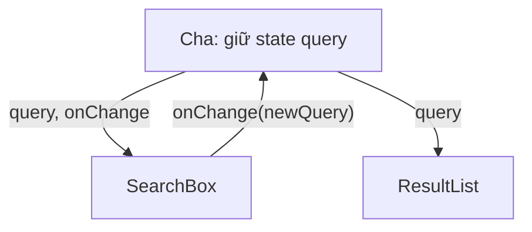
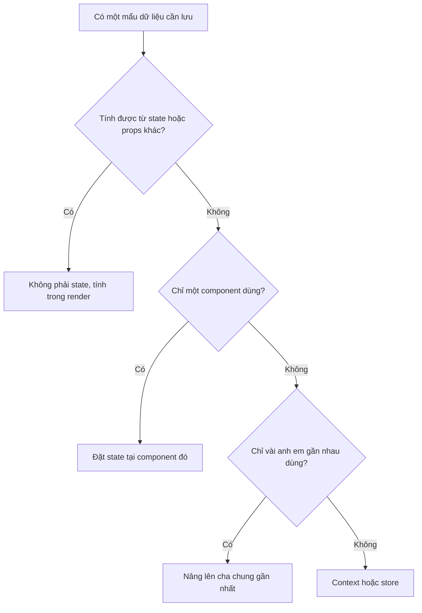

# Lý thuyết 25: Composition

Bài này nói về cách chia và ghép component bằng props, `children` và vị trí đặt state. Cần nắm [Bài 1](/go?p=09-React%2Feasy%2Flt-01-tu-duy-react-render.md), [Bài 2](/go?p=09-React%2Feasy%2Flt-02-hooks-co-ban.md) và [Props vs State](/go?p=09-React%2Feasy%2Flt-24-props-vs-state.md).

## Composition là gì?

Composition nghĩa là xây một component phức tạp bằng cách ghép nhiều component đơn giản lại, truyền nội dung vào qua props và `children`, thay vì dùng inheritance như trong OOP truyền thống. Giống xếp LEGO: mỗi mảnh nhỏ làm một việc, bạn ghép chúng thành thứ lớn hơn mà không cần "đẻ" một mảnh mới từ mảnh cũ.

## Vấn đề nó giải quyết

Component được tách tốt thì dễ test, ít re-render và dùng lại được. Tách sai thì xuất hiện ba triệu chứng quen thuộc: **prop drilling** (phải chuyền props qua nhiều tầng trung gian chỉ để tới một con sâu bên dưới), state đặt sai tầng (gõ một ký tự mà cả trang render lại), và API component khó dùng (một component với mười boolean prop).

**Tóm tắt:**

- Composition thay cho inheritance: component phức tạp được ghép từ component nhỏ qua props, `children` và slot.
- Truyền JSX qua `children` tránh render thừa vì element giữ nguyên tham chiếu khi component bọc ngoài render lại.
- Đặt state ở mức thấp nhất vẫn đủ cho mọi nơi dùng, nâng lên cha chung gần nhất khi cần chia sẻ (lifting state up), hoặc đẩy xuống khi chỉ một nhánh dùng (colocation).
- Quy tắc nhớ: thêm boolean prop thứ năm (`isPrimary`, `isLarge`...) là tín hiệu nên tách component hoặc dùng slot thay vì cộng thêm cờ.
- Context giải quyết khi dữ liệu cần lan rộng tới nhiều nhánh xa nhau, khác với lifting state up chỉ hợp vài anh em gần nhau — xem [State management](/go?p=09-React%2Fmedium%2Flt-05-state-management.md).

## Props và children

Props là input chỉ đọc. Không sửa props. `children` là prop đặc biệt chứa JSX lồng bên trong.

```tsx
type CardProps = {
  title: string;
  actions?: React.ReactNode; // slot: truyền JSX qua prop
  children: React.ReactNode;
};
function Card({ title, actions, children }: CardProps) {
  return (
    <section>
      <header><h2>{title}</h2>{actions}</header>
      {children}
    </section>
  );
}
```

Vấn đề đặt ra là làm sao để một component bao ngoài (như `Card`) dùng được với nội dung bất kỳ mà không phải biết trước nội dung đó. Cách giải quyết là để nội dung do bên ngoài tạo và "nhét" vào qua `children` hoặc một slot prop.

Hiệu ứng hiệu năng quan trọng: JSX truyền qua `children` được **tạo bởi cha của Card**. Khi state bên trong `Card` đổi, `children` vẫn là cùng tham chiếu element nên React bỏ qua render lại các con đó.

**Nền tảng:** Composition thay cho inheritance: component phức tạp được ghép từ component nhỏ qua props, `children` và slot. Element do component nào tạo ra thì giữ nguyên tham chiếu khi component bọc ngoài render lại, nhờ vậy truyền nội dung qua `children` vừa linh hoạt vừa tránh render thừa.

```tsx
function Layout({ children }: { children: React.ReactNode }) {
  const [open, setOpen] = useState(false);   // state đổi chỉ render lại Layout
  // children không render lại
  return <div className={open ? "open" : ""}>{children}</div>;
}
```

## Composition thay vì inheritance

React không khuyến nghị inheritance giữa component. Biến thể được diễn đạt bằng props và ghép nối.

```tsx
function Dialog({ title, children }: { title: string; children: React.ReactNode }) {
  return <div role="dialog" aria-label={title}>{children}</div>;
}
// "Biến thể" là một component khác bọc Dialog, không phải subclass
function ConfirmDialog({ onOk }: { onOk: () => void }) {
  return <Dialog title="Xác nhận"><button onClick={onOk}>OK</button></Dialog>;
}
```

Quy tắc nhớ: nếu bạn đang thêm boolean prop thứ năm (`isPrimary`, `isLarge`, `withIcon`, ...), hãy cân nhắc tách component hoặc dùng slot.

## Lifting state up và colocation

Hai component anh em cần cùng dữ liệu thì đưa state lên cha chung gần nhất, truyền xuống qua props, kèm callback để con yêu cầu đổi.



Ngược lại cũng đúng: **đẩy state xuống** (colocation). State chỉ một nhánh dùng thì đặt ở nhánh đó, để khi nó đổi các nhánh khác không render lại. Đây thường là tối ưu hiệu năng rẻ nhất.

Khi nào nâng lên: hai anh em phải luôn hiển thị cùng một dữ liệu (ô tìm kiếm và danh sách kết quả). Khi nào không: chỉ một nhánh dùng; nâng lên chỉ khiến cha và mọi con của nó render lại mỗi lần state đổi.

**Phải thuộc:** Đặt state ở mức thấp nhất vẫn đủ cho mọi nơi dùng: một component dùng thì đặt tại đó, các anh em dùng chung thì nâng lên cha chung gần nhất, nhiều nhánh xa nhau thì mới dùng Context hoặc store. Dữ liệu tính được từ state hoặc props khác thì không phải state.

Chuỗi cân nhắc khi nơi đặt state không rõ, có thể đọc như sơ đồ quyết định sau:



Cùng nội dung dưới dạng danh sách:

1. Có thể tính từ state/props khác? Thì không phải state.
2. Chỉ một component dùng? Đặt tại đó.
3. Hai anh em dùng? Nâng lên cha chung.
4. Nhiều tầng, nhiều nhánh xa nhau? Context hoặc store (xem [Bài 5](/go?p=09-React%2Fmedium%2Flt-05-state-management.md)).

Dữ liệu cần ở rất nhiều nơi (theme, người dùng hiện tại) mà chuyền qua từng tầng props quá rườm rà thì dùng Context — kênh truyền giá trị xuống cây mà không qua từng tầng props, Provider đặt giá trị và bất kỳ component con nào cũng đọc được bằng `useContext`. Cơ chế re-render, cách tránh render thừa khi dùng Context, và so sánh với Zustand/Redux đọc tiếp ở [Bài 5: State management](/go?p=09-React%2Fmedium%2Flt-05-state-management.md).

## Bẫy thường gặp

| Bẫy | Hậu quả | Cách sửa |
|---|---|---|
| Prop drilling nhiều tầng cho dữ liệu toàn cục | Code khó đổi | Context hoặc store; hoặc truyền JSX qua `children` thay vì dữ liệu |
| Lift state quá cao | Mỗi lần gõ render cả trang | Colocate, tách component |
| Quá nhiều boolean prop | API khó dùng, tổ hợp vô nghĩa | Tách component hoặc slot |

## Câu hỏi phỏng vấn thường gặp

Mỗi câu theo chuỗi: câu hỏi, gợi ý suy luận, lập luận, đáp án ngắn, kiến thức cần nhớ. Hãy tự trả lời trước khi đọc tiếp.

### 1. Vì sao truyền JSX qua `children` giúp tránh re-render không cần thiết?

**Gợi ý suy luận:**
- Ai tạo ra element `children`: wrapper hay component cha của wrapper?
- Wrapper có state nội bộ đổi và render lại: element do cha tạo có được tạo lại không?
- React có render lại con khi element nhận vào là cùng một tham chiếu không?

**Lập luận:** `children` là element được tạo ở component cha. Khi state nội bộ của wrapper đổi, chỉ wrapper chạy lại, còn cha không render nên element `children` vẫn là cùng một tham chiếu. React thấy element y nguyên nên bỏ qua việc render lại phần con đó.

**Đáp án ngắn:** Element do cha tạo ra nên giữ nguyên tham chiếu khi state nội bộ của wrapper đổi.

**Nhớ:** đẩy state xuống hoặc đưa nội dung qua children để thu hẹp phạm vi render.

### 2. Khi nào lift state up, khi nào đẩy state xuống?

**Gợi ý suy luận:**
- Hai component anh em cần cùng một dữ liệu thì dữ liệu đó phải nằm ở đâu?
- Nếu chỉ một nhánh dùng state mà để ở trên cao thì những ai bị render theo?

**Lập luận:** Dữ liệu chung cần nằm ở tổ tiên gần nhất của những nơi dùng nó, nên nâng lên khi nhiều anh em cần. Ngược lại, state đặt cao hơn mức cần thiết làm cả nhánh render lại khi nó đổi, nên đẩy xuống khi chỉ một nhánh dùng.

**Đáp án ngắn:** Nâng khi nhiều anh em cần chung; đẩy xuống khi chỉ một nhánh dùng để giảm re-render.

**Nhớ:** đặt state ở mức thấp nhất đủ dùng. Xem phần "Lifting state up và colocation".

Tiếp theo: [Bài 26: Compound Components](/go?p=09-React%2Feasy%2Flt-26-compound-components.md).
