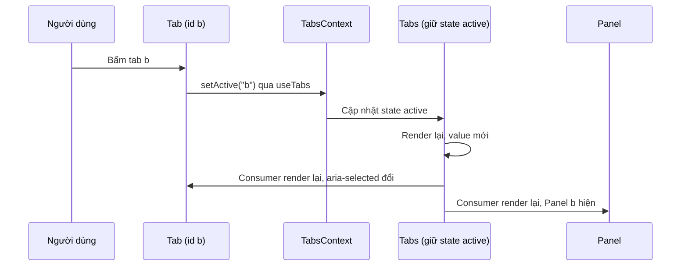

# Lý thuyết 26: Compound Components

Bài này cần nắm [Composition](/go?p=09-React%2Feasy%2Flt-25-composition.md) (đặc biệt phần Context) trước.

## Compound components là gì?

Một nhóm component chia sẻ state ngầm qua Context, người dùng ghép theo kiểu khai báo (như `<select>` và `<option>` trong HTML thuần — `<option>` không cần nhận props nào về việc "ai đang được chọn", nó tự biết nhờ nằm trong đúng `<select>` cha).

**Tóm tắt:**

- Compound components là một nhóm component chia sẻ state ngầm qua Context, người dùng tự ghép theo kiểu khai báo mà không cần nối dây thủ công.
- Component cha (`Tabs`) giữ state và cung cấp qua Context; các con (`Tab`, `Panel`) tự đọc ra bằng một custom hook riêng (`useTabs`).
- Ưu điểm: API linh hoạt, người dùng tự sắp xếp layout, không cần truyền cờ qua nhiều tầng props.
- Nhược điểm: cấu trúc ngầm định (con phải nằm trong đúng cha), cần báo lỗi rõ ràng khi dùng sai chỗ thay vì âm thầm trả `undefined`.
- Phù hợp cho bộ component nhiều phần phối hợp (Tabs, Accordion, Menu, Select); không hợp cho component đơn giản chỉ có một hai tùy chọn, vì prop thường rõ ràng hơn.

```tsx
type TabsCtx = { active: string; setActive: (id: string) => void };
const TabsContext = createContext<TabsCtx | null>(null);
const useTabs = () => {
  const c = useContext(TabsContext);
  if (!c) throw new Error("Phải nằm trong <Tabs>");
  return c;
};

function Tabs({ defaultId, children }: { defaultId: string; children: React.ReactNode }) {
  const [active, setActive] = useState(defaultId);
  const value = useMemo(() => ({ active, setActive }), [active]);
  return <TabsContext value={value}>{children}</TabsContext>;
}
function Tab({ id, children }: { id: string; children: React.ReactNode }) {
  const { active, setActive } = useTabs();
  return <button aria-selected={active === id} onClick={() => setActive(id)}>{children}</button>;
}
function Panel({ id, children }: { id: string; children: React.ReactNode }) {
  return useTabs().active === id ? <div role="tabpanel">{children}</div> : null;
}
Tabs.Tab = Tab;
Tabs.Panel = Panel;

// Dùng: <Tabs defaultId="a"><Tabs.Tab id="a">A</Tabs.Tab><Tabs.Panel id="a">...</Tabs.Panel></Tabs>
```

Ưu: API linh hoạt, người dùng tự sắp xếp layout, không cần truyền cờ. Nhược: ngầm định cấu trúc, cần kiểm tra lỗi khi dùng ngoài cha.

Data flow của ví dụ trên như sau: `Tabs` giữ state, đưa xuống qua Context, và các `Tab`, `Panel` con tự đọc ra mà không cần ai truyền props.



**Phải thuộc:** Compound components chia sẻ state ngầm qua Context, đánh đổi giữa API gọn và độ ngầm. Mẫu thường có một custom hook riêng (`useTabs`) ném lỗi rõ ràng khi được gọi ngoài component cha, thay vì âm thầm trả về `undefined` rồi crash ở chỗ khó hiểu hơn.

Khi nào dùng compound components: bộ component có nhiều phần phối hợp (Tabs, Accordion, Menu, Select) và người dùng cần tự bố trí. Khi nào không: component đơn giản chỉ có một hai tùy chọn, vì prop thường rõ ràng hơn.

## Bẫy thường gặp

| Bẫy | Hậu quả | Cách sửa |
|---|---|---|
| Quên kiểm tra context null trong hook dùng chung (`useTabs`) | Lỗi khó hiểu khi dùng `Tab` ngoài `Tabs` | Ném lỗi rõ ràng ngay trong hook khi context là `null` |
| Truyền object `value` mới mỗi render cho Context | Mọi `Tab`/`Panel` render lại dù không cần | `useMemo` cho value |

## Câu hỏi phỏng vấn thường gặp

Mỗi câu theo chuỗi: câu hỏi, gợi ý suy luận, lập luận, đáp án ngắn, kiến thức cần nhớ. Hãy tự trả lời trước khi đọc tiếp.

### 1. Compound components là gì, đánh đổi ra sao?

**Gợi ý suy luận:**
- Các phần của một widget (Tabs, TabList, TabPanel) cần chia sẻ state chung, truyền bằng cách nào mà người dùng không phải nối dây thủ công?
- Cấu trúc ngầm định nghĩa thế nào khi người dùng sắp xếp sai?

**Lập luận:** Nhóm component chia sẻ state qua Context, người dùng chỉ ghép chúng theo kiểu khai báo (`<Tabs><Tabs.Tab/>...`). API gọn và linh hoạt về bố cục. Đổi lại cấu trúc phải đúng ngầm định (con phải nằm trong cha), nên cần báo lỗi rõ khi dùng sai.

**Đáp án ngắn:** Nhóm component chia sẻ state qua Context cho API khai báo; đổi lại ngầm định cấu trúc.

**Nhớ:** compound = Context + API khai báo.

Tiếp theo: [Bài 27: Render Props](/go?p=09-React%2Feasy%2Flt-27-render-props.md).
