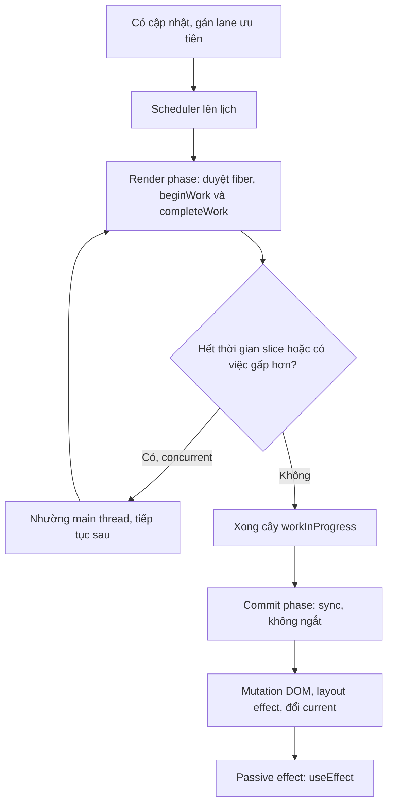
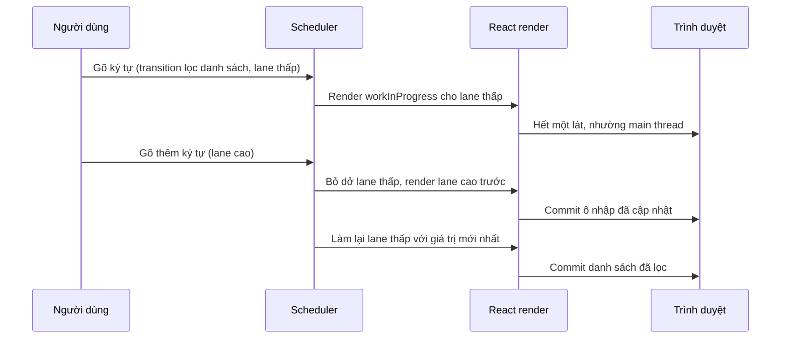
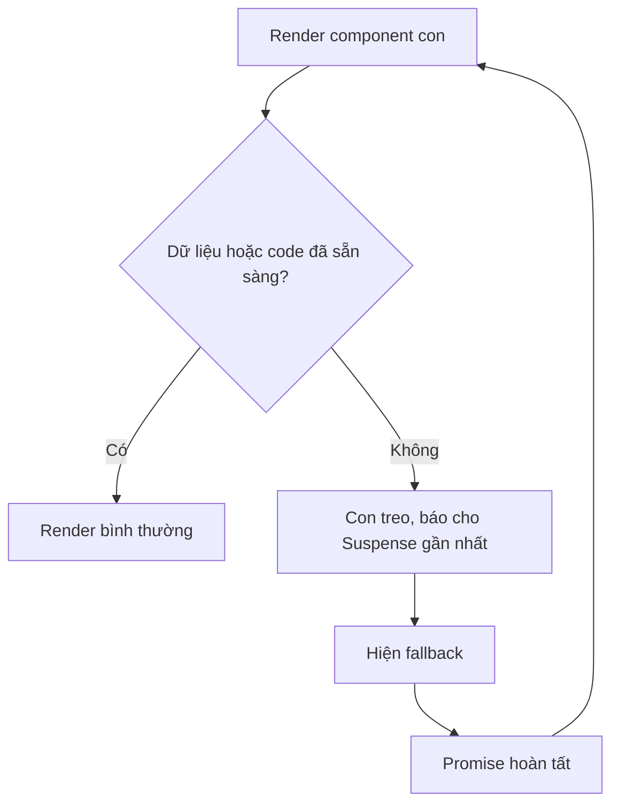
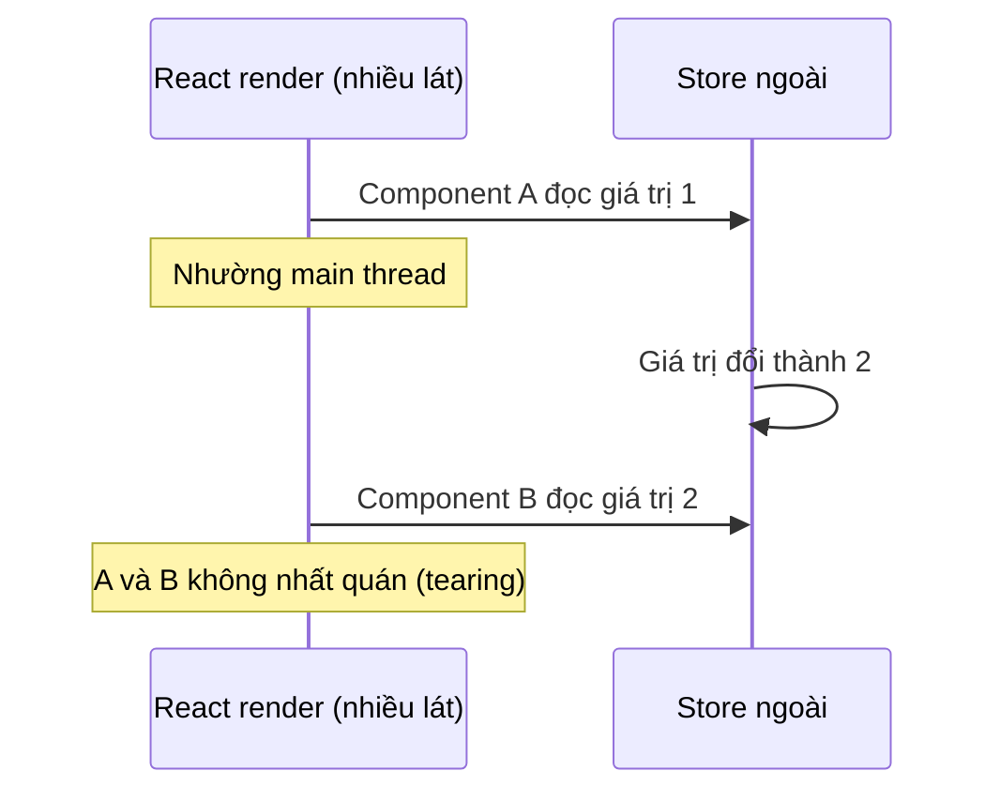

# Lý thuyết 8: Fiber và concurrent rendering

Bài này giải thích kiến trúc bên trong cho phép React 18+ tạm dừng, ưu tiên và hủy render. Cần nắm [Bài 1](/go?p=09-React%2Feasy%2Flt-01-tu-duy-react-render.md) và [Memo hóa](/go?p=09-React%2Fmedium%2Flt-32-memo-hoa.md). Phần mô tả Fiber và lanes ở mức khái niệm; tên hàm và cấu trúc nội bộ thay đổi theo phiên bản, đừng học thuộc.

## Vấn đề: render dài chặn cả trình duyệt

Trình duyệt chỉ có một **main thread** để vừa chạy JavaScript, vừa xử lý click và gõ phím, vừa vẽ màn hình. Bộ reconciler cũ của React (trước Fiber, kiểu React 15) duyệt cây bằng đệ quy và render sync, không dừng được giữa chừng. Với cây lớn, một lần render kéo dài hàng trăm ms và trong thời gian đó ô nhập không nhận phím, UI đứng hình. Ẩn dụ: một đầu bếp nấu xong cả bàn tiệc mới chịu quay ra tiếp khách đang gọi thêm nước.

## Fiber và concurrent rendering là gì?

**Fiber** là cấu trúc dữ liệu và thuật toán render có thể ngắt quãng: React chia việc render thành nhiều đơn vị nhỏ, làm từng chút, và có thể dừng để nhường main thread cho input rồi quay lại làm tiếp. **Concurrent rendering** là khả năng nhờ Fiber: React chuẩn bị nhiều phiên bản UI cùng lúc, ưu tiên cập nhật gấp (gõ phím) hơn cập nhật nặng (lọc danh sách dài). Lưu ý quan trọng: concurrent không làm tổng công việc nhẹ đi, nó chỉ làm UI **phản hồi** tốt hơn.

## Khi nào cần quan tâm, và cần làm gì

Bạn chạm vào chủ đề này khi UI giật lúc gõ hoặc chuyển trang, khi dùng Suspense và transition, hoặc khi dùng store ngoài React. Ba việc cần làm: giữ render thuần (vì nó có thể bị gọi lại hoặc bỏ dở); đánh dấu cập nhật không gấp bằng `useTransition` hoặc `useDeferredValue`; và dùng `useSyncExternalStore` cho store ngoài React. Nếu app của bạn nhỏ và không giật, bạn không cần chủ động dùng transition; React 18+ đã tự chạy bình thường.

## Các khái niệm cần biết

- **Main thread**: thread duy nhất của trình duyệt chạy JS và xử lý input. Chiếm nó quá lâu thì UI đơ.
- **Time slicing**: chia công việc render thành các lát ngắn, sau mỗi lát trả quyền lại cho trình duyệt.
- **Render phase và commit phase**: pha đầu tính cây mới và có thể bị ngắt; pha sau áp lên DOM và không thể ngắt.
- **Lane**: nhãn ưu tiên dạng bitmask gán cho mỗi cập nhật. Cập nhật gấp (click) được xử lý trước cập nhật không gấp (transition).
- **Transition**: cập nhật được đánh dấu là không gấp, có thể bị ngắt hoặc bỏ nếu có cập nhật mới.
- **Suspense và fallback**: ranh giới cho phép phần UI "chờ" dữ liệu hoặc code, trong lúc chờ hiện nội dung tạm (fallback).
- **Tearing**: UI hiển thị không nhất quán vì các phần cùng một lần render đọc giá trị store ngoài khác nhau.
- **Double buffering**: giữ hai cây (đang hiển thị và đang xây) rồi hoán đổi khi xong.

**Tóm tắt:**

- Render kiểu cũ đệ quy trên call stack nên không dừng giữa chừng được, khiến render dài chặn main thread và gây giật input.
- Fiber biến cây component thành cấu trúc liên kết bằng con trỏ, nên React dừng, nhường main thread rồi làm tiếp.
- Hai cây `current` và `workInProgress` (double buffering) cho phép vứt một lần render dở dang mà màn hình không bị ảnh hưởng.
- Render phase chỉ tính toán, có thể bị ngắt hoặc lặp lại nên phải thuần; commit phase sync, không ngắt và là nơi duy nhất chạm DOM.
- Concurrent rendering không làm tổng công việc nhẹ đi, nó chỉ cho phép ưu tiên; `useTransition` và `useDeferredValue` đều chỉ đổi ưu tiên.
- Suspense hiện `fallback` của ranh giới gần nhất, còn lỗi đi lên Error Boundary.
- `useSyncExternalStore` tránh tearing với store ngoài React, và `getSnapshot` phải trả cùng tham chiếu khi store không đổi.

## Fiber là gì

Mỗi component (và DOM node) có một **fiber**: một object trong cây liên kết, lưu type, props, state (danh sách hooks), con trỏ `child`, `sibling`, `return` (cha), và cờ công việc (effect flags). Vì dùng con trỏ thay đệ quy thuần, React có thể **dừng giữa chừng và tiếp tục sau**: duyệt cây như vòng lặp, không phụ thuộc call stack.

Có hai cây fiber (double buffering):

| Cây | Vai trò |
|---|---|
| `current` | Cây đang hiển thị trên màn hình |
| `workInProgress` | Cây đang xây trong lúc render, chưa hiển thị |

Khi render xong và commit, `workInProgress` trở thành `current`. Nếu render bị bỏ dở hoặc bị cập nhật gấp chen vào, React vứt `workInProgress` mà không ảnh hưởng màn hình. Đó là lý do render phải thuần.

**Nền tảng:** Fiber biến cây component thành cấu trúc liên kết bằng con trỏ (`child`, `sibling`, `return`) thay vì đệ quy trên call stack, nên React có thể dừng giữa chừng, nhường main thread rồi làm tiếp. Kết hợp với hai cây `current` và `workInProgress` (double buffering), một lần render dở dang có thể bị vứt mà màn hình không bị ảnh hưởng.

## Work loop và hai pha



| | Render phase | Commit phase |
|---|---|---|
| Có thể ngắt, bỏ, lặp lại | Có (concurrent) | Không |
| Có side effect | Không được | Có (DOM, ref, effect) |
| Được gọi bao nhiêu lần | Có thể nhiều hơn một lần | Một lần |

Vì render có thể chạy nhiều lần hoặc bị bỏ, side effect trong render là bug. Đó là điều StrictMode cố lộ ra.

**Nền tảng:** Hai pha có tính chất khác nhau: render phase chỉ tính toán, có thể bị ngắt, bỏ hoặc lặp lại nên phải thuần; commit phase sync, không ngắt, và là nơi duy nhất chạm DOM, gắn ref, chạy effect. Concurrent rendering không làm tổng công việc nhẹ đi, nó chỉ cho phép ưu tiên để UI phản hồi tốt hơn.

Để thấy sự khác biệt, hãy theo dõi một cập nhật gấp (gõ phím) chen vào lúc React đang render một cập nhật transition.



Đọc sơ đồ: cập nhật gấp luôn được commit trước nên ô nhập mượt; phần nặng bị bỏ dở rồi làm lại với giá trị mới nhất thay vì hiển thị kết quả đã lỗi thời.

## Scheduler và lanes (mức khái niệm)

Scheduler của React chia việc thành các lát (khoảng vài ms theo thiết kế), sau mỗi lát hỏi trình duyệt xem có input cần xử lý không (cơ chế task queue, `MessageChannel`), nếu có thì nhường.

**Lanes** là hệ thống ưu tiên dạng bitmask: mỗi cập nhật được gán một lane, nhiều cập nhật cùng lane được gom batch.

| Loại cập nhật | Mức ưu tiên (khái niệm) |
|---|---|
| Event rời rạc (click, gõ phím) | Cao nhất, sync |
| Event liên tục (scroll, mousemove) | Cao |
| Cập nhật mặc định (setState trong effect, timer) | Thường |
| Transition (`startTransition`) | Thấp, có thể bị ngắt |
| Idle, offscreen | Thấp nhất |

Cập nhật ưu tiên thấp bị cập nhật ưu tiên cao **chen ngang**; khi xong React tiếp tục (hoặc làm lại) phần thấp.

## Concurrent rendering và `createRoot`

Concurrent features chỉ bật khi dùng `createRoot` (React 18+). Ở React 18, `ReactDOM.render` cũ vẫn chạy legacy mode (cảnh báo deprecated); React 19 đã gỡ hẳn `ReactDOM.render`, chỉ còn `createRoot` và `hydrateRoot`. Lưu ý: bản thân concurrent rendering không "nhanh hơn", nó làm UI **phản hồi** tốt hơn bằng cách ưu tiên.

## useTransition

Vấn đề đặt ra: gõ vào ô tìm kiếm thì danh sách nặng bên dưới phải lọc lại, và việc lọc làm ô nhập bị khựng. Cách giải quyết là `useTransition`, đánh dấu một cập nhật state là **không gấp**: React giữ UI cũ phản hồi và render UI mới ở nền. Nó trả về `isPending` để bạn hiển thị state "đang lọc".

```tsx
function Search({ items }: { items: string[] }) {
  const [query, setQuery] = useState("");
  const [filter, setFilter] = useState("");
  const [isPending, startTransition] = useTransition();

  return (
    <>
      <input
        value={query}
        onChange={e => {
          setQuery(e.target.value);                       // gấp: ô nhập luôn mượt
          startTransition(() => setFilter(e.target.value)); // không gấp: lọc nặng
        }}
      />
      {isPending && <span>Đang lọc...</span>}
      <HeavyList items={items} filter={filter} />
    </>
  );
}
```

Chi tiết: trong `startTransition` chỉ các `setState` sync được đánh dấu transition; không điều khiển được input kiểm soát (controlled text) bằng transition vì sẽ trễ ô gõ. Từ React 19, transition chấp nhận hàm **async** (được gọi là Actions), `isPending` kéo dài đến khi xong; cập nhật state sau `await` vẫn cần bọc `startTransition` lại. Transition có thể bị ngắt và bỏ nếu có cập nhật mới.

## useDeferredValue

Dùng khi bạn không sở hữu `setState` (ví dụ giá trị đến từ prop) nhưng vẫn muốn phần nặng "đi chậm" hơn phần gấp. Nó nhận một giá trị và trả về bản **trễ**: lần render đầu dùng giá trị cũ, rồi render nền với giá trị mới.

```tsx
function SearchResults({ query }: { query: string }) {
  // React 19 có tham số thứ hai initialValue
  const deferred = useDeferredValue(query);
  const stale = deferred !== query;
  return (
    <div style={{ opacity: stale ? 0.6 : 1 }}>
      <HeavyList filter={deferred} />          {/* nên bọc memo để bỏ qua render khi deferred chưa đổi */}
    </div>
  );
}
```

| | `useTransition` | `useDeferredValue` |
|---|---|---|
| Kiểm soát | Bạn bọc **setState** | Bạn bọc **giá trị** (khi không sở hữu setState, ví dụ prop) |
| Có `isPending` | Có | Tự suy ra bằng so sánh |
| So với debounce | Không chờ cố định, ngắt được, phản ứng theo thiết bị | Debounce trễ cố định, không ngắt render |

**Phải thuộc:** `useTransition` bọc call `setState` bạn sở hữu và trả `[isPending, startTransition]`; `useDeferredValue` bọc một giá trị nhận vào (ví dụ prop) và trả bản trễ. Cả hai chỉ đổi ưu tiên, không giảm công việc, và con nặng phải `memo` thì `useDeferredValue` mới có tác dụng. Không bọc controlled input trong transition.

Con nặng cần `memo` để `deferred` giữ nguyên thì bỏ qua render. Hai công cụ này không giúp nếu việc chậm nằm ngoài render React (ví dụ tính toán sync trong handler).

## Suspense

Suspense cho phép component "chờ" dữ liệu hoặc code: khi con ném promise (qua nguồn tương thích như `lazy`, `use()`, thư viện hỗ trợ), React hiện `fallback` của Suspense gần nhất.

```tsx
import { lazy, Suspense, use } from "react";

const Chart = lazy(() => import("./Chart"));

function Profile({ userPromise }: { userPromise: Promise<{ name: string }> }) {
  // React 19: đọc promise, treo Suspense nếu chưa xong
  const user = use(userPromise);
  return <h1>{user.name}</h1>;
}

<Suspense fallback={<p>Đang tải...</p>}>
  <Profile userPromise={parentPromise} />
  <Chart />
</Suspense>
```

Flow hoạt động: component con "chưa sẵn sàng" thì dừng render và báo lên cho Suspense gần nhất; khi dữ liệu về, React thử render lại phần đó.



Khi nào dùng: chia nhỏ tải code (`lazy`), tải dữ liệu bằng framework hoặc thư viện hỗ trợ Suspense. Khi nào không: dùng nó như cơ chế bắt lỗi (việc đó của Error Boundary) hoặc bọc cả trang bằng một Suspense duy nhất.

Quy tắc:

| Chủ đề | Nội dung |
|---|---|
| Promise ổn định | Với `use()`, promise phải được tạo ngoài render hoặc cache (từ cha, loader, Server Component). Tạo mới trong render gây vòng lặp treo |
| `use()` | Chỉ ở 19. Đọc promise hoặc Context. Có thể gọi trong `if`/vòng lặp, khác các hook khác |
| Transition + Suspense | Cập nhật bọc transition **không** làm UI đã hiển thị biến thành fallback; giữ UI cũ và đánh dấu pending |
| Lồng Suspense | Tạo các "ranh giới tải" độc lập; đặt chiến lược để tránh nhấp nháy fallback |
| Lỗi | Promise bị reject ném lên Error Boundary gần nhất ([Bài 6](/go?p=09-React%2Fmedium%2Flt-06-routing-forms-data.md)) |
| SSR | Suspense cho phép streaming và hydrate chọn lọc ([Bài 9](/go?p=09-React%2Fhard%2Flt-09-ssr-rsc-nextjs.md)) |

**Phải thuộc:** Suspense hiện `fallback` của ranh giới gần nhất khi con chưa sẵn sàng (qua `lazy`, `use()` hoặc thư viện hỗ trợ). `use()` (React 19) đọc promise hoặc Context và gọi được trong `if` hoặc vòng lặp; promise phải ổn định, tạo ngoài render hoặc cache. Lỗi (promise reject) đi lên Error Boundary, không phải Suspense.

React 19.2 có thêm component `Activity` (ẩn UI nhưng giữ state, hạ ưu tiên render) và `useEffectEvent`; hãy kiểm tra react.dev trước khi dùng vì đây là tính năng tương đối mới.

## Tearing và useSyncExternalStore

Với render ngắt được, một lần render có thể **kéo dài qua nhiều lát**. Nếu trong lúc đó store ngoài (Redux, biến global, `window`) bị đổi, các phần của cùng một cây có thể đọc giá trị khác nhau, UI không nhất quán. Hiện tượng này gọi là **tearing**.



Khi nào cần lo về tearing: bạn đọc dữ liệu từ nguồn ngoài React có thể đổi bất kỳ lúc nào (store tự viết, `window`, `navigator`). Khi nào không: dữ liệu nằm trong state hoặc context của React, vì React tự bảo đảm nhất quán. Hiện tượng khi sai là UI hiển thị hai giá trị khác nhau của cùng một dữ liệu, chỉ thỉnh thoảng và khó tái hiện.

`useSyncExternalStore(subscribe, getSnapshot, getServerSnapshot?)` giải quyết: React đọc snapshot và **buộc render sync** khi store đổi, nên nhất quán. Các thư viện (Redux react-redux v8+, Zustand) dùng nó bên trong.

```tsx
import { useSyncExternalStore } from "react";

function subscribe(cb: () => void) {
  window.addEventListener("online", cb);
  window.addEventListener("offline", cb);
  return () => { window.removeEventListener("online", cb); window.removeEventListener("offline", cb); };
}
function useOnline() {
  // snapshot server
  return useSyncExternalStore(subscribe, () => navigator.onLine, () => true);
}
```

`getSnapshot` phải trả **cùng giá trị (tham chiếu) khi store không đổi**; trả object mới mỗi lần gây lặp vô hạn. `getServerSnapshot` bắt buộc khi SSR và hydrate.

**Phải thuộc:** `useSyncExternalStore(subscribe, getSnapshot, getServerSnapshot?)` dùng cho store ngoài React để tránh tearing. `getSnapshot` phải trả cùng tham chiếu khi store không đổi, nếu trả object mới mỗi lần sẽ lặp vô hạn.

## Automatic batching (ôn lại, góc nhìn cơ chế)

Trong React 18 mọi cập nhật cùng tick gom vào cùng lane và render một lần. Các cập nhật từ event rời rạc được xử lý sync ở cuối event để input mượt; cập nhật khác lên lịch qua scheduler. `flushSync(() => setX(...))` ép render sync ngay (dùng hiếm, ví dụ cuộn tới phần tử vừa thêm), làm mất lợi ích batching.

## Bẫy thường gặp

| Bẫy | Hậu quả | Cách sửa |
|---|---|---|
| Side effect trong render | Chạy nhiều lần, rò rỉ, tearing | Dời sang effect hoặc handler |
| Bọc controlled input trong transition | Gõ bị trễ | Chỉ bọc cập nhật nặng, giữ state input gấp |
| `useDeferredValue` mà con không `memo` | Không giảm công việc | Bọc `memo` con nặng |
| Đọc biến global mutable trong render | Tearing | `useSyncExternalStore` |
| `getSnapshot` trả object mới | Lặp vô hạn | Cache snapshot, trả cùng tham chiếu |
| Tạo promise trong render rồi `use()` | Treo mãi | Tạo ngoài render, cache |
| Kỳ vọng transition tăng tốc | Không đúng, chỉ ưu tiên | Giảm công việc thật bằng memo, virtualization |
| Một Suspense bọc cả trang | Fallback nuốt cả trang | Nhiều ranh giới nhỏ |
| `flushSync` lạm dụng | Mất batching | Tránh trừ trường hợp cần |

## Câu hỏi phỏng vấn thường gặp

Mỗi câu theo chuỗi: câu hỏi, gợi ý suy luận, lập luận, đáp án ngắn, kiến thức cần nhớ. Hãy tự trả lời trước khi đọc tiếp.

### 1. Gõ vào ô tìm kiếm trên danh sách nghìn dòng thì ô gõ bị giật. Fiber giải quyết vấn đề nào của render kiểu cũ?

**Gợi ý suy luận:**
- Main thread chỉ chạy một việc một lúc: render dài sync thì event gõ phím chờ ai?
- Muốn nhường chỗ cho việc gấp thì render phải có tính chất gì (dừng giữa chừng, làm tiếp)?
- Cấu trúc dữ liệu nào cho phép dừng và tiếp tục (không dựa vào call stack)?

**Lập luận:** Reconciler cũ đệ quy trên call stack, không dừng giữa chừng được, nên render lớn chiếm main thread và chặn input. Fiber biểu diễn mỗi đơn vị công việc thành một object liên kết (con, anh em, cha), nên có thể làm từng phần, tạm dừng, nhường cho việc gấp, rồi làm tiếp. Đó là nền cho concurrent rendering.

**Đáp án ngắn:** Fiber là cấu trúc và thuật toán render có thể ngắt; thay stack reconciler sync để không chặn main thread.

**Nhớ:** render ngắt được cần cấu trúc không phụ thuộc call stack.

### 2. Vì sao React giữ hai cây `current` và `workInProgress`?

**Gợi ý suy luận:**
- Màn hình đang hiển thị cây nào? Nếu vừa render vừa sửa thẳng cây đó thì người dùng thấy gì giữa chừng?
- Nếu render bị bỏ dở thì cây đang xây dở nên làm gì?

**Lập luận:** Render có thể dài và bị ngắt, nên không được sửa cây đang hiển thị. React xây UI mới trên cây `workInProgress`. Khi commit, hoán đổi để nó thành `current`. Nếu bỏ dở thì vứt `workInProgress`, màn hình vẫn nhất quán.

**Đáp án ngắn:** Xây UI mới nền mà không đụng cái đang hiển thị; commit thì hoán đổi, bỏ dở thì vứt.

**Nhớ:** double buffering giúp render an toàn khi bị hủy.

### 3. Vì sao render phải thuần trong concurrent mode?

**Gợi ý suy luận:**
- Render có thể bị ngắt, chạy lại, hoặc bỏ đi: một lần commit tương ứng bao nhiêu lần render?
- Nếu trong render có side effect (ghi log, đổi biến ngoài) thì chuyện gì xảy ra với số lần chạy?

**Lập luận:** Vì render có thể chạy nhiều lần cho một lần commit, hoặc chạy xong mà bị hủy, side effect trong render sẽ lặp hoặc rò (đăng ký không bao giờ gỡ). Thuần thì chạy bao nhiêu lần cũng cho cùng kết quả và không để lại dấu vết.

**Đáp án ngắn:** Render có thể bị chạy nhiều lần, ngắt hoặc hủy; side effect sẽ lặp hoặc rò.

**Nhớ:** side effect để trong handler hoặc effect.

### 4. `useTransition` và `useDeferredValue` khác gì, khi nào dùng cái nào?

**Gợi ý suy luận:**
- Bạn có sở hữu hàm `setState` gây cập nhật nặng, hay chỉ nhận giá trị từ props?
- Cần biết "đang chờ" để hiện state không?
- Cả hai cùng nói với React điều gì về độ gấp?

**Lập luận:** Cả hai đánh dấu cập nhật là không gấp để React ưu tiên input. `useTransition` bọc call `setState` bạn kiểm soát và cho `isPending`. `useDeferredValue` bọc một giá trị nhận vào khi bạn không sở hữu `setState`, trả giá trị trễ hơn.

**Đáp án ngắn:** Cái đầu bọc setState, có `isPending`; cái sau bọc giá trị khi không sở hữu setState. Cả hai đánh dấu công việc không gấp.

**Nhớ:** có setter thì transition, chỉ có giá trị thì deferred. Xem phần "useDeferredValue".

### 5. Transition khác debounce thế nào?

**Gợi ý suy luận:**
- Debounce chờ một khoảng cố định rồi chạy: khi chạy thì có chặn main thread không?
- Transition render ở mức ưu tiên thấp: khi có input mới thì render dở dang làm gì?

**Lập luận:** Debounce giảm số lần chạy nhưng trễ cố định kể cả máy nhanh, và khi chạy vẫn chặn sync. Transition không có độ trễ cố định, render có thể bị ngắt khi có việc gấp, và tự thích nghi theo năng lực thiết bị.

**Đáp án ngắn:** Không có độ trễ cố định, có thể ngắt, phản ứng theo năng lực thiết bị; debounce giảm số lần chạy nhưng khi chạy vẫn chặn.

**Nhớ:** debounce giảm tần suất, transition đổi ưu tiên.

### 6. Tearing là gì và `useSyncExternalStore` giải quyết ra sao?

**Gợi ý suy luận:**
- Render concurrent có thể kéo dài qua nhiều khoảng: nếu store ngoài đổi giữa chừng thì các component đọc ở các thời điểm khác nhau thấy gì?
- Muốn mọi nơi thấy cùng một giá trị trong một lần render thì cần cơ chế gì?

**Lập luận:** Khi render chia thành nhiều khoảng, store ngoài có thể đổi giữa chừng, nên phần UI này thấy giá trị cũ, phần kia thấy giá trị mới: đó là tearing. `useSyncExternalStore` đọc snapshot nhất quán và buộc cập nhật từ store diễn ra sync, để không lệch trong một lần render.

**Đáp án ngắn:** Các phần UI đọc giá trị store khác nhau trong cùng một lần render; hook buộc cập nhật sync và dùng snapshot nhất quán.

**Nhớ:** store ngoài React thì dùng `useSyncExternalStore`. Xem phần "Tearing và useSyncExternalStore".

### 7. Suspense hoạt động thế nào, và `use()` khác hook thường chỗ nào?

**Gợi ý suy luận:**
- Component chưa có dữ liệu thì có thể "báo" cho React điều gì để React dừng nó lại?
- Ai nhận tín hiệu đó và hiện gì tạm thời?
- Promise tạo mới mỗi lần render thì có ổn định không?

**Lập luận:** Khi component cần dữ liệu chưa sẵn sàng, nó ném promise lên. Suspense gần nhất bắt lại, hiện fallback, và render lại khi promise xong. `use()` đọc promise hoặc context, và khác hook thường ở chỗ gọi được có điều kiện; promise phải ổn định giữa các lần render, nếu không sẽ lặp.

**Đáp án ngắn:** Component ném promise, Suspense gần nhất hiện fallback; `use()` gọi được có điều kiện, cần promise ổn định.

**Nhớ:** ranh giới Suspense quyết định phần nào hiện fallback. Xem phần "Suspense".

### 8. Automatic batching đổi gì ở React 18?

**Gợi ý suy luận:**
- Trước 18 chỉ gom được ở handler của React: sau 18 thì ở đâu?
- Có lúc nào cần cập nhật DOM ngay lập tức không?

**Lập luận:** Với `createRoot`, mọi `setState` trong cùng tick được gom thành một render dù nằm ở timeout, promise hay native event. Nếu thật sự cần cập nhật DOM ngay thì dùng `flushSync` để thoát khỏi batching.

**Đáp án ngắn:** Batch ở mọi nơi nếu dùng `createRoot`; `flushSync` để thoát khi cần.

**Nhớ:** xem phần "Automatic batching".

### 9. Lanes là gì ở mức khái niệm?

**Gợi ý suy luận:**
- Có nhiều cập nhật cùng chờ với độ gấp khác nhau (gõ phím, transition): cần biểu diễn "độ ưu tiên" gọn thế nào để so sánh và gộp nhanh?
- Bitmask cho phép làm phép gộp, so sánh ra sao?

**Lập luận:** Mỗi cập nhật gán vào một "làn" ưu tiên, biểu diễn bằng bitmask. Phép bit cho phép gộp nhiều cập nhật cùng làn vào một batch và so sánh độ gấp rất nhanh, nên cập nhật gấp chen ngang được cập nhật chậm.

**Đáp án ngắn:** Bitmask ưu tiên gán cho cập nhật, giúp gom batch và chen ngang.

**Nhớ:** lanes là cơ chế ưu tiên nội bộ, không phải API bạn dùng.

Tiếp theo: [Bài 9: SSR, RSC và Next.js](/go?p=09-React%2Fhard%2Flt-09-ssr-rsc-nextjs.md).

