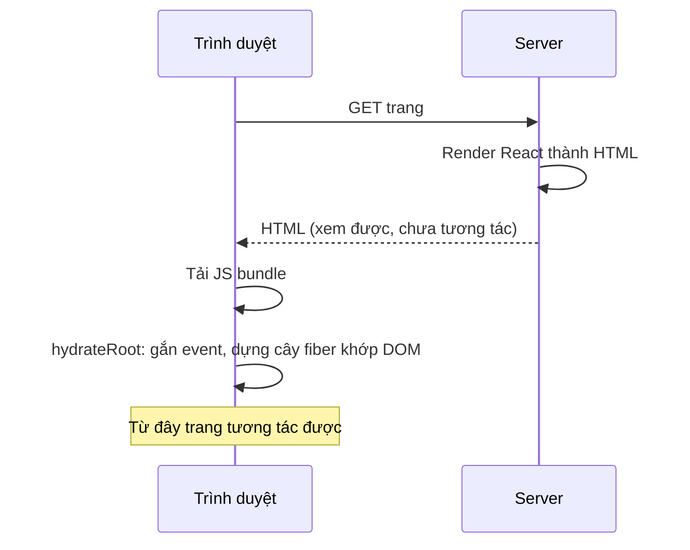
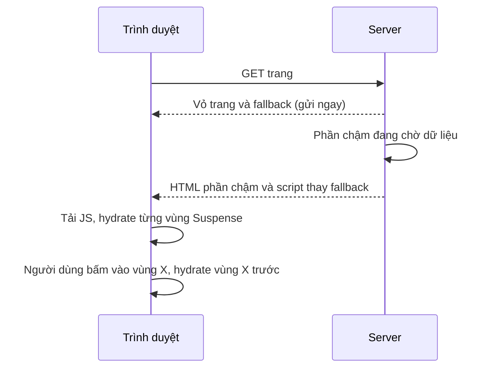
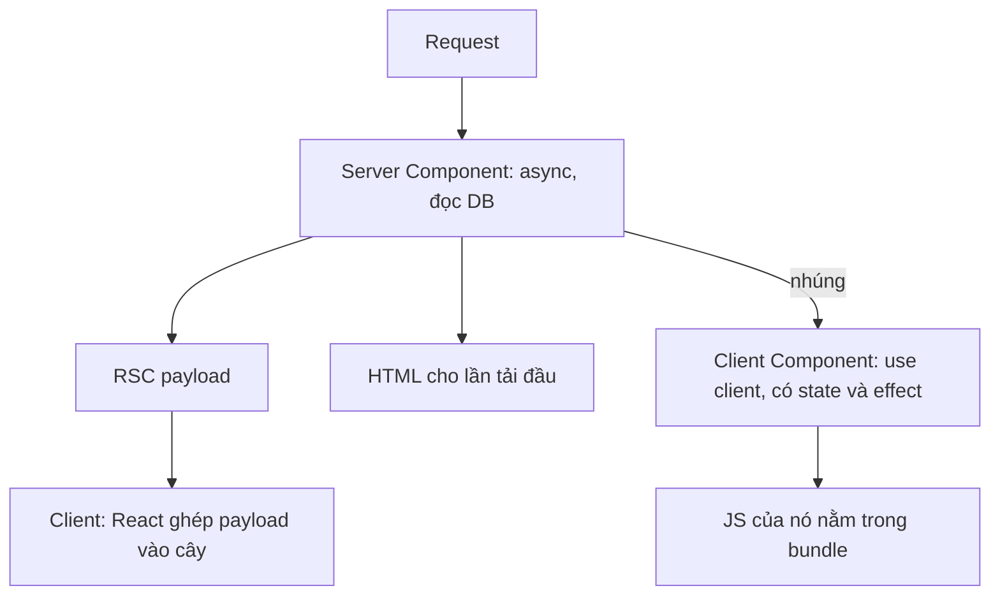
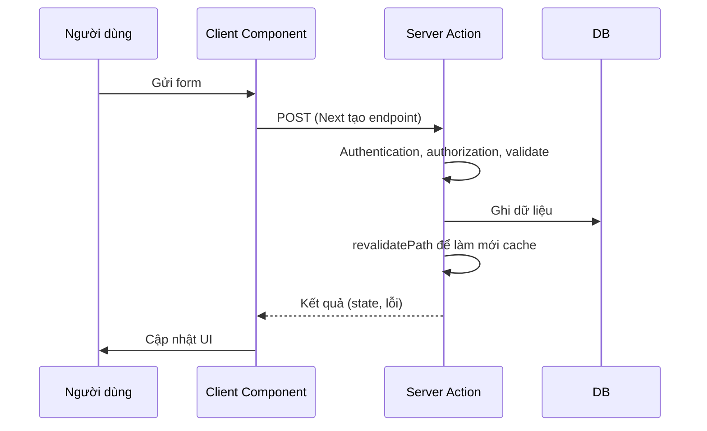

# Lý thuyết 9: SSR, React Server Components và Next.js

Bài này nói về render phía server: từ SSR truyền thống đến Server Components và Next.js App Router. Cần nắm [Bài 8](/go?p=09-React%2Fhard%2Flt-08-fiber-concurrent.md) (Suspense) và [Bài 6](/go?p=09-React%2Fmedium%2Flt-06-routing-forms-data.md). Về chỉ số hiệu năng xem [Web performance và Core Web Vitals](/go?p=11-Frontend-Core%2Flt-03-web-performance-core-web-vitals.md).

## Vì sao cần render ở server?

Một ứng dụng React thuần (CSR) gửi cho trình duyệt một trang HTML gần như trống cùng một bundle JS lớn; người dùng thấy màn trắng cho đến khi JS tải xong, chạy xong và gọi API xong. Với trang công khai, điều này làm LCP chậm và công cụ tìm kiếm khó đọc nội dung. Render một phần hoặc toàn bộ trên server giải quyết vấn đề đó, nhưng kéo theo một loạt khái niệm mới: nên tạo HTML lúc nào (mỗi request, lúc build, định kỳ), làm sao "đánh thức" HTML tĩnh thành ứng dụng tương tác (hydration), và component nào thật sự cần chạy ở trình duyệt.

Bài này đi qua các chiến lược render (CSR, SSR, SSG, ISR), hydration, streaming SSR, React Server Components (RSC) với ranh giới `"use client"`, và cơ chế cache cùng Server Actions của Next.js App Router. RSC đổi cả mô hình tư duy: không phải component nào cũng chạy ở trình duyệt. Chọn sai chiến lược dẫn đến TTFB chậm, bundle lớn, SEO kém, hoặc tệ nhất là lộ dữ liệu nhạy cảm.

## Khi nào dùng, khi nào không

Dùng render phía server khi trang cần SEO, nội dung công khai, LCP nhanh, hoặc dữ liệu nặng muốn giữ ở server. Ngược lại, ứng dụng nội bộ tương tác cao (dashboard sau đăng nhập, không cần SEO) có thể chỉ cần CSR và đỡ phức tạp hạ tầng. Cách làm khuyến nghị với App Router: mặc định mọi thứ là Server Component, chỉ thêm `"use client"` ở các lá cây tương tác; tải dữ liệu ở server; hiểu từng tầng cache; và coi Server Action là endpoint công khai cần authentication, kiểm tra đầu vào.

## Các khái niệm cần biết

- **TTFB, FCP, LCP**: thời gian đến byte đầu tiên, lần vẽ nội dung đầu tiên, và lần vẽ phần tử lớn nhất. Là các thước đo cảm nhận tốc độ tải trang.
- **Hydration**: bước React ở trình duyệt gắn event và dựng lại cây fiber lên trên HTML do server đã sinh, biến trang tĩnh thành tương tác được.
- **Streaming SSR**: server gửi HTML theo từng phần thay vì chờ toàn bộ dữ liệu xong.
- **Selective hydration**: hydrate từng vùng theo ranh giới Suspense, ưu tiên vùng người dùng vừa chạm vào.
- **Server Component (RSC)**: component chỉ chạy trên server, code của nó không vào bundle client.
- **RSC payload**: dữ liệu mô tả cây component mà server gửi cho client (không phải HTML), để React ghép vào cây hiện có.
- **Server Action**: hàm `async` chạy ở server nhưng gọi được từ form hoặc client như một gọi hàm; thực chất là một endpoint HTTP.
- **Revalidate**: làm mới dữ liệu đã cache, theo thời gian hoặc on-demand.
- **Waterfall**: chuỗi request phải chờ nhau tuần tự thay vì chạy parallel.
- **IDOR**: lỗi cho phép truy cập tài nguyên của người khác chỉ bằng cách đổi id trong request.

**Tóm tắt:**

- Chọn chiến lược render theo độ tươi của dữ liệu, nhu cầu SEO và chi phí server: CSR, SSR, SSG, ISR.
- SSR chỉ cho HTML tĩnh; hydration mới biến nó thành ứng dụng tương tác, nên lần render đầu ở client phải khớp output server.
- Hydration mismatch đến từ `Date.now()`, `Math.random()`, API trình duyệt hoặc HTML sai cấu trúc.
- Streaming SSR và selective hydration giúp phần trang sẵn sàng hiển thị và tương tác trước.
- RSC mặc định chạy ở server, code không vào bundle client; RSC và SSR giải hai việc khác nhau nên bổ trợ nhau.
- `"use client"` đánh dấu ranh giới module; props qua ranh giới phải serialize được.
- Next.js App Router có cache nhiều tầng, là nguồn bug dữ liệu cũ phổ biến.
- Server Action thực chất là endpoint HTTP công khai, nên từng action phải authentication, authorization và validate đầu vào.

## Các chiến lược render

Bốn chiến lược dưới đây khác nhau ở hai điều: HTML được tạo ở đâu và vào thời điểm nào. Tạo càng sớm (lúc build) thì càng nhanh và rẻ nhưng dữ liệu càng dễ cũ.

| Chiến lược | HTML tạo ở | Thời điểm | Ưu | Nhược |
|---|---|---|---|---|
| CSR | Trình duyệt | Mỗi lần xem | Đơn giản, hosting tĩnh | Màn trắng, SEO và LCP kém hơn, bundle lớn |
| SSR | Server | Mỗi request | HTML đầy đủ, dữ liệu mới | TTFB phụ thuộc server, tốn tài nguyên |
| SSG | Server lúc build | Một lần | Nhanh nhất, CDN | Dữ liệu cũ đến lần build sau |
| ISR | Build + tái tạo theo chu kỳ hoặc on-demand | Định kỳ | Tĩnh mà vẫn cập nhật | Cần hiểu revalidate, có thể thấy dữ liệu cũ |

**Phải thuộc:** CSR tạo HTML trong trình duyệt; SSR tạo trên server mỗi request; SSG tạo sẵn lúc build; ISR là SSG được làm mới theo chu kỳ hoặc on-demand. Chọn theo mức "tươi" của dữ liệu, nhu cầu SEO và chi phí server.

## SSR và hydration



Đọc sơ đồ: người dùng thấy nội dung rất sớm vì HTML đã đầy đủ, nhưng trang chỉ "sống" sau khi bundle JS tải xong và hydrate chạy xong.

**Hydration** gắn React vào HTML có sẵn: React render lại cây ở client rồi **đối chiếu** với DOM do server sinh, tái sử dụng DOM, gắn event. Khoảng trống giữa "thấy được" và "tương tác được" là điểm yếu của SSR (nút bấm chưa phản hồi).

**Nền tảng:** SSR chỉ cho HTML tĩnh; hydration mới biến nó thành ứng dụng tương tác bằng cách render lại cây ở client và đối chiếu với DOM có sẵn. Vì vậy lần render đầu ở client phải cho đúng output như server, nếu không sẽ có hydration mismatch (do `Date.now()`, `Math.random()`, API trình duyệt, HTML sai cấu trúc).

### Hydration mismatch

Server và client phải render **cùng output** ở lần đầu. Nguyên nhân thường gặp:

| Nguyên nhân | Ví dụ | Cách sửa |
|---|---|---|
| Giá trị khác nhau mỗi lần | `Date.now()`, `Math.random()`, múi giờ | Tính ở server rồi truyền xuống, hoặc render sau mount |
| Dùng API trình duyệt trong render | `window.innerWidth`, `localStorage` | Đọc trong `useEffect` hoặc `useSyncExternalStore` với `getServerSnapshot` |
| HTML không hợp lệ | `<div>` trong `<p>`, trình duyệt tự sửa DOM | Sửa cấu trúc |
| Id sinh ngẫu nhiên | Tự sinh id | `useId` |
| Extension trình duyệt chèn DOM | | `suppressHydrationWarning` cho phần tử cụ thể (chỉ một cấp, dùng hạn chế) |

Mẫu "chỉ client":

```tsx
function ClientOnly({ children }: { children: React.ReactNode }) {
  const [mounted, setMounted] = useState(false);
  useEffect(() => setMounted(true), []);
  // server và lần hydrate đầu đều render null
  return mounted ? <>{children}</> : null;
}
```

React 18+ báo lỗi mismatch rõ hơn và tự phục hồi bằng render lại phía client, mất lợi ích SSR của vùng đó.

## Streaming SSR và selective hydration (React 18)

Vấn đề của SSR cổ điển là "tất cả hoặc không có gì": server phải chờ dữ liệu của phần chậm nhất xong mới gửi được byte HTML đầu tiên, và client phải hydrate cả trang một lượt. Streaming SSR chia nhỏ việc đó:

- `renderToPipeableStream` (Node) và `renderToReadableStream` (Web streams) gửi HTML theo **từng phần**; ranh giới `<Suspense>` cho phép gửi vỏ trang trước, phần chậm sau, kèm script thay chỗ fallback.
- **Selective hydration**: hydrate từng phần theo Suspense, ưu tiên phần người dùng vừa tương tác; một phần chậm không chặn phần khác.

Kết quả: TTFB và FCP tốt hơn, không phải đợi toàn bộ dữ liệu.



Khi nào dùng: trang có vài vùng dữ liệu chậm, độc lập (bình luận, gợi ý). Khi nào không cần: trang nhỏ, dữ liệu về gần như tức thì.

## React Server Components

RSC là component chạy **chỉ trên server** (lúc build hoặc mỗi request), có thể `async`, truy cập trực tiếp DB, file, secret. Kết quả được tuần tự hóa thành **RSC payload** (mô tả cây, không phải HTML) gửi cho client. Code của Server Component **không** nằm trong JS bundle.

Vấn đề đặt ra là SSR vẫn gửi JS của **mọi** component xuống client để hydrate, kể cả những component chỉ hiển thị dữ liệu và không bao giờ tương tác. RSC cắt phần đó khỏi bundle. Sơ đồ dưới cho thấy đường đi của một request.

**Nền tảng:** RSC thay đổi câu hỏi "component này chạy ở đâu": mặc định chạy ở server, mã không vào bundle client, chỉ phần tương tác mới là Client Component. RSC và SSR giải hai việc khác nhau (nơi chạy so với HTML đầu tiên) nên bổ trợ nhau chứ không thay thế nhau.



```tsx
// app/products/page.tsx : Server Component (mặc định trong App Router)
import { db } from "@/lib/db";
import { AddToCart } from "./AddToCart";

export default async function Page() {
  // chạy ở server, không lộ credential
  const products = await db.product.findMany();
  return (
    <ul>
      {products.map(p => (
        <li key={p.id}>{p.name} <AddToCart id={p.id} /></li>
      ))}
    </ul>
  );
}
```

```tsx
// app/products/AddToCart.tsx : Client Component
"use client";
import { useState } from "react";
export function AddToCart({ id }: { id: string }) {
  const [n, setN] = useState(0);
  return <button onClick={() => setN(n + 1)}>Thêm {id} ({n})</button>;
}
```

| | Server Component | Client Component (`"use client"`) |
|---|---|---|
| Chạy ở | Server | Server (SSR lần đầu) và trình duyệt |
| State, effect, event handler | Không | Có |
| `async/await` trực tiếp trong component | Có | Không |
| API trình duyệt | Không | Có |
| Vào bundle JS | Không | Có |
| Truy cập secret, DB | Có | Không (sẽ lộ) |

### Ranh giới "use client"

`"use client"` đánh dấu **ranh giới module**: file đó và mọi thứ nó import đều thuộc bundle client. Không cần đặt ở mọi file, chỉ ở điểm vào của cây client.

| Quy tắc | Chi tiết |
|---|---|
| Server nhúng được Client | Có, và truyền props |
| Client import Server Component | Không (sẽ thành client). Nhưng Client **nhận** Server Component qua `children` hoặc props là được |
| Props qua ranh giới | Phải tuần tự hóa được (chuỗi, số, object thuần, Date, Promise, Server Action). Không truyền hàm thường, class instance |
| Context | Provider là Client Component; Server Component không dùng được Context |
| Đặt ranh giới thấp | Tách phần tương tác ra lá để phần còn lại giữ ở server |

**Phải thuộc:** `"use client"` đánh dấu ranh giới module: file đó và mọi thứ nó import thuộc bundle client. Server Component nhúng được Client Component, còn Client Component không import được Server Component nhưng nhận nó qua `children` hoặc props. Props qua ranh giới phải tuần tự hóa được (không hàm thường, không class instance) và coi như dữ liệu công khai.

Khác biệt hay bị hiểu nhầm: "Client Component" **vẫn được render trước trên server** (SSR) cho HTML đầu; khác biệt là nó cũng được gửi JS để hydrate. Và RSC không thay SSR: chúng bổ trợ nhau.

Dùng `import "server-only"` ở module chứa logic/secret để build lỗi nếu bị import vào client.

## Next.js App Router

Cấu trúc file: `layout.tsx`, `page.tsx`, `loading.tsx` (Suspense tự động), `error.tsx` (Error Boundary, phải là Client Component), `not-found.tsx`, `route.ts` (route handler).

Ghi chú: các API và mặc định của Next.js đổi nhanh giữa 13, 14, 15, 16. Dưới đây là mô hình cần nắm; **hãy tra nextjs.org/docs cho phiên bản bạn dùng**.

### Caching (mô hình nhiều tầng)

| Tầng | Làm gì | Ghi chú |
|---|---|---|
| Request memoization | Cùng `fetch` (cùng URL, options) trong một lần render chỉ gọi một lần; hoặc `React.cache` cho hàm | Chỉ sống trong một request |
| Data cache | Lưu kết quả giữa các request, qua `revalidate`, tag | Next 14 mặc định cache `fetch`; Next 15 đổi sang **không cache mặc định** |
| Full route cache | HTML và RSC payload của route tĩnh lúc build | Route dùng API động (`cookies()`, `headers()`, `searchParams`) thì chuyển sang render động |
| Router cache (client) | Lưu payload route đã tải để điều hướng nhanh | Thời hạn khác nhau giữa các phiên bản |

Next 16 giới thiệu mô hình **Cache Components**: bật `cacheComponents: true`, dùng directive `"use cache"` kèm `cacheLife` và `cacheTag` để chọn rõ thứ gì được cache; phần chưa cache nằm sau `<Suspense>` và stream, dẫn đến Partial Prerendering. Tài liệu hiện hành mô tả cả "mô hình trước" lẫn Cache Components, nên cần biết dự án của bạn đang dùng mô hình nào. Re-authentication: theo thời gian (`revalidate`, `cacheLife`) hoặc on-demand (`revalidateTag`, `revalidatePath`, `updateTag` sau Server Action; tên chính xác xem tài liệu).

Ghi nhớ: bẫy lớn nhất của Next là **cache không ở nơi bạn nghĩ**, dữ liệu cũ hoặc ngược lại không cache được. Luôn kiểm tra: route này tĩnh hay động, dữ liệu cache bao lâu, ai invalidate.

### Server Actions

Hàm `async` có directive `"use server"`, gọi từ form hoặc client như RPC (gọi hàm từ xa). Next biến nó thành endpoint POST. Dùng khi cần ghi dữ liệu (tạo bài, cập nhật hồ sơ) mà không muốn tự viết API riêng. Không dùng cho việc đọc dữ liệu để hiển thị (đã có Server Component) và đừng coi nó là hàm nội bộ an toàn, như bảng "Bẫy bảo mật" bên dưới giải thích.

**Phải thuộc:** Server Action (`"use server"`) thực chất là endpoint HTTP POST công khai, không phải hàm nội bộ an toàn. Trong từng action phải authentication, authorization, validate đầu vào và lấy danh tính từ session chứ không tin dữ liệu client gửi.

Flow một lần gửi form như sau.



```tsx
// app/actions.ts
"use server";
import { z } from "zod";
import { db } from "@/lib/db";
import { revalidatePath } from "next/cache";
import { getSession } from "@/lib/auth";

const schema = z.object({ title: z.string().min(1).max(200) });

export async function createPost(prev: { error?: string }, formData: FormData) {
  const session = await getSession();
  // bắt buộc authentication trong chính action
  if (!session) return { error: "Chưa đăng nhập" };
  const parsed = schema.safeParse({ title: formData.get("title") });
  // bắt buộc kiểm tra đầu vào
  if (!parsed.success) return { error: "Dữ liệu không hợp lệ" };
  await db.post.create({ data: { title: parsed.data.title, authorId: session.userId } });
  revalidatePath("/posts");
  return {};
}
```

```tsx
// Client: dùng với useActionState (React 19)
"use client";
import { useActionState } from "react";
import { createPost } from "./actions";
export function NewPost() {
  const [state, action, pending] = useActionState(createPost, {});
  return <form action={action}><input name="title" /><button disabled={pending}>Đăng</button>{state.error}</form>;
}
```

### Bẫy bảo mật

| Bẫy | Rủi ro | Phòng |
|---|---|---|
| Coi Server Action là hàm nội bộ | Thực chất là endpoint HTTP công khai; ai cũng có thể gọi với đầu vào tùy ý | Authentication, authorization và validate trong **từng** action |
| Tin dữ liệu từ client (id người dùng, giá, role) | IDOR, gian lận | Lấy danh tính từ session, kiểm tra quyền sở hữu tài nguyên |
| Truyền toàn bộ object DB làm props sang Client Component | Lộ trường nhạy cảm (hash mật khẩu) trong RSC payload | Chọn trường, dùng DTO |
| Secret đặt biến `NEXT_PUBLIC_` | Lộ ra bundle client | Chỉ biến công khai mới có tiền tố đó |
| Import module secret vào client | Rò rỉ | `server-only` |
| Chỉ ẩn nút bằng UI | Vẫn gọi được action | Kiểm tra quyền phía server |
| Middleware là lớp bảo vệ duy nhất | Có thể bị bypass bởi lỗi config hoặc lỗ hổng | Kiểm tra quyền ở tầng dữ liệu (defence in depth) |
| CSRF | Server Action có kiểm tra Origin, nhưng không thay thế thiết kế | Xem [Bảo mật Frontend](/go?p=11-Frontend-Core%2Flt-04-bao-mat-frontend.md) |

## So sánh nhanh

| Câu hỏi | Chọn |
|---|---|
| Landing, blog, nội dung ít đổi | SSG hoặc ISR |
| Dữ liệu cá nhân hóa theo request | SSR/động, stream sau Suspense |
| Dashboard nội bộ, không cần SEO | CSR (Vite) hoặc Next với client nhiều |
| Giảm JS gửi client | RSC |
| Tương tác phong phú (editor, canvas) | Client Component ở lá |

## Bẫy thường gặp

| Bẫy | Hậu quả | Cách sửa |
|---|---|---|
| `"use client"` đặt ở root/layout | Cả cây thành client, mất lợi ích RSC | Đẩy ranh giới xuống lá |
| Dùng `window`, `localStorage` khi render | Crash SSR hoặc mismatch | Effect hoặc `getServerSnapshot` |
| `Date.now()`/random trong render | Hydration mismatch | Truyền từ server, render sau mount |
| Truyền hàm làm props qua ranh giới | Lỗi tuần tự hóa | Server Action hoặc handler trong client |
| Đoán cache mặc định | Dữ liệu cũ hoặc quá nhiều request | Đọc tài liệu đúng phiên bản, khai báo rõ |
| Fetch tuần tự trong Server Component | Waterfall server | `Promise.all`, tách component có Suspense |
| Store module-level dùng chung | Rò dữ liệu giữa user | Tạo theo request, dùng Context ở client |
| Tin Server Action là private | Lỗ hổng | Authentication, validate mỗi action |

## Câu hỏi phỏng vấn thường gặp

Mỗi câu theo chuỗi: câu hỏi, gợi ý suy luận, lập luận, đáp án ngắn, kiến thức cần nhớ. Hãy tự trả lời trước khi đọc tiếp.

### 1. CSR, SSR, SSG, ISR khác nhau thế nào và chọn theo tiêu chí nào?

**Gợi ý suy luận:**
- Cùng là HTML, nhưng được tạo ở đâu (trình duyệt hay server) và vào lúc nào (mỗi request hay lúc build)?
- Dữ liệu đổi nhanh hay chậm, có cần SEO không, server tốn bao nhiêu?
- Có cách nào "tạo sẵn nhưng làm mới định kỳ" không?

**Lập luận:** CSR tạo HTML trong trình duyệt, SSR tạo trên server mỗi request, SSG tạo sẵn lúc build, ISR là SSG có làm mới định kỳ hoặc on-demand. Dữ liệu càng cần tươi thì nghiêng về SSR/CSR; cần SEO và tải nhanh thì nghiêng về HTML tạo sẵn; muốn giảm tải server thì SSG/ISR.

**Đáp án ngắn:** Khác ở nơi và thời điểm tạo HTML; chọn theo mức tươi của dữ liệu, SEO và chi phí server.

**Nhớ:** chọn theo "tươi đến mức nào" và "ai trả chi phí". Xem phần đầu bài.

### 2. Hydration là gì, và vì sao có lỗi mismatch?

**Gợi ý suy luận:**
- HTML từ server hiển thị được nhưng chưa có event: ai gắn tương tác vào?
- Muốn gắn vào mà không dựng lại thì React cần điều gì giữa HTML có sẵn và cây React vừa render?
- Những thứ nào khác nhau giữa server và client lần đầu (giờ, random, `window`)?

**Lập luận:** Hydration là React gắn handler và state vào HTML có sẵn, dựa trên giả định cây React ở client khớp HTML server. Nếu output lần render đầu ở client khác server (thời gian, random, API trình duyệt, HTML sai cấu trúc) thì giả định hỏng: đó là mismatch. Nên render lần đầu phải giống nhau, phần chỉ có ở client đặt trong effect.

**Đáp án ngắn:** Gắn React vào HTML có sẵn; mismatch khi output server và client đầu tiên khác (thời gian, random, API trình duyệt, HTML sai).

**Nhớ:** lần render đầu ở client phải giống server.

### 3. Streaming SSR và selective hydration giải quyết điều gì?

**Gợi ý suy luận:**
- SSR cổ điển phải chờ phần nào chậm nhất xong mới gửi và hydrate: người dùng thấy gì trong lúc đó?
- Nếu chia trang theo ranh giới Suspense thì phần nào gửi trước được?

**Lập luận:** SSR cổ điển theo kiểu "tất cả hoặc không gì": chờ mọi dữ liệu, rồi tải toàn bộ JS, rồi hydrate toàn bộ. Streaming gửi HTML theo phần khi sẵn sàng, còn selective hydration hydrate từng ranh giới Suspense, ưu tiên phần người dùng tương tác trước, không chờ toàn bộ.

**Đáp án ngắn:** Gửi HTML theo phần, hydrate theo ranh giới Suspense, không chờ toàn bộ.

**Nhớ:** Suspense là đường cắt cho streaming. Xem phần "Streaming SSR và selective hydration".

### 4. Server Component khác Client Component thế nào, và khác SSR ra sao?

**Gợi ý suy luận:**
- Component chạy ở đâu và mã của nó có được gửi xuống trình duyệt không?
- SSR render HTML ban đầu cho component nào: chỉ Client hay cả hai?
- Hai khái niệm này đối lập hay bổ trợ?

**Lập luận:** Server Component chỉ chạy trên server, mã không vào bundle client, có thể async và truy cập dữ liệu trực tiếp. SSR là bước tạo HTML ban đầu, áp dụng cả cho Client Component. Vì chúng giải hai việc khác nhau (RSC: ai chạy, SSR: HTML đầu tiên) nên bổ trợ nhau.

**Đáp án ngắn:** RSC chỉ chạy ở server, không vào bundle, có thể async; SSR là việc render HTML ban đầu cho cả Client Component. Chúng bổ trợ nhau.

**Nhớ:** RSC quyết định nơi chạy, SSR quyết định HTML đầu tiên. Xem phần "React Server Components".

### 5. `"use client"` làm chính xác điều gì?

**Gợi ý suy luận:**
- Directive này áp dụng cho từng component hay cho cả module?
- Các module được import từ file đó thuộc phía nào?
- Server Component có thể nằm bên trong Client Component không, và bằng cách nào?

**Lập luận:** Nó đánh dấu ranh giới module: file đó và mọi thứ nó import thuộc bundle client. Nó không cấm Server Component hiện diện bên trong, vì Server Component vẫn truyền được xuống qua `children` (element đã được server render sẵn).

**Đáp án ngắn:** Đánh dấu ranh giới module; file và phần import thuộc bundle client; Server Component vẫn truyền được qua `children`.

**Nhớ:** đặt ranh giới càng thấp trong cây càng tốt.

### 6. Truyền props từ Server sang Client Component có hạn chế gì?

**Gợi ý suy luận:**
- Dữ liệu đi qua ranh giới server/client phải đi bằng đường nào (mạng)? Vậy kiểu dữ liệu nào đi được?
- Hàm thường và class instance có biểu diễn được không?
- Props bị gửi xuống trình duyệt thì ai nhìn thấy?

**Lập luận:** Props băng qua mạng nên phải tuần tự hóa được: không truyền hàm thường hay class instance. Vì mọi thứ truyền xuống đều tới trình duyệt, không được truyền kèm trường nhạy cảm (token, dữ liệu nội bộ).

**Đáp án ngắn:** Phải tuần tự hóa; không truyền hàm thường hay class instance; chú ý không lộ trường nhạy cảm.

**Nhớ:** props qua ranh giới = dữ liệu công khai.

### 7. Các tầng cache của Next.js App Router là gì và vì sao hay gây bug dữ liệu cũ?

**Gợi ý suy luận:**
- Cache ở những tầng nào: cùng một request, giữa các request, cả route, ở router phía client?
- Mỗi tầng đặt mặc định khác nhau theo phiên bản: người đọc có nhớ nổi không?
- Nếu không rõ mặc định thì chuyện gì xảy ra khi dữ liệu đổi?

**Lập luận:** Có bốn tầng: request memoization, data cache, full route cache, router cache. Nhiều tầng mà mặc định đổi theo phiên bản nên khó đoán tầng nào đang giữ dữ liệu, dẫn tới dữ liệu cũ. Cache Components cho phép khai báo tường minh phần nào cache, giảm bất ngờ.

**Đáp án ngắn:** Request memoization, data cache, full route cache, router cache; mặc định thay đổi theo phiên bản nên dễ dữ liệu cũ; Cache Components cho phép khai báo rõ.

**Nhớ:** luôn kiểm tra mặc định theo phiên bản bạn dùng. Xem phần "Next.js App Router".

### 8. Server Action có an toàn mặc định không?

**Gợi ý suy luận:**
- Về bản chất, Server Action được gọi qua cái gì (một endpoint HTTP)?
- Ai gọi được endpoint đó nếu không kiểm tra?

**Lập luận:** Mỗi Server Action là một endpoint công khai: ai biết cách gọi là gọi được, dù UI không hiện nút. Vì vậy trong từng action phải authentication, authorization và validate đầu vào như bất kỳ API nào.

**Đáp án ngắn:** Không, là endpoint công khai; phải authentication, authorization, validate trong từng action.

**Nhớ:** coi Server Action như API công khai.

### 9. Làm sao tránh waterfall khi lấy dữ liệu trong Server Component?

**Gợi ý suy luận:**
- Waterfall xuất hiện khi request B chỉ bắt đầu sau khi A xong: vì sao có thể xảy ra trong cây component lồng nhau?
- Những request độc lập có cần chờ nhau không?
- Làm sao cho phần chậm không chặn phần còn lại?

**Lập luận:** Component cha `await` xong rồi con mới render và `await` tiếp thì các request nối đuôi nhau (waterfall). Với request độc lập, khởi chạy parallel bằng `Promise.all`. Tách phần chậm thành component có Suspense để không chặn phần khác, và preload dữ liệu sớm.

**Đáp án ngắn:** Fetch parallel bằng `Promise.all`, tách thành component có Suspense, preload dữ liệu.

**Nhớ:** request độc lập thì chạy parallel.

Tiếp theo: [Bài 10: Hiệu năng và kiến trúc](/go?p=09-React%2Fhard%2Flt-10-hieu-nang-kien-truc.md).

