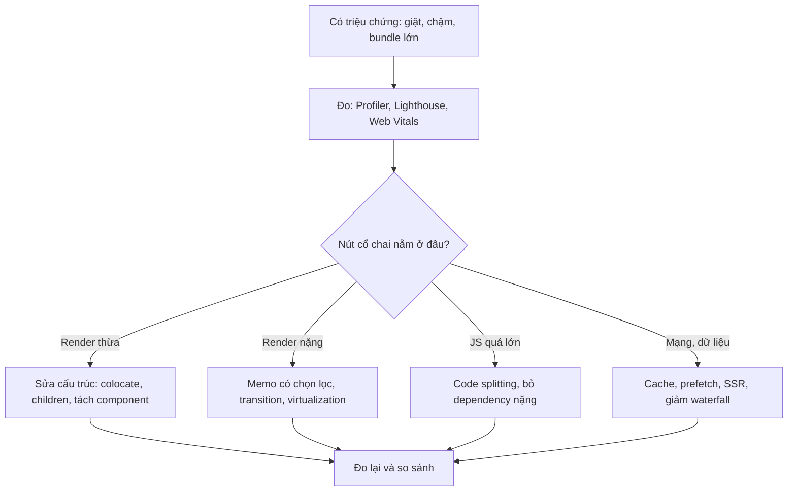
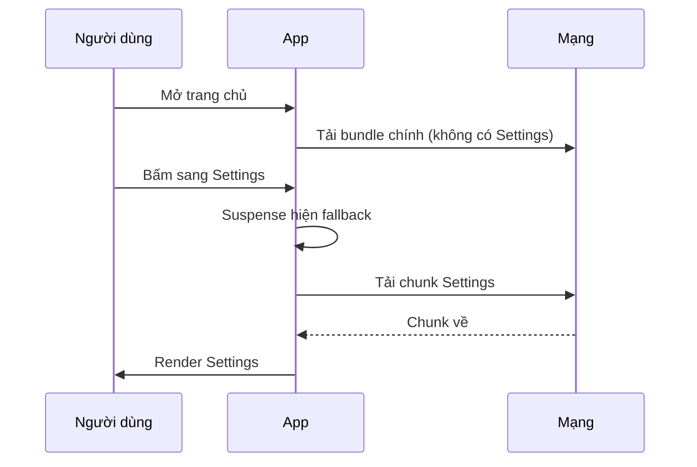

# Lý thuyết 10: Hiệu năng và kiến trúc

Bài tổng hợp: cách đo và tối ưu hiệu năng React, cách tổ chức dự án lớn, và các anti-pattern hay gặp. Cần nắm [Memo hóa](/go?p=09-React%2Fmedium%2Flt-32-memo-hoa.md), [Bài 5](/go?p=09-React%2Fmedium%2Flt-05-state-management.md) và [Bài 8](/go?p=09-React%2Fhard%2Flt-08-fiber-concurrent.md). Chỉ số web (LCP, INP, CLS) xem [Web performance và Core Web Vitals](/go?p=11-Frontend-Core%2Flt-03-web-performance-core-web-vitals.md).

## Tối ưu bắt đầu từ việc đo, không phải từ đoán

Bài này gom hai nhóm việc: làm cho ứng dụng React chạy nhanh (đo bằng Profiler, nhận diện nguyên nhân re-render, giảm JS bằng code splitting, giảm DOM bằng virtualization, để React Compiler tự memo) và giữ cho ứng dụng lớn còn quản lý được (tổ chức mã nguồn, design system, xử lý lỗi).

Vấn đề đặt ra là tối ưu theo cảm tính thường vô ích hoặc phản tác dụng: bọc `memo` khắp nơi làm code rối mà không nhanh hơn, trong khi nút cổ chai thật là một bundle 3 MB. Kiến trúc kém cũng làm mọi tối ưu về sau khó hơn và đội phát triển chậm dần. Cách giải quyết là làm theo quy trình: đo, xác định nút cổ chai, sửa cấu trúc trước, memo sau, rồi chặn hồi quy bằng ngân sách bundle (giới hạn kích thước) và test. Về kiến trúc: tổ chức theo tính năng và tách ranh giới rõ.

## Khi nào cần đọc bài này

Khi người dùng báo giật, khi Core Web Vitals kém, hoặc khi codebase vượt vài chục màn hình và nhiều đội cùng làm. Nếu ứng dụng nhỏ, chạy mượt và chỉ một hai người làm, đừng tối ưu sớm, hãy giữ code đơn giản.

## Các khái niệm cần biết

- **Profiler**: công cụ trong React DevTools ghi lại mỗi lần commit, component nào render, mất bao lâu và vì sao. Dùng để biết nên tối ưu ở đâu.
- **Flamegraph**: biểu đồ thanh xếp lớp thể hiện thời gian render của từng component trong một commit.
- **Code splitting**: tách bundle JS thành nhiều **chunk**, chỉ tải chunk cần cho màn hình hiện tại. Giảm thời gian tải ban đầu.
- **Tree-shaking**: bundler loại bỏ code export mà không ai import. Cần dùng ES module.
- **Virtualization (windowing)**: chỉ render các dòng đang nằm trong khung nhìn thay vì cả nghìn dòng.
- **React Compiler**: bước build tự động thêm memo hóa vào component, thay cho `useMemo`, `useCallback`, `memo` viết tay.
- **Bundle budget**: ngưỡng kích thước bundle cho phép; vượt thì CI báo lỗi.
- **Barrel file**: file `index.ts` re-export hàng loạt module khác. Tiện nhưng nếu quá lớn thì làm build chậm và cản tree-shaking.
- **Headless UI**: thư viện cung cấp hành vi và accessibility (focus, bàn phím, aria) mà không áp sẵn UI.
- **Error Boundary**: component bắt lỗi xảy ra trong lúc render của cây con và hiển thị UI thay thế.
- **Public API của module**: những gì một module chọn export ra cho bên ngoài; phần còn lại là chi tiết nội bộ.

**Tóm tắt:**

- Tối ưu là vòng lặp đo, xác định nút cổ chai, sửa, đo lại, không phải đoán.
- "Chậm" có ba loại (tải JS lớn, render thừa, render nặng), mỗi loại có cách chữa khác nhau; sửa cấu trúc trước, memo sau.
- Re-render thừa thường do state đặt quá cao, props mới mỗi render, context value đổi hoặc key sai; chữa theo thứ tự đẩy state xuống, truyền `children`, rồi mới `memo`.
- Code splitting bằng `lazy` cần `Suspense`, nên tách theo route, tương tác và thư viện nặng.
- Virtualization cho danh sách rất dài, đánh đổi bằng độ phức tạp và accessibility.
- React Compiler tự memo hóa nhưng không thay thế việc hiểu cách render.
- Cấu trúc feature-based chỉ lộ public API qua `index.ts` và ép ranh giới bằng ESLint.
- Xử lý lỗi theo từng layer, từ Error Boundary đến log và monitoring.

## Quy trình tối ưu



**Nền tảng:** Tối ưu là một vòng lặp đo, xác định nút cổ chai, sửa, đo lại, không phải đoán. "Chậm" có ít nhất ba loại (tải JS lớn, render thừa, render nặng), mỗi loại có cách chữa khác nhau; thứ tự ưu tiên là sửa cấu trúc trước, memo sau.

## React Profiler

React DevTools có tab **Profiler**: ghi lại các lần commit, hiển thị component nào render, mất bao lâu, và **vì sao** (bật "Record why each component rendered": props đổi, state đổi, hooks đổi, cha render lại).

| Dấu hiệu trong flamegraph | Ý nghĩa |
|---|---|
| Thanh xám | Không render trong commit này |
| Thanh vàng, cam, đỏ (tốn nhiều) | Render lâu |
| Nhiều component render do "parent rendered" | Cân nhắc đẩy state xuống hoặc `memo` |
| Commit rất nhiều và rất nhanh | Có thể cập nhật quá thường (animation bằng state) |

Cách đọc: tìm commit chậm nhất, nhìn component nào chiếm nhiều thời gian, rồi xem lý do nó render. Nếu lý do là "parent rendered" mà props không đổi, cấu trúc cây hoặc vị trí state đang có vấn đề. Nếu component thật sự nặng thì mới tính đến memo, transition hay virtualization.

Chạy Profiler trên bản **production build có bật profiling** (dev chậm hơn và có StrictMode; bản production thường tắt Profiler, framework và bundler thường có tùy chọn profiling build, xem tài liệu công cụ bạn dùng). Component `<Profiler id onRender>` trong code để ghi số liệu thực tế, kết hợp Performance panel của trình duyệt để thấy cả layout và paint.

## Nguyên nhân re-render

| Nguyên nhân | Dấu hiệu | Cách giảm |
|---|---|---|
| State quá cao trong cây | Gõ phím làm cả trang render | Đẩy state xuống, tách component |
| Cha render lại | Con đơn giản render theo | `children`, `memo` |
| Props mới mỗi render (object, hàm, mảng literal) | `memo` vô tác dụng | `useMemo`/`useCallback` hoặc Compiler |
| Context value đổi | Mọi consumer render | Tách context, store có selector |
| Store không selector | Render theo mọi thay đổi | Selector, `useShallow` |
| Key sai | Mount lại cả danh sách | Key ổn định |
| Effect set state liên tục | Vòng render | Tính trong render |

**Phải thuộc:** Nguyên nhân re-render thừa: state đặt quá cao, cha render lại, props mới mỗi render (object, hàm, mảng literal), context value đổi, store không có selector, key sai. Cách chữa theo thứ tự: đẩy state xuống, truyền `children`, rồi mới `memo` kèm props ổn định.

## Code splitting và lazy

Mục tiêu: chỉ tải JS cần thiết cho màn hình hiện tại. `lazy(() => import(...))` báo cho bundler tách module đó thành chunk riêng; chunk chỉ được tải khi component lần đầu được render, và trong lúc chờ, `Suspense` hiện fallback.



Hệ quả khi dùng sai: tách quá nhỏ thì sinh nhiều request và nháy fallback; không bọc `Suspense` thì React báo lỗi.

```tsx
import { lazy, Suspense } from "react";

const Settings = lazy(() => import("./pages/Settings")); // module phải export default

function Routes() {
  return (
    <Suspense fallback={<PageSkeleton />}>
      <Settings />
    </Suspense>
  );
}
```

**Phải thuộc:** `lazy(() => import("./X"))` yêu cầu module `export default` một component và phải được bọc trong `Suspense`. Nên tách chunk theo route, theo tương tác (modal, editor) và theo thư viện nặng; tách component nhỏ chỉ thêm request và nháy fallback.

| Nơi tách | Ví dụ |
|---|---|
| Theo route | Mỗi trang một chunk (lazy route của router) |
| Theo tương tác | Modal, trình soạn thảo, biểu đồ nặng chỉ tải khi mở |
| Theo thư viện | Tải động thư viện lớn (markdown, PDF) |

Cách làm tốt: prefetch chunk khi hover link hoặc rảnh rỗi; đặt `Suspense` đủ nhỏ để không nháy cả trang; dùng bundle analyzer (`vite-bundle-visualizer`, `@next/bundle-analyzer`) để tìm thư viện nặng; ưu tiên import theo đường dẫn hoặc thư viện hỗ trợ tree-shaking. Next.js có `next/dynamic` cho Client Component.

## Virtualization

Vấn đề đặt ra: render 10.000 dòng nghĩa là 10.000 node DOM, tốn memory, chậm khi mount và khi cuộn. Virtualization giải quyết bằng cách chỉ render phần trong khung nhìn cùng một ít dòng đệm, và đặt chúng đúng vị trí bằng `transform`/`position` trong một vùng có chiều cao bằng tổng chiều cao thật. Khi người dùng cuộn, thư viện tính lại dòng nào nằm trong khung và thay nội dung.

```tsx
import { useVirtualizer } from "@tanstack/react-virtual";

function BigList({ rows }: { rows: string[] }) {
  const parentRef = useRef<HTMLDivElement>(null);
  const v = useVirtualizer({ count: rows.length, getScrollElement: () => parentRef.current, estimateSize: () => 36 });
  return (
    <div ref={parentRef} style={{ height: 400, overflow: "auto" }}>
      <div style={{ height: v.getTotalSize(), position: "relative" }}>
        {v.getVirtualItems().map(item => (
          <div key={item.key}
               style={{ position: "absolute", top: 0, transform: `translateY(${item.start}px)`, height: item.size }}>
            {rows[item.index]}
          </div>
        ))}
      </div>
    </div>
  );
}
```

Đánh đổi: tìm kiếm trên trang (Ctrl+F), accessibility, chiều cao động, và scroll restoration phức tạp hơn. Chỉ dùng khi danh sách thực sự lớn; phân trang hoặc "tải thêm" đơn giản hơn nhiều lần.

## React Compiler

React Compiler là bước build (plugin Babel/SWC/Vite, `babel-plugin-react-compiler`) **tự động memo hóa** component và giá trị dẫn xuất ở mức rất mịn, kể cả sau điều kiện sớm, thứ `useMemo` tay không làm được.

| Chủ đề | Nội dung |
|---|---|
| Điều kiện | Code tuân quy tắc React: render thuần, không mutate props/state, hooks đúng chỗ. Phần không tuân thủ bị **bỏ qua** (không tối ưu) thay vì làm hỏng |
| Phiên bản | Hỗ trợ React 19; React 17 và 18 cần thêm gói `react-compiler-runtime` và config target. Bản ổn định 1.0 phát hành cuối 2025, hãy kiểm tra react.dev/learn/react-compiler |
| Kiểm tra | `eslint-plugin-react-hooks` có luật cho compiler; `"use no memo"` để loại trừ component |
| Ảnh hưởng | Giảm nhu cầu `useMemo`/`useCallback`/`memo` viết tay; không cần gỡ code cũ ngay |
| Không làm | Không sửa thuật toán chậm, không giảm kích thước bundle, không thay virtualization |
| Dev tool | Component được compiler tối ưu có nhãn trong React DevTools |

Khi nào dùng: dự án mới trên React 19 hoặc dự án cũ có nhiều memo tay dễ sai; khi nào chưa nên: codebase đầy vi phạm quy tắc React (mutate state, đọc ref trong render), vì compiler sẽ bỏ qua các component đó và bạn không được lợi gì.

Hệ quả cho phỏng vấn: nói được "code mới nên viết đúng quy tắc, đo bằng Profiler, để compiler lo memo; memo tay chỉ khi có bằng chứng cần hoặc cần kiểm soát dependency của effect".

## Cấu trúc thư mục feature-based

Vấn đề của cách chia theo loại kỹ thuật (`components/`, `hooks/`, `utils/` khổng lồ) là sửa một tính năng phải chạm nhiều thư mục, và không ai biết file nào còn được dùng. Cách giải quyết là tổ chức theo **tính năng nghiệp vụ**: mọi thứ của một tính năng nằm cùng chỗ, bên ngoài chỉ thấy public API của nó.

```text
src/
  app/                 # khởi tạo: router, providers, layout toàn cục
  features/
    orders/
      api/             # hàm gọi API, query hooks
      components/      # UI riêng của feature
      hooks/
      model/           # kiểu, schema Zod, reducer, selectors
      index.ts         # public API: chỉ export những gì bên ngoài được dùng
    auth/
  shared/              # dùng chung, không biết nghiệp vụ
    ui/                # design system
    lib/               # tiện ích, http client
    config/
```

| Quy tắc | Lý do |
|---|---|
| Feature chỉ import feature khác qua `index.ts` | Giữ ranh giới, đổi bên trong không vỡ ngoài |
| `shared` không import từ `features` | Dependency một chiều, tránh vòng |
| Colocate: test, style, story cạnh code | Dễ tìm, dễ xóa |
| Thực thi bằng ESLint (`no-restricted-imports`, `eslint-plugin-boundaries`) | Quy ước không tự giữ được |
| Tránh barrel file lớn trong shared | Làm chậm build, cản tree-shaking ở một số công cụ |

**Phải thuộc:** Cấu trúc feature-based: gom mọi thứ của một tính năng vào một thư mục và chỉ lộ public API qua `index.ts`; feature chỉ import feature khác qua `index.ts`; `shared` không được import từ `features` (dependency một chiều). Ranh giới phải được thực thi bằng ESLint chứ không dựa vào kỷ luật.

Nguyên tắc bổ sung: logic nghiệp vụ tách khỏi UI (hook, hàm thuần) để test dễ; dữ liệu server qua lớp API mỏng với kiểu rõ (xem [TypeScript nâng cao](/go?p=11-Frontend-Core%2Flt-02-typescript-nang-cao.md)).

## Design system

| Lớp | Nội dung |
|---|---|
| Token | Màu, khoảng cách, chữ, bo góc, dạng biến CSS hoặc theme |
| Primitive | Button, Input, Stack, Text; không logic nghiệp vụ |
| Pattern | Dialog, Tabs, Combobox; dùng thư viện headless (Radix UI, React Aria) để có sẵn a11y |
| Tài liệu | Storybook: ví dụ, state, kiểm thử trực quan |
| Phiên bản | Đóng gói, semantic versioning, changelog; theo dõi mức dùng |

Nguyên tắc API: composition thay vì quá nhiều boolean prop ([Composition](/go?p=09-React%2Feasy%2Flt-25-composition.md)); hỗ trợ `ref` và `className`, spread các DOM attribute; có kiểu TS chính xác; accessibility làm mặc định (focus trap, aria, bàn phím). Styling: CSS Modules, Tailwind, hoặc CSS-in-JS **zero-runtime** (vanilla-extract, Panda); CSS-in-JS runtime (styled-components, Emotion) có chi phí render và gặp khó với Server Components, cân nhắc kỹ.

## Xử lý lỗi theo lớp

| Lớp | Công cụ |
|---|---|
| Handler, async | `try/catch`, state lỗi, toast |
| Render | Error Boundary theo vùng ([Bài 6](/go?p=09-React%2Fmedium%2Flt-06-routing-forms-data.md)) |
| Dữ liệu | Query `error`, retry có giới hạn, `errorElement` của route |
| Toàn cục | `window.onerror`, `unhandledrejection`, `onUncaughtError` (React 19), gửi Sentry |
| Người dùng | Thông báo hữu ích, nút thử lại, không lộ stack |
| Hồi phục | `resetKeys`, reload dữ liệu, fallback an toàn |

Không nuốt lỗi âm thầm; log kèm context (user, route, version). Release có source map để đọc stack.

## Anti-pattern thường gặp

| Anti-pattern | Vì sao tệ | Thay bằng |
|---|---|---|
| God component hàng nghìn dòng | Khó test, render thừa | Tách theo trách nhiệm, hook, composition |
| Prop drilling sâu 5+ tầng | Cứng, dễ lỗi | Composition, Context, store |
| Sync state bằng effect | Render dư, lệch | Tính trong render, state dẫn xuất |
| Copy dữ liệu server vào store | Hai nguồn sự thật | TanStack Query |
| `useEffect` fetch rải rác | Race, không cache | Query/loader/RSC |
| Memo mọi thứ "cho chắc" | Phức tạp, không nhanh hơn | Đo trước |
| Index làm key | State lệch | Id ổn định |
| Lạm dụng Context cho state đổi nhanh | Render lan rộng | Store có selector |
| Boolean prop bùng nổ | Tổ hợp vô nghĩa | Tách component, slot |
| Component định nghĩa trong component | Mất state | Đưa ra ngoài |
| Barrel file khổng lồ + circular dependency | Build chậm, lỗi khó hiểu | Import trực tiếp, ranh giới feature |
| Bỏ qua a11y | Mất người dùng, rủi ro pháp lý | Headless UI, test bằng role |

## Bẫy thường gặp

| Bẫy | Hậu quả | Cách sửa |
|---|---|---|
| Profile bản dev | Số liệu sai | Dùng production build |
| Tối ưu không đo | Mất công, không cải thiện | Đo trước và sau |
| `lazy` mà không có `Suspense` | Lỗi runtime | Bọc `Suspense` |
| `lazy` cho component nhỏ | Thêm request, nháy | Chỉ tách chunk đáng kể |
| Virtualize danh sách nhỏ | Phức tạp vô ích | Phân trang hoặc render thẳng |
| Giả định Compiler sửa mọi thứ | Component vi phạm quy tắc bị bỏ qua | Sửa code theo quy tắc, bật lint |
| Cấu trúc thư mục theo loại | Sửa một tính năng chạm nhiều nơi | Theo feature |
| Một Error Boundary duy nhất | Sập cả app | Nhiều boundary |

## Câu hỏi phỏng vấn thường gặp

### 1. Một trang React chạy chậm, bạn bắt đầu từ đâu?

**Gợi ý suy luận:**
- "Chậm" có thể là chậm lúc tải, lúc render hay lúc tương tác: làm sao biết là loại nào?
- Nếu chưa đo mà sửa thì chuyện gì xảy ra với công sức bỏ ra?

**Lập luận:** Vì mỗi loại chậm có thuốc khác nhau (JS quá lớn cần tách bundle, render thừa cần sửa cấu trúc, render nặng cần giảm công việc), sửa theo cảm tính dễ trúng chỗ không phải nút thắt. Nên phải đo trước bằng Profiler và công cụ trình duyệt, xác định loại chậm, sửa cấu trúc trước (rẻ và bền), memo sau, rồi đo lại để biết có cải thiện thật.

**Đáp án ngắn:** Đo bằng Profiler và DevTools, phân loại render thừa, render nặng hay bundle lớn, sửa cấu trúc trước rồi mới memo, và đo lại sau mỗi thay đổi.

**Nhớ:** Tối ưu bắt đầu từ đo, không từ đoán. Xem [bài 10](/go?p=09-React%2Fhard%2Flt-10-hieu-nang-kien-truc.md).

### 2. Component con render lại dù dữ liệu của nó không đổi. Nguyên nhân có thể là gì và chặn thế nào?

**Gợi ý suy luận:**
- Khi nào React gọi lại một hàm component? (state của nó đổi, cha render, context đổi)
- Prop kiểu object/hàm tạo trong thân cha có "bằng" lần trước không?
- State đang đặt ở đâu so với nơi dùng nó?

**Lập luận:** Vì cha render thì mặc định con render theo, và props mới (object, hàm tạo lại mỗi lần) khiến so sánh nông thấy "khác", nên con render thừa. Context đổi thì mọi consumer render, store không có selector cũng vậy, key sai thì remount. Từ đó cách chặn đi theo từng nguyên nhân: đưa state xuống gần nơi dùng (colocate), truyền `children` để phần tĩnh không bị tạo lại, `memo` kèm props ổn định, selector cho store, key ổn định.

**Đáp án ngắn:** Do state đặt quá cao, cha render, props mới mỗi lần, context đổi, store thiếu selector hoặc key sai. Chặn bằng colocate state, `children`, memo, selector và key đúng.

**Nhớ:** Re-render là mặc định, memo chỉ là công cụ sau cùng.

### 3. Code splitting nên cắt ở đâu và trả giá gì?

**Gợi ý suy luận:**
- Người dùng có cần toàn bộ mã ngay khi vào trang không?
- Cắt nhỏ bundle thì số request và thời điểm tải thay đổi ra sao?

**Lập luận:** Vì không phải mã nào cũng cần ngay, cắt theo ranh giới người dùng chưa chạm tới (route, tương tác như mở modal, thư viện nặng) làm bundle đầu nhỏ hơn. Nhưng phần cắt ra phải tải khi cần nên thêm request và thời gian chờ, do đó cần fallback (Suspense) và có thể prefetch khi người dùng sắp dùng.

**Đáp án ngắn:** Cắt theo route, theo tương tác và theo thư viện nặng. Đổi lại thêm request và cần fallback, giải bằng prefetch.

**Nhớ:** `lazy` + Suspense, ranh giới cắt là chỗ người dùng chưa cần.

### 4. Khi nào cần virtualization và nhược điểm của nó?

**Gợi ý suy luận:**
- Chi phí DOM tăng theo số phần tử thế nào?
- Nếu chỉ vẽ phần nhìn thấy thì những thứ dựa vào DOM đầy đủ (tìm trong trang, đọc màn hình) còn đúng không?

**Lập luận:** Vì chi phí render và memory tăng theo số node DOM, danh sách hàng nghìn dòng làm trang nặng, nên chỉ vẽ các dòng trong khung nhìn. Hệ quả: dòng ngoài khung không tồn tại trong DOM, nên Ctrl+F không tìm thấy, trình đọc màn hình thiếu context, và chiều cao động khó tính vị trí cuộn.

**Đáp án ngắn:** Dùng cho danh sách rất lớn. Đánh đổi là mất Ctrl+F, ảnh hưởng a11y và khó với chiều cao động.

**Nhớ:** Danh sách vài trăm dòng thường chưa cần.

### 5. React Compiler làm gì, và `useMemo` có lỗi thời không?

**Gợi ý suy luận:**
- Memo thủ công giải quyết vấn đề gì, và ai đang phải nhớ viết nó?
- Compiler cần biết gì về code để tự memo an toàn?

**Lập luận:** Vì memo thủ công chỉ nhằm giữ tham chiếu và kết quả ổn định giữa các render, compiler phân tích code lúc build và tự chèn việc này, miễn là code theo quy tắc React (thuần, không mutate). Nên nhu cầu `useMemo`/`useCallback` thủ công giảm. Nhưng nó không đổi thuật toán chậm hay giảm kích thước bundle, và component vi phạm quy tắc bị bỏ qua.

**Đáp án ngắn:** Nó tự memo lúc build nếu code đúng quy tắc nên giảm memo tay, nhưng không sửa thuật toán chậm hay bundle lớn.

**Nhớ:** Compiler thưởng cho code thuần, không thay thế việc đo.

### 6. Cấu trúc feature-based có lợi gì và giữ ranh giới thế nào?

**Gợi ý suy luận:**
- Một thay đổi nghiệp vụ thường chạm những file nào nếu chia theo loại (components, hooks)?
- Điều gì ngăn feature này import tùy tiện vào ruột feature khác?

**Lập luận:** Vì thay đổi thường theo nghiệp vụ, gom mọi thứ của một tính năng vào một thư mục thì sửa gọn một chỗ. Nhưng gom mà ai cũng import sâu vào nhau thì lại rối, nên mỗi feature chỉ lộ public API qua `index.ts`, và ranh giới được ESLint thực thi để không phụ thuộc kỷ luật.

**Đáp án ngắn:** Gom theo nghiệp vụ để sửa một tính năng chỉ chạm một nơi, lộ public API qua `index.ts`, thực thi bằng ESLint.

**Nhớ:** Ranh giới không thực thi bằng công cụ thì sẽ bị phá.

### 7. Một design system gồm những lớp nào?

**Gợi ý suy luận:**
- Giá trị lặp lại (màu, khoảng cách) nên lưu ở đâu để đổi một chỗ?
- Component dùng chung cần đảm bảo gì ngoài UI (bàn phím, ARIA)?

**Lập luận:** Vì muốn đổi UI đồng loạt, giá trị gốc phải là token. Trên token là primitive và pattern, cần headless có a11y để hành vi đúng bất kể kiểu dáng. Để cả đội dùng đúng cần tài liệu sống (Storybook) và versioning để nâng cấp không vỡ.

**Đáp án ngắn:** Token, primitive, pattern headless có a11y, Storybook làm tài liệu, và versioning.

**Nhớ:** Design system là contract giữa thiết kế và code.

### 8. Chiến lược xử lý lỗi cho app lớn?

**Gợi ý suy luận:**
- Một lỗi render ở widget nhỏ có nên làm trắng cả trang?
- Lỗi nào Error Boundary không bắt được (event handler, async)?

**Lập luận:** Vì mỗi loại lỗi xuất hiện ở lớp khác nhau, cần nhiều lớp: try/catch ở handler, Error Boundary theo vùng để lỗi chỉ sập vùng đó, xử lý lỗi dữ liệu ở tầng query, và bắt toàn cục (`window.onerror`, `unhandledrejection`) để gửi giám sát. Cuối cùng thông báo cho người dùng phải có thể hành động (thử lại, quay về).

**Đáp án ngắn:** Nhiều lớp: handler, Error Boundary theo vùng, lỗi dữ liệu, bắt toàn cục gửi giám sát, và thông báo người dùng làm được gì tiếp.

**Nhớ:** Một boundary duy nhất nghĩa là một lỗi sập cả app.

### 9. Kể ba anti-pattern React và cách sửa.

**Gợi ý suy luận:**
- Giá trị suy ra được từ state/props có cần một state riêng không?
- Dữ liệu server đã có cache thì chép vào store gây ra điều gì?
- Component khai báo trong thân component khác có danh tính ổn định không?

**Lập luận:** Vì effect sync state tạo render thừa và dễ lệch, nên tính trực tiếp khi render. Copy dữ liệu server vào store tạo hai nguồn sự thật, nên để thư viện server state giữ. Component định nghĩa trong component là kiểu mới mỗi lần render nên bị unmount/mount lại, mất state, nên đưa ra ngoài.

**Đáp án ngắn:** Effect sync state (tính khi render), copy dữ liệu server vào store (dùng query cache), component trong component (đưa ra ngoài).

**Nhớ:** Mỗi anti-pattern vi phạm "một nguồn sự thật" hoặc danh tính ổn định.

Tiếp theo: [Bộ câu hỏi phỏng vấn React](/go?p=07-Interview-QA%2FFrontend%2Fhard%2Fqa-react-phong-van.md).

