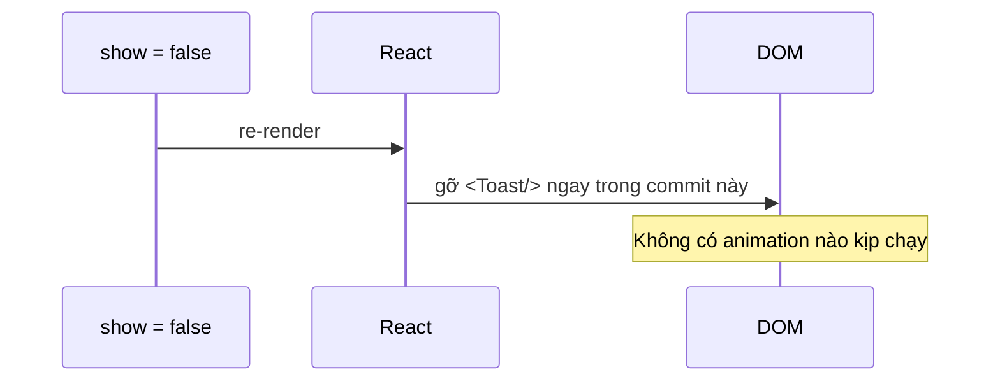
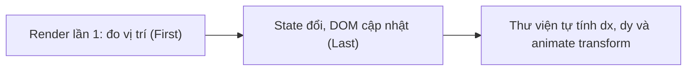

# Lý thuyết 11: Animation trong React

Bài [Animation và motion trên web](/go?p=11-Frontend-Core%2Flt-07-animation-motion-web.md) đã nói nền tảng dùng chung: vì sao `transform`/`opacity` mượt, FLIP là gì, `prefers-reduced-motion`. Bài này không lặp lại phần đó — nó nói riêng về vấn đề của React: component unmount thì DOM biến mất **ngay lập tức**, không có DOM nào để animate "biến mất" cả. Cần [Bài 1](/go?p=09-React%2Feasy%2Flt-01-tu-duy-react-render.md) và [Bài 8](/go?p=09-React%2Fhard%2Flt-08-fiber-concurrent.md).

## Vấn đề nó giải quyết

Animate một phần tử **xuất hiện** trong React dễ: render nó, rồi animate bằng CSS/WAAPI như bình thường. Animate một phần tử **biến mất** thì không: ngay khi điều kiện render đổi (`{show && <Toast />}` thành `false`), React gỡ nó khỏi DOM trong cùng một commit — không còn thời gian cho animation chạy. Cùng vấn đề đó nhân lên khi một phần tử trong danh sách bị xóa (`items.filter(...)`) hoặc đổi vị trí (sort lại): DOM nhảy thẳng tới trạng thái mới, không có animation "biến mất" hay "di chuyển" nào tự xảy ra.

**Nền tảng:** Giải pháp cho cả hai vấn đề cùng một nguyên tắc: **trì hoãn việc gỡ bỏ DOM thật** cho tới khi animation "biến mất" chạy xong, và **đo vị trí cũ/mới bằng `useLayoutEffect` + FLIP** cho việc đổi vị trí. Thư viện animation của React (Framer Motion/`motion`, React Spring, `react-transition-group`) về bản chất đều tự động hóa hai nguyên tắc này; code tay cũng làm được nhưng thư viện xử lý sẵn các trường hợp biên.

## Các khái niệm cần biết

| Khái niệm | Là gì | Vì sao quan trọng |
|---|---|---|
| **Exit animation** | Animation chạy khi một phần tử sắp unmount | React tự gỡ DOM ngay khi điều kiện render đổi; phải có cơ chế trì hoãn việc gỡ |
| **`AnimatePresence`** (Framer Motion/`motion`) | Component bọc quanh phần tử có `exit`, trì hoãn unmount tới khi animation exit chạy xong | Cách phổ biến nhất để có exit animation trong React |
| **Layout animation** | Tự động animate khi vị trí/kích thước một phần tử đổi giữa hai lần render | Thư viện tự làm FLIP giúp bạn khi `layout` prop bật |
| **`key` và animation list** | React dùng `key` để biết phần tử nào "vẫn là nó", phần tử nào mới/bị xóa | `key` sai khiến thư viện animate nhầm "phần tử A biến mất, B xuất hiện" thay vì "A đổi vị trí" |
| **Animation ngoài vòng render** | Animate bằng ref + WAAPI/GSAP, không qua state | Tránh re-render liên tục chỉ để đổi một giá trị animate |
| **`useReducedMotion`** | Hook đọc `prefers-reduced-motion` | Tắt/giảm animation theo cờ hệ điều hành ngay trong component |

**Tóm tắt:**

- React gỡ DOM của component unmount ngay trong commit, nên exit animation cần trì hoãn việc gỡ DOM thật cho tới khi animation chạy xong, bằng state `mounted` nội bộ hoặc `AnimatePresence`.
- `AnimatePresence` so sánh danh sách `key` của children giữa hai lần render để biết phần tử nào mới (chạy `initial → animate`) và phần tử nào biến mất (chạy `animate → exit` rồi mới unmount thật).
- `key` phải là id ổn định của dữ liệu; dùng index làm `key` khiến `AnimatePresence` animate nhầm phần tử khi chèn/xóa ở giữa danh sách.
- Prop `layout` tự động hóa FLIP: đo vị trí trước/sau mỗi lần render rồi animate `transform` để giả lập đổi vị trí mượt, không cần tự viết `getBoundingClientRect`.
- Animation liên tục (progress bar, counter) nên animate qua ref + Web Animations API thay vì `setState` mỗi khung hình, để tránh re-render toàn bộ component 60 lần/giây.
- Xóa một phần tử giữa danh sách luôn kéo theo hai animation riêng: `exit` cho phần tử bị xóa, `layout` cho các phần tử còn lại đổi vị trí.
- `useReducedMotion` đọc cờ `prefers-reduced-motion` để tắt/rút ngắn animation trang trí ngay trong component, không cần tự viết `matchMedia`.

## Exit animation: vấn đề cốt lõi và cách giải



Không dùng thư viện, bạn phải tự trì hoãn unmount bằng state nội bộ:

```jsx
function Toast({ show, children }) {
  const [mounted, setMounted] = useState(show);
  useEffect(() => {
    if (show) setMounted(true);
  }, [show]);

  if (!mounted) return null;
  return (
    <div
      className={show ? 'toast enter' : 'toast exit'}
      onTransitionEnd={() => !show && setMounted(false)} // chỉ gỡ thật sau khi animation exit chạy xong
    >
      {children}
    </div>
  );
}
```

Với Framer Motion (`motion`), `AnimatePresence` làm đúng việc này nhưng xử lý thêm các trường hợp biên (nhiều phần tử exit cùng lúc, animation bị ngắt giữa chừng):

```jsx
import { AnimatePresence, motion } from 'motion/react';

function ToastList({ toasts }) {
  return (
    <AnimatePresence>
      {toasts.map((t) => (
        <motion.div
          key={t.id} // bắt buộc: AnimatePresence dùng key để biết phần tử nào đang rời đi
          initial={{ opacity: 0, y: -20 }}
          animate={{ opacity: 1, y: 0 }}
          exit={{ opacity: 0, y: -20 }} // chạy khi phần tử bị gỡ khỏi children; AnimatePresence trì hoãn unmount thật
          transition={{ duration: 0.2 }}
        >
          {t.message}
        </motion.div>
      ))}
    </AnimatePresence>
  );
}
```

**Phải thuộc:** `AnimatePresence` chỉ hoạt động nếu phần tử con trực tiếp của nó có prop `key` ổn định và duy nhất — nó so sánh danh sách `key` giữa hai lần render để suy ra phần tử nào mới xuất hiện (chạy `initial`→`animate`) và phần tử nào biến mất (chạy `animate`→`exit` rồi mới thật sự unmount). Thiếu `key` hoặc dùng index làm key khi danh sách có thể chèn/xóa ở giữa sẽ khiến nó animate nhầm phần tử.

## Layout animation: FLIP tự động

```jsx
<motion.div layout className="card">{title}</motion.div>
```

Chỉ cần thêm prop `layout`, thư viện tự đo vị trí/kích thước trước và sau mỗi lần render (dùng kỹ thuật FLIP đã học ở bài nền tảng), rồi animate phần chênh lệch bằng `transform`. Không cần tự viết `getBoundingClientRect()` hay quản lý `useLayoutEffect` tay — đây chính là lý do các thư viện animation tồn tại thay vì luôn tự viết FLIP.



Với danh sách (sort, thêm, xóa), kết hợp `layout` và `AnimatePresence`:

```jsx
<AnimatePresence>
  {sortedItems.map((item) => (
    <motion.li key={item.id} layout exit={{ opacity: 0 }}>
      {item.label}
    </motion.li>
  ))}
</AnimatePresence>
```

`layout` animate việc đổi vị trí của các phần tử **còn lại** khi thứ tự thay đổi; `exit` animate phần tử **bị xóa**. Hai prop này giải quyết hai vấn đề khác nhau và thường dùng cùng nhau.

## Animate ngoài vòng render: khi không nên dùng state

```jsx
// Tệ: mỗi khung hình animation là một lần setState → một lần re-render toàn component
function ProgressBar({ target }) {
  const [width, setWidth] = useState(0);
  useEffect(() => {
    let raf;
    const step = () => { setWidth((w) => Math.min(w + 2, target)); raf = requestAnimationFrame(step); };
    raf = requestAnimationFrame(step);
    return () => cancelAnimationFrame(raf);
  }, [target]);
  return <div style={{ width: `${width}%` }} />;
}

// Tốt: animate DOM trực tiếp qua ref, không qua React state
function ProgressBar({ target }) {
  const ref = useRef(null);
  useEffect(() => {
    ref.current.animate(
      [{ width: '0%' }, { width: `${target}%` }],
      { duration: 400, easing: 'ease-out', fill: 'forwards' },
    );
  }, [target]);
  return <div ref={ref} />;
}
```

**Suy luận:** Animate bằng `setState` mỗi khung hình nghĩa là mỗi khung hình đi qua toàn bộ chu trình reconciliation của React (so sánh cây, chạy lại hàm component, diff), dù bản chất chỉ cần đổi một giá trị CSS. Dùng ref + Web Animations API (hoặc gán trực tiếp `style.transform` trong một `requestAnimationFrame` loop) bỏ qua hoàn toàn React cho riêng phần animate, trả quyền điều khiển khung hình lại cho trình duyệt — đây là nguyên tắc "animate ngoài React" mà Framer Motion cũng áp dụng nội bộ cho animation có `motion.div` (nó đọc/ghi style qua ref, không set qua state của chính nó ở mỗi khung hình).

## Tôn trọng `prefers-reduced-motion`

```jsx
import { useReducedMotion } from 'motion/react';

function Card() {
  const reduce = useReducedMotion();
  return (
    <motion.div
      initial={{ opacity: 0, y: reduce ? 0 : 20 }}
      animate={{ opacity: 1, y: 0 }}
      transition={{ duration: reduce ? 0 : 0.3 }}
    >
      ...
    </motion.div>
  );
}
```

## Bẫy thường gặp

| Bẫy | Hậu quả | Cách tránh |
|---|---|---|
| Dùng index làm `key` trong danh sách có `AnimatePresence` | Animate nhầm phần tử khi chèn/xóa ở giữa danh sách | `key` phải là id ổn định của dữ liệu, không phải vị trí |
| Quên bọc bằng `AnimatePresence` | `exit` không chạy, phần tử biến mất ngay lập tức | `AnimatePresence` phải là cha trực tiếp của các phần tử có `exit` |
| Animate bằng `setState` mỗi khung hình cho hiệu ứng liên tục | Re-render liên tục, tốn CPU, có thể giật trên máy yếu | Animate ngoài React bằng ref + WAAPI, hoặc dùng thư viện animation |
| Đổi `key` của cả cây khi chỉ muốn animate một phần nhỏ | Toàn bộ subtree unmount/remount, state con bị mất, animate sai phạm vi | Chỉ đặt `key` động ở đúng phần tử cần coi là "object mới" |
| `layout` trên cây DOM rất sâu, nhiều phần tử | Chi phí đo `getBoundingClientRect` mỗi lần render tăng theo số phần tử | Giới hạn `layout` ở phần tử thật sự cần, dùng `layoutId` cho animate giữa hai phần tử khác nhau thay vì bật layout tràn lan |

## Câu hỏi phỏng vấn thường gặp

### 1. Vì sao không thể animate một component "biến mất" chỉ bằng CSS transition thông thường trong React?

**Gợi ý suy luận:**
- React gỡ DOM của component bị unmount ở thời điểm nào so với animation?
- Transition CSS cần gì để chạy được (phần tử còn tồn tại trong bao lâu)?

**Lập luận:** CSS transition cần phần tử tồn tại trong DOM suốt thời gian animate để trình duyệt nội suy giá trị. Khi điều kiện render đổi, React gỡ phần tử khỏi DOM ngay trong cùng một commit, nên không còn phần tử nào để chạy transition nữa — animation "biến mất" cần một cơ chế trì hoãn việc gỡ DOM thật cho tới khi animation chạy xong, đó là việc `AnimatePresence` hoặc state `mounted` nội bộ làm.

**Đáp án ngắn:** Vì React gỡ DOM ngay lập tức khi unmount; cần trì hoãn việc gỡ để animation kịp chạy.

**Nhớ:** Unmount là tức thời; exit animation phải tự trì hoãn nó.

### 2. `AnimatePresence` cần gì ở phần tử con để hoạt động đúng?

**Gợi ý suy luận:**
- Nó phân biệt phần tử "mới" và "bị xóa" bằng cách nào giữa hai lần render?
- Index có ổn định khi chèn/xóa ở giữa danh sách không?

**Lập luận:** `AnimatePresence` so sánh danh sách con theo `key` giữa lần render trước và sau để suy ra phần tử nào mới (chạy `initial → animate`) và phần tử nào vừa biến mất khỏi danh sách con (chạy `animate → exit`). `key` phải là id ổn định gắn với dữ liệu; dùng index sẽ sai ngay khi một phần tử bị chèn hoặc xóa ở giữa, vì index của các phần tử sau đó đổi dù bản thân dữ liệu không đổi.

**Đáp án ngắn:** Cần `key` ổn định, duy nhất, gắn với dữ liệu — không dùng index.

**Nhớ:** Sai key thì animate nhầm phần tử.

### 3. Animate một progress bar bằng `setState` trong `requestAnimationFrame` loop có vấn đề gì so với dùng ref?

**Gợi ý suy luận:**
- Mỗi lần `setState` kéo theo việc gì ở React?
- Việc đó có cần thiết chỉ để đổi một giá trị CSS không?

**Lập luận:** Mỗi `setState` làm React chạy lại hàm component và reconciliation, dù chỉ cần đổi `width` của một phần tử. Với animation 60 khung hình/giây, đó là 60 lần re-render/giây cho một việc có thể làm hoàn toàn ở tầng DOM. Animate qua `ref.current.animate(...)` (Web Animations API) hoặc gán trực tiếp `style` trong `requestAnimationFrame` bỏ qua React cho riêng phần này, để trình duyệt tối ưu khung hình.

**Đáp án ngắn:** `setState` mỗi khung hình gây re-render thừa; animate qua ref tránh được việc đó.

**Nhớ:** Animation liên tục nên đi ngoài state, qua ref.

### 4. Prop `layout` của Framer Motion làm gì bên dưới, và quan hệ với FLIP ra sao?

**Gợi ý suy luận:**
- Nó cần biết điều gì trước và sau khi DOM đổi?
- Animate "đổi vị trí" cuối cùng vẫn quy về animate thuộc tính nào?

**Lập luận:** `layout` tự động hóa đúng bốn bước FLIP (First, Last, Invert, Play): đo vị trí/kích thước trước khi render mới áp dụng, đo lại sau đó, tính chênh lệch, rồi animate bằng `transform` để giả lập chuyển động mượt — thay vì animate trực tiếp các thuộc tính layout (chậm, giật). Bạn không cần tự viết `getBoundingClientRect()` hay quản lý `useLayoutEffect`, thư viện làm thay.

**Đáp án ngắn:** Nó tự chạy FLIP bên dưới, animate bằng transform thay vì layout thật.

**Nhớ:** `layout` = FLIP tự động.

### 5. Kết hợp `layout` và `exit` trong cùng một danh sách để làm gì, khác nhau ở đâu?

**Gợi ý suy luận:**
- `exit` animate cái gì, `layout` animate cái gì?
- Khi xóa một phần tử giữa danh sách, có mấy chuyện xảy ra cùng lúc?

**Lập luận:** Khi xóa một phần tử ở giữa danh sách, có hai chuyện xảy ra: phần tử đó biến mất (cần `exit` để animate việc biến mất trước khi unmount thật), và các phần tử phía sau nó dịch chuyển lên để lấp chỗ trống (cần `layout` để animate việc đổi vị trí đó thay vì nhảy khựng). Thiếu `exit` thì phần tử bị xóa biến mất đột ngột; thiếu `layout` thì các phần tử còn lại nhảy vị trí không mượt.

**Đáp án ngắn:** `exit` animate phần tử bị xóa biến mất; `layout` animate các phần tử còn lại đổi vị trí; cần cả hai cho một danh sách animate trọn vẹn.

**Nhớ:** Xóa một phần tử luôn kéo theo hai animation riêng biệt.
