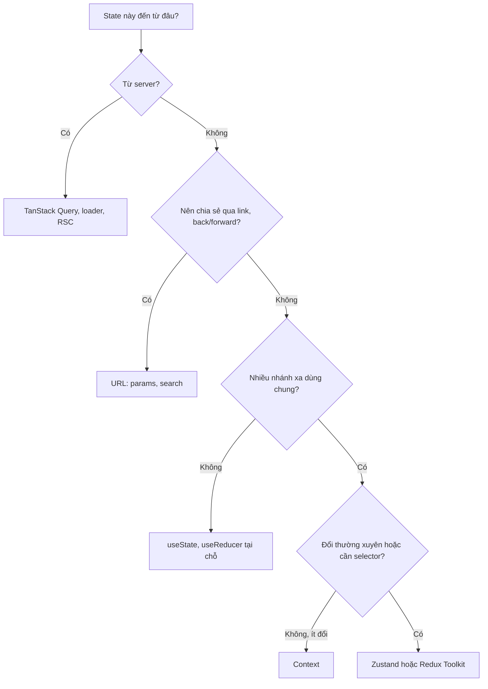
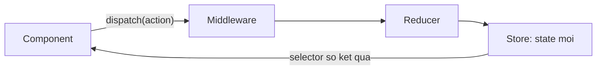
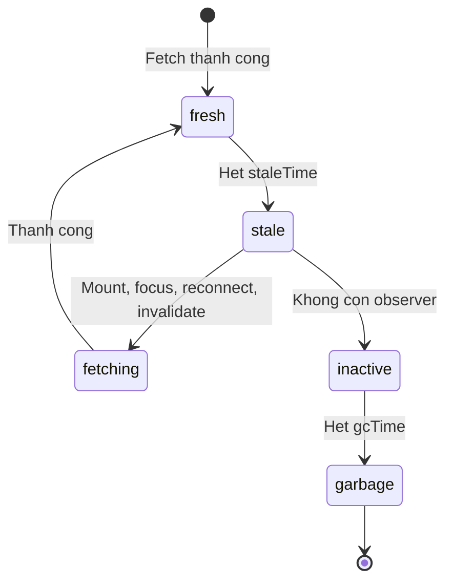

# Lý thuyết 5: State management

Bài này giúp chọn đúng công cụ cho đúng loại state. Cần nắm [Composition](/go?p=09-React%2Feasy%2Flt-25-composition.md) (Context) và [Memo hóa](/go?p=09-React%2Fmedium%2Flt-32-memo-hoa.md).

## Quản lý state là chọn đúng công cụ cho đúng loại state

"State management" nghe như một việc phải cài thư viện, nhưng thực chất là một câu hỏi phân loại: dữ liệu này đến từ đâu và ai sở hữu nó? Từ câu trả lời, ta chọn một trong các công cụ: `useState`, Context, Redux Toolkit, Zustand, TanStack Query hoặc chính URL của router.

Sai lầm phổ biến nhất là nhét mọi thứ vào một store toàn cục, đặc biệt là dữ liệu lấy từ server. Hệ quả thực tế: bạn phải tự sync cache bằng tay, một thay đổi nhỏ làm nhiều component render lại, và cùng một đoạn code tải dữ liệu bị lặp ở nhiều nơi.

Bạn cần cân nhắc bài này khi state phải chia sẻ giữa các nhánh xa nhau trong cây component, khi có dữ liệu từ API, hoặc khi state phải sống sót qua điều hướng và reload trang. Cách làm gọn là: mặc định để state ở local; dữ liệu server giao cho TanStack Query; state UI dùng chung thì dùng Zustand hoặc Redux Toolkit; còn state muốn chia sẻ qua đường link thì đặt lên URL.

## Các khái niệm cần biết

- **Server state**: dữ liệu thật nằm ở server, client chỉ giữ một bản sao có thể đã cũ. Nó cần cache, retry, sync lại. Ví dụ: danh sách đơn hàng.
- **Client state**: dữ liệu chỉ tồn tại ở UI (modal đang mở, theme). Không ai khác sở hữu nó.
- **Store**: một nơi tập trung giữ state, nằm ngoài cây component, component đăng ký đọc và gửi thay đổi vào.
- **Selector**: hàm chọn đúng phần state mà component cần (`s => s.cart.items.length`). Component chỉ render lại khi kết quả selector đổi. Không có selector thì mọi thay đổi trong store đều đánh thức component.
- **Slice, action, dispatch (Redux)**: slice là một mảnh state kèm các reducer của nó; action là mô tả "chuyện gì xảy ra"; dispatch là gửi action vào store.
- **Immer**: thư viện cho phép viết code "sửa trực tiếp" trên một bản nháp (draft), rồi tự sinh state mới bất biến. Giúp reducer ngắn gọn mà không phá nguyên tắc bất biến.
- **Thunk**: hàm async được dispatch như một action, dùng để gọi API rồi dispatch kết quả.
- **Query key**: mảng định danh một mục cache của TanStack Query, ví dụ `["todos", { page: 2 }]`.
- **Stale (cũ) và fresh (tươi)**: dữ liệu fresh được dùng thẳng từ cache; stale thì vẫn hiển thị nhưng sẽ được refetch ngầm ở lần kích hoạt tiếp theo.
- **Invalidate**: đánh dấu cache là cũ để buộc tải lại, thường sau khi ghi dữ liệu thành công.
- **Optimistic update**: cập nhật UI ngay như thể server đã thành công, và hoàn tác nếu server báo lỗi. Dùng khi muốn UI phản hồi tức thì (bấm tim, tick checkbox).

**Tóm tắt:**

- Việc đầu tiên là phân loại state theo nguồn sở hữu: local UI, shared client, server state, URL state, form state.
- Server state là bản sao của dữ liệu ở xa nên cần cache, dedupe, refetch, invalidate; đó là việc của TanStack Query chứ không phải store client.
- Context không phù hợp cho state đổi liên tục vì mọi consumer render lại.
- Redux Toolkit dùng Immer nên cho phép viết "mutate" trong reducer; `useSelector` so bằng `===` nên selector trả object mới sẽ gây render thừa.
- Zustand tránh re-render thừa bằng selector, nhẹ hơn Redux khi không cần tooling lớn.
- TanStack Query v5: `staleTime` mặc định 0 và `gcTime` mặc định 5 phút; query key phải chứa mọi biến ảnh hưởng kết quả.
- State lọc, trang, tab nên nằm trên URL để chia sẻ link và giữ khi F5.

## Phân loại state

| Loại | Ví dụ | Công cụ phù hợp |
|---|---|---|
| Local UI | Modal mở, tab đang chọn, hover | `useState`, `useReducer` |
| Shared client | Giỏ hàng, theme, sidebar, user hiện tại | Context (ít đổi), Zustand, Redux Toolkit |
| Server state | Danh sách đơn hàng, profile | TanStack Query, loader của router, RSC |
| URL state | Trang, filter, sort, tab | Query string, params (React Router, `useSearchParams`) |
| Form state | Giá trị, lỗi, touched | React Hook Form, `useActionState` ([Bài 6](/go?p=09-React%2Fmedium%2Flt-06-routing-forms-data.md)) |



Đọc sơ đồ từ trên xuống: câu hỏi đầu tiên luôn là "có phải dữ liệu từ server không", vì đó là loại cần công cụ chuyên dụng nhất. Chỉ khi chắc chắn là client state mới tính đến chuyện chia sẻ rộng hay hẹp.

Quy tắc nhớ: **server state không phải client state**. Nó có chủ sở hữu ở xa, có thể cũ, cần cache, retry, invalidate.

**Nền tảng:** Việc đầu tiên khi chọn công cụ là phân loại state theo nguồn sở hữu: local UI, shared client, server state, URL state, form state. Server state là bản sao của dữ liệu ở xa nên cần cache, dedupe, refetch, invalidate, đó là việc của TanStack Query chứ không phải của store client.

## Context và re-render (nhắc lại có trọng tâm)

Context là cơ chế "phát sóng" một giá trị xuống mọi component con mà không phải truyền props qua từng tầng. Cái giá: mọi consumer render lại khi `value` đổi, không có selector để lọc. Với state đổi nhanh (vị trí chuột, ô nhập liệu) hoặc có nhiều consumer, hãy dùng store có selector, nếu không cả cây dưới Provider sẽ giật. Với dữ liệu ít đổi (theme, locale, auth) Context là đủ và không cần thư viện.

## Redux Toolkit (RTK)

Redux là mô hình một store duy nhất, state chỉ đổi qua action, nhờ vậy mọi thay đổi đều truy vết được. Redux hiện đại viết bằng RTK: giảm boilerplate, dùng Immer (viết "mutate" nhưng thực tế bất biến) và có sẵn thunk, devtools. Flow chạy: component dispatch action, reducer tính state mới, store thông báo, selector quyết định component nào render lại.



Chọn RTK khi đội lớn cần quy ước chặt và công cụ gỡ lỗi; đừng chọn cho một ứng dụng nhỏ chỉ có vài cờ UI, vì lúc đó Zustand hoặc `useState` nhẹ hơn nhiều.

```ts
// store/cartSlice.ts
import { createSlice, configureStore, type PayloadAction } from "@reduxjs/toolkit";
import { TypedUseSelectorHook, useDispatch, useSelector } from "react-redux";

type CartItem = { id: string; qty: number };

const cartSlice = createSlice({
  name: "cart",
  initialState: { items: [] as CartItem[] },
  reducers: {
    add(state, a: PayloadAction<CartItem>) {
      const found = state.items.find(i => i.id === a.payload.id);
      if (found) found.qty += a.payload.qty; // an toàn nhờ Immer
      else state.items.push(a.payload);
    },
    remove(state, a: PayloadAction<string>) {
      state.items = state.items.filter(i => i.id !== a.payload);
    },
  },
});
export const { add, remove } = cartSlice.actions;

export const store = configureStore({ reducer: { cart: cartSlice.reducer } });
export type RootState = ReturnType<typeof store.getState>;
export type AppDispatch = typeof store.dispatch;
export const useAppDispatch: () => AppDispatch = useDispatch;
export const useAppSelector: TypedUseSelectorHook<RootState> = useSelector;

// Component: selector chỉ lấy phần cần, component chỉ render khi kết quả đổi
// const count = useAppSelector(s => s.cart.items.length);
// Ghi chú: từ react-redux 9.1 có thể dùng useSelector.withTypes<RootState>() thay cho TypedUseSelectorHook
```

Điểm cần nắm:

| Chủ đề | Nội dung |
|---|---|
| Immer | Chỉ "mutate" trong reducer của `createSlice`; không vừa mutate vừa return giá trị mới |
| Selector | `useSelector` so `===` kết quả; selector trả object mới mỗi lần gây render thừa; dùng `createSelector` (reselect) để memo |
| Async | `createAsyncThunk`, hoặc RTK Query (tích hợp cache dữ liệu) |
| Middleware | Listener, logging; không đặt side effect trong reducer |
| Khi chọn | Team lớn cần quy ước chặt, time-travel debug, logic phức tạp, cần devtools và middleware |
| Bất biến | Không đưa giá trị không serialize được (class instance, function) vào state |

**Phải thuộc:** Flow Redux: component `dispatch(action)`, reducer tính state mới, store thông báo, selector quyết định component nào render lại. RTK dùng Immer nên chỉ được viết "mutate" bên trong reducer của `createSlice`; `useSelector` so kết quả bằng `===`, nên selector trả object mới mỗi lần sẽ gây render thừa.

## Zustand

Store nhỏ, không Provider, selector là mặc định.

```ts
import { create } from "zustand";

type CartState = {
  items: { id: string; qty: number }[];
  add: (id: string) => void;
  clear: () => void;
};

export const useCart = create<CartState>()(set => ({
  items: [],
  add: id => set(s => ({ items: [...s.items, { id, qty: 1 }] })),
  clear: () => set({ items: [] }),
}));

// Component
// const count = useCart(s => s.items.length);   // chỉ render khi count đổi
// const add = useCart(s => s.add);
```

Bẫy: `useCart()` không selector đăng ký toàn bộ store, render mỗi lần đổi. Selector trả về object/mảng mới mỗi lần cũng gây render lại (dùng `useShallow` của Zustand hoặc chọn từng trường; kiểm tra tài liệu phiên bản bạn dùng, v5 hành vi chặt hơn với selector trả tham chiếu mới). Với SSR cần tạo store theo request, không dùng store module-level dùng chung giữa các request.

| | Context | Zustand | Redux Toolkit |
|---|---|---|---|
| Boilerplate | Ít | Rất ít | Vừa |
| Selector, tránh render thừa | Không | Có | Có |
| Devtools, middleware | Không | Có (middleware) | Mạnh nhất |
| Provider | Có | Không | Có |
| Phù hợp | Dữ liệu ít đổi | Client state vừa và nhỏ | Ứng dụng lớn, nhiều dev |

## TanStack Query (React Query v5)

TanStack Query quản lý server state: cache theo **query key**, dedupe request (nhiều component hỏi cùng một dữ liệu thì chỉ gửi một request), retry khi lỗi, refetch nền, invalidate. Dùng cho mọi dữ liệu đọc từ API; không dùng cho state thuần UI. Hai hook chính: `useQuery` để đọc, `useMutation` để ghi.

```tsx
import { useQuery, useMutation, useQueryClient } from "@tanstack/react-query";

type Todo = { id: string; title: string };

function useTodos() {
  return useQuery({
    // định danh cache, phải chứa mọi biến ảnh hưởng kết quả
    queryKey: ["todos"],
    queryFn: async (): Promise<Todo[]> => {
      const r = await fetch("/api/todos");
      if (!r.ok) throw new Error("Tải lỗi");   // fetch không tự throw khi 4xx/5xx
      return r.json();
    },
    staleTime: 30_000,                          // 30s coi là còn tươi, không refetch
  });
}

function useAddTodo() {
  const qc = useQueryClient();
  return useMutation({
    mutationFn: (title: string) =>
      fetch("/api/todos", { method: "POST", body: JSON.stringify({ title }) }),
    // đánh dấu cũ và refetch
    onSuccess: () => qc.invalidateQueries({ queryKey: ["todos"] }),
  });
}
```

Lifecycle của một mục cache (đọc sơ đồ: dữ liệu tươi sẽ cũ dần theo `staleTime`, bị tải lại khi có event kích hoạt, và bị xóa khỏi memory sau `gcTime` nếu không ai dùng):



| Khái niệm | Ý nghĩa | Mặc định (v5) |
|---|---|---|
| `staleTime` | Bao lâu dữ liệu coi là tươi, không refetch tự động | 0 (luôn stale) |
| `gcTime` | Giữ cache của query không còn component dùng bao lâu (v4 gọi là `cacheTime`) | 5 phút |
| `isPending` / `isLoading` | v5: `isPending` là chưa có dữ liệu; `isLoading` = `isFetching && isPending` | |
| `isFetching` | Đang gọi mạng (kể cả nền) | |
| Invalidate | Đánh dấu stale, refetch query đang active | |
| Optimistic update | Cập nhật cache trước, rollback khi lỗi (`onMutate`, `onError`, `onSettled`) | |

**Phải thuộc:** TanStack Query v5: `staleTime` mặc định 0 (dữ liệu luôn stale, mount lại thì refetch nền), `gcTime` mặc định 5 phút (v4 gọi là `cacheTime`). `staleTime` quyết định khi nào cần refetch, `gcTime` quyết định giữ cache bao lâu khi không còn ai dùng. Query key phải chứa mọi biến ảnh hưởng kết quả.

Hiểu nhầm hay gặp: `staleTime` mặc định 0 nên mỗi lần mount component, query có dữ liệu cache vẫn refetch nền (hiện cache trước, cập nhật sau). Tăng `staleTime` nếu dữ liệu ít đổi. Query key nên là mảng tuần tự hóa được, gồm cả tham số: `["todos", { status, page }]`.

Vì có TanStack Query, thường không cần Redux cho dữ liệu API. Phần fetch cơ bản và race condition ở [Bài 6](/go?p=09-React%2Fmedium%2Flt-06-routing-forms-data.md).

## URL là state

Filter, sort, trang, tab nên nằm trên URL: chia sẻ được, back/forward đúng, reload không mất.

```tsx
const [params, setParams] = useSearchParams();
const page = Number(params.get("page") ?? 1);
// setParams(p => { p.set("page", String(page + 1)); return p; })
```

## Bẫy thường gặp

| Bẫy | Hậu quả | Cách sửa |
|---|---|---|
| Copy dữ liệu API vào Redux/Zustand | Hai nguồn sự thật, cache lệch | Để TanStack Query giữ |
| Một Context khổng lồ | Re-render lan rộng | Tách context hoặc dùng store có selector |
| Store không selector | Render mỗi thay đổi | Luôn dùng selector |
| Selector trả object mới | Render vô hạn hoặc thừa | `createSelector`, `useShallow` |
| State dẫn xuất lưu trong store | Lệch dữ liệu | Tính từ nguồn bằng selector |
| Query key thiếu tham số | Cache sai, dữ liệu lẫn | Đưa mọi biến vào key |
| `fetch` không kiểm `r.ok` | Lỗi 500 không vào `error` | Throw thủ công |
| Store module-level trong SSR | Rò dữ liệu giữa user | Tạo store theo request |
| Đặt filter vào state thay vì URL | Không chia sẻ, mất khi reload | Dùng search params |

## Câu hỏi phỏng vấn thường gặp

### 1. Vì sao tách server state khỏi client state?

**Gợi ý suy luận:**
- Ai sở hữu dữ liệu: UI hay hệ thống bên ngoài?
- Dữ liệu từ server có thể cũ đi theo thời gian không?

**Lập luận:** Vì server state do bên ngoài sở hữu và có thể cũ, nó cần cache, dedupe, refetch và sync, còn client state chỉ do UI sở hữu và luôn mới. Dùng cùng một công cụ cho cả hai buộc bạn tự làm lại các việc đó. Tách để dùng công cụ đúng.

**Đáp án ngắn:** Server state do bên ngoài sở hữu, có thể cũ, cần cache và sync; client state do UI sở hữu. Tách để dùng công cụ phù hợp.

**Nhớ:** Server state dùng thư viện query.

### 2. Context có phù hợp làm state management không?

**Gợi ý suy luận:**
- Khi `value` đổi, ai render lại?
- Consumer có chọn được một phần của value không?

**Lập luận:** Vì Context không có selector, mọi consumer render lại khi `value` đổi dù chỉ dùng một phần. Với dữ liệu ít đổi (theme, user) thì chi phí nhỏ, còn dữ liệu đổi thường xuyên thì gây render lan rộng.

**Đáp án ngắn:** Với dữ liệu ít đổi thì phù hợp; không có selector nên mọi consumer render lại khi value đổi.

**Nhớ:** Context là cơ chế truyền, không phải store.

### 3. Vì sao Redux Toolkit cho phép viết "mutate"?

**Gợi ý suy luận:**
- Reducer vẫn phải trả state bất biến, vậy cái gì ở giữa biến "mutate" thành bất biến?
- Phạm vi nào của code được bọc?

**Lập luận:** Vì Immer đưa cho reducer một draft (proxy), ghi lên draft được ghi lại rồi tạo state mới bất biến từ các thay đổi. Việc này chỉ có hiệu lực trong reducer của `createSlice`/`createReducer`, ngoài đó mutate là mutate thật.

**Đáp án ngắn:** Immer bọc draft và sinh state bất biến; chỉ đúng trong reducer của `createSlice`/`createReducer`.

**Nhớ:** Trông như mutate, thực chất bất biến.

### 4. Zustand tránh re-render thừa bằng cách nào?

**Gợi ý suy luận:**
- Component đăng ký vào cả store hay một phần?
- Khi store đổi, React so sánh gì để quyết định render?

**Lập luận:** Vì component truyền selector chọn phần cần dùng, mỗi lần store đổi Zustand chạy selector và so sánh kết quả với lần trước; chỉ khi phần đã chọn đổi mới render. Cần giữ kết quả selector ổn định (không tạo object mới mỗi lần).

**Đáp án ngắn:** Dùng selector và so sánh kết quả; component chỉ render khi phần đã chọn đổi.

**Nhớ:** Chọn đúng phần cần dùng.

### 5. `staleTime` và `gcTime` khác gì?

**Gợi ý suy luận:**
- "Dữ liệu còn tươi" và "cache còn được giữ" là hai câu hỏi khác nhau thế nào?
- Khi không còn component nào dùng query, cache sống bao lâu?

**Lập luận:** Vì `staleTime` quyết định khi nào dữ liệu bị coi là cũ nên cần refetch (trong thời gian đó dùng cache mà không gọi mạng). `gcTime` quyết định bao lâu giữ cache sau khi không còn ai dùng trước khi xóa. Hai thứ độc lập nên đặt riêng.

**Đáp án ngắn:** `staleTime`: khi nào refetch; `gcTime`: giữ cache bao lâu khi không ai dùng.

**Nhớ:** Tươi và còn giữ là hai khái niệm.

### 6. Bấm "thích" muốn UI đổi ngay. Optimistic update trong TanStack Query làm thế nào?

**Gợi ý suy luận:**
- Nếu request lỗi thì cần gì để quay lại?
- Refetch đang chạy có thể ghi đè gì?

**Lập luận:** Vì cập nhật cache trước khi server trả lời, phải hủy query liên quan để không bị ghi đè, lưu snapshot để rollback, rồi cập nhật cache (`onMutate`). Lỗi thì khôi phục snapshot (`onError`), kết thúc thì invalidate để sync server (`onSettled`).

**Đáp án ngắn:** Hủy query liên quan, lưu snapshot, cập nhật cache trong `onMutate`, rollback ở `onError`, invalidate ở `onSettled`.

**Nhớ:** Snapshot cho rollback.

### 7. Khi nào chọn Redux Toolkit thay Zustand?

**Gợi ý suy luận:**
- Quy mô đội, nhu cầu quy ước, middleware, devtools?
- Chấp nhận boilerplate đến đâu?

**Lập luận:** Vì RTK cho cấu trúc chặt, middleware và devtools mạnh, hợp đội lớn với logic nghiệp vụ phức tạp; Zustand tối giản cho nhu cầu gọn. Chọn theo chi phí quy ước so với tốc độ.

**Đáp án ngắn:** Đội lớn cần quy ước, middleware, devtools mạnh, logic phức tạp thì RTK; nhu cầu gọn thì Zustand.

**Nhớ:** Chọn theo quy mô, không theo mốt.

### 8. State nên nằm trên URL khi nào?

**Gợi ý suy luận:**
- Người dùng có muốn chia sẻ, đánh dấu, back/forward state này không?
- F5 thì state có mất không?

**Lập luận:** Vì URL là thứ duy nhất sống qua reload, chia sẻ và lịch sử trình duyệt. State nào người dùng muốn giữ, gửi link hay quay lại (filter, trang, tab) nên ở URL.

**Đáp án ngắn:** Khi người dùng muốn chia sẻ, đánh dấu, back/forward: filter, trang, tab.

**Nhớ:** URL là state có sẵn.

### 9. Query key quan trọng ra sao?

**Gợi ý suy luận:**
- Cache được tra bằng gì?
- Nếu hai query khác tham số dùng cùng key thì sao?

**Lập luận:** Vì query key là định danh cache, hai query cùng key chia sẻ dữ liệu. Thiếu biến (ví dụ `userId`) thì query khác nhau dùng chung key và trả nhầm dữ liệu; key chứa đủ biến thì tự refetch khi biến đổi.

**Đáp án ngắn:** Là định danh cache; thiếu biến thì trả nhầm dữ liệu.

**Nhớ:** Mọi biến ảnh hưởng kết quả phải nằm trong key.

Tiếp theo: [Bài 6: Routing, forms và data](/go?p=09-React%2Fmedium%2Flt-06-routing-forms-data.md).

