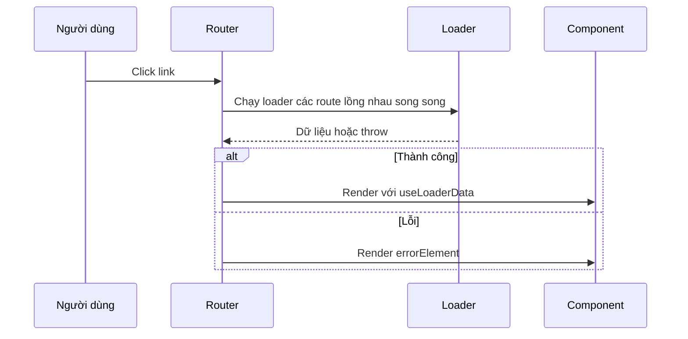
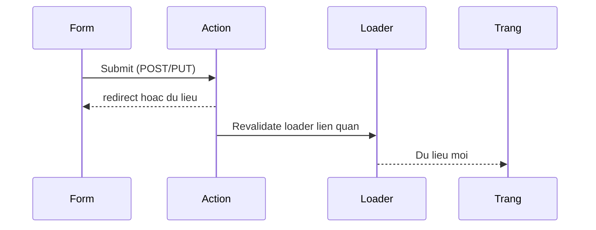
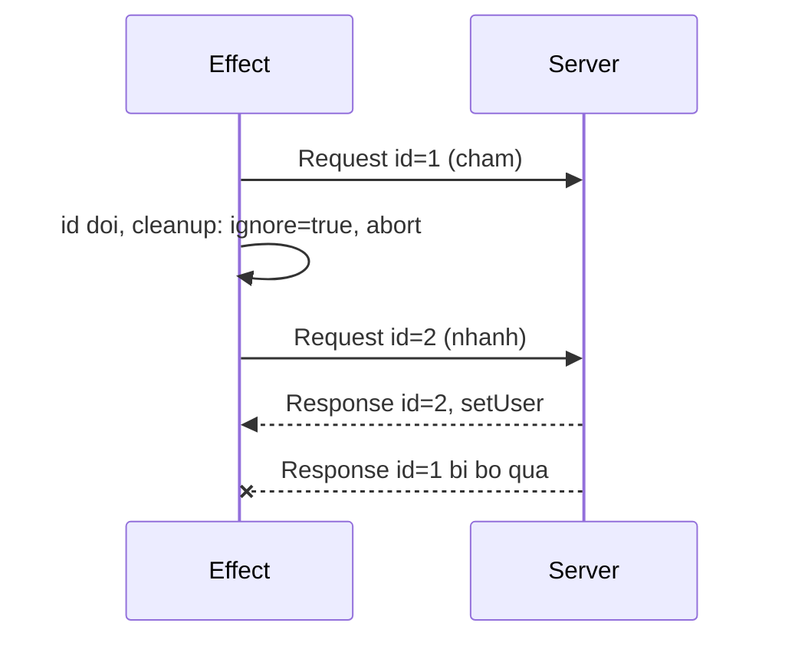

# Lý thuyết 6: Routing, forms và data fetching

Bài này gom ba việc thường đi cùng nhau trong ứng dụng thật: điều hướng, form, và lấy dữ liệu. Cần nắm [Bài 2](/go?p=09-React%2Feasy%2Flt-02-hooks-co-ban.md) và [Bài 5](/go?p=09-React%2Fmedium%2Flt-05-state-management.md).

## Ba việc đi cùng nhau: chuyển trang, nhập liệu, lấy dữ liệu

Hầu như ứng dụng thật nào cũng có nhiều trang, có form nhập liệu và có gọi API. Bài này đi qua các công cụ cho từng việc: React Router với data APIs (`loader`, `action`, `errorElement`), React Hook Form kết hợp Zod cho form, các cách lấy dữ liệu, cách xử lý race condition, và Error Boundary để lỗi không làm sập cả UI.

Vì sao cần? Nếu chỉ dùng `useEffect` rải rác để fetch, bạn sẽ gặp waterfall (các request nối đuôi nhau), race condition (response cũ ghi đè response mới) và code loading/error bị lặp lại ở từng màn hình. Form controlled hoàn toàn khiến mỗi phím gõ render lại cả form. Còn một lỗi không được bắt sẽ làm toàn bộ cây UI biến mất, người dùng chỉ thấy trang trắng.

Hướng giải quyết: lấy dữ liệu ở tầng route (loader) hoặc qua thư viện có cache; form theo hướng uncontrolled trước, validate bằng schema; bọc các vùng dễ lỗi bằng Error Boundary; hủy hoặc bỏ qua response cũ.

## Các khái niệm cần biết

- **Loader**: hàm chạy trước khi route render, trả dữ liệu cho trang qua `useLoaderData`. Dùng khi dữ liệu gắn với một URL.
- **Action**: hàm xử lý việc ghi (POST/PUT/DELETE) khi gửi `<Form>`; sau khi xong router tự gọi lại loader liên quan (revalidate).
- **Waterfall**: chuỗi request phụ thuộc nhau, cái sau chỉ bắt đầu khi cái trước xong, nên tổng thời gian bằng tổng từng phần.
- **Race condition**: nhiều request cùng chạy, kết quả phụ thuộc request nào về trước. Hậu quả: màn hình hiện dữ liệu của lựa chọn cũ.
- **`AbortController` / `signal`**: API chuẩn của trình duyệt để hủy một `fetch` đang chạy.
- **Controlled và uncontrolled input**: controlled là giá trị input do state React giữ và đổi mỗi phím; uncontrolled là DOM tự giữ, React chỉ đọc khi cần.
- **Schema (Zod)**: mô tả hình dạng dữ liệu hợp lệ bằng code; từ đó vừa kiểm tra lúc chạy vừa suy ra kiểu TypeScript.
- **Resolver**: lớp nối để React Hook Form dùng một thư viện validate bên ngoài (ở đây là Zod).
- **Error Boundary**: component đặc biệt bắt lỗi ném ra trong lúc render của cây con và hiển thị UI dự phòng (fallback).
- **Suspense**: cơ chế cho phép component "tạm dừng" khi dữ liệu chưa sẵn sàng và hiện fallback trong lúc chờ.

**Tóm tắt:**

- Fetch trong effect chỉ bắt đầu sau khi component render, nên request lồng nhau chờ nhau và tạo waterfall.
- Loader của React Router chạy khi điều hướng, trước và song song với render, nên tránh được waterfall.
- Controlled form render mỗi phím gõ, uncontrolled (React Hook Form) để DOM giữ giá trị nên ít render hơn.
- Schema Zod vừa validate vừa suy ra kiểu qua `z.infer`; luôn validate lại ở server.
- React 19 có `useActionState`, `useFormStatus` và `useOptimistic` để quản lý kết quả action và UI lạc quan.
- Mạng không bảo đảm response về đúng thứ tự, nên cleanup của effect phải vô hiệu hóa kết quả cũ (race condition).
- Error Boundary chỉ bắt lỗi ném khi render, lifecycle và constructor; không bắt lỗi trong event handler, async hay SSR.

## React Router: data APIs

Từ v6.4 (và v7), router khai báo config ngoài component, cho phép tải dữ liệu **parallel với việc render** thay vì sau khi render xong. Hãy xem ví dụ sau, gồm loader, action, trang và trang lỗi cho một route.

```tsx
import { createBrowserRouter, RouterProvider, useLoaderData, Form, redirect,
         useRouteError, isRouteErrorResponse,
         type LoaderFunctionArgs, type ActionFunctionArgs } from "react-router-dom";

type Project = { id: string; name: string };

async function projectLoader({ params, request }: LoaderFunctionArgs): Promise<Project> {
  // hủy khi điều hướng đi
  const res = await fetch(`/api/projects/${params.id}`, { signal: request.signal });
  if (res.status === 404) throw new Response("Không tìm thấy", { status: 404 });
  if (!res.ok) throw new Error("Lỗi tải");
  return res.json();
}

async function projectAction({ request, params }: ActionFunctionArgs) {
  const form = await request.formData();
  await fetch(`/api/projects/${params.id}`, { method: "PUT", body: form });
  return redirect(`/projects/${params.id}`);
}

function ProjectPage() {
  const project = useLoaderData() as Project;
  return (
    <Form method="post">
      <input name="name" defaultValue={project.name} />
      <button>Lưu</button>
    </Form>
  );
}

function RouteError() {
  const e = useRouteError();
  return <p>{isRouteErrorResponse(e) ? `${e.status}` : "Có lỗi xảy ra"}</p>;
}

const router = createBrowserRouter([
  { path: "/projects/:id", element: <ProjectPage />, loader: projectLoader,
    action: projectAction, errorElement: <RouteError /> },
]);
// <RouterProvider router={router} />
```



Đọc sơ đồ: khi người dùng bấm link, router chạy loader của mọi route lồng nhau cùng lúc rồi mới render; nếu loader ném lỗi (hoặc `Response` 404) thì route đó hiện `errorElement` thay vì trang chính. Flow ghi tương tự: `<Form method="post">` gọi `action`, sau đó router chạy lại loader để dữ liệu trên màn hình luôn mới.

**Nền tảng:** Fetch trong effect chỉ bắt đầu sau khi component đã render, nên các request lồng nhau chờ nhau (waterfall). Loader của router bắt đầu khi điều hướng, trước và parallel với render; đó là mô hình "dữ liệu theo route bắt đầu ở route".



| Khái niệm | Lợi ích |
|---|---|
| Loader parallel cho route lồng | Tránh waterfall (cha tải xong mới đến con) |
| `request.signal` | Điều hướng đi thì hủy request, giảm race |
| `action` + `<Form>` | Mutation rồi tự revalidate loader liên quan |
| `errorElement` | Lỗi theo từng route, không sập toàn app |
| `useNavigation` | Biết đang tải/đang gửi để hiện state chờ |
| Lazy route (`lazy`) | Code splitting theo route |

Khi nào dùng loader: trang có dữ liệu phụ thuộc URL và bạn muốn tránh waterfall. Khi nào không: dữ liệu chỉ phát sinh sau tương tác của người dùng (ô tìm kiếm gõ tới đâu gọi tới đó), hoặc ứng dụng chưa dùng data router; lúc đó thư viện cache như TanStack Query hợp hơn.

Lưu ý: tên gói và một số API khác nhau giữa v6 và v7 (v7 gộp vào `react-router`, có thêm chế độ framework). Hãy tra tài liệu phiên bản bạn dùng. Loader chỉ phù hợp khi dùng data router; nếu dự án đã dùng TanStack Query, có thể gọi `queryClient.ensureQueryData` trong loader để giữ cache một nguồn.

## Form: controlled hay uncontrolled

| | Controlled thuần | Uncontrolled + thư viện (RHF) |
|---|---|---|
| Render mỗi phím gõ | Cả form | Gần như không |
| Validation | Tự viết | Theo schema |
| Form lớn | Chậm | Tốt |
| Ví dụ | Ô tìm kiếm có kết quả tức thời | Form đăng ký, cài đặt |

**Phải thuộc:** Controlled thì state React giữ giá trị và render mỗi phím gõ; uncontrolled (React Hook Form) để DOM giữ giá trị, đọc khi cần nên ít render, hợp form lớn. Dùng một schema Zod vừa validate vừa suy ra kiểu qua `z.infer`, và luôn validate lại ở server vì validate ở client chỉ để trải nghiệm.

React Hook Form (RHF) đăng ký input uncontrolled qua `ref`, đọc giá trị khi cần. Kết hợp Zod để có **một schema vừa validate vừa suy ra kiểu TS**.

```tsx
import { useForm } from "react-hook-form";
import { zodResolver } from "@hookform/resolvers/zod";
import { z } from "zod";

const schema = z.object({
  email: z.string().email("Email không hợp lệ"),
  age: z.coerce.number().int().min(18, "Phải đủ 18 tuổi"),
});
type FormValues = z.infer<typeof schema>;

function SignupForm() {
  const { register, handleSubmit, formState: { errors, isSubmitting } } =
    useForm<FormValues>({ resolver: zodResolver(schema) });

  const onSubmit = async (v: FormValues) => { await fetch("/api/signup", { method: "POST", body: JSON.stringify(v) }); };

  return (
    <form onSubmit={handleSubmit(onSubmit)} noValidate>
      <input {...register("email")} aria-invalid={!!errors.email} />
      {errors.email && <p role="alert">{errors.email.message}</p>}
      <input type="number" {...register("age")} />
      {errors.age && <p role="alert">{errors.age.message}</p>}
      <button disabled={isSubmitting}>Gửi</button>
    </form>
  );
}
```

Điểm cần nắm: schema Zod nên **dùng lại ở server** (validate lại phía server là bắt buộc, client chỉ để trải nghiệm; xem [Bảo mật Frontend](/go?p=11-Frontend-Core%2Flt-04-bao-mat-frontend.md)). Với component controlled bên thứ ba (select tùy biến) dùng `Controller`/`useController`. Chế độ `mode` (`onSubmit`, `onBlur`, `onChange`) ảnh hưởng thời điểm validate và số lần render. Hàm `z.coerce` có hành vi chuyển kiểu hơi đặc biệt (chuỗi rỗng thành 0), kiểm tra phiên bản Zod bạn dùng. Từ Zod 4, `z.string().email()` được coi là cách cũ, cách mới là `z.email()` (ví dụ ở đây theo kiểu Zod 3, vẫn chạy được ở Zod 4).

React 19 bổ sung hướng form riêng, bổ trợ chứ không thay RHF:

```tsx
// React 19: Actions
function Rename() {
  const [state, formAction, isPending] = useActionState(
    async (_prev: { error?: string }, formData: FormData) => {
      const name = String(formData.get("name") ?? "");
      if (!name) return { error: "Tên trống" };
      await save(name);
      return {};
    },
    {},
  );
  return (
    <form action={formAction}>
      <input name="name" />
      <button disabled={isPending}>Lưu</button>
      {state.error && <p>{state.error}</p>}
    </form>
  );
}
```

`<form action={fn}>` tự reset form uncontrolled sau khi action thành công; `useFormStatus` (từ `react-dom`) đọc state pending trong con của form; `useOptimistic` hiển thị kết quả lạc quan trong lúc chờ. Ở React 18 không có các API này (bản canary cũ có tên khác, đừng dùng).

**Phải thuộc:** React 19 Actions: `useActionState(action, initialState)` trả `[state, formAction, isPending]` và quản lý kết quả của action; `useFormStatus` (từ `react-dom`) chỉ đọc state pending của form cha nên phải đặt trong component con của form; `useOptimistic` hiển thị kết quả lạc quan trong lúc chờ.

## Data fetching: các mức

| Mức | Cách | Nhận xét |
|---|---|---|
| 1 | `useEffect` + `fetch` + state | Dễ, nhưng tự lo loading, error, race, cache, retry |
| 2 | Thư viện (TanStack Query, SWR) | Cache, dedupe, retry, refetch, mutation. Lựa chọn mặc định cho SPA |
| 3 | Loader của router | Tải theo route, parallel, trước render |
| 4 | Framework (Next.js, RSC) | Tải trên server, không gửi JS dữ liệu ([Bài 9](/go?p=09-React%2Fhard%2Flt-09-ssr-rsc-nextjs.md)) |
| 5 | `use(promise)` + Suspense (React 19) | Đọc promise trong render; promise phải ổn định (tạo ở nơi khác render) |

Tránh **waterfall**: component cha fetch xong mới render con rồi con mới fetch. Giải pháp: tải parallel ở route, prefetch, hoặc nâng fetch lên.

## Race condition khi fetch

Người dùng đổi `id` nhanh: request 1 chậm, request 2 nhanh; response 1 đến sau và ghi đè kết quả đúng. Hệ quả thực tế là màn hình hiện hồ sơ của người dùng A trong khi ô chọn đang là B, và lỗi này rất khó tái hiện vì phụ thuộc tốc độ mạng. Cách giải quyết là mỗi lần effect chạy lại, cleanup của lần trước đánh dấu "bỏ qua" và hủy request cũ.

**Nền tảng:** Mạng không bảo đảm response về theo thứ tự gửi, nên response của request cũ có thể đến sau và ghi đè kết quả mới. Cleanup của effect chạy mỗi khi dependency đổi, vì vậy đó là chỗ vô hiệu hóa kết quả cũ (cờ `ignore` hoặc `AbortController`).



```tsx
function useUser(id: string) {
  const [user, setUser] = useState<User | null>(null);
  useEffect(() => {
    let ignore = false;                       // cờ bỏ qua response cũ
    const ctrl = new AbortController();
    fetch(`/api/users/${id}`, { signal: ctrl.signal })
      .then(r => r.json())
      .then(u => { if (!ignore) setUser(u); })
      .catch(() => {});
    return () => { ignore = true; ctrl.abort(); };
  }, [id]);
  return user;
}
```

Cách tốt hơn: TanStack Query tự xử lý (key theo `id`). Cũng cần cân nhắc debounce ô tìm kiếm và hủy request.

## Error Boundary

Error Boundary bắt lỗi ném ra **trong lúc render, trong lifecycle, và trong constructor của cây con**. Chưa có hook tương đương; vẫn cần class component, hoặc dùng `react-error-boundary`.

```tsx
import { ErrorBoundary } from "react-error-boundary";

<ErrorBoundary
  fallbackRender={({ error, resetErrorBoundary }) => (
    <div role="alert">
      <p>Lỗi: {error.message}</p>
      <button onClick={resetErrorBoundary}>Thử lại</button>
    </div>
  )}
  onError={(err, info) => reportToSentry(err, info.componentStack)}
  resetKeys={[userId]}              // đổi key thì tự reset
>
  <Dashboard />
</ErrorBoundary>
```

| Bắt được | KHÔNG bắt được |
|---|---|
| Lỗi trong render, lifecycle của con | Lỗi trong event handler (dùng try/catch) |
| Lỗi từ `use()`, Suspense sau khi throw | Lỗi async (setTimeout, promise không vào render) |
| | Lỗi SSR phía server, lỗi của chính boundary |

**Phải thuộc:** Error Boundary chỉ bắt lỗi ném trong lúc render, lifecycle và constructor của cây con; không bắt lỗi trong event handler (dùng `try/catch`), lỗi async, lỗi SSR hay lỗi của chính nó. Vẫn cần class component (`getDerivedStateFromError`, `componentDidCatch`) hoặc thư viện `react-error-boundary`.

Đặt boundary ở nhiều mức: toàn app (trang lỗi chung), theo route, theo widget độc lập (một widget lỗi không làm sập cả trang). React 19 thêm `onCaughtError`, `onUncaughtError` ở `createRoot` để báo lỗi tập trung.

## Bẫy thường gặp

| Bẫy | Hậu quả | Cách sửa |
|---|---|---|
| Fetch lồng cha-con | Waterfall | Loader parallel, prefetch |
| Không xử lý response cũ | Hiển thị dữ liệu sai | AbortController, cờ ignore, thư viện |
| `fetch` không kiểm `r.ok` | Lỗi HTTP bị coi thành công | Kiểm tra và throw |
| Form controlled lớn | Render cả form mỗi phím | RHF, uncontrolled |
| Chỉ validate ở client | Bỏ qua bằng gọi API trực tiếp | Validate lại ở server |
| Try/catch quanh JSX mong bắt lỗi render | Không hiệu lực | Error Boundary |
| Error Boundary cho lỗi event handler | Không bắt | try/catch trong handler |
| Tạo promise mới trong render rồi `use()` | Suspend vô hạn | Tạo ngoài render, cache hoặc nhận từ cha/server |
| Một boundary duy nhất toàn app | Một lỗi nhỏ sập cả trang | Nhiều boundary theo vùng |

## Câu hỏi phỏng vấn thường gặp

### 1. Fetch trong effect làm trang hiện từng mảnh chậm. Loader của React Router giải quyết gì?

**Gợi ý suy luận:**
- Fetch trong effect bắt đầu khi nào so với lúc render?
- Nếu cha và con đều chờ dữ liệu thì thứ tự request ra sao?

**Lập luận:** Vì effect chỉ chạy sau khi component render, request bắt đầu muộn và các request lồng nhau chờ nhau (waterfall). Loader chạy khi điều hướng, trước và parallel với render, nên tránh waterfall, có `errorElement` cho lỗi và hủy bằng signal khi điều hướng đi.

**Đáp án ngắn:** Tải trước và parallel với render, tránh waterfall, có errorElement, hủy bằng signal khi điều hướng.

**Nhớ:** Dữ liệu theo route nên bắt đầu ở route.

### 2. Khi nào chọn form uncontrolled/RHF so với controlled?

**Gợi ý suy luận:**
- Mỗi phím gõ có buộc React render lại không trong từng kiểu?
- Bạn có cần phản hồi tức thời từng phím không?

**Lập luận:** Vì controlled lưu giá trị trong state nên mỗi phím gây render, form lớn thì chậm. Uncontrolled/RHF để DOM giữ giá trị và đọc khi cần nên ít render. Controlled chỉ cần khi phải phản hồi tức thời từng phím.

**Đáp án ngắn:** Form lớn, nhiều ô, cần hiệu năng thì uncontrolled/RHF; controlled cho phản hồi tức thời từng phím.

**Nhớ:** Giá trị ở DOM hay ở state.

### 3. Zod mang lại gì khi dùng với RHF?

**Gợi ý suy luận:**
- Validation và kiểu TypeScript thường được viết hai lần, điều gì sai khi chúng lệch nhau?
- Server có cần kiểm tra lại không?

**Lập luận:** Vì một schema Zod vừa là luật validation vừa sinh kiểu qua `z.infer`, hai thứ không thể lệch. Schema đó dùng lại được ở server nên cùng luật hai đầu.

**Đáp án ngắn:** Một schema cho validation và kiểu (`z.infer`), tái dùng ở server.

**Nhớ:** Single source of truth cho dữ liệu form.

### 4. Gõ nhanh và kết quả của query cũ ghi đè query mới. Race condition xảy ra thế nào, chặn ra sao?

**Gợi ý suy luận:**
- Response có đến theo thứ tự gửi không?
- Làm sao "hủy hiệu lực" response của render cũ?

**Lập luận:** Vì mạng không đảm bảo thứ tự, response cũ có thể đến sau response mới và ghi đè. Cleanup của effect chạy khi dependency đổi nên dùng nó để hủy (AbortController) hoặc đặt cờ bỏ qua kết quả cũ; hoặc dùng thư viện cache theo key.

**Đáp án ngắn:** Response cũ đến sau; AbortController hoặc cờ ignore trong cleanup, hoặc dùng thư viện cache theo key.

**Nhớ:** Cleanup là chỗ vô hiệu hóa kết quả cũ.

### 5. Error Boundary bắt được và không bắt được lỗi nào?

**Gợi ý suy luận:**
- Boundary hoạt động trong pha nào của React?
- Lỗi trong event handler hay async xảy ra ngoài pha đó không?

**Lập luận:** Vì boundary chỉ theo dõi pha render/lifecycle của cây con, nó bắt lỗi ở đó. Event handler, code async và SSR chạy ngoài pha này nên không bắt được, phải dùng `try/catch` hoặc xử lý riêng.

**Đáp án ngắn:** Bắt lỗi render/lifecycle của con; không bắt event handler, async, SSR.

**Nhớ:** Boundary theo vùng.

### 6. Vì sao Error Boundary vẫn là class component?

**Gợi ý suy luận:**
- Boundary cần hai API nào của lifecycle?
- Hook đã có tương đương chưa?

**Lập luận:** Vì hai API `getDerivedStateFromError` và `componentDidCatch` chưa có hook tương đương, nên boundary phải là class. Thực tế dùng `react-error-boundary` để bọc.

**Đáp án ngắn:** API `getDerivedStateFromError` và `componentDidCatch` chưa có hook; dùng `react-error-boundary` để bọc.

**Nhớ:** Viết một lần, tái dùng.

### 7. `useActionState` và `useFormStatus` khác nhau thế nào?

**Gợi ý suy luận:**
- Cái nào cần biết kết quả của action, cái nào chỉ cần biết đang gửi?
- Component nào đọc được state form cha?

**Lập luận:** Vì quản lý kết quả cần giữ state và cung cấp `formAction`: đó là `useActionState`. Chỉ đọc state pending thì `useFormStatus`, nhưng hook này đọc form cha nên phải dùng trong component con của form.

**Đáp án ngắn:** Cái đầu quản lý state kết quả và cung cấp `formAction`; cái sau chỉ đọc pending của form cha, dùng trong component con.

**Nhớ:** Kết quả so với state.

### 8. Waterfall là gì, tránh thế nào?

**Gợi ý suy luận:**
- Khi nào request B phải chờ request A?
- Có thể bắt đầu cả hai sớm hơn không?

**Lập luận:** Vì mỗi component chỉ fetch sau khi được render, cha chờ dữ liệu thì con chưa render và chưa fetch, tạo chuỗi request phụ thuộc theo cây. Nên đưa việc tải lên cấp route (loader), prefetch, hoặc tải ở server.

**Đáp án ngắn:** Chuỗi request phụ thuộc theo cây component; tránh bằng loader, prefetch, hoặc tải ở server.

**Nhớ:** Bắt đầu tải sớm và parallel.

Tiếp theo: [Bài 7: Testing React](/go?p=09-React%2Fmedium%2Flt-07-testing-react.md).

