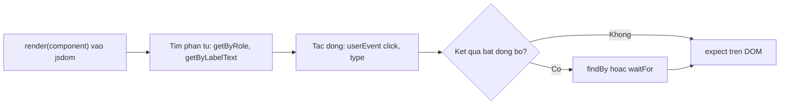
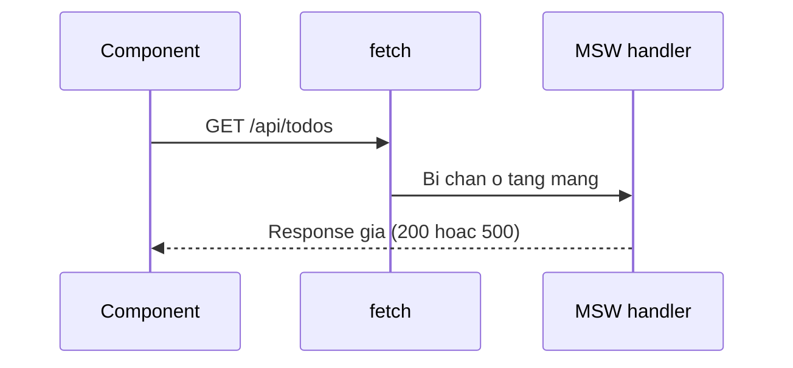
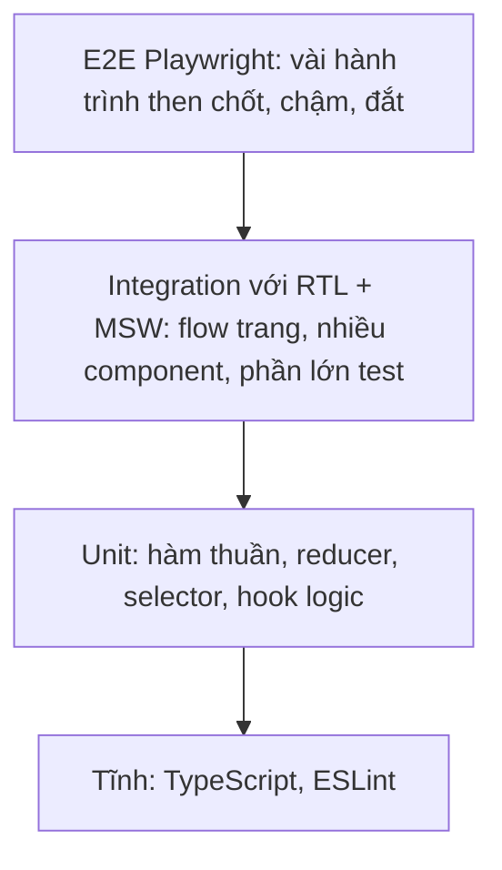

# Lý thuyết 7: Testing React

Bài này nói về cách kiểm thử ứng dụng React có giá trị: test hành vi người dùng thấy, không test chi tiết cài đặt. Cần nắm [Bài 2](/go?p=09-React%2Feasy%2Flt-02-hooks-co-ban.md) và [Bài 6](/go?p=09-React%2Fmedium%2Flt-06-routing-forms-data.md).

## Test React để làm gì và test cái gì

Bộ công cụ phổ biến gồm: React Testing Library (RTL) chạy trên Vitest hoặc Jest để test component, MSW để mock mạng, `renderHook` để test hook, và Playwright hoặc Cypress cho kiểm thử end-to-end (E2E, mở trình duyệt thật chạy cả hành trình).

Vấn đề mà cách tiếp cận này giải quyết: test gắn chặt vào cài đặt (đọc state nội bộ, kiểm tra tên hàm được gọi) sẽ vỡ ngay khi bạn refactor dù ứng dụng vẫn chạy đúng, và ngược lại không bắt được bug mà người dùng thật gặp. Test nhìn từ góc độ người dùng (họ thấy nút nào, gõ vào ô nào, thấy chữ gì) bền hơn và còn kéo theo accessibility (khả năng tiếp cận cho người dùng trình đọc màn hình).

Hãy test các flow quan trọng: form, danh sách có lọc, authorization, xử lý lỗi API. E2E chỉ dành cho một vài hành trình then chốt như đăng nhập hay thanh toán. Cách làm: render như người dùng, query theo vai trò và nhãn, tương tác bằng `userEvent`, mock mạng ở biên bằng MSW, và chờ thao tác async bằng `findBy` hoặc `waitFor`.

## Các khái niệm cần biết

- **jsdom**: môi trường mock DOM chạy trong Node, cho phép render component mà không cần trình duyệt. Nhanh nhưng không có layout thật (không đo được kích thước).
- **Query theo role**: tìm phần tử theo vai trò ARIA (button, textbox, heading) và tên truy cập (accessible name), giống cách trình đọc màn hình hiểu trang.
- **Mock**: object giả thay cho dependency thật; `vi.fn()` tạo hàm giả ghi lại lần gọi. **Stub** là phiên bản trả giá trị cố định.
- **MSW (Mock Service Worker)**: thư viện chặn request ở tầng mạng và trả response giả, nên code ứng dụng vẫn gọi `fetch` thật.
- **`act`**: hàm của React đảm bảo mọi cập nhật state và effect được xử lý xong trước khi bạn khẳng định.
- **Snapshot test**: lưu đầu ra (DOM) vào file rồi so sánh ở lần sau; dễ thành rác nếu snapshot lớn.
- **Flaky test (test chập chờn)**: lúc xanh lúc đỏ dù code không đổi, thường do phụ thuộc thời gian hoặc thứ tự.
- **Fake timers**: thay `setTimeout` thật bằng đồng hồ giả do test điều khiển, để test debounce mà không phải chờ.
- **Auto-wait**: công cụ tự chờ phần tử sẵn sàng rồi mới thao tác (Playwright), thay cho `sleep` cố định.

**Tóm tắt:**

- Test càng giống cách người dùng thật dùng phần mềm thì càng đáng tin; test hành vi nhìn thấy, không test state nội bộ.
- Query ưu tiên theo accessibility: `ByRole` trước, `ByTestId` cuối cùng.
- `getBy` sync và ném lỗi, `queryBy` trả `null` để khẳng định không tồn tại, `findBy` async và chờ xuất hiện.
- Ưu tiên `userEvent` hơn `fireEvent`, gọi `userEvent.setup()` trước `render`, và luôn `await`.
- Mock ở biên mạng bằng MSW để code ứng dụng chạy thật; mock sâu vào bên trong làm test xanh giả.
- Test hook bằng `renderHook`, và cảnh báo `act` nghĩa là có cập nhật state xảy ra ngoài tầm kiểm soát của test.
- Test pyramid: nhiều unit và component test, ít E2E (Playwright) cho các flow then chốt.
- E2E ổn định cần locator theo role, test độc lập và không `sleep`.

## Triết lý của RTL

> Test càng giống cách phần mềm được dùng, càng đáng tin.

| Nên | Không nên |
|---|---|
| Query theo thứ người dùng thấy (role, label, text) | Truy cập state, instance, tên hàm nội bộ |
| Kiểm tra DOM kết quả | Kiểm tra `setState` được gọi |
| Mock ở biên hệ thống (mạng) | Mock con, mock hook của chính dự án |
| Test hành vi | Snapshot lớn khó đọc |

**Nền tảng:** Test càng giống cách người dùng thật dùng phần mềm thì càng đáng tin. Vì vậy test hành vi nhìn thấy (role, label, text) chứ không test chi tiết cài đặt như state nội bộ hay tên hàm, nhờ đó test không vỡ khi refactor.

Thứ tự ưu tiên của query:

| Ưu tiên | Query | Ghi chú |
|---|---|---|
| 1 | `getByRole('button', { name: /lưu/i })` | Gần trải nghiệm trình đọc màn hình nhất, đồng thời kiểm tra a11y |
| 2 | `getByLabelText`, `getByPlaceholderText`, `getByText`, `getByDisplayValue` | Với form và nội dung |
| 3 | `getByAltText`, `getByTitle` | |
| 4 | `getByTestId` | Phương án cuối |

Ba họ query: `getBy` (phải có, sync, lỗi nếu không thấy), `queryBy` (trả `null`, dùng để khẳng định **không có**), `findBy` (async, chờ xuất hiện). Dùng `jest-dom` cho matcher (`toBeInTheDocument`, `toBeDisabled`).

**Phải thuộc:** Ba họ query: `getBy` (sync, ném lỗi nếu không thấy), `queryBy` (trả `null`, dùng để khẳng định không tồn tại), `findBy` (async, chờ xuất hiện). Thứ tự ưu tiên: `ByRole`, rồi `ByLabelText`/`ByPlaceholderText`/`ByText`/`ByDisplayValue`, rồi `ByAltText`/`ByTitle`, cuối cùng `ByTestId`.

## Config Vitest

```ts
// vitest.config.ts
import { defineConfig } from "vitest/config";
import react from "@vitejs/plugin-react";

export default defineConfig({
  plugins: [react()],
  test: { environment: "jsdom", setupFiles: ["./src/test/setup.ts"], globals: true },
});

// src/test/setup.ts
import "@testing-library/jest-dom/vitest";
import { afterEach } from "vitest";
import { cleanup } from "@testing-library/react";
afterEach(() => cleanup());
```

Vitest tương thích phần lớn API Jest (`vi.fn`, `vi.mock` thay cho `jest.fn`, `jest.mock`), chạy nhanh với Vite. Jest vẫn phổ biến với CRA cũ, Next.js (có preset `next/jest`).

Một test RTL luôn đi theo cùng một vòng: dựng, tìm, tác động, khẳng định.



## Test component mẫu

Hãy xem ví dụ sau: một form đăng nhập nhỏ và test kiểm tra hành vi người dùng thấy (nút bị khóa khi chưa nhập, gọi `onSubmit` đúng giá trị).

```tsx
import { render, screen } from "@testing-library/react";
import userEvent from "@testing-library/user-event";
import { describe, it, expect, vi } from "vitest";

function LoginForm({ onSubmit }: { onSubmit: (email: string) => void }) {
  const [email, setEmail] = useState("");
  return (
    <form onSubmit={e => { e.preventDefault(); onSubmit(email); }}>
      <label htmlFor="e">Email</label>
      <input id="e" value={email} onChange={e => setEmail(e.target.value)} />
      <button disabled={!email}>Đăng nhập</button>
    </form>
  );
}

describe("LoginForm", () => {
  it("gửi email khi người dùng nhập và bấm nút", async () => {
    const user = userEvent.setup();           // luôn setup trước khi render
    const onSubmit = vi.fn();
    render(<LoginForm onSubmit={onSubmit} />);

    const button = screen.getByRole("button", { name: "Đăng nhập" });
    expect(button).toBeDisabled();

    await user.type(screen.getByLabelText("Email"), "a@b.com");
    await user.click(button);

    expect(onSubmit).toHaveBeenCalledWith("a@b.com");
  });
});
```

Dùng `userEvent` (mô phỏng chuỗi event thật: focus, keydown, input, keyup) thay vì `fireEvent` (chỉ bắn một event), trừ khi cần event đặc thù.

**Phải thuộc:** Ưu tiên `userEvent` hơn `fireEvent`, gọi `userEvent.setup()` trước khi `render`, và luôn `await` các thao tác của `userEvent` cũng như `findBy`. Quên `await` làm test xanh giả hoặc chập chờn.

## MSW: mock mạng ở biên

Vấn đề: component gọi API thì test không thể phụ thuộc server thật (chậm, không ổn định), nhưng mock thẳng `fetch` lại làm test không còn giống thực tế. MSW chặn request ở tầng mạng nên code ứng dụng (`fetch`, axios, TanStack Query) chạy nguyên bản. Cùng handler dùng được cho test, Storybook, dev. Không cần MSW khi component thuần không gọi mạng.

**Nền tảng:** Chỉ mock ở biên xa nhất của hệ thống (mạng), để toàn bộ code ứng dụng (client gọi API, xử lý lỗi, cache) chạy thật trong test. Mock sâu vào bên trong (mock con, mock hook nội bộ) làm test xanh nhưng bug thật vẫn lọt.



```ts
// src/test/server.ts (MSW v2)
import { http, HttpResponse } from "msw";
import { setupServer } from "msw/node";

export const server = setupServer(
  http.get("/api/todos", () => HttpResponse.json([{ id: "1", title: "Học React" }])),
);

// setup.ts
// beforeAll(() => server.listen({ onUnhandledRequest: "error" }));
// afterEach(() => server.resetHandlers());
// afterAll(() => server.close());
```

```tsx
it("hiển thị lỗi khi API 500", async () => {
  server.use(http.get("/api/todos", () => new HttpResponse(null, { status: 500 })));
  // bọc QueryClientProvider, Router
  render(<TodoPage />, { wrapper: TestProviders });
  expect(await screen.findByRole("alert")).toHaveTextContent(/lỗi/i);
});
```

Với TanStack Query, mỗi test tạo `QueryClient` mới với `retry: false` để khỏi chờ retry và tránh rò cache giữa các test.

## Test async

| Công cụ | Dùng khi |
|---|---|
| `await screen.findByX` | Chờ phần tử **xuất hiện** (gói `waitFor` + `getBy`) |
| `await waitFor(() => expect(...))` | Chờ một khẳng định đúng; callback có thể chạy nhiều lần, không đặt side effect trong đó |
| `await waitForElementToBeRemoved(...)` | Chờ biến mất (spinner) |
| `vi.useFakeTimers()` | Test debounce, timer; nhớ `vi.useRealTimers()` sau test, và dùng với `userEvent.setup({ advanceTimers: vi.advanceTimersByTime })` |

## Test hook

```tsx
import { renderHook, act } from "@testing-library/react";

function useCounter() {
  const [n, setN] = useState(0);
  return { n, inc: () => setN(c => c + 1) };
}

it("tăng đếm", () => {
  const { result } = renderHook(() => useCounter());
  act(() => result.current.inc());           // cập nhật state ngoài tương tác: bọc act
  expect(result.current.n).toBe(1);
});
```

`renderHook` có sẵn trong `@testing-library/react` từ v13.1 (gói `@testing-library/react-hooks` cũ không hỗ trợ React 18+). Hook phụ thuộc Context truyền `wrapper`. Hook đơn giản thường test gián tiếp qua component dùng nó; chỉ test riêng hook phức tạp, tái sử dụng.

## Bẫy act()

`act` bảo đảm mọi cập nhật state và effect liên quan đã được xử lý trước khi bạn khẳng định. RTL đã bọc `act` giúp bạn trong `render`, `userEvent`, `findBy`, `waitFor`. Cảnh báo "not wrapped in act(...)" thường nghĩa là có cập nhật state **sau** khi test kết thúc hoặc ngoài chỗ được chờ.

| Triệu chứng | Nguyên nhân | Cách sửa |
|---|---|---|
| "not wrapped in act" | State đổi sau khi promise resolve mà test không chờ | `await findBy...` hoặc `waitFor` cho kết quả cuối |
| Cảnh báo ở test kết thúc sớm | Test thoát trước khi request xong | Chờ state cuối trong test |
| Bọc `act` thủ công mọi chỗ | Che bug thiết kế test | Chỉ bọc khi gọi trực tiếp (hook, timer) |
| `waitFor` rỗng hoặc chỉ `sleep` | Test chập chờn | Chờ điều kiện cụ thể |

## Accessibility trong test

`getByRole` buộc markup có vai trò và tên truy cập; nếu khó query thì thường UI kém accessible. Thêm `jest-axe` hoặc `vitest-axe` để chạy `axe` trên DOM đã render; nó chỉ bắt được một phần vấn đề a11y, không thay thế kiểm tra thủ công.

## E2E với Playwright

```ts
import { test, expect } from "@playwright/test";

test("đăng nhập và thấy dashboard", async ({ page }) => {
  await page.goto("/login");
  await page.getByLabel("Email").fill("a@b.com");
  await page.getByLabel("Mật khẩu").fill("secret");
  await page.getByRole("button", { name: "Đăng nhập" }).click();
  // tự chờ, tự retry
  await expect(page.getByRole("heading", { name: "Dashboard" })).toBeVisible();
});
```

Playwright có auto-wait, locator theo role giống RTL, trace viewer, chạy đa trình duyệt. Cypress cũng phổ biến, mô hình chạy trong trình duyệt. Chọn theo đội; điều quan trọng là chiến lược: dữ liệu test ổn định (seed, API mock hoặc môi trường riêng), tránh `waitForTimeout` cố định.

## Test pyramid cho React



Nhiều đội frontend theo mô hình "trophy": nhiều test tích hợp ở giữa, vì giá trị cao trên chi phí. Unit cho logic thuần (reducer, util, validator), integration cho flow, E2E cho smoke và đường găng.

## Bẫy thường gặp

| Bẫy | Hậu quả | Cách sửa |
|---|---|---|
| Test chi tiết cài đặt | Vỡ khi refactor | Test hành vi nhìn thấy |
| Mock quá nhiều | Test xanh nhưng bug thật vẫn lọt | MSW ở biên mạng, ít mock nội bộ |
| `getByTestId` khắp nơi | Bỏ qua a11y | Ưu tiên role, label |
| Quên `await` với `userEvent` hoặc `findBy` | Test xanh giả hoặc chập chờn | Luôn `await` |
| Dùng `getBy` để khẳng định không tồn tại | Ném lỗi | `queryBy...` rồi `not.toBeInTheDocument()` |
| Rò `QueryClient` giữa các test | Test phụ thuộc thứ tự | Tạo mới mỗi test |
| Snapshot lớn | Mọi người bấm update | Snapshot nhỏ có chủ đích hoặc assertion cụ thể |
| Timer thật trong test | Chậm, chập chờn | Fake timers có kiểm soát |
| E2E quá nhiều | Chậm, bất ổn | Giữ ít, dùng integration |

## Câu hỏi phỏng vấn thường gặp

### 1. Test hay vỡ khi refactor dù hành vi không đổi. Triết lý của React Testing Library?

**Gợi ý suy luận:**
- Người dùng thấy và làm gì: class hay role, label, text?
- Test dính chi tiết cài đặt thì refactor ra sao?

**Lập luận:** Vì người dùng tương tác qua nội dung hiển thị, query theo role, label, text kiểm tra đúng điều họ trải nghiệm. Test không phụ thuộc cài đặt thì không vỡ khi refactor.

**Đáp án ngắn:** Test như người dùng dùng; query theo role, label, text; tránh test cài đặt.

**Nhớ:** Test hành vi, không test cài đặt.

### 2. `getBy`, `queryBy`, `findBy` khác gì?

**Gợi ý suy luận:**
- Bạn muốn khẳng định phần tử có hay không có?
- Phần tử xuất hiện sau một thao tác async thì sao?

**Lập luận:** Vì có ba nhu cầu: phần tử phải có ngay (`getBy`, ném lỗi nếu không), có thể không có (`queryBy`, trả null để khẳng định vắng mặt), sẽ có sau (`findBy`, async chờ xuất hiện).

**Đáp án ngắn:** `getBy` sync và ném lỗi; `queryBy` sync trả null; `findBy` async chờ xuất hiện.

**Nhớ:** Chọn theo thời điểm phần tử xuất hiện.

### 3. Vì sao dùng MSW thay vì mock `fetch`?

**Gợi ý suy luận:**
- Mock `fetch` bỏ qua phần code nào của app?
- Chặn ở tầng mạng thì code gọi API chạy thật không?

**Lập luận:** Vì MSW chặn ở tầng mạng nên toàn bộ code app (client, xử lý lỗi) chạy thật, chỉ server là giả. Handler dùng lại được cho test, Storybook, dev.

**Đáp án ngắn:** Chặn ở tầng mạng nên code app chạy thật, handler tái dùng cho test, Storybook, dev.

**Nhớ:** Mock ở biên xa nhất.

### 4. Cảnh báo "not wrapped in act" nói lên điều gì?

**Gợi ý suy luận:**
- Test có chờ state cập nhật xong trước khi khẳng định không?
- Cách nào chờ thay vì ép `act`?

**Lập luận:** Vì có cập nhật state xảy ra ngoài vùng test đang chờ, nên kiểm tra có thể chạy trước khi UI ổn định. Giải pháp đúng là chờ state cuối bằng `findBy`/`waitFor`, không bọc `act` bừa chỉ để tắt cảnh báo.

**Đáp án ngắn:** Có cập nhật state ngoài vùng được chờ; chờ state cuối bằng `findBy`/`waitFor`, không bọc `act` bừa.

**Nhớ:** Cảnh báo chỉ ra test chưa chờ đủ.

### 5. Test custom hook thế nào?

**Gợi ý suy luận:**
- Hook không chạy được ngoài component, vậy cần gì để chạy nó?
- Hook cần context thì cấp bằng cách nào?

**Lập luận:** Vì hook cần chạy trong component, `renderHook` dựng component giả. Hàm trong hook đổi state phải gọi trong `act`, hook cần context thì cấp qua `wrapper`. Hoặc test gián tiếp qua component dùng nó.

**Đáp án ngắn:** `renderHook` kèm `act` khi gọi hàm đổi state, `wrapper` cho context; hoặc test qua component.

**Nhớ:** Test hook qua public API của nó.

### 6. `userEvent` khác `fireEvent` ở đâu?

**Gợi ý suy luận:**
- Một cú click thật của người dùng gồm những event nào?
- Test nên mô phỏng event đơn lẻ hay chuỗi thực?

**Lập luận:** Vì người dùng thật tạo chuỗi event (hover, mousedown, focus, mouseup, click), nên `userEvent` mô phỏng chuỗi đó và bắt được lỗi mà một event đơn lẻ bỏ sót. `fireEvent` chỉ bắn một event.

**Đáp án ngắn:** `userEvent` mô phỏng chuỗi event thực của người dùng; `fireEvent` bắn một event đơn lẻ.

**Nhớ:** Ưu tiên `userEvent`.

### 7. Test pyramid trong frontend nên chia thế nào?

**Gợi ý suy luận:**
- Test nào nhanh, rẻ và ổn định; test nào đắt, chậm?
- Bạn muốn độ tin cậy cao nhất trên mỗi đồng chi phí ở đâu?

**Lập luận:** Vì chi phí và độ chập chờn tăng khi lên cao, nên nhiều test tích hợp (độ tin cậy tốt), unit cho logic thuần, ít E2E cho hành trình then chốt, và công cụ tĩnh (TypeScript, lint) làm nền.

**Đáp án ngắn:** Nhiều integration, ít E2E, unit cho logic thuần, công cụ tĩnh làm nền.

**Nhớ:** Cân bằng chi phí và độ tin cậy.

### 8. Test debounce hoặc timer thế nào?

**Gợi ý suy luận:**
- Có nên chờ thời gian thật trong test không?
- Cập nhật state do timer gây ra cần gì để React xử lý?

**Lập luận:** Vì chờ thật làm test chậm và thiếu ổn định, dùng fake timers rồi tiến thời gian bằng `advanceTimersByTime`. Nếu hành động đó cập nhật state thì bọc trong `act`, và phục hồi timer thật sau test để không ảnh hưởng test khác.

**Đáp án ngắn:** Fake timers, tiến thời gian bằng `advanceTimersByTime` bọc trong `act` nếu cập nhật state, phục hồi timer thật sau test.

**Nhớ:** Điều khiển thời gian thay vì chờ nó.

### 9. Làm sao E2E ổn định?

**Gợi ý suy luận:**
- Nguyên nhân chập chờn: chờ chưa đủ, selector dễ vỡ, dữ liệu thay đổi?
- Test này có phụ thuộc test khác không?

**Lập luận:** Vì chập chờn đến từ thời gian, selector và dữ liệu, nên dùng auto-wait thay sleep cứng, locator theo role, dữ liệu seed cố định, và cô lập từng test.

**Đáp án ngắn:** Auto-wait, locator theo role, dữ liệu seed cố định, không sleep cứng, cô lập test.

**Nhớ:** Loại bỏ từng nguồn không xác định.

Tiếp theo (Hard): [Bài 8: Fiber và concurrent rendering](/go?p=09-React%2Fhard%2Flt-08-fiber-concurrent.md).

