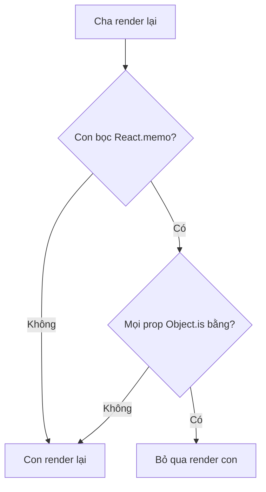

# Lý thuyết 32: Memo hóa (useMemo, useCallback, React.memo)

Bài này đào sâu nhóm công cụ tối ưu bằng cách ghi nhớ kết quả cũ. Cần nắm [Bài 1](/go?p=09-React%2Feasy%2Flt-01-tu-duy-react-render.md) và [Bài 2](/go?p=09-React%2Feasy%2Flt-02-hooks-co-ban.md).

## Bài này nói về điều gì?

`useMemo`, `useCallback`, `React.memo` gọi chung là **memo hóa**, tức là ghi nhớ kết quả cũ để khỏi tính lại. Nhóm công cụ này rất dễ dùng sai theo hai hướng ngược nhau. Memo hóa bừa bãi làm code phức tạp hơn mà không nhanh hơn chút nào. Ngược lại, không memo đúng chỗ cần thì một thay đổi nhỏ ở component cha có thể kéo theo cả cây con render lại. Hiểu cơ chế bên dưới giúp bạn quyết định có cơ sở thay vì làm theo thói quen.

Bạn sẽ cần đến chúng khi: Profiler (công cụ đo thời gian render trong React DevTools, xem [Bài 10](/go?p=09-React%2Fhard%2Flt-10-hieu-nang-kien-truc.md)) cho thấy một chỗ render chậm; hoặc muốn ngăn một danh sách con bị render lại dây chuyền. Nguyên tắc xuyên suốt: đo trước, sửa cấu trúc trước, memo hóa sau, và memo hóa phải đi theo cặp (giá trị ổn định ở cha cộng `memo` ở con).

## Các khái niệm cần biết

- **Tham chiếu (reference) và `Object.is`**: với object, mảng và hàm, hai giá trị "bằng nhau" khi cùng trỏ vào một vùng nhớ, không phải khi nội dung giống nhau. `Object.is({}, {})` là `false`. React dùng `Object.is` để so sánh props và dependency, nên một object tạo mới mỗi lần render luôn bị coi là "đã đổi".
- **So nông (shallow compare)**: chỉ so từng prop ở tầng ngoài cùng bằng `Object.is`, không đi sâu vào bên trong object.
- **Dependency array (`deps`)**: mảng các giá trị mà hook phụ thuộc vào. Hook chỉ tính lại khi có phần tử nào đó trong mảng đổi.
- **Re-render dây chuyền**: cha render lại thì mặc định mọi con cũng render lại, dù props không đổi.

**Tóm tắt:**

- React so props và dependency bằng `Object.is`, tức so tham chiếu; object, mảng, hàm tạo mới mỗi render luôn bị coi là đã đổi.
- Memo hóa chỉ là giữ tham chiếu ổn định khi dữ liệu thật không đổi, và phải đi theo cặp: `useMemo`/`useCallback` ở cha cộng `memo` ở con.
- Memo hóa có chi phí (so deps, memory), nên chỉ có lợi khi tính toán nặng hoặc con thật sự đắt.
- React Compiler (ổn định từ 1.0) tự thêm memo hóa lúc build cho code tuân quy tắc React, nên code mới ít cần viết tay `useMemo`/`useCallback`.

## Bản chất của memo hóa

Mỗi lần render, hàm và object trong component là **tham chiếu mới**. Memo hóa giữ lại tham chiếu cũ khi dependency không đổi.

**Nền tảng:** React so props và dependency bằng `Object.is`, tức so tham chiếu chứ không so nội dung. Object, mảng, hàm tạo mới mỗi lần render luôn bị coi là "đã đổi"; toàn bộ chuyện memo hóa chỉ là giữ cho tham chiếu ổn định khi dữ liệu thật không đổi.

| API | Làm gì | Trả về |
|---|---|---|
| `useMemo(fn, deps)` | Cache **kết quả** của `fn` | Giá trị |
| `useCallback(fn, deps)` | Cache **chính hàm** `fn` (tương đương `useMemo(() => fn, deps)`) | Hàm |
| `React.memo(Comp)` | Bỏ qua render nếu props bằng nhau (so nông, `Object.is` từng prop) | Component |



Vấn đề đặt ra: mỗi lần `List` render, nếu `onSelect` là hàm tạo mới thì prop của mọi `Row` đều "đổi", và `memo` không giúp được gì. Cách giải quyết là giữ nguyên tham chiếu hàm bằng `useCallback` và để `memo` chặn render của con. Hậu quả nếu thiếu một trong hai vế: danh sách vài nghìn dòng render lại toàn bộ mỗi lần chọn một dòng.

Điểm mấu chốt: `useCallback` **một mình không có tác dụng** nếu con không được `memo` (hoặc không dùng hàm đó trong dependency của hook khác). Cả hai phải đi cùng nhau.

**Phải thuộc:** `useMemo(fn, deps)` cache kết quả, `useCallback(fn, deps)` cache chính hàm (tương đương `useMemo(() => fn, deps)`), `React.memo` bỏ qua render nếu mọi prop bằng nhau theo `Object.is`. Memo hóa phải đi theo cặp: giá trị ổn định ở cha (`useMemo`/`useCallback`) cộng `memo` ở con; thiếu một vế thì vô tác dụng.

```tsx
const Row = memo(function Row({ item, onSelect }: { item: Item; onSelect: (id: string) => void }) {
  return <li onClick={() => onSelect(item.id)}>{item.name}</li>;
});

function List({ items }: { items: Item[] }) {
  const [selected, setSelected] = useState<string | null>(null);
  // ổn định, không đọc state
  const onSelect = useCallback((id: string) => setSelected(id), []);
  return <ul>{items.map(i => <Row key={i.id} item={i} onSelect={onSelect} />)}</ul>;
}
```

## Khi nào memo có lợi, khi nào không

| Có lợi | Không có lợi hoặc có hại |
|---|---|
| Phép tính thật sự nặng (đo được, vài ms trở lên) | Phép tính rẻ (cộng chuỗi, filter mảng nhỏ) |
| Giá trị truyền cho con đã `memo` | Con không `memo` |
| Giá trị nằm trong dependency của `useEffect`/hook khác và cần ổn định | Props gần như luôn đổi mỗi lần |
| Component con đắt, render thường xuyên với props ổn định | Component nhẹ: chi phí so sánh props lớn hơn chi phí render |
| Giá trị Context `value` | Dependency chứa object mới mỗi render (memo vô nghĩa) |

Thứ tự ưu tiên khi chậm:

1. Đo bằng Profiler (xem [Bài 10](/go?p=09-React%2Fhard%2Flt-10-hieu-nang-kien-truc.md)).
2. Sửa cấu trúc: đẩy state xuống, truyền `children` ([Composition](/go?p=09-React%2Feasy%2Flt-25-composition.md)).
3. Ảo hóa danh sách dài.
4. Memo hóa có chọn lọc.

React Compiler (React 19 ecosystem, plugin `babel-plugin-react-compiler`, bản 1.0 đã ổn định; kiểm tra react.dev) tự thêm memo hóa lúc build, nên code mới ít cần `useMemo`/`useCallback` viết tay. Compiler cần code tuân quy tắc React (render thuần, không sửa state). Chi tiết ở Bài 10. React vẫn coi `useMemo` là tối ưu hiệu năng, **không** phải bảo đảm ngữ nghĩa: không dựa vào nó để giữ đúng logic.

## Bẫy thường gặp

| Bẫy | Hậu quả | Cách sửa |
|---|---|---|
| `useCallback` mà con không `memo` | Tốn memory, không lợi | Memo cả hai hoặc bỏ |
| Dependency là object/mảng tạo mới mỗi render | Memo luôn miss | Dùng giá trị nguyên thủy hoặc memo nguồn |
| `useMemo` cho phép tính rẻ | Phức tạp, so deps tốn hơn | Bỏ |
| Dựa vào `useMemo` để đảm bảo logic | React có thể bỏ cache | Chỉ dùng để tối ưu |
| `memo` + prop `children` JSX mới | Memo vô tác dụng | Ổn định children hoặc bỏ memo |

## Câu hỏi phỏng vấn thường gặp

Mỗi câu theo chuỗi: câu hỏi, gợi ý suy luận, lập luận, đáp án ngắn, kiến thức cần nhớ. Hãy tự trả lời trước khi đọc tiếp.

### 1. Bọc `useCallback` quanh handler mà con vẫn render lại. `useMemo` và `useCallback` khác gì?

**Gợi ý suy luận:**
- Một hàm mới mỗi render khác gì hàm được giữ tham chiếu khi con so sánh props?
- Con có đang `memo` không?

**Lập luận:** Vì `useMemo` giữ kết quả, `useCallback` giữ tham chiếu hàm, cả hai chỉ giúp giá trị ổn định giữa các render. Nếu con không `memo` thì cha render là con render, tham chiếu ổn định không đổi được gì. Vậy `useCallback` chỉ có tác dụng khi có người so sánh tham chiếu (con `memo` hoặc dependency của hook khác).

**Đáp án ngắn:** Memo kết quả so với memo hàm; `useCallback` không tự tránh render, cần con `memo` hoặc dependency của hook khác.

**Nhớ:** Memo giữ tham chiếu, không tự cắt render.

### 2. Thêm `useMemo` khắp nơi mà app chậm hơn. Khi nào memo hóa phản tác dụng?

**Gợi ý suy luận:**
- Memo tốn gì mỗi render (so deps, giữ memory)?
- Nếu phép tính rẻ hoặc deps luôn đổi thì memo có trúng cache không?

**Lập luận:** Vì mỗi lần render vẫn phải so deps và giữ giá trị trong memory, chi phí này là cố định. Khi phép tính rẻ, props luôn đổi (không bao giờ trúng cache) hoặc component nhẹ, chi phí vượt lợi ích.

**Đáp án ngắn:** Khi phép tính rẻ, props luôn đổi hoặc component nhẹ, vì chi phí so deps và memory lớn hơn lợi.

**Nhớ:** Đo trước, memo sau.

### 3. `React.memo` quyết định bỏ qua render dựa trên điều gì, tùy biến được không?

**Gợi ý suy luận:**
- So sánh hai object props bằng gì: nội dung hay tham chiếu?
- Khi nào bạn muốn thay cách so?

**Lập luận:** Vì so sánh nông từng prop bằng `Object.is`, object/hàm mới mỗi render luôn bị coi là khác. Tham số thứ hai `arePropsEqual` cho phép tự định nghĩa, nhưng so sâu có thể đắt hơn render và dễ bỏ sót thay đổi, nên ít khi nên dùng.

**Đáp án ngắn:** So nông bằng `Object.is`; có `arePropsEqual` tùy biến nhưng ít khi nên dùng.

**Nhớ:** Giữ props ổn định thay vì tùy biến so sánh.

### 4. Bật React Compiler thì thói quen memo thay đổi thế nào?

**Gợi ý suy luận:**
- Memo thủ công đang giữ ổn định cái gì, compiler có thể suy ra không?
- Điều kiện nào để phân tích an toàn?

**Lập luận:** Vì compiler phân tích data flow lúc build và tự chèn memo nếu code đúng quy tắc (thuần), nên cần ít `useMemo`/`useCallback` thủ công. Một số trường hợp vẫn cần tham chiếu ổn định cho dependency của effect.

**Đáp án ngắn:** Tự memo hóa lúc build nếu code đúng quy tắc, giảm memo tay; vẫn cần trong vài trường hợp dependency effect cần ổn định.

**Nhớ:** Compiler thưởng code thuần.

Tiếp theo: [Bài 33: useReducer và các hook nâng cao khác](/go?p=09-React%2Fmedium%2Flt-33-usereducer-hooks-khac.md).
