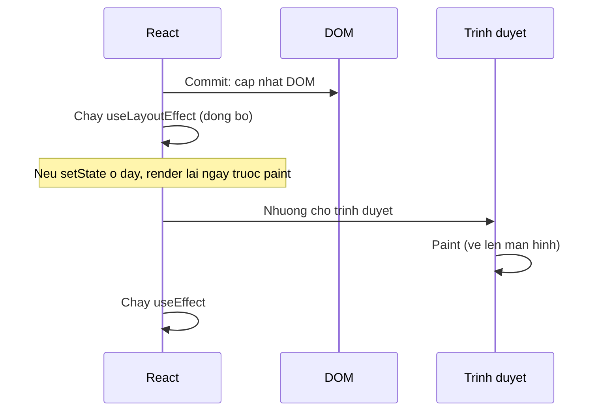

# Lý thuyết 33: useReducer và các hook nâng cao khác

Bài này cần nắm [Bài 2](/go?p=09-React%2Feasy%2Flt-02-hooks-co-ban.md) (`useState`) trước.

## useReducer

`useReducer` gom mọi cách thay đổi state vào một hàm duy nhất gọi là **reducer**: nhận state hiện tại cùng một **action** (object mô tả "chuyện gì vừa xảy ra", thường có trường `type`) rồi trả về state mới. Component không tự sửa state mà **dispatch** action. Nhờ vậy mọi quy tắc chuyển state nằm ở một chỗ, dễ đọc và dễ test độc lập với UI.

**Tóm tắt:**

- `useReducer` gom mọi quy tắc chuyển state vào một hàm reducer thuần (cùng state và action thì luôn ra cùng state mới, không sửa state cũ), component chỉ `dispatch` action.
- Dùng khi nhiều giá trị state liên quan nhau hoặc logic cập nhật phức tạp; `useState` vẫn gọn hơn cho một cờ bật tắt hay một ô nhập đơn giản.
- `useLayoutEffect` chạy sync sau khi DOM cập nhật và trước khi trình duyệt paint, dùng để đo layout rồi chỉnh tránh nhấp nháy; mặc định vẫn nên dùng `useEffect`.
- `useId` sinh id ổn định khớp giữa server và client, dùng cho `htmlFor`/`aria-*`, không dùng làm `key` danh sách.
- Cả hai hook `useLayoutEffect` và `useId` đều hiếm khi cần, nhưng giải đúng một vấn đề cụ thể mà `useState`/`useEffect` thường không giải được gọn.

Dùng khi nhiều giá trị state liên quan nhau, hoặc logic cập nhật phức tạp, hoặc muốn test logic riêng. Không cần dùng khi state chỉ là một cờ bật tắt hay một ô nhập: `useState` ngắn gọn hơn. Nếu dùng sai (ví dụ reducer sửa trực tiếp state cũ) component sẽ không render lại vì tham chiếu không đổi.

```tsx
type State = { items: string[]; status: "idle" | "saving" | "error" };
type Action =
  | { type: "add"; text: string }
  | { type: "saveStart" }
  | { type: "saveFail" };

function reducer(s: State, a: Action): State {
  switch (a.type) {
    case "add":       return { ...s, items: [...s.items, a.text] };
    case "saveStart": return { ...s, status: "saving" };
    case "saveFail":  return { ...s, status: "error" };
  }
}

const [state, dispatch] = useReducer(reducer, { items: [], status: "idle" });
```

| | `useState` | `useReducer` |
|---|---|---|
| State đơn giản, độc lập | Phù hợp | Thừa |
| Nhiều trường liên quan, chuyển state | Nhiều `setX` dễ lệch | Một nơi quyết định |
| `dispatch` ổn định tham chiếu | `setState` cũng ổn định | Có lợi khi đưa xuống con qua Context |
| Reducer phải thuần | | Cũng gọi hai lần trong StrictMode |

Mẹo: tách state và dispatch ra hai Context để consumer chỉ dispatch không bị render lại khi state đổi.

## useLayoutEffect

Chạy **sync sau khi DOM cập nhật, trước khi trình duyệt paint**. Dùng để đo layout (`getBoundingClientRect`) rồi chỉnh vị trí tooltip, tránh nhấp nháy.

| | `useEffect` | `useLayoutEffect` |
|---|---|---|
| Thời điểm | Sau paint | Trước paint, chặn paint |
| Dùng cho | Hầu hết effect | Đo và sửa DOM tránh flicker |
| SSR | Không chạy | Không chạy trên server; React cảnh báo ở các phiên bản cũ (xem react.dev cho phiên bản bạn dùng) |
| Rủi ro | Flicker khi cần đo | Chậm trình duyệt nếu làm nặng |

**Phải thuộc:** `useEffect` chạy sau paint, `useLayoutEffect` chạy sync sau khi DOM cập nhật và trước paint (chặn paint). Mặc định dùng `useEffect`; chỉ chuyển sang `useLayoutEffect` khi cần đo layout rồi chỉnh để tránh flicker, và không chạy trên server.

Sơ đồ dưới đây cho thấy vị trí của hai loại effect trong một lần cập nhật:



Đọc sơ đồ: vì `useLayoutEffect` chạy trước paint, bạn có thể đo kích thước, `setState` rồi React render lại ngay mà người dùng không bao giờ thấy khung hình sai. Với `useEffect`, người dùng đã thấy khung hình đầu rồi mới thấy khung hình sửa, tức là nhấp nháy. Đổi lại, mọi việc nặng trong `useLayoutEffect` đều làm chậm lần vẽ đầu tiên.

Mặc định dùng `useEffect`; chuyển sang `useLayoutEffect` chỉ khi thấy nhấp nháy do đo-rồi-set.

## useId

Sinh id ổn định, **khớp giữa server và client**, dùng cho `htmlFor`/`aria-*`. Không dùng làm `key` của danh sách. Không dùng `Math.random()` hoặc biến đếm toàn cục vì gây hydration mismatch ([Bài 9](/go?p=09-React%2Fhard%2Flt-09-ssr-rsc-nextjs.md)).

```tsx
function Field({ label }: { label: string }) {
  const id = useId();
  return (<><label htmlFor={id}>{label}</label><input id={id} /></>);
}
```

## Bẫy thường gặp

| Bẫy | Hậu quả | Cách sửa |
|---|---|---|
| Reducer mutate state | Không render, bug StrictMode | Trả về object mới |
| `useLayoutEffect` làm việc nặng | Chặn paint, giật | Chuyển sang `useEffect` |
| Dùng `useId` làm `key` danh sách | Sai ý nghĩa, không ổn định theo dữ liệu | Dùng id từ chính dữ liệu làm key |

## Câu hỏi phỏng vấn thường gặp

Mỗi câu theo chuỗi: câu hỏi, gợi ý suy luận, lập luận, đáp án ngắn, kiến thức cần nhớ. Hãy tự trả lời trước khi đọc tiếp.

### 1. Khi nào chọn `useReducer` thay `useState`?

**Gợi ý suy luận:**
- Các trường state có liên quan và đổi cùng nhau theo quy tắc không?
- Bạn muốn logic cập nhật nằm ở đâu để test?

**Lập luận:** Vì nhiều `setX` rải rác dễ tạo state bất khả thi, gom logic vào reducer (hàm thuần state, action) giúp chuyển state rõ ràng và test độc lập.

**Đáp án ngắn:** Khi nhiều state liên quan, chuyển state phức tạp, muốn tập trung và test logic.

**Nhớ:** Reducer = logic cập nhật thuần.

### 2. Tooltip chớp sai vị trí một khung hình. `useLayoutEffect` khác `useEffect` ra sao?

**Gợi ý suy luận:**
- `useEffect` chạy trước hay sau paint?
- Muốn đo DOM rồi chỉnh trước khi người dùng thấy thì chạy lúc nào?

**Lập luận:** Vì `useEffect` chạy sau paint nên khung đầu sai lọt ra màn hình (flicker). `useLayoutEffect` chạy sync sau khi cập nhật DOM, trước paint, nên đo và chỉnh xong rồi mới hiện. Vì chạy sync chặn paint, không dùng cho việc nặng, và không chạy trên server vì không có DOM.

**Đáp án ngắn:** Chạy trước paint và sync; dùng đo layout rồi chỉnh để tránh flicker; không chạy trên server.

**Nhớ:** Mặc định `useEffect`, chỉ hạ xuống layout khi thấy flicker.

### 3. Server render ra id khác client gây hydration mismatch. `useId` giải quyết gì?

**Gợi ý suy luận:**
- Tạo id bằng random hoặc counter toàn cục khác nhau giữa server và client ở điểm nào?
- Cần property gì của id?

**Lập luận:** Vì random và counter toàn cục cho kết quả khác giữa hai môi trường, HTML từ server không khớp lúc hydrate. `useId` sinh id dựa trên vị trí trong cây nên ổn định giữa server và client.

**Đáp án ngắn:** Tạo id ổn định giữa server và client, tránh mismatch (dùng cho `htmlFor`, `aria-*`).

**Nhớ:** Không dùng làm key danh sách.

Tiếp theo: [Bài 34: Custom Hook](/go?p=09-React%2Fmedium%2Flt-34-custom-hook.md).
