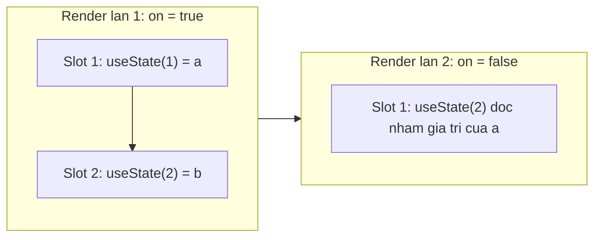

# Lý thuyết 35: Hooks Best Practices (Rules of Hooks)

Bài này cần nắm [Bài 2](/go?p=09-React%2Feasy%2Flt-02-hooks-co-ban.md) trước.

## Hai quy tắc và lý do

Hai quy tắc: chỉ gọi hook ở top-level (không trong `if`, vòng lặp, hàm lồng, sau `return` sớm); chỉ gọi từ function component hoặc custom hook.

**Tóm tắt:**

- Hai quy tắc của hooks: chỉ gọi ở top-level của component/custom hook (không trong điều kiện, vòng lặp, hàm lồng, sau `return` sớm); chỉ gọi từ function component hoặc custom hook (tên bắt đầu bằng `use`).
- Lý do duy nhất: React không nhận diện hook theo tên mà theo **thứ tự gọi** trong một danh sách gắn trên fiber của component.
- Nếu số hoặc thứ tự hook đổi giữa hai lần render, hook ở vị trí sau đọc nhầm slot của hook khác, gây lỗi "Rendered fewer hooks than expected" hoặc state gắn sai.
- Ngoại lệ duy nhất ở React 19: `use()` được phép gọi trong điều kiện và vòng lặp; mọi hook khác vẫn tuân quy tắc cũ.
- `eslint-plugin-react-hooks` (rule `rules-of-hooks` và `exhaustive-deps`) tồn tại chính để bắt lỗi này ngay lúc viết code, nên luôn nên bật.

Lý do: React không lưu hook theo tên mà theo **thứ tự gọi**. Mỗi fiber có một danh sách liên kết các hook; lần render thứ n đọc phần tử thứ n. Nếu số hay thứ tự hook đổi giữa các lần render, state bị gắn nhầm.

**Nền tảng:** Hook được nhận diện bằng thứ tự gọi trong danh sách gắn trên fiber của component, không phải bằng tên. Đây là lý do duy nhất khiến hooks không được gọi có điều kiện.



Ở lần render thứ hai chỉ còn một hook nhưng danh sách cũ có hai phần tử, nên `b` đọc nhầm slot 1 và React báo lỗi số hook không khớp. Ví dụ sai kinh điển:

```tsx
function Bad({ on }: { on: boolean }) {
  if (on) { const [a] = useState(1); }  // lần render sau không gọi, danh sách lệch
  const [b] = useState(2);              // b có thể đọc nhầm slot của a
}
```

Exception với React 19: `use()` có thể gọi trong điều kiện và vòng lặp (xem [Bài 8](/go?p=09-React%2Fhard%2Flt-08-fiber-concurrent.md) và [Bài 9](/go?p=09-React%2Fhard%2Flt-09-ssr-rsc-nextjs.md)). Các hook khác vẫn tuân quy tắc. Đây là lý do `eslint-plugin-react-hooks` (rules-of-hooks, exhaustive-deps) nên luôn bật.

## Bẫy thường gặp

| Bẫy | Hậu quả | Cách sửa |
|---|---|---|
| Gọi hook có điều kiện | Lỗi "Rendered fewer hooks" | Đưa điều kiện vào trong hook hoặc tách component |
| Gọi hook sau một `return` sớm | Số hook đổi giữa các lần render có/không vào nhánh return | Đặt mọi hook trước bất kỳ `return` nào |
| Gọi hook trong vòng lặp với số lần lặp thay đổi | Số hook thay đổi giữa các render | Dùng một hook duy nhất quản lý mảng, hoặc tách component con cho từng phần tử |
| Tắt `eslint-plugin-react-hooks` vì thấy cảnh báo phiền | Mất lưới an toàn, bug âm thầm | Sửa theo cảnh báo thay vì tắt rule |

## Câu hỏi phỏng vấn thường gặp

Mỗi câu theo chuỗi: câu hỏi, gợi ý suy luận, lập luận, đáp án ngắn, kiến thức cần nhớ. Hãy tự trả lời trước khi đọc tiếp.

### 1. Đặt `useState` trong `if` thì state gắn sai. Vì sao hooks không được gọi trong điều kiện?

**Gợi ý suy luận:**
- Hook không có tên, React phân biệt chúng bằng gì?
- Nếu một render bỏ qua một hook thì các hook sau lệch thế nào?

**Lập luận:** Vì React định danh hook theo thứ tự gọi trong danh sách gắn trên fiber. Thứ tự đổi giữa hai render thì hook sau đọc nhầm slot, nên state gắn sai.

**Đáp án ngắn:** React định danh hook theo thứ tự gọi trên mỗi fiber; thứ tự đổi thì state gắn sai.

**Nhớ:** Gọi hook vô điều kiện, ở cấp cao nhất.

### 2. React 19 có ngoại lệ nào cho quy tắc hooks không?

**Gợi ý suy luận:**
- `use()` khác các hook khác (`useState`, `useEffect`...) ở cơ chế theo dõi vị trí không?
- Nếu nó không dựa vào thứ tự gọi cố định, nó có an toàn khi gọi trong điều kiện/vòng lặp không?

**Lập luận:** Vì `use()` được thiết kế để đọc một resource (Promise hoặc Context) tại đúng thời điểm gọi mà không phụ thuộc vào vị trí cố định trong danh sách hook như các hook truyền thống, nó được phép gọi trong điều kiện và vòng lặp. Mọi hook khác (`useState`, `useEffect`, `useMemo`...) vẫn tuân quy tắc cũ vì chúng vẫn định danh theo thứ tự gọi trên fiber.

**Đáp án ngắn:** Có, `use()` là ngoại lệ duy nhất được gọi trong điều kiện/vòng lặp; mọi hook khác vẫn phải gọi vô điều kiện ở top-level.

**Nhớ:** chỉ `use()` là ngoại lệ, không áp dụng cho hook khác.

Tiếp theo: [Bài 5: State management](/go?p=09-React%2Fmedium%2Flt-05-state-management.md).
