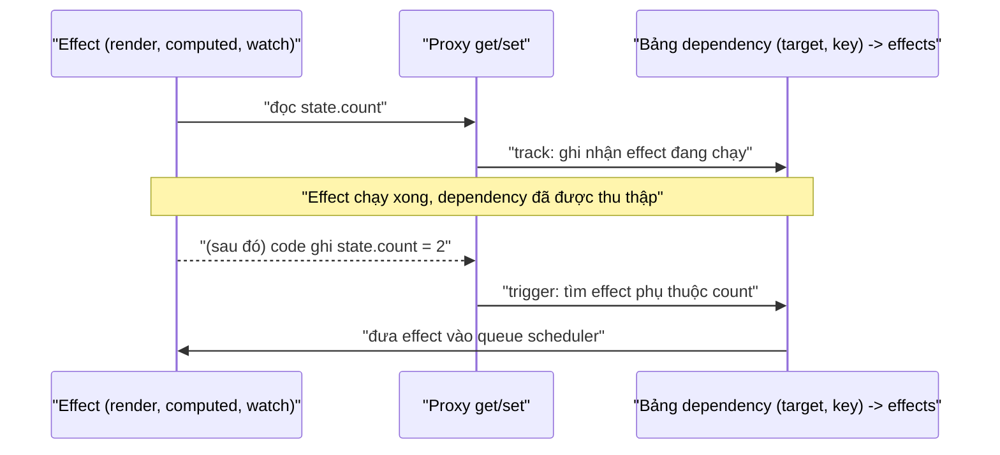
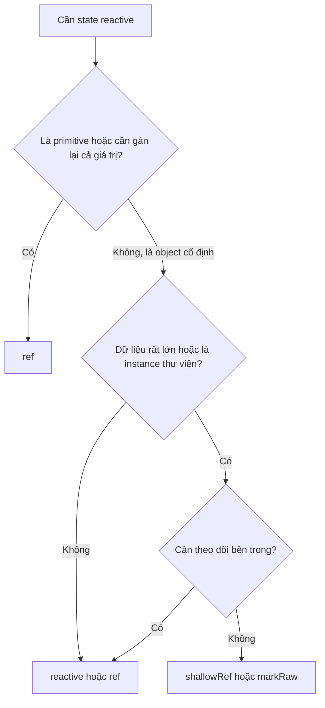
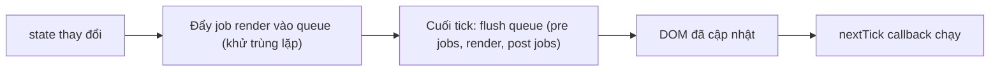

# Lý thuyết 1: Reactivity trong Vue 3

Bài nền tảng của cả bộ tài liệu. Hầu hết bẫy ở các bài sau (computed, watch, Pinia, hiệu năng) đều quy về cơ chế trong bài này.

## Reactivity là gì?

Hãy hình dung một bảng tính Excel: ô C1 có công thức `=A1+B1`. Bạn sửa A1 thì C1 tự tính lại, mà bạn không phải bảo nó làm vậy. Reactivity của Vue 3 làm đúng điều đó cho UI: bạn chỉ việc đổi dữ liệu, phần UI đang dùng dữ liệu ấy tự cập nhật.

Cách Vue làm được là dùng `Proxy` (một lớp bọc của JavaScript cho phép chặn mọi thao tác đọc và ghi trên một object). Khi code **đọc** dữ liệu bên trong một "effect" (đoạn code cần chạy lại khi dữ liệu đổi), Vue ghi nhận "effect này phụ thuộc vào dữ liệu kia": thao tác này gọi là **track**. Khi code **ghi** dữ liệu, Vue tìm những effect đã ghi nhận và cho chúng chạy lại: thao tác này gọi là **trigger**. Hàm render của component, `computed` và `watch` đều là effect, còn `ref` và `reactive` là hai cách tạo ra dữ liệu mà Vue theo dõi được.

## Vì sao phải hiểu cơ chế này

Phần lớn lỗi kiểu "UI không cập nhật", "watch không chạy", "mất reactivity sau khi destructure" đều đến từ hiểu sai cơ chế trên, và hầu hết bẫy ở các bài sau (computed, watch, Pinia, hiệu năng) quy về nó. Câu hỏi phỏng vấn Senior về Vue cũng thường bắt đầu từ đây.

Bạn sẽ dùng kiến thức này mỗi lần khai báo state, truyền state giữa các composable (hàm tái sử dụng logic có state, ví dụ `useCounter()`), tách giá trị ra khỏi một object, hoặc tối ưu cho dữ liệu lớn. Mô hình cần nhớ chỉ một câu: **đọc trong effect thì được ghi nhận, ghi thì effect liên quan chạy lại**. Từ đó suy ra ba thói quen: dùng `ref` làm mặc định, giữ nguyên "vỏ" reactive khi truyền dữ liệu đi (`toRef`, `toRefs`, getter), và dùng `shallowRef` cho dữ liệu lớn.

## Các khái niệm cần biết

- **Effect:** một hàm mà Vue chạy lại khi dữ liệu nó đã đọc thay đổi. Bạn ít khi tạo trực tiếp; `watchEffect`, `computed` và render của component đều tạo effect cho bạn.
- **Scheduler:** queue của Vue quyết định khi nào effect của component được chạy lại. Nhờ nó, nhiều lần ghi liên tiếp chỉ gây một lần render.
- **Unwrap:** việc tự lấy `.value` ra giúp bạn. Trong template, `{{ count }}` tự unwrap ref nên không cần viết `count.value`.
- **Microtask:** queue tác vụ nhỏ của JavaScript, chạy ngay sau đoạn code hiện tại và trước khi trình duyệt vẽ lại. Vue flush queue render ở đây.
- **`Object.is`:** phép so sánh bằng chặt chẽ mà Vue dùng để quyết định giá trị có "thật sự đổi" không. Gán lại đúng giá trị cũ thì không trigger.
- **Shallow (nông) và deep (sâu):** deep nghĩa là mọi object lồng bên trong đều được theo dõi; shallow chỉ theo dõi lớp ngoài cùng. Mặc định của Vue là deep.

**Tóm tắt:**

- Reactivity của Vue 3 dựa trên `Proxy`: effect đọc dữ liệu thì được track, ghi dữ liệu thì trigger và effect liên quan chạy lại.
- Render của component, `computed` và `watch` đều là effect, nên hiểu cơ chế này là hiểu gốc của hầu hết bẫy ở các bài sau.
- Dependency được thu thập lại mỗi lần effect chạy, nên nhánh không được đọc thì không tạo dependency.
- `ref` nhận mọi kiểu và cần `.value` trong script; `reactive` chỉ nhận object và mất reactivity khi gán lại biến hoặc destructure primitive. Mặc định chọn `ref`.
- Muốn tách property mà vẫn giữ liên kết thì dùng `toRef`, `toRefs` hoặc truyền getter, không gán thông thường.
- Dữ liệu lớn hoặc instance thư viện ngoài nên dùng `shallowRef`, `shallowReactive` hoặc `markRaw` để tránh chi phí proxy sâu.
- Cập nhật DOM là async: các lần ghi trong cùng tick được gộp và flush ở microtask, muốn đọc DOM mới thì `await nextTick()`.

## Mô hình track và trigger

Sơ đồ sau cho thấy toàn bộ lifecycle của một dependency: effect chạy và đọc dữ liệu (track), về sau dữ liệu bị ghi (trigger), và effect được xếp hàng chạy lại.



Ý chính:

- Khi một effect chạy, Vue lưu nó vào biến "effect đang hoạt động". Mỗi lần `get` trên proxy, `track(target, key)` gắn effect đó vào key.
- Khi `set` làm giá trị đổi (so bằng `Object.is`), `trigger(target, key)` lấy các effect của key và lập lịch chạy lại.
- Dependency được **thu thập lại mỗi lần chạy**, nên nhánh `if` không được đọc thì không tạo dependency. Đây là lý do `watchEffect` chỉ theo dõi những gì thực sự được đọc.
- Từ Vue 3.5, hệ thống dependency được viết lại theo cơ chế version counting và liên kết hai chiều, giảm memory và tăng tốc, nhưng mô hình khái niệm không đổi.

Hệ quả thực tế của việc "thu thập lại mỗi lần chạy": nếu bạn viết `cond.value ? a.value : b.value`, khi `cond` đang `true` thì đổi `b` không làm effect chạy lại, vì `b` chưa từng được đọc. Đây là hành vi đúng, giúp Vue không chạy thừa.

**Nền tảng:** reactivity của Vue 3 chỉ là hai việc: lúc effect đọc dữ liệu qua `Proxy` thì ghi nhận dependency (track), lúc ghi thì tra ra các effect đã ghi nhận và xếp lịch chạy lại (trigger). Render, `computed`, `watch` đều là effect, nên hiểu cơ chế này là hiểu gốc của mọi bẫy ở các bài sau.

Mini phiên bản (để hiểu, không dùng thật):

```ts
const targetMap = new WeakMap<object, Map<PropertyKey, Set<() => void>>>()
let activeEffect: (() => void) | null = null

function track(target: object, key: PropertyKey) {
  if (!activeEffect) return
  let deps = targetMap.get(target)
  if (!deps) targetMap.set(target, (deps = new Map()))
  let set = deps.get(key)
  if (!set) deps.set(key, (set = new Set()))
  set.add(activeEffect)
}

function trigger(target: object, key: PropertyKey) {
  targetMap.get(target)?.get(key)?.forEach((fn) => fn())
}

function reactive<T extends object>(obj: T): T {
  return new Proxy(obj, {
    get(t, k, r) { track(t, k); return Reflect.get(t, k, r) },
    set(t, k, v, r) {
      const ok = Reflect.set(t, k, v, r)
      trigger(t, k)
      return ok
    },
  })
}
```

## ref và reactive

Vue cho hai cách tạo dữ liệu reactive. Vấn đề là proxy chỉ bọc được object, còn số hay chuỗi (primitive) thì không bọc được. `ref` giải quyết bằng cách đặt giá trị vào một "hộp" object có property `.value`; `reactive` thì bọc trực tiếp chính object bạn đưa vào. Sự khác biệt đó kéo theo mọi điểm trong bảng dưới.

| | `ref` | `reactive` |
|---|---|---|
| Kiểu hỗ trợ | Mọi kiểu (primitive, object) | Chỉ object, array, Map, Set |
| Cách truy cập | `.value` trong script, tự unwrap trong template | Truy cập property trực tiếp |
| Gán lại cả biến | Được (`r.value = {...}`) | **Mất reactivity** nếu gán lại biến, vì biến trỏ sang object khác |
| Destructure | `const { value } = r` là copy | Property primitive bị copy, mất reactivity |
| Khuyến nghị | Mặc định | Dùng khi muốn object cố định, ít khi cần |

Cách nhớ: `ref` là một cái hộp có `.value`, hộp luôn là reactive. `reactive` trả về proxy của chính object, nên bạn phải giữ proxy đó.

**Phải thuộc:** `ref` nhận mọi kiểu, cần `.value` trong script và tự unwrap trong template; `reactive` chỉ nhận object, array, Map, Set, không có `.value` nhưng gán lại biến hoặc destructure primitive là mất reactivity. Mặc định chọn `ref`.

`ref` chứa object sẽ gọi `reactive` bên trong, nên `ref({a: 1}).value.a` vẫn reactive sâu (deep). Proxy chỉ tạo **lazy**: object lồng nhau chỉ bị bọc khi được truy cập.

Giới hạn của `reactive`:

- Không giữ được primitive (`reactive(1)` không có tác dụng).
- Gán lại biến hoặc truyền cho hàm rồi gán lại sẽ mất liên kết.
- Cần cẩn thận khi so sánh: `reactive(obj) !== obj`. Dùng `toRaw` khi cần object gốc.

Cách chọn nhanh: nếu phân vân thì dùng `ref`. Sơ đồ dưới tóm tắt các lựa chọn, kể cả khi dữ liệu lớn.



## Mất reactivity khi destructure

Đây là lỗi phổ biến nhất của người mới. Lý do: `reactive` chỉ theo dõi việc đọc và ghi **qua proxy**. Khi bạn destructure một property primitive, bạn lấy ra một con số thường, không còn đi qua proxy nữa nên Vue không biết gì về nó.

```ts
import { reactive, toRefs, toRef, ref } from 'vue'

const state = reactive({ count: 0, name: 'Vue' })

// SAI: count chỉ là number 0, copy tại thời điểm này
let { count } = state
count++ // không ảnh hưởng state

// ĐÚNG 1: giữ liên kết bằng ref trỏ vào property
const countRef = toRef(state, 'count')
countRef.value++ // state.count cũng tăng

// ĐÚNG 2: toRefs cho cả object (hay dùng khi return từ composable)
const { count: c, name } = toRefs(state)

// Props trong Vue 3.5: destructure trong <script setup> được compiler biến đổi
// const { title } = defineProps<{ title: string }>()
// title được compile thành props.title nên vẫn reactive (xem Bài 2)
```

Quy tắc: **không tách property ra khỏi object reactive bằng phép gán thông thường**. Nếu cần, dùng `toRef`, `toRefs`, hoặc truyền một getter `() => state.count`.

Cùng loại bẫy với hàm:

```ts
function useDouble(n: number) { /* nhận giá trị, không reactive */ }
useDouble(state.count)          // SAI

import { toValue, type MaybeRefOrGetter, computed } from 'vue'
function useDoubleOk(n: MaybeRefOrGetter<number>) {
  return computed(() => toValue(n) * 2)
}
useDoubleOk(() => state.count)  // ĐÚNG
```

`toValue` (từ 3.3) chuẩn hóa ref, getter và giá trị thường, là cách viết composable nhận input linh hoạt.

## shallowRef và shallowReactive

Theo mặc định Vue theo dõi sâu, và với một mảng 50.000 dòng hoặc một instance của thư viện bản đồ, chi phí bọc proxy và theo dõi từng property là không đáng. Các API "shallow" cho bạn tắt theo dõi sâu: Vue chỉ để ý khi bạn thay cả giá trị. Nên dùng khi dữ liệu lớn và bạn luôn cập nhật bằng cách gán mới cả khối; không nên dùng khi bạn hay sửa từng phần tử bên trong và muốn UI tự cập nhật, vì lúc đó UI sẽ đứng yên.

| API | Theo dõi | Dùng khi |
|---|---|---|
| `shallowRef` | Chỉ `.value` (gán lại mới trigger) | Dữ liệu lớn bất biến, instance của class ngoài (chart, map), danh sách lớn thay cả mảng |
| `shallowReactive` | Chỉ property cấp 1 | Ít gặp |
| `markRaw` | Không bao giờ bị proxy | Instance thư viện thứ ba, object lớn tĩnh |
| `triggerRef` | Ép trigger | Sau khi sửa trực tiếp bên trong `shallowRef` |

```ts
const rows = shallowRef<Row[]>([])
rows.value.push(newRow)      // KHÔNG trigger
rows.value = [...rows.value, newRow] // trigger (thay cả mảng)
```

Chi tiết hiệu năng ở [Bài 8](/go?p=10-Vue%2Fhard%2Flt-08-hieu-nang-rendering.md).

## Thời điểm cập nhật DOM và nextTick

Vấn đề đặt ra: sau khi bạn gán `text.value = 'b'`, DOM chưa đổi ngay, nên đọc DOM lúc đó vẫn thấy giá trị cũ. Lý do là Vue cố ý trì hoãn để gộp nhiều thay đổi thành một lần vẽ. `nextTick` là cách đợi tới khi lần vẽ đó xong.

Trigger không chạy render ngay. Effect của component được đưa vào queue (scheduler), **gộp (batch)** và chạy trong microtask. Nhiều lần ghi cùng tick chỉ render một lần.



```vue
<script setup lang="ts">
import { ref, nextTick, useTemplateRef } from 'vue'

const text = ref('a')
const el = useTemplateRef<HTMLElement>('box') // Vue 3.5

async function update() {
  text.value = 'b'
  console.log(el.value?.textContent) // vẫn là 'a'
  await nextTick()
  console.log(el.value?.textContent) // 'b'
}
</script>

<template>
  <div ref="box">{{ text }}</div>
  <button @click="update">Cập nhật</button>
</template>
```

Quy tắc: cần đọc DOM sau khi đổi state thì `await nextTick()`. Đừng dùng `setTimeout` để "chờ".

**Phải thuộc:** cập nhật DOM của Vue là async: nhiều lần ghi trong cùng tick được gộp và khử trùng lặp, flush ở microtask; muốn đọc DOM đã cập nhật thì `await nextTick()`.

## Hành vi cần thuộc

| Chủ đề | Hành vi |
|---|---|
| Mảng reactive | `push`, `splice`, gán theo index đều được theo dõi (khác Vue 2) |
| Thêm property mới | Reactive (không cần `Vue.set`) |
| `Map`, `Set` | Reactive qua `reactive` |
| Giá trị trùng | Gán giá trị bằng `Object.is` thì không trigger |
| Object trong `ref` | Deep mặc định; `shallowRef` để tắt |
| `reactive` lồng `ref` | Tự unwrap khi là property của object reactive, **không** unwrap khi là phần tử mảng reactive |
| `readonly` | Proxy chỉ đọc, ghi sẽ cảnh báo ở dev |

## Bẫy thường gặp

| Bẫy | Hậu quả | Cách tránh |
|---|---|---|
| Destructure `reactive` hoặc gán `state = ...` | Mất reactivity | `toRefs`, giữ nguyên biến, dùng `Object.assign(state, next)` |
| Quên `.value` trong script | So sánh sai, gán đè mất ref | Bật lint, dùng TypeScript |
| `shallowRef` rồi sửa bên trong | UI không cập nhật | Thay cả value hoặc `triggerRef` |
| Đọc DOM ngay sau khi sửa state | Thấy giá trị cũ | `await nextTick()` |
| Truyền `state.x` vào composable | Mất liên kết | Truyền getter hoặc ref, dùng `toValue` |
| Object lớn đưa vào `ref` | Tốn memory, chậm | `shallowRef` hoặc `markRaw` |
| Dùng proxy làm key của `Map` bên ngoài | Tra cứu hụt vì proxy khác object gốc | Dùng `toRaw` nhất quán |
| Template ref không có sau `await` đầu tiên | `null` vì chưa mount | Dùng sau `onMounted` hoặc `nextTick` |

## Câu hỏi phỏng vấn thường gặp

1. Thêm một property mới vào object, hoặc gán `arr[3] = x`, thì ở Vue 2 UI không cập nhật còn Vue 3 thì có. Vì sao hai phiên bản khác nhau?

   **Gợi ý suy luận:**
   - Muốn biết một property được đọc hoặc ghi, ta phải "chặn" thao tác ở đâu? Có thể chặn trên property đã tồn tại, hay trên cả object?
   - Một property chưa tồn tại lúc khởi tạo thì có sẵn chỗ để gắn interceptor không?

   **Lập luận:** Vue 2 dùng `Object.defineProperty` gắn getter/setter lên từng property có sẵn lúc khởi tạo, nên property thêm sau, thao tác xóa hay đổi theo chỉ số mảng đều không có interceptor nào để bắt. Vue 3 dùng `Proxy` bọc cả object và chặn mọi thao tác (đọc, ghi, thêm, xóa), nên bắt được tất cả. Proxy cũng được tạo lazy: object lồng bên trong chỉ bọc khi được truy cập, không duyệt đệ quy ngay.

   **Đáp án ngắn:** Vue 2 chặn từng property bằng `defineProperty` nên bỏ sót thêm/xóa và chỉ số mảng; Vue 3 dùng `Proxy` bắt toàn bộ thao tác và tạo proxy lazy.

   **Nhớ:** Proxy chặn ở mức object, nên property mới cũng được theo dõi.

2. Bạn gõ `state.count = 2` ở đâu đó trong code, và một phần UI tự đổi theo. Giải thích bằng track và trigger.

   **Gợi ý suy luận:**
   - Vue cần biết gì về "ai đang dùng `count`" trước khi `count` thay đổi? Biết bằng cách nào khi code chỉ đọc giá trị?
   - Khi ghi, Vue lấy danh sách đó ở đâu và làm gì với nó?
   - Effect chạy lại có thu thập lại dependency không?

   **Lập luận:** khi một effect (render, `computed`, `watch`) chạy, Vue đặt nó làm "effect đang hoạt động". Mỗi lần effect đọc `state.count` qua proxy, `track` gắn effect đó vào bảng dependency của key `count`. Khi ghi, proxy so giá trị (bằng `Object.is`), nếu đổi thì `trigger` tra bảng ra các effect của `count` và đưa vào queue chạy lại. Dependency được thu thập lại mỗi lần chạy, nên nhánh `if` không được đọc thì không tạo dependency.

   **Đáp án ngắn:** đọc trong effect thì được ghi nhận (track); ghi thì các effect có dependency được xếp lịch chạy lại (trigger).

   **Nhớ:** mô hình một câu: đọc trong effect thì ghi nhận, ghi thì effect liên quan chạy lại. Xem mục "Mô hình track và trigger".

3. Bạn cần khai báo một số đếm và một object config. Chọn `ref` hay `reactive`, và vì sao?

   **Gợi ý suy luận:**
   - Proxy bọc được primitive không? Vậy một số hay chuỗi phải được giữ ở dạng gì?
   - Nếu sau này gán lại cả object (`state = {...}`), biến trỏ sang đâu và proxy cũ còn ý nghĩa không?

   **Lập luận:** proxy chỉ bọc được object, nên primitive phải nằm trong một "hộp" có `.value`: đó là `ref`, dùng được cho mọi kiểu. Gán lại `r.value = {...}` vẫn đi qua hộp nên giữ được reactivity. Còn `reactive` trả về proxy của chính object, nếu gán lại biến sang object khác thì mất liên kết, nên chỉ hợp object cố định. Vì thế mặc định chọn `ref`; `reactive` khi muốn tránh `.value` với object không bị gán lại.

   **Đáp án ngắn:** mặc định `ref` vì dùng cho mọi kiểu và gán lại được; `reactive` chỉ cho object cố định.

   **Nhớ:** `ref` là hộp luôn reactive, `reactive` là proxy bạn phải giữ nguyên.

4. `const { count } = state` rồi `count++` nhưng UI không đổi. Vì sao, và sửa thế nào?

   **Gợi ý suy luận:**
   - Reactivity chỉ theo dõi đọc/ghi đi qua cái gì (proxy)?
   - Khi destructure một primitive, bạn lấy ra proxy hay một con số thường?

   **Lập luận:** vì chỉ thao tác qua proxy mới bị chặn, mà destructure primitive lấy ra bản sao số tại thời điểm đó, không còn đi qua proxy nên Vue không biết gì. Muốn giữ liên kết thì phải giữ "vỏ": `toRef(state, 'count')` hoặc `toRefs(state)` tạo ref trỏ vào property, hoặc truyền một getter `() => state.count`; composable nhận `MaybeRefOrGetter` và đọc bằng `toValue`.

   **Đáp án ngắn:** primitive bị copy ra khỏi proxy nên mất liên kết; dùng `toRef`, `toRefs` hoặc getter.

   **Nhớ:** không tách property khỏi object reactive bằng phép gán thông thường.

5. Gán `text.value = 'b'` rồi đọc DOM ngay vẫn thấy giá trị cũ. `nextTick` làm gì?

   **Gợi ý suy luận:**
   - Trigger có chạy render ngay lập tức không, hay xếp vào queue?
   - Queue đó được xả khi nào (microtask), và vì sao nên gom thay vì render mỗi lần ghi?

   **Lập luận:** trigger chỉ đẩy job render vào queue của scheduler, chưa vẽ ngay, để gom nhiều thay đổi thành một lần vẽ. Queue được xả ở microtask sau đoạn code hiện tại, nên ngay sau lúc ghi DOM chưa đổi. `nextTick` trả promise resolve sau lần xả đó, nên `await nextTick()` rồi đọc DOM sẽ thấy giá trị mới.

   **Đáp án ngắn:** `nextTick` trả promise resolve sau lần flush DOM kế tiếp, để đọc DOM đã cập nhật.

   **Nhớ:** cần đọc DOM sau khi đổi state thì `await nextTick()`, đừng dùng `setTimeout`.

6. Bảng 50.000 dòng làm trang giật mỗi khi tải. Khi nào dùng `shallowRef`, và có đánh đổi gì?

   **Gợi ý suy luận:**
   - Theo dõi sâu 50.000 object tốn gì (proxy cho từng object, bảng dependency)?
   - Nếu chỉ theo dõi `.value`, thì thao tác nào còn kích hoạt cập nhật?

   **Lập luận:** mặc định `ref` theo dõi sâu nên mọi phần tử đều bị bọc proxy và theo dõi, tốn memory và CPU với dữ liệu lớn. `shallowRef` chỉ theo dõi việc gán lại `.value`: nếu bạn luôn thay cả mảng (`rows.value = [...]`) thì vẫn cập nhật mà không tốn proxy sâu. Đánh đổi: sửa bên trong (`rows.value.push(x)`) không trigger, phải thay cả giá trị hoặc gọi `triggerRef`.

   **Đáp án ngắn:** dùng cho dữ liệu lớn hoặc instance thư viện, khi luôn thay cả giá trị; sửa bên trong sẽ không cập nhật UI trừ khi `triggerRef`.

   **Nhớ:** `shallowRef` đổi sự tiện lợi lấy hiệu năng.

7. Gán `count.value` ba lần liên tiếp trong một handler nhưng component chỉ render một lần. Vì sao?

   **Gợi ý suy luận:**
   - Mỗi lần ghi, effect render được xếp vào queue thế nào? Nếu nó đã nằm trong queue thì sao?
   - Queue chạy lúc nào?

   **Lập luận:** mỗi trigger chỉ đẩy job render vào queue, và queue khử trùng lặp nên cùng một job chỉ được giữ một lần. Queue được xả ở microtask sau khi handler chạy xong, nên render một lần với giá trị cuối cùng.

   **Đáp án ngắn:** job render được khử trùng lặp trong queue và chạy ở microtask.

   **Nhớ:** batching là lý do ghi nhiều lần vẫn chỉ vẽ một lần.

8. `toRaw` và `markRaw` khác nhau thế nào, và khi nào cần?

   **Gợi ý suy luận:**
   - Nếu `reactive(obj) !== obj`, so sánh object ở nơi khác sẽ ra sao?
   - Một instance thư viện (bản đồ, biểu đồ) có nên bị bọc proxy không?

   **Lập luận:** proxy là một object khác với object gốc, nên so sánh hoặc dùng làm key của `Map` bên ngoài sẽ hụt; `toRaw` lấy object gốc ra từ proxy để tránh lỗi đó. Ngược lại, instance thư viện không cần theo dõi và bị bọc proxy có thể gây lỗi hoặc chậm, nên `markRaw` đánh dấu nó không bao giờ bị proxy.

   **Đáp án ngắn:** `toRaw` lấy object gốc từ proxy; `markRaw` đánh dấu object không bao giờ bị bọc proxy.

   **Nhớ:** một cái đọc ngược khỏi proxy, một cái ngăn proxy ngay từ đầu.

Tiếp theo: [Bài 2: Props, events, slots](/go?p=10-Vue%2Feasy%2Flt-02-component-props-events-slots.md). Phần computed và watch ở [Bài 4](/go?p=10-Vue%2Fmedium%2Flt-04-computed-watch-rendering.md).

