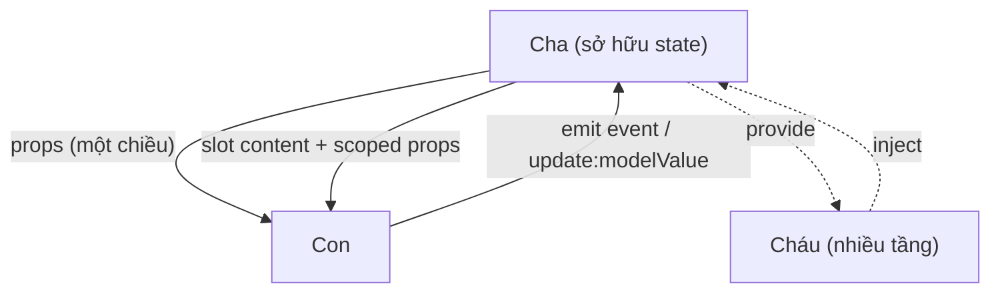
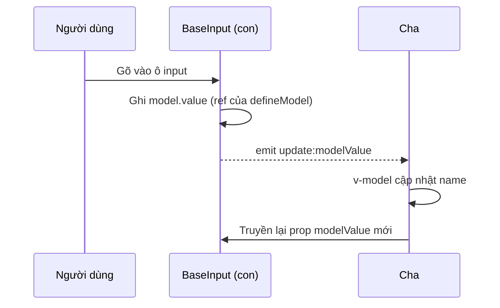

# Lý thuyết 2: Component, props, events, slots

Bài này đào sâu giao tiếp giữa các component. Đọc [Bài 1](/go?p=10-Vue%2Feasy%2Flt-01-reactivity-vue3.md) trước vì nhiều bẫy ở đây liên quan reactivity.

## Component giao tiếp với nhau như thế nào?

Một ứng dụng Vue là một cây component: component cha chứa component con, con chứa cháu. Khi tách UI ra thành nhiều component, câu hỏi ngay lập tức xuất hiện: cha đưa dữ liệu cho con bằng cách nào, con báo lại cho cha ra sao, và cha làm sao tùy biến một phần UI bên trong con? Vue có sẵn các "kênh" cho từng nhu cầu:

- **props:** dữ liệu đi từ cha xuống con.
- **events** và **`v-model`:** con báo event lên cha (và `v-model` là cách gọn để sync hai chiều một giá trị).
- **slots:** cha đưa cả một mảnh UI vào bên trong con.
- **`$attrs`:** các attribute cha truyền nhưng con không khai báo (ví dụ `class`), tự chảy tiếp xuống phần tử gốc.
- **`provide`/`inject`:** đưa dữ liệu xuyên nhiều tầng mà không phải truyền qua từng component ở giữa.

## Vì sao phải thiết kế cẩn thận

Hãy coi mỗi component như một cái máy có ổ cắm (props), nút bấm báo hiệu (events) và khe lắp phụ kiện (slots). Nếu ổ cắm và nút bấm được thiết kế rõ, người khác dùng máy mà không cần mở nó ra. Ngược lại, nếu contract sai (con tự sửa dữ liệu của cha, hoặc phụ thuộc vào cấu trúc bên trong của nhau), bạn gặp coupling chặt, state khó truy vết "ai đã đổi cái này?", và component không tái sử dụng được ở nơi khác.

Bạn sẽ cần bài này mỗi khi tách UI thành component, xây component dùng chung (design system, tức bộ component UI thống nhất cho cả dự án), hoặc viết wrapper (component bọc quanh một phần tử gốc như `<input>` hoặc `<button>`). Nguyên tắc dẫn đường là **dữ liệu chảy xuống, event chảy lên**. Contract được khai báo bằng TypeScript qua `defineProps`, `defineEmits` và `defineModel`; dùng slot khi cần tùy biến UI; dùng `provide/inject` cho context chung.

## Các khái niệm cần biết

- **Coupling (độ phụ thuộc):** mức độ hai phần code phải biết chi tiết bên trong của nhau. Coupling chặt nghĩa là sửa chỗ này dễ làm hỏng chỗ kia.
- **Mutate:** sửa trực tiếp một object hoặc mảng tại chỗ (ví dụ `obj.x = 1`, `arr.push(1)`), khác với việc tạo giá trị mới.
- **Props drilling:** phải truyền một prop qua nhiều component trung gian chỉ để tới component ở sâu bên dưới. `provide/inject` hoặc Pinia giải quyết việc này.
- **Wrapper component:** component mỏng bọc một phần tử hoặc component khác (ví dụ `BaseButton` bọc `<button>`), thêm style hoặc hành vi chung.
- **Renderless component:** component chỉ chứa logic, UI hoàn toàn do cha quyết định qua scoped slot (giải thích ở mục Slots).

**Tóm tắt:**

- Nguyên tắc gốc của giao tiếp component: dữ liệu chảy xuống qua props, event chảy lên qua emit, và chỉ chủ sở hữu mới được sửa dữ liệu.
- Props là một chiều; mutate sâu object prop không bị chặn nhưng là anti-pattern vì phá khả năng truy vết.
- `v-model` trên component thực chất là prop `modelValue` cộng event `update:modelValue`, và `defineModel` gói cặp này thành một `ref` hai chiều.
- Slot được biên dịch trong scope của cha nên không thấy biến của con; muốn dùng dữ liệu của con phải qua scoped slot.
- Attribute không khai báo là props hay emits (`class`, `style`, listener) tự rơi xuống phần tử gốc, và `inheritAttrs: false` cùng `$attrs` dùng để kiểm soát việc này.
- `provide`/`inject` giải bài toán props drilling nhưng tạo data flow ngầm, nên chỉ dùng cho context ổn định như theme hay form.
- Chọn kênh theo phạm vi: props và event cho quan hệ cha con, slot cho UI, `provide`/`inject` cho một nhánh cây, Pinia cho state toàn cục.

## Data flow

Sơ đồ sau tóm tắt các kênh. Nét liền là kênh trực tiếp giữa cha và con, nét đứt là kênh xuyên nhiều tầng.



## Props một chiều

Props là dữ liệu cha giao cho con. Quy tắc quan trọng nhất: dữ liệu chỉ có một chủ sở hữu, và chỉ chủ đó được sửa. Nếu con cũng sửa được thì khi dữ liệu sai, bạn không biết phải tìm lỗi ở đâu.

Con **không được sửa props**. Vue cảnh báo ở dev nếu gán trực tiếp. Sửa object được truyền qua props (mutate sâu) không bị chặn nhưng là anti-pattern vì cha không biết ai đã đổi.

**Nền tảng:** dữ liệu chỉ có một chủ sở hữu và chỉ chủ đó được sửa: dữ liệu chảy xuống qua props, event chảy lên qua emit. Mọi kênh khác (`v-model`, slot, provide/inject) là biến thể của nguyên tắc này.

```vue
<script setup lang="ts">
interface Props {
  title: string
  items?: string[]
  size?: 'sm' | 'md' | 'lg'
}

// Vue 3.5: destructure reactive + default bằng cú pháp JS
const { title, items = [], size = 'md' } = defineProps<Props>()

// Dùng trong watch/computed thì bọc getter
// watch(() => title, ...)
</script>

<template>
  <h2 :class="size">{{ title }} ({{ items.length }})</h2>
</template>
```

Lưu ý:

- Từ Vue 3.5, props destructure trong `<script setup>` là tính năng ổn định. Compiler đổi `title` thành `__props.title`. Nhưng **truyền `title` thẳng vào hàm hoặc `watch(title, ...)` thì không reactive**, phải viết `watch(() => title, ...)`.
- Với mảng và object làm default, kiểu `withDefaults` dùng factory; destructure thì viết giá trị mặc định trực tiếp.
- Boolean prop: `<Comp disabled />` nghĩa là `true` (Vue có boolean casting).
- Props khai báo bằng kiểu TypeScript được compiler chuyển thành runtime props. Kiểu phức tạp import từ file ngoài có thể hạn chế tùy phiên bản, nên giữ kiểu props đơn giản hoặc kiểm tra khi build.

Cần state cục bộ khởi tạo từ props:

```ts
const props = defineProps<{ initial: number }>()
const local = ref(props.initial) // chỉ lấy giá trị ban đầu
// Muốn sync khi props đổi: dùng computed (đọc) hoặc watch (hiếm)
```

## Events và v-model

Khi con muốn đổi dữ liệu mà nó không sở hữu, con không tự sửa mà **emit** (phát) một event, kèm dữ liệu nếu cần. Cha lắng nghe bằng `@ten-su-kien` và tự quyết định có đổi state hay không. Cần khai báo `defineEmits` để có kiểu và để Vue biết đâu là event của component (không bị lẫn vào `$attrs`).

```vue
<script setup lang="ts">
const emit = defineEmits<{
  (e: 'save', payload: { id: number }): void
  (e: 'cancel'): void
}>()

// Cú pháp ngắn gọn từ 3.3
const emit2 = defineEmits<{
  save: [payload: { id: number }]
  cancel: []
}>()
</script>
```

`defineModel` (ổn định từ 3.4) là cách chuẩn để làm `v-model`:

```vue
<!-- BaseInput.vue -->
<script setup lang="ts">
const model = defineModel<string>({ required: true })
const [count, countModifiers] = defineModel<number, 'clamp'>('count')
</script>

<template>
  <input v-model="model" />
</template>
```

```vue
<!-- Cha -->
<BaseInput v-model="name" v-model:count="n" />
```

Bản chất: `defineModel` khai báo prop `modelValue` và event `update:modelValue`, trả về một `ref` mà ghi vào sẽ emit. Khi cha không truyền `v-model`, ref hoạt động như state cục bộ. Dùng nó cho các ô nhập, toggle, picker, tức mọi component có "một giá trị cha và con cùng sửa". Không dùng cho hành động không phải giá trị (ví dụ "đã bấm Lưu"): hãy emit event thường.

**Phải thuộc:** `v-model` trên component = prop `modelValue` + event `update:modelValue`; `v-model:title` thì là prop `title` + event `update:title`. `defineModel` (ổn định từ Vue 3.4) gói cặp này thành một `ref` hai chiều.

Flow khi người dùng gõ vào `BaseInput`:



| Chủ đề | Quy tắc |
|---|---|
| Nhiều model | `v-model:title`, `v-model:count`, mỗi cái là một prop và một event |
| Modifier built-in | `.trim`, `.number`, `.lazy` (trên phần tử gốc) |
| Modifier tùy biến | Lấy từ tuple thứ hai của `defineModel`, tự áp dụng bằng `get`/`set` |
| Event native | Component không khai báo emit thì listener rơi vào `$attrs` |
| Validation emit | Dạng object của `defineEmits` có thể kiểm tra payload (hiếm dùng) |

Event name: emit bằng camelCase hoặc kebab-case đều được, trong template nghe bằng `@save-item`.

## Slots và scoped slots

Props chỉ truyền được dữ liệu. Khi cha muốn nhét cả một mảnh UI (nút, icon, nội dung tùy ý) vào bên trong con, ta dùng **slot**: con để sẵn một "khe" bằng `<slot>`, cha đổ nội dung vào khe đó. Giống như hộp bút có ngăn: hộp quyết định vị trí ngăn, bạn quyết định bỏ gì vào. **Scoped slot** là khe có thể trao ngược dữ liệu: con đưa `item` ra qua property của `<slot>`, cha nhận để tự quyết định hiển thị `item` thế nào. Dùng khi con nắm dữ liệu hoặc logic (danh sách, bảng) còn cha nắm hình thức; không cần khi nội dung chỉ là một chuỗi, lúc đó dùng prop đơn giản hơn.

```vue
<!-- DataList.vue -->
<script setup lang="ts" generic="T extends { id: number }">
defineProps<{ items: T[] }>()
defineSlots<{
  default(props: { item: T; index: number }): any
  empty(): any
  header?(): any
}>()
</script>

<template>
  <header v-if="$slots.header"><slot name="header" /></header>
  <ul v-if="items.length">
    <li v-for="(item, i) in items" :key="item.id">
      <slot :item="item" :index="i">{{ item.id }}</slot>
    </li>
  </ul>
  <slot v-else name="empty">Không có dữ liệu</slot>
</template>
```

```vue
<DataList :items="users">
  <template #default="{ item }">{{ item.name }}</template>
  <template #empty>Chưa có user</template>
</DataList>
```

| Khái niệm | Ý nghĩa |
|---|---|
| Phạm vi biên dịch | Nội dung slot được biên dịch trong scope **của cha**, chỉ truy cập dữ liệu con qua slot props |
| Scoped slot | Con truyền dữ liệu ra cho cha qua property của `<slot>` |
| Slot fallback | Nội dung bên trong `<slot>` hiển thị khi cha không cung cấp |
| Slot động | `<template #[dynamicName]>` |
| `defineSlots` | Chỉ để kiểu TypeScript, không có hành vi runtime |
| Lazy | Slot là hàm, chỉ chạy khi con render nó. Thuận lợi cho hiệu năng |

**Phải thuộc:** nội dung slot được biên dịch trong scope của cha, nên không thấy biến của con; muốn dùng dữ liệu của con thì con phải đưa ra qua slot props (scoped slot). Slot là hàm nên chỉ chạy khi con render nó.

Pattern renderless component: con chỉ quản lý logic và đưa dữ liệu qua scoped slot. Ngày nay thường thay bằng composable, vẫn dùng khi logic gắn chặt với cây DOM.

## Attribute inheritance và $attrs

Vấn đề: bạn viết `<BaseButton class="mt-2" @click="save">` nhưng `BaseButton` không khai báo `class` hay `click`. Vue không bỏ chúng đi mà gọi chúng là **attrs** và tự gắn vào phần tử gốc của con. Đó là **attribute inheritance** (attrs tự rơi xuống phần tử gốc). Cơ chế này giúp wrapper hoạt động như phần tử gốc mà không phải khai báo từng attribute HTML.

Attribute không được khai báo là props hoặc emits (`class`, `style`, `id`, listener `onClick`) tự động rơi xuống **phần tử gốc duy nhất** của con.

```vue
<script setup lang="ts">
defineOptions({ inheritAttrs: false })
import { useAttrs } from 'vue'
const attrs = useAttrs()
</script>

<template>
  <label>
    <slot />
    <!-- chuyển attrs xuống input thay vì thẻ label -->
    <input v-bind="attrs" />
  </label>
</template>
```

| Tình huống | Hành vi |
|---|---|
| Component có một root | Attrs tự gộp vào root (`class` và `style` được merge, không ghi đè) |
| Fragment (nhiều root) | Không tự kế thừa, phải `v-bind="$attrs"` thủ công, nếu không có cảnh báo |
| `inheritAttrs: false` | Tắt gộp tự động, tự đặt `$attrs` |
| `$attrs` | Chứa cả listener (trong Vue 3 đã gộp `$listeners` vào `$attrs`) |
| `$attrs` không reactive trong watch | Thay đổi vẫn re-render, nhưng dùng `onUpdated` nếu cần phản ứng |

Wrapper quanh phần tử gốc (BaseButton, BaseInput) nên mặc định để attrs rơi xuống và khai báo props cho phần thật sự cần xử lý.

## provide và inject

Khi dữ liệu cần tới một component nằm sâu 5 tầng, truyền props qua 4 component trung gian là phiền (props drilling). Với `provide`, một component tổ tiên "cung cấp" giá trị; bất kỳ hậu duệ nào cũng `inject` (lấy) được mà không cần các tầng giữa biết. Hợp với context gắn với một nhánh cây, như theme của một vùng UI hoặc form context cho các ô nhập trong một form.

```ts
// keys.ts: dùng InjectionKey để có kiểu
import type { InjectionKey, Ref } from 'vue'
export interface ThemeCtx { theme: Ref<'light' | 'dark'>; toggle: () => void }
export const ThemeKey: InjectionKey<ThemeCtx> = Symbol('theme')
```

```ts
// Provider
const theme = ref<'light' | 'dark'>('light')
provide(ThemeKey, { theme: readonly(theme), toggle: () => (theme.value = theme.value === 'light' ? 'dark' : 'light') })

// Consumer sâu bên dưới
const ctx = inject(ThemeKey) // kiểu ThemeCtx | undefined
const ctx2 = inject(ThemeKey, undefined) ?? (() => { throw new Error('thiếu ThemeProvider') })()
```

Quy tắc:

- Truyền **ref** (không truyền giá trị thô) để consumer phản ứng khi đổi.
- Bọc `readonly` và cung cấp hàm thay đổi trong provider để giữ một nguồn ghi (single writer).
- Dùng `Symbol` làm key để tránh va chạm tên.
- `app.provide` cho giá trị toàn ứng dụng (nền tảng của plugin, xem [Bài 10](/go?p=10-Vue%2Fhard%2Flt-10-pattern-nang-cao-kien-truc.md)).
- Đừng lạm dụng: provide/inject làm data flow ngầm, khó truy vết. Dùng cho context ổn định (theme, form context, tab group), dữ liệu nghiệp vụ dùng Pinia ([Bài 5](/go?p=10-Vue%2Fmedium%2Flt-05-composables-pinia.md)).

## Chọn kênh giao tiếp

| Nhu cầu | Chọn |
|---|---|
| Cha cấp dữ liệu cho con trực tiếp | Props |
| Con báo hành động lên cha | Emit |
| Sync hai chiều một giá trị | `defineModel` |
| Cha tùy biến một phần UI của con | Slot |
| Con chia sẻ dữ liệu cho phần UI do cha viết | Scoped slot |
| Context cho cả cây con | provide/inject |
| Dữ liệu dùng nhiều nơi không cùng nhánh | Pinia |
| Cha gọi hàm của con (hiếm) | `defineExpose` + template ref |

## Bẫy thường gặp

| Bẫy | Hậu quả | Cách tránh |
|---|---|---|
| Sửa trực tiếp prop hoặc mutate object prop | Dữ liệu thay đổi khó truy vết | Emit lên cha hoặc dùng `defineModel` |
| `watch(propsDestructured, ...)` | Không chạy | Dùng getter `() => title` |
| Quên `:key` đúng trên `v-for` chứa component có state | State lẫn giữa các item | Key ổn định theo id |
| Component nhiều root nhưng không bind `$attrs` | Mất class, listener, cảnh báo | `v-bind="$attrs"` hoặc một root |
| Provide giá trị thô thay vì ref | Consumer không cập nhật | Provide ref hoặc object reactive |
| Dùng slot name sai hoặc quên `#default` khi có named slot | Nội dung không hiện | Bọc `<template #default>` |
| Props object tạo mới mỗi lần render ở cha (`:style="{...}"`, `:opts="{...}"`) | Con re-render thừa | Hoist ra hằng, hoặc `computed` |
| `defineExpose` lạm dụng | Cha và con dính chặt | Ưu tiên props và events |

## Câu hỏi phỏng vấn thường gặp

1. Component con gán lại prop thì Vue cảnh báo. Vì sao props được thiết kế một chiều, và con muốn đổi dữ liệu thì làm sao?

   **Gợi ý suy luận:**
   - Nếu cả cha lẫn con cùng sửa một dữ liệu, khi dữ liệu sai bạn tìm lỗi ở đâu?
   - Dữ liệu có "chủ sở hữu" nào, và ai là người được quyền sửa?

   **Lập luận:** nếu nhiều component cùng sửa một dữ liệu thì không ai biết "ai đã đổi cái này", gây coupling chặt và khó truy vết. Vì vậy dữ liệu chỉ có một chủ (cha) và chỉ chủ đó được sửa. Con muốn thay đổi thì **emit** một event, cha lắng nghe và tự quyết đổi state hay không. Nhờ vậy flow là dữ liệu chảy xuống, event chảy lên.

   **Đáp án ngắn:** để chỉ chủ sở hữu state được sửa, giúp truy vết dễ; con muốn đổi thì emit event cho cha.

   **Nhớ:** dữ liệu chảy xuống, event chảy lên. Mutate sâu object prop không bị chặn nhưng là anti-pattern.

2. `v-model` trên component tự viết thực chất xảy ra những gì, và `defineModel` làm gì cho bạn?

   **Gợi ý suy luận:**
   - Một giá trị mà cả cha và con cùng sửa cần những phần nào: một kênh xuống và một kênh lên?
   - Nếu cha không bind `v-model` thì component con làm sao vẫn dùng được?

   **Lập luận:** để sync hai chiều dưới ràng buộc "chỉ chủ sửa", cha truyền giá trị xuống bằng prop `modelValue` và con báo đổi lên bằng event `update:modelValue`. `defineModel` gói hai thứ này thành một `ref`: đọc là lấy prop, ghi là emit `update:modelValue`. Nếu cha không truyền `v-model`, ref chạy như state cục bộ của con. Chỉ dùng cho "một giá trị cha và con cùng sửa"; còn hành động như "đã bấm Lưu" thì emit event thường.

   **Đáp án ngắn:** `defineModel` khai báo prop `modelValue` và event `update:modelValue`, trả về ref hai chiều; ghi vào ref sẽ emit, nếu cha không bind thì là state cục bộ.

   **Nhớ:** `v-model` = prop + event `update:`.

3. Bạn viết component `DataList` nắm dữ liệu, nhưng mỗi nơi dùng muốn hiển thị mỗi phần tử theo một kiểu. Dùng gì, và vì sao slot thường chưa đủ?

   **Gợi ý suy luận:**
   - Nội dung của slot được biên dịch trong scope của cha hay của con? Cha có thấy biến `item` của con không?
   - Muốn cha dùng `item` của con, con phải làm gì với slot?

   **Lập luận:** slot thường chỉ đưa UI từ cha vào con, mà nội dung slot biên dịch trong scope của cha nên không thấy dữ liệu bên trong con. Khi con nắm dữ liệu còn cha nắm hình thức hiển thị, con đưa dữ liệu ra qua property của `<slot :item="item">` (scoped slot), cha nhận bằng `#default="{ item }"`. Nếu nội dung chỉ là một chuỗi thì dùng prop đơn giản hơn.

   **Đáp án ngắn:** dùng scoped slot: con truyền dữ liệu ra qua slot props, cha quyết định cách hiển thị. Dùng khi con nắm dữ liệu hoặc logic (danh sách, bảng).

   **Nhớ:** scope của slot nằm ở cha; truy cập dữ liệu con chỉ qua slot props.

4. Wrapper `BaseInput` bọc thẻ `<input>` nhưng `class` và `@input` của cha rơi vào thẻ `<label>` ngoài cùng thay vì `<input>`. Vì sao, và `inheritAttrs: false` giải quyết thế nào?

   **Gợi ý suy luận:**
   - Attribute không được khai báo là prop hay emit thì Vue làm gì với nó (attrs)?
   - Chúng rơi vào phần tử nào của con (root)? Nếu muốn chuyển đi chỗ khác thì phải tắt gì và gắn lại ra sao?

   **Lập luận:** các attribute không phải props hay emits được Vue gọi là attrs và tự gắn vào phần tử gốc duy nhất của con (`class` và `style` được gộp). Ở đây gốc là `<label>`, nên chúng rơi vào đó. Đặt `defineOptions({ inheritAttrs: false })` tắt việc gộp tự động, rồi tự `v-bind="$attrs"` lên `<input>`. Cũng cần khi component có nhiều root vì Vue không biết gắn vào đâu.

   **Đáp án ngắn:** attrs mặc định rơi vào root; `inheritAttrs: false` tắt việc đó để bạn tự bind `$attrs` vào phần tử mong muốn (hoặc khi nhiều root).

   **Nhớ:** wrapper nên để attrs rơi xuống và chỉ khai báo props cho phần cần xử lý.

5. Một giá trị theme cần tới component sâu 5 tầng. So sánh provide/inject, props drilling và Pinia, chọn cái nào?

   **Gợi ý suy luận:**
   - Truyền qua props thì 4 tầng giữa phải làm gì dù không dùng giá trị?
   - Dữ liệu chỉ có nghĩa trong một nhánh cây hay toàn ứng dụng, ngay cả ngoài cây component?

   **Lập luận:** props drilling rõ ràng nhưng bắt các tầng giữa chuyển hộ nên rườm khi sâu. `provide/inject` cho tổ tiên cung cấp và hậu duệ lấy trực tiếp, hợp context gắn với một nhánh cây (theme, form context). Pinia hợp state toàn cục cần truy cập cả ngoài cây component. Vì provide/inject làm data flow ngầm, khó truy vết, chỉ dùng cho context ổn định; provide nên là ref và `readonly` kèm hàm đổi để giữ một nguồn ghi.

   **Đáp án ngắn:** context gắn với một nhánh cây (theme, form) thì provide/inject; state toàn cục thì Pinia; props drilling rõ ràng nhưng rườm khi sâu.

   **Nhớ:** provide ref chứ không phải giá trị thô, để consumer phản ứng được.

6. Từ Vue 3.5 destructure props trong `<script setup>` vẫn reactive, nhưng `watch(title, ...)` lại không chạy. Cần cẩn thận điều gì?

   **Gợi ý suy luận:**
   - Compiler biến `title` thành gì khi bạn đọc nó trong template hoặc effect?
   - Truyền `title` thẳng vào `watch` thì `watch` nhận một giá trị thường hay một nguồn có thể theo dõi?

   **Lập luận:** compiler biến mỗi lần đọc `title` thành `props.title`, nên đọc trong effect (render, `computed`) vẫn được track. Nhưng `watch(title, ...)` truyền vào giá trị tại thời điểm gọi, không phải nguồn theo dõi, nên nó không theo dõi được thay đổi. Phải bọc getter: `watch(() => title, ...)`.

   **Đáp án ngắn:** destructure chỉ reactive khi đọc trong effect; truyền thẳng vào `watch` hay hàm thì mất, phải bọc getter.

   **Nhớ:** cùng bẫy với destructure `reactive` ở [Bài 1](/go?p=10-Vue%2Feasy%2Flt-01-reactivity-vue3.md).

7. Vì sao trong nội dung slot bạn dùng được biến của cha nhưng không dùng được biến của con?

   **Gợi ý suy luận:**
   - Nội dung slot được viết ở template của ai, và biên dịch cùng template nào?
   - Muốn nhìn thấy dữ liệu của con thì con phải đưa ra qua đâu?

   **Lập luận:** nội dung slot nằm trong template của cha và được biên dịch cùng template đó, nên scope của nó là scope của cha. Biến bên trong con không nằm trong scope đó, chỉ truy cập được nếu con chủ động đưa qua slot props.

   **Đáp án ngắn:** vì nội dung slot được biên dịch trong scope của cha; dữ liệu con chỉ đến qua slot props.

   **Nhớ:** phạm vi biên dịch của slot là cha.

8. Khi nào dùng `defineExpose`, khi `<script setup>` mặc định đóng kín?

   **Gợi ý suy luận:**
   - Có những việc cha cần ra lệnh cho con (focus, mở, reset) mà không thể diễn đạt bằng dữ liệu không?
   - Mở nhiều thứ ra cho cha thì coupling thay đổi thế nào?

   **Lập luận:** `<script setup>` đóng kín để cha và con chỉ nói chuyện qua props và events, giữ coupling thấp. Với những API mệnh lệnh như `focus()`, `open()`, `reset()` không hợp để biểu diễn bằng props, ta mở đúng những hàm cần thiết qua `defineExpose`, cha gọi qua template ref. Lạm dụng làm cha và con dính chặt nên chỉ dùng khi thật cần.

   **Đáp án ngắn:** khi cần API mệnh lệnh như `focus()` hoặc `reset()`; còn lại ưu tiên props và events.

   **Nhớ:** mặc định đóng kín, mở có chọn lọc.

Tiếp theo: [Bài 3: API styles và lifecycle](/go?p=10-Vue%2Feasy%2Flt-03-api-styles-lifecycle.md).

