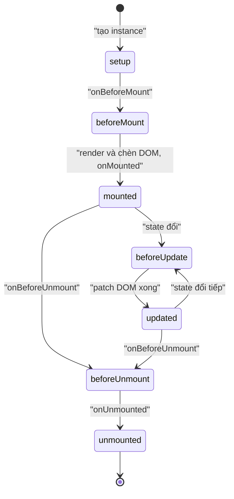
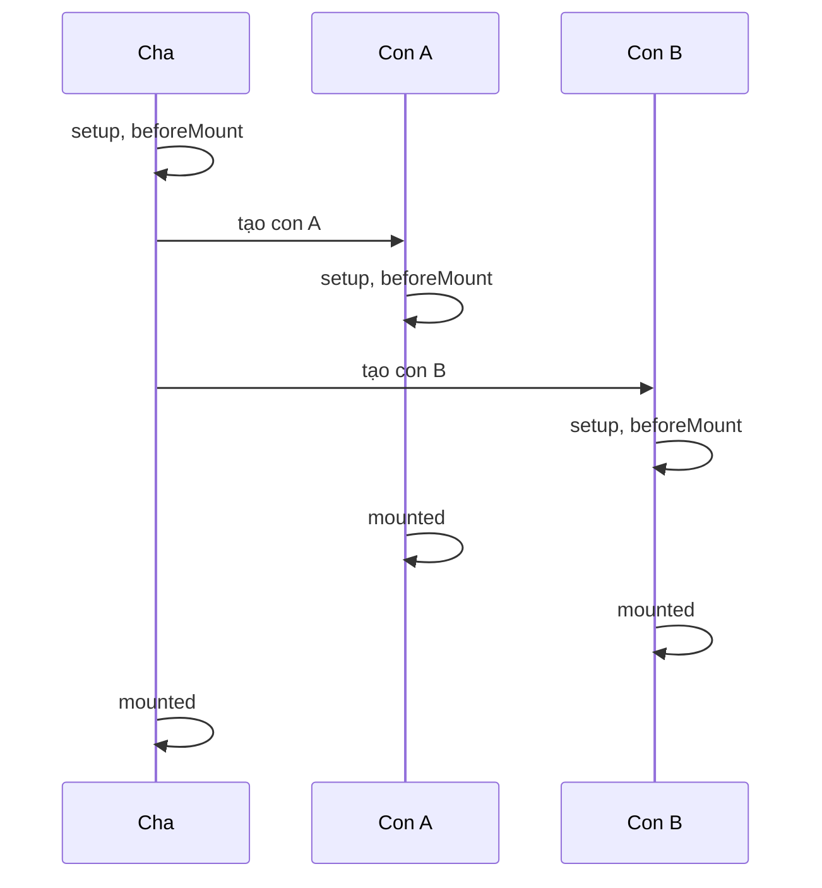
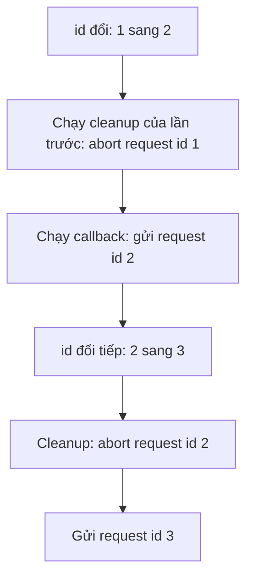

# Lý thuyết 3: API styles và lifecycle

Bài này so sánh Options API với Composition API, giải thích `<script setup>` và lifecycle component, kèm composable cơ bản và cleanup.

## Hai cách viết component và lifecycle của nó

Vue cho bạn hai cách viết cùng một component. **Options API** chia code theo loại: một khối `data`, một khối `methods`, một khối `computed`. **Composition API** cho bạn viết bằng hàm, gom code theo từng mối quan tâm (ví dụ mọi thứ về "tìm kiếm" nằm cạnh nhau). Cú pháp `<script setup>` là cách viết Composition ngắn gọn nhất và là chuẩn cho dự án mới.

Mọi component đều có **lifecycle**: được tạo, chèn vào trang, cập nhật nhiều lần, rồi bị hủy. Vue cho bạn các **hook** (hàm bạn đăng ký để Vue gọi đúng thời điểm) như `onMounted`, `onUnmounted`. Bạn dùng chúng khi cần khởi tạo dữ liệu, truy cập DOM, đăng ký event, thiết lập thư viện ngoài, và đặc biệt là dọn dẹp khi component bị hủy.

## Vì sao điều này quan trọng

Người làm Senior phải đọc được code cũ viết bằng Options, viết code mới bằng Composition, và nắm rõ **tài nguyên nào phải dọn** (listener, timer, subscription). Quên dọn thì handler vẫn chạy trên component đã biến mất, memory không được giải phóng (memory leak) và ứng dụng chậm dần theo thời gian dùng.

Để logic dùng lại được, bạn đặt nó vào **composable** (hàm tên `useXxx` đóng gói state và hành vi reactive). Nguyên tắc cho cả bài: **mỗi tài nguyên mở ra phải có chỗ đóng**, bằng `onUnmounted`, `onScopeDispose` hoặc `onWatcherCleanup`.

## Các khái niệm cần biết

- **Lifecycle hook:** hàm bạn đăng ký để Vue gọi tại một thời điểm cố định của component. Nó phải được gọi sync trong `setup` để Vue biết hook thuộc component nào.
- **Mixin:** cơ chế tái sử dụng của Options API, trộn property của mixin vào component. Đã bị thay bằng composable (lý do ở mục dưới).
- **Macro compiler:** những hàm như `defineProps` trông như hàm thường nhưng thực ra chỉ có tác dụng lúc biên dịch; compiler đọc và biến đổi chúng rồi xóa đi, nên không cần import.
- **Template ref:** tham chiếu tới phần tử DOM hoặc component con trong template, qua property `ref="box"`. Chỉ có giá trị sau khi mount.
- **Effect scope:** "phạm vi" gom các `computed`, `watch` được tạo trong đó để dừng chúng cùng lúc. Mỗi component có một scope.
- **Memory leak:** vùng nhớ vẫn bị giữ dù không còn dùng nữa, thường vì một listener hoặc timer còn trỏ tới nó.
- **SSR (Server-Side Rendering):** render component thành HTML trên server. Trên server không có `window` hay DOM, nên một số hook không chạy ([Bài 9](/go?p=10-Vue%2Fhard%2Flt-09-ssr-nuxt-hydration.md)).

**Tóm tắt:**

- Options API và Composition API cùng chạy trên một runtime; Composition API gom logic theo tính năng và tái sử dụng được qua composable.
- `<script setup>` được biên dịch thành `setup()`, nên code cấp cao nhất chạy mỗi lần tạo instance chứ không phải một lần như module.
- Thứ tự mount là cha `setup`, các con mount trước, cha `mounted` sau cùng; `unmounted` cũng con trước cha.
- Chỉ chạm DOM an toàn từ `onMounted` trở đi, và trên server chỉ có `setup` cùng `onServerPrefetch` chạy.
- Lifecycle hook và `watch` phải được gọi sync trong `setup` để Vue gắn vào đúng instance.
- Mỗi tài nguyên mở ra (listener, timer, request, subscription) phải có chỗ đóng bằng `onUnmounted`, `onScopeDispose` hoặc `onCleanup` của watcher; quên cleanup là nguồn chính của memory leak.
- Composable đặt tên bắt đầu bằng `use`, nhận ref hoặc getter làm input và trả về ref, không trả giá trị đã mất reactivity.

## Options API và Composition API

Vấn đề đặt ra: so sánh hai cách viết để biết khi nào chọn cái nào.

| Tiêu chí | Options API | Composition API |
|---|---|---|
| Tổ chức code | Theo loại (`data`, `methods`, `computed`) | Theo **mối quan tâm logic** |
| Tái sử dụng logic | Mixin (xung đột tên, nguồn gốc mờ) | Composable (tường minh, có tham số, có kiểu) |
| TypeScript | Suy luận khá, hạn chế với `this` | Suy luận tự nhiên, generic dễ |
| `this` | Có, trỏ proxy của instance | Không dùng |
| Tree-shaking, kích thước | Kém hơn | Tốt hơn (import theo nhu cầu) |
| Đường cong học | Thấp | Cao hơn một chút |
| Cả hai dùng được chung | Có, Options có thể gọi `setup()` | Có |

Hai kiểu **không phải hai engine khác nhau**: Options được xây trên Composition. Roadmap xem cả hai là hợp lệ. Dự án mới nên dùng Composition với `<script setup>`; code legacy giữ nguyên rồi chuyển dần theo từng component.

Mixin bị thay thế vì ba vấn đề: nguồn gốc property không rõ (đọc `this.total` không biết nó đến từ mixin nào), va chạm tên (hai mixin cùng có `loading` thì một cái đè cái kia), và không truyền được tham số. Composable giải quyết cả ba vì bạn tự `const { total } = useCart(userId)`: nguồn gốc rõ, đặt tên lại được, nhận tham số.

Khi nào chọn gì: dự án mới, hoặc component có nhiều logic cần tái sử dụng, chọn Composition. Component nhỏ trong codebase Options sẵn có thì cứ giữ Options, đừng viết lại hàng loạt chỉ vì "mới hơn".

## script setup

`<script setup>` là cú pháp rút gọn của Composition API: bạn viết code ở cấp cao nhất của thẻ script, không cần `export default` hay `return` từng biến cho template.

```vue
<script setup lang="ts">
import { ref, computed, onMounted } from 'vue'
import UserCard from './UserCard.vue' // import xong là dùng được trong template

const count = ref(0)
const double = computed(() => count.value * 2)
function inc() { count.value++ }

onMounted(() => console.log('mounted'))
</script>

<template>
  <UserCard @click="inc" />
  {{ count }} / {{ double }}
</template>
```

Điều cần biết (câu hỏi phỏng vấn hay hỏi):

- Biên dịch thành hàm `setup()` với mã chạy **mỗi lần tạo instance** (không phải một lần như module). Code ở cấp cao nhất của `<script setup>` chạy mỗi instance.
- Mọi biến cấp cao nhất và import **tự lộ ra template**, không cần `return`.
- Component mặc định **đóng kín**: cha dùng template ref không thấy gì trừ khi `defineExpose`.
- Macro compiler (`defineProps`, `defineEmits`, `defineModel`, `defineExpose`, `defineOptions`, `defineSlots`) không cần import và bị xóa khi biên dịch.
- Muốn code chạy một lần cho mọi instance thì đặt trong thẻ `<script>` thường (module scope) cạnh `<script setup>`.
- `await` ở cấp cao nhất làm component **async**, cần `<Suspense>` bao ngoài ([Bài 8](/go?p=10-Vue%2Fhard%2Flt-08-hieu-nang-rendering.md)).
- Template ref kiểu 3.5: `useTemplateRef('name')`, tách khỏi tên biến.

**Nền tảng:** `<script setup>` được biên dịch thành hàm `setup()`, nên code cấp cao nhất chạy mỗi lần tạo instance, không phải một lần như module. Hiểu điều này để không chia sẻ state nhầm giữa các instance và để biết hook, `computed`, `watch` gắn vào instance nào.

## Lifecycle và thứ tự cha-con

Sơ đồ state dưới đây cho thấy một component đi qua những giai đoạn nào. Mỗi mũi tên gắn với một hook bạn có thể đăng ký.



| Hook | Thời điểm | Dùng cho |
|---|---|---|
| `setup` (thay `created`) | Khởi tạo instance, chưa có DOM | Khai báo state, gọi composable, bắt đầu fetch |
| `onBeforeMount` | Trước lần render đầu | Hiếm |
| `onMounted` | DOM đã chèn, template ref có giá trị | Truy cập DOM, khởi tạo thư viện, observer |
| `onBeforeUpdate` | Trước patch | Đọc DOM trước khi đổi (hiếm) |
| `onUpdated` | Sau patch | Đọc DOM sau cập nhật; tránh đổi state trong đây (vòng lặp) |
| `onBeforeUnmount` | Còn đầy đủ trước khi hủy | Dọn dẹp cần instance |
| `onUnmounted` | Đã hủy | Dọn timer, listener, subscription |
| `onErrorCaptured` | Lỗi từ con | Error boundary ([Bài 10](/go?p=10-Vue%2Fhard%2Flt-10-pattern-nang-cao-kien-truc.md)) |
| `onActivated`, `onDeactivated` | Với `<KeepAlive>` | Làm mới hoặc tạm dừng khi bị ẩn |
| `onServerPrefetch` | Chỉ SSR | Fetch trước khi render phía server ([Bài 9](/go?p=10-Vue%2Fhard%2Flt-09-ssr-nuxt-hydration.md)) |

Đọc sơ đồ: `setup` chạy khi instance được tạo; component chỉ có DOM sau khi mount; sau đó nó có thể lặp qua lại giữa "cập nhật" nhiều lần; cuối cùng bị hủy thì chạy các hook unmount. Điểm cần nhớ là nó chỉ chạm DOM an toàn từ `onMounted` trở đi.

Thứ tự khi một cha có hai con A, B (mount: cha phải đợi con vẽ xong mới coi là xong):



| Giai đoạn | Thứ tự |
|---|---|
| Mount | cha `setup`, cha `beforeMount`, A `setup`, A `beforeMount`, B `setup`, B `beforeMount`, A `mounted`, B `mounted`, cha `mounted` |
| Update | cha `beforeUpdate` -> con `beforeUpdate` -> con `updated` -> cha `updated` |
| Unmount | cha `beforeUnmount` -> con `beforeUnmount` -> con `unmounted` -> cha `unmounted` |

Quy tắc nhớ: **`mounted` đi từ con lên cha** (cha mounted sau cùng, khi con đã có DOM). `setup` và `beforeMount` đi từ cha xuống con.

**Phải thuộc:** thứ tự mount là cha `setup`, cha `beforeMount`, các con `setup` và `beforeMount`, các con `mounted`, rồi cha `mounted` sau cùng. `unmounted` cũng là con trước cha. Chỉ chạm DOM an toàn từ `onMounted` trở đi; trên server chỉ chạy `setup` và `onServerPrefetch`.

Chú ý SSR: trên server chỉ chạy `setup`, `onServerPrefetch`, không chạy `onMounted` hay các hook DOM. Mọi truy cập `window`, `document` phải nằm trong `onMounted` (hoặc kiểm tra môi trường).

Hook phải được **gọi sync trong `setup`** để Vue biết instance hiện tại. Gọi sau `await` đầu tiên trong `<script setup>` thường vẫn được compiler giữ context, nhưng trong hàm `async` bình thường hoặc callback thì không hoạt động.

## Composable cơ bản và cleanup

Composable là hàm dùng API Composition để đóng gói logic có state. Hãy xem ví dụ: nhiều component cần theo dõi vị trí chuột. Thay vì chép đi chép lại code `addEventListener`, ta viết một lần thành `useMouse()`. Quan trọng là composable tự lo cả việc dọn dẹp, để người dùng nó không phải nhớ. Dùng composable khi logic có state hoặc có tài nguyên cần dọn và được dùng ở nhiều nơi; hàm thuần không có state thì chỉ cần là hàm tiện ích bình thường.

```ts
// useEventListener.ts
import { onMounted, onUnmounted } from 'vue'

export function useEventListener<K extends keyof WindowEventMap>(
  type: K,
  handler: (e: WindowEventMap[K]) => void,
) {
  onMounted(() => window.addEventListener(type, handler))
  onUnmounted(() => window.removeEventListener(type, handler))
}
```

```ts
// useMouse.ts: trả về ref, tự dọn
import { ref } from 'vue'
export function useMouse() {
  const x = ref(0)
  const y = ref(0)
  useEventListener('mousemove', (e) => { x.value = e.pageX; y.value = e.pageY })
  return { x, y } // trả object chứa ref, caller destructure an toàn
}
```

Cleanup (dọn dẹp) là việc trả lại tài nguyên đã mượn: gỡ listener, hủy timer, đóng kết nối. Công cụ tùy thuộc bạn đang ở mức nào, như bảng sau (mức component, mức effect scope và mức watcher):

| Công cụ | Dọn khi nào | Dùng ở đâu |
|---|---|---|
| `onUnmounted` | Component bị hủy | Trong component hoặc composable chạy trong `setup` |
| `onScopeDispose` | Effect scope bị dừng (component hủy hoặc `scope.stop()`) | Composable muốn dùng được cả ngoài component |
| `onWatcherCleanup` (3.5) | Trước lần chạy lại của watcher hoặc khi watcher dừng | Hủy request cũ, clear timer của watcher |
| Tham số `onCleanup` của `watch` | Giống trên, dùng được mọi phiên bản 3.x | Callback watch |

```ts
import { ref, watch, onWatcherCleanup } from 'vue'

const id = ref(1)
watch(id, (val) => {
  const ctrl = new AbortController()
  fetch(`/api/items/${val}`, { signal: ctrl.signal }).then(/* ... */)
  onWatcherCleanup(() => ctrl.abort()) // phải gọi sync trong callback, trước await
})
```

Flow khi `id` đổi liên tục (ví dụ người dùng bấm nhanh qua nhiều mục): request cũ bị hủy trước khi request mới bắt đầu, nên kết quả cũ không ghi đè kết quả mới (lỗi "race condition", hai request về sai thứ tự).



`onWatcherCleanup` chỉ gọi được **sync** trong callback hoặc getter của watcher (3.5+). Sau `await` thì dùng tham số `onCleanup` thứ ba.

**Phải thuộc:** mỗi tài nguyên mở ra (listener, timer, request, subscription) phải có chỗ đóng: `onUnmounted` hoặc `onScopeDispose` cho lifecycle component và scope, `onWatcherCleanup` (3.5, gọi sync) hoặc tham số `onCleanup` của `watch` cho lần chạy lại của watcher.

**Effect scope**: mọi `computed`, `watch` tạo trong `setup` gắn vào scope của component và tự dừng khi hủy. Tạo chúng ở nơi khác (module, callback async) thì không tự dừng. Dùng `effectScope()` để quản lý thủ công.

## Quy ước composable

- Đặt tên `useXxx`, tệp riêng, trả về object chứa ref (không trả `reactive` nếu caller sẽ destructure).
- Nhận input là `MaybeRefOrGetter` và đọc bằng `toValue` trong effect.
- Không giữ state ở module scope trừ khi chủ ý singleton (cẩn thận SSR, xem [Bài 5](/go?p=10-Vue%2Fmedium%2Flt-05-composables-pinia.md)).
- Gọi ở cấp cao nhất của `setup` hoặc composable khác, không gọi trong điều kiện hoặc sau `await` tùy tiện.

## Bẫy thường gặp

| Bẫy | Hậu quả | Cách tránh |
|---|---|---|
| Quên remove listener, timer, observer | Memory leak, handler chạy trên component đã hủy | `onUnmounted` hoặc `onScopeDispose` |
| Gọi hook lòng vòng trong callback async | Cảnh báo "no active component instance" | Gọi hook sync trong `setup` |
| Truy cập DOM hoặc `window` trong `setup` | Lỗi SSR, ref còn null | Đặt trong `onMounted` |
| Đổi state trong `onUpdated` | Vòng lặp cập nhật vô hạn | Dùng `watch` có điều kiện |
| Dùng `async onMounted` rồi cho rằng Vue chờ | Vue không chờ promise của hook | Tự xử lý lỗi, state loading |
| Mixin trong code mới | Xung đột tên, khó truy vết | Composable |
| Tạo watch/computed ngoài `setup` | Không bị dọn tự động | `effectScope` hoặc đặt trong `setup` |
| Tưởng `setup` chỉ chạy một lần như module | State bị chia sẻ nhầm hoặc hiểu sai | Nhớ nó chạy theo từng instance |

## Câu hỏi phỏng vấn thường gặp

1. Options API và Composition API khác nhau cốt lõi ở đâu, và khi nào chọn cái nào?

   **Gợi ý suy luận:**
   - Code của một tính năng (ví dụ tìm kiếm) nằm tập trung hay rải theo loại khối (`data`, `methods`, `computed`)?
   - Muốn tái sử dụng logic có state thì mỗi cách dùng cơ chế gì?
   - Hai kiểu chạy trên cùng một runtime không?

   **Lập luận:** Options chia code theo loại, nên một tính năng bị rải ra nhiều khối; Composition gom theo mối quan tâm logic, nên logic tái sử dụng được gói gọn thành composable. Cả hai chạy trên cùng runtime (Options được xây trên Composition), nên khác biệt là cách tổ chức và tái sử dụng, không phải engine. Dự án mới hoặc component có nhiều logic tái sử dụng chọn Composition; component nhỏ trong codebase Options sẵn có thì giữ nguyên, không viết lại hàng loạt.

   **Đáp án ngắn:** khác ở cách tổ chức (theo loại hay theo logic) và cơ chế tái sử dụng (mixin hay composable); cùng một runtime.

   **Nhớ:** mới thì dùng Composition với `<script setup>`; cũ thì chuyển dần.

2. Vì sao composable tốt hơn mixin?

   **Gợi ý suy luận:**
   - Đọc `this.total` trong một component có mixin, bạn biết nó đến từ đâu không?
   - Hai mixin cùng có `loading` thì chuyện gì xảy ra?
   - Mixin có nhận tham số được không?

   **Lập luận:** mixin trộn property vào component nên nguồn gốc mờ, hai mixin cùng tên thì cái này đè cái kia, và không truyền được tham số. Composable là hàm: `const { total } = useCart(userId)` cho thấy nguồn rõ ràng, đặt lại tên khi destructure để tránh va chạm, nhận tham số, và có kiểu TypeScript tự nhiên.

   **Đáp án ngắn:** composable có nguồn gốc tường minh, tham số hóa được, không xung đột tên, có kiểu TypeScript.

   **Nhớ:** mixin có ba lỗi: nguồn mờ, va chạm tên, không tham số.

3. Một cha có hai con A và B. Thứ tự các hook mount, update và unmount là gì, và vì sao?

   **Gợi ý suy luận:**
   - Cha có thể coi là "đã mount" khi nào: trước hay sau khi con có DOM?
   - Việc tạo instance và việc chèn DOM đi theo chiều nào của cây?
   - Khi hủy, thứ gì phải còn nguyên lâu nhất?

   **Lập luận:** để vẽ cha cần vẽ các con, nên `setup` và `beforeMount` đi từ cha xuống con, còn `mounted` đi từ con lên cha vì cha chỉ xong khi các con đã có DOM: cha `mounted` sau cùng. Update tương tự: `beforeUpdate` của cha trước, `updated` của con trước cha. Khi hủy: `beforeUnmount` của cha chạy trước, rồi các con, nên `unmounted` của con xong trước, cha sau cùng.

   **Đáp án ngắn:** `setup` và `beforeMount` từ cha xuống con; `mounted` từ con lên cha; unmount thì `beforeUnmount` cha trước và `unmounted` con trước.

   **Nhớ:** mount: cha, A, B rồi A mounted, B mounted, cha mounted. Xem bảng thứ tự trong bài.

4. `<script setup>` khác `<script>` thường chỗ nào mà đáng nhớ?

   **Gợi ý suy luận:**
   - Code ở cấp cao nhất chạy một lần cho module hay một lần cho mỗi instance?
   - Làm sao template thấy được biến, và `defineProps` có phải hàm thường không?

   **Lập luận:** `<script setup>` biên dịch thành hàm `setup()`, nên code cấp cao nhất chạy mỗi lần tạo instance chứ không một lần như module (muốn chạy một lần thì đặt trong `<script>` thường). Biến và import cấp cao nhất tự lộ ra template, không cần `return`. `defineProps`, `defineEmits`... là macro compile-time bị xóa khi biên dịch nên không import. Component mặc định đóng kín, chỉ mở qua `defineExpose`.

   **Đáp án ngắn:** biên dịch thành `setup()` chạy theo từng instance, tự lộ biến ra template, macro compile-time, component đóng kín.

   **Nhớ:** `await` ở cấp cao nhất làm component async và cần `<Suspense>`.

5. `onUnmounted` và `onScopeDispose` khác nhau thế nào, vì sao composable hay dùng cái sau?

   **Gợi ý suy luận:**
   - `onUnmounted` gắn với cái gì (component), `onScopeDispose` gắn với cái gì (effect scope)?
   - Composable có luôn chạy bên trong một component không?

   **Lập luận:** `onUnmounted` chỉ có nghĩa khi có component bị hủy; `onScopeDispose` chạy khi effect scope bị dừng, mà scope có thể là của component hoặc tạo thủ công bằng `effectScope()`. Composable dùng `onScopeDispose` sẽ dọn đúng ngay cả khi dùng ngoài component. Trong component hai hook tương đương cho việc dọn.

   **Đáp án ngắn:** `onScopeDispose` gắn với effect scope nên dùng được ngoài component; trong component thì tương đương `onUnmounted`.

   **Nhớ:** mỗi tài nguyên mở ra phải có chỗ đóng.

6. Người dùng bấm nhanh qua nhiều mục, request cũ về sau ghi đè dữ liệu mới. Làm sao hủy request cũ khi tham số đổi?

   **Gợi ý suy luận:**
   - Hai request về sai thứ tự gây ra lỗi gì (race condition)?
   - Có cơ chế hủy một `fetch` đang chạy không?
   - Hook nào chạy ngay trước lần chạy lại của watcher?

   **Lập luận:** nếu request cũ về sau, nó ghi đè kết quả đúng. Cần hủy request cũ ngay khi `id` đổi: dùng `AbortController` cho `fetch`, và đăng ký việc hủy bằng `onWatcherCleanup` (3.5, gọi sync) hoặc tham số `onCleanup` của `watch` (dùng được mọi 3.x, kể cả sau `await`). Cleanup chạy trước lần callback kế và khi watcher dừng, nên request cũ luôn bị hủy trước khi request mới bắt đầu.

   **Đáp án ngắn:** `AbortController` kết hợp `onWatcherCleanup` hoặc tham số `onCleanup` của `watch`.

   **Nhớ:** `onWatcherCleanup` chỉ gọi sync; sau `await` dùng `onCleanup`.

7. Truy cập `window` trong `setup` gây lỗi khi SSR. Vì sao, và đặt ở đâu?

   **Gợi ý suy luận:**
   - Trên server có `window` hoặc DOM không?
   - Hook nào chỉ chạy ở client, sau khi DOM có?

   **Lập luận:** SSR render component thành HTML trên server nên không có `window` hay `document`; trên server chỉ chạy `setup` và `onServerPrefetch`, còn `onMounted` và các hook DOM chỉ chạy ở client. Vì vậy mọi truy cập `window`, `document`, template ref phải đặt trong `onMounted` (hoặc kiểm tra môi trường).

   **Đáp án ngắn:** server không có DOM; chỉ `onMounted` chạy ở client nên đặt đó.

   **Nhớ:** chỉ chạm DOM an toàn từ `onMounted` trở đi. Xem [Bài 9](/go?p=10-Vue%2Fhard%2Flt-09-ssr-nuxt-hydration.md).

8. Khi nào cần `onActivated`, và nó liên quan gì đến `<KeepAlive>`?

   **Gợi ý suy luận:**
   - Component nằm trong `KeepAlive` khi bị ẩn có bị unmount không?
   - Vậy `onMounted` có chạy lại khi nó hiện lại không?

   **Lập luận:** `KeepAlive` cache component thay vì hủy, nên khi quay lại `onMounted` không chạy lần nữa. Muốn làm mới dữ liệu khi hiện lại hoặc tạm dừng việc khi ẩn, dùng `onActivated` và `onDeactivated`.

   **Đáp án ngắn:** với `<KeepAlive>` component được cache không unmount, nên dùng `onActivated` để làm mới dữ liệu khi hiện lại.

   **Nhớ:** cache thì không có mount lại, cần hook riêng.

Tiếp theo: [Bài 4: Computed, watch, rendering](/go?p=10-Vue%2Fmedium%2Flt-04-computed-watch-rendering.md).

