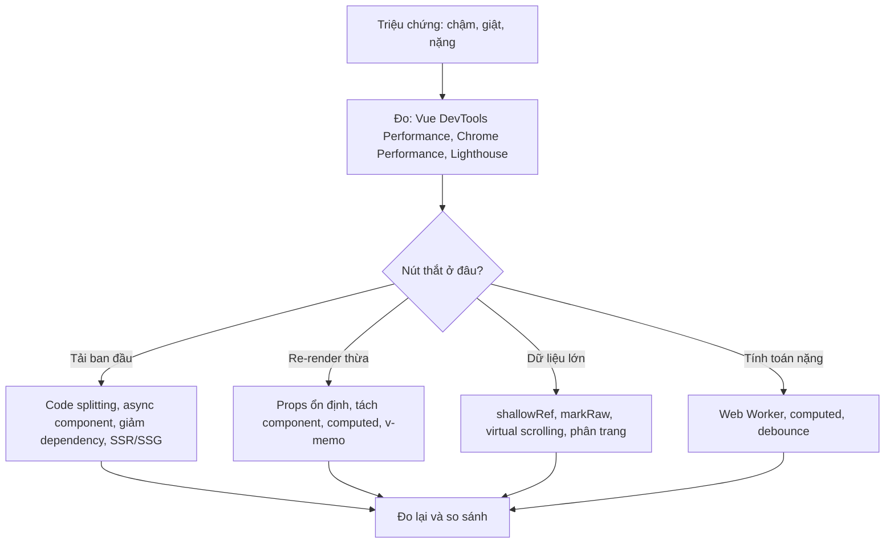
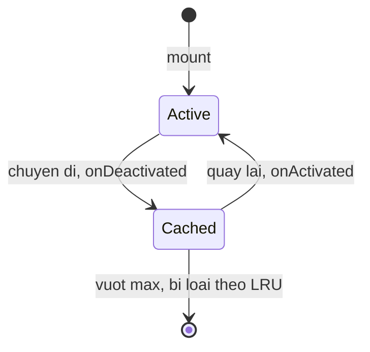

# Lý thuyết 8: Hiệu năng rendering

Bài này gom các kỹ thuật tối ưu hiệu năng ở tầng Vue: giảm chi phí reactivity, danh sách lớn, lazy loading, Suspense, KeepAlive, Teleport và cách đo. Chỉ số web chung ở [Web Performance](/go?p=11-Frontend-Core%2Flt-03-web-performance-core-web-vitals.md).

## Tối ưu hiệu năng Vue là gì, và khi nào mới cần?

Hiệu năng ở tầng Vue là tập kỹ thuật làm hai việc: giảm công việc của runtime (theo dõi dữ liệu, render lại, so khớp và cập nhật DOM) và giảm lượng code cùng dữ liệu phải tải về. Các công cụ chính gồm `shallowRef`, `markRaw`, virtual scrolling, `defineAsyncComponent`, `Suspense`, `KeepAlive` và code splitting; bài này giải thích từng cái.

Điều quan trọng cần nhớ trước: Vue mặc định đã nhanh. Vấn đề thực tế hiếm khi nằm ở Vue mà đến từ bốn nguồn: dữ liệu lớn bị bọc proxy sâu, danh sách hàng nghìn dòng, bundle (gói JavaScript tải về) phình to, và re-render lan rộng do props không ổn định. Vì vậy chỉ tối ưu khi **đo** thấy vấn đề, ví dụ INP cao (độ trễ phản hồi khi người dùng tương tác), TTI chậm (thời gian tới khi trang dùng được), cuộn giật, memory tăng dần. Tối ưu khi chưa có số liệu chỉ làm code phức tạp thêm mà lợi ích không chắc có.

Quy trình xuyên suốt: đo (DevTools, Lighthouse), xác định nút thắt, chọn kỹ thuật phù hợp, đo lại để xác nhận có cải thiện.

## Các khái niệm cần biết

- **Re-render:** Vue chạy lại hàm render của component để so khớp (patch) DOM. Re-render thừa là re-render mà kết quả không đổi.
- **Bundle và code splitting:** bundle là tệp JS gói toàn bộ code. Code splitting là tách nó thành nhiều mảnh để chỉ tải mảnh cần thiết, các mảnh còn lại tải khi tới lượt.
- **Virtual scrolling:** chỉ tạo DOM cho các dòng đang nhìn thấy trong khung cuộn, thay vì tất cả.
- **Hydration:** bước JavaScript trên trình duyệt "gắn" tương tác vào HTML đã được server render sẵn ([Bài 9](/go?p=10-Vue%2Fhard%2Flt-09-ssr-nuxt-hydration.md)).
- **INP (Interaction to Next Paint) và TTI:** hai chỉ số đo độ mượt khi tương tác và thời điểm trang sẵn sàng dùng; chi tiết ở [Web Performance](/go?p=11-Frontend-Core%2Flt-03-web-performance-core-web-vitals.md).
- **Heap snapshot:** ảnh chụp memory của trang trong Chrome, dùng để tìm object bị giữ lại không đáng có (rò rỉ).
- **LRU (Least Recently Used):** chính sách loại bỏ phần tử lâu chưa dùng nhất khi cache đầy; `KeepAlive` dùng nó cho `max`.

**Tóm tắt:**

- Vue mặc định đã nhanh; quy trình luôn là đo, xác định nút thắt, sửa một thứ, đo lại, không tối ưu khi chưa có số liệu.
- Nút thắt thực tế thường là dữ liệu lớn bị proxy sâu, danh sách dài, bundle phình to và re-render lan rộng.
- `shallowRef` chỉ trigger khi gán lại `.value`, `markRaw` đánh dấu object không bao giờ bị bọc proxy.
- Props được so shallow bằng `Object.is`, nên object hoặc mảng tạo mới mỗi lần render ở cha luôn làm con render lại.
- Danh sách lớn dùng virtual scrolling; component nặng dùng `defineAsyncComponent` để lazy loading và code splitting.
- `Suspense` xử lý dependency async (experimental), `KeepAlive` giữ state nhưng đánh đổi memory, nên đặt `max`.
- `Teleport` chỉ dời DOM, không đổi cây component, nên props, provide/inject và events vẫn đi theo quan hệ cha con logic.

## Quy trình đo trước, tối ưu sau

Sơ đồ dưới giúp chọn hướng đúng theo loại triệu chứng, thay vì áp dụng mọi mẹo cùng lúc.



Đọc sơ đồ: mỗi triệu chứng dẫn tới một nhóm giải pháp khác nhau. Tải ban đầu chậm thì giảm lượng code; chậm khi tương tác thì thường là re-render thừa hoặc dữ liệu quá lớn; tính toán nặng thì đưa ra khỏi main thread. Cuối cùng luôn đo lại, vì nếu số liệu không đổi thì thay đổi đó không đáng giữ.

**Nền tảng:** Vue mặc định đã nhanh; nút thắt thực tế đến từ dữ liệu lớn bị proxy sâu, danh sách quá dài, bundle phình to và re-render lan rộng. Quy trình luôn là đo, xác định nút thắt, sửa một thứ, đo lại, không tối ưu khi chưa có số liệu.

Công cụ:

| Công cụ | Dùng để |
|---|---|
| Vue DevTools (tab Performance, Timeline) | Thời gian render và update của từng component |
| Vue DevTools (Inspector) | Xem state, props |
| Chrome Performance panel | Flame chart, long task, layout thrashing |
| Chrome Memory | Heap snapshot tìm rò rỉ (listener, closure giữ component) |
| Lighthouse, WebPageTest | Chỉ số tải và bundle |
| `rollup-plugin-visualizer` | Xem bundle chiếm bởi gì |
| Opt-in `app.config.performance = true` | Đánh dấu hiệu năng của component trong dev (Performance panel) |

## Giảm chi phí reactivity

`ref` và `reactive` bọc **proxy sâu theo kiểu lazy**. Với danh sách lớn hoặc instance thư viện, chi phí đáng kể: mỗi object được truy cập đều bị bọc, mỗi property đọc đều được ghi nhận. Ngoài ra, instance của thư viện ngoài (biểu đồ, bản đồ, trình soạn thảo) thường có trường private hoặc dựa vào danh tính object, nên bị proxy có thể gây lỗi hoặc chậm. Giải pháp là bảo Vue "đừng theo dõi sâu chỗ này" bằng các công cụ dưới đây. Chi tiết cơ chế ở [Bài 1](/go?p=10-Vue%2Feasy%2Flt-01-reactivity-vue3.md).

| Công cụ | Hành vi | Dùng cho |
|---|---|---|
| `shallowRef` | Chỉ theo dõi gán lại `.value` | Mảng lớn thay cả mảng, kết quả API chỉ đọc |
| `shallowReactive` | Chỉ cấp 1 | State phẳng |
| `markRaw` | Không bao giờ bị proxy | Map, chart, editor instance, class có private field |
| `readonly`, `Object.freeze` | Ngăn đổi | Dữ liệu cố định (freeze còn tránh bị proxy sâu trong Vue 3) |
| `triggerRef` | Ép cập nhật | Sau khi mutate bên trong `shallowRef` |

```ts
import { shallowRef, markRaw, triggerRef } from 'vue'

const rows = shallowRef<Row[]>([])            // 50.000 dòng, không proxy từng dòng
async function load() { rows.value = await fetchRows() } // gán lại: cập nhật

const chart = shallowRef<ECharts | null>(null)
onMounted(() => { chart.value = markRaw(echarts.init(el.value!)) })

// Mutate tại chỗ rồi báo cho Vue
rows.value.push(newRow)
triggerRef(rows)
```

Cách nhớ: **dữ liệu chỉ đọc và lớn thì `shallowRef`; object do thư viện ngoài sở hữu thì `markRaw`**.

**Phải thuộc:** `shallowRef` chỉ trigger khi gán lại `.value` (sửa bên trong cần `triggerRef`); `markRaw` đánh dấu object không bao giờ bị bọc proxy. Props được so shallow bằng `Object.is`, nên object hoặc mảng tạo mới mỗi lần render ở cha luôn làm con render lại.

## Tránh re-render thừa

Component con re-render khi props thay đổi (so shallow bằng `Object.is`), hoặc khi slot động thay đổi, hoặc khi nó đọc state vừa đổi. "So shallow" nghĩa là chỉ so tham chiếu: `{ a: 1 }` mới tạo luôn khác `{ a: 1 }` cũ dù nội dung giống, nên con bị render lại một cách vô ích. Bảng dưới liệt kê nguyên nhân hay gặp và cách xử lý.

| Nguyên nhân re-render thừa | Cách khắc phục |
|---|---|
| Truyền object hoặc mảng mới mỗi lần render (`:opts="{ a: 1 }"`) | Hoist hằng, `computed`, hoặc `markRaw` |
| Truyền cả object lớn khi con chỉ cần một trường | Truyền đúng trường cần |
| Đọc state thay đổi liên tục ở component cha (vd. `scrollY`) | Đẩy vào component con nhỏ |
| Handler inline đổi mỗi lần | Vue đã cache handler của compiler; vấn đề thường ở prop object |
| Component lớn trộn phần tĩnh và động | Tách phần động thành component riêng |
| Slot nội dung động làm con update | Dùng scoped slot (lazy, cập nhật hẹp hơn) |

`v-memo` và `v-once` chỉ khi đã đo ([Bài 4](/go?p=10-Vue%2Fmedium%2Flt-04-computed-watch-rendering.md)). `computed` ổn định giúp con không re-render (3.4+ computed không kích hoạt khi kết quả bằng nhau).

## Danh sách lớn: virtual scrolling

Render 10.000 dòng thì DOM và memory nặng. Virtual scrolling chỉ render các dòng trong viewport (cộng đệm), phần còn lại là khoảng trống có chiều cao tính toán. Giống như cuốn sách rất dày mà bạn chỉ mở ra hai trang đang đọc: cuộn tới đâu, thư viện tái sử dụng các nút DOM cũ để hiển thị dữ liệu mới.


Chọn cách nào còn tùy nhu cầu, như bảng dưới. Điều cần nhớ là phân trang hoặc lọc phía server thường là lựa chọn đầu tiên vì nó giảm cả dữ liệu tải về, còn virtual scroll chỉ giảm DOM.

| Cách | Khi dùng |
|---|---|
| Phân trang, "tải thêm" | Người dùng không cần cuộn liên tục cả tập |
| Virtual list (`vue-virtual-scroller`, `@tanstack/vue-virtual`, `vueuse` `useVirtualList`) | Danh sách rất lớn, chiều cao dòng biết trước hoặc đo được |
| `content-visibility: auto` (CSS) | Giảm chi phí layout và paint cho vùng ngoài màn hình, rất rẻ để thử |
| Server-side filter, sort | Dữ liệu không nên tải hết về client |

Đánh đổi của virtual list: tìm kiếm của trình duyệt (Ctrl+F) không thấy dòng chưa render, a11y cần xử lý (`aria-rowcount`, focus), dòng có chiều cao thay đổi thì phức tạp hơn.

## Lazy loading: defineAsyncComponent và code splitting

Vấn đề: nếu bundle chứa mọi thứ, người dùng phải tải cả trình soạn thảo và biểu đồ nặng chỉ để xem trang chủ. `defineAsyncComponent` cho phép bạn nói "component này chỉ tải khi cần": bundler (Vite, Rollup) thấy `import()` động sẽ tách component thành tệp riêng. Dùng cho component nặng, ít xuất hiện (modal, chart, editor); không cần cho component nhỏ luôn hiển thị vì thêm một request mạng còn chậm hơn.

```ts
import { defineAsyncComponent } from 'vue'

const HeavyChart = defineAsyncComponent({
  loader: () => import('./HeavyChart.vue'),
  loadingComponent: Spinner,
  delay: 200,            // chờ 200ms mới hiện loading (tránh nhấp nháy)
  errorComponent: ErrorBox,
  timeout: 10000,
})
```

Vue 3.5 thêm chiến lược **lazy hydration** cho async component dùng trong SSR (`hydrateOnVisible`, `hydrateOnIdle`, `hydrateOnInteraction`, `hydrateOnMediaQuery`) từ `vue`:

```ts
import { defineAsyncComponent, hydrateOnVisible } from 'vue'
const Comments = defineAsyncComponent({
  loader: () => import('./Comments.vue'),
  hydrate: hydrateOnVisible(), // chỉ hydrate khi vào viewport
})
```

Chi tiết hydration ở [Bài 9](/go?p=10-Vue%2Fhard%2Flt-09-ssr-nuxt-hydration.md).

Nguyên tắc code splitting:

| Điểm tách | Ví dụ |
|---|---|
| Theo route | `component: () => import(...)` |
| Theo tương tác | Modal, trình soạn thảo, chart chỉ tải khi mở |
| Theo vendor | `manualChunks` tách thư viện nặng, ổn định (cache tốt) |
| Thư viện lớn | Import theo module (`lodash-es`, icon theo từng cái), thay thư viện nặng bằng bản nhẹ |

Quan sát bundle trước khi tách: một thư viện 300 KB (như moment, một bộ icon) thường đem lại hiệu quả hơn chia route.

## Suspense

Vấn đề: nhiều component cần chờ dữ liệu async, và bạn không muốn mỗi cái tự hiện một spinner riêng. `Suspense` gom lại: hiện một fallback chung cho tới khi cả nhóm sẵn sàng. Chỉ nên dùng khi bạn thực sự có dependency async trong cây con; nếu không thì nó không có tác dụng gì. Vì tính năng còn thử nghiệm (theo tài liệu Vue 3.5, kiểm tra lại theo phiên bản bạn dùng), cân nhắc kỹ trước khi dựa vào nó trong code lâu dài.

`<Suspense>` hiển thị fallback trong khi cây con có **dependency async**: component dùng `await` ở cấp cao nhất của `<script setup>`, hoặc async component.

```vue
<template>
  <Suspense>
    <template #default><UserProfile /></template>
    <template #fallback>Đang tải...</template>
  </Suspense>
</template>
```

| Điểm | Ghi chú |
|---|---|
| Trạng thái | Tài liệu chính thức ghi tính năng này là **thử nghiệm**, API có thể đổi |
| Hai slot | `#default` và `#fallback` |
| Lần đầu và sau đó | Fallback chỉ hiện ở lần resolve đầu; các lần sau giữ nội dung cũ (có prop `timeout` để hiện fallback nếu quá lâu) |
| Lỗi | Không tự bắt: dùng `onErrorCaptured` ở cha |
| Kết hợp | Thường đi cùng `RouterView`, `KeepAlive`, `Transition` (thứ tự lồng cần đúng) |
| Dùng thực tế | Nuxt dùng Suspense nội bộ cho điều hướng trang |

## KeepAlive

Giữ instance component (state, DOM) khi bị ẩn thay vì hủy. Ví dụ: người dùng gõ filter ở trang danh sách, vào chi tiết một mục rồi quay lại; không có `KeepAlive` thì filter và vị trí cuộn mất hết vì component đã bị hủy và tạo lại. Đổi lại, bạn đánh đổi memory và nguy cơ dữ liệu cũ, nên không dùng cho trang luôn cần dữ liệu mới.



```vue
<KeepAlive :include="['ListPage', 'FilterPanel']" :max="5">
  <component :is="current" />
</KeepAlive>
```

| Điểm | Ghi chú |
|---|---|
| Hook | `onActivated` và `onDeactivated` thay cho mount/unmount khi chuyển |
| `include`, `exclude` | Khớp theo **tên** component (với `<script setup>` tên suy ra từ tên file hoặc `defineOptions({ name })`) |
| `max` | Giới hạn số instance cache, loại cũ nhất (LRU) |
| Rủi ro | Memory tăng, dữ liệu cũ khi quay lại (cần làm mới trong `onActivated`) |
| Dùng khi | Tab, trang danh sách có filter và vị trí cuộn cần giữ |

## Teleport

Vấn đề: modal đặt trong component sâu trong cây, nhưng thẻ cha có `overflow: hidden` hoặc `transform` nên modal bị cắt hoặc nằm sai lớp `z-index`. Teleport giải quyết bằng cách "dịch chuyển" phần DOM tới nơi khác (thường `body`) mà giữ nguyên quan hệ logic.

`<Teleport to="body">` render nội dung con ở vị trí DOM khác, nhưng **vẫn là con logic** của component (props, provide/inject, events giữ nguyên).

```vue
<Teleport to="body" :disabled="isMobile">
  <div class="modal" role="dialog"><slot /></div>
</Teleport>
```

Dùng cho modal, tooltip, toast để thoát khỏi `overflow: hidden`, `transform` hay `z-index` của cha.

**Phải thuộc:** `Teleport` chỉ dời DOM sang vị trí khác, không đổi cây component: props, provide/inject và events vẫn đi theo quan hệ cha con logic.

Lưu ý: đích phải tồn tại trước khi mount; SSR cần xử lý riêng (Nuxt cung cấp `<ClientOnly>` và hỗ trợ teleport có điều kiện); từ 3.5 có `defer` để teleport đến phần tử được render sau trong cùng tick.

## Bảng chọn nhanh

| Vấn đề đo được | Giải pháp đầu tiên |
|---|---|
| Bundle ban đầu lớn | Phân tích bundle, tách route, bỏ thư viện nặng |
| Danh sách trên 1.000 dòng chậm | Phân trang hoặc virtual scroll, `shallowRef` |
| Mỗi lần gõ phím cả trang chậm | Cô lập state vào component con, debounce |
| Re-render con liên tục | Ổn định props |
| Chuyển tab mất state | `KeepAlive` có `max` |
| Modal bị cắt bởi CSS cha | `Teleport` |
| Tải chart làm chậm LCP | `defineAsyncComponent`, lazy hydration |
| Thư viện chart làm Vue chậm | `markRaw` instance |
| Memory tăng dần | Heap snapshot, tìm listener và timer chưa dọn |

## Bẫy thường gặp

| Bẫy | Hậu quả | Cách tránh |
|---|---|---|
| Tối ưu khi chưa đo | Code phức tạp, lợi ích bằng không | Đo trước và sau |
| Mutate `shallowRef` không `triggerRef` | UI không cập nhật | Gán lại hoặc `triggerRef` |
| `markRaw` object mà sau đó cần reactive | Không cập nhật | Chỉ dùng cho object bên ngoài |
| Virtual list không có chiều cao cố định | Nhảy cuộn | Đo chiều cao hoặc dùng thư viện hỗ trợ |
| `KeepAlive` không `max` | Memory leak | Đặt `max` |
| `KeepAlive` `include` sai tên | Không cache | Đặt `name` rõ ràng |
| `Suspense` không có xử lý lỗi | Trang trắng | `onErrorCaptured` |
| Import cả thư viện (lodash) | Bundle lớn | Import từng hàm hoặc `lodash-es` |
| Lạm dụng `deep` watcher trên object lớn | Duyệt toàn bộ mỗi lần | Watch trường cụ thể |
| Dựa vào `v-memo` thay vì sửa cấu trúc | Bug UI cũ | Sửa nguyên nhân gốc |

## Câu hỏi phỏng vấn thường gặp

1. Một mảng 50.000 dòng và một instance biểu đồ đều làm Vue chậm khi đưa vào `ref`. Vì sao, và `shallowRef` với `markRaw` giải quyết khác nhau thế nào?

   **Gợi ý suy luận:**
   - `ref` mặc định theo dõi sâu: mỗi object được truy cập bị bọc thế nào, và mỗi property đọc phải ghi nhận gì?
   - Instance thư viện ngoài (chart, map) có cần Vue theo dõi nó không? Có phụ thuộc vào danh tính object hay trường private không?

   **Lập luận:** theo dõi sâu nghĩa là mỗi object được truy cập đều bị bọc proxy và mỗi property đọc đều được ghi nhận, nên với dữ liệu lớn chi phí đáng kể. Với dữ liệu lớn bạn luôn thay cả khối thì chỉ cần theo dõi việc gán lại `.value`: đó là `shallowRef`. Với instance của thư viện ngoài, bị proxy có thể gây lỗi (trường private, danh tính object) hoặc chậm, nên đánh dấu nó không bao giờ bị proxy: `markRaw`.

   **Đáp án ngắn:** `shallowRef` cho dữ liệu lớn chỉ thay thế cả khối, `markRaw` cho instance bên ngoài không nên bị proxy.

   **Nhớ:** dữ liệu chỉ đọc và lớn thì `shallowRef`, object do thư viện ngoài sở hữu thì `markRaw`.

2. Trang có danh sách 50.000 dòng. Bạn xử lý thế nào?

   **Gợi ý suy luận:**
   - Chi phí nằm ở đâu: dữ liệu tải về, memory, hay số DOM node?
   - Cách nào giảm cả dữ liệu tải về, cách nào chỉ giảm DOM?
   - Nếu vẫn cần cuộn liên tục thì tạo DOM cho dòng nào là đủ?

   **Lập luận:** 50.000 dòng làm nặng cả mạng, memory, và DOM. Cách rẻ và hiệu quả nhất là không đưa cả tập về client: phân trang hoặc lọc, sắp xếp phía server, vì nó giảm cả dữ liệu lẫn DOM. Nếu bắt buộc cuộn liên tục thì dùng virtual scrolling: chỉ render dòng trong viewport (cộng đệm) và dùng khoảng trống giữ thanh cuộn; kèm `shallowRef` để tránh proxy từng dòng. Đánh đổi: Ctrl+F không thấy dòng chưa render và cần xử lý a11y.

   **Đáp án ngắn:** ưu tiên phân trang hoặc lọc phía server; nếu cần cuộn liên tục thì virtual scrolling kết hợp `shallowRef`.

   **Nhớ:** virtual scroll chỉ giảm DOM, phân trang phía server giảm cả dữ liệu.

3. Trang chậm và đồng nghiệp đề nghị thêm `v-memo`, `shallowRef` mọi chỗ. Quy trình tối ưu của bạn là gì?

   **Gợi ý suy luận:**
   - Khi chưa đo, làm sao biết nút thắt nằm ở tải ban đầu, re-render, dữ liệu lớn hay tính toán?
   - Làm sao biết thay đổi đó có thật sự giúp?

   **Lập luận:** Vue mặc định đã nhanh, nên tối ưu khi chưa đo thường chỉ thêm code phức tạp mà không có lợi. Quy trình đúng: đo (Vue DevTools, Chrome Performance, Lighthouse), xác định nút thắt, chọn kỹ thuật theo triệu chứng (tải ban đầu thì code splitting; re-render thừa thì ổn định props; dữ liệu lớn thì shallow hoặc virtual scroll; tính toán nặng thì Worker), sửa một thứ, rồi đo lại để xác nhận; nếu số liệu không đổi thì bỏ thay đổi đó.

   **Đáp án ngắn:** đo, xác định nút thắt, sửa một thứ, đo lại; dùng DevTools, Performance panel và bundle visualizer.

   **Nhớ:** không có số liệu thì không tối ưu. Xem mục "Quy trình đo trước, tối ưu sau".

4. `Suspense` làm gì, và khi nào bạn thấy nó không đủ?

   **Gợi ý suy luận:**
   - Nhiều component cùng chờ dữ liệu async thì mỗi cái hiện spinner riêng có ổn không?
   - Nếu một dependency async lỗi thì `Suspense` có tự bắt không?

   **Lập luận:** `Suspense` gom các dependency async trong cây con (component có `await` ở cấp cao nhất hoặc async component) và hiện một fallback chung cho tới khi cả nhóm sẵn sàng. Fallback chỉ hiện ở lần resolve đầu. Nó không tự xử lý lỗi, nên cần `onErrorCaptured` ở cha, nếu không có thể thành trang trắng; tài liệu còn ghi tính năng này là thử nghiệm.

   **Đáp án ngắn:** hiển thị fallback chung trong khi chờ dependency async; đang thử nghiệm và không tự xử lý lỗi.

   **Nhớ:** `Suspense` cần `onErrorCaptured` đi kèm.

5. `KeepAlive` giúp giữ filter và vị trí cuộn khi quay lại trang danh sách. Đánh đổi gì?

   **Gợi ý suy luận:**
   - Giữ instance (state, DOM) thay vì hủy thì tốn gì, và dữ liệu giữ lại có còn mới không?
   - Nếu cache không giới hạn thì chuyện gì xảy ra?

   **Lập luận:** `KeepAlive` giữ state và DOM nên người dùng không mất filter, nhưng đổi lại tốn memory và dữ liệu có thể cũ khi quay lại. Vì không còn mount lại, phải làm mới dữ liệu trong `onActivated`. Không đặt `max` thì cache tăng dần (memory leak); `max` loại instance lâu chưa dùng nhất (LRU).

   **Đáp án ngắn:** giữ state nhưng tốn memory và có thể dữ liệu cũ; dùng `max` và làm mới trong `onActivated`.

   **Nhớ:** `include` khớp theo tên component, nên đặt `name` rõ ràng.

6. Modal đặt trong component sâu bị cắt bởi `overflow: hidden` của cha. Dùng `Teleport` thì props và events có bị phá vỡ không?

   **Gợi ý suy luận:**
   - `Teleport` đổi cái gì: vị trí trong DOM hay quan hệ trong cây component?
   - Props, provide/inject, events đi theo cây nào?

   **Lập luận:** CSS như `overflow` và `z-index` tác động theo cây DOM, nên chuyển phần DOM của modal sang `body` thoát khỏi ràng buộc đó. Nhưng props, provide/inject và events đi theo cây component (logic), không theo cây DOM. `Teleport` chỉ dời DOM, nên nội dung vẫn là con logic của component. Lưu ý đích phải tồn tại trước khi mount và SSR cần xử lý riêng.

   **Đáp án ngắn:** không, nội dung vẫn là con logic, chỉ phần DOM nằm chỗ khác.

   **Nhớ:** `Teleport` đổi vị trí DOM, không đổi cây component.

7. Lazy hydration trong Vue 3.5 là gì và giải quyết vấn đề nào?

   **Gợi ý suy luận:**
   - Hydration chạy JS cho mọi component có chi phí gì với TTI?
   - Một phần dưới màn hình (ví dụ bình luận) có cần tương tác ngay không?

   **Lập luận:** hydrate cả trang nghĩa là tải và chạy JS của mọi async component ngay lúc tải, làm trang chậm tương tác. Lazy hydration hoãn hydrate component async đến khi cần: `hydrateOnVisible` (khi vào viewport), `hydrateOnIdle`, `hydrateOnInteraction`, `hydrateOnMediaQuery`, nhờ đó giảm JS chạy lúc tải.

   **Đáp án ngắn:** hoãn hydrate async component đến khi visible, idle hoặc có tương tác, giảm JS chạy lúc tải.

   **Nhớ:** chi tiết hydration ở [Bài 9](/go?p=10-Vue%2Fhard%2Flt-09-ssr-nuxt-hydration.md).

8. Một component con re-render liên tục dù nội dung không đổi. Bạn giảm re-render thừa bằng cách nào?

   **Gợi ý suy luận:**
   - Vue so props bằng cách nào (tham chiếu hay nội dung)? `{ a: 1 }` mới tạo có bằng `{ a: 1 }` cũ không?
   - Nếu cha đọc state đổi nhanh như `scrollY`, thì phần nào của cây bị render lại?

   **Lập luận:** props được so shallow bằng `Object.is`, nên object hoặc mảng tạo mới mỗi lần render luôn "khác" và con bị render lại vô ích. Cách xử lý: giữ props ổn định (hoist hằng, `computed`), chỉ truyền trường cần, tách phần động thành component riêng để cô lập state đổi nhanh, và dùng `computed` ổn định (từ 3.4 kết quả bằng nhau thì không kích hoạt lại). `v-memo` chỉ khi đã đo.

   **Đáp án ngắn:** props ổn định, tách component, cô lập state đổi nhanh, và `computed` ổn định.

   **Nhớ:** props so shallow theo tham chiếu.

Tiếp theo: [Bài 9: SSR, Nuxt, hydration](/go?p=10-Vue%2Fhard%2Flt-09-ssr-nuxt-hydration.md).

