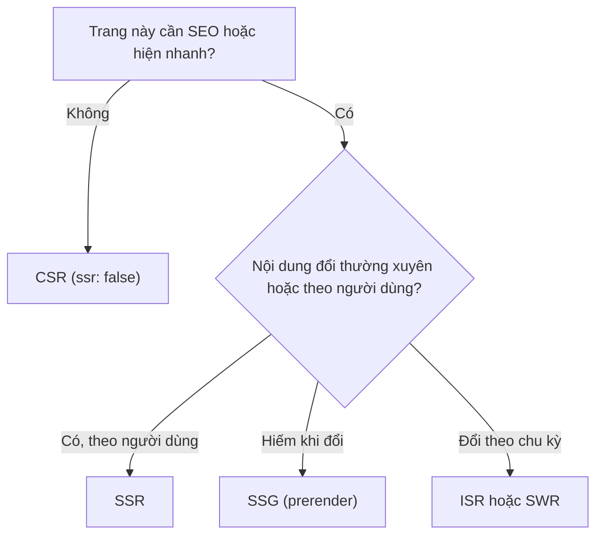
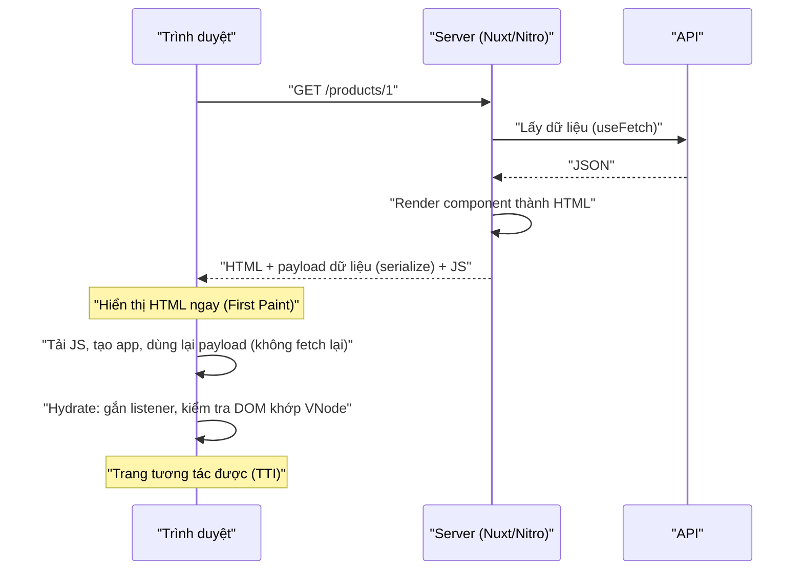
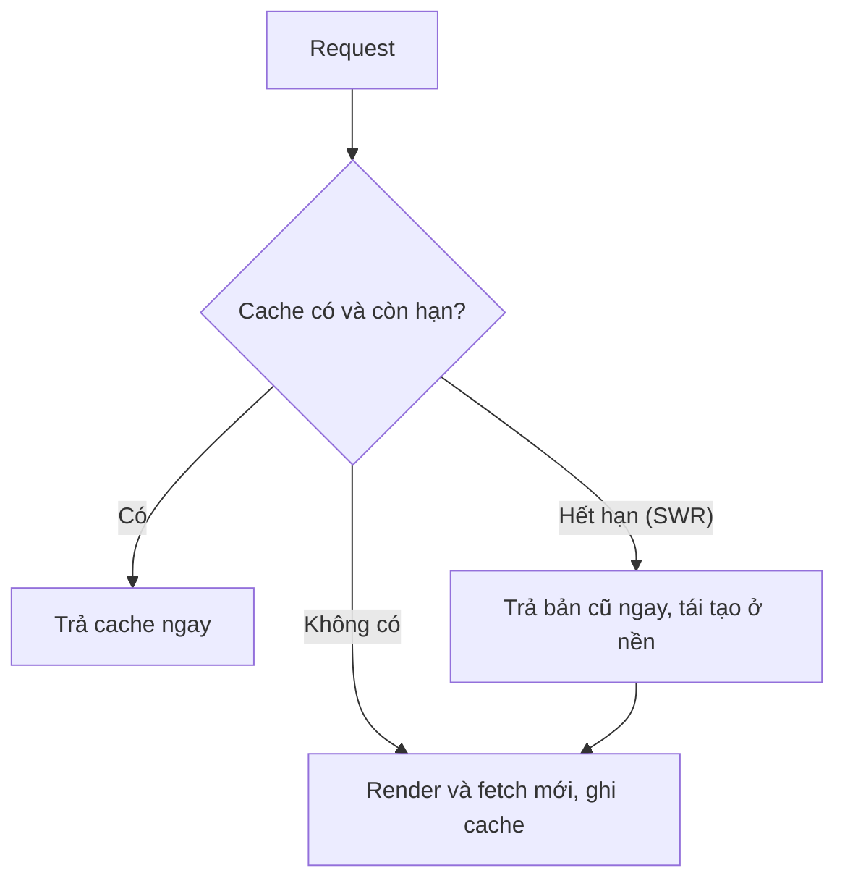
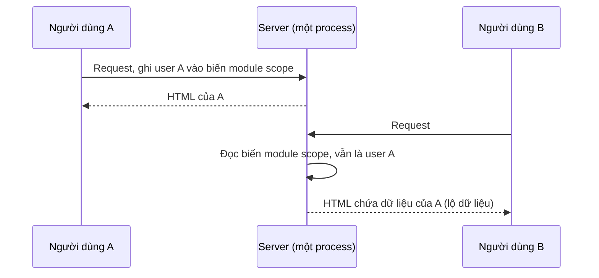

# Lý thuyết 9: SSR, Nuxt và hydration

Bài này so sánh các chế độ render (CSR, SSR, SSG, ISR), giải thích hydration và lỗi mismatch, cách lấy dữ liệu trong Nuxt, cache, bẫy state dùng chung giữa các request và islands. Bảo mật liên quan XSS ở [Bảo mật frontend](/go?p=11-Frontend-Core%2Flt-04-bao-mat-frontend.md).

## SSR là gì và vì sao có nó?

Một ứng dụng Vue thông thường (CSR, Client-Side Rendering) gửi cho trình duyệt một trang HTML gần như trống kèm một đống JavaScript; trình duyệt chạy JS rồi mới vẽ nội dung. Hậu quả: người dùng nhìn màn hình trắng một lúc, mạng yếu thì lâu hơn, và robot của công cụ tìm kiếm có thể thấy trang trống nên SEO kém.

**SSR (Server-Side Rendering)** đảo ngược: server chạy chính component Vue đó, tạo ra HTML có đủ nội dung rồi gửi đi. Trình duyệt hiển thị ngay. Sau đó trình duyệt tải JS, và Vue **hydrate**, tức là "gắn tương tác" (listener, state) lên HTML đã có sẵn thay vì vẽ lại từ đầu. Hãy hình dung một ngôi nhà đã xây xong vỏ, hydration là bước nối điện và nước để nó dùng được.

**Nuxt** là meta-framework của Vue (framework dựng trên framework khác), gói sẵn những thứ cần để làm SSR: routing theo cấu trúc file, chọn SSR/SSG/ISR theo từng route, API lấy dữ liệu, hệ thống module.

## Khi nào dùng, khi nào không, và cái giá phải trả

Dùng SSR cho trang công khai cần SEO và tốc độ hiển thị: thương mại điện tử, tin tức, landing page. Ứng dụng nội bộ sau đăng nhập thường không cần SSR, vì không có SEO để tối ưu và bạn tránh được độ phức tạp.

Cái giá của SSR gồm bốn thứ: hydration mismatch (HTML server và client khác nhau), code phải chạy được ở hai môi trường, state dùng chung giữa các request trên server, và chi phí vận hành server. Cách làm tổng quát: chọn chế độ render **theo từng route** (`routeRules`), lấy dữ liệu bằng API hỗ trợ SSR (`useFetch`, `useAsyncData`), giữ code "universal" (không chạm `window` ngoài `onMounted`), và không dùng state toàn cục không theo request.

## Các khái niệm cần biết

- **SSG (Static Site Generation):** tạo sẵn HTML của mọi trang lúc build, rồi phục vụ như tệp tĩnh. Rất nhanh nhưng dữ liệu cố định tới lần build kế.
- **ISR (Incremental Static Regeneration) và SWR (stale-while-revalidate):** trả ngay bản cache (có thể hơi cũ) rồi tái tạo bản mới ở nền cho lần sau; cân bằng giữa tốc độ của tĩnh và độ mới của động.
- **TTFB, LCP:** TTFB là thời gian tới byte đầu tiên server trả về; LCP là thời điểm phần nội dung lớn nhất hiện ra. SSR cải thiện LCP nhưng có thể làm TTFB tệ hơn nếu API chậm.
- **VNode:** object JS nhẹ mô tả "DOM nên trông thế nào"; hydration so VNode của client với DOM server gửi sang.
- **Payload:** dữ liệu server đã fetch, được nhúng vào HTML dưới dạng JSON để client dùng lại, khỏi gọi API lần nữa.
- **Nitro:** engine server bên dưới Nuxt, lo API route, cache và deploy trên nhiều nền tảng.
- **Universal code:** code chạy được ở cả server và client, tức không phụ thuộc DOM hay `window` lúc chạy ban đầu.
- **Cross-request state pollution:** lỗi khi dữ liệu của người dùng A bị lộ cho người dùng B vì state nằm ở biến dùng chung của server.

**Tóm tắt:**

- SSR có hai pha: server chạy component để ra HTML, rồi client hydrate tức gắn listener lên DOM có sẵn chứ không vẽ lại.
- Các chế độ render khác nhau ở thời điểm tạo HTML: CSR ở trình duyệt, SSR mỗi request, SSG lúc build, ISR/SWR là cache rồi tái tạo ở nền; Nuxt chọn theo từng nhóm route bằng `routeRules`.
- Hydration mismatch xảy ra khi lần render đầu của client khác HTML server (do `Date.now()`, `Math.random()`, API trình duyệt), nên code phải chạy được ở cả hai môi trường.
- Dữ liệu ban đầu lấy bằng `useFetch` hoặc `useAsyncData` (có payload, key, cache); `$fetch` chỉ dành cho hành động như click hay submit.
- Cache phải có chiến lược làm tươi, và cache key phải gồm mọi biến ảnh hưởng response.
- Trên server mọi thứ ở module scope bị dùng chung giữa các người dùng, nên state theo người dùng phải gắn với từng request (`useState`, Pinia theo request).
- Islands và lazy hydration giảm lượng JavaScript client phải hydrate.

## Các chế độ render

Nuxt cho phép chọn chế độ khác nhau cho từng nhóm route. Sơ đồ sau giúp chọn chế độ ban đầu; bảng bên dưới là so sánh chi tiết.



| Chế độ | HTML tạo ở đâu và khi nào | Ưu | Nhược | Dùng cho |
|---|---|---|---|---|
| CSR (SPA) | Trình duyệt, lúc chạy | Đơn giản, hosting tĩnh | HTML trống, SEO và LCP kém | Dashboard sau đăng nhập |
| SSR | Server, **mỗi request** | Dữ liệu mới, SEO | Tốn server, TTFB phụ thuộc API | Trang cá nhân hóa công khai |
| SSG | Lúc build | Cực nhanh, CDN | Build lâu khi nhiều trang, dữ liệu cũ | Blog, tài liệu |
| ISR / SWR | Server hoặc edge, **cache và tái tạo nền** | Gần như tĩnh nhưng cập nhật định kỳ | Dữ liệu có thể cũ trong khoảng cache | Catalog sản phẩm, tin tức |
| Hybrid | Mỗi route một chế độ | Linh hoạt | Config phức tạp | Hầu hết dự án Nuxt |

```ts
// nuxt.config.ts: chọn chế độ theo route
export default defineNuxtConfig({
  routeRules: {
    '/': { prerender: true },              // SSG lúc build
    // ISR: tái tạo sau 1 giờ (phụ thuộc nền tảng host)
    '/products/**': { isr: 3600 },
    '/blog/**': { swr: 600 },              // stale-while-revalidate 10 phút
    '/account/**': { ssr: false },         // CSR
  },
})
```

**Phải thuộc:** các chế độ khác nhau ở thời điểm tạo HTML: CSR ở trình duyệt lúc chạy, SSR trên server mỗi request, SSG lúc build, ISR/SWR là cache rồi tái tạo ở nền. Nuxt chọn chế độ theo từng nhóm route bằng `routeRules`.

`isr` yêu cầu nền tảng deploy hỗ trợ (ví dụ Vercel, Netlify); nơi khác hãy dùng `swr` hoặc cache tầng CDN. Kiểm tra tài liệu Nitro cho nơi bạn deploy.

## Flow SSR và hydration



Đọc sơ đồ: server lấy dữ liệu trước rồi mới render, nên HTML đến trình duyệt đã đầy đủ. Trình duyệt hiện nó ngay (First Paint), trong lúc đó tải JS. Khi JS sẵn sàng, Vue dùng lại payload và hydrate, rồi trang mới thật sự tương tác được.

Điểm cốt lõi:

- Giữa First Paint và hydrate xong, trang **trông có vẻ dùng được nhưng chưa tương tác** (nhấp không phản hồi). Đó là cái giá của SSR.
- Hydration không dựng lại DOM, mà **đi qua DOM có sẵn, so với VNode** client và gắn event. Nếu khác nhau là mismatch.
- Dữ liệu fetch ở server được **serialize vào payload** để client dùng lại, tránh fetch hai lần.
- Hook chạy trên server: `setup`, `onServerPrefetch`, `beforeCreate/created` kiểu Options. **Không** chạy: `onMounted`, `onBeforeMount`, và mọi hook liên quan DOM.

**Nền tảng:** SSR có hai pha: server chạy component để ra HTML, rồi client hydrate, tức đi qua DOM có sẵn, so với VNode của mình và gắn listener, chứ không vẽ lại. Vì vậy lần render đầu của client phải cho ra đúng cấu trúc server đã gửi, và code phải chạy được ở cả hai môi trường.

## Hydration mismatch

Vấn đề đặt ra: hydration giả định client sẽ tạo ra đúng cấu trúc mà server đã gửi. Ví dụ server render "10:00:01" nhưng client render "10:00:03" vì đồng hồ khác nhau, thì hai bên lệch nhau. Đó là mismatch, và nó xảy ra khi HTML từ server khác với những gì client render lần đầu. Vue cảnh báo ở dev (từ 3.5 thông báo rõ hơn về loại mismatch) và có thể sửa DOM, gây nháy hoặc lỗi.

| Nguyên nhân | Ví dụ | Cách xử lý |
|---|---|---|
| Giá trị ngẫu nhiên hoặc theo thời gian | `Math.random()`, `Date.now()`, `new Date()` | Tạo ở server rồi truyền qua state/payload, hoặc chỉ tính sau `onMounted` |
| Múi giờ, locale khác nhau | Format ngày trên server UTC, client giờ địa phương | Định dạng thống nhất hoặc sau mount |
| Truy cập `window`, `localStorage` khi render | `v-if="window.innerWidth > 768"` | Dùng giá trị mặc định lúc render đầu, cập nhật trong `onMounted` |
| HTML không hợp lệ | `<p>` lồng `<div>`, `<table>` thiếu `<tbody>` (trình duyệt tự sửa) | Viết HTML hợp lệ |
| Dữ liệu client khác server | State đăng nhập chỉ ở client | Cùng nguồn dữ liệu (cookie) cho cả hai |
| ID sinh tự động khác nhau | `id` ngẫu nhiên cho label/input | `useId()` (Vue 3.5) cho ID ổn định giữa server và client |
| Extension trình duyệt chèn DOM | Dịch trang, extension | Khó tránh, dùng `data-allow-mismatch` (3.5) cho trường hợp chấp nhận |

```vue
<script setup lang="ts">
import { ref, onMounted, useId } from 'vue'

const id = useId()                 // ổn định server và client (3.5)
const now = ref<string | null>(null)
onMounted(() => { now.value = new Date().toLocaleTimeString() }) // chỉ client
</script>

<template>
  <label :for="id">Tên</label>
  <input :id="id" />
  <span>{{ now ?? '...' }}</span>
</template>
```

Với phần chỉ chạy ở client (map, editor): Nuxt có `<ClientOnly>` (kèm `#fallback`) và hậu tố `.client.vue`. Với `data-allow-mismatch`, chỉ dùng cho nội dung thật sự khác biệt có chủ ý (ví dụ thời gian).

## Data fetching trong Nuxt

Vấn đề: nếu lấy dữ liệu ở client sau khi trang hiện, nội dung SEO sẽ trống; nếu lấy ở cả server lẫn client thì gọi API hai lần. Nuxt cung cấp các hàm biết "đang chạy ở đâu" và chuyển kết quả qua payload. Chọn như sau:

| API | Dùng khi | Ghi chú |
|---|---|---|
| `useFetch(url, opts)` | Gọi HTTP đơn giản | Là `useAsyncData` cộng `$fetch`; tự sinh key từ URL và options |
| `useAsyncData(key, handler)` | Logic bất kỳ (nhiều API, SDK, CMS) | Phải đặt key ổn định nếu tự quản |
| `$fetch` | Event, action (click, submit) | **Không** dùng trong `setup` để lấy dữ liệu ban đầu: SSR sẽ fetch hai lần vì không có payload |
| `useState(key, init)` | State chia sẻ an toàn cho SSR | Thay cho `ref` ở module scope |

```vue
<script setup lang="ts">
const route = useRoute()

const { data: product, status, error, refresh } = await useFetch(
  // getter: theo dõi params, tự fetch lại khi đổi
  () => `/api/products/${route.params.id}`,
  {
    key: () => `product-${route.params.id}`,
    lazy: false,                    // true: không chặn điều hướng, hiện skeleton
    server: true,                   // false: chỉ fetch ở client
    transform: (p: Product) => ({ id: p.id, name: p.name }), // giảm payload
    // Mặc định (theo tài liệu): đang hydrate thì lấy từ payload, ngược lại lấy từ static data
    getCachedData: (key, nuxtApp) => nuxtApp.isHydrating ? nuxtApp.payload.data[key] : nuxtApp.static.data[key],
  },
)
</script>
```

| Chủ đề | Nội dung |
|---|---|
| `status` | `idle`, `pending`, `success`, `error` |
| `refresh` / `execute` | Gọi lại thủ công |
| `watch` | Mặc định theo dõi các nguồn phản ứng trong URL và options |
| `lazy` | Không chặn điều hướng, phải xử lý `pending` |
| `transform` và `pick` | Cắt payload, giảm kích thước HTML |
| Deduplicate | Tùy chọn `dedupe`: `'cancel'` (mặc định, hủy request đang chạy) hoặc `'defer'` (dùng lại request đang chạy) |
| `deep` | Tài liệu Nuxt 4 ghi mặc định `false` (`data` là ref nông, hiệu năng tốt hơn); bật `deep: true` nếu cần ref sâu. Nuxt 3 có thể khác, kiểm tra theo phiên bản |
| `pending` và `clear` | `pending` là boolean; `clear()` đặt lại data, error và hủy request đang chờ |
| Dùng chung | Nhiều component gọi cùng key và options thì chia sẻ `data`, `error`, `status` |
| `await` | Có `await` thì điều hướng chờ dữ liệu (SSR cũng chờ) |

**Dữ liệu dùng lại ở client**: `useFetch` và `useAsyncData` lưu kết quả trong `nuxtApp.payload`; khi hydrate, client **không gọi lại** nếu có dữ liệu cache cùng key. Dùng `$fetch` trực tiếp thì mất cơ chế này.

**Phải thuộc:** dữ liệu ban đầu của trang lấy bằng `useFetch` hoặc `useAsyncData` (có payload, key, cache); `$fetch` chỉ dành cho hành động như click hay submit, gọi trong `setup` sẽ fetch hai lần (server rồi client).

## Cache và chiến lược làm tươi

SSR tốn tài nguyên server mỗi lần render, nên cache là cách giảm tải và tăng tốc. Sơ đồ dưới thể hiện chiến lược SWR: ưu tiên trả nhanh, tái tạo sau. Chỉ dùng cho nội dung dùng chung cho mọi người; không dùng cho trang có dữ liệu riêng từng người.



| Tầng cache | Công cụ | Lưu ý |
|---|---|---|
| Trình duyệt | HTTP cache, `Cache-Control` | Tốt cho tài nguyên tĩnh có hash |
| CDN, edge | `swr`, `isr`, `s-maxage` | Không cache trang cá nhân hóa (có cookie) |
| Server (Nitro) | `defineCachedEventHandler`, `routeRules.cache` | Cache key phải gồm biến thể (ngôn ngữ, thiết bị) |
| Client app | `getCachedData`, TanStack Query | Làm mới khi `refresh` hoặc đổi key |

Quy tắc: **không bao giờ cache chung response có thông tin riêng của người dùng**. Kiểm tra `Vary`, cookie, header Authorization.

## State dùng chung giữa request

Ở trình duyệt, mỗi người dùng có một bản JavaScript riêng, nên biến toàn cục an toàn. Trên server thì khác: một process phục vụ nhiều request nối tiếp nhau, nên mọi thứ ở module scope là **dùng chung giữa mọi người dùng**. Hậu quả nghiêm trọng: người này có thể thấy dữ liệu của người kia.



```ts
// NGUY HIỂM
// module scope: user A thấy dữ liệu user B
const currentUser = ref<User | null>(null)
export const useUser = () => currentUser

// AN TOÀN: state gắn với request
export const useUser = () => useState<User | null>('user', () => null)
```

**Nền tảng:** trên server một process phục vụ nhiều request nên mọi thứ ở module scope bị dùng chung giữa các người dùng; mọi state theo người dùng phải gắn với từng request (`useState`, Pinia theo request).

| Cách đúng | Lý do |
|---|---|
| `useState` của Nuxt | Gắn với `nuxtApp` của từng request, serialize sang client |
| Pinia (`@pinia/nuxt`) | Instance theo request, hydrate tự động |
| Tạo app/router/store theo request trong factory | Không có singleton |
| Không giữ cache toàn cục (Map, biến) chứa dữ liệu theo người dùng | Rò dữ liệu giữa user |
| Dữ liệu serialize được | Payload là JSON: `Date`, `Map`, class instance cần xử lý (Nuxt hỗ trợ một số kiểu qua devalue, và có thể thêm plugin payload) |

Memory leak trên server nghiêm trọng hơn client vì process sống lâu: listener hoặc timer tạo trong `setup` mà không dọn sẽ tích lũy theo số request. Trên server `onUnmounted` không chạy; dùng `onScopeDispose` hoặc tránh tạo timer phía server.

## Islands và render từng phần

Hydrate cả trang nghĩa là tải và chạy JS của mọi component, kể cả phần chỉ là chữ tĩnh. Ý tưởng của islands ("hòn đảo tương tác giữa biển HTML tĩnh") là chỉ hydrate những phần thật sự cần tương tác. Mục tiêu: gửi ít JS hơn. Dùng khi trang có nhiều nội dung tĩnh và vài vùng tương tác; không hợp khi gần như mọi thứ đều tương tác và chia sẻ state.

| Kỹ thuật | Mô tả |
|---|---|
| Lazy hydration (Vue 3.5) | `hydrateOnVisible`, `hydrateOnIdle`... cho async component |
| Server components / islands của Nuxt | Component `.server.vue` render ở server, không gửi JS của nó; config qua `experimental.componentIslands` và dùng `<NuxtIsland>`. Tính năng thử nghiệm, kiểm tra tài liệu phiên bản |
| `<ClientOnly>`, `.client.vue` | Chỉ render ở client |
| Chia nhỏ trang | Phần tĩnh không hydrate (đang là hướng đi chung của hệ sinh thái) |

Đánh đổi islands: không có state phản ứng chung giữa các đảo, props phải serialize được, logic tương tác ngoài đảo phải tự giao tiếp.

## VitePress, Quasar

| Công cụ | Vai trò |
|---|---|
| VitePress | Trình tạo site tĩnh (SSG) cho tài liệu, nền Vite và Vue; Markdown cùng component Vue |
| Quasar | Framework UI và build đa nền tảng (SPA, SSR, PWA, Electron, mobile) |
| Nuxt | Meta-framework full-stack: SSR/SSG/ISR, API route (Nitro), module |

## Bẫy thường gặp

| Bẫy | Hậu quả | Cách tránh |
|---|---|---|
| `window` hoặc `document` ở `setup` | Lỗi trên server | Đặt trong `onMounted`, hoặc `import.meta.client` |
| `Math.random()` hoặc `Date.now()` trong render | Hydration mismatch | `useId`, `useState`, tính sau mount |
| Dùng `$fetch` trong `setup` thay `useFetch` | Fetch hai lần | `useFetch` hoặc `useAsyncData` |
| `ref` ở module scope | Lộ dữ liệu giữa user | `useState`, Pinia |
| Cache trang có cookie | Người này thấy dữ liệu người kia | Loại trừ route cá nhân hóa khỏi cache chung |
| HTML không hợp lệ (`<p><div>`) | Mismatch do trình duyệt tự sửa | Cấu trúc hợp lệ |
| Payload quá lớn | HTML nặng, TTFB và parse chậm | `transform`, `pick`, chỉ lấy trường cần |
| `onMounted` fetch thay vì `useFetch` | Không SSR, nội dung SEO trống | `useFetch` |
| Timer và listener tạo phía server không dọn | Memory leak process | Chỉ tạo ở client |
| Hydrate cả trang nặng | TTI chậm | Lazy hydration, islands, giảm JS |
| Lỗi `key` của `useAsyncData` trùng nhau | Dữ liệu ghi đè nhau | Key duy nhất, theo tham số |

## Câu hỏi phỏng vấn thường gặp

1. Một trang blog, một trang catalog và một trang dashboard sau đăng nhập: bạn chọn CSR, SSR, SSG hay ISR cho từng trang, và vì sao?

   **Gợi ý suy luận:**
   - HTML được tạo ở đâu và khi nào trong mỗi chế độ (trình duyệt, mỗi request, lúc build, cache và tái tạo)?
   - Trang đó có cần SEO và hiện nhanh không? Nội dung đổi thường xuyên hay theo từng người?

   **Lập luận:** chọn theo hai câu hỏi: cần SEO/tốc độ hiện không, và nội dung đổi thế nào. Dashboard sau đăng nhập không cần SEO nên CSR cho đơn giản. Blog ít đổi nên SSG: HTML tạo sẵn lúc build, cực nhanh qua CDN. Catalog đổi theo chu kỳ nên ISR hoặc SWR: trả bản cache ngay rồi tái tạo nền. Trang đổi mỗi request hoặc cá nhân hóa công khai thì SSR. Nuxt cho chọn từng nhóm route bằng `routeRules`.

   **Đáp án ngắn:** khác ở thời điểm tạo HTML. Trang tĩnh ít đổi thì SSG, thường đổi hoặc cá nhân hóa thì SSR, giữa hai loại thì ISR/SWR, còn dashboard thì CSR.

   **Nhớ:** chọn chế độ theo từng route, không theo toàn ứng dụng.

2. Console báo hydration mismatch khi trang có `Date.now()` trong template. Hydration là gì, và vì sao có mismatch?

   **Gợi ý suy luận:**
   - Hydration dựng lại DOM hay đi qua DOM sẵn có, so với cái gì?
   - Server render lúc 10:00:01 và client render lúc 10:00:03: hai kết quả có giống nhau không?

   **Lập luận:** hydration không dựng lại DOM mà đi qua HTML do server gửi, so với VNode mà client tạo ra, và gắn event. Nó giả định lần render đầu của client cho đúng cấu trúc mà server đã gửi. Giá trị ngẫu nhiên hoặc theo thời gian (`Date.now()`, `Math.random()`), `window` khi render, múi giờ khác nhau, hoặc HTML không hợp lệ (`<p>` lồng `<div>`) làm hai bên khác nhau nên mismatch. Cách tránh: tính giá trị đó sau `onMounted`, dùng `useId()` cho ID, truyền giá trị từ server qua payload.

   **Đáp án ngắn:** hydration gắn tương tác lên HTML có sẵn bằng cách so DOM với VNode của client; mismatch khi lần render đầu của client khác server (ngẫu nhiên, thời gian, `window`, HTML không hợp lệ).

   **Nhớ:** lần render đầu của client phải giống server. Xem mục "Hydration mismatch".

3. Vì sao `onMounted` không chạy trên server, và hook nào chạy?

   **Gợi ý suy luận:**
   - `onMounted` đảm bảo điều gì (có DOM)? Trên server có DOM không?
   - Server cần làm gì với dữ liệu async trước khi render ra HTML?

   **Lập luận:** `onMounted` chạy sau khi DOM đã được chèn, mà server chỉ tạo chuỗi HTML, không có DOM, nên các hook liên quan DOM (`onBeforeMount`, `onMounted`) không chạy. Server chạy `setup` (cộng `beforeCreate/created` kiểu Options) và `onServerPrefetch` để lấy dữ liệu trước khi render.

   **Đáp án ngắn:** server chạy `setup` và `onServerPrefetch`; không có `onMounted` vì không có DOM.

   **Nhớ:** truy cập `window` phải nằm trong `onMounted`.

4. Trong Nuxt, `useFetch` và `$fetch` khác gì, và nếu gọi `$fetch` trong `setup` thì có chuyện gì?

   **Gợi ý suy luận:**
   - Server đã fetch dữ liệu rồi, client có cách nào biết để khỏi fetch lại không?
   - `$fetch` thuần có đưa kết quả vào payload không?

   **Lập luận:** `useFetch` (và `useAsyncData`) lưu kết quả vào payload mà server nhúng vào HTML, nên khi hydrate client dùng lại, không gọi API lần nữa; nó cũng tạo key, cache và phản ứng với đổi tham số. `$fetch` chỉ là HTTP thuần, không đi qua payload, nên dùng nó trong `setup` làm server fetch một lần và client fetch thêm một lần. Vì vậy `$fetch` dành cho event, action (click, submit), còn dữ liệu ban đầu dùng `useFetch`.

   **Đáp án ngắn:** `useFetch` tích hợp SSR payload, cache và phản ứng; `$fetch` là HTTP thuần dùng cho event, không chuyển dữ liệu từ server sang client.

   **Nhớ:** dữ liệu ban đầu: `useFetch`/`useAsyncData`; hành động: `$fetch`.

5. Người dùng A đăng nhập, rồi người dùng B thỉnh thoảng thấy dữ liệu của A trên trang SSR. Nguyên nhân thường gặp và cách tránh?

   **Gợi ý suy luận:**
   - Ở trình duyệt mỗi người có bản JS riêng. Trên server, một process phục vụ bao nhiêu người dùng?
   - Một biến ở module scope sống bao lâu, và ai đọc được nó?

   **Lập luận:** trên server một process phục vụ nhiều request nối tiếp, nên biến ở module scope (ví dụ `const currentUser = ref(null)`) dùng chung cho mọi người dùng: request của A ghi vào, request của B đọc lại thấy A (cross-request state pollution). Cách đúng là gắn state với từng request: `useState` của Nuxt, Pinia theo request, hoặc tạo app/store trong factory; và không giữ cache toàn cục chứa dữ liệu theo người dùng.

   **Đáp án ngắn:** state ở module scope bị dùng chung giữa mọi request trên server; dùng `useState`, Pinia theo request hoặc tạo instance trong factory.

   **Nhớ:** trên server không có singleton an toàn cho dữ liệu người dùng.

6. Trang SSR hiện nhanh nhưng vài giây sau mới bấm được. Làm sao giảm JS cần hydrate?

   **Gợi ý suy luận:**
   - Giữa First Paint và hydrate xong, trang trong state nào?
   - Phần nào của trang thật sự cần tương tác, phần nào chỉ là chữ tĩnh?

   **Lập luận:** hydrate cả trang nghĩa là tải và chạy JS của mọi component, kể cả phần chỉ là chữ tĩnh, nên khoảng chờ giữa trông dùng được và tương tác được kéo dài. Giảm bằng cách chỉ hydrate thứ cần: lazy hydration (`hydrateOnVisible`, `hydrateOnIdle`) cho async component, islands (component `.server.vue`, tính năng thử nghiệm), `<ClientOnly>` cho phần chỉ client, và tách async component để giảm bundle.

   **Đáp án ngắn:** lazy hydration, islands, `ClientOnly` và tách async component.

   **Nhớ:** đánh đổi islands: không chia sẻ state phản ứng giữa các đảo, props phải serialize được.

7. Bạn cache trang SSR để giảm tải server. Cần lưu ý gì?

   **Gợi ý suy luận:**
   - Một bản HTML được cache sẽ phục vụ cho ai? Nếu nó chứa dữ liệu riêng của một người thì sao?
   - Cùng URL nhưng khác ngôn ngữ hoặc thiết bị thì cache phải phân biệt bằng gì?

   **Lập luận:** cache trả cùng một response cho nhiều người, nên không bao giờ được cache chung nội dung riêng tư (có cookie, Authorization): người này sẽ thấy dữ liệu người kia; phải loại route cá nhân hóa khỏi cache chung và kiểm tra `Vary`. Cache key phải gồm các biến thể (ngôn ngữ, thiết bị). Với trang gần như tĩnh thì chọn `swr` hoặc `isr` để trả nhanh bản cũ và tái tạo nền; `isr` cần nền tảng host hỗ trợ.

   **Đáp án ngắn:** không cache nội dung riêng tư, định nghĩa key theo biến thể, chọn `swr` hoặc `isr` cho trang gần như tĩnh.

   **Nhớ:** cache chung chỉ cho nội dung dùng chung mọi người.

8. Khi nào KHÔNG cần SSR?

   **Gợi ý suy luận:**
   - SSR giải bài toán gì (SEO, hiện nội dung nhanh)? Ứng dụng đó có cần không?
   - SSR kéo theo những cái giá nào (mismatch, hai môi trường, state dùng chung, chi phí server)?

   **Lập luận:** SSR chỉ đáng khi có lợi ích SEO và tốc độ hiện nội dung cho trang công khai. Ứng dụng sau đăng nhập không cần SEO nên không cần trả cái giá của SSR: hydration mismatch, code chạy ở hai môi trường, state dùng chung giữa request và chi phí vận hành server. Khi đó CSR (có thể kèm prerender cho vài trang marketing) đơn giản và rẻ hơn.

   **Đáp án ngắn:** ứng dụng sau đăng nhập không cần SEO, ưu tiên đơn giản và chi phí; có thể dùng CSR kết hợp prerender trang marketing.

   **Nhớ:** chọn SSR khi lợi ích lớn hơn độ phức tạp.

Tiếp theo: [Bài 10: Pattern nâng cao và kiến trúc](/go?p=10-Vue%2Fhard%2Flt-10-pattern-nang-cao-kien-truc.md).

