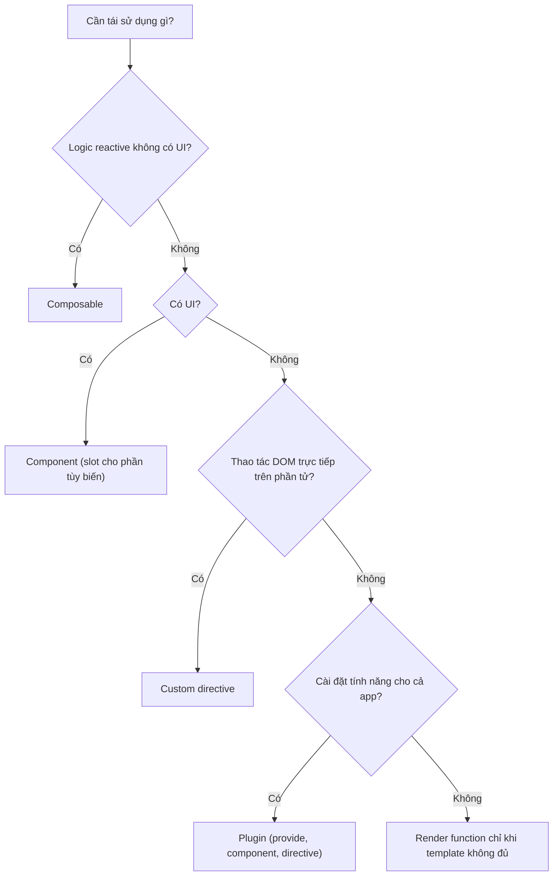
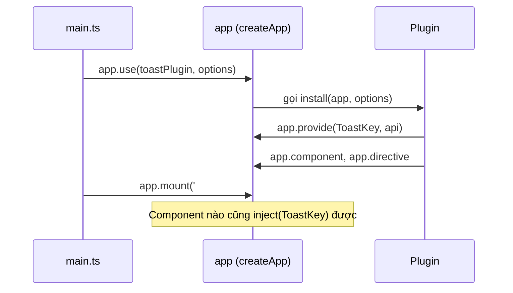
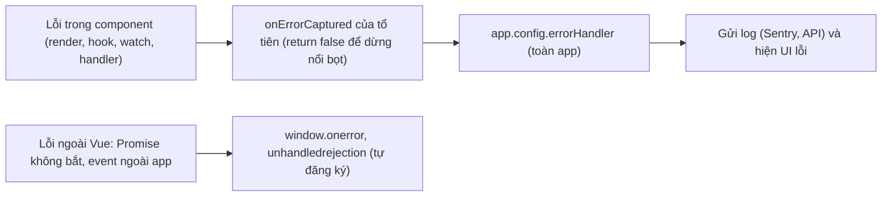
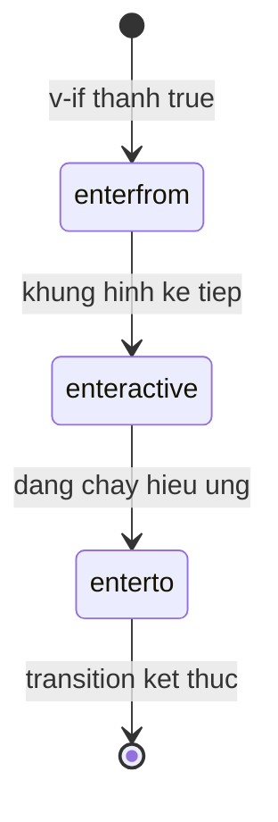

# Lý thuyết 10: Pattern nâng cao và kiến trúc

Bài cuối gom các công cụ mở rộng của Vue (directive, plugin, render function), xử lý lỗi toàn cục, component generic với TypeScript, hiệu ứng chuyển cảnh, và cách tổ chức dự án lớn. Kiểu nâng cao của TypeScript xem [TypeScript nâng cao](/go?p=11-Frontend-Core%2Flt-02-typescript-nang-cao.md).

## Các điểm mở rộng của Vue và vì sao cần chọn cẩn thận

Khi dự án nhỏ, câu hỏi của bạn là "làm sao viết được component này". Khi dự án lớn, nhiều đội cùng làm, câu hỏi đổi thành "ranh giới giữa các phần nằm ở đâu, lỗi được xử lý theo chuẩn nào, làm sao thêm tính năng mà không phá phần cũ". Vue cung cấp nhiều "điểm mở rộng" để trả lời: custom directive (thao tác DOM mức thấp trên một phần tử), plugin (cài đặt tính năng cho cả ứng dụng một lần), render function và `h()` (tạo VNode bằng code thay vì template), cơ chế bắt lỗi toàn cục, component generic (component dùng được với nhiều kiểu dữ liệu), và `Transition`/`TransitionGroup` (hiệu ứng chuyển cảnh).

Điều cần tránh là chọn công cụ quá mạnh cho việc nhỏ: ví dụ viết plugin cho thứ chỉ một component dùng, hoặc viết render function khi template làm được. Hậu quả là code khó đọc, khó bảo trì, và mất các tối ưu mà Vue làm sẵn. Nguyên tắc: chọn công cụ **ít quyền lực nhất mà vẫn đủ dùng**: composable trước, component sau, directive cho DOM thuần, plugin để cài đặt toàn cục, render function chỉ khi template không đủ. Bài này cần nhất khi bạn xây design system, thư viện nội bộ, tính năng chia sẻ giữa nhiều app, hoặc làm dự án nhiều đội.

## Các khái niệm cần biết

- **VNode (virtual node):** object JavaScript nhẹ mô tả một phần tử UI (tag gì, attribute gì, con là gì). Template của bạn được biên dịch thành code tạo VNode; Vue so VNode cũ và mới để biết cập nhật DOM thế nào.
- **`h()`:** hàm tạo VNode bằng tay, viết tắt của "hyperscript". `h('span', { class: 'a' }, 'xin chào')` tạo một thẻ `span`.
- **Patch flags và hoisting:** tối ưu mà compiler của Vue làm cho template: đánh dấu phần nào của VNode có thể đổi (patch flags) để bỏ qua phần còn lại khi so sánh, và nhấc phần tĩnh ra ngoài hàm render (hoisting) để khỏi tạo lại. Render function viết tay không có các tối ưu này.
- **Error boundary:** một component bắt lỗi của con nó và hiện UI thay thế, để lỗi không làm sập cả trang.
- **Event bubbling (nổi bọt) của lỗi:** lỗi đi ngược lên cây component qua từng tổ tiên cho tới khi có ai chặn hoặc tới handler toàn app.
- **FLIP:** kỹ thuật animate di chuyển (First, Last, Invert, Play): đo vị trí trước và sau, rồi dùng `transform` để phần tử "trượt" từ chỗ cũ sang chỗ mới. `TransitionGroup` dùng nó cho lớp `*-move`.
- **Module augmentation:** khai báo thêm kiểu cho một module có sẵn trong TypeScript (ví dụ thêm `$toast` vào kiểu của Vue).
- **Public API của module:** tệp `index.ts` chỉ xuất những gì được phép dùng từ bên ngoài, ẩn phần còn lại.

**Tóm tắt:**

- Chọn công cụ ít quyền lực nhất mà vẫn đủ dùng: composable cho logic, component cho UI, directive cho thao tác DOM thuần, plugin cho cài đặt toàn app.
- Render function chỉ dùng khi template không diễn đạt được, vì mất phần lớn tối ưu của compiler.
- Plugin là object có `install(app, options)` hoặc một hàm; chia sẻ API qua `provide`/`inject` có kiểu tốt hơn `globalProperties`.
- Lỗi trong component đi lên qua `onErrorCaptured`, rồi tới `app.config.errorHandler`; lỗi ngoài Vue phải tự bắt bằng `window.onerror` hoặc `unhandledrejection`.
- Mọi handler lỗi cuối cùng cần gửi log lên hệ thống như Sentry.
- Component generic với TypeScript giúp props và slot giữ kiểu theo dữ liệu truyền vào.
- `Transition` và `TransitionGroup` chỉ gắn class theo giai đoạn để bạn viết CSS.
- Dự án lớn nên chia theo feature và domain với dependency một chiều, lint để ép ranh giới.

## Chọn cơ chế mở rộng

Sơ đồ dưới là cây quyết định: bắt đầu từ thứ bạn cần tái sử dụng rồi đi theo các câu hỏi để chọn công cụ phù hợp nhất.



**Nền tảng:** chọn công cụ ít quyền lực nhất mà vẫn đủ dùng: composable cho logic reactive, component cho UI, directive cho thao tác DOM thuần, plugin cho cài đặt toàn ứng dụng, render function chỉ khi template không diễn đạt được (vì mất tối ưu của compiler).

## Custom directive

Directive là attribute đặc biệt dạng `v-xxx` trong template (như `v-if`, `v-model`). Bạn có thể tự viết directive riêng khi cần can thiệp trực tiếp vào phần tử DOM, ví dụ tự focus ô nhập khi hiện ra, hoặc phát hiện click ra ngoài một menu để đóng nó. Đó là những việc cần `el` (phần tử thật) và không gắn với state reactive nào, nên composable không phù hợp bằng. Directive dùng cho truy cập DOM mức thấp trên một phần tử. Vue 3 đổi tên hook cho khớp với lifecycle component.

```ts
// vFocus và vClickOutside trong <script setup>: biến bắt đầu bằng "v" được dùng làm v-xxx
import type { Directive } from 'vue'

export const vClickOutside: Directive<HTMLElement, () => void> = {
  mounted(el, binding) {
    const handler = (e: MouseEvent) => {
      if (!el.contains(e.target as Node)) binding.value()
    }
    ;(el as any).__outside = handler
    document.addEventListener('click', handler)
  },
  unmounted(el) {
    document.removeEventListener('click', (el as any).__outside) // dọn dẹp bắt buộc
  },
}
```

```vue
<script setup lang="ts">
import { vClickOutside } from './directives'
const open = ref(true)
</script>
<template><div v-if="open" v-click-outside="() => (open = false)">Menu</div></template>
```

| Hook | Thời điểm |
|---|---|
| `created` | Trước khi attribute và listener của phần tử được áp dụng |
| `beforeMount`, `mounted` | Trước và sau khi chèn vào DOM |
| `beforeUpdate`, `updated` | Trước và sau khi component chứa nó (và con) cập nhật |
| `beforeUnmount`, `unmounted` | Trước và sau khi hủy |
| Tham số | `el`, `binding` (`value`, `oldValue`, `arg`, `modifiers`, `instance`), `vnode`, `prevVnode` |

Quy tắc: directive **không dùng được trên component** một cách đáng tin cậy (áp vào root của component, nhưng bị lưu ý khi nhiều root), nên dành cho phần tử gốc. Hầu hết nhu cầu "dùng lại logic" nên là composable. Dùng directive cho: focus, click outside, lazy load ảnh, tooltip gắn DOM. Dọn mọi listener trong `unmounted`. Với SSR cần `getSSRProps` hoặc tránh phụ thuộc DOM (directive tùy biến mặc định bị bỏ qua khi render server).

## Plugin

Plugin là object có `install(app, options)` hoặc một hàm. Mục đích: đăng ký thứ toàn cục một lần. Vấn đề nó giải quyết: một tính năng như thông báo toast cần component, directive và một API gọi từ mọi nơi; thay vì mỗi chỗ tự đăng ký, bạn gói chúng vào một plugin rồi `app.use(...)` một lần. Dùng khi tính năng cắt ngang cả ứng dụng và cần config; không cần khi chỉ một vài component dùng (chỉ cần import).



```ts
// plugins/toast.ts
import type { App, InjectionKey } from 'vue'

export interface ToastApi { show(msg: string): void }
export const ToastKey: InjectionKey<ToastApi> = Symbol('toast')

export default {
  install(app: App, options: { duration?: number } = {}) {
    const api: ToastApi = {
      show(msg) { /* tạo UI, dùng options.duration ?? 3000 */ },
    }
    // cách nên dùng: có kiểu, không đụng global
    app.provide(ToastKey, api)
    app.component('AppToast', AppToast)        // đăng ký component
    app.directive('tooltip', vTooltip)         // đăng ký directive
    // dùng được nhưng khó kiểu, tránh trong code mới
    // app.config.globalProperties.$toast = api
  },
}

// main.ts
createApp(App).use(toastPlugin, { duration: 5000 }).mount('#app')

// Dùng
export function useToast() {
  const t = inject(ToastKey)
  if (!t) throw new Error('Chưa cài toast plugin')
  return t
}
```

| Cách chia sẻ | Ưu | Nhược |
|---|---|---|
| `app.provide` + `inject` + `useXxx()` | Có kiểu, test dễ, không đụng global | Phải qua `inject` |
| `globalProperties` | Dùng được trong template qua `$x` | Khó kiểu (cần khai báo module augmentation), ẩn nguồn gốc |
| Import module trực tiếp | Đơn giản | Singleton, rủi ro SSR nếu có state |

**Phải thuộc:** plugin là object có `install(app, options)` (hoặc một hàm), được cài bằng `app.use(plugin, options)`; bên trong thường dùng `app.provide`, `app.component`, `app.directive`. Chia sẻ API qua `provide`/`inject` có kiểu tốt hơn `globalProperties`.

Plugin phù hợp: i18n, router, Pinia, thư viện UI, tích hợp analytics. Nhớ rằng router, Pinia, i18n **đều là plugin** của `createApp`. Hàm tạo app phải gọi theo từng request ở SSR (factory) để không dùng chung instance.

## Render function và h()

Template là cú pháp tiện, nhưng dùng render function khi logic sinh VNode quá động (cây đệ quy, tạo thẻ theo config, HOC, tức component bọc component khác để thêm hành vi). Ví dụ dưới là một `Heading` cần sinh thẻ `h1`, `h2` hoặc `h3` theo prop `level`; viết bằng template sẽ phải lặp `v-if` cho từng mức.

```ts
import { h, defineComponent, type PropType, type VNode } from 'vue'

export const Heading = defineComponent({
  props: { level: { type: Number as PropType<1 | 2 | 3>, required: true } },
  setup(props, { slots }) {
    return () => h(`h${props.level}`, { class: 'title' }, slots.default?.())
  },
})

// Functional component: hàm thuần, không state
const Badge = (props: { text: string }) => h('span', { class: 'badge' }, props.text)
Badge.props = ['text'] // khai báo props để Vue phân biệt với attrs
```

| So sánh | Template | Render function / JSX |
|---|---|---|
| Tối ưu compiler (patch flags, hoisting) | **Có** | **Không** (VNode tạo lúc chạy, so sánh đầy đủ hơn) |
| Linh hoạt logic | Hạn chế bởi directive | Toàn bộ JS |
| Đọc hiểu | Gần HTML | Gần code |
| Dùng khi | Hầu hết | Cây động, thư viện, wrapper cấp thấp |

`h()` nhận `(type, props, children)`; children là chuỗi, mảng VNode, hoặc object slot. Phân biệt `class`, `style`, event `onClick` giống template. Kết quả quan trọng: render function **mất tối ưu compiler**, nên chỉ dùng khi cần.

## Xử lý lỗi

Vấn đề: ở production, một lỗi không bắt sẽ làm một phần UI đứng im hoặc trắng trang, và bạn không hề biết nếu không có log. Vue cho nhiều lớp bắt lỗi, từ gần nhất (error boundary quanh một vùng) tới xa nhất (handler toàn app). Sơ đồ cho thấy lỗi đi lên lần lượt qua từng lớp.



```ts
// main.ts
const app = createApp(App)

app.config.errorHandler = (err, instance, info) => {
  // info: loại nguồn lỗi ("render function", "watcher callback"...)
  reportError(err, { component: instance?.$options.name, info })
}
app.config.warnHandler = (msg, instance, trace) => { /* chỉ dev */ }

window.addEventListener('unhandledrejection', (e) => reportError(e.reason))
```

```vue
<!-- ErrorBoundary.vue: pattern error boundary -->
<script setup lang="ts">
import { ref, onErrorCaptured } from 'vue'
const error = ref<Error | null>(null)
onErrorCaptured((err) => {
  error.value = err as Error
  return false // chặn lỗi nổi lên tiếp
})
</script>
<template>
  <slot v-if="!error" />
  <div v-else role="alert">Có lỗi xảy ra <button @click="error = null">Thử lại</button></div>
</template>
```

Lưu ý: `errorHandler` bắt lỗi trong render, hook, watcher, event handler của component; **không** bắt lỗi trong callback `setTimeout` hoặc Promise không được Vue bọc. Lỗi trong handler async có trả về Promise bị từ chối được Vue bắt cho handler gọi qua Vue, nhưng đừng dựa vào điều đó cho mọi `await`. Lỗi tải chunk dynamic import xử lý ở `router.onError`.

**Phải thuộc:** lỗi trong component đi lên qua `onErrorCaptured` của các tổ tiên (trả `false` để dừng nổi bọt), rồi tới `app.config.errorHandler`; lỗi ngoài Vue (Promise không bắt, `setTimeout`) phải tự bắt bằng `window.onerror` hoặc `unhandledrejection`. Mọi handler cuối cùng cần gửi log (Sentry hoặc tương đương).

## Component generic với TypeScript

Component generic giải quyết bài toán: một `Select` hay `DataTable` dùng được với `User`, `Product` hay chuỗi, nhưng TypeScript vẫn biết chính xác kiểu của `item` trong slot. Không có generic, bạn phải dùng `any` và mất kiểm tra kiểu. Dùng khi component nhận dữ liệu kiểu tùy ý từ cha; không cần với component chỉ làm việc với một kiểu cố định.

```vue
<!-- Select.vue: generic theo kiểu item -->
<script setup lang="ts" generic="T extends string | number | object">
const props = defineProps<{
  items: T[]
  labelKey?: T extends object ? keyof T : never
}>()
const model = defineModel<T | null>({ default: null })

defineSlots<{
  option(p: { item: T; selected: boolean }): any
}>()
</script>

<template>
  <ul>
    <li v-for="(it, i) in items" :key="i" @click="model = it">
      <slot name="option" :item="it" :selected="model === it">{{ it }}</slot>
    </li>
  </ul>
</template>
```

Dùng: `<Select :items="users" v-model="current">` suy ra `T = User`, slot `option` có `item: User`. Điểm cần nhớ: `generic` nhận cú pháp tham số kiểu giống TypeScript; kiểu suy ra từ props; `defineSlots` để kiểu slot; có thể dùng `extends` để ràng buộc.

## Animations: Transition và TransitionGroup

`<Transition>` cho Vue biết "phần tử này sắp xuất hiện hoặc biến mất, hãy gắn các CSS class theo từng giai đoạn để tôi viết hiệu ứng". Bạn chỉ viết CSS cho các lớp; Vue lo việc thêm bớt lớp đúng thời điểm và đợi hiệu ứng kết thúc trước khi gỡ phần tử khỏi DOM. `<TransitionGroup>` làm tương tự cho cả danh sách.



Đọc sơ đồ (phần vào): `enter-from` là state bắt đầu (ví dụ `opacity: 0`), `enter-active` giữ khai báo `transition`, `enter-to` là state cuối; phần ra (`leave-*`) làm ngược lại.

| | `<Transition>` | `<TransitionGroup>` |
|---|---|---|
| Dùng cho | Một phần tử hoặc component vào/ra (`v-if`, `v-show`, `:key`, `component :is`) | Danh sách `v-for` thêm, bớt, đổi chỗ |
| Phần tử bọc | Không render thêm | Mặc định render Fragment; thẻ bọc nếu có `tag` |
| `key` | Cần khi chuyển giữa các phần tử cùng loại | **Bắt buộc** cho mỗi con |
| Chuyển động di chuyển | Không | Có lớp `*-move` (FLIP) |
| `mode` | `out-in`, `in-out` | Không có |

```vue
<template>
  <Transition name="fade" mode="out-in">
    <component :is="view" :key="view.name" />
  </Transition>

  <TransitionGroup name="list" tag="ul">
    <li v-for="t in todos" :key="t.id">{{ t.text }}</li>
  </TransitionGroup>
</template>

<style>
.fade-enter-active, .fade-leave-active { transition: opacity .2s ease; }
.fade-enter-from, .fade-leave-to { opacity: 0; }

.list-move, .list-enter-active, .list-leave-active { transition: all .3s ease; }
.list-enter-from, .list-leave-to { opacity: 0; transform: translateX(20px); }
.list-leave-active { position: absolute; } /* để phần tử còn lại di chuyển mượt */
</style>
```

Các lớp: `*-enter-from`, `*-enter-active`, `*-enter-to`, `*-leave-from`, `*-leave-active`, `*-leave-to`. Có thể dùng JavaScript hooks (`@before-enter`, `@enter`, `@leave`) cùng GSAP. Mẹo: dùng `transform` và `opacity` (compositor) thay vì `width` hay `top`; tôn trọng `prefers-reduced-motion`. `<Transition>` yêu cầu **một** phần tử gốc con.

## Cấu trúc dự án lớn

```text
src/
  app/              # khởi tạo: main.ts, router, plugins, providers
  shared/           # ui (design system), lib, composables dùng chung, types
  entities/         # user, product: model, api, ui nhỏ
  features/         # tính năng có nghiệp vụ: add-to-cart, login
    cart/
      components/ composables/ api/ store.ts index.ts   # index.ts là public API
  pages/ (views/)   # ghép feature theo route
```

| Nguyên tắc | Nội dung |
|---|---|
| Tổ chức theo **domain/feature**, không theo loại file | Thêm tính năng chỉ chạm một thư mục |
| Hướng dependency một chiều | `pages` -> `features` -> `entities` -> `shared`; không import ngược |
| Public API qua `index.ts` | Ẩn nội bộ, import bằng alias |
| Tách tầng | UI (component) / logic (composable, store) / truy cập dữ liệu (api client) |
| API client tập trung | Một nơi cho base URL, interceptor, xử lý lỗi, kiểu response |
| Quy ước tên | `useXxx`, `XxxStore`, `BaseXxx` cho component nền |
| Công cụ ép quy tắc | ESLint (`vue/*`, import boundaries), `vue-tsc`, Prettier, CI |
| Monorepo khi nhiều app | pnpm workspace, package `ui`, `api-client`, `config` |

Với đội lớn: Storybook cho design system, Changesets cho phiên bản gói, contract testing với backend (OpenAPI sinh kiểu).

## Anti-pattern thường gặp

| Anti-pattern | Vì sao tệ | Thay thế |
|---|---|---|
| God component 1.000 dòng | Khó test và đọc | Tách component, composable |
| Mọi thứ trong Pinia | Server state sai chỗ, store phình | Phân loại state ([Bài 5](/go?p=10-Vue%2Fmedium%2Flt-05-composables-pinia.md)) |
| Event bus toàn cục (`mitt`) cho mọi thứ | Flow ngầm, khó truy vết | Props, emits, store |
| `$parent`, `$refs` xuyên component | Coupling chặt | Props, emits, provide |
| Mutate props | Dữ liệu khó truy vết | Emit, `defineModel` |
| `watch` để sync hai state | Race, lặp | `computed` |
| `any` ở ranh giới | Mất an toàn kiểu | Kiểu hóa props, api, store |
| `v-html` với dữ liệu người dùng | XSS ([Bảo mật FE](/go?p=11-Frontend-Core%2Flt-04-bao-mat-frontend.md)) | Escape mặc định, sanitize khi bắt buộc |
| Logic nghiệp vụ trong template | Khó test | Computed, composable |
| Plugin global dựa `globalProperties` | Ẩn dependency, khó kiểu | `provide` và `useXxx` |
| Import tương đối kiểu `../../../../` | Rối | Alias và public API |

## Bẫy thường gặp

| Bẫy | Hậu quả | Cách tránh |
|---|---|---|
| Directive quên dọn listener | Memory leak | `unmounted` |
| Plugin giữ state ở module scope | Lẫn dữ liệu giữa request SSR | State theo `app` (provide) |
| Render function làm mất patch flags | Chậm hơn với cây lớn | Giữ template khi có thể |
| `errorHandler` không gửi log | Lỗi production mù | Tích hợp Sentry hoặc tương đương |
| `onErrorCaptured` quên `return false` | Lỗi nổi lên làm sập trên | Quyết định rõ chặn hay không |
| Quên `key` trong `TransitionGroup` | Hiệu ứng sai, cảnh báo | Key duy nhất ổn định |
| Dùng `width/height` làm animation | Reflow, giật | `transform`, `opacity` |
| `generic` quá rộng | Mất suy luận | Ràng buộc `extends` hợp lý |
| Import chéo giữa feature | Circular dependency | Qua `entities` hoặc `shared` |

## Câu hỏi phỏng vấn thường gặp

Mỗi câu có gợi ý suy luận để tự lần ra đáp án trước khi đọc.

1. **Bạn cần tự động focus một ô nhập khi nó xuất hiện. Viết custom directive hay composable?**
   - Gợi ý: việc này chạm vào phần tử DOM thật hay chỉ là logic dữ liệu reactive?
   - Lập luận: directive có hook gắn với lifecycle phần tử và nhận trực tiếp DOM node, nên hợp cho can thiệp DOM thuần; composable đóng gói logic reactive nhưng không tự có phần tử. Ưu tiên composable, dùng directive khi chỉ cần thao tác DOM.
2. **Vì sao plugin nên dùng `app.provide` thay vì gắn vào `app.config.globalProperties`?**
   - Gợi ý: cái nào có kiểu TypeScript, và cái nào dễ thay thế khi test?
   - Lập luận: plugin là object có `install(app, options)`. `provide`/`inject` có `InjectionKey` nên kiểu rõ và không đụng global, còn test chỉ cần cung cấp giá trị khác. Vì vậy `app.provide` dễ kiểm soát hơn.
3. **Khi nào bạn chấp nhận viết render function, dù mất gì?**
   - Gợi ý: nhớ lại việc compiler làm trước khi chạy (patch flags, hoisting) nhờ template có cấu trúc tĩnh. Render function thì cấu trúc sinh bằng JavaScript tự do.
   - Lập luận: với cây thật sự động hoặc code thư viện, template khó diễn đạt nên render function linh hoạt hơn, nhưng compiler không phân tích được nữa nên mất các tối ưu đó.
4. **Một component con ném lỗi giữa chừng. Bạn thiết kế để cả trang không sập thế nào?**
   - Gợi ý: lỗi cần được bắt ở mấy phạm vi (một vùng, cả app, promise không bắt)?
   - Lập luận: `onErrorCaptured` đặt ở cha tạo error boundary theo vùng và hiện UI dự phòng; `app.config.errorHandler` bắt phần còn lại của app; `unhandledrejection` bắt promise bị bỏ sót; cuối cùng ghi log.
5. **Muốn một `<DataTable>` dùng cho nhiều kiểu dòng mà vẫn có kiểu đúng. Làm thế nào?**
   - Gợi ý: kiểu của props và slot phải cùng tham chiếu một tham số kiểu.
   - Lập luận: khai báo `generic="T"` trong `<script setup>`, rồi `defineProps` và `defineSlots` dùng `T`, nên dữ liệu truyền vào và slot props cùng suy ra một kiểu.
6. **Vì sao một phần tử cần `Transition` còn danh sách cần `TransitionGroup`?**
   - Gợi ý: số phần tử đang chuyển động cùng lúc, và việc di chuyển khi thứ tự đổi.
   - Lập luận: `Transition` xử lý một phần tử vào hoặc ra. `TransitionGroup` xử lý nhiều phần tử, có thêm, bớt, di chuyển, nên cần `key` để biết phần tử nào là phần tử nào.
7. **Dự án lớn dần và code rối. Bạn chia thư mục theo gì, và giữ ranh giới bằng cách nào?**
   - Gợi ý: khi sửa một tính năng, bạn muốn đụng một chỗ hay nhiều chỗ? Dependency hai chiều gây gì?
   - Lập luận: chia theo feature và domain để thay đổi tập trung; dependency một chiều tránh vòng; public API qua `index.ts` giấu chi tiết bên trong; công cụ lint ép ranh giới để quy ước không bị phá.
8. **Anti-pattern nào đáng lo nhất?**
   - Gợi ý: mỗi cái vi phạm nguyên tắc nào đã học (data flow một chiều, nguồn sự thật, một trách nhiệm)?
   - Lập luận: god component vi phạm một trách nhiệm; nhét server state vào store tạo bản sao lệch; event bus làm data flow khó truy vết; mutate props phá data flow một chiều.

Câu hỏi tổng hợp: [Q&A phỏng vấn Vue](/go?p=07-Interview-QA%2FFrontend%2Fhard%2Fqa-vue-phong-van.md).

