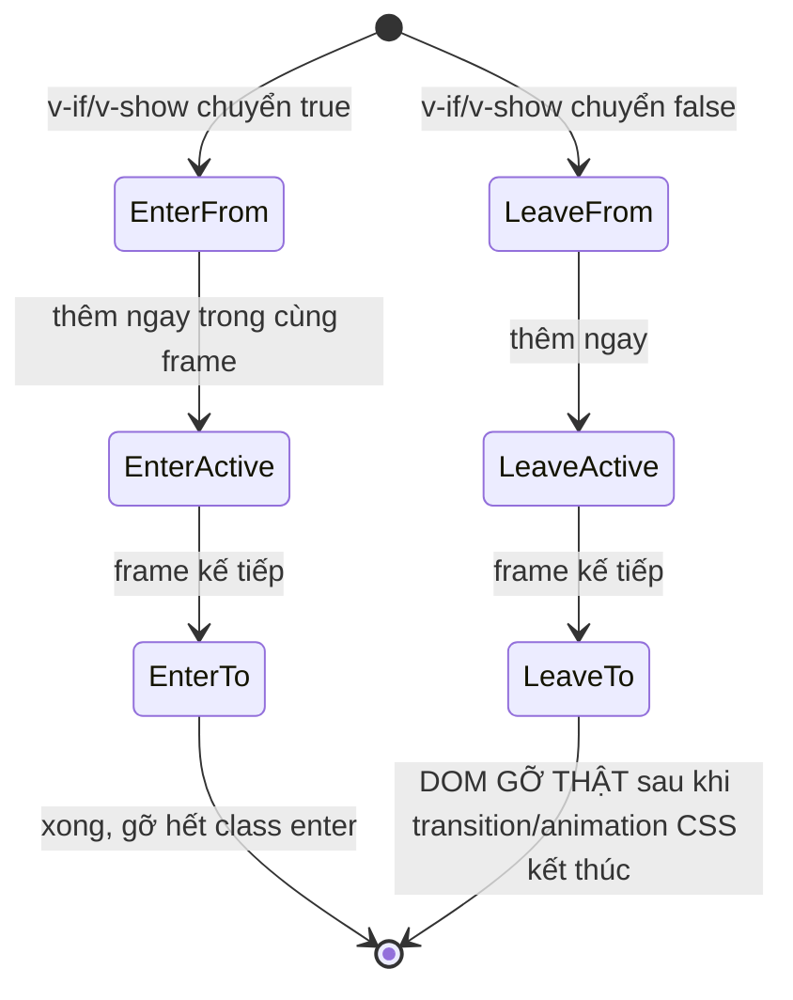
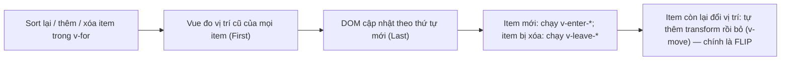

# Lý thuyết 11: Animation trong Vue

Bài [Animation và motion trên web](/go?p=11-Frontend-Core%2Flt-07-animation-motion-web.md) đã nói nền tảng dùng chung: vì sao `transform`/`opacity` mượt, FLIP là gì, `prefers-reduced-motion`. Bài [Hiệu năng rendering](/go?p=10-Vue%2Fhard%2Flt-08-hieu-nang-rendering.md) chỉ nhắc `Transition` một dòng khi bàn thứ tự lồng với `Suspense`/`KeepAlive`. Bài này đi vào cơ chế thật: Vue có component `Transition` dựng sẵn để tự động hóa animate vào/ra, và `TransitionGroup` để animate cả danh sách — đây là điểm khác biệt lớn nhất so với React, nơi phải cài thêm thư viện (Framer Motion) mới có khả năng tương đương.

## Vấn đề nó giải quyết

Giống React, Vue gỡ DOM của một phần tử ngay khi `v-if` chuyển `false` — không có DOM thì không animate "biến mất" được. Nhưng Vue giải quyết vấn đề này ở tầng framework thay vì để bạn tự quản lý state `mounted`/`unmounting`: `<Transition>` tự thêm/bớt class CSS đúng lúc, hoặc gọi JS hook đúng lúc, và **tự trì hoãn việc gỡ DOM thật** cho tới khi animation xong. Đây là lý do Vue không cần một thư viện ngoài để có exit animation cơ bản, trong khi React cần `AnimatePresence`.

**Nền tảng:** `<Transition>` không tự vẽ animation — nó chỉ là một cỗ máy thêm/bớt class CSS (hoặc gọi hook JS) đúng thời điểm vào ba giai đoạn: **enter** (phần tử xuất hiện), **leave** (phần tử biến mất, DOM được giữ lại tới khi xong), và tùy chọn **appear** (lần hiện đầu tiên khi trang tải). Bạn tự viết CSS animate cho các class đó; `<Transition>` chỉ lo đúng nhịp.

## Các khái niệm cần biết

| Khái niệm | Là gì | Vì sao quan trọng |
|---|---|---|
| **`<Transition>`** | Component bọc quanh MỘT phần tử gốc, tự thêm/bớt class theo giai đoạn enter/leave | Cách chuẩn để animate một phần tử xuất hiện/biến mất trong Vue |
| **6 class tự động** | `v-enter-from`, `v-enter-active`, `v-enter-to`, `v-leave-from`, `v-leave-active`, `v-leave-to` (hoặc tiền tố tùy chỉnh qua `name`) | Đây là "API" thật sự của Transition — CSS của bạn nhắm vào các class này |
| **`<TransitionGroup>`** | Animate một **danh sách** phần tử (`v-for`), có thêm class `v-move` cho việc đổi vị trí | `<Transition>` chỉ nhận một con; danh sách phải dùng `TransitionGroup` |
| **`v-move`** | Class áp dụng khi một phần tử còn lại trong danh sách đổi vị trí | Chính là FLIP được Vue tự động hóa — không cần tự đo `getBoundingClientRect` |
| **JS hooks** (`@enter`, `@leave`, `@before-enter`...) | Callback JS chạy đúng giai đoạn, nhận phần tử DOM và một `done` callback | Dùng khi cần GSAP hoặc logic animate phức tạp hơn CSS thuần |
| **`appear`** | Prop bật animate cho cả lần hiện **đầu tiên** khi trang vừa tải | Mặc định `Transition` không animate lần đầu, chỉ animate khi trạng thái đổi sau đó |

**Tóm tắt:**

- `<Transition>` tự thêm/bớt 6 class CSS (`v-enter-from/active/to`, `v-leave-from/active/to`) đúng thời điểm, và tự trì hoãn việc gỡ DOM thật cho tới khi animation CSS kết thúc.
- `-active` là class mang `transition`/`animation` CSS thật, tồn tại suốt cả quá trình; `-from`/`-to` chỉ là hai điểm đầu-cuối tức thời để nội suy.
- Vue biết animation CSS xong nhờ lắng nghe `transitionend`/`animationend`; class `-active` thiếu `transition`/`animation` thì Vue gỡ DOM ngay lập tức, animation coi như không chạy.
- Animate bằng JS (GSAP, WAAPI) qua các hook `@enter`/`@leave` bắt buộc thêm `:css="false"` và tự gọi `done()`, nếu không Vue sẽ không biết khi nào animation JS kết thúc.
- `<TransitionGroup>` dùng cho danh sách (`Transition` chỉ nhận một con); nó tự chạy FLIP cho các phần tử không đổi nhưng đổi vị trí, qua class `v-move`.
- `key` trong `v-for` phải là id dữ liệu ổn định, không phải index, nếu không `TransitionGroup` animate nhầm phần tử khi chèn/xóa ở giữa.
- `v-if` tạo/hủy component (tốn hơn khi đổi liên tục); `v-show` chỉ đổi `display` nhưng vẫn chạy đủ animation enter/leave, rẻ hơn cho trường hợp đổi tần suất cao.

## Sáu class và vòng đời enter/leave



```css
/* name="fade" quyết định tiền tố class: v-enter-* mặc định, hoặc fade-enter-* nếu đặt name */
.fade-enter-active, .fade-leave-active {
  transition: opacity 0.2s ease;
}
.fade-enter-from, .fade-leave-to {
  opacity: 0; /* trạng thái "ẩn": lúc bắt đầu enter, và lúc kết thúc leave */
}
```

```vue
<Transition name="fade">
  <p v-if="show">Nội dung animate vào/ra</p>
</Transition>
```

**Phải thuộc:** `-active` là class mang `transition`/`animation` CSS thật (luôn có suốt cả quá trình); `-from`/`-to` chỉ là hai điểm đầu-cuối để trình duyệt nội suy. `v-leave-to` trùng giá trị với `v-enter-from` trong ví dụ trên (cùng là `opacity: 0`) không phải trùng hợp — cả hai đều là "trạng thái ẩn", chỉ khác chiều animate tới hay animate từ đó.

**Suy luận:** Vue biết chính xác khi nào animation CSS kết thúc để gỡ DOM thật (không sớm hơn, không trễ hơn) bằng cách lắng nghe sự kiện `transitionend`/`animationend` của trình duyệt trên chính phần tử đó — đây là lý do class `-active` bắt buộc phải khai báo `transition`/`animation`, nếu không Vue sẽ không nhận được sự kiện kết thúc và gỡ DOM ngay lập tức (y hệt như không có Transition). Với animation phức tạp hơn CSS thuần, bạn phải tự gọi `done()` qua JS hook để nói cho Vue biết "xong rồi, gỡ được".

## JS hooks: khi cần GSAP hoặc logic animate phức tạp

```vue
<Transition
  @before-enter="(el) => gsap.set(el, { opacity: 0, y: -20 })"
  @enter="(el, done) => gsap.to(el, { opacity: 1, y: 0, duration: 0.3, onComplete: done })"
  @leave="(el, done) => gsap.to(el, { opacity: 0, y: -20, duration: 0.2, onComplete: done })"
  :css="false"
>
  <div v-if="show" class="card">...</div>
</Transition>
```

**Phải thuộc:** `:css="false"` bắt buộc khi dùng JS hook để animate — thiếu nó, Vue vẫn chờ sự kiện CSS `transitionend` song song với hook JS, và vì không có CSS transition nào thật sự chạy, nó sẽ gỡ DOM ngay lập tức thay vì chờ `done()` của bạn. Tham số `done` trong `@enter`/`@leave` là hợp đồng bắt buộc: quên gọi `done()` thì Vue treo mãi ở trạng thái "đang chuyển", không bao giờ coi animation là xong.

## TransitionGroup: animate danh sách và `v-move`

```vue
<TransitionGroup name="list" tag="ul">
  <li v-for="item in sortedItems" :key="item.id" class="list-item">
    {{ item.label }}
  </li>
</TransitionGroup>
```

```css
.list-enter-active, .list-leave-active { transition: all 0.3s ease; }
.list-enter-from, .list-leave-to { opacity: 0; transform: translateX(20px); }
.list-leave-active { position: absolute; } /* để phần tử sắp biến mất không chiếm chỗ, các phần tử khác dịch chuyển ngay */
.list-move { transition: transform 0.3s ease; } /* animate việc ĐỔI VỊ TRÍ của phần tử còn lại */
```



**Nền tảng:** `TransitionGroup` khác `Transition` ở hai điểm bắt buộc: nó render ra một phần tử bọc thật (`tag="ul"`, mặc định là `span`) chứ không phải chỉ là "chỗ trú tạm" như `Transition`, và nó tự chạy đúng bốn bước FLIP cho **những item không đổi** nhưng đổi vị trí — đây là việc `Transition` thường (chỉ nhận một con) không làm được, vì nó không biết gì về "các phần tử anh em xung quanh".

## Khi nào dùng `v-if`/`v-show` kết hợp Transition

| | `v-if` + Transition | `v-show` + Transition |
|---|---|---|
| DOM | Thêm/gỡ thật | Luôn tồn tại, chỉ đổi `display` |
| Hook `@enter`/`@leave` | Chạy đủ enter và leave | Chạy đủ enter và leave (khác với không có Transition, `v-show` chỉ đổi `display` tức thời) |
| Chi phí tạo lại | Cao hơn nếu bật/tắt liên tục (tạo/hủy component) | Thấp hơn khi bật/tắt liên tục |
| Dùng cho | Hiện/ẩn không thường xuyên (modal, toast) | Hiện/ẩn liên tục (tab, dropdown gõ nhanh) |

## Bẫy thường gặp

| Bẫy | Hậu quả | Cách tránh |
|---|---|---|
| Class `-active` không khai báo `transition`/`animation` | Vue không nhận được sự kiện kết thúc, gỡ DOM ngay lập tức, animation không chạy | Luôn đặt `transition`/`animation` CSS lên đúng class `-active` |
| Dùng JS hook mà quên `:css="false"` | Vue chờ cả sự kiện CSS lẫn `done()`, animation có thể bị cắt ngang hoặc không chạy đúng | Luôn thêm `:css="false"` khi animate hoàn toàn bằng JS |
| Quên gọi `done()` trong `@enter`/`@leave` | Vue treo ở trạng thái "đang chuyển", phần tử sau không vào đúng vòng đời | Luôn gọi `done()` khi animation JS (GSAP, WAAPI) hoàn tất |
| Animate danh sách bằng `Transition` thay vì `TransitionGroup` | Lỗi vì `Transition` chỉ nhận đúng một phần tử con | Danh sách luôn dùng `TransitionGroup` |
| `key` trong `v-for` không ổn định (dùng index) | `v-move`/enter/leave animate nhầm phần tử khi chèn/xóa ở giữa | `key` phải là id dữ liệu, không phải vị trí |
| Thiếu `position: absolute` cho `.leave-active` khi item rời đi vẫn chiếm chỗ | Các item khác không dịch chuyển cho tới khi item cũ biến mất hẳn, animate giật | Đặt `leave-active { position: absolute }` để item rời đi "thoát luồng" ngay |

## Câu hỏi phỏng vấn thường gặp

### 1. Sáu class `v-enter-from/active/to` và `v-leave-from/active/to` dùng như thế nào, cái nào mang animation thật?

**Gợi ý suy luận:**
- Class nào tồn tại suốt cả quá trình, class nào chỉ tồn tại một khung hình?
- `transition`/`animation` CSS nên khai báo trên class nào?

**Lập luận:** `-active` tồn tại suốt từ đầu tới cuối giai đoạn enter hoặc leave, nên đó là nơi khai báo `transition`/`animation` CSS thật. `-from` chỉ tồn tại một khung hình lúc bắt đầu (trạng thái gốc để nội suy từ đó), `-to` được thêm ở khung hình kế tiếp (trạng thái đích), rồi cả hai bị gỡ khi xong. Nếu `-active` không có `transition`/`animation`, Vue không biết khi nào animation kết thúc.

**Đáp án ngắn:** `-active` mang CSS animate thật và tồn tại suốt quá trình; `-from`/`-to` chỉ là hai điểm đầu-cuối tức thời.

**Nhớ:** Thiếu transition trên `-active` thì mọi thứ khác vô nghĩa.

### 2. Vì sao phải thêm `:css="false"` khi dùng JS hook (`@enter`, `@leave`) để animate bằng GSAP?

**Gợi ý suy luận:**
- Không có `:css="false"`, Vue chờ tín hiệu kết thúc từ đâu?
- Nếu không có CSS transition nào thật sự chạy, tín hiệu đó có bao giờ tới không?

**Lập luận:** Mặc định Vue chờ sự kiện `transitionend`/`animationend` của trình duyệt để biết animation CSS đã xong. Khi animate hoàn toàn bằng JS (không có CSS transition nào chạy), sự kiện đó không bao giờ bắn, nên Vue sẽ gỡ DOM ngay lập tức (coi như animation xong tức khắc) trước khi GSAP kịp chạy. `:css="false"` tắt cơ chế chờ CSS, chuyển hoàn toàn sang chờ bạn tự gọi `done()`.

**Đáp án ngắn:** Để Vue không chờ sự kiện CSS không tồn tại; chuyển sang chờ `done()` của bạn.

**Nhớ:** Animate bằng JS thì luôn kèm `:css="false"`.

### 3. `TransitionGroup` khác `Transition` ở điểm nào, vì sao danh sách bắt buộc phải dùng `TransitionGroup`?

**Gợi ý suy luận:**
- `Transition` nhận được bao nhiêu phần tử con?
- Animate "đổi vị trí của các phần tử còn lại" cần biết thông tin gì mà một phần tử đơn lẻ không có?

**Lập luận:** `Transition` chỉ quản lý đúng một phần tử gốc và hai giai đoạn enter/leave của chính nó, không biết gì về các phần tử anh em xung quanh. `TransitionGroup` render ra một phần tử bọc thật và theo dõi toàn bộ danh sách con, nên nó có đủ thông tin để không chỉ animate enter/leave của từng item mà còn animate việc **đổi vị trí** của các item không đổi khi danh sách sắp xếp lại — qua class `v-move`, tự chạy FLIP bên dưới.

**Đáp án ngắn:** `Transition` chỉ quản một phần tử; `TransitionGroup` quản cả danh sách nên animate thêm được việc đổi vị trí qua `v-move`.

**Nhớ:** Danh sách cần biết về "anh em xung quanh"; chỉ `TransitionGroup` có thông tin đó.

### 4. Xóa một item ở giữa danh sách khiến các item animate giật thay vì mượt. Thiếu gì?

**Gợi ý suy luận:**
- Item sắp biến mất còn chiếm chỗ trong layout trong lúc animate leave không?
- Các item phía sau nó dịch chuyển lên ngay, hay chờ item cũ biến mất hẳn?

**Lập luận:** Mặc định, item đang chạy animation leave vẫn chiếm chỗ trong luồng layout cho tới khi bị gỡ DOM thật, nên các item phía sau phải chờ tới lúc đó mới dịch chuyển lên — gây cảm giác khựng rồi mới trượt. Đặt `position: absolute` lên class `-leave-active` đưa item đó ra khỏi luồng layout ngay khi bắt đầu leave, để các item còn lại dịch chuyển lên cùng lúc, mượt hơn.

**Đáp án ngắn:** Item rời đi còn chiếm chỗ layout; thêm `position: absolute` cho `leave-active` để nó thoát luồng ngay.

**Nhớ:** Leave vẫn chiếm chỗ trừ khi bạn chủ động gỡ nó khỏi layout.

### 5. `v-if` và `v-show` đều dùng được với `Transition`. Khác nhau ở đâu khi chọn cho một tab chuyển qua lại liên tục?

**Gợi ý suy luận:**
- `v-show` có tạo/hủy component mỗi lần đổi không?
- Tần suất đổi trạng thái cao thì chi phí nào đáng lo hơn?

**Lập luận:** `v-if` thêm/gỡ DOM thật, nghĩa là tạo và hủy component mỗi lần đổi — tốn hơn khi đổi liên tục (tab chuyển qua lại nhanh). `v-show` chỉ đổi thuộc tính `display`, component vẫn tồn tại nguyên vẹn, nên rẻ hơn nhiều khi tần suất đổi cao, dù cả hai đều chạy đủ animation enter/leave của `Transition` như nhau.

**Đáp án ngắn:** `v-if` tạo/hủy component (tốn hơn khi đổi liên tục); `v-show` chỉ đổi `display`, rẻ hơn cho trường hợp đổi liên tục.

**Nhớ:** Đổi liên tục thì `v-show`; hiếm khi đổi thì `v-if` cũng ổn.
