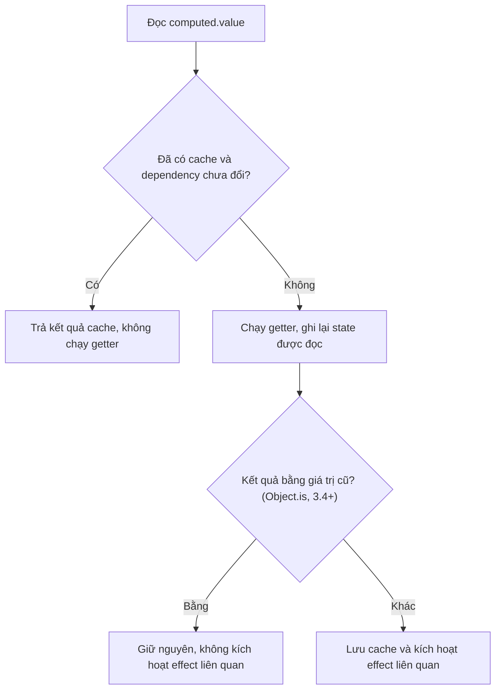
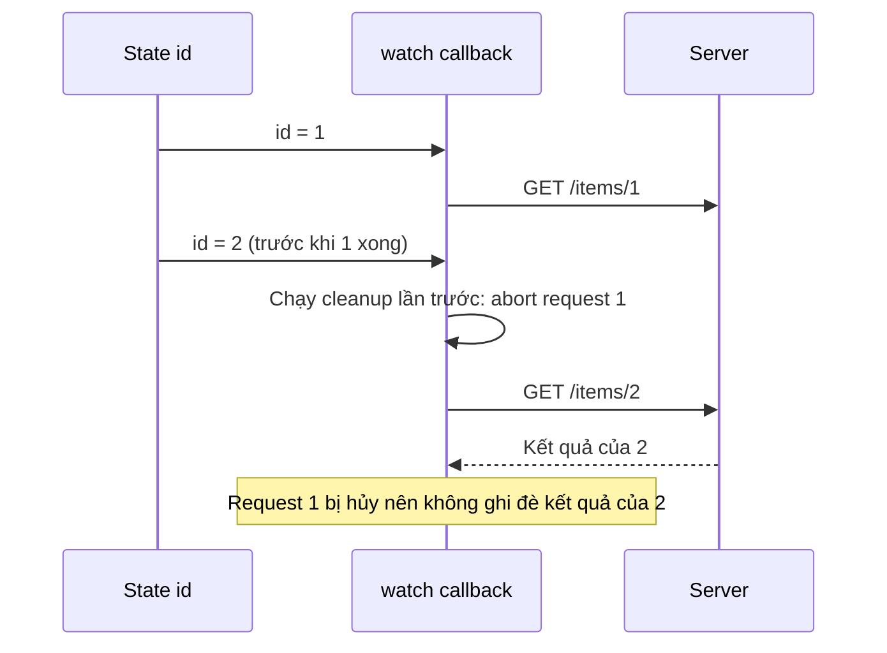
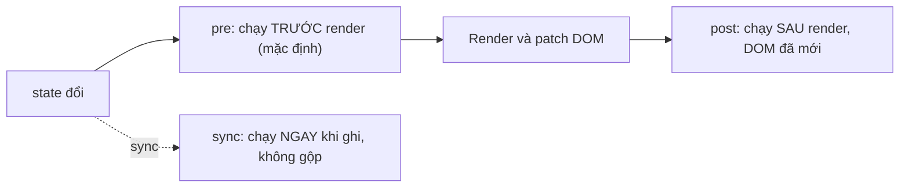
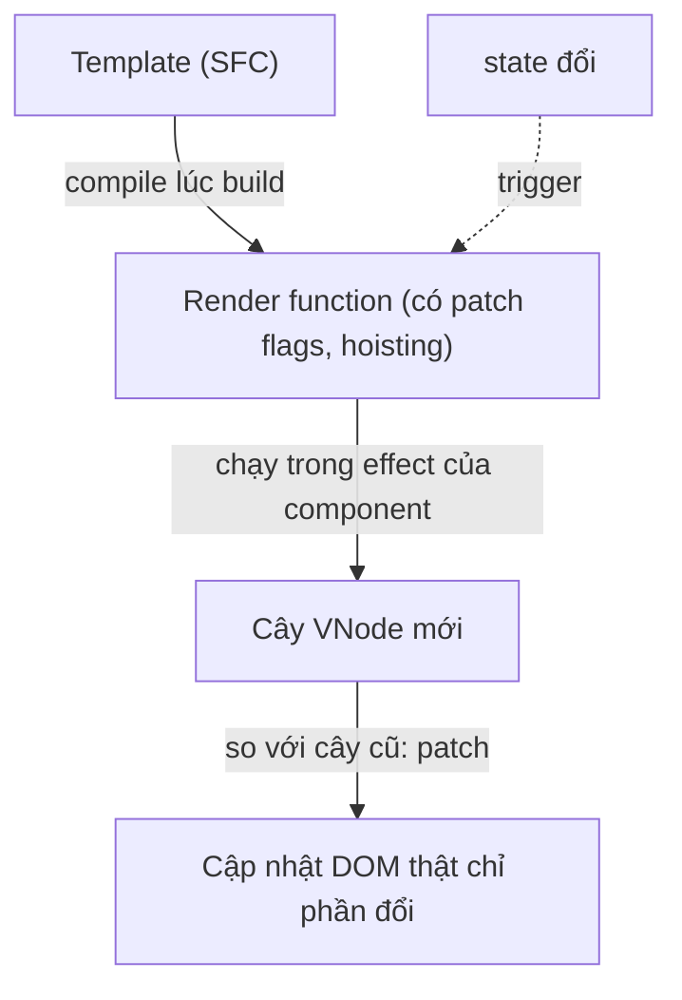

# Lý thuyết 4: Computed, watch và cơ chế rendering

Bài này giải thích hai nhóm: dữ liệu dẫn xuất và tác dụng phụ (`computed`, `watch`), và đường đi từ template đến DOM (compiler, virtual DOM, patch flags). Nền tảng ở [Bài 1](/go?p=10-Vue%2Feasy%2Flt-01-reactivity-vue3.md).

## Hai câu hỏi cốt lõi: tính ra giá trị mới, hay làm một việc gì đó?

Khi dữ liệu trong ứng dụng thay đổi, bạn thường cần làm một trong hai việc. Việc thứ nhất là **tính ra một giá trị mới từ dữ liệu có sẵn**, ví dụ tổng tiền giỏ hàng từ danh sách sản phẩm. Việc thứ hai là **làm một việc ở bên ngoài thế giới reactive**, ví dụ gọi API khi `id` đổi, ghi `localStorage`, hay đổi `document.title`. Vue có hai công cụ riêng cho hai việc này: `computed` cho việc thứ nhất, `watch` và `watchEffect` cho việc thứ hai.

Hãy hình dung `computed` như một ô công thức trong bảng tính: bạn nhập `=A1*B1`, ô tự cập nhật khi A1 hoặc B1 đổi, và nếu không ai nhìn vào ô đó thì nó không cần tính. `watch` giống một chuông báo: "khi ô này đổi thì làm việc kia". Chọn nhầm hai thứ này là nguồn của nhiều bug: dùng `watch` để gán ref này từ ref kia thì dễ lệch sync và chạy dư; nhét việc gọi API vào `computed` thì thời điểm chạy do Vue quyết định nên không đoán được.

Nửa sau của bài trả lời một câu hỏi khác nhưng liên quan: từ template đến DOM thật, Vue làm gì và vì sao Vue 3 nhanh hơn Vue 2? Biết cơ chế compile, patch và diff giúp bạn giải thích vì sao `key` quan trọng, khi nào `v-memo` đáng dùng, và đâu là chỗ nên tối ưu thay vì đoán mò.

Quy tắc ngắn để chọn: dẫn xuất giá trị thì `computed`; phản ứng với thay đổi để làm việc bên ngoài (API, localStorage, DOM) thì `watch`; cần tối ưu hiệu năng thì đo để tìm điểm nghẽn rồi mới dùng `key`, `v-memo`, `shallowRef`.

## Các khái niệm cần biết

| Từ khóa | Nghĩa đơn giản | Dùng khi nào |
|---|---|---|
| Giá trị dẫn xuất (derived state) | Giá trị luôn có thể tính lại từ state khác, nên không cần lưu riêng. | Tổng tiền, danh sách đã lọc, tên đầy đủ. Lưu riêng rồi tự sync là nguồn bug. |
| Tác dụng phụ (side effect) | Bất cứ việc gì vượt ra ngoài việc tính giá trị: gọi mạng, ghi storage, sửa DOM, đổi state khác. | Đặt trong `watch` hoặc event handler, không đặt trong `computed`. |
| Lazy và cache | Lazy là chỉ tính khi có người đọc; cache là giữ kết quả cho đến khi dependency đổi. | Là lý do `computed` rẻ hơn method khi tính toán nặng. |
| Race condition | Hai request chạy chồng nhau, request cũ về sau lại ghi đè kết quả của request mới. | Gặp khi `watch` gọi API và tham số đổi nhanh. Xử lý bằng `onCleanup` cộng `AbortController`. |
| `onCleanup` | Hàm được truyền vào callback của `watch` để đăng ký việc dọn dẹp trước lần chạy kế tiếp hoặc khi dừng. | Hủy request cũ, xóa timer, gỡ listener. |
| Virtual DOM (VNode) | Cây object JavaScript mô tả UI. Đổi state thì tạo cây mới rồi so với cây cũ. | Cho phép cập nhật DOM thật theo cách tối thiểu thay vì dựng lại tất cả. |
| Patch và diff | Diff là so hai cây VNode; patch là áp phần khác biệt lên DOM thật. | Là bước tốn chi phí chính mà compiler của Vue 3 cố giảm. |
| Patch flags, hoisting, block tree | Các dấu hiệu compiler gắn lúc build để runtime bỏ qua phần tĩnh và chỉ so phần động. | Giải thích vì sao Vue 3 nhanh. Giải thích chi tiết ở mục "Tối ưu của compiler". |
| LIS (dãy con tăng dài nhất) | Thuật toán tìm tập phần tử giữ nguyên thứ tự tương đối để chỉ di chuyển phần còn lại. | Giảm số lần di chuyển DOM khi đổi thứ tự danh sách có `key`. |
| `Object.is` | Phép so sánh bằng chặt chẽ của JS: coi `NaN` bằng `NaN` và coi `+0` khác `-0`. | Vue dùng nó để quyết định giá trị có "đổi" hay không (computed, `v-memo`). |

**Tóm tắt:**

- Câu hỏi chọn công cụ: cần tính ra giá trị mới thì dùng `computed`, cần làm một việc ra bên ngoài (API, storage, DOM) thì dùng `watch`.
- `computed` phải thuần, lazy và có cache; chỉ tính lại khi dependency đổi, và từ 3.4 effect phụ thuộc không bị kích hoạt nếu kết quả bằng giá trị cũ.
- `watch` chỉ định nguồn rõ ràng, có giá trị cũ; `watchEffect` tự thu thập dependency nhưng chỉ phần đọc trước `await` đầu tiên.
- `flush` có ba giá trị: `pre` (mặc định, trước render), `post` (sau render, thấy DOM mới) và `sync` (chạy ngay, không gộp).
- Vue 3 vẫn dùng virtual DOM nhưng nhanh hơn vì compiler gắn patch flag, hoist phần tĩnh và dùng block tree để chỉ so sánh phần động.
- `key` trong `v-for` phải ổn định và duy nhất theo định danh, không dùng index khi danh sách có thể đổi thứ tự.
- `v-if` và `v-for` không nên đặt cùng phần tử; `v-memo` và `v-once` chỉ đáng dùng cho trường hợp đã đo thấy chậm.

## computed

Cách dùng cơ bản là truyền vào một getter, Vue trả về một ref chỉ đọc. Lần đầu bạn đọc `.value`, getter chạy và Vue ghi lại nó đã đọc những state nào. Từ đó về sau, kết quả được dùng lại từ cache cho đến khi một trong các state đó đổi.

```ts
import { ref, computed } from 'vue'

const items = ref([{ price: 10, qty: 2 }, { price: 5, qty: 1 }])
const total = computed(() => items.value.reduce((s, i) => s + i.price * i.qty, 0))

// Writable computed (hiếm)
const first = ref('A'); const last = ref('B')
const full = computed({
  get: () => `${first.value} ${last.value}`,
  set: (v: string) => { [first.value, last.value] = v.split(' ') },
})
```

| Đặc tính | Giải thích |
|---|---|
| Lazy | Chỉ tính khi được đọc lần đầu |
| Cache | Chỉ tính lại khi dependency đổi. Khác với method (chạy mỗi lần render) |
| Dependency động | Chỉ theo dõi thứ thực sự được đọc trong getter |
| So sánh kết quả (3.4+) | Nếu kết quả tính lại bằng giá trị cũ (`Object.is`), effect phụ thuộc vào computed **không bị kích hoạt** |
| Getter phải thuần | Không mutate state, không gọi API, không đổi DOM |
| Xóa dependency | Computed không đọc dependency nào thì sẽ không bao giờ cập nhật |

Flow chạy của một computed như sau.



Đọc sơ đồ: getter chỉ chạy khi cache hết hạn, và việc so sánh kết quả từ 3.4 giúp chặn các lần render thừa khi dependency đổi nhưng đầu ra vẫn như cũ. Dùng `computed` khi giá trị tính từ state khác và cần dùng nhiều lần. Không dùng khi bạn cần làm việc bên ngoài (gọi API, ghi storage), vì khi nào getter chạy là do Vue quyết định; nếu sai, bạn sẽ thấy việc đó chạy lúc có lúc không.

Bẫy: computed trả về object hoặc mảng mới mỗi lần thì luôn bị coi là "đổi" và gây render con. Giữ ổn định bằng cách trả cùng tham chiếu khi dữ liệu không đổi. Từ 3.4 computed nhận tham số `oldValue` ở getter nếu muốn trả về giá trị cũ khi không đổi.

Computed gắn vào scope tạo ra nó. Đọc computed bên trong `setTimeout` vẫn đúng giá trị nhưng không tạo dependency.

## watch và watchEffect

`watch` trả lời câu hỏi "khi nguồn X đổi thì làm gì". Bạn chỉ rõ nguồn, Vue gọi callback kèm giá trị mới và cũ, và mặc định không chạy ngay lúc tạo. `watchEffect` tiện hơn khi bạn không muốn liệt kê nguồn: nó chạy callback ngay, ghi lại mọi state đọc trong đó và chạy lại khi một trong số đó đổi. Ví dụ dưới đây dùng cả hai, trong đó callback của `watch` còn xử lý luôn race condition khi `id` đổi nhanh.

```ts
import { ref, watch, watchEffect } from 'vue'

const id = ref(1)
const keyword = ref('')

// watch: nguồn rõ ràng, có giá trị cũ và mới, mặc định lazy
watch(id, async (newId, oldId, onCleanup) => {
  const ctrl = new AbortController()
  onCleanup(() => ctrl.abort())
  const res = await fetch(`/api/items/${newId}`, { signal: ctrl.signal })
  // ...
}, { immediate: true })

// Nhiều nguồn, nguồn là getter
watch([id, () => keyword.value.trim()], ([i, k]) => { /* ... */ })

// Object reactive: cần getter hoặc deep
const state = reactive({ filter: { page: 1 } })
watch(() => state.filter.page, (p) => { /* chỉ theo page */ })
watch(() => state.filter, () => { /* ... */ }, { deep: true })

// watchEffect: tự thu thập dependency, chạy ngay
watchEffect(() => { document.title = `Item ${id.value}` })
```

| | `watch` | `watchEffect` |
|---|---|---|
| Nguồn | Chỉ định rõ | Tự thu thập khi chạy |
| Chạy lần đầu | Không (trừ `immediate`) | Có, ngay lập tức |
| Giá trị cũ | Có | Không |
| Dependency async bộ | Theo dõi đúng nguồn | Chỉ phần đọc **trước `await` đầu tiên** được theo dõi |
| Dùng khi | Cần kiểm soát khi nào chạy, so sánh cũ mới | Đơn giản, nhiều dependency ngầm |

Các tùy chọn đáng nhớ:

| Tùy chọn | Ý nghĩa |
|---|---|
| `immediate` | Chạy ngay khi tạo |
| `deep` | Duyệt sâu. Số nguyên (3.5) là độ sâu tối đa. Tốn chi phí với object lớn |
| `once` (3.4) | Chạy một lần rồi dừng |
| `flush` | `'pre'` (mặc định), `'post'`, `'sync'` |
| `onTrigger`, `onTrack` | Debug (chỉ dev) |

Từ 3.5 `watch` trả về handle: `const { stop, pause, resume } = watch(...)`, gọi như hàm vẫn là `stop`.

Quy tắc chọn: **dẫn xuất giá trị thì computed; tác dụng phụ thì watch**. Nếu bạn dùng watch để gán một ref khác từ ref này, hầu như nên đổi thành computed.

**Nền tảng:** `computed` là giá trị dẫn xuất, lazy và có cache, nên phải thuần (không side effect); `watch` là cầu nối sang thế giới bên ngoài (API, storage, DOM). Chọn đúng công cụ theo câu hỏi "tính ra giá trị hay làm một việc" là cách tránh phần lớn bug sync state.

Chọn giữa hai công cụ watch: dùng `watch` khi cần biết giá trị cũ, cần kiểm soát chính xác nguồn nào kích hoạt, hoặc dependency nằm sau `await`. Dùng `watchEffect` khi logic ngắn, đọc nhiều state và bạn chấp nhận Vue tự suy ra phụ thuộc. Không nên dùng `watchEffect` cho tác vụ async phức tạp, vì chỉ phần đọc trước `await` đầu tiên được theo dõi; hiện tượng gặp phải là đổi state sau `await` mà effect không chạy lại.

Race condition khi gọi API trong watch diễn ra như sau, và `onCleanup` là chỗ để chặn nó.



Đọc sơ đồ: trước mỗi lần callback chạy lại, Vue gọi hàm đã đăng ký bằng `onCleanup`. Nếu bỏ bước này, request chậm của `id = 1` có thể về sau cùng và ghi đè dữ liệu của `id = 2`.

### flush



| flush | Khi nào | Dùng cho |
|---|---|---|
| `pre` | Trước render của component, gộp và khử trùng lặp | Mặc định. Phản ứng trước khi DOM đổi |
| `post` | Sau render | Cần đọc DOM đã cập nhật (`watchPostEffect` là viết tắt) |
| `sync` | Sync mỗi lần ghi | Hiếm, chi phí cao, có thể chạy nhiều lần liên tiếp |

Lưu ý: với `pre`, nhiều lần ghi cùng tick chỉ chạy callback một lần với giá trị cuối. Với `sync`, mỗi lần ghi chạy một lần.

**Phải thuộc:** `flush` có ba giá trị: `'pre'` (mặc định, chạy trước render), `'post'` (sau render, thấy DOM mới, có `watchPostEffect`) và `'sync'` (chạy ngay mỗi lần ghi, không gộp). Với `watchEffect`, chỉ phụ thuộc đọc trước `await` đầu tiên mới được theo dõi.

Khi nào dùng `post`: bạn cần đo kích thước phần tử hoặc gọi API của thư viện bên ngoài trên DOM vừa cập nhật; nếu dùng `pre`, bạn sẽ đọc DOM cũ. Khi nào tránh `sync`: gần như luôn luôn, vì mỗi lần ghi chạy một lần nên vòng lặp cập nhật hàng loạt sẽ gọi callback hàng loạt.

## Từ template đến DOM

Đến đây ta chuyển sang nửa thứ hai: khi state đổi, Vue biến template thành thay đổi trên DOM thật bằng cách nào. Điều quan trọng cần nhớ là phần lớn công việc được làm sẵn lúc build, không phải lúc chạy.



Điểm cốt lõi: template của SFC được biên dịch **lúc build**, không phải lúc chạy. Bản chạy chỉ cần runtime (nhẹ hơn). Biên dịch lúc chạy (chuỗi template trong code) cần build đầy đủ có compiler.

**Nền tảng:** Vue 3 vẫn dùng virtual DOM nhưng nhanh hơn vì compiler biết cấu trúc template từ lúc build: nó gắn patch flags, hoist phần tĩnh và gom nút động vào block tree, nên runtime chỉ so sánh phần động. Viết render function hay JSX bằng tay thì mất phần lớn các tối ưu này.

### Tối ưu của compiler (nguyên nhân Vue 3 nhanh)

| Tối ưu | Ý nghĩa |
|---|---|
| Patch flags | Mỗi VNode động có cờ cho biết phần nào đổi (text, class, props cụ thể). Patch chỉ kiểm tra phần đó thay vì so toàn bộ |
| Static hoisting | VNode tĩnh được tạo một lần ngoài render function và tái sử dụng |
| Static stringification | Vùng tĩnh lớn được chuyển thành chuỗi HTML, gắn bằng `innerHTML` |
| Block tree | Mỗi block chỉ giữ danh sách phẳng các **nút động** (dynamicChildren), bỏ qua cây tĩnh khi patch |
| Cache handler | Handler inline được cache, tránh tạo prop mới gây update |
| Cờ `STABLE_FRAGMENT` | `v-for` trên danh sách ổn định tối ưu thứ tự |

Khi dùng `v-if`/`v-for` hoặc nhiều nhánh, mỗi nhánh là một block riêng để cấu trúc của block tree ổn định.

Hệ quả thực tế: nếu bạn viết render function bằng tay (hoặc JSX), bạn mất phần lớn các tối ưu này vì compiler không phân tích được code. Vì vậy với UI thông thường, template SFC thường nhanh hơn và dễ tối ưu hơn; render function dành cho trường hợp cần tính linh hoạt động mà template không diễn đạt được.

## Virtual DOM, key và diff

Vấn đề đặt ra: khi một danh sách thay đổi (thêm, xóa, đổi thứ tự), Vue cần biết item cũ nào tương ứng item mới nào để tái sử dụng phần tử DOM. Nếu đoán sai, nó có thể giữ phần tử DOM của item A nhưng gán dữ liệu của item B vào, và state bên trong phần tử (nội dung ô input, state component con) đi theo phần tử chứ không theo dữ liệu. `key` chính là cách bạn nói cho Vue biết "item này là item này".

Vue không cố so sánh mọi thứ. Với mảng con có `key`, thuật toán dùng bước tiền xử lý hai đầu rồi tìm **dãy con tăng dài nhất (LIS)** để giảm số thao tác di chuyển DOM.

| Không có key hoặc key = index | Key ổn định theo id |
|---|---|
| Vue tái sử dụng phần tử "tại chỗ" và chỉ cập nhật nội dung | Vue nhận ra item nào di chuyển, thêm, xóa |
| State nội bộ (input, component con) bị gán nhầm item khi chèn hoặc sắp xếp lại | State đi cùng đúng item |
| Chỉ chấp nhận được cho danh sách tĩnh, không có state | Mặc định nên dùng |

`key` còn dùng để **buộc tạo lại** component: đổi `:key` thì phần tử cũ bị hủy, tạo cái mới. Hữu ích để reset form hoặc chạy lại hiệu ứng.

**Phải thuộc:** `key` trong `v-for` phải ổn định và duy nhất theo định danh item (id), không dùng index khi danh sách có thể thêm, xóa, đổi thứ tự; đổi `:key` sẽ buộc hủy và tạo lại phần tử hoặc component.

## v-if và v-for

Hai directive này hay bị dùng sai vì trông giống nhau nhưng khác bản chất. `v-if` quyết định phần tử có tồn tại trong cây hay không; `v-show` luôn giữ phần tử và chỉ ẩn bằng CSS. Chọn sai thì hậu quả là mount lại tốn kém (với `v-if` đổi liên tục) hoặc render thừa những phần nặng mà người dùng không bao giờ mở (với `v-show`).

| So sánh | `v-if` | `v-show` |
|---|---|---|
| Cơ chế | Tạo hoặc hủy phần tử | Đặt `display: none` |
| Chi phí khởi tạo | Lazy (không render khi false) | Luôn render |
| Chi phí chuyển đổi | Cao (mount, unmount, chạy hook) | Thấp |
| Dùng khi | Ít khi đổi, điều kiện nặng | Bật tắt thường xuyên |
| `<template>` | Hỗ trợ | Không hỗ trợ |

Về `v-if` cùng `v-for` trên một phần tử: ở Vue 3, **`v-if` có độ ưu tiên cao hơn `v-for`**, nên `v-if` không truy cập được biến lặp. Đây là ngược Vue 2. Không nên đặt chung. Lọc bằng computed:

```vue
<script setup lang="ts">
const visible = computed(() => users.value.filter((u) => u.active))
</script>
<template>
  <li v-for="u in visible" :key="u.id">{{ u.name }}</li>
</template>
```

## v-memo và v-once

Đôi khi ngay cả khi đã có patch flags, một danh sách rất lớn vẫn tốn thời gian vì mỗi lần cập nhật Vue phải duyệt qua từng dòng để so sánh. `v-memo` cho phép bạn nói "dòng này chỉ cần patch lại khi các giá trị này đổi", và `v-once` nói "render một lần rồi thôi". Cả hai đều là công cụ chuyên dụng, dùng sau khi đo.

`v-memo` bỏ qua cập nhật cả cây con nếu dependency array không đổi (so từng phần tử bằng `Object.is`).

```vue
<div v-for="item in list" :key="item.id" v-memo="[item.id === selectedId, item.updatedAt]">
  <!-- Chỉ patch lại khi trạng thái chọn hoặc updatedAt đổi -->
  <HeavyRow :item="item" />
</div>
```

| Công cụ | Dùng khi | Rủi ro |
|---|---|---|
| `v-once` | Render một lần, không cập nhật nữa | Dữ liệu cũ nếu sau này cần đổi |
| `v-memo` | Danh sách rất lớn (trên khoảng 1000 mục) có điều kiện cập nhật rõ ràng | Quên một dependency thì UI cũ. `v-memo` với `v-for` phải đặt trên cùng phần tử |
| `computed` | Tránh tính toán nặng lặp lại | Không tránh re-render con |
| `shallowRef` | Giảm chi phí theo dõi | Phải thay cả value |

Chỉ dùng `v-memo` sau khi đo. Đa số trường hợp, tách component con và truyền props ổn định là đủ, vì component con **chỉ re-render khi props của nó đổi** (so shallow).

## Bẫy thường gặp

| Bẫy | Hậu quả | Cách tránh |
|---|---|---|
| Side effect trong `computed` | Chạy bất định, khó debug | Chuyển sang `watch` hoặc hàm riêng |
| `watch` một `ref` chứa object mà thiếu `deep` (watch trực tiếp `reactive` thì mặc định đã deep) | Không chạy khi đổi property sâu | Dùng getter cụ thể hoặc `deep` |
| `watchEffect` đọc dependency sau `await` | Không theo dõi phần sau | Đọc hết dependency trước, hoặc dùng `watch` |
| Race condition khi gọi API trong watch | Kết quả cũ ghi đè mới | `onCleanup` và `AbortController`, hoặc cờ so sánh |
| Dùng `key={index}` với danh sách đổi | Lẫn state, bug input | Key theo id ổn định |
| `v-if` và `v-for` cùng phần tử | Lỗi biến hoặc lọc sai | Computed lọc trước |
| `flush: 'sync'` bừa bãi | Chạy lặp, chậm | Chỉ dùng khi bắt buộc |
| Mutate trong computed getter (`arr.sort()`) | Đổi state gốc | Sao chép: `[...arr].sort()` hoặc `toSorted` |
| Tạo `{}` hoặc `[]` mới trong template làm prop | Con re-render | Hoist hoặc computed |

## Câu hỏi phỏng vấn thường gặp

Mỗi câu có gợi ý suy luận để tự lần ra đáp án trước khi đọc.

1. **Bạn cần giá trị ghép từ hai ô nhập. `computed`, method hay watch?**
   - Gợi ý: giá trị dẫn xuất hay tác dụng phụ? Đọc nhiều lần thì có cần tính lại không?
   - Lập luận: dẫn xuất từ dữ liệu khác nên chọn `computed`, vì nó lazy và cache đến khi dependency đổi. Method chạy mỗi lần gọi; watch dành cho tác dụng phụ.
2. **Vì sao trong `computed` không nên có side effect?**
   - Gợi ý: `computed` chạy lúc nào (khi có người đọc và cache mất hiệu lực)?
   - Lập luận: thời điểm và số lần chạy do hệ thống quyết định (lazy, cache), nên effect đặt trong đó không đoán được khi nào xảy ra.
3. **Gọi API mỗi khi `id` đổi: `watch` hay `watchEffect`?**
   - Gợi ý: nguồn rõ ràng hay tự thu thập? Phần sau `await` có được theo dõi?
   - Lập luận: `watch` chỉ định nguồn, lazy, có giá trị cũ. `watchEffect` tự thu thập và chạy ngay, nhưng chỉ dependency đọc sync trước `await` mới được `track`.
4. **Watcher đọc DOM mà ra giá trị cũ. `flush` nào sửa được?**
   - Gợi ý: watcher mặc định chạy trước hay sau lần render?
   - Lập luận: `pre` chạy trước render nên DOM cũ; `post` chạy sau render nên thấy DOM mới; `sync` chạy ngay khi ghi, không gộp.
5. **Vì sao Vue 3 nhanh dù vẫn dùng virtual DOM?**
   - Gợi ý: template có cấu trúc tĩnh, compiler biết gì trước khi chạy?
   - Lập luận: compiler tạo render function với patch flags, hoisting, block tree, nên runtime chỉ so sánh phần động.
6. **Xóa dòng đầu danh sách mà chữ trong ô nhập nhảy sang dòng khác. Nguyên nhân?**
   - Gợi ý: Vue ghép item cũ và mới bằng gì? Index thay đổi sau khi xóa thì sao?
   - Lập luận: không có key ổn định thì ghép theo vị trí, nên DOM và state cũ ở lại vị trí còn dữ liệu dịch chuyển. Dùng `key` theo id để định danh item; không dùng index khi danh sách đổi thứ tự.
7. **Panel bật tắt liên tục chọn `v-if` hay `v-show`?**
   - Gợi ý: tạo/hủy cây đắt hơn hay đổi `display` đắt hơn?
   - Lập luận: `v-show` chuyển rẻ nên hợp bật tắt thường xuyên; `v-if` khởi tạo lazy nên hợp điều kiện hiếm đổi và nặng.
8. **Khi nào mới nên dùng `v-memo`?**
   - Gợi ý: nó hứa với Vue điều gì, và quên một dependency thì sao?
   - Lập luận: nó bỏ qua patch khi dependency array không đổi, quên dependency thì UI cũ, nên chỉ dùng cho danh sách rất lớn sau khi đo cho thấy cần.

Tiếp theo: [Bài 5: Composables và Pinia](/go?p=10-Vue%2Fmedium%2Flt-05-composables-pinia.md). Hiệu năng chuyên sâu ở [Bài 8](/go?p=10-Vue%2Fhard%2Flt-08-hieu-nang-rendering.md).

