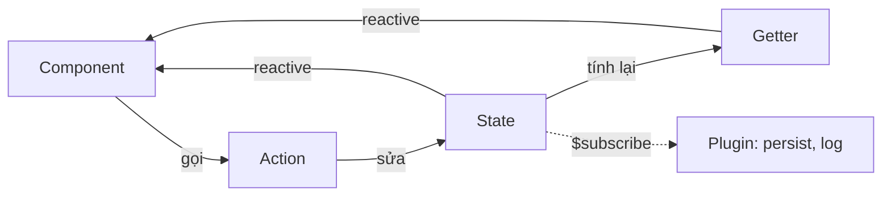
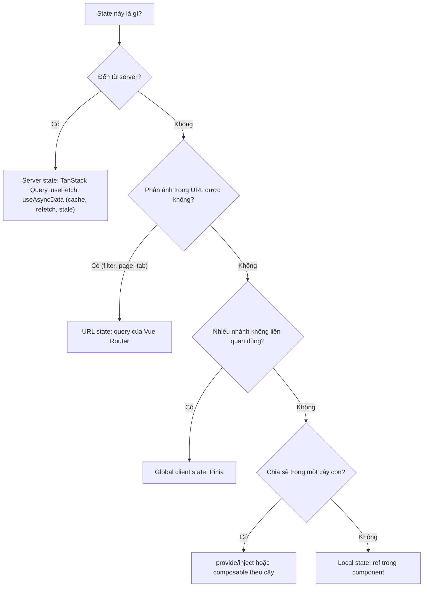
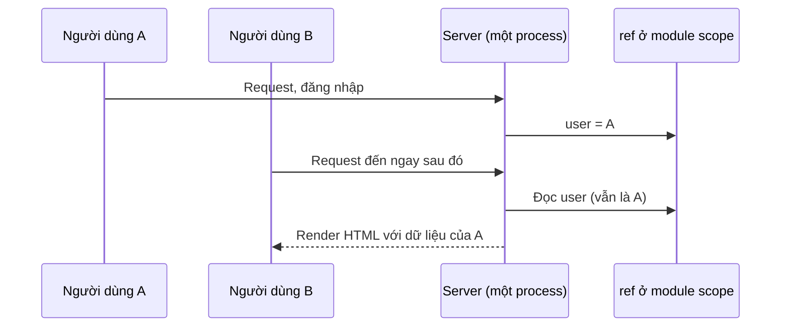

# Lý thuyết 5: Composables và Pinia

Bài này tập trung vào thiết kế tái sử dụng logic (composable) và quản lý state toàn cục (Pinia), cùng cách chọn đúng loại state cho đúng chỗ.

## Vấn đề: logic lặp lại và state đặt sai chỗ

Khi ứng dụng Vue lớn dần, hai nhu cầu xuất hiện gần như cùng lúc. Nhu cầu thứ nhất là **dùng lại logic**: cùng một đoạn "gọi API, theo dõi loading và lỗi" hay "theo dõi vị trí chuột" xuất hiện ở nhiều component, và bạn không muốn sao chép. Nhu cầu thứ hai là **chia sẻ state**: giỏ hàng hay thông tin người dùng đăng nhập phải thấy được từ nhiều nhánh không liên quan của cây component, và phải sống sót khi chuyển trang.

Vue trả lời bằng hai công cụ. **Composable** là một hàm tên `useXxx` đóng gói logic reactive (state, computed, watch, lifecycle hook) để gọi lại ở nhiều nơi; mỗi lần gọi thường tạo ra một bản state riêng. **Pinia** là thư viện quản lý state chính thức của Vue: nó giữ state toàn cục, getter (về bản chất là computed) và action (hàm sửa state), có tích hợp DevTools và hỗ trợ SSR. Có thể hình dung composable như một công thức nấu ăn bạn dùng lại ở nhiều bếp, còn Pinia như cái tủ lạnh chung của cả nhà.

Ứng dụng lớn hỏng không phải vì thiếu công cụ mà vì **đặt state sai chỗ**: nhét mọi thứ vào store, trộn dữ liệu từ server với state UI, hoặc để store dùng chung giữa các request trên server SSR khiến dữ liệu người này lộ sang người khác. Vì vậy nguyên tắc của bài là phân loại state trước rồi mới chọn công cụ. Composable dành cho logic và state theo từng instance. Pinia chỉ dành cho state toàn cục thật sự. Dữ liệu từ server nên dùng thư viện có cache như TanStack Query hoặc `useFetch`.

Khi nào dùng composable: logic dùng lại ở từ hai component trở lên, hoặc cần tách logic ra để dễ test. Khi nào dùng Pinia: state cần chia sẻ giữa các nhánh không liên quan hoặc sống qua điều hướng. Khi nào không dùng Pinia: giá trị chỉ một component cần, dữ liệu phản ánh được trong URL, form đang sửa, hay bản sao dữ liệu server (chi tiết ở mục "Phân loại state").

## Các khái niệm cần biết

| Từ khóa | Nghĩa đơn giản | Dùng khi nào |
|---|---|---|
| Composable | Hàm `useXxx` dùng API reactive của Vue để đóng gói logic có state. | Tái sử dụng logic giữa component, thay mixin. |
| `MaybeRefOrGetter` và `toValue` | Kiểu cho tham số nhận được giá trị thường, ref hoặc getter; `toValue` đọc ra giá trị thật từ bất kỳ dạng nào. | Để composable dùng linh hoạt mà vẫn reactive theo đầu vào. |
| Getter, action (trong Pinia) | Getter là giá trị dẫn xuất từ state (như computed); action là hàm sửa state, có thể async. | Đặt logic nghiệp vụ trong action để truy vết ở một chỗ. |
| `$patch`, `$subscribe`, `$onAction` | `$patch` sửa nhiều trường một lần; `$subscribe` lắng nghe thay đổi state; `$onAction` lắng nghe call action. | Persist ra localStorage, log, đo thời gian. |
| Singleton ở module scope | Một biến khai báo ở cấp file module, chỉ tồn tại một bản cho cả process. | Tiện ở client, nhưng nguy hiểm trên server SSR. |
| Server state | Dữ liệu thuộc về server mà client chỉ giữ bản sao, có thể cũ (stale) và cần làm mới. | Dùng thư viện cache, không copy vào store. |
| Stale, invalidate, dedupe | Stale là dữ liệu có thể đã cũ; invalidate là đánh dấu để tải lại; dedupe là gộp các request giống nhau. | Là các việc mà TanStack Query làm sẵn. |
| Cross-request state pollution | State module scope trên server bị dùng chung giữa các request của nhiều người dùng. | Là lỗi bảo mật và đúng đắn nghiêm trọng khi SSR. |

**Tóm tắt:**

- Composable gói logic có state để tái sử dụng; mỗi lần gọi tạo state riêng theo instance, khác với state ở module scope dùng chung cho cả app.
- Composable tốt nhận ref hoặc getter làm input, đọc dependency trước `await`, và dọn tài nguyên khi component unmount.
- Pinia có hai kiểu store: option store (có sẵn `$reset`) và setup store (phải `return` mọi thứ muốn chia sẻ, tự viết reset).
- Destructure state và getter của store phải qua `storeToRefs`, còn action thì lấy trực tiếp.
- Cập nhật state bằng action hoặc `$patch`; `$subscribe` và `$onAction` dùng để persist, log, đo lường.
- Lỗi kiến trúc phổ biến nhất là đặt state sai chỗ: UI cục bộ dùng `ref`, state lọc và trang nằm trên URL, dữ liệu server dùng thư viện cache, chỉ state client dùng chung thật sự mới vào Pinia.
- Trên server một process phục vụ nhiều request, nên store hoặc `ref` ở module scope bị dùng chung giữa các người dùng; state phải được tạo mới theo từng request.

## Thiết kế composable

Ví dụ dưới đây là một composable gọi API theo URL. Chú ý ba điểm: tham số đầu vào chấp nhận ref hoặc getter, dependency được đọc trước `await`, và request cũ được hủy khi URL đổi.

```ts
// useFetchJson.ts: ví dụ composable tốt
import { ref, shallowRef, toValue, watchEffect, type MaybeRefOrGetter } from 'vue'

export function useFetchJson<T>(url: MaybeRefOrGetter<string>) {
  const data = shallowRef<T | null>(null)
  const error = shallowRef<Error | null>(null)
  const loading = ref(false)

  watchEffect(async (onCleanup) => {
    const u = toValue(url) // đọc dependency TRƯỚC await
    const ctrl = new AbortController()
    onCleanup(() => ctrl.abort())
    loading.value = true
    error.value = null
    try {
      const res = await fetch(u, { signal: ctrl.signal })
      if (!res.ok) throw new Error(`HTTP ${res.status}`)
      data.value = (await res.json()) as T
    } catch (e) {
      if ((e as Error).name !== 'AbortError') error.value = e as Error
    } finally {
      loading.value = false
    }
  })

  return { data, error, loading }
}
```

Quy tắc thiết kế:

| Quy tắc | Lý do |
|---|---|
| Input là `MaybeRefOrGetter`, đọc bằng `toValue` | Dùng được với giá trị, ref, getter |
| Trả về **object chứa ref** (không phải reactive) | Caller destructure mà không mất reactivity |
| Có cleanup (`onScopeDispose`, `onCleanup`) | Không rò rỉ listener, request |
| Tên `useXxx`, một trách nhiệm | Dễ ghép, dễ test |
| Không phụ thuộc component cụ thể | Test được ngoài component |
| Không mutate đối số | Tránh tác dụng phụ ẩn |
| Dữ liệu lớn dùng `shallowRef` | Giảm chi phí proxy |

Composable phân loại theo state:

| Loại | Ví dụ | Hành vi |
|---|---|---|
| Không có state (utility) | `useFormat`, `useDebounceFn` | Chỉ hàm |
| State theo instance | `useMouse`, `useFetchJson` | Mỗi lần gọi một state mới |
| State dùng chung | `useAuth` với state ở module scope | Một state cho cả app (singleton) |

Singleton ở module scope tiện nhưng **nguy hiểm khi SSR** (xem phần dưới). Với state dùng chung nên chuyển sang Pinia hoặc `createSharedComposable` của VueUse (chia sẻ một instance, tự dọn khi không còn ai dùng).

VueUse là bộ composable sẵn có (`useStorage`, `useDebounceFn`, `useIntersectionObserver`, `useEventListener`...). Nguyên tắc senior: dùng VueUse cho phần phổ biến, tự viết cho logic nghiệp vụ của dự án.

## Pinia: hai kiểu store

Pinia cho bạn hai cách khai báo store. Option store có cấu trúc `state`, `getters`, `actions` quen thuộc từ Options API. Setup store viết như một composable: `ref` thành state, `computed` thành getter, hàm thành action. Hai kiểu tạo ra cùng một loại store ở runtime, khác nhau ở mức linh hoạt.

```ts
// Option store
import { defineStore } from 'pinia'

export const useCounterStore = defineStore('counter', {
  state: () => ({ count: 0 }),
  getters: { double: (s) => s.count * 2 },
  actions: { inc() { this.count++ } },
})
```

```ts
// Setup store: giống hệt viết composable
import { defineStore } from 'pinia'
import { ref, computed } from 'vue'

export const useCartStore = defineStore('cart', () => {
  const items = ref<{ id: number; qty: number }[]>([])
  const count = computed(() => items.value.reduce((s, i) => s + i.qty, 0))

  function add(id: number) {
    const it = items.value.find((i) => i.id === id)
    if (it) it.qty++
    else items.value.push({ id, qty: 1 })
  }
  function $reset() { items.value = [] } // setup store phải tự viết reset

  return { items, count, add, $reset } // phải return mọi state và getter muốn dùng
})
```

| Tiêu chí | Option store | Setup store |
|---|---|---|
| Cú pháp | Giống Options API | Giống Composition |
| Linh hoạt | Hạn chế | Cao: dùng `watch`, composable, store khác |
| `$reset()` | Có sẵn | Không có, phải tự viết |
| Suy luận kiểu | Tốt | Tốt |
| Rủi ro | Ít | Quên `return` property thì không là state thật (mất SSR, DevTools) |
| Dùng khi | Store đơn giản | Logic phức tạp, cần composable |

Quy tắc setup store: `ref` thành state, `computed` thành getter, hàm thành action. Phải `return` mọi state mà bạn muốn chia sẻ hoặc serialize. Không dùng `ref` riêng tư nếu cần SSR hoặc hydrate.

Khi nào chọn option store: store đơn giản, cả nhóm quen Options API, muốn `$reset` có sẵn. Khi nào chọn setup store: cần `watch`, cần dùng composable hoặc store khác bên trong. Nếu sai: quên `return` một state ở setup store thì state đó không được tính là state của store, nên nó không được serialize khi SSR, không hiện trong DevTools và plugin persist không lưu nó.

### storeToRefs

Vấn đề: store là một object `reactive`, nên nếu bạn destructure thẳng `const { count } = store` thì `count` chỉ là con số tại thời điểm đó, và UI không cập nhật nữa. `storeToRefs` giải quyết bằng cách chuyển state và getter thành ref để destructure an toàn.

```vue
<script setup lang="ts">
import { storeToRefs } from 'pinia'
const store = useCartStore()

const { items, count } = storeToRefs(store) // state và getter thành ref: GIỮ reactivity
// action lấy trực tiếp, không cần storeToRefs
const { add } = store

// SAI: const { count } = store  // count thành số thường, mất reactivity
</script>
```

`storeToRefs` chỉ lấy state và getter, bỏ qua action. Store là `reactive`, nên destructure thẳng thì bị mất reactivity, cùng gốc với [Bài 1](/go?p=10-Vue%2Feasy%2Flt-01-reactivity-vue3.md).

**Phải thuộc:** Pinia có hai kiểu store: option store (`state`, `getters`, `actions`, có sẵn `$reset`) và setup store (`ref` thành state, `computed` thành getter, hàm thành action, phải `return` mọi thứ muốn chia sẻ và tự viết reset). Destructure state và getter của store phải qua `storeToRefs`; action lấy trực tiếp.

## Cập nhật state và subscribe

| API | Dùng cho |
|---|---|
| Gọi action | Cách chuẩn, đặt logic nghiệp vụ và log tại một chỗ |
| `store.$patch({...})` hoặc `$patch(fn)` | Cập nhật nhiều trường một lần (một mutation trong DevTools) |
| `store.$subscribe` | Theo dõi thay đổi state (persist localStorage) |
| `store.$onAction` | Theo dõi action, đo thời gian, bắt lỗi |
| `store.$reset()` | Về state ban đầu (option store) |
| `pinia.use(plugin)` | Plugin: persist, logging |

Data flow một chiều của Pinia giúp bạn dễ truy vết: component gọi action, action sửa state, getter tính lại, component hiển thị lại.



Đọc sơ đồ: sửa state qua action để mọi thay đổi đi qua một cổng duy nhất, nơi bạn gắn log, kiểm tra điều kiện, đo thời gian. Mutate trực tiếp ở nhiều nơi vẫn chạy được nhưng sau này bạn không biết ai đã đổi state.

Store gọi store khác: gọi `useOtherStore()` **bên trong action hoặc getter**, không ở cấp module, để tránh circular dependency lúc khởi tạo và đảm bảo có Pinia đang hoạt động. Hai store đọc lẫn nhau ở cấp cao nhất của setup store sẽ lỗi.

## Phân loại state

Câu hỏi đầu tiên khi cần lưu một dữ liệu không phải "dùng store nào" mà là "dữ liệu này thuộc loại gì". Sơ đồ sau là cách đi từ loại state đến công cụ phù hợp, bắt đầu từ câu hỏi dữ liệu có đến từ server hay không.



| Loại | Công cụ | Sai phổ biến |
|---|---|---|
| Local UI (mở menu, input nháp) | `ref` | Đưa vào Pinia |
| Form đang sửa | `ref` hoặc thư viện form | Ghi mỗi phím vào store |
| URL (filter, trang, sort) | `route.query` | Giữ filter trong store làm F5 mất hoặc link không chia sẻ được |
| Server data (danh sách, chi tiết) | TanStack Query, `useFetch` | Copy vào store rồi tự quản stale, loading, retry |
| Global (user đăng nhập, theme, giỏ hàng) | Pinia | Nhét tất cả vào một store lớn |

Quy tắc: **server state không phải client state**. Dữ liệu server có lifecycle riêng (stale, invalidate, retry, dedupe) và thư viện chuyên dụng xử lý tốt hơn store viết tay. Store chỉ giữ thứ client sở hữu. Xem thêm mục API ở [Bài 6](/go?p=10-Vue%2Fmedium%2Flt-06-router-forms.md).

**Nền tảng:** lỗi kiến trúc phổ biến nhất là đặt state sai chỗ, nên phân loại trước khi chọn công cụ: local UI dùng `ref`, state lọc và trang dùng URL, dữ liệu server dùng thư viện cache (TanStack Query, `useFetch`), chỉ state client dùng chung thật sự mới vào Pinia.

## Bẫy SSR với store và module state

Trên server, **một process phục vụ nhiều request**. State ở module scope sống qua mọi request, nên dữ liệu người dùng này lộ sang người dùng khác (cross-request state pollution). Ở trình duyệt thì mỗi người dùng có một process riêng nên cùng đoạn code đó hoàn toàn vô hại, đó là lý do lỗi này không lộ ra khi phát triển trên client.



Đọc sơ đồ: vì biến ở module scope chỉ có một bản cho cả process, request của B đọc phải dữ liệu A vừa ghi. Cách chữa là tạo state mới cho mỗi request (một Pinia mỗi request, `useState` của Nuxt).

**Phải thuộc:** trên server một process phục vụ nhiều request, nên `ref` hoặc store ở module scope bị dùng chung giữa mọi người dùng (cross-request state pollution). State phải được tạo mới theo từng request.

```ts
// NGUY HIỂM trong SSR: module-level singleton
const user = ref<User | null>(null)          // dùng chung cho mọi request trên server
export function useUser() { return { user } }
```

Pinia tránh được nếu dùng đúng:

| Đúng | Sai |
|---|---|
| Tạo Pinia mới cho mỗi request (`createPinia()` trong factory `createApp`), `app.use(pinia)` | Tạo một Pinia ở module scope cho server |
| Gọi `useStore()` trong `setup`, action, router guard | Gọi `useStore()` ở cấp module trước khi có app/pinia |
| Ngoài component: `useStore(pinia)` truyền pinia rõ ràng | Giả định pinia toàn cục |
| Server serialize `pinia.state.value`, client `pinia.state.value = initial` trước khi mount | Fetch lại ở client rồi gây hydration mismatch |

Nuxt với `@pinia/nuxt` lo phần này cho bạn, nhưng với `useState` hay composable tự viết vẫn phải tránh `ref` ở module scope. Chi tiết ở [Bài 9](/go?p=10-Vue%2Fhard%2Flt-09-ssr-nuxt-hydration.md).

## Test store (xem trước)

```ts
import { setActivePinia, createPinia } from 'pinia'
beforeEach(() => setActivePinia(createPinia()))
it('thêm vào giỏ', () => {
  const s = useCartStore(); s.add(1); s.add(1)
  expect(s.count).toBe(2)
})
```

Chi tiết ở [Bài 7](/go?p=10-Vue%2Fmedium%2Flt-07-testing-vue.md).

## Bẫy thường gặp

| Bẫy | Hậu quả | Cách tránh |
|---|---|---|
| Destructure store trực tiếp | Mất reactivity | `storeToRefs` cho state, lấy action trực tiếp |
| Setup store không `return` state | Không SSR, không DevTools, không persist | Return mọi state dùng chung |
| Một store khổng lồ | Khó test, khó tách | Chia theo domain |
| Copy server data vào store | Stale, trùng logic cache | TanStack Query, `useFetch` |
| `useStore()` ở module scope | Lỗi "no active Pinia" | Gọi trong setup, action, guard |
| State ở module scope khi SSR | Rò dữ liệu giữa user | Pinia theo request, `useState` của Nuxt |
| Mutate state bên ngoài action ở mọi nơi | Khó truy vết | Quy ước: đổi state qua action |
| Composable gọi hook sau `await` | Mất instance | Gọi hook trước `await` |
| Store circular dependency | Lỗi khi khởi tạo | Gọi store khác bên trong action |
| Dùng store cho form nháp | Re-render rộng, state bẩn | `ref` cục bộ, commit khi submit |

## Câu hỏi phỏng vấn thường gặp

Mỗi câu có gợi ý suy luận để tự lần ra đáp án trước khi đọc.

1. **Composable khác mixin và hàm tiện ích thế nào?**
   - Gợi ý: hàm tiện ích có dùng được `ref` hay lifecycle không? Mixin có cho bạn biết giá trị từ đâu ra không?
   - Lập luận: utility là hàm thuần, không có state theo instance. Composable dùng API reactive và lifecycle nên có state theo instance và nguồn gốc tường minh (bạn tự đặt tên khi destructure), khác mixin trộn ngầm.
2. **Vì sao composable nên trả về object chứa `ref` thay vì một `reactive`?**
   - Gợi ý: người gọi sẽ destructure kết quả. Destructure `reactive` thì sao?
   - Lập luận: destructure `reactive` mất liên kết, còn destructure object chứa ref thì mỗi ref vẫn giữ nguyên, nên người gọi an toàn.
3. **Chọn option store hay setup store?**
   - Gợi ý: bạn có cần `watch` hay composable trong store không? Ai viết reset?
   - Lập luận: option store đơn giản, có `$reset` sẵn. Setup store linh hoạt hơn nhưng Pinia chỉ nhận thứ được `return`, nên phải return đủ và tự viết reset.
4. **Destructure store làm mất reactivity. Sửa thế nào?**
   - Gợi ý: store là `reactive`, và action không cần reactivity.
   - Lập luận: `storeToRefs` tạo ref cho state và getter để giữ liên kết; action lấy trực tiếp từ store.
5. **Dữ liệu nào không nên đưa vào Pinia?**
   - Gợi ý: nguồn sự thật của nó nằm ở đâu?
   - Lập luận: server state có thư viện cache lo, state URL thuộc router, state cục bộ của form hay UI thuộc component; đưa vào store là tạo bản sao dễ lệch.
6. **Người dùng A thấy dữ liệu của B trên SSR. Nguyên nhân?**
   - Gợi ý: module được import mấy lần trong process server?
   - Lập luận: biến ở module scope tồn tại suốt lifecycle server, mọi request dùng chung, nên phải tạo instance theo request.
7. **Hai store cần dùng nhau mà tránh circular dependency thế nào?**
   - Gợi ý: circular dependency xảy ra lúc nào, khi khởi tạo hay khi chạy?
   - Lập luận: gọi `useOtherStore()` bên trong action hoặc getter, tức lúc chạy chứ không lúc khởi tạo store, nên không vòng.
8. **Vì sao Pinia thay Vuex?**
   - Gợi ý: so sánh số khái niệm phải học (mutation) và độ hỗ trợ TypeScript.
   - Lập luận: Pinia bỏ mutation nên API đơn giản, kiểu TypeScript tốt, modular, DevTools và SSR tốt; Vuex ở chế độ bảo trì.

Tiếp theo: [Bài 6: Router và Forms](/go?p=10-Vue%2Fmedium%2Flt-06-router-forms.md).

