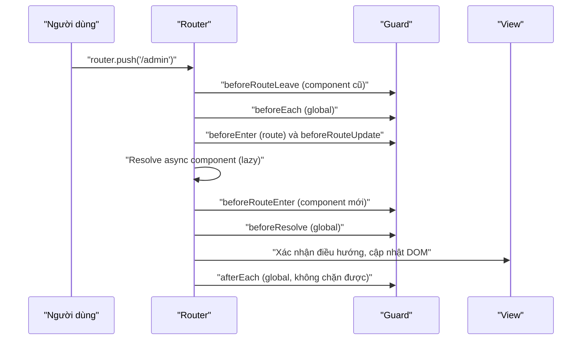
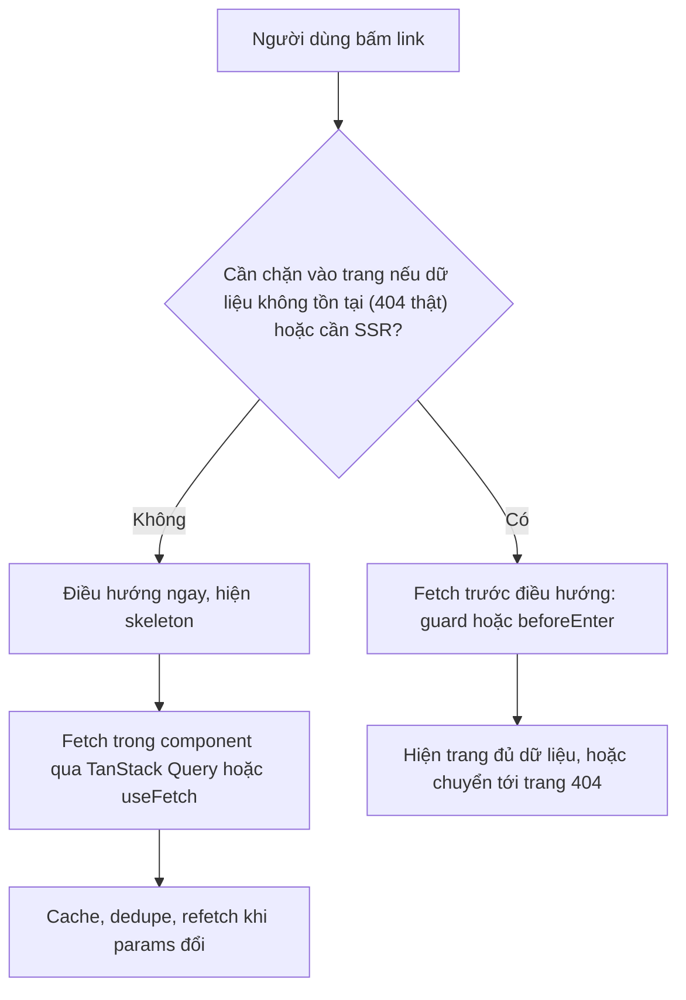
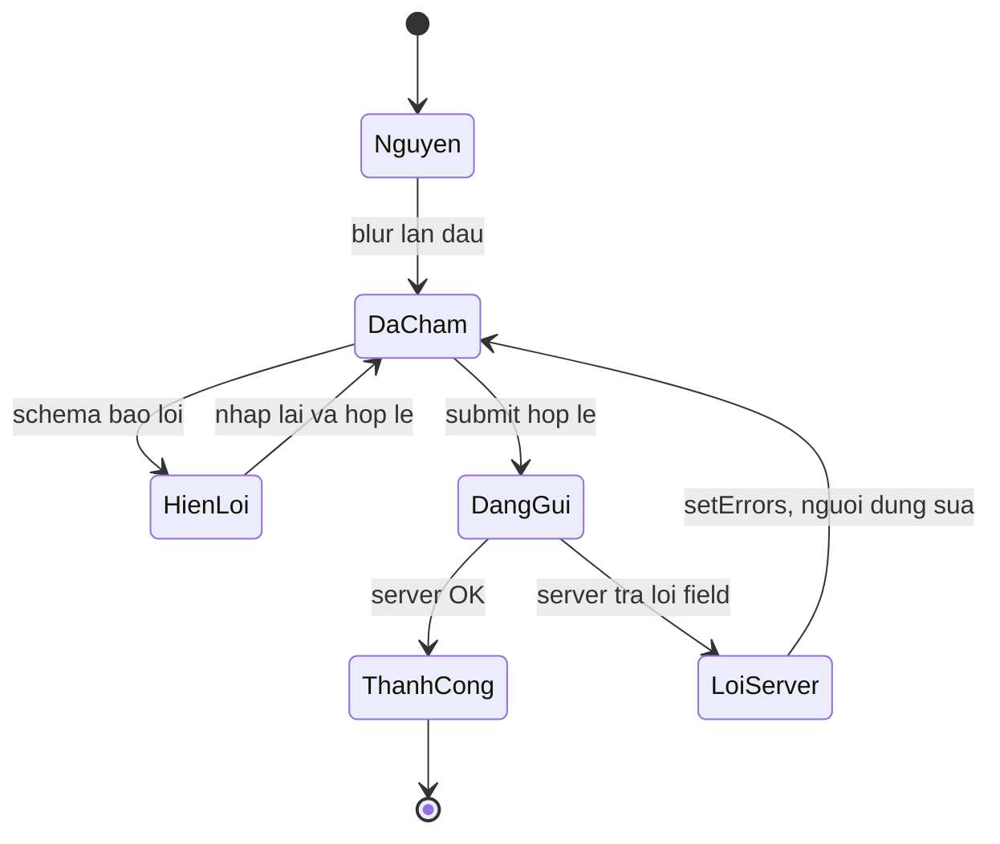

# Lý thuyết 6: Vue Router và Forms

Bài này gồm hai nửa: điều hướng (guard, lazy route, cách lấy dữ liệu, scroll) và form (v-model, validation với VeeValidate hoặc FormKit cùng Zod).

## Router và form giải quyết vấn đề gì?

Một SPA (single page application) chỉ tải một trang HTML, nhưng người dùng vẫn mong có nhiều "trang": địa chỉ riêng cho từng màn hình, nút Back hoạt động, link chia sẻ được, và có những màn hình chỉ người có quyền mới vào được. **Vue Router 4** là router chính thức của Vue lo việc đó. Nó ánh xạ URL sang component, hỗ trợ route lồng nhau (layout bên ngoài, nội dung bên trong), guard (hàm chạy trước khi chuyển trang để cho phép, chặn hay chuyển hướng), lazy loading (chỉ tải code của trang khi vào trang) và scroll behavior (khôi phục vị trí cuộn).

Phần thứ hai của bài là **form**: chuỗi thao tác nhập liệu, kiểm tra hợp lệ rồi gửi đi. Form nhỏ chỉ cần `v-model`. Form có quy tắc thì thường dùng một thư viện schema như Zod để khai báo quy tắc một lần, kết hợp VeeValidate hoặc FormKit để lo state (đã chạm vào chưa, đang gửi chưa, lỗi từng field).

Lý do cần cẩn thận ở cả hai nơi này: router quyết định trải nghiệm tải trang, việc bảo vệ route và state nằm trong URL; còn form là nơi phát sinh nhiều bug nghiệp vụ nhất, như validation ở client lệch với server, hiện lỗi sai lúc, hay kiểu dữ liệu sai (ví dụ số nhập vào lại là chuỗi). Bạn cần router cho mọi SPA có nhiều trang, authorization hoặc trang chi tiết có tham số, và cần cách làm form có hệ thống cho mọi màn hình nhập liệu có quy tắc.

Cách tiếp cận của bài: với router, dùng guard cho authentication, lazy route để chia bundle, và chọn mô hình lấy dữ liệu một cách có chủ đích thay vì mặc định. Với form, lấy một schema làm nguồn sự thật, suy ra kiểu TypeScript từ schema, và hiển thị lỗi theo tương tác của người dùng.

## Các khái niệm cần biết

| Từ khóa | Nghĩa đơn giản | Dùng khi nào |
|---|---|---|
| History mode | Cách router đổi URL: `createWebHistory` dùng URL sạch (`/users/1`), `createWebHashHistory` dùng dấu `#`. | URL sạch cần server trả `index.html` cho mọi đường dẫn, nếu không F5 sẽ ra 404. |
| Route record | Một mục khai báo trong `routes` (path, component, meta). | Khi hai URL cùng khớp một record thì component được tái sử dụng chứ không tạo mới. |
| `meta` | Dữ liệu tùy ý gắn vào route. | Guard đọc `to.meta.requiresAuth` để biết cần kiểm tra quyền không. |
| Navigation guard | Hàm chạy trong quá trình điều hướng, có thể cho qua, hủy hoặc chuyển hướng. | Authentication, authorization, cảnh báo thoát khi form chưa lưu. |
| Lazy route, code splitting | Khai báo component bằng `() => import(...)` để bundler tách thành chunk riêng, tải khi cần. | Giảm kích thước bundle ban đầu. |
| `touched`, `dirty` | `touched` là field đã được người dùng chạm vào (blur); `dirty` là giá trị đã khác giá trị ban đầu. | Quyết định khi nào hiện lỗi, khi nào cảnh báo thoát khi chưa lưu. |
| Schema | Mô tả khai báo về hình dạng và quy tắc của dữ liệu (Zod). | Một nguồn cho cả validation và kiểu TypeScript. |
| `z.infer` | Suy ra kiểu TypeScript từ schema Zod. | Không phải viết tay kiểu lần thứ hai và lệch khỏi quy tắc. |
| IME | Bộ gõ ghép chữ (tiếng Việt, Trung, Nhật). | `v-model` chờ ghép chữ xong mới cập nhật; nếu cần cập nhật từng ký tự phải tự bind. |
| Stale-while-revalidate | Hiện dữ liệu cũ trong cache ngay, đồng thời tải lại ngầm để cập nhật. | Là hành vi mặc định hữu ích của thư viện cache như TanStack Query. |

**Tóm tắt:**

- Khi chỉ params đổi, component được tái sử dụng nên `onMounted` không chạy lại; phải `watch` route params, dùng `onBeforeRouteUpdate` hoặc đặt `:key` trên `RouterView`.
- Navigation guard có thứ tự cố định, trả `undefined` hoặc `true` thì cho qua, `false` thì hủy, địa chỉ thì chuyển hướng.
- Guard ở client chỉ là UX; authentication và authorization thật phải kiểm ở server.
- Lazy route (`() => import(...)`) chia bundle theo route và là cách rẻ nhất để giảm tải ban đầu.
- Lấy dữ liệu có chủ đích: trong component, trong guard hoặc bằng thư viện cache, và tránh để request lồng nhau tạo waterfall.
- Form dùng `v-model` cho trường hợp đơn giản; form phức tạp nên dùng VeeValidate hoặc FormKit để lo state `touched`, `dirty` và lỗi.
- Schema Zod là nguồn sự thật duy nhất cho validation và kiểu TypeScript; validation ở client chỉ phục vụ trải nghiệm, server luôn phải kiểm lại.

## Vue Router: bức tranh tổng quan

Đoạn config dưới đây gom các thành phần chính: lazy route, route lồng nhau có `meta`, route bắt mọi đường dẫn không khớp (404) và hành vi cuộn.

```ts
// router.ts
import { createRouter, createWebHistory } from 'vue-router'

export const router = createRouter({
  history: createWebHistory(),
  routes: [
    { path: '/', component: () => import('./pages/Home.vue') },           // lazy
    {
      path: '/admin',
      component: () => import('./layouts/AdminLayout.vue'),
      meta: { requiresAuth: true, roles: ['admin'] },
      children: [
        { path: 'users/:id', name: 'user', component: () => import('./pages/User.vue'), props: true },
      ],
    },
    { path: '/:pathMatch(.*)*', component: () => import('./pages/NotFound.vue') },
  ],
  scrollBehavior(to, from, saved) {
    if (saved) return saved                       // nút Back: khôi phục vị trí
    if (to.hash) return { el: to.hash, behavior: 'smooth' }
    return { top: 0 }
  },
})
```

| Chủ đề | Điểm cần nhớ |
|---|---|
| History mode | `createWebHistory` (URL sạch, cần server fallback về `index.html`), `createWebHashHistory` (không cần config server) |
| Route lồng nhau | `children` kết hợp `<RouterView>` lồng, dùng cho layout |
| `props: true` | Truyền params làm props, tách component khỏi router |
| `meta` | Dữ liệu tùy ý (quyền, title, layout) cho guard |
| Params thay đổi | Cùng component, **instance được tái sử dụng**, hook mounted không chạy lại. Cần `watch(() => route.params.id)` hoặc `:key="route.fullPath"` |
| `router.push` và `replace` | `push` thêm lịch sử, `replace` thay thế |
| Kiểu của query | `route.query` kiểu `string \| string[] \| null`, cần ép kiểu khi dùng |

**Phải thuộc:** khi chỉ params đổi (ví dụ `/users/1` sang `/users/2`) hai URL cùng khớp một route record nên component được tái sử dụng, `onMounted` không chạy lại. Phản ứng bằng `watch(() => route.params.id, ...)`, `onBeforeRouteUpdate` hoặc `:key="route.fullPath"` trên `RouterView`.

## Navigation guard

Vấn đề đặt ra: trước khi cho người dùng vào một trang, bạn thường cần kiểm tra điều gì đó (đã đăng nhập chưa, có quyền không, form đang sửa dở có cần xác nhận không). Guard là nơi làm việc đó, và thứ tự chúng chạy quyết định bạn đặt logic ở đâu. Sơ đồ sau cho thấy toàn bộ chuỗi, đã bổ sung `beforeRouteEnter` ở cuối giai đoạn chờ.



Đọc sơ đồ: guard chạy từ ngoài vào trong. Bất kỳ guard nào trả `false` hoặc một địa chỉ khác thì các bước sau không chạy. `afterEach` chạy sau khi điều hướng đã xác nhận nên chỉ dùng để ghi log, analytics hay đổi title, không dùng để chặn.

Ví dụ phổ biến nhất là chặn route cần đăng nhập ở guard toàn cục.

```ts
router.beforeEach(async (to) => {
  const auth = useAuthStore()                 // gọi store BÊN TRONG guard
  if (to.meta.requiresAuth && !auth.isLoggedIn) {
    return { name: 'login', query: { redirect: to.fullPath } }
  }
  // return undefined hoặc true: cho đi; false: hủy; object/chuỗi: chuyển hướng
})
```

| Điểm | Chi tiết |
|---|---|
| Giá trị trả về | `undefined` hoặc `true` cho qua, `false` hủy, địa chỉ để chuyển hướng. Không cần `next()` nữa (vẫn dùng được nhưng dễ sai, gọi `next` nhiều lần là lỗi) |
| Guard trong component | `onBeforeRouteLeave`, `onBeforeRouteUpdate` (composable trong `setup`) |
| Bảo vệ phía client | Chỉ là UX. **Quyền thật phải kiểm ở server** ([bảo mật FE](/go?p=11-Frontend-Core%2Flt-04-bao-mat-frontend.md)) |
| Guard async | Trả về Promise, cẩn thận guard chậm làm điều hướng "đơ" |
| Lỗi chunk | `router.onError` bắt lỗi tải route lazy (sau deploy, chunk cũ 404), thường reload trang |

**Phải thuộc:** thứ tự guard: `beforeRouteLeave` (component cũ), `beforeEach`, `beforeRouteUpdate` (component tái sử dụng), `beforeEnter` (route), resolve async component, `beforeRouteEnter`, `beforeResolve`, điều hướng được xác nhận, rồi `afterEach`. Guard trả `undefined` hoặc `true` thì cho qua, `false` thì hủy, địa chỉ thì chuyển hướng; guard client chỉ là UX, quyền thật phải kiểm ở server.

## Lazy route và code splitting

`component: () => import(...)` tạo chunk riêng, tải khi vào route. Thực hành:

- Route cấp trang luôn lazy; component nhỏ dùng chung thì không cần.
- Gộp chunk theo nhóm tính năng (config `manualChunks` của Vite) khi có quá nhiều chunk nhỏ.
- Preload thủ công khi hover link (gọi `import()` sớm); trong Nuxt, `<NuxtLink>` tự prefetch chunk khi link vào viewport.
- Nhớ xử lý lỗi tải chunk sau deploy (`router.onError`, hoặc `vite:preloadError`).

Chi tiết hiệu năng ở [Bài 8](/go?p=10-Vue%2Fhard%2Flt-08-hieu-nang-rendering.md) và [Web Performance](/go?p=11-Frontend-Core%2Flt-03-web-performance-core-web-vitals.md).

## Mô hình lấy dữ liệu theo route

Một trang chi tiết luôn cần dữ liệu, nên câu hỏi là gọi API vào lúc nào so với việc chuyển trang. Hai lựa chọn cơ bản là gọi sau khi đã chuyển (người dùng thấy khung trang rồi mới thấy dữ liệu) hoặc gọi trước khi chuyển (người dùng chờ rồi thấy trang đầy đủ), cộng với hai cách tổ chức có sẵn cache là thư viện và framework.



| Mô hình | Cách làm | Ưu | Nhược |
|---|---|---|---|
| Fetch sau khi điều hướng | Điều hướng xong, component hiện skeleton rồi gọi API trong `setup` hoặc `watch` | Điều hướng tức thì, UX có loading | Màn hình trống thoáng qua |
| Fetch trước khi điều hướng | Gọi API trong `beforeEnter` hoặc guard rồi mới chuyển | Trang hiện đầy đủ dữ liệu | Người dùng phải chờ, "đơ" nếu API chậm |
| Thư viện cache | TanStack Query (`useQuery` với key theo params) | Cache, dedupe, refetch, stale-while-revalidate | Thêm một dependency |
| Framework (Nuxt) | `useFetch`/`useAsyncData` | SSR, cache theo key | Gắn với Nuxt |

```ts
// Fetch sau điều hướng, phản ứng khi params đổi, không race condition
const route = useRoute()
const id = computed(() => String(route.params.id))
const { data, status } = useQuery({            // TanStack Query cho Vue
  queryKey: ['user', id],
  queryFn: ({ signal }) => fetch(`/api/users/${id.value}`, { signal }).then((r) => r.json()),
})
```

Lời khuyên: mặc định "fetch sau điều hướng + cache thư viện" (UX tốt, ít code). Dùng "fetch trước" khi cần chặn vào trang nếu dữ liệu không tồn tại (404 thật) hoặc cần SSR.

URL là nguồn sự thật của filter, page, sort: dùng `route.query` thay vì state cục bộ để F5 và chia sẻ link đều giữ state ([Bài 5](/go?p=10-Vue%2Fmedium%2Flt-05-composables-pinia.md)).

## Forms: v-model và kiểm soát

Với form đơn giản, `v-model` trên các phần tử cùng `.trim`, `.number`, `.lazy` là đủ. Điểm cần nhớ:

| Chủ đề | Lưu ý |
|---|---|
| `v-model` trên `<input>` | Dùng event `input`; với IME (tiếng Việt, tiếng Trung) cập nhật sau khi kết thúc ghép chữ. Muốn cập nhật từng ký tự trong lúc ghép phải tự dùng `:value` và `@input` |
| `.number` | Ép sang số nếu parse được, nếu không giữ chuỗi |
| Checkbox nhiều giá trị | `v-model` với mảng |
| Giá trị rỗng | Phân biệt `''`, `null`, `undefined` ngay trong schema |
| Form lớn | Mỗi phím gây cập nhật reactive; giảm bằng `.lazy` hoặc debounce nếu có logic nặng |

Thư viện form giải quyết: state `touched`, `dirty`, lỗi theo field, submit đang chạy, reset, mảng field động, lỗi từ server.

## Validation: Zod là nguồn sự thật

Vấn đề thường gặp: quy tắc được viết một lần trong code kiểm tra, một lần trong kiểu TypeScript, rồi lần nữa ở server, và ba nơi này dần lệch nhau. Giải pháp là khai báo quy tắc một lần bằng schema, rồi suy ra kiểu TypeScript từ chính schema đó, dùng cho cả form lẫn (nếu có thể) server.

```ts
// schema.ts
import { z } from 'zod'

export const signupSchema = z
  .object({
    email: z.string().email('Email không hợp lệ'),
    password: z.string().min(8, 'Tối thiểu 8 ký tự'),
    confirm: z.string(),
    age: z.coerce.number().int().min(18, 'Phải từ 18 tuổi'),
  })
  .refine((v) => v.password === v.confirm, { path: ['confirm'], message: 'Mật khẩu không khớp' })

export type SignupForm = z.infer<typeof signupSchema> // kiểu suy ra từ schema
```

**Nền tảng:** schema là một nguồn sự thật duy nhất cho quy tắc validation và kiểu TypeScript (`z.infer`), tránh việc luật và kiểu lệch nhau theo thời gian. Validation ở client chỉ phục vụ trải nghiệm, server luôn phải kiểm lại.

Lưu ý phiên bản: ví dụ viết theo Zod 3; từ Zod 4 các hàm kiểu `z.string().email()` vẫn dùng được nhưng dạng mới là `z.email()`, hãy kiểm tra lại theo phiên bản bạn dùng.

### VeeValidate

VeeValidate lo phần state form. `useForm` nhận schema, `defineField` trả về cặp giá trị và property (`blur`, `input` handler) để bind vào input, `handleSubmit` chỉ gọi hàm của bạn khi dữ liệu đã hợp lệ, `errors` chứa lỗi theo field. Ví dụ dưới kết hợp Zod và xử lý lỗi từ server.

```vue
<script setup lang="ts">
import { useForm } from 'vee-validate'
import { toTypedSchema } from '@vee-validate/zod'
import { signupSchema } from './schema'

const { defineField, handleSubmit, errors, isSubmitting, setErrors } = useForm({
  validationSchema: toTypedSchema(signupSchema),
})
const [email, emailAttrs] = defineField('email')
const [password, passwordAttrs] = defineField('password')

const onSubmit = handleSubmit(async (values) => {
  try {
    await api.signup(values) // values đã được validate và có kiểu
  } catch (e) {
    setErrors({ email: 'Email đã tồn tại' }) // lỗi từ server hiện ở field
  }
})
</script>

<template>
  <form @submit.prevent="onSubmit">
    <input v-model="email" v-bind="emailAttrs" type="email" />
    <span>{{ errors.email }}</span>
    <input v-model="password" v-bind="passwordAttrs" type="password" />
    <span>{{ errors.password }}</span>
    <button :disabled="isSubmitting">Đăng ký</button>
  </form>
</template>
```

Lưu ý: cú pháp `toTypedSchema` và gói adapter thay đổi theo phiên bản VeeValidate và Zod (một số bản mới hỗ trợ trực tiếp Standard Schema). Kiểm tra tài liệu phiên bản bạn dùng.

### VeeValidate hay FormKit

| Tiêu chí | VeeValidate | FormKit |
|---|---|---|
| Triết lý | Composable, tự dựng UI, headless | Framework form trọn gói (input có sẵn, schema JSON, theme) |
| Tùy biến UI | Hoàn toàn tự do | Theo hệ thống input của FormKit |
| Tốc độ dựng form lớn | Cần viết component input | Nhanh, khai báo bằng schema |
| Tích hợp Zod | Có adapter | Plugin riêng |
| Chọn khi | Đã có design system riêng | Cần dựng nhanh, nhiều form chuẩn |

### Nguyên tắc validation

Flow một lần nhập và gửi form đúng cách đi như sau.



Đọc sơ đồ: lỗi chỉ hiện sau khi field đã được chạm (`DaCham`), tức là người dùng không bị mắng khi chưa kịp nhập. State `DangGui` là lúc nút bị vô hiệu để chặn gửi đúp.

1. Schema dùng chung **chia sẻ giữa client và server** (monorepo) hoặc client mirror server. Validation client chỉ là UX, server luôn kiểm lại.
2. Khi nào hiện lỗi: sau `blur` lần đầu, rồi theo từng `input` ("reward early, punish late"). Không hiện lỗi khi người dùng chưa chạm field.
3. Submit: vô hiệu nút khi đang gửi (`isSubmitting`) để chặn gửi đúp, nhưng không vô hiệu vì form "chưa hợp lệ" (người dùng không biết lý do).
4. Lỗi từ server ánh xạ về field (`setErrors`), lỗi chung hiện ở đầu form.
5. Với kiểm tra async (email trùng) cần debounce và hủy request cũ.

## Bẫy thường gặp

| Bẫy | Hậu quả | Cách tránh |
|---|---|---|
| Params đổi nhưng component không tải lại | Hiển thị dữ liệu cũ | `watch` theo params hoặc `:key` trên `RouterView` |
| Gọi `useStore()` ở cấp module router | Lỗi chưa có Pinia | Gọi trong guard |
| Chỉ chặn quyền ở client | Bypass bằng gọi API trực tiếp | Kiểm quyền ở server |
| Quên server fallback với history mode | F5 trả 404 | Config rewrite về `index.html` |
| Gọi `next()` nhiều lần hoặc quên gọi | Điều hướng treo | Dùng giá trị trả về |
| Race condition khi params đổi nhanh | Dữ liệu cũ ghi đè | Hủy request, dùng TanStack Query |
| `route.query.x` coi là string | Có thể là mảng hoặc null | Ép kiểu và validate |
| Validation chỉ ở client | Dữ liệu xấu vào server | Validate lại ở server |
| Hiện lỗi ngay khi mới mở form | UX tệ | Hiện sau `touched` |
| Lỗi tải chunk sau deploy | Trang trắng khi điều hướng | `router.onError` và reload |

## Câu hỏi phỏng vấn thường gặp

Mỗi câu có gợi ý suy luận để tự lần ra đáp án trước khi đọc.

1. **Điều hướng đến trang khác có form chưa lưu và guard kiểm quyền. Thứ tự guard?**
   - Gợi ý: hợp lý là rời trang cũ trước, rồi toàn cục, rồi route, rồi xác nhận.
   - Lập luận: `beforeRouteLeave` (cũ), `beforeEach`, `beforeRouteUpdate` (nếu tái sử dụng), `beforeEnter`, resolve async component, `beforeRouteEnter`, `beforeResolve`, rồi `afterEach`.
2. **Đổi params mà `onMounted` không chạy lại. Vì sao?**
   - Gợi ý: hai URL cùng khớp một route record thì router tạo mới hay tái sử dụng?
   - Lập luận: cùng route record nên component được tái sử dụng, không mount lại. Dùng `watch` trên params hoặc `onBeforeRouteUpdate`.
3. **Lazy route hoạt động thế nào?**
   - Gợi ý: người dùng cần code của mọi trang ngay từ đầu không?
   - Lập luận: component là hàm dynamic `import()`, bundler tách chunk riêng, router chỉ tải khi vào route.
4. **Tải dữ liệu trước hay sau điều hướng?**
   - Gợi ý: người dùng thấy gì trong lúc chờ ở mỗi cách?
   - Lập luận: sau điều hướng (skeleton) cho cảm giác nhanh; trước điều hướng khi cần chặn vào trang hoặc cần chắc chắn có dữ liệu. Kết hợp cache của thư viện.
5. **Guard phía client có đủ bảo vệ route không?**
   - Gợi ý: người dùng có kiểm soát được code chạy ở trình duyệt không?
   - Lập luận: họ chỉnh sửa hoặc bỏ qua được code client, nên guard chỉ cải thiện UX; quyền thật phải kiểm ở server.
6. **VeeValidate và FormKit khác nhau thế nào?**
   - Gợi ý: bạn muốn tự dựng UI hay dùng input có sẵn?
   - Lập luận: VeeValidate là headless composable, bạn tự dựng UI; FormKit là framework form có input sẵn.
7. **Vì sao suy kiểu từ Zod schema?**
   - Gợi ý: nếu kiểu TypeScript và luật validate viết riêng thì chuyện gì xảy ra theo thời gian?
   - Lập luận: chúng sẽ lệch nhau, nên dùng schema làm một nguồn sự thật cho cả validation và kiểu.
8. **Server trả lỗi cho form. Hiển thị thế nào?**
   - Gợi ý: lỗi thuộc field cụ thể hay chung? Dữ liệu đã nhập có nên mất không?
   - Lập luận: ánh xạ lỗi về từng field bằng `setErrors`, lỗi chung hiển thị tổng, giữ dữ liệu đã nhập để người dùng sửa.

Tiếp theo: [Bài 7: Testing](/go?p=10-Vue%2Fmedium%2Flt-07-testing-vue.md).

