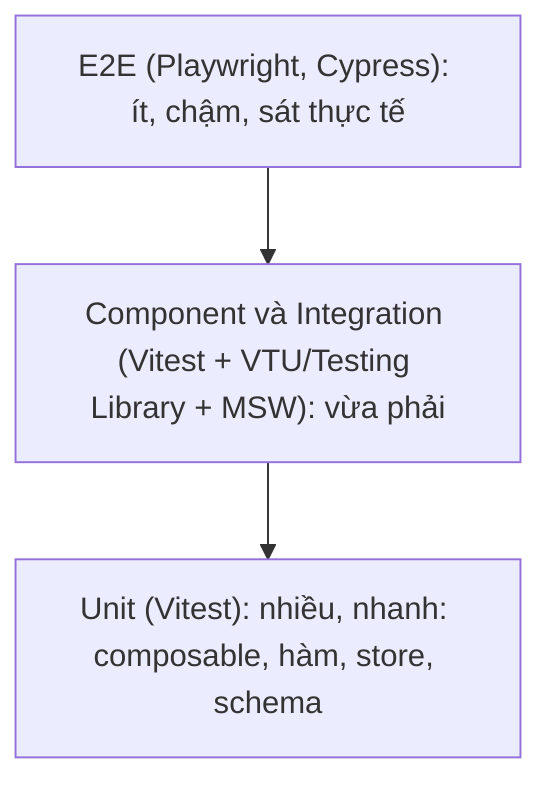
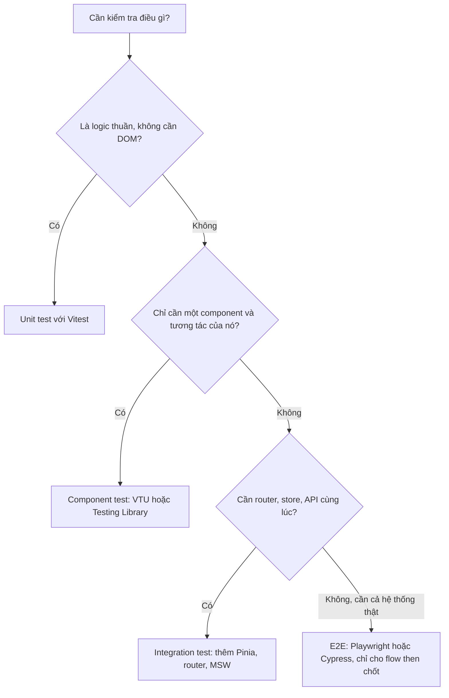
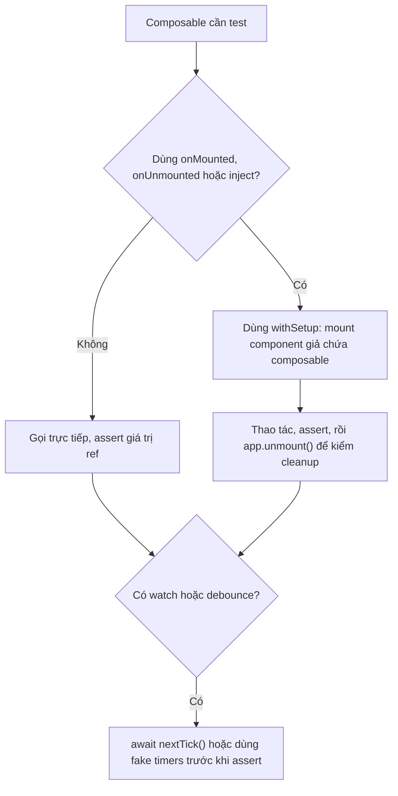
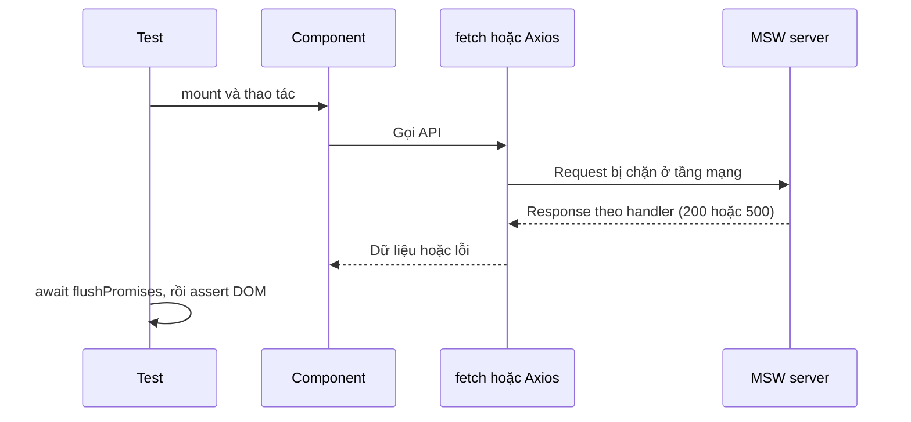

# Lý thuyết 7: Testing trong Vue

Bài này trình bày chiến lược test cho ứng dụng Vue 3: unit và component test với Vitest, so sánh Vue Test Utils với Testing Library, test composable, Pinia, router, mock API bằng MSW và E2E.

## Test cái gì, ở tầng nào?

Viết test không khó; khó là viết test **đúng tầng**. Test sai tầng thì vừa chậm vừa dễ gãy: nếu test bám vào chi tiết cài đặt (tên biến nội bộ, cấu trúc DOM), mỗi lần refactor là một lần sửa hàng loạt test dù hành vi không đổi; nếu cái gì cũng test bằng E2E trên trình duyệt thật, CI chạy hàng chục phút và thỉnh thoảng đỏ ngẫu nhiên (test chập chờn, hay gọi là flaky).

Hệ sinh thái test của Vue gồm các công cụ, mỗi cái có một vai. **Vitest** là test runner dùng chung config với Vite, nên alias, plugin và biến môi trường chạy giống lúc build. **Vue Test Utils (VTU)** là thư viện chính thức để mount component trong test. **Testing Library** (`@testing-library/vue`) cũng mount component nhưng ép bạn tương tác như người dùng: tìm theo role, label, text. **MSW** mock API ở tầng mạng. **Playwright** hoặc **Cypress** chạy E2E trên trình duyệt thật.

Cách chọn theo thứ được test: logic thuần (hàm, composable, store, schema) dùng unit test; component có tương tác dùng component test; chỉ những flow nghiệp vụ quan trọng (đăng nhập, thanh toán) mới dùng E2E. Nguyên tắc xuyên suốt: hình kim tự tháp, nhiều unit nhanh, vừa đủ component test, ít E2E, và luôn test **hành vi quan sát được** (người dùng bấm gì, thấy gì) thay vì chi tiết nội bộ.

## Các khái niệm cần biết

| Từ khóa | Nghĩa đơn giản | Dùng khi nào |
|---|---|---|
| Unit, component, integration, E2E test | Từ nhỏ đến lớn: một hàm; một component có tương tác; nhiều phần ghép lại (component, router, store, mạng giả); toàn bộ ứng dụng trên trình duyệt thật. | Chọn tầng thấp nhất còn bắt được lỗi bạn quan tâm. |
| jsdom, happy-dom | Môi trường mô phỏng DOM chạy trong Node, không có trình duyệt thật. | Component test nhanh; không dùng khi cần đo layout thật. |
| Wrapper | Object VTU trả về khi `mount`, dùng để tìm phần tử, kích hoạt event, đọc `emitted`. | Test component dùng chung. |
| Stub, mock, spy | Stub thay một thứ bằng bản giả đơn giản; mock giả có thể kiểm tra call; spy bọc hàm thật để ghi lại call. | Cô lập phần đang test khỏi phần nặng hoặc có tác dụng phụ. |
| `flushPromises` | Chờ tất cả promise đang chờ được giải quyết. | Sau khi component gọi API và bạn muốn assert kết quả. |
| Fake timers | Đồng hồ giả do test điều khiển (`vi.useFakeTimers`). | Test debounce, `setTimeout` mà không chờ thật. |
| MSW | Thư viện chặn request ở tầng mạng và trả response bạn định nghĩa. | Test code gọi API mà không đổi code client. |
| Test chập chờn (flaky) | Test lúc qua lúc rớt dù code không đổi. | Nguyên nhân thường gặp: không chờ async, dữ liệu dùng chung, timer và mạng thật. |
| Snapshot | Lưu đầu ra (thường là HTML) lần đầu rồi so lần sau. | Dùng nhỏ và cụ thể; snapshot cả component dễ bị bấm update mà không ai đọc. |

**Tóm tắt:**

- Test bám vào hành vi quan sát được và đặt ở tầng thấp nhất còn bắt được lỗi; bám chi tiết cài đặt thì gãy mỗi lần refactor.
- Test pyramid cho Vue: nhiều unit test cho logic thuần, component test ở giữa, ít E2E cho các flow then chốt.
- Vitest dùng chung config với Vite nên alias và plugin chạy giống lúc build.
- VTU cho bạn cầm wrapper và đọc nội bộ (`props`, `emitted`, `vm`); Testing Library chỉ cho tương tác và query như người dùng.
- Mọi `trigger` và `setValue` đều phải `await`, và `await flushPromises()` sau khi gọi API.
- Composable chỉ dùng `ref`, `computed` thì gọi trực tiếp; composable dùng lifecycle hook hoặc `inject` cần component chủ.
- Mock API ở biên mạng bằng MSW để interceptor, serialize và xử lý lỗi chạy thật; Pinia nên dùng store thật cho integration test.

## Test pyramid cho Vue

Hình dưới biểu diễn tỉ lệ nên có ở mỗi tầng: đáy rộng (nhiều, nhanh, ổn định), đỉnh hẹp (ít, chậm, sát thực tế).



| Tầng | Công cụ | Kiểm tra gì | Tốc độ | Độ ổn định |
|---|---|---|---|---|
| Unit | Vitest | Hàm, composable, store, schema | Mili giây | Rất cao |
| Component | Vitest + jsdom hoặc happy-dom + VTU/TL | Render, tương tác, emit, slot | Nhanh | Cao |
| Integration | Như trên + router + Pinia + MSW | Nhiều component và data flow | Trung bình | Cao nếu mock mạng tốt |
| E2E | Playwright, Cypress | Flow hoàn chỉnh trên trình duyệt thật | Chậm | Cần thiết kế cẩn thận |

Lưu ý: nhiều đội dùng "trophy": ưu tiên component và integration test nhiều hơn unit nhỏ lẻ. Điểm chung: test tầng thấp nhất có thể bắt được lỗi.

Để chọn tầng cho một lỗi cụ thể, hãy tự hỏi theo sơ đồ sau.



Đọc sơ đồ: đi từ tầng rẻ đến tầng đắt và dừng ngay khi tầng đó đủ để bắt lỗi. Đẩy mọi thứ lên E2E nghĩa là CI chậm; đẩy mọi thứ xuống unit với mock dày đặc nghĩa là test pass nhưng ứng dụng vẫn hỏng khi ghép lại.

**Nền tảng:** test phải bám vào hành vi quan sát được (người dùng bấm gì, thấy gì) và đặt ở tầng thấp nhất còn bắt được lỗi; test bám chi tiết cài đặt thì gãy mỗi lần refactor, còn đẩy hết lên E2E thì chậm và chập chờn.

## Vitest cơ bản

Vitest dùng lại config Vite nên bạn gần như chỉ cần chỉ định môi trường DOM giả và file khởi động. Đây là config tối thiểu.

```ts
// vitest.config.ts
import { defineConfig } from 'vitest/config'
import vue from '@vitejs/plugin-vue'

export default defineConfig({
  plugins: [vue()],
  test: {
    environment: 'jsdom',          // hoặc 'happy-dom' (nhanh hơn, ít đầy đủ hơn)
    globals: true,
    setupFiles: ['./test/setup.ts'], // khởi động MSW, reset mock
  },
})
```

| Điểm | Ghi chú |
|---|---|
| Dùng chung config Vite | Alias, plugin, biến môi trường hoạt động như khi build |
| `vi.fn`, `vi.mock`, `vi.spyOn` | Mock hàm và module |
| `vi.useFakeTimers()` | Test debounce, timer; nhớ `vi.useRealTimers()` sau test |
| jsdom và happy-dom | Không có layout thật (kích thước = 0), `IntersectionObserver`, `ResizeObserver` phải mock |
| Chế độ browser | Vitest có Browser Mode chạy test component trên trình duyệt thật cho trường hợp cần layout |

## VTU và Testing Library

Hai thư viện này cùng mount component nhưng khác cách bạn "nhìn" nó. VTU cho bạn cầm wrapper và đọc bên trong (props, `emitted`, `vm`). Testing Library chỉ cho bạn những gì người dùng thấy và làm được. Hai đoạn dưới đây kiểm tra cùng một hành vi bằng hai cách.

```ts
// VTU: mount và thao tác qua wrapper
import { mount } from '@vue/test-utils'
import Counter from './Counter.vue'

it('tăng khi bấm', async () => {
  const wrapper = mount(Counter, { props: { initial: 1 } })
  await wrapper.get('button').trigger('click')   // await để DOM cập nhật
  expect(wrapper.text()).toContain('2')
  expect(wrapper.emitted('change')?.[0]).toEqual([2])
})
```

```ts
// Testing Library: query theo role, như người dùng
import { render, screen } from '@testing-library/vue'
import userEvent from '@testing-library/user-event'

it('tăng khi bấm', async () => {
  const user = userEvent.setup()
  render(Counter, { props: { initial: 1 } })
  await user.click(screen.getByRole('button', { name: /tăng/i }))
  expect(screen.getByText('2')).toBeInTheDocument() // cần @testing-library/jest-dom
})
```

| Tiêu chí | Vue Test Utils | Testing Library |
|---|---|---|
| Triết lý | Truy cập wrapper, props, emitted, vm | Chỉ tương tác như người dùng, query theo role, label, text |
| Truy cập nội bộ | Có (`wrapper.vm`, `setProps`, `findComponent`) | Cố ý hạn chế |
| Rủi ro | Test dính chi tiết cài đặt, gãy khi refactor | Ít gãy hơn, nhưng kiểm emit/props cần cách gián tiếp |
| Hỗ trợ truy cập (a11y) | Không ép buộc | Khuyến khích dùng role, label (có lợi cho a11y) |
| Dùng khi | Test component thư viện, emit, slot, props | Test màn hình ứng dụng theo hành vi |

Lời khuyên: dùng Testing Library cho màn hình nghiệp vụ; VTU cho component dùng chung cần kiểm tra emit, slot, props. Có thể dùng cả hai trong một dự án (Testing Library vue xây trên VTU).

**Phải thuộc:** VTU cho bạn cầm wrapper và đọc nội bộ (props, `emitted`, `vm`); Testing Library chỉ cho tương tác và query như người dùng (role, label, text). Mọi `trigger`, `setValue` đều phải `await`, và `await flushPromises()` sau khi gọi API.

Các điểm kỹ thuật:

- `mount` render đầy đủ cây con; `shallowMount` chặn con bằng stub. Ưu tiên `mount`, chỉ stub component nặng hoặc có tác dụng phụ (`global.stubs`).
- Test async: `await` mọi `trigger`, `setValue`, và `await flushPromises()` sau khi gọi API; `await nextTick()` khi cần.
- Component async hoặc `Suspense`: bọc trong wrapper có `<Suspense>` khi test.
- Teleport: dùng `global.stubs: { teleport: true }` hoặc tìm phần tử trong `document.body`.

## Test composable

Composable là hàm, nên câu hỏi là có cần một component bao quanh hay không. Nếu composable chỉ dùng `ref`, `computed`, `watch` thì gọi trực tiếp là đủ. Nếu nó dùng lifecycle hook (`onMounted`, `onUnmounted`) hoặc `inject`, gọi ngoài component sẽ cảnh báo hoặc không chạy đúng, vì các hook đó cần một component đang chạy làm "chủ". Khi đó bạn mount một component giả chỉ để chứa composable.



Hai loại:

```ts
// 1. Composable độc lập (không dùng lifecycle/inject): gọi trực tiếp
import { useCounter } from './useCounter'
it('tăng', () => {
  const { count, inc } = useCounter()
  inc()
  expect(count.value).toBe(1)
})
```

```ts
// 2. Composable dùng lifecycle hoặc inject: cần component chủ
import { createApp, defineComponent, h } from 'vue'

export function withSetup<T>(composable: () => T): [T, ReturnType<typeof createApp>] {
  let result!: T
  const app = createApp(defineComponent({
    setup() { result = composable(); return () => h('div') },
  }))
  app.mount(document.createElement('div'))
  return [result, app]
}

it('dọn listener khi unmount', () => {
  const [res, app] = withSetup(() => useMouse())
  window.dispatchEvent(new MouseEvent('mousemove', { clientX: 5 }))
  app.unmount() // kiểm tra cleanup
})
```

Nếu composable có `watch`, nhớ `await nextTick()` trước khi assert. Dùng fake timer cho debounce.

**Phải thuộc:** composable chỉ dùng `ref`, `computed`, `watch` thì gọi trực tiếp; composable dùng lifecycle hook hoặc `inject` cần một component chủ (mount component giả, kiểu `withSetup`) và `app.unmount()` để kiểm cleanup.

## Test Pinia

```ts
import { setActivePinia, createPinia } from 'pinia'

beforeEach(() => setActivePinia(createPinia())) // store mới mỗi test: tránh rò state

it('tính tổng', () => {
  const cart = useCartStore()
  cart.add(1)
  expect(cart.count).toBe(1)
})
```

Với component dùng store, cách thường dùng là `createTestingPinia` từ `@pinia/testing`:

```ts
import { createTestingPinia } from '@pinia/testing'

const wrapper = mount(CartView, {
  global: { plugins: [createTestingPinia({ createSpy: vi.fn, initialState: { cart: { items: [] } } })] },
})
```

Action mặc định bị stub (chỉ ghi nhận call); bật `stubActions: false` để chạy thật. Nên ưu tiên pinia thật cho integration và stub action cho component test thuần.

## Test router

```ts
import { createRouter, createMemoryHistory } from 'vue-router'
import { routes } from './routes'

const router = createRouter({ history: createMemoryHistory(), routes })
router.push('/admin')
await router.isReady()

const wrapper = mount(App, { global: { plugins: [router] } })
```

Dùng `createMemoryHistory` (không cần trình duyệt). Test guard bằng cách `push` rồi kiểm `router.currentRoute.value.fullPath`. Component chỉ dùng `useRoute` có thể mock bằng cách cung cấp router thật nhỏ thay vì mock từng hàm.

## Mock API bằng MSW

Vấn đề: component gọi API, và bạn không muốn test phụ thuộc server thật. Cách phổ biến là `vi.mock` cả module API, nhưng như vậy bạn bỏ qua luôn interceptor, cách serialize và xử lý lỗi của lớp client, tức là những chỗ hay hỏng thật. MSW (Mock Service Worker) giải quyết bằng cách mock ở tầng thấp hơn: request vẫn được tạo thật, nhưng MSW chặn và trả response bạn định nghĩa.

MSW chặn request ở tầng mạng, nên code dùng `fetch`, Axios hay TanStack Query đều không cần đổi.

```ts
// test/server.ts
import { setupServer } from 'msw/node'
import { http, HttpResponse } from 'msw'

export const server = setupServer(
  http.get('/api/users/:id', ({ params }) => HttpResponse.json({ id: params.id, name: 'An' })),
)

// test/setup.ts
beforeAll(() => server.listen({ onUnhandledRequest: 'error' }))
afterEach(() => server.resetHandlers())
afterAll(() => server.close())
```

```ts
// Test lỗi 500 trong một test cụ thể
server.use(http.get('/api/users/:id', () => HttpResponse.json({ message: 'x' }, { status: 500 })))
```

| So sánh | `vi.mock` module API | MSW |
|---|---|---|
| Mức mock | Hàm/module | Mạng |
| Test cả lớp client (interceptor, serialize) | Không | Có |
| Tái dùng cho dev và Storybook | Không | Có (browser worker) |
| Độ trung thực | Thấp | Cao |

Với TanStack Query trong test: tạo `QueryClient` mới mỗi test và tắt `retry` để test lỗi không chờ lâu. Config `onUnhandledRequest: 'error'` ở trên làm test thất bại ngay khi code gọi một URL mà bạn chưa định nghĩa handler, nên không có request thật nào lọt ra ngoài một cách âm thầm.



Đọc sơ đồ: mọi thứ từ component đến lớp client chạy thật, chỉ có server là giả. Khi cần test nhánh lỗi, dùng `server.use` để ghi đè handler trong một test cụ thể, và `resetHandlers` ở `afterEach` đưa về mặc định.

## E2E: Playwright và Cypress

E2E (end-to-end) chạy ứng dụng thật trong trình duyệt thật và điều khiển như người dùng. Nó bắt được lỗi mà test nhỏ không thấy (config, tích hợp, CSS che nút bấm) nhưng chậm và dễ chập chờn, nên chỉ dùng cho một vài đường đi sống còn. Bảng dưới so sánh hai công cụ phổ biến.

| Tiêu chí | Playwright | Cypress |
|---|---|---|
| Trình duyệt | Chromium, Firefox, WebKit | Chromium, Firefox, WebKit (thử nghiệm) |
| Chạy parallel | Mặc định, mạnh | Cần dịch vụ trả phí hoặc config thêm |
| Nhiều tab, nhiều origin | Hỗ trợ tốt | Hạn chế hơn |
| Auto-wait | Có | Có (retry assertion) |
| Trải nghiệm debug | Trace viewer | Time-travel runner rất trực quan |
| Cũng test component | Có (thử nghiệm) | Có (Component Testing) |

```ts
// Playwright
import { test, expect } from '@playwright/test'

test('đăng nhập thành công', async ({ page }) => {
  await page.goto('/login')
  await page.getByLabel('Email').fill('an@example.com')
  await page.getByLabel('Mật khẩu').fill('secret123')
  await page.getByRole('button', { name: 'Đăng nhập' }).click()
  await expect(page).toHaveURL('/dashboard')
})
```

Nguyên tắc E2E: dùng locator theo role hoặc label (không CSS dài), mỗi test độc lập (tự seed dữ liệu qua API), không `sleep`, chạy trên môi trường ổn định, giới hạn ở đường đi quan trọng (đăng nhập, thanh toán, flow chính). Mạng bên thứ ba nên mock bằng `page.route`.

## Chọn gì để test

| Nên test | Không nên |
|---|---|
| Hành vi: bấm, nhập, thấy gì, gọi gì | Tên biến nội bộ, thứ tự hook, cấu trúc DOM chi tiết |
| Logic nghiệp vụ trong composable, store | Chính Vue, thư viện bên thứ ba |
| Nhánh lỗi và state rỗng, loading | Snapshot lớn của cả component |
| Contract component (props, emits, slot) | Style CSS |

## Bẫy thường gặp

| Bẫy | Hậu quả | Cách tránh |
|---|---|---|
| Quên `await` sau `trigger` hoặc `setValue` | Assert trước khi DOM cập nhật, test chập chờn | `await` mọi tương tác, `flushPromises` |
| Pinia dùng chung giữa test | State rò, thứ tự test ảnh hưởng | `setActivePinia(createPinia())` mỗi test |
| `shallowMount` mặc định | Test không phản ánh thực tế | `mount` và stub có chọn lọc |
| Test chi tiết cài đặt (`wrapper.vm.x`) | Gãy khi refactor | Kiểm tra DOM và emit |
| Snapshot khổng lồ | Ai cũng bấm update | Assert cụ thể |
| jsdom thiếu API (observer, matchMedia) | Lỗi lạ | Mock hoặc dùng Browser Mode |
| E2E phụ thuộc dữ liệu chung | Test gãy ngẫu nhiên | Seed dữ liệu riêng mỗi test |
| `retry` mặc định của Query trong test | Test lỗi chạy rất lâu | `retry: false` |
| Mock `fetch` thủ công rải rác | Không sync với thực tế | MSW tập trung |
| Fake timers quên khôi phục | Test sau treo | `afterEach(vi.useRealTimers)` |

## Câu hỏi phỏng vấn thường gặp

Mỗi câu có gợi ý suy luận để tự lần ra đáp án trước khi đọc.

1. **Vì sao dự án Vite chọn Vitest thay Jest?**
   - Gợi ý: test và build dùng chung config thì lợi gì (ESM, alias, plugin)?
   - Lập luận: Vitest dùng chung config và pipeline Vite nên không phải config hai lần, nhanh, và API tương thích Jest nên chuyển dễ.
2. **Test một nút bấm: truy cập `wrapper.vm` hay tìm theo role?**
   - Gợi ý: người dùng thật tìm nút bằng gì? Đổi cách cài đặt thì test nào gãy?
   - Lập luận: VTU cho truy cập nội bộ, dễ dính chi tiết cài đặt; Testing Library ép test theo hành vi người dùng và khuyến khích a11y, nên ít gãy khi refactor.
3. **Composable dùng `onMounted` gọi trực tiếp trong test thì lỗi. Làm sao?**
   - Gợi ý: hook cần "component hiện tại". Cần dựng gì để có nó?
   - Lập luận: mount một component giả (`withSetup`) gọi composable trong `setup`, rồi unmount để kiểm cleanup.
4. **Vì sao dùng MSW thay vì mock module API?**
   - Gợi ý: mock module bỏ qua những lớp nào giữa component và mạng?
   - Lập luận: mock module bỏ qua interceptor và serialize; MSW giả ở tầng mạng nên code client chạy thật, độ trung thực cao, tái dùng cho dev.
5. **Test component dùng Pinia thế nào mà không dính state giữa các test?**
   - Gợi ý: store là singleton theo Pinia đang active. Action thật có nên gọi API không?
   - Lập luận: dùng `createTestingPinia` với `initialState`, action stub mặc định; test store thuần dùng `createPinia` mới mỗi test.
6. **Áp dụng test pyramid thế nào?**
   - Gợi ý: tầng nào nhanh và ít chập chờn, tầng nào chậm?
   - Lập luận: nhiều test nhanh ở dưới, ít E2E ở trên; đặt test ở tầng thấp nhất còn bắt được lỗi.
7. **Test hay xanh đỏ thất thường. Nguyên nhân và cách giảm?**
   - Gợi ý: kết quả phụ thuộc vào thứ gì không kiểm soát (thời gian, mạng, dữ liệu chung, async)?
   - Lập luận: không chờ async, dữ liệu chia sẻ, timer thật, mạng thật. Sửa bằng await đúng, seed riêng, fake timer, mock mạng.
8. **Playwright hay Cypress?**
   - Gợi ý: bạn cần chạy parallel, nhiều trình duyệt, nhiều tab, hay ưu tiên debug trực quan?
   - Lập luận: Playwright mạnh về parallel, đa trình duyệt và nhiều tab; Cypress có trải nghiệm debug tốt. Chọn theo nhu cầu của đội.

Tiếp theo: [Bài 8: Hiệu năng rendering](/go?p=10-Vue%2Fhard%2Flt-08-hieu-nang-rendering.md).

