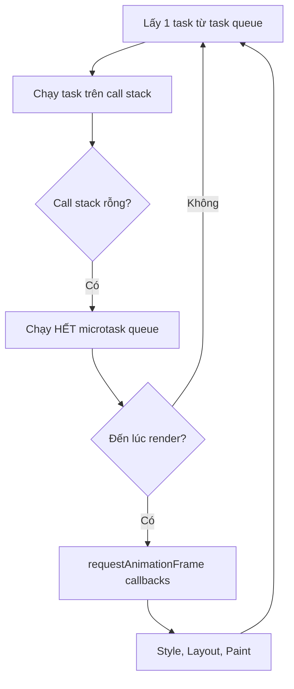
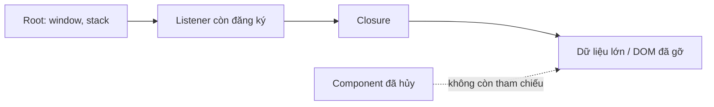

# Lý thuyết 1: JavaScript runtime và event loop

Bài mở đầu bộ Frontend dùng chung. Mọi bài sau (hiệu năng, bảo mật, kiến trúc) đều dựa vào mô hình thực thi của JavaScript trong trình duyệt.

## JavaScript chạy code như thế nào?

Hãy hình dung một quầy phục vụ chỉ có **một nhân viên**. Khách (code của bạn) xếp hàng, nhân viên phục vụ từng người một. Nếu một khách mất 5 phút, cả hàng đứng chờ, kể cả việc "lau bảng thông báo" (vẽ lại giao diện) cũng phải đợi. Đó chính là mô hình của JavaScript trong trình duyệt: engine chạy code trên **một main thread**, dùng chung với việc tính style, layout và paint. Bài này giải thích nhân viên đó chọn khách tiếp theo theo quy tắc nào (event loop), và các khái niệm đi kèm: call stack, task queue và microtask, closure, `this`, prototype, module, memory và Web Worker.

## Vấn đề nó giải quyết, và vì sao senior phải nắm

Hầu hết lỗi "khó hiểu" như thứ tự log sai, giao diện giật, tab ngốn RAM tăng dần, `this` bị mất, Promise không bắt được lỗi đều **không phải lỗi cú pháp**. Chúng là hệ quả trực tiếp của mô hình thực thi. Người chỉ nhớ "cách sửa" sẽ sửa mò; người hiểu mô hình giải thích được **vì sao** và đoán trước được hiện tượng.

Bạn sẽ cần kiến thức này khi debug thứ tự async, khi trang bị đơ (long task, tức một task chạy quá khoảng 50 ms), khi RAM của tab tăng mãi, khi chọn giữa main thread và Worker, và khi cấu hình bundler (ESM hay CommonJS). Phương pháp xuyên suốt: với mọi câu hỏi về thứ tự, hãy **vẽ ra** bốn thứ: call stack hiện tại, microtask queue, task queue, và có "cơ hội render" hay không.

**Tóm tắt:**

- JavaScript chạy code của bạn trên một main thread duy nhất, dùng chung với style, layout và paint, nên code chạy lâu là giao diện đơ.
- Một vòng event loop: lấy một task, chạy tới khi call stack rỗng, xả cạn microtask, rồi (nếu đến lúc) render. Thứ tự là sync, microtask, task.
- `Promise.then` và phần sau `await` là microtask nên luôn chạy trước `setTimeout(0)`; vòng microtask vô hạn làm đói render.
- `this` của hàm thường do cách gọi quyết định, arrow function lấy `this` từ phạm vi bao ngoài; closure giữ biến sống chừng nào còn hàm tham chiếu.
- ESM là static nên tree shaking được và có live binding; CommonJS là dynamic và chép giá trị lúc `require`.
- Memory leak là một đường tham chiếu bị bỏ quên từ root (listener, timer, cache, DOM detached); tìm bằng heap snapshot, sửa bằng cách gỡ và dọn.
- Promise không hủy được (dùng `AbortController`), `fetch` không reject với 4xx/5xx, và `forEach(async)` không chờ.
- Web Worker đưa việc nặng ra thread riêng nhưng không có DOM và dữ liệu bị copy qua `postMessage`; chỉ đáng khi việc đủ nặng.

## Các khái niệm cần biết

- **Call stack**: nơi engine ghi nhớ hàm nào đang chạy. Gọi hàm thì đẩy vào, hàm xong thì lấy ra. Chỉ khi stack rỗng engine mới nhận việc mới. Đệ quy không điểm dừng gây lỗi "Maximum call stack size exceeded".
- **Task (macrotask)**: một đơn vị công việc do môi trường xếp vào queue, ví dụ callback của `setTimeout`, event click, hoàn tất I/O. Mỗi vòng lặp lấy đúng một task.
- **Microtask**: việc nhỏ cần chạy "ngay sau khi code hiện tại xong, trước khi làm bất cứ gì khác", ví dụ `Promise.then`. Dùng khi bạn muốn kết quả async nhưng không muốn nhường cho render hay timer.
- **Event loop**: vòng lặp vô hạn của môi trường, lấy task, chạy, xả microtask, rồi (nếu đến lúc) render.
- **Long task**: task chiếm main thread quá lâu (thường xét ngưỡng 50 ms), làm giao diện không phản hồi.
- **Forced reflow (synchronous layout)**: khi bạn ghi style rồi đọc ngay một property hình học (như `offsetHeight`), trình duyệt buộc phải tính layout ngay lập tức thay vì gom lại. Lặp lại trong vòng lặp sẽ gây giật.
- **Structured clone**: thuật toán sao chép sâu giá trị khi gửi dữ liệu giữa các thread (`postMessage`) hoặc gọi `structuredClone()`. Không sao chép được hàm.

## Event loop

JavaScript chạy code của bạn trên **một main thread**. Thread này cũng làm việc style, layout, paint. Vì vậy code JS chạy lâu sẽ chặn cả giao diện.



Quy tắc nhớ:

| Khái niệm | Nguồn | Khi nào chạy |
|---|---|---|
| Task (macrotask) | `setTimeout`, `setInterval`, event DOM, `MessageChannel`, I/O | Mỗi vòng lặp lấy **một** task |
| Microtask | `Promise.then/catch/finally`, `queueMicrotask`, `MutationObserver`, phần sau `await` | **Sau mỗi task**, chạy cạn queue trước khi làm việc khác |
| rAF | `requestAnimationFrame` | Ngay **trước** style/layout/paint của khung hình kế tiếp |

Trình duyệt thường chỉ render mỗi khoảng 16,7 ms (màn hình 60 Hz), không phải sau mỗi task.

**Nền tảng:** JavaScript chỉ có một main thread, dùng chung cho code của bạn, style, layout và paint. Vì vậy mọi vấn đề về thứ tự log, giao diện đơ hay animation giật đều quy về một câu hỏi: lúc này call stack, microtask queue và task queue đang chứa gì, và đã tới cơ hội render chưa.

**Phải thuộc:** thứ tự một vòng event loop là lấy một task, chạy tới khi call stack rỗng, xả cạn toàn bộ microtask, (nếu đến lúc) chạy rAF rồi style, layout, paint, sau đó mới lấy task kế. Nói gọn: code sync, rồi microtask, rồi task.

```js
console.log("1 sync");
setTimeout(() => console.log("5 timeout"), 0);
Promise.resolve().then(() => console.log("3 microtask 1"))
  .then(() => console.log("4 microtask 2"));
queueMicrotask(() => console.log("3b microtask"));
console.log("2 sync");
// Thứ tự thực tế: 1, 2, 3 (microtask 1), 3b, 4, 5
```

Thử đọc ví dụ trên theo mô hình: code sync chạy hết trước (in 1 và 2), `setTimeout` chỉ đăng ký một task cho lần sau, `then` đăng ký microtask. Khi call stack rỗng, microtask được xả hết (3, 3b, 4; lưu ý `then` thứ hai chỉ được xếp vào hàng sau khi `then` đầu chạy xong, nhưng vẫn nằm trong cùng đợt xả), rồi mới tới task `setTimeout` (5).

Hệ quả cho senior:

- **Microtask đói task**: vòng `Promise.then` tự gọi lại chính nó vô hạn sẽ không bao giờ nhường cho render hay timer.
- `setTimeout(fn, 0)` không phải "chạy ngay": có độ trễ tối thiểu và phải chờ task hiện tại xong; timer lồng sâu bị kẹp tối thiểu khoảng 4 ms theo đặc tả HTML.
- Đọc `offsetHeight` sau khi ghi style sẽ ép **synchronous layout** (forced reflow). Gom đọc trước, ghi sau.
- Tách việc nặng: chia nhỏ thành chunk và nhường main thread bằng `await` một task mới (ví dụ `scheduler.yield()` nếu trình duyệt hỗ trợ, hoặc `setTimeout`/`MessageChannel` làm phương án dự phòng). Kiểm tra bảng tương thích trên MDN trước khi dựa vào `scheduler.yield`.

## Closure, this, prototype

Ba khái niệm này trả lời câu hỏi "biến nào hàm nhìn thấy", "hàm đang chạy trên object nào" và "property được tìm ở đâu". Hiểu sai chúng gây ra các lỗi kinh điển bên dưới.

**Closure** là hàm cộng với môi trường từ vựng (lexical environment) nơi nó được tạo. Biến được giữ sống chừng nào còn hàm tham chiếu tới nó.

```js
// Bẫy kinh điển: var không có phạm vi khối
for (var i = 0; i < 3; i++) setTimeout(() => console.log(i)); // 3 3 3
// 0 1 2 (mỗi vòng một binding)
for (let j = 0; j < 3; j++) setTimeout(() => console.log(j));
```

**`this`** được quyết định **lúc gọi**, trừ arrow function (lấy `this` từ phạm vi bao ngoài lúc định nghĩa).

| Cách gọi | `this` |
|---|---|
| `obj.method()` | `obj` |
| `fn()` ở strict mode / module | `undefined` |
| `new Fn()` | object mới tạo |
| `fn.call(x)`, `apply`, `bind(x)` | `x` |
| Arrow function | `this` của phạm vi bao ngoài, không đổi được bằng `call/bind` |
| Event handler `addEventListener` (hàm thường) | phần tử gắn handler (`currentTarget`) |

```js
const user = { name: "An", hi() { return this.name; } };
const f = user.hi;
// mất this khi tách method khỏi object: strict mode/module ném TypeError (this là undefined), sloppy mode this là globalThis nên không ra "An"
f();
```

**Phải thuộc:** `this` của hàm thường do **cách gọi** quyết định (`obj.f()`, gọi trơn, `new`, `call/apply/bind`), còn arrow function lấy `this` từ phạm vi bao ngoài lúc định nghĩa và không đổi được.

**Prototype**: mỗi object có liên kết nội bộ `[[Prototype]]`. Tra cứu property đi dọc chuỗi này. `class` chỉ là cú pháp trên prototype. `Object.create(null)` tạo object không có prototype, an toàn khi dùng làm từ điển (tránh `__proto__`, `toString`). Nhớ: ghi đè property lên instance **che** property của prototype, không sửa prototype.

## Module: ESM và CommonJS

**Module** là cách chia code thành các file có phạm vi riêng và khai báo rõ cái gì xuất ra, cái gì nhập vào. JavaScript có hai hệ chính: **ESM** (chuẩn của ngôn ngữ, dùng `import/export`) và **CommonJS** (hệ cũ của Node.js, dùng `require`). Cần biết sự khác nhau vì bundler chỉ loại được code thừa (**tree shaking**, tức bỏ phần export không ai dùng) khi import là tĩnh.

| Tiêu chí | ESM (`import/export`) | CommonJS (`require`) |
|---|---|---|
| Nạp | Phân tích tĩnh, async | Sync, chạy lúc gọi |
| Binding | **Live binding** (tham chiếu sống) | Sao chép giá trị export tại thời điểm `require` |
| Tree shaking | Có thể (vì import tĩnh) | Rất hạn chế |
| Top-level await | Có | Không |
| `this` ở top-level | `undefined` | `module.exports` |
| Import động | `import()` trả Promise | `require()` sync |

Bẫy: trộn ESM và CJS (thiếu `default`, `__esModule`, circular dependency). Dependency vòng ở ESM cho ra giá trị `undefined` hoặc lỗi TDZ nếu dùng trước khi khởi tạo. Thư viện công bố cả hai bản nên dùng trường `exports` trong `package.json` và đặt cờ `sideEffects: false` đúng chỗ để bundler loại bỏ code thừa.

## Memory và rò rỉ

**Garbage collector (GC)** là bộ phận tự động giải phóng memory. Nó không đếm "ai còn dùng" mà xét **khả năng truy cập** (reachability) từ root (biến toàn cục, stack, DOM đang gắn). Object không còn đường tới root sẽ bị thu hồi. **Memory leak** trong JS nghĩa là: bạn không còn cần object nhưng vẫn vô tình giữ một đường tham chiếu tới nó, nên GC không dám thu hồi. Hiện tượng: tab chậm dần, RAM tăng, cuối cùng crash.



Đọc sơ đồ: dù component đã bị hủy (mũi tên đứt), listener đăng ký trên `window` vẫn nối từ root tới closure rồi tới dữ liệu lớn, nên GC không thu hồi được. Gỡ listener là cắt đường nối đó.

**Nền tảng:** GC thu hồi theo **khả năng truy cập từ root**, không theo việc bạn còn "cần" object hay không. Rò rỉ chính là một đường tham chiếu bị bỏ quên (listener, timer, cache, DOM bị tách) nối từ root tới thứ bạn đã hết dùng.

| Nguồn rò rỉ phổ biến | Cách xử lý |
|---|---|
| Listener không gỡ (`addEventListener`, `window.resize`, `scroll`) | `removeEventListener` hoặc `AbortController` (`{ signal }`) |
| `setInterval`/`setTimeout` không clear | `clearInterval` khi hủy component |
| Closure giữ object lớn không còn dùng | Gán `null`, thu hẹp phạm vi biến |
| Cache/Map toàn cục tăng vô hạn | Giới hạn kích thước (LRU) hoặc `WeakMap`/`WeakRef` |
| DOM node bị tách (detached) nhưng còn được tham chiếu từ JS | Xóa tham chiếu khi gỡ node |
| Subscription (observable, WebSocket, store) không hủy | Hủy trong cleanup |

```js
// Gỡ nhiều listener cùng lúc bằng một AbortController
const ac = new AbortController();
window.addEventListener("resize", onResize, { signal: ac.signal });
window.addEventListener("scroll", onScroll, { signal: ac.signal });
// khi hủy:
ac.abort();
```

Cách phát hiện: Chrome DevTools, tab Memory, chụp **heap snapshot** ở hai thời điểm và so sánh (chế độ Comparison), hoặc ghi **Allocation timeline**. Tab Performance bật "Memory" để xem đồ thị heap có dạng răng cưa đi lên không (mỗi lần GC không xuống về mức cũ là dấu hiệu rò rỉ). Tìm chuỗi "Detached" trong snapshot để thấy DOM bị tách.

## Promise và async/await: các bẫy

**Promise** là object đại diện cho kết quả chưa có, ở một trong ba state: pending, fulfilled, rejected. `async/await` là cú pháp để viết code chờ Promise trông như code tuần tự; phần sau `await` được lập lịch như một microtask. Các bẫy dưới đây đều xuất phát từ việc quên rằng `await` chỉ chờ khi bạn thực sự viết nó, và chỉ chờ đúng một promise.

```js
// 1. Quên await: lỗi thoát khỏi try/catch
async function a() {
  try { fetchData(); } catch (e) { /* không bắt được rejection */ }
}
// 2. forEach không chờ async
items.forEach(async (x) => { await save(x); }); // không chờ xong
for (const x of items) { await save(x); }       // tuần tự
await Promise.all(items.map(save));             // song song
// 3. await tuần tự khi các việc độc lập
const u = await getUser(); const p = await getPosts(); // chậm, nên Promise.all
```

| API | Hành vi |
|---|---|
| `Promise.all` | Reject ngay khi **một** promise reject (các việc khác vẫn chạy tiếp) |
| `Promise.allSettled` | Chờ tất cả, trả state từng cái |
| `Promise.race` | Kết quả của promise **đầu tiên xong** (kể cả reject) |
| `Promise.any` | Promise đầu tiên **fulfilled**; tất cả reject thì `AggregateError` |

**Phải thuộc:** `all` reject khi một cái reject; `allSettled` chờ tất cả và không bao giờ reject; `race` lấy cái xong đầu tiên (kể cả reject); `any` lấy cái fulfilled đầu tiên. Ngoài ra `fetch` chỉ reject khi lỗi mạng, với 4xx/5xx phải kiểm tra `response.ok`.

Thêm các điểm hay bị hỏi:

- Một `await` luôn nhường main thread và phần còn lại chạy như microtask.
- Promise **không hủy được**. Muốn hủy request dùng `AbortController` truyền vào `fetch`.
- `fetch` **không reject** khi HTTP 4xx/5xx, chỉ reject khi lỗi mạng. Phải kiểm tra `response.ok`.
- `unhandledrejection` là event cuối cùng để ghi nhận lỗi bị bỏ sót; nên gắn vào công cụ giám sát (xem [Bài 5](/go?p=11-Frontend-Core%2Flt-05-kien-truc-frontend.md)).
- Race condition ở UI (gõ tìm kiếm, response cũ về sau response mới): hủy request cũ hoặc so sánh request id trước khi set state.

## Web Worker

**Web Worker** giải quyết vấn đề "một nhân viên duy nhất": nó cho bạn thêm một background thread để tính toán nặng mà không làm đơ giao diện. Worker chạy JS ở thread riêng, không truy cập DOM, giao tiếp qua `postMessage` (dữ liệu được **structured clone**, tức sao chép). Dùng `Transferable` (như `ArrayBuffer`) để chuyển quyền sở hữu không sao chép.

```js
// main.js
const w = new Worker(new URL("./hash.worker.js", import.meta.url), { type: "module" });
w.postMessage({ text: bigString });
w.onmessage = (e) => console.log("hash:", e.data);
// hash.worker.js
self.onmessage = (e) => {
  let h = 0;
  for (const c of e.data.text) h = (h * 31 + c.charCodeAt(0)) | 0;
  self.postMessage(h);
};
```

| Loại | Dùng cho |
|---|---|
| Dedicated Worker | Việc nặng cho một trang (parse, nén, xử lý ảnh) |
| Shared Worker | Chia sẻ giữa nhiều tab cùng origin |
| Service Worker | Proxy mạng, cache, offline, push; không phải cho tính toán |

Đánh đổi: chi phí khởi tạo và sao chép dữ liệu. Chỉ đáng khi tác vụ vượt khoảng vài chục ms. Worker giúp giảm INP vì giữ main thread rảnh (xem [Bài 3](/go?p=11-Frontend-Core%2Flt-03-web-performance-core-web-vitals.md)).

## Bẫy thường gặp

| Bẫy | Biểu hiện | Cách tránh |
|---|---|---|
| `var` trong vòng lặp có closure | Mọi callback thấy cùng giá trị | Dùng `let` |
| Truyền method làm callback | `this` là `undefined` | Arrow function hoặc `bind` |
| `async` trong `forEach` | Code chạy tiếp khi chưa xong | `for...of` hoặc `Promise.all` |
| `Promise.all` với danh sách lớn | Bão request, rate limit | Giới hạn concurrency |
| `==` so sánh | Ép kiểu bất ngờ (`"" == 0`) | Dùng `===` |
| Mutate state dùng chung | Lỗi khó lần vết | Dữ liệu bất biến, `structuredClone` khi cần sao chép sâu |
| `JSON.stringify` mất dữ liệu | `undefined`, hàm, `Date`, `Map` bị đổi hoặc bỏ | Dùng `structuredClone` hoặc serialize riêng |
| Số thực | `0.1 + 0.2 !== 0.3` | Làm việc với số nguyên (đơn vị nhỏ nhất) hoặc thư viện decimal |
| Timer bị trình duyệt giảm tốc ở tab nền | Đồng hồ sai | Tính theo `performance.now()` hoặc timestamp |

## Câu hỏi phỏng vấn thường gặp

Mỗi câu có chuỗi: gợi ý suy luận, lập luận, đáp án ngắn, điều cần nhớ. Thử tự đi theo gợi ý trước khi đọc tiếp.

### 1. Một đoạn code in log theo thứ tự lạ: có `setTimeout`, có `Promise.then`, có code sync. Bạn giải thích thứ tự đó thế nào?

**Gợi ý suy luận:**
- JavaScript có mấy thread chạy code của bạn, và khi một đoạn đang chạy thì đoạn khác có chen vào được không (call stack)?
- Callback của timer và callback của Promise được xếp vào cùng một queue hay hai queue khác nhau?
- Sau khi một task xong, trình duyệt làm gì trước: lấy task kế hay xả queue còn lại?

**Lập luận:** vì chỉ có một main thread nên code sync chạy hết trước, không ai chen vào được. `setTimeout` chỉ đăng ký một task cho vòng sau, còn `then` đăng ký microtask. Quy tắc là khi call stack rỗng thì xả cạn microtask rồi mới lấy task kế tiếp. Nên microtask luôn đến trước task, kể cả `setTimeout(0)`.

**Đáp án ngắn:** event loop lấy một task, chạy xong thì xả hết microtask, rồi (nếu đến lúc) render, rồi lấy task tiếp. Task gồm timer, event DOM, I/O; microtask gồm `Promise.then`, `queueMicrotask`, phần sau `await`. Thứ tự: sync, microtask, rồi task.

**Nhớ:** microtask xả cạn sau mỗi task, trước render và trước task kế. Ví dụ thứ tự log có trong [lt-01](/go?p=11-Frontend-Core%2Flt-01-javascript-runtime-event-loop.md).

### 2. Vì sao `Promise.then` luôn chạy trước `setTimeout(0)` dù timer là 0 ms?

**Gợi ý suy luận:**
- `setTimeout(fn, 0)` có chạy ngay không, hay chỉ đặt vào queue nào đó?
- Callback `then` nằm ở queue nào và được xả vào thời điểm nào?

**Lập luận:** timer 0 ms chỉ nghĩa là "sớm nhất có thể", callback vẫn là một task phải chờ task hiện tại xong, và còn bị độ trễ tối thiểu. `then` là microtask, được xả ngay khi call stack rỗng, tức trước khi event loop lấy task kế. Vì vậy `then` đứng trước.

**Đáp án ngắn:** microtask được xả hết sau task hiện tại, còn callback `setTimeout` là task phải chờ vòng lặp sau, nên `then` chạy trước.

**Nhớ:** "0 ms" không phải "chạy ngay". Hệ quả: vòng `then` tự gọi lại vô hạn sẽ làm đói render và timer.

### 3. Làm animation bằng `setTimeout` thì giật, bằng `requestAnimationFrame` thì mượt. Vì sao?

**Gợi ý suy luận:**
- Trình duyệt vẽ khung hình vào những thời điểm nào, và có khớp với lúc timer đến hạn không?
- Nếu bạn đổi style ngay trước lúc vẽ thì khác gì đổi style ở một thời điểm bất kỳ?

**Lập luận:** màn hình làm mới theo nhịp (khoảng 16,7 ms ở 60 Hz) và trình duyệt chỉ render ở các nhịp đó. Timer đến hạn lệch nhịp nên có khung bị bỏ hoặc vẽ hai lần. rAF được gọi ngay trước style/layout/paint của khung kế, nên thay đổi luôn rơi vào đúng khung và tab ẩn thì tự dừng.

**Đáp án ngắn:** rAF chạy trong vòng lặp ngay trước bước style, layout, paint của khung hình kế tiếp, còn `setTimeout` chạy như một task bất kỳ, không khớp nhịp vẽ.

**Nhớ:** làm animation JS dùng rAF; việc nặng thì chia nhỏ để không chặn khung hình.

### 4. Closure giữ biến sống lâu hơn dự kiến và gây memory leak. Khi nào chuyện đó xảy ra?

**Gợi ý suy luận:**
- Hàm bên trong nhớ cái gì của hàm bên ngoài (phạm vi từ vựng)?
- Garbage collector (GC) chỉ thu những object nào (khả năng truy cập từ gốc)?
- Ai còn giữ tham chiếu tới hàm đó: event listener, timer, cache toàn cục?

**Lập luận:** closure giữ tham chiếu tới biến ngoài mà nó dùng, nên các biến đó còn "truy cập được" chừng nào hàm còn sống. Nếu hàm bị giữ bởi thứ sống lâu (listener chưa gỡ, `setInterval` chưa clear, Map toàn cục) thì dữ liệu lớn mà nó chụp cũng không được GC, và rò rỉ tăng dần.

**Đáp án ngắn:** closure là hàm kèm môi trường từ vựng nơi nó được tạo. Nó rò rỉ khi một tham chiếu sống lâu (listener, timer, cache) giữ hàm và qua đó giữ dữ liệu lớn không còn dùng.

**Nhớ:** rò rỉ là "còn được tham chiếu mà không còn cần". Gỡ listener/timer, giới hạn cache, dùng `WeakMap`/`WeakRef`.

### 5. `this` trong cùng một hàm lúc trỏ đúng, lúc undefined. Nó được xác định thế nào, và arrow function khác gì?

**Gợi ý suy luận:**
- `this` được gán lúc định nghĩa hàm hay lúc gọi hàm? Gọi kiểu `obj.f()`, `f()`, `new F()` khác nhau chỗ nào?
- Nếu hàm không tự có `this` thì nó lấy từ đâu?

**Lập luận:** với hàm thường, `this` quyết định theo cách gọi: `obj.f()` thì là `obj`; gọi trơn thì là `undefined` (strict mode) hoặc global object; `call/apply/bind` ép giá trị; `new` tạo object mới. Vì vậy tách method ra khỏi object sẽ mất `this`. Arrow function không có `this` riêng nên lấy `this` của phạm vi bao quanh lúc định nghĩa, và không đổi được bằng `call`.

**Đáp án ngắn:** hàm thường: `this` do cách gọi quyết định. Arrow function: `this` cố định theo phạm vi từ vựng nơi nó được viết.

**Nhớ:** truyền method làm callback thì dùng arrow hoặc `bind`; arrow không dùng làm method cần `this` động hay constructor.

### 6. Vì sao tree shaking chạy tốt với ESM nhưng kém với CommonJS, và circular dependency ở hai hệ khác nhau ra sao?

**Gợi ý suy luận:**
- `import` nằm cố định ở đầu file còn `require()` là một lần gọi hàm: công cụ build đọc được gì từ mỗi cái mà không chạy code?
- Khi A import B và B import A, module nào chạy trước, và phần export nào đã sẵn sàng?

**Lập luận:** import/export của ESM là khai báo tĩnh, bundler biết export nào được dùng mà không cần chạy code, nên bỏ được phần thừa. `require` có thể nằm trong `if` hay nhận chuỗi động nên không phân tích chắc chắn được. Với circular dependency, CommonJS trả về bản `exports` dở dang tại thời điểm đó (có thể thiếu giá trị), còn ESM dùng liên kết sống (live binding) nên giá trị có thể sẵn sàng sau, nhưng truy cập sớm vẫn gây lỗi (vùng chết tạm thời).

**Đáp án ngắn:** ESM tĩnh nên tree shaking hiệu quả, và export là liên kết sống; CommonJS động, trả về object `exports` ở trạng thái hiện có tại lúc `require`, nên kém tối ưu và dễ gặp giá trị dở dang khi có vòng.

**Nhớ:** viết ESM, tránh `export default` object lớn và side effect khi import; gỡ vòng dependency bằng tách module.

### 7. Trang SPA dùng lâu thì ngày càng chậm. Bạn tìm và sửa memory leak thế nào?

**Gợi ý suy luận:**
- Rò rỉ biểu hiện ra sao trên đồ thị heap sau nhiều lần GC?
- Làm sao so sánh hai thời điểm để thấy cái gì tăng lên mà không được giải phóng?
- Những nguồn tham chiếu sống lâu thường là gì (listener, timer, cache, DOM bị tách)?

**Lập luận:** nếu heap sau mỗi lần GC không về mức cũ thì có thứ còn bị giữ. Chụp heap snapshot trước và sau thao tác lặp lại (ví dụ mở rồi đóng một màn hình) rồi so sánh để thấy object tăng. Truy ngược chuỗi tham chiếu (retainers) tới thủ phạm, ví dụ nút DOM "Detached" còn bị listener hoặc biến giữ. Gỡ nguồn giữ, rồi đo lại để xác nhận.

**Đáp án ngắn:** dùng tab Memory chụp heap snapshot hai thời điểm và so sánh, tìm object tăng và DOM "Detached", truy retainers. Sửa bằng cách gỡ listener, clear timer, hủy request khi unmount, giới hạn cache hoặc dùng `WeakMap`.

**Nhớ:** quy trình: tái hiện, đo, truy retainers, sửa, đo lại.

### 8. Khi nào bạn đưa việc tính toán sang Web Worker, và tốn kém gì?

**Gợi ý suy luận:**
- Việc nặng chạy trên main thread thì giao diện bị sao (cùng thread với layout, paint)?
- Worker và main thread chia sẻ gì, truyền dữ liệu qua đâu, truyền có tốn không?

**Lập luận:** main thread vừa chạy JS vừa lo giao diện nên tính toán nặng làm đơ UI. Worker là thread riêng nên giải phóng main thread. Nhưng worker không có DOM, giao tiếp bằng `postMessage` với dữ liệu bị structured clone (sao chép), nên dữ liệu lớn tốn thời gian copy trừ khi dùng `Transferable`. Thêm vào đó là chi phí khởi tạo, bundle thêm file và khó debug.

**Đáp án ngắn:** dùng khi có việc CPU nặng kéo dài (parse lớn, xử lý ảnh, encrypt). Chi phí: không truy cập DOM, copy dữ liệu qua `postMessage` (giảm bằng `Transferable`), khởi tạo và độ phức tạp của giao tiếp async.

**Nhớ:** chỉ dùng khi việc đủ nặng để bù chi phí truyền dữ liệu; việc nhỏ thì chia chunk và nhường main thread.

Bộ đáp án gợi ý nằm trong [Câu hỏi phỏng vấn Senior FE](/go?p=07-Interview-QA%2FFrontend%2Fhard%2Fqa-fe-phong-van.md). Bài kế tiếp: [Bài 2: TypeScript nâng cao](/go?p=11-Frontend-Core%2Flt-02-typescript-nang-cao.md).

