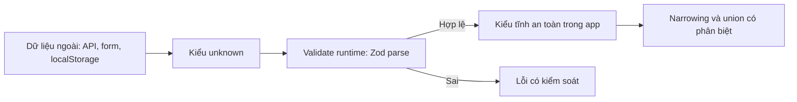
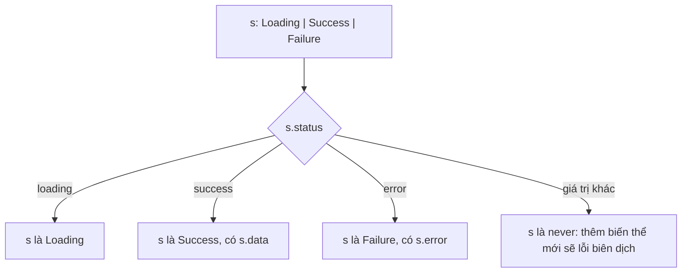

# Lý thuyết 2: TypeScript nâng cao

Bài này đi sau [Bài 1: JavaScript runtime](/go?p=11-Frontend-Core%2Flt-01-javascript-runtime-event-loop.md). TypeScript chỉ tồn tại lúc biên dịch: kiểu bị **xóa** hoàn toàn khi chạy, nên dữ liệu từ bên ngoài vẫn phải được kiểm tra lúc chạy.

## TypeScript nâng cao là gì, và dùng để làm gì?

TypeScript là JavaScript cộng thêm một hệ thống kiểu **tĩnh**: trình biên dịch đọc code, suy ra mỗi giá trị thuộc kiểu nào và báo lỗi trước khi chạy. Ở mức cơ bản bạn chỉ "gắn nhãn kiểu" cho biến. Ở mức nâng cao, bạn dùng hệ kiểu như một công cụ **thiết kế**: cấu hình `strict`, narrowing (thu hẹp kiểu), union có phân biệt, generics, conditional/mapped/template literal types, `infer`, `satisfies`, và nối kiểu tĩnh với việc kiểm tra dữ liệu lúc chạy.

## Vấn đề nó giải quyết

Một lập trình viên senior không chỉ "thêm kiểu cho đủ" mà thiết kế kiểu để **state bất hợp lệ không thể biểu diễn**. Ví dụ, nếu một màn hình có thể ở state "đang tải", "thành công" hoặc "lỗi", thì kiểu nên cấm luôn tổ hợp "vừa đang tải vừa có lỗi" thay vì dựa vào việc ai đó nhớ kiểm tra. Khi đó cả một lớp bug biến mất ngay lúc biên dịch. Phỏng vấn senior thường soi vào ba điểm: `any` khác `unknown` ra sao, mô hình hóa state thế nào, và có tin dữ liệu từ API hay không.

## Khi nào dùng, khi nào không

Dùng khi bạn thiết kế thư viện dùng chung, layer gọi API, state phức tạp, component có props linh hoạt, hoặc nâng cấp codebase JS lên TS. Công thức làm việc: bật `strict`, hạn chế `as`, dùng union có phân biệt thay cho các cờ boolean rời rạc, suy ra kiểu từ **một nguồn duy nhất** (schema), và kiểm tra dữ liệu ở biên bằng Zod hoặc công cụ tương đương.

Không nên lạm dụng: kiểu đệ quy sâu hoặc quá "thông minh" làm trình biên dịch chậm và đồng đội khó đọc. Khi một kiểu cần cả đoạn giải thích mới hiểu, hãy cân nhắc đơn giản hóa.

Điều quan trọng nhất cần nhớ: TypeScript chỉ tồn tại lúc biên dịch. Kiểu bị **xóa** hoàn toàn khi chạy, nên dữ liệu từ bên ngoài (API, form, `localStorage`) vẫn phải được kiểm tra lúc chạy. Sơ đồ dưới đây là toàn cảnh cách hai tầng này nối với nhau.

**Tóm tắt:**

- TypeScript là hệ kiểu static và bị xóa khi chạy, nên dữ liệu từ API, form, storage vẫn phải validate lúc chạy (ví dụ bằng Zod).
- Thiết kế kiểu để state bất hợp lệ không thể biểu diễn: dùng discriminated union thay cho các cờ boolean rời rạc.
- Gán phần còn lại vào biến kiểu `never` ở `default` để bắt buộc xử lý đủ nhánh (exhaustiveness check).
- `any` tắt kiểm tra và lây lan; `unknown` buộc phải narrowing trước khi dùng.
- `as` chỉ khẳng định, không kiểm tra; `satisfies` kiểm tra thật mà vẫn giữ kiểu hẹp.
- Generics giữ thông tin kiểu; mapped, conditional và template literal types cùng `infer` để suy ra kiểu từ một nguồn duy nhất.
- Bật `strict`, thêm `noUncheckedIndexedAccess`, và đừng làm kiểu đệ quy quá thông minh khiến compiler chậm và đồng đội khó đọc.

## Các khái niệm cần biết

- **Structural typing (kiểu cấu trúc)**: TS coi hai kiểu là tương thích nếu cùng "hình dạng", không quan tâm tên. Tiện, nhưng cũng là lý do `UserId` và `OrderId` cùng là `string` bị lẫn nhau.
- **Narrowing**: thu hẹp một kiểu rộng (như `string | number`) thành kiểu hẹp hơn trong một nhánh code nhờ kiểm tra như `typeof x === "string"`.
- **Discriminated union (union có phân biệt)**: union các object có chung một trường literal (ví dụ `status`) để TS biết đang ở nhánh nào.
- **Generics**: tham số hóa kiểu, như `Array<T>`, để một hàm hoạt động với nhiều kiểu mà vẫn giữ được thông tin kiểu.
- **Conditional type**: kiểu chọn theo điều kiện, viết `T extends U ? X : Y`.
- **`infer`**: trong conditional type, nhờ TS "bắt" một phần kiểu ra thành tên mới, ví dụ lấy kiểu trả về của hàm.
- **Mapped type**: tạo kiểu mới bằng cách duyệt qua các key của kiểu cũ, `{ [K in keyof T]: ... }`.
- **Branded type**: gắn "nhãn ảo" vào kiểu nguyên thủy để tách các giá trị cùng kiểu nhưng khác ý nghĩa.



Đọc sơ đồ: dữ liệu từ ngoài vào luôn được coi là `unknown` (chưa tin). Chỉ sau khi qua bước validate lúc chạy (Zod `parse`) nó mới trở thành kiểu tĩnh đáng tin trong phần còn lại của app.

**Nền tảng:** TypeScript là hệ kiểu **tĩnh và bị xóa khi chạy** (type erasure). Nó chứng minh code của bạn nhất quán với nhau, nhưng không chứng minh dữ liệu thật từ API, form hay `localStorage` đúng hình dạng đã khai báo. Đó là lý do phải validate ở biên.

## Cấu hình strict

Vấn đề đặt ra: mặc định TS khá dễ dãi (cho phép `any` ngầm, cho `null` đi khắp nơi). Cách giải quyết là bật chế độ nghiêm ngặt trong `tsconfig.json`.

`"strict": true` bật nhóm cờ gồm `strictNullChecks`, `noImplicitAny`, `strictFunctionTypes`, `strictBindCallApply`, `strictPropertyInitialization`, `noImplicitThis`, `alwaysStrict`, `useUnknownInCatchVariables`. Tuy vậy một số cờ có giá trị cao lại **không** nằm trong `strict`:

| Cờ | Tác dụng |
|---|---|
| `noUncheckedIndexedAccess` | `arr[i]` và `obj[key]` có kiểu `T \| undefined` |
| `exactOptionalPropertyTypes` | Phân biệt "thiếu property" với "property là `undefined`" |
| `noImplicitOverride` | Bắt buộc keyword `override` |
| `noFallthroughCasesInSwitch` | Chặn `case` rơi xuống |
| `verbatimModuleSyntax` | Giữ nguyên `import type`, tránh import dư làm side effect |
| `isolatedModules` | Mỗi file phải biên dịch độc lập (cần cho Babel, esbuild, SWC) |

Lưu ý: `tsc` chỉ kiểm tra kiểu. Nhiều bundler (esbuild, SWC, Babel) chỉ **xóa kiểu** mà không kiểm tra, nên CI vẫn phải chạy `tsc --noEmit`.

## Narrowing và union có phân biệt

Vấn đề: một giá trị có kiểu rộng (union) thì bạn chưa dùng được property riêng của từng nhánh. Cách giải quyết là kiểm tra, và TS sẽ "nhớ" kết quả kiểm tra trong nhánh đó. Narrowing thu hẹp kiểu bằng kiểm tra lúc chạy: `typeof`, `instanceof`, `in`, so sánh bằng, truthiness, và **type predicate** do bạn viết.

```ts
type Loading = { status: "loading" };
type Success<T> = { status: "success"; data: T };
type Failure = { status: "error"; error: Error };
type State<T> = Loading | Success<T> | Failure;

function render(s: State<string[]>): string {
  switch (s.status) {
    case "loading": return "...";
    case "success": return s.data.join(", "); // s là Success
    case "error":   return s.error.message;   // s là Failure
    default: {
      const _never: never = s; // thêm biến thể mới mà quên xử lý sẽ lỗi biên dịch
      return _never;
    }
  }
}

// Type predicate
const isString = (x: unknown): x is string => typeof x === "string";
```

Hãy xem flow TS suy luận khi gặp `switch`:



So với cách cũ `{ loading: boolean; data?: T; error?: Error }`, union có phân biệt không cho phép tổ hợp phi lý (vừa `loading` vừa có `error`). Quy tắc nhớ: **một trường phân biệt (discriminant) kiểu literal, và kiểm tra `never` ở nhánh cuối**.

**Phải thuộc:** discriminated union gồm các object có chung một trường literal (như `status`); `switch` trên trường đó thu hẹp kiểu từng nhánh, và gán phần còn lại vào biến kiểu `never` ở `default` là cách bắt buộc xử lý đủ nhánh (exhaustiveness check).

## Generics và ràng buộc

Generics dùng khi bạn muốn một hàm hoặc kiểu hoạt động với nhiều kiểu dữ liệu mà **không đánh mất** thông tin kiểu (khác với `any`, vốn làm mất hết). Không dùng khi chỉ có một kiểu cụ thể duy nhất. `extends` trong `<K extends keyof T>` là ràng buộc: K chỉ được là một key có thật của T, nên `obj[k]` luôn hợp lệ.

```ts
// Ràng buộc: K phải là key của T
function pick<T, K extends keyof T>(obj: T, keys: K[]): Pick<T, K> {
  const out = {} as Pick<T, K>;
  for (const k of keys) out[k] = obj[k];
  return out;
}

// Giá trị mặc định cho tham số kiểu
type ApiResponse<T = unknown> = { ok: true; data: T } | { ok: false; message: string };
```

Quy tắc: tham số kiểu nên **xuất hiện ít nhất hai lần** (đầu vào và đầu ra). Nếu chỉ xuất hiện một lần, thường có thể thay bằng kiểu cụ thể. Từ TS 5.0 có `const` type parameter (`<const T>`) để suy ra literal thay vì kiểu rộng, và từ TS 5.4 có `NoInfer<T>` để chặn một vị trí tham gia suy luận. Kiểm tra phiên bản TS của dự án trước khi dùng.

## Conditional, mapped, template literal types và infer

Đây là "lập trình ở tầng kiểu": biến một kiểu thành kiểu khác. Dùng khi bạn viết thư viện hoặc helper cần suy ra kiểu từ kiểu có sẵn (ví dụ lấy kiểu trả về của hàm, sinh tên getter). Ít khi cần trong code ứng dụng thông thường; nếu dùng quá nhiều, code khó bảo trì.

```ts
// Conditional type, phân phối trên union
type NonNull<T> = T extends null | undefined ? never : T;
type A = NonNull<string | null>; // string

// infer: trích kiểu từ bên trong
type Awaited2<T> = T extends Promise<infer U> ? U : T;
type Ret<T> = T extends (...a: any[]) => infer R ? R : never;

// Mapped type kèm key remapping
type Getters<T> = {
  [K in keyof T as `get${Capitalize<string & K>}`]: () => T[K];
};
type G = Getters<{ name: string; age: number }>;
// { getName: () => string; getAge: () => number }

// Template literal type
type Route = `/users/${number}` | "/home";
type EventName<T extends string> = `on${Capitalize<T>}`;
```

Bẫy của conditional type: nó **phân phối** trên union khi tham số kiểu trần (naked). Muốn tắt, bọc trong tuple: `[T] extends [U] ? ... : ...`. Kiểu đệ quy quá sâu làm chậm trình biên dịch và có giới hạn độ sâu; ưu tiên kiểu đơn giản, dễ đọc.

## Utility types hay gặp

TS có sẵn các kiểu tiện ích dựng từ những khái niệm ở trên, nên bạn không phải tự viết lại. Nên dùng chúng trước khi tự định nghĩa mapped type.

| Utility | Ý nghĩa |
|---|---|
| `Partial<T>`, `Required<T>`, `Readonly<T>` | Đổi tính tùy chọn hoặc chỉ đọc (nông) |
| `Pick<T,K>`, `Omit<T,K>` | Chọn hoặc bỏ key |
| `Record<K,V>` | Từ điển key K, giá trị V |
| `Exclude<U,X>`, `Extract<U,X>` | Lọc thành viên union |
| `NonNullable<T>` | Bỏ `null` và `undefined` |
| `ReturnType<F>`, `Parameters<F>` | Suy từ chữ ký hàm |
| `Awaited<T>` | Kiểu sau khi `await` |
| `InstanceType<C>` | Kiểu instance của class |

`Omit` trên union **không phân phối** (làm mất phân biệt); cần viết mapped type riêng nếu muốn giữ từng nhánh.

## satisfies, as const, unknown vs any

Vấn đề: nếu chú thích `const palette: Colors = {...}` thì TS nới kiểu của từng property thành `string | number[]`, bạn phải narrowing mỗi lần dùng. `satisfies` (TS 4.9) giải quyết: kiểm tra giá trị khớp một kiểu nhưng **giữ kiểu hẹp** đã suy ra. `as const` thì "đóng băng" giá trị thành kiểu literal chỉ đọc, hợp để suy ra union từ một mảng hằng.

```ts
type Colors = Record<string, string | number[]>;
const palette = {
  red: [255, 0, 0],
  green: "#0f0",
} satisfies Colors;

// vẫn là number[], không bị nới thành string | number[]
palette.red.map((n) => n * 2);
palette.green.toUpperCase();     // vẫn là string

const ROLES = ["admin", "user"] as const; // readonly tuple literal
type Role = (typeof ROLES)[number];       // "admin" | "user"
```

| | `any` | `unknown` |
|---|---|---|
| Gán giá trị vào | Được | Được |
| Dùng giá trị ra | Mọi thao tác, **tắt kiểm tra** | Phải narrowing trước |
| Lan truyền | Làm "nhiễm" các kiểu khác | Không lan |
| Dùng khi | Hầu như tránh | Dữ liệu chưa biết: JSON, `catch`, tham số tổng quát |

`any` là lối thoát tắt hẳn kiểm tra; `unknown` là "chưa biết, phải kiểm tra trước khi dùng". Phân biệt `as` (khẳng định, không kiểm tra, có thể nói dối) và `satisfies` (kiểm tra thật). Dấu `!` (non-null assertion) cũng là lời hứa không được kiểm chứng.

**Phải thuộc:** `any` tắt kiểm tra kiểu và lây sang biểu thức khác; `unknown` nhận mọi giá trị nhưng phải narrowing trước khi dùng. Còn `as` chỉ khẳng định (không kiểm tra), `satisfies` kiểm tra thật mà vẫn giữ kiểu hẹp.

## Kiểu cho API và validate lúc chạy với Zod

Kiểu TS không bảo vệ bạn khi server trả sai hình dạng. Cách bền vững: định nghĩa **schema một lần**, suy ra kiểu từ schema.

```ts
import { z } from "zod";

const UserSchema = z.object({
  id: z.number().int(),
  email: z.string().email(),
  role: z.enum(["admin", "user"]),
  createdAt: z.coerce.date(),
});
type User = z.infer<typeof UserSchema>; // kiểu suy ra từ schema

async function getUser(id: number): Promise<User> {
  const res = await fetch(`/api/users/${id}`);
  if (!res.ok) throw new Error(`HTTP ${res.status}`);
  const json: unknown = await res.json();     // unknown, không phải any
  return UserSchema.parse(json);               // ném lỗi nếu sai hình dạng
}

// Không ném lỗi: dùng safeParse
const r = UserSchema.safeParse(input);
if (!r.success) console.error(r.error.issues);
```

Quy tắc: `res.json()` trả `Promise<any>`, hãy gán ngay vào `unknown`. Validate ở **biên** (layer API, form, đọc storage), phần còn lại của app tin kiểu. Với API lớn, cân nhắc sinh kiểu từ OpenAPI để client và server không lệch. Tên hàm và hành vi chi tiết có thể khác giữa phiên bản Zod, hãy đối chiếu tài liệu phiên bản bạn dùng. Phần layer API xem [Bài 5](/go?p=11-Frontend-Core%2Flt-05-kien-truc-frontend.md).

## Bẫy thường gặp

| Bẫy | Giải thích | Cách tránh |
|---|---|---|
| Kiểu cấu trúc (structural typing) | Hai kiểu cùng hình dạng thì tương thích, `UserId` và `OrderId` đều là `string` lẫn được | Branded type: `string & { __brand: "UserId" }` |
| Excess property check chỉ áp dụng cho object literal | Gán qua biến trung gian thì không báo thừa property | Dùng `satisfies` hoặc kiểu chính xác |
| `Object.keys` trả `string[]` | Không phải `(keyof T)[]` vì object có thể có key thừa | Chủ động ép kiểu có ý thức hoặc dùng `Object.entries` có kiểm tra |
| Tham số hàm là bivariant với method | Method shorthand lỏng hơn property hàm | Dùng property hàm khi muốn chặt (`strictFunctionTypes`) |
| `enum` | Sinh code lúc chạy, `const enum` gây rắc rối với `isolatedModules` | Dùng union literal hoặc `as const` |
| `as` ép sai | Bỏ qua kiểm tra, lỗi trốn tới runtime | Narrowing, type guard, schema |
| `catch (e)` | `e` là `unknown` khi strict | Kiểm tra `e instanceof Error` |
| Kiểu sâu và chậm | Conditional đệ quy làm IDE ì ạch | Giữ kiểu công khai đơn giản, đo bằng `tsc --extendedDiagnostics` |
| `@types` lệch phiên bản | Kiểu không khớp bản thư viện thật | Pin version, ưu tiên thư viện tự mang kiểu |

## Câu hỏi phỏng vấn thường gặp

Mỗi câu có chuỗi: gợi ý suy luận, lập luận, đáp án ngắn, điều cần nhớ. Thử tự đi theo gợi ý trước khi đọc tiếp.

### 1. Dữ liệu đến từ ngoài chương trình thì nên gán kiểu `any` hay `unknown`?

**Gợi ý suy luận:**
- Với giá trị mà bạn chưa biết hình dạng, bạn muốn trình biên dịch cho phép làm gì với nó?
- Một kiểu "tắt kiểm tra" và một kiểu "buộc kiểm tra trước khi dùng" khác nhau thế nào?

**Lập luận:** `any` tắt kiểm tra kiểu, nên lỗi chạy lúc sau không bị bắt và `any` còn lây sang biểu thức khác. `unknown` là kiểu an toàn của "chưa biết": gán gì vào cũng được nhưng muốn dùng phải thu hẹp (narrowing) bằng `typeof`, `in`, kiểm tra tùy biến hay schema. Vì thế với dữ liệu ngoài, `unknown` ép bạn kiểm tra trước khi tin.

**Đáp án ngắn:** `any` bỏ kiểm tra kiểu; `unknown` nhận mọi giá trị nhưng phải thu hẹp trước khi dùng. Dùng `unknown` cho dữ liệu chưa tin cậy (kết quả `JSON.parse`, `catch`, dữ liệu API).

**Nhớ:** `any` là lối thoát, `unknown` là hàng rào. Xem mục "satisfies, as const, unknown vs any" trong [lt-02](/go?p=11-Frontend-Core%2Flt-02-typescript-nang-cao.md).

### 2. Làm sao để khi thêm một biến thể mới vào union, code `switch` quên xử lý sẽ báo lỗi lúc biên dịch?

**Gợi ý suy luận:**
- Làm sao để TS biết đang ở nhánh nào của union (một property chung mang giá trị literal)?
- Sau khi đã xử lý hết các nhánh, kiểu còn lại của biến là gì?

**Lập luận:** nếu mỗi biến thể có property phân biệt (ví dụ `kind: "a" | "b"`), `switch` trên nó thu hẹp kiểu từng nhánh. Khi mọi nhánh đã được xử lý, phần còn lại của union là `never`. Gán giá trị đó vào biến kiểu `never` ở nhánh `default` thì thêm biến thể mới sẽ làm phép gán lỗi, nên thiếu nhánh bị bắt lúc biên dịch.

**Đáp án ngắn:** discriminated union là union có property literal chung để phân biệt. Đảm bảo đủ nhánh bằng kiểm tra `never` ở `default` (exhaustiveness check).

**Nhớ:** union phân biệt + `never` ở nhánh cuối = trình biên dịch nhắc bạn khi thêm biến thể.

### 3. `satisfies`, `as` và chú thích kiểu (`: T`) đều "nói về kiểu". Khác nhau ở đâu?

**Gợi ý suy luận:**
- Chú thích `: T` làm kiểu của biến bị mở rộng thành T, mất thông tin cụ thể thế nào?
- `as` là kiểm tra hay là lời khẳng định với trình biên dịch?
- Có cách nào vừa kiểm tra giá trị khớp T vừa giữ kiểu suy luận hẹp không?

**Lập luận:** chú thích `: T` kiểm tra rồi đổi kiểu biến thành T, nên mất chi tiết hẹp (ví dụ key cụ thể, literal). `as T` bỏ qua kiểm tra, chỉ ép kiểu, nên có thể che lỗi. `satisfies T` kiểm tra giá trị khớp T nhưng giữ nguyên kiểu suy luận hẹp, nên vừa an toàn vừa giữ gợi ý tự hoàn thành.

**Đáp án ngắn:** `: T` kiểm tra và mở rộng kiểu về T; `as T` ép kiểu không kiểm tra; `satisfies T` kiểm tra mà giữ kiểu hẹp.

**Nhớ:** ưu tiên `satisfies` cho cấu hình, bảng tra; hạn chế `as` vì nó có thể nói dối trình biên dịch.

### 4. Conditional type áp lên một union cho ra kết quả "rời rạc" từng phần tử. Đó là gì và tắt thế nào?

**Gợi ý suy luận:**
- Khi tham số kiểu trần `T` là union và đứng ở vế trái `extends`, TS xử lý cả khối hay từng phần tử?
- Muốn xử lý cả union như một khối thì phải làm gì với `T`?

**Lập luận:** với `T extends U ? X : Y` mà `T` là tham số kiểu trần, TS tự áp điều kiện lên từng thành viên của union rồi gộp kết quả (phân phối). Điều đó tiện cho phép lọc, nhưng gây bất ngờ khi bạn muốn so sánh cả union. Bọc `T` trong tuple, `[T] extends [U]`, thì `T` không còn trần nên phép phân phối bị tắt.

**Đáp án ngắn:** conditional type phân phối là áp điều kiện lần lượt lên từng thành viên union khi `T` trần. Tắt bằng `[T] extends [U]`.

**Nhớ:** `never` cũng là union rỗng nên kết quả phân phối trên `never` là `never`; để ý trường hợp này.

### 5. Viết `Getters<T>` (hoặc `DeepReadonly<T>`) và giải thích từng phần.

**Gợi ý suy luận:**
- Muốn tạo kiểu mới từ từng key của kiểu cũ thì dùng cấu trúc nào (mapped type, `keyof`)?
- Muốn đổi tên key thì dùng gì (`as`, template literal type)? Muốn đệ quy cho kiểu lồng nhau thì điều kiện dừng là gì?

**Lập luận:** mapped type `[K in keyof T]` duyệt từng key. Mệnh đề `as` cho phép đổi tên key bằng template literal, ví dụ `get${Capitalize<K>}`, và giá trị thành một hàm trả về `T[K]`. Với `DeepReadonly`, với mỗi property ta kiểm tra: nếu là object thì gọi đệ quy, nếu không thì giữ nguyên; điều kiện đó chính là điểm dừng. Cả hai dựa trên cùng ý: duyệt key rồi biến đổi.

**Đáp án ngắn:** `Getters<T>` dùng mapped type có key remapping và template literal; `DeepReadonly<T>` dùng mapped type có `readonly` và đệ quy trên property là object. Code mẫu `Getters` nằm trong mục "Conditional, mapped, template literal types và infer" của bài.

**Nhớ:** mapped type + `keyof` + `as` + template literal là bộ công cụ biến đổi kiểu.

### 6. Khai báo `interface User` cho kết quả API rồi, vì sao vẫn có lỗi chạy do dữ liệu sai hình dạng?

**Gợi ý suy luận:**
- Kiểu TS tồn tại ở giai đoạn nào (biên dịch) và còn lại gì lúc chạy trong trình duyệt?
- Ai bảo đảm server trả đúng như khai báo?

**Lập luận:** kiểu bị xóa khi biên dịch, nên lúc chạy không có gì kiểm tra dữ liệu thật. Khai báo kiểu cho kết quả `fetch` chỉ là lời hứa, server đổi hay lỗi thì dữ liệu sai vẫn lọt vào. Vì vậy ranh giới với bên ngoài cần kiểm tra lúc chạy: parse bằng schema (ví dụ Zod) rồi suy ra kiểu từ schema để hai thứ không lệch.

**Đáp án ngắn:** vì kiểu TS không tồn tại lúc chạy. Tôi nhận dữ liệu là `unknown`, validate bằng schema (Zod) ở ranh giới, và lấy kiểu bằng `z.infer` từ chính schema đó.

**Nhớ:** tin kiểu bên trong, kiểm tra thật ở rìa hệ thống.

### 7. `strict` gồm những gì, và bạn bật thêm cờ nào?

**Gợi ý suy luận:**
- Những lỗi phổ biến nhất lúc chạy là gì (null/undefined, `any` ngầm, `this` sai)?
- `strict` có bao phủ việc truy cập mảng theo chỉ số có thể ra `undefined` không?

**Lập luận:** `strict` là cờ tổng bật nhóm kiểm tra nghiêm như `strictNullChecks`, `noImplicitAny`, `strictFunctionTypes`, `strictBindCallApply`, `strictPropertyInitialization`, `useUnknownInCatchVariables`. Nhưng `arr[i]` vẫn ra `T`, dù có thể `undefined`, nên cần `noUncheckedIndexedAccess`. Cũng nên bật `exactOptionalPropertyTypes` để phân biệt "thiếu property" với "property là `undefined`".

**Đáp án ngắn:** `strict` bật cả nhóm kiểm tra nghiêm (null, `any` ngầm, hàm, `this`, khởi tạo property...). Tôi bật thêm `noUncheckedIndexedAccess` và `exactOptionalPropertyTypes`.

**Nhớ:** danh sách đầy đủ ở mục "Cấu hình strict" của [lt-02](/go?p=11-Frontend-Core%2Flt-02-typescript-nang-cao.md); bật dần ở dự án cũ.

### 8. Hàm nhận `userId: string, orderId: string` bị truyền ngược mà TS không báo. Vì sao, và sửa thế nào?

**Gợi ý suy luận:**
- TS coi hai kiểu tương thích dựa trên tên hay dựa trên hình dạng?
- Làm sao làm cho hai kiểu cùng nền `string` trở nên khác nhau?

**Lập luận:** TS dùng structural typing: cùng hình dạng thì tương thích, nên hai `string` tùy ý lẫn vào nhau. Để tách ý nghĩa, gắn một "nhãn ảo" lên kiểu nền, ví dụ `string & { __brand: "UserId" }`. Hai kiểu có nhãn khác nhau không gán được cho nhau, và nhãn chỉ có trong kiểu, không có ở runtime. Giá trị được tạo qua một hàm kiểm tra rồi ép kiểu một chỗ duy nhất.

**Đáp án ngắn:** structural typing khiến các kiểu cùng hình dạng lẫn nhau. Branded type thêm nhãn ảo vào kiểu nền để chúng không còn gán lẫn được.

**Nhớ:** tạo giá trị có nhãn ở một hàm khởi tạo duy nhất để giữ an toàn.

Đáp án gợi ý ở [Câu hỏi phỏng vấn Senior FE](/go?p=07-Interview-QA%2FFrontend%2Fhard%2Fqa-fe-phong-van.md). Tham khảo gốc: typescriptlang.org/docs. Bài kế tiếp: [Bài 3: Hiệu năng web và Core Web Vitals](/go?p=11-Frontend-Core%2Flt-03-web-performance-core-web-vitals.md).

