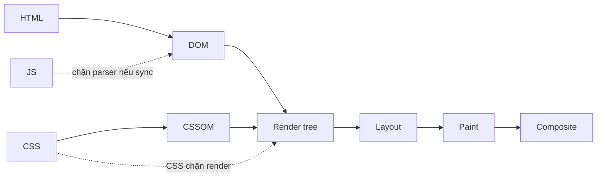

# Lý thuyết 3: Hiệu năng web và Core Web Vitals

Bài này dựa trên mô hình main thread ở [Bài 1](/go?p=11-Frontend-Core%2Flt-01-javascript-runtime-event-loop.md) và liên quan trực tiếp tới [bảo mật](/go?p=11-Frontend-Core%2Flt-04-bao-mat-frontend.md) (CSP, third-party) và [kiến trúc](/go?p=11-Frontend-Core%2Flt-05-kien-truc-frontend.md) (performance budget trong CI).

## Hiệu năng web là gì?

Khi bạn mở một trang, trình duyệt phải tải HTML, CSS, JS, ảnh, font, rồi biến chúng thành pixel trên màn hình. "Hiệu năng web" là mức độ nhanh và mượt của toàn bộ quá trình đó theo cảm nhận của người dùng thật. Bài này đi qua: cách trình duyệt vẽ trang (critical rendering path), ba chỉ số Core Web Vitals (LCP, INP, CLS) dùng để đo cảm nhận đó, và các kỹ thuật tải, cache, tách bundle, đo đạc để cải thiện chúng.

## Vì sao nó quan trọng

Trang chậm hoặc giật ảnh hưởng trực tiếp tới tỷ lệ chuyển đổi (người dùng bỏ đi) và trải nghiệm. Phỏng vấn senior hiếm khi hỏi "bạn biết mẹo nào"; họ hỏi **quy trình chẩn đoán**: đo cái gì, đo ở đâu (lab hay field), và nguyên nhân gốc nằm ở mạng, server, JS hay layout. Đoán mò rồi tối ưu bừa thường tốn công mà không cải thiện được chỉ số nào.

## Khi nào cần, và làm theo trình tự nào

Bạn cần kiến thức này khi trang chậm, khi điểm CWV kém ở dữ liệu thực, khi bundle phình, khi thêm third-party script, và như một cổng kiểm tra trong CI. Trình tự luôn là: **đo trước** (RUM cộng lab), tìm nút cổ chai theo từng chỉ số, sửa đúng chỗ, đo lại, rồi đặt ngân sách hiệu năng để không bị tụt lại.


**Tóm tắt:**

- Core Web Vitals có ba chỉ số, ngưỡng tốt ở phân vị 75: LCP <= 2,5 s, INP <= 200 ms (thay FID từ 3/2024), CLS <= 0,1.
- Quy trình luôn là đo trước (RUM cộng lab), tìm nút cổ chai theo từng chỉ số, sửa đúng chỗ, đo lại, rồi đặt performance budget trong CI.
- Trình duyệt chỉ vẽ được khi có cả DOM và CSSOM, nên CSS và script sync trên critical rendering path trì hoãn lần vẽ đầu.
- LCP cải thiện bằng tối ưu ảnh, preload và giảm TTFB; INP bằng chia nhỏ long task; CLS bằng đặt kích thước cho ảnh, font và quảng cáo.
- Giảm bundle bằng code splitting và tree shaking; `defer` giữ thứ tự, `async` chạy ngay khi tải xong.
- `no-cache` là lưu nhưng phải revalidate, `no-store` mới là không lưu; file có hash thì `max-age=31536000, immutable`, HTML thì `no-cache`.
- Lighthouse là lab và không đo được INP (dùng TBT thay), nên cần RUM để có số liệu người dùng thật.

## Các khái niệm cần biết

- **Core Web Vitals (CWV)**: bộ ba chỉ số do Google công bố, đại diện cho tốc độ tải (LCP), độ phản hồi (INP) và độ ổn định thị giác (CLS). Chúng ảnh hưởng cả trải nghiệm và (ở mức nhất định) xếp hạng tìm kiếm.
- **Phân vị 75 (p75)**: sắp các lượt tải từ tốt tới tệ, lấy giá trị tại mốc 75%. Nghĩa là 3/4 người dùng có trải nghiệm bằng hoặc tốt hơn con số đó. Đo bằng p75 để không bị che bởi số trung bình.
- **Lab data và field data**: lab là đo trong môi trường kiểm soát (Lighthouse) nên lặp lại được; field là dữ liệu người dùng thật (CrUX, RUM) nên phản ánh đúng thực tế.
- **RUM (Real User Monitoring)**: đo hiệu năng từ trình duyệt của người dùng thật rồi gửi về server của bạn.
- **TTFB (Time To First Byte)**: thời gian từ lúc request tới byte đầu tiên của response, phản ánh mạng và server.
- **TBT (Total Blocking Time)**: tổng thời gian main thread bị chặn bởi các long task, dùng trong lab thay cho INP.
- **Hydration**: bước JS "gắn" event và state vào HTML đã render sẵn từ server. Trong lúc chưa xong, trang trông đã hiện nhưng bấm chưa phản hồi.
- **bfcache (back/forward cache)**: trình duyệt giữ nguyên trang trong memory để nút Back/Forward hiện lại tức thì.
- **Layout thrashing**: xen kẽ đọc và ghi DOM liên tục khiến trình duyệt phải tính layout lại nhiều lần (xem [Bài 1](/go?p=11-Frontend-Core%2Flt-01-javascript-runtime-event-loop.md) về forced reflow).

## Ngưỡng Core Web Vitals hiện hành

Theo web.dev (trang Web Vitals, cập nhật 31/10/2024): INP đã thay thế FID thành Core Web Vital ổn định từ tháng 3/2024. Ngưỡng "tốt" được đánh giá ở **phân vị 75** của lượt tải trang, tách riêng mobile và desktop. Trang đạt khi cả ba chỉ số đều đạt.

| Chỉ số | Đo gì | Tốt | Cần cải thiện | Kém |
|---|---|---|---|---|
| **LCP** (Largest Contentful Paint) | Tốc độ tải: thời điểm phần tử nội dung lớn nhất hiển thị | <= 2,5 s | 2,5 s đến 4 s | > 4 s |
| **INP** (Interaction to Next Paint) | Độ phản hồi: độ trễ của tương tác chậm nhất trong cả lifecycle trang (bỏ 1 giá trị cao nhất cho mỗi 50 tương tác) tới lần vẽ kế tiếp; chỉ tính click, tap, phím | <= 200 ms | 200 ms đến 500 ms | > 500 ms |
| **CLS** (Cumulative Layout Shift) | Ổn định thị giác: tổng điểm dịch chuyển bố cục bất ngờ | <= 0,1 | 0,1 đến 0,25 | > 0,25 |

Các mốc "tốt" 2,5 s, 200 ms, 0,1 và mốc INP "kém" 500 ms được xác nhận trực tiếp trên web.dev (trang Web Vitals và trang INP). Mốc "kém" của LCP (4 s) và CLS (0,25) là giá trị chuẩn đã công bố nhưng chưa được kiểm tra lại trong lần soạn này, nên đối chiếu lại khi ôn thi vì Google có thể điều chỉnh. FID đã bị loại, đừng nhắc FID như chỉ số hiện hành.

**Phải thuộc:** ba chỉ số Core Web Vitals và ngưỡng "tốt" ở phân vị 75: LCP <= 2,5 s (tốc độ tải), INP <= 200 ms (độ phản hồi, thay FID từ 3/2024), CLS <= 0,1 (ổn định bố cục). Lighthouse (lab) không đo được INP, lab dùng TBT thay thế.

## Critical rendering path



Vấn đề đặt ra: trình duyệt không thể vẽ khi chưa biết cả cấu trúc (DOM) lẫn kiểu dáng (CSSOM). Vì vậy tài nguyên nào nằm trên "đường găng" này sẽ trì hoãn lần vẽ đầu tiên. Đọc sơ đồ: HTML thành DOM, CSS thành CSSOM, hai thứ ghép thành render tree, rồi layout (tính vị trí, kích thước), paint (tô màu), composite (ghép các layer). JS sync có thể chặn parser, còn CSS chặn việc render.

**Nền tảng:** trình duyệt chỉ vẽ được khi có cả DOM và CSSOM, nên mọi tài nguyên nằm trên đường này (CSS, script sync) đều trì hoãn lần vẽ đầu. Tối ưu hiệu năng tải về bản chất là rút ngắn hoặc gỡ chặn đường găng này, và tránh làm layout lại không cần thiết.

Quy tắc nhớ:

- **CSS chặn render** (không vẽ khi CSSOM chưa xong). Script sync còn **chặn parser** và phải chờ CSS phía trước.
- `defer`: tải parallel, chạy sau khi parse xong, giữ thứ tự. `async`: chạy ngay khi tải xong, không đảm bảo thứ tự. `type="module"` mặc định như `defer`.
- Property ảnh hưởng chi phí: thay đổi `width/top` gây layout, `color` gây paint, `transform/opacity` thường chỉ cần composite (rẻ nhất, có thể chạy trên compositor).

## Cải thiện từng chỉ số

Mỗi chỉ số có nguyên nhân điển hình riêng. Đừng áp biện pháp của chỉ số này cho chỉ số khác: ví dụ preload ảnh giúp LCP nhưng không giúp INP.

### LCP

LCP gồm bốn phần liên tiếp: **TTFB**, **độ trễ bắt đầu tải tài nguyên**, **thời gian tải tài nguyên**, **độ trễ render**. Xác định phần nào chiếm nhiều nhất (DevTools Performance hoặc `web-vitals` attribution) rồi mới sửa.

| Nguyên nhân | Biện pháp |
|---|---|
| TTFB cao | CDN, cache ở edge, giảm xử lý server, streaming SSR, 103 Early Hints |
| Ảnh LCP được phát hiện muộn (nằm trong JS, CSS background, lazy-load nhầm) | Đặt `` trong HTML ban đầu, `<link rel="preload" as="image">`, `fetchpriority="high"` cho ảnh LCP, **không** `loading="lazy"` cho ảnh LCP |
| Ảnh nặng | WebP/AVIF, `srcset` và `sizes`, nén, CDN ảnh |
| Render bị chặn | Inline CSS tới hạn, `defer` script, bỏ CSS thừa |
| Client-side render rỗng ban đầu | SSR/SSG hoặc streaming để HTML đã có nội dung |

### INP

INP có ba phần: **input delay** (main thread bận), **processing time** (handler chạy), **presentation delay** (tới lần vẽ kế). Lab tool như Lighthouse **không đo được INP** vì không có người dùng thật; dùng TBT (Total Blocking Time) làm chỉ báo thay thế trong lab.

| Nguyên nhân | Biện pháp |
|---|---|
| Long task (> 50 ms) | Chia nhỏ, nhường main thread (`scheduler.yield()` nếu hỗ trợ, `setTimeout`), Web Worker |
| Handler làm quá nhiều | Chỉ làm phần cần phản hồi ngay, hoãn phần còn lại sang sau lần vẽ |
| Render lại quá rộng | Giảm phạm vi cập nhật, ảo hóa danh sách dài |
| Layout thrashing | Gom đọc/ghi DOM, tránh forced reflow |
| Third-party script nặng | Tải muộn, cô lập, đo riêng |
| DOM quá lớn | Giảm số node, `content-visibility: auto` |

### CLS

| Nguyên nhân | Biện pháp |
|---|---|
| Ảnh, video, iframe không có kích thước | Khai `width`/`height` hoặc `aspect-ratio` |
| Quảng cáo, banner chèn muộn | Chừa sẵn chỗ (min-height) |
| Font đổi gây giật chữ | `font-display`, preload font, `size-adjust` để khớp metric font dự phòng |
| Chèn nội dung phía trên nội dung đang xem | Chèn bên dưới viewport hoặc theo hành động người dùng |
| Animation làm đổi layout | Dùng `transform` thay vì `top/left/height` |

Điều kiện: dịch chuyển do người dùng khởi tạo (trong khoảng ngắn sau input) không tính vào CLS. Trang khôi phục từ **bfcache** cũng giúp tải gần như tức thì; tránh `unload` handler và `Cache-Control: no-store` thừa để không phá bfcache.

## Ảnh và font

```html
<!-- Ảnh LCP: ưu tiên cao, đủ kích thước, đa định dạng -->
<picture>
  <source type="image/avif" srcset="hero-800.avif 800w, hero-1600.avif 1600w" sizes="100vw">
  
</picture>
<!-- Ảnh dưới màn hình đầu: lazy -->


<!-- Font: preload file woff2 đang dùng, crossorigin bắt buộc -->
<link rel="preload" href="/fonts/app.woff2" as="font" type="font/woff2" crossorigin>
<style>
  @font-face { font-family: App; src: url(/fonts/app.woff2) format("woff2"); font-display: swap; }
</style>
```

`font-display: swap` hiện chữ dự phòng ngay (tốt cho LCP, có thể gây shift); `optional` hạn chế shift nhất nhưng font có thể không dùng ở lần tải đầu. Dùng subset (chỉ ký tự cần, ví dụ tiếng Việt cần thêm khối Latin mở rộng) để giảm dung lượng.

## Bundle splitting và tree shaking

Vấn đề: nếu gom toàn bộ JS vào một file, người dùng phải tải cả phần họ chưa dùng, làm chậm LCP và tăng thời gian parse. Cách giải quyết: chia bundle thành các **chunk** tải theo nhu cầu (**code splitting**), và để bundler loại code không ai import (**tree shaking**). Không nên chia quá nhỏ vì mỗi chunk thêm một request.

| Kỹ thuật | Ý nghĩa | Lưu ý |
|---|---|---|
| Code splitting theo route | Mỗi trang một chunk, dùng `import()` | Cách có lợi nhất cho SPA |
| Tách vendor chunk | Thư viện ít đổi cache lâu | Quá nhiều chunk nhỏ làm tăng request, cân bằng |
| Tree shaking | Loại export không dùng | Cần ESM, đúng `sideEffects` trong `package.json`, tránh `import *` và barrel file nặng |
| Lazy load component nặng | Biểu đồ, editor, bản đồ | Tải khi cần hoặc khi hover/idle |
| Thay thư viện nặng | `moment` sang `date-fns`/`dayjs`, tránh nhập cả `lodash` | Đo bằng bundle analyzer |
| Minify và nén | Terser/esbuild, Brotli hoặc gzip | Nén ở server hoặc CDN |

```js
// Chia theo route: chunk chỉ tải khi vào trang
const Report = () => import("./pages/Report.js");

// Prefetch chủ động khi người dùng có ý định
button.addEventListener("pointerenter", () => import("./pages/Report.js"), { once: true });
```

Công cụ xem bundle: `source-map-explorer`, `webpack-bundle-analyzer`, `rollup-plugin-visualizer`, hoặc báo cáo của bundler bạn dùng.

## Cache HTTP và CDN

Cách nhanh nhất để tải một file là không phải tải lại. **Cache HTTP** cho trình duyệt giữ file theo chỉ dẫn trong header `Cache-Control`; **CDN** là mạng server đặt gần người dùng, giữ bản sao ở "edge". Chiến lược chung: file bất biến (có hash) cache rất lâu, file có thể đổi (HTML) luôn authentication lại. Nếu làm ngược lại, người dùng hoặc kẹt bản cũ hoặc tải lại mọi thứ mỗi lần.

| Tài nguyên | `Cache-Control` gợi ý |
|---|---|
| File build có hash trong tên (`app.3f9a.js`) | `public, max-age=31536000, immutable` |
| HTML | `no-cache` (luôn revalidate bằng ETag) hoặc `max-age` rất ngắn |
| API công khai ít đổi | `max-age` ngắn kèm `stale-while-revalidate` |
| Dữ liệu riêng tư | `private`; dữ liệu nhạy cảm cân nhắc `no-store` |

**Phải thuộc:** `no-cache` nghĩa là "được lưu nhưng phải revalidate trước khi dùng", còn `no-store` mới là "không lưu". File có hash trong tên thì `max-age=31536000, immutable`, HTML thì `no-cache`.

Nhớ thêm: Cache bust bằng **tên file có hash**, không bằng query string thất thường. CDN cần chú ý header `Vary` và cache key để không phục vụ nhầm nội dung theo người dùng.

## Preload, prefetch, preconnect

Đây là các "gợi ý tài nguyên" (resource hints): bạn báo trước cho trình duyệt biết sắp cần gì để nó làm sớm hơn. Dùng khi trình duyệt không tự phát hiện sớm được tài nguyên quan trọng; không dùng tràn lan vì mỗi gợi ý đều tốn băng thông.

| Gợi ý | Ý nghĩa | Dùng cho |
|---|---|---|
| `preload` | Tải **ngay**, ưu tiên cao, cho tài nguyên **trang hiện tại** | Ảnh LCP, font, CSS/JS then chốt |
| `prefetch` | Tải khi rảnh, ưu tiên thấp, cho **điều hướng kế tiếp** | Chunk của trang người dùng sắp vào |
| `preconnect` | Mở sẵn DNS, TCP, TLS | Origin bên thứ ba chắc chắn dùng |
| `dns-prefetch` | Chỉ phân giải DNS | Origin có thể dùng |
| Speculation Rules | Prefetch/prerender toàn trang | Kiểm tra mức hỗ trợ trình duyệt trước khi dựa vào |

Preload quá nhiều làm tranh băng thông với tài nguyên thực sự quan trọng. Preload thừa (không dùng) còn bị cảnh báo trong console.

## Đo bằng Lighthouse, DevTools, RUM

Vấn đề: "chạy Lighthouse thấy 95 điểm" chưa chắc người dùng thật thấy nhanh. Cần hiểu mỗi loại dữ liệu trả lời câu hỏi gì.

| Loại | Công cụ | Ưu điểm | Hạn chế |
|---|---|---|---|
| Lab | Lighthouse, DevTools Performance, WebPageTest | Lặp lại được, gỡ lỗi sâu | Không phản ánh thiết bị, mạng thật; không đo INP |
| Field (CrUX) | PageSpeed Insights, Search Console | Dữ liệu người dùng thật | Gộp theo origin/URL, thiếu chi tiết |
| RUM tự dựng | Thư viện `web-vitals` gửi về analytics | Chi tiết từng lượt, có attribution | Phải tự vận hành |

```js
import { onLCP, onINP, onCLS } from "web-vitals";
const send = (m) => navigator.sendBeacon("/rum", JSON.stringify({ name: m.name, value: m.value, id: m.id }));
onLCP(send); onINP(send); onCLS(send);
```

Quy trình senior: dùng CrUX/RUM để biết **có vấn đề không và ở đâu**, dùng lab để **tái hiện và gỡ lỗi**. Khi lab tốt mà field kém, nghi ngờ thiết bị yếu, mạng chậm, tương tác thật, hoặc cache lạnh.

## Performance budget

Ngân sách là giới hạn đo được và tự động kiểm tra: tổng JS nén (ví dụ cho trang đầu), LCP/INP/CLS ở phân vị 75, số request, kích thước ảnh. Gắn vào CI (Lighthouse CI, `size-limit`, bundle analyzer) để PR vượt ngân sách bị chặn. Con số cụ thể phải dựa trên người dùng và thiết bị mục tiêu của bạn, không có mốc chung chuẩn.

## Bẫy thường gặp

| Bẫy | Giải thích |
|---|---|
| Tối ưu theo điểm Lighthouse | Điểm lab không bằng dữ liệu field; đừng "chơi điểm" |
| `loading="lazy"` cho ảnh LCP | Làm LCP chậm hơn |
| Preload mọi thứ | Tranh băng thông, phản tác dụng |
| Tree shaking "không hiệu quả" | Do CJS, barrel file, hoặc `sideEffects` sai |
| Cache HTML quá lâu | Người dùng kẹt bản cũ trỏ tới file hash đã xóa |
| Third-party script | Thường là thủ phạm chính của INP và LCP; đo riêng |
| Chỉ đo trên máy dev mạnh | Dùng throttling CPU và mạng, thiết bị thật |
| Hydration nặng | Trang trông xong nhưng chưa tương tác được, ảnh hưởng INP |

## Câu hỏi phỏng vấn thường gặp

Mỗi câu có chuỗi: gợi ý suy luận, lập luận, đáp án ngắn, điều cần nhớ. Thử tự đi theo gợi ý trước khi đọc tiếp.

### 1. Người dùng nói "trang chậm". Bạn đo theo những chỉ số nào, và "tốt" nghĩa là gì?

**Gợi ý suy luận:**
- Trải nghiệm của người dùng chia thành mấy phần: thấy nội dung chính, bấm được và phản hồi, bố cục có nhảy không?
- Một trang có người dùng nhanh, người dùng chậm: dùng trung bình hay một phân vị để đánh giá?

**Lập luận:** ba khía cạnh ứng với ba chỉ số: LCP (tải phần nội dung lớn nhất), INP (độ phản hồi của tương tác), CLS (độ ổn định bố cục). Trung bình che giấu người dùng chậm, nên đánh giá ở phân vị 75 của lượt tải thật, tách mobile và desktop. Trang đạt khi cả ba đạt ngưỡng tốt.

**Đáp án ngắn:** LCP <= 2,5 s, INP <= 200 ms, CLS <= 0,1, đánh giá ở phân vị 75, tách mobile và desktop.

**Nhớ:** ba chỉ số, ba ngưỡng, p75. Xem bảng ngưỡng trong [lt-03](/go?p=11-Frontend-Core%2Flt-03-web-performance-core-web-vitals.md).

### 2. Vì sao Google thay FID bằng INP, và vì sao chạy Lighthouse không ra INP?

**Gợi ý suy luận:**
- FID đo phần nào của một tương tác (chỉ độ trễ trước khi xử lý, chỉ lần đầu)? Tương tác trải qua những pha nào đến khi màn hình đổi?
- INP cần có tương tác thật của người dùng. Lighthouse chạy tự động thì có không?

**Lập luận:** FID chỉ đo độ trễ nhận đầu vào của tương tác đầu tiên, bỏ sót thời gian xử lý và vẽ, nên không phản ánh cảm giác suốt session. INP đo toàn bộ độ trễ (input delay, processing, presentation) của tương tác chậm nhất trong lifecycle trang. Vì cần người dùng thật tương tác, lab tool như Lighthouse không đo được, và dùng TBT (tổng thời gian main thread bị chặn) làm chỉ báo thay.

**Đáp án ngắn:** INP bao toàn bộ lifecycle và cả ba pha của tương tác, FID chỉ lần đầu và chỉ độ trễ nhập. Lighthouse không có người dùng thật nên không đo INP, ta dùng TBT trong lab và đo INP bằng RUM.

**Nhớ:** FID không còn là chỉ số hiện hành; INP đo bằng dữ liệu thực địa.

### 3. LCP là 4 giây. Bạn tìm xem phần nào chậm bằng cách nào?

**Gợi ý suy luận:**
- Từ lúc người dùng yêu cầu trang đến lúc phần tử lớn nhất hiện ra, thời gian đi qua những chặng nào (chờ server, chờ phát hiện tài nguyên, tải, vẽ)?
- Mỗi chặng có nguyên nhân và cách chữa khác nhau, vậy phải tách ra đo trước khi sửa?

**Lập luận:** LCP gồm bốn phần: TTFB, độ trễ bắt đầu tải tài nguyên, thời gian tải tài nguyên, và độ trễ vẽ phần tử. Đo từng phần (DevTools Performance, web-vitals attribution) cho biết chặng nào chiếm nhiều nhất. Chậm TTFB thì xem server/CDN; chậm bắt đầu tải thì ảnh LCP bị phát hiện muộn (preload, tránh lazy-load ảnh LCP); chậm tải thì ảnh quá nặng; chậm vẽ thì bị CSS/JS chặn render.

**Đáp án ngắn:** chia LCP thành bốn phần (TTFB, resource load delay, load duration, element render delay), đo xem phần nào lớn nhất rồi chữa đúng phần đó.

**Nhớ:** đừng đoán, tách ra rồi sửa chặng lớn nhất.

### 4. Trang bị nhảy bố cục khi tải xong. Nguyên nhân thường gặp và cách chữa?

**Gợi ý suy luận:**
- Trình duyệt biết kích thước phần tử khi nào: lúc dựng bố cục hay lúc tài nguyên về?
- Điều gì xuất hiện muộn và đẩy nội dung bên dưới: ảnh, quảng cáo, font, nội dung chèn bằng JS?

**Lập luận:** nếu kích thước chưa biết lúc dựng bố cục thì khi tài nguyên về, phần tử đổi kích thước và đẩy các phần tử khác, thành CLS. Nên chữa bằng cách dành chỗ trước: đặt `width`/`height` hoặc `aspect-ratio` cho ảnh/video, đặt chiều cao tối thiểu cho slot quảng cáo, tránh chèn nội dung phía trên nội dung có sẵn. Font đổi làm chữ giãn thì dùng font fallback có metric gần giống (`size-adjust`) hoặc `font-display` phù hợp.

**Đáp án ngắn:** CLS do nội dung không có chỗ dành trước. Dành sẵn kích thước cho ảnh, quảng cáo, nhúng; hạn chế chèn nội dung động ở trên; xử lý đổi font gây giãn chữ.

**Nhớ:** dịch chuyển do người dùng khởi tạo ngay sau thao tác không tính vào CLS.

### 5. `async`, `defer` và `type="module"` cho script khác nhau thế nào?

**Gợi ý suy luận:**
- Một `<script>` thường làm gì với việc phân tích HTML (parser bị chặn không)?
- Tải script parallel với parse thì còn lại câu hỏi: chạy lúc nào, theo thứ tự nào?

**Lập luận:** script thường chặn parser lúc tải và chạy. `async` tải parallel nhưng chạy ngay khi tải xong, nên thứ tự không đảm bảo và có thể chạy trước khi DOM xong. `defer` tải parallel và chạy sau khi parse xong, đúng thứ tự khai báo. `type="module"` mặc định hành xử như `defer` (và có phạm vi module riêng, hỗ trợ import).

**Đáp án ngắn:** `async`: chạy ngay khi tải xong, không đảm bảo thứ tự. `defer`: chạy sau khi parse xong, đúng thứ tự. `module`: mặc định như `defer`.

**Nhớ:** script phụ thuộc vào DOM hoặc thứ tự thì dùng `defer`; script độc lập (analytics) thì `async`.

### 6. `preload`, `prefetch`, `preconnect` đều "tải sớm". Khác nhau thế nào và dùng sai thì sao?

**Gợi ý suy luận:**
- Bạn đang cần tài nguyên ngay trang này, cho trang kế tiếp, hay chỉ cần chuẩn bị kết nối tới origin?
- Tải sớm quá nhiều thứ tranh băng thông với tài nguyên quan trọng thì hậu quả gì?

**Lập luận:** `preload` ra lệnh tải tài nguyên cần cho trang hiện tại với ưu tiên cao (hợp cho ảnh LCP, font). `prefetch` tải với ưu tiên thấp tài nguyên cho điều hướng sau. `preconnect` chỉ mở sẵn kết nối (DNS, TCP, TLS) tới origin sẽ dùng. Vì băng thông có hạn, preload tràn lan làm chậm tài nguyên thật sự quan trọng.

**Đáp án ngắn:** `preload` cho tài nguyên cần ngay ở trang này, `prefetch` cho trang sau, `preconnect` chỉ khởi động kết nối. Dùng có chọn lọc.

**Nhớ:** preload thứ không dùng sẽ bị cảnh báo và tốn băng thông.

### 7. Chiến lược cache cho file build có hash trong tên và cho file HTML?

**Gợi ý suy luận:**
- Nếu nội dung đổi thì tên file có đổi không? Khi đó cache lâu có nguy cơ gì?
- HTML là điểm vào trỏ tới các file có hash: cache lâu thì người dùng thấy bản nào?

**Lập luận:** file có hash đổi tên khi nội dung đổi, nên có thể cache rất lâu và đánh dấu `immutable` mà không lo bản cũ. HTML giữ URL cố định nhưng trỏ tới file hash mới, nên phải luôn được kiểm tra lại, nếu không người dùng kẹt ở bản cũ. Do đó HTML dùng `no-cache` (kiểm tra lại bằng ETag) hoặc thời gian ngắn.

**Đáp án ngắn:** file hash: `Cache-Control: public, max-age=31536000, immutable`. HTML: `no-cache` hoặc max-age ngắn kèm ETag.

**Nhớ:** "cache dài cho thứ bất biến, kiểm tra lại cho điểm vào".

### 8. Lighthouse báo xanh nhưng dữ liệu người dùng thật báo đỏ. Bạn tin cái nào?

**Gợi ý suy luận:**
- Lab chạy trên máy, mạng, kịch bản nào? Người dùng thật có khác không (thiết bị yếu, mạng chậm, tương tác khác)?
- Cái nào được dùng để đánh giá Core Web Vitals chính thức?

**Lập luận:** lab data lặp lại được, tốt để gỡ lỗi, nhưng chỉ mô phỏng một môi trường và không có tương tác thật (không đo INP). Field data (RUM, CrUX) là trải nghiệm thật ở phân vị 75 nên là căn cứ đánh giá. Khi mâu thuẫn, tin field data để biết có vấn đề, rồi dùng lab để tái hiện và sửa.

**Đáp án ngắn:** tin field data để đánh giá, dùng lab data để chẩn đoán. Mâu thuẫn thường do thiết bị, mạng hoặc tương tác thực tế khác môi trường lab.

**Nhớ:** field để biết, lab để sửa.

Đáp án gợi ý ở [Câu hỏi phỏng vấn Senior FE](/go?p=07-Interview-QA%2FFrontend%2Fhard%2Fqa-fe-phong-van.md). Nguồn: web.dev/articles/vitals, web.dev/articles/optimize-lcp, optimize-inp, optimize-cls. Bài kế tiếp: [Bài 4: Bảo mật frontend](/go?p=11-Frontend-Core%2Flt-04-bao-mat-frontend.md).

