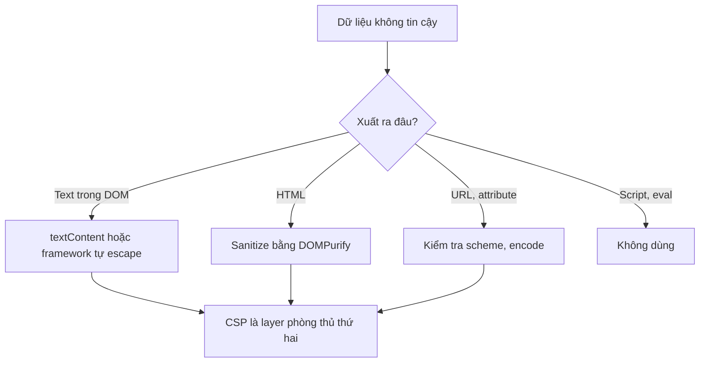
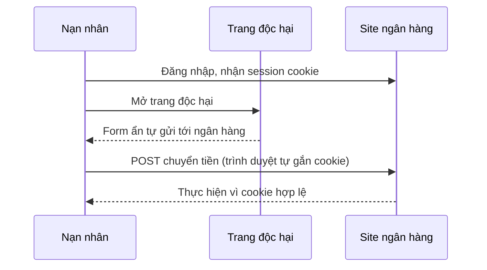
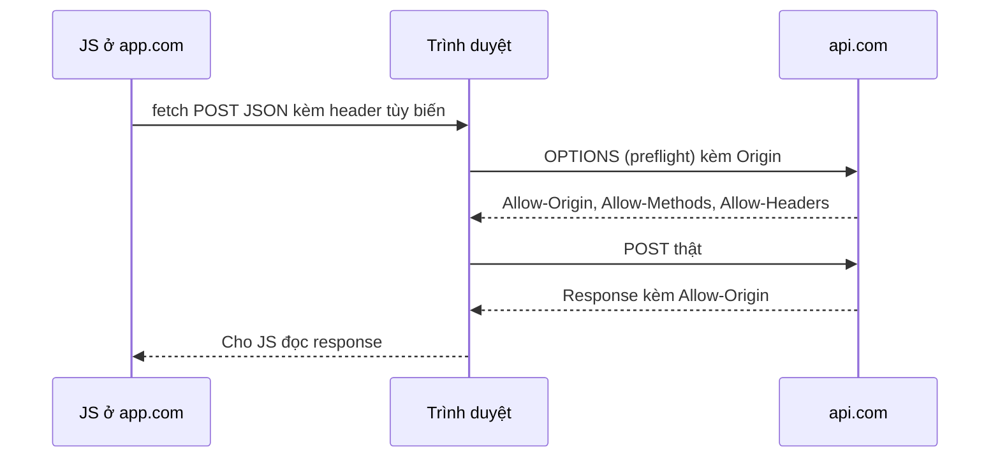

# Lý thuyết 4: Bảo mật frontend

Bài này bổ sung cho [Bài 3: Hiệu năng](/go?p=11-Frontend-Core%2Flt-03-web-performance-core-web-vitals.md) (third-party script vừa chậm vừa rủi ro) và nối với [Bài 5: Kiến trúc](/go?p=11-Frontend-Core%2Flt-05-kien-truc-frontend.md) (layer API, CI). Nguyên tắc nền: **mọi thứ chạy ở client đều nằm trong tay kẻ tấn công**. Frontend chỉ giảm bề mặt tấn công; quyết định authorization luôn phải ở server.

## Bảo mật frontend là gì?

Frontend là phần code chạy trong trình duyệt của người dùng, nên kẻ tấn công có thể đọc, sửa và gọi lại mọi thứ ở đó. Vì vậy "bảo mật frontend" không phải là giấu bí mật trong JS, mà là các layer phòng thủ giúp trình duyệt không bị lợi dụng: chống XSS, CSP, chống CSRF (SameSite, token), hiểu đúng CORS, lưu token an toàn, chống clickjacking, giữ chuỗi cung ứng npm sạch và sanitize HTML.

## Vì sao phải hiểu cơ chế

Một lỗ XSS cho phép kẻ tấn công chạy JS với quyền của người dùng: đọc dữ liệu trên trang, gọi API thay họ, đổi nội dung. Phỏng vấn senior kiểm tra việc bạn hiểu **cơ chế** (vì sao CORS không bảo vệ server, vì sao HttpOnly không chặn được XSS gọi API) chứ không chỉ liệt kê tên. Nếu chỉ thuộc tên, bạn sẽ áp sai biện pháp: ví dụ tưởng bật CORS là API an toàn, hoặc tưởng cookie HttpOnly là hết lo XSS.

## Khi nào cần chú ý

Khi render nội dung do người dùng nhập, khi thiết kế đăng nhập và lưu session, khi thêm script bên thứ ba, khi thêm thư viện, khi mở API cho nhiều origin. Cách làm tổng quát: encode theo ngữ cảnh khi xuất dữ liệu, sanitize khi buộc phải chèn HTML, đặt CSP và cookie flags, giảm dependency, pin version, quét lỗ hổng trong CI. Nhớ nguyên tắc đã nêu ở đầu bài: frontend chỉ giảm bề mặt tấn công, authorization thật phải nằm ở server.

**Tóm tắt:**

- Mọi thứ chạy ở client đều nằm trong tay kẻ tấn công; frontend chỉ giảm bề mặt tấn công, authorization thật luôn ở server.
- XSS có ba loại (stored, reflected, DOM-based); chặn bằng escape theo ngữ cảnh đầu ra, sanitize bằng allowlist khi bắt buộc chèn HTML.
- CSP là layer giảm thiệt hại chứ không thay thế escape; nonce và hash cho phép script inline cụ thể mà không mở `unsafe-inline`.
- CSRF lợi dụng việc trình duyệt tự gửi cookie; `SameSite` giúp nhiều nhưng không đủ, cần thêm CSRF token khi có `None` hoặc GET đổi state.
- CORS chỉ nới same-origin policy cho JS đọc response, do trình duyệt thực thi, nên không bảo vệ server khỏi curl hay server khác.
- Chỗ lưu token là đánh đổi giữa XSS (đọc được từ JS) và CSRF (cookie tự gửi); cookie `HttpOnly` hoặc BFF giữ token ra khỏi tầm JS.
- Chuỗi cung ứng npm: lockfile, `npm ci`, hạn chế script cài đặt, audit và SRI cho tài nguyên bên ngoài.

## Các khái niệm cần biết

- **Origin**: bộ ba scheme + host + port (ví dụ `https://app.example.com:443`). Khác một thành phần là khác origin.
- **Same-origin policy**: quy tắc nền của trình duyệt, JS ở origin này không được đọc dữ liệu của origin khác.
- **Site**: domain đăng ký (như `example.com`), rộng hơn origin. `a.example.com` và `b.example.com` cùng site nhưng khác origin.
- **XSS (Cross-Site Scripting)**: kẻ tấn công làm cho trang của bạn chạy JS do họ viết.
- **Sink**: chỗ trong code mà dữ liệu bị diễn giải như mã hoặc HTML (ví dụ `innerHTML`). **Source** là nơi dữ liệu không tin cậy đi vào (URL, input, `postMessage`).
- **CSRF (Cross-Site Request Forgery)**: trang độc hại khiến trình duyệt nạn nhân gửi request có kèm session cookie tới site thật.
- **CSP (Content Security Policy)**: header cho trình duyệt biết nguồn nào được chạy script, tải ảnh, kết nối.
- **Nonce**: chuỗi ngẫu nhiên dùng một lần, đánh dấu script inline được phép chạy.
- **Preflight**: request `OPTIONS` mà trình duyệt gửi trước để hỏi server có cho phép request thật hay không.
- **BFF (Backend For Frontend)**: một layer server nhỏ phục vụ riêng cho frontend, giữ token ở server để trình duyệt không bao giờ thấy.
- **SRI (Subresource Integrity)**: kèm hash vào thẻ script để trình duyệt từ chối file bị sửa.
- **Clickjacking**: lừa người dùng click vào trang thật đang bị che bên dưới một layer giả.



Đọc sơ đồ: mọi dữ liệu không tin cậy phải đi qua bước chọn cách xuất tùy nơi nó được ghi ra. CSP không thay thế các bước này mà là layer thứ hai, giảm thiệt hại nếu một bước bị sót.

## XSS: ba loại và cách chặn

Vấn đề: ứng dụng nhận chuỗi từ người dùng rồi ghi ra trang. Nếu chuỗi đó được trình duyệt hiểu là HTML hoặc JS, kẻ tấn công điều khiển được trang. Hệ quả thực tế: đánh cắp dữ liệu, gọi API thay nạn nhân, hiển thị form đăng nhập giả.

| Loại | Nguồn payload | Ví dụ |
|---|---|---|
| **Stored** | Lưu trong DB, mọi người xem đều dính | Bình luận chứa `` |
| **Reflected** | Nằm trong request (query), server phản chiếu lại | Link tìm kiếm độc hại gửi cho nạn nhân |
| **DOM-based** | Client tự đọc nguồn (`location.hash`, `postMessage`) rồi ghi vào sink nguy hiểm, server không liên quan | `el.innerHTML = location.hash.slice(1)` |

Sink nguy hiểm cần nhớ: `innerHTML`, `outerHTML`, `document.write`, `insertAdjacentHTML`, `eval`, `new Function`, `setTimeout(string)`, attribute `href`/`src` với `javascript:`, và các API của framework chèn HTML thô (như `dangerouslySetInnerHTML` ở React, `v-html` ở Vue).

```js
// Sai: HTML từ người dùng
el.innerHTML = userInput;
// Đúng: coi là text
el.textContent = userInput;

// Kiểm tra URL trước khi gán vào href
function safeUrl(u) {
  try {
    const url = new URL(u, location.origin);
    return ["http:", "https:", "mailto:"].includes(url.protocol) ? url.href : "#";
  } catch { return "#"; }
}
```

Quy tắc nhớ: **escape theo ngữ cảnh đầu ra** (HTML, attribute, URL, JS, CSS mỗi nơi một kiểu). Framework hiện đại tự escape khi dùng cú pháp nội suy thường, rủi ro nằm ở các API "tắt escape" và ở URL.

**Phải thuộc:** ba loại XSS là Stored (lưu trong DB), Reflected (phản chiếu từ request) và DOM-based (client tự ghi vào sink nguy hiểm). Cách chặn chính là escape theo ngữ cảnh đầu ra (ưu tiên `textContent`), sanitize bằng allowlist khi bắt buộc chèn HTML, còn CSP chỉ là layer giảm thiệt hại.

## Sanitize HTML

Khi bắt buộc hiển thị HTML của người dùng (trình soạn thảo rich text), dùng thư viện đã kiểm chứng và dùng danh sách cho phép (allowlist), không tự viết regex.

```js
import DOMPurify from "dompurify";
const clean = DOMPurify.sanitize(dirtyHtml, { ALLOWED_TAGS: ["b", "i", "a", "p", "ul", "li"], ALLOWED_ATTR: ["href"] });
el.innerHTML = clean;
```

Bẫy: sanitize **ở nơi xuất** (gần sink) chứ không chỉ lúc lưu; cấu hình quá rộng; sửa chuỗi sau khi đã sanitize (mutation XSS). Trình duyệt đang có Trusted Types (ép sink chỉ nhận giá trị đã qua policy) và Sanitizer API; mức hỗ trợ khác nhau giữa trình duyệt, hãy kiểm tra MDN trước khi dựa vào.

## CSP (Content Security Policy)

CSP là header cho trình duyệt biết nguồn nào được tải script, style, ảnh, kết nối. Đây là **layer giảm thiệt hại**, không thay thế escape.

```http
Content-Security-Policy:
  default-src 'self';
  script-src 'self' 'nonce-R4nd0m' 'strict-dynamic';
  style-src 'self';
  img-src 'self' data: https:;
  connect-src 'self' https://api.example.com;
  object-src 'none';
  base-uri 'self';
  frame-ancestors 'none'
```

| Chỉ thị hoặc keyword | Ý nghĩa |
|---|---|
| `script-src` với **nonce** hoặc **hash** | Chỉ chạy inline script có nonce hợp lệ (nonce phải **mới cho mỗi response**) |
| `'unsafe-inline'`, `'unsafe-eval'` | Vô hiệu hóa phần lớn lợi ích chống XSS, tránh dùng |
| `'strict-dynamic'` | Script đã được tin cậy được phép nạp thêm script |
| `frame-ancestors` | Ai được nhúng trang bằng iframe (chống clickjacking) |
| `report-uri`/`report-to` | Gửi báo cáo vi phạm; hãy bắt đầu bằng `Content-Security-Policy-Report-Only` |

Deploy thực tế: chạy Report-Only trước, đọc báo cáo, siết dần. Nhiều bundler cần cấu hình để gắn nonce vào script và style.

## CSRF và SameSite

Vấn đề đặt ra: server nhận ra bạn qua cookie, và trình duyệt gắn cookie vào mọi request tới server đó, **kể cả request do trang khác kích hoạt**. Hãy xem kịch bản tấn công:



Cách chặn: `SameSite` khiến trình duyệt không gắn cookie khi request xuất phát từ site khác, còn CSRF token khiến server đòi một giá trị mà trang độc hại không thể biết.

Nói gọn, CSRF lợi dụng việc trình duyệt **tự gửi cookie** theo origin đích: trang độc hại khiến trình duyệt của nạn nhân gửi request có session cookie tới site thật.

| Biện pháp | Ghi chú |
|---|---|
| Cookie `SameSite=Lax` | Không gửi cookie ở request cross-site (trừ điều hướng GET cấp cao). Chrome và Edge coi `Lax` là mặc định khi không khai báo, các trình duyệt khác có thể khác (kiểm tra lại theo phiên bản), nên **khai báo tường minh** |
| `SameSite=Strict` | Chặt nhất, ảnh hưởng flow đi vào từ link ngoài |
| `SameSite=None; Secure` | Cho phép cross-site, bắt buộc HTTPS, vẫn cần chống CSRF khác |
| CSRF token (synchronizer hoặc double-submit) | Server kiểm tra token đi kèm request thay đổi state |
| Kiểm tra `Origin`/`Referer`, header tùy biến | Bổ trợ |
| Không dùng GET để thay đổi dữ liệu | Quy tắc thiết kế |

Lưu ý: "same-site" khác "same-origin". Hai subdomain của cùng domain đăng ký là cùng site nhưng khác origin, nên một subdomain bị chiếm vẫn có thể là bàn đạp.

## CORS hiểu đúng

Vấn đề: same-origin policy chặn JS ở `app.com` đọc response từ `api.com`. Nhưng nhiều hệ thống hợp lệ cần điều đó (SPA gọi API ở domain khác). CORS là cách server **chủ động cho phép** một số origin.

CORS là cơ chế **nới lỏng** same-origin policy, do **trình duyệt thực thi**, để JS ở origin A đọc được response của origin B. Nó **không bảo vệ server**: curl hoặc server khác gọi thoải mái. Nó cũng không ngăn request tới server, mà chỉ ngăn **JS đọc response** (request "đơn giản" vẫn được gửi đi).

**Nền tảng:** bảo mật web đứng trên same-origin policy của trình duyệt, và CORS chỉ là cách server nới lỏng chính sách đó cho JS cross-origin đọc response. Nó do trình duyệt thực thi nên không bảo vệ được API trước curl hay server khác; authorization thật luôn nằm ở server.



Nếu preflight không được phép, trình duyệt không gửi request thật và console báo lỗi CORS. Bảng dưới liệt kê các khái niệm cần nhớ.

| Khái niệm | Điểm cần nhớ |
|---|---|
| Preflight (`OPTIONS`) | Gửi trước với request không đơn giản (method khác GET/POST/HEAD, header tùy biến, `Content-Type: application/json`) |
| `Access-Control-Allow-Origin` | Một origin cụ thể hoặc `*`; **không dùng `*` với credentials** |
| Credentials | Cần `credentials: "include"` ở client và `Access-Control-Allow-Credentials: true` ở server, kèm origin cụ thể |
| `Vary: Origin` | Bắt buộc khi trả origin động, để cache không trả nhầm |
| `Access-Control-Max-Age` | Cache kết quả preflight |

Lỗi hay gặp: phản chiếu bừa header `Origin` vào `Allow-Origin` cùng `Allow-Credentials: true` (khác gì mở toang cho mọi site). Cách sửa lỗi CORS ở dev bằng proxy của dev server là hợp lý, nhưng production phải cấu hình đúng ở server hoặc gateway.

## Lưu token: cookie HttpOnly hay localStorage

Token là "chìa khóa" chứng minh bạn đã đăng nhập. Câu hỏi là cất chìa khóa ở đâu để kẻ tấn công khó lấy nhất. Không có đáp án tuyệt đối, chỉ có đánh đổi giữa nguy cơ XSS (đánh cắp token) và nguy cơ CSRF (tự gửi cookie).

| Tiêu chí | Cookie `HttpOnly; Secure; SameSite` | `localStorage`/`sessionStorage` |
|---|---|---|
| JS đọc được token? | Không | Có |
| Bị XSS đánh cắp token? | Không đọc được token, nhưng XSS vẫn **gọi API thay người dùng** | Bị đánh cắp và dùng ở nơi khác |
| CSRF | Có rủi ro, cần SameSite hoặc token | Không (không tự gửi) |
| Gửi kèm request | Tự động | Phải tự gắn header |
| Phù hợp | Session của ứng dụng web cùng site | API công khai, mobile, trường hợp đặc thù |

Mô hình thường được khuyên: access token sống ngắn, refresh token trong cookie `HttpOnly; Secure; SameSite`, có xoay vòng (rotation) và thu hồi phía server. Có thể dùng mẫu BFF (backend for frontend) để token không bao giờ xuống trình duyệt. Kết luận cần thuộc: `HttpOnly` chống JS đọc cookie nhưng không chống XSS gọi API thay người dùng, còn `localStorage` bị XSS lấy được token nhưng không dính CSRF. Tiền tố `__Host-` cho tên cookie ép `Secure`, `Path=/` và không có `Domain`. Không có chỗ nào ở client "hoàn toàn an toàn"; chọn theo mối đe dọa và vẫn phải chống XSS.

## Clickjacking

Kẻ tấn công nhúng trang của bạn trong iframe trong suốt, đặt lên nút giả để lừa click. Phòng thủ: header `Content-Security-Policy: frame-ancestors 'none'` (hoặc `'self'`), và `X-Frame-Options: DENY`/`SAMEORIGIN` cho trình duyệt cũ. Đặt cờ này ở server, không ở thẻ `<meta>` (meta không áp dụng được cho `frame-ancestors`). Mẹo "frame-busting" bằng JS không đáng tin.

## Chuỗi cung ứng npm

| Rủi ro | Biện pháp |
|---|---|
| Gói độc hại, typosquatting | Kiểm tra tên gói, số tải, người bảo trì trước khi thêm |
| Dependency confusion (gói nội bộ bị gói công khai trùng tên chiếm) | Dùng scope (`@org/`) và cấu hình registry riêng |
| Script `postinstall` chạy mã khi cài | Cân nhắc `--ignore-scripts` trong CI, hoặc cho phép theo danh sách |
| Dependency bắc cầu (transitive) bị chiếm quyền | Pin bằng lockfile, `npm ci`, kiểm tra thay đổi lockfile ở PR |
| Lỗ hổng đã biết | `npm audit`, Dependabot hoặc Renovate, SCA trong CI |
| Script bên thứ ba qua CDN bị sửa | Subresource Integrity (`integrity="sha384-..."` kèm `crossorigin`), hoặc tự host |
| Quá nhiều thư viện nhỏ | Giảm bề mặt, tự viết hàm tầm thường |

```html
<script src="https://cdn.example.com/lib.js"
        integrity="sha384-BASE64HASH" crossorigin="anonymous"></script>
```

SRI chỉ hợp với file bất biến theo phiên bản. Tag manager và quảng cáo nạp động thì SRI không áp dụng được, cần CSP và đánh giá nhà cung cấp.

## Dữ liệu nhạy cảm ở client

- Mọi thứ trong bundle đều công khai: **không để secret** (API key riêng tư, mật khẩu) trong code hay biến môi trường build. Biến có tiền tố công khai (như `VITE_`, `NEXT_PUBLIC_`) sẽ được nhúng vào bundle.
- Source map công khai lộ mã nguồn; cân nhắc chỉ upload cho công cụ giám sát lỗi.
- Không ghi token, mật khẩu, PII vào `console`, URL (lọt vào log, Referer, lịch sử), hay công cụ analytics/Sentry (cấu hình scrub dữ liệu).
- Ẩn nút trên UI không phải authorization. Server phải kiểm tra lại mọi quyền.
- Cẩn thận `postMessage`: luôn kiểm tra `event.origin` và chỉ định `targetOrigin` cụ thể thay cho `"*"`.
- `target="_blank"` nên đi kèm `rel="noopener"` (trình duyệt hiện đại đã mặc định, vẫn nên khai).
- Autofill, cache trình duyệt, nút Back có thể lộ dữ liệu trên máy dùng chung; dùng `Cache-Control: no-store` cho trang rất nhạy cảm.

## Bẫy thường gặp

| Bẫy | Thực tế |
|---|---|
| "Dùng framework thì không bị XSS" | Vẫn bị qua `v-html`, `dangerouslySetInnerHTML`, `href` kiểu `javascript:`, thư viện render markdown |
| "HttpOnly chặn được XSS" | Chỉ chặn đọc cookie; XSS vẫn gửi request kèm cookie |
| "CORS bảo vệ API của tôi" | CORS chỉ là chính sách của trình duyệt |
| `Access-Control-Allow-Origin: *` cùng credentials | Không hợp lệ, và phản chiếu origin là lỗ hổng |
| CSP có `'unsafe-inline'` | Gần như vô hiệu với XSS |
| Validate chỉ ở client | Kẻ tấn công bỏ qua UI, gọi thẳng API |
| `npm install` trong CI không có lockfile | Phiên bản trôi, dễ dính gói bị chiếm |
| JWT trong `localStorage` rồi nghĩ "đã encrypt" | JWT chỉ được **ký**, nội dung đọc được |
| Tin cờ `Secure` mà vẫn chạy HTTP | Thiếu HTTPS và HSTS làm mọi biện pháp khác yếu đi |

## Câu hỏi phỏng vấn thường gặp

Mỗi câu có chuỗi: gợi ý suy luận, lập luận, đáp án ngắn, điều cần nhớ. Thử tự đi theo gợi ý trước khi đọc tiếp.

### 1. Một ô nhập của người dùng bị chèn script chạy được trên trang. Có những kiểu XSS nào và chặn từng kiểu thế nào?

**Gợi ý suy luận:**
- Chuỗi độc đi từ đâu tới trình duyệt: lưu ở server rồi trả về, phản chiếu từ URL, hay được JS phía client ghi vào DOM?
- Ở mỗi đường đó, chỗ nào chuỗi bị diễn giải thành mã thay vì dữ liệu?

**Lập luận:** nếu server lưu rồi trả cho người khác thì là stored; nếu server phản chiếu tham số URL vào response thì là reflected; nếu JS phía client ghi dữ liệu không tin cậy vào DOM (như `innerHTML`) thì là DOM-based. Gốc chung là dữ liệu bị diễn giải thành mã. Nên chặn bằng cách encode đầu ra theo ngữ cảnh, không dùng sink nguy hiểm (`innerHTML`, `eval`), và thêm CSP làm layer phòng thủ sau.

**Đáp án ngắn:** ba loại stored, reflected, DOM-based. Chặn bằng escape đầu ra theo ngữ cảnh, tránh `innerHTML` và `eval`, sanitize khi buộc render HTML, thêm CSP.

**Nhớ:** coi mọi đầu vào là dữ liệu, không để nó thành mã. Xem mục XSS trong [lt-04](/go?p=11-Frontend-Core%2Flt-04-bao-mat-frontend.md).

### 2. CSP hoạt động ra sao, nonce khác hash thế nào, và vì sao nói tránh `unsafe-inline`?

**Gợi ý suy luận:**
- CSP là danh sách cho phép: trình duyệt dựa vào đâu để quyết định một script được chạy?
- Một script inline do kẻ tấn công chèn và script inline của bạn trông giống nhau; làm sao phân biệt?

**Lập luận:** server gửi header CSP liệt kê nguồn script được phép, trình duyệt từ chối mọi thứ ngoài danh sách. Với script inline hợp lệ, cần dấu hiệu nhận biết: nonce là chuỗi ngẫu nhiên mỗi response, gắn vào header và thẻ script; hash là hash nội dung script. `unsafe-inline` cho mọi script inline chạy, nên kẻ chèn script cũng chạy được, làm CSP mất ý nghĩa.

**Đáp án ngắn:** CSP cho trình duyệt biết nguồn script hợp lệ. Nonce là token ngẫu nhiên mỗi response, hash là hash nội dung cố định; cả hai cho phép script inline cụ thể mà không mở toang như `unsafe-inline`.

**Nhớ:** nonce phải không đoán được và đổi mỗi lần; hash hợp với script tĩnh.

### 3. Đã đặt cookie `SameSite`. Còn cần CSRF token không?

**Gợi ý suy luận:**
- CSRF lợi dụng điều gì: trình duyệt tự gắn cookie vào request tới site đích dù gửi từ trang khác?
- `SameSite=Lax` cho cookie đi kèm ở những kiểu request nào từ site khác? "Same-site" khác "same-origin" ra sao?

**Lập luận:** `Strict` và `Lax` làm cookie không gửi theo phần lớn request chéo site (POST, ảnh, fetch), nên chặn phần lớn CSRF. Nhưng `Lax` vẫn gửi cookie khi điều hướng cấp cao bằng GET, nên GET có tác dụng phụ vẫn bị lợi dụng. Và same-site tính theo site, nên một subdomain bị chiếm vẫn gửi request cùng site. `SameSite=None` hoặc trình duyệt cũ cũng không được bảo vệ. Những trường hợp đó vẫn cần CSRF token hoặc kiểm tra bổ sung.

**Đáp án ngắn:** SameSite chặn phần lớn CSRF nhưng không phải tất cả. Vẫn cần token khi cookie đặt `None`, có GET đổi state, có nguy cơ từ subdomain cùng site, hoặc cần bảo vệ trình duyệt cũ.

**Nhớ:** phòng thủ nhiều layer: SameSite, token, không đổi state bằng GET.

### 4. CORS có bảo vệ server không? Preflight xảy ra khi nào?

**Gợi ý suy luận:**
- Ai thực thi chính sách CORS, server hay trình duyệt? Một kẻ gọi API bằng `curl` có bị chặn không?
- Request nào "đơn giản" đến mức gửi thẳng, request nào cần hỏi server trước?

**Lập luận:** same-origin policy do trình duyệt thực thi để trang này không đọc được response của origin khác. CORS chỉ là cách server nới chính sách đó cho origin cụ thể. Vì chỉ ràng buộc trình duyệt, `curl` hay server khác vẫn gọi được, nên CORS không bảo vệ server. Preflight (`OPTIONS`) xảy ra khi request không "đơn giản": method ngoài GET/HEAD/POST, header tùy biến, hoặc `Content-Type` ngoài các kiểu form/text, để trình duyệt hỏi trước xem server có cho phép không.

**Đáp án ngắn:** CORS là cơ chế trình duyệt nới same-origin policy theo header server trả; nó không bảo vệ server. Preflight xảy ra với request không đơn giản (method lạ, header tùy biến, `application/json`).

**Nhớ:** authentication và authorization phải làm ở server; CORS chỉ quyết định trang web nào đọc được response.

### 5. Lưu access token ở cookie HttpOnly hay `localStorage`?

**Gợi ý suy luận:**
- Nếu trang bị XSS, script độc đọc được gì? JS có đọc được cookie HttpOnly không?
- Cookie tự gắn vào request thì mở ra rủi ro gì (nhớ lại CSRF)?

**Lập luận:** `localStorage` đọc được bằng JS nên XSS lấy token đi và dùng ở chỗ khác. Cookie HttpOnly JS không đọc được nên token không bị đánh cắp trực tiếp, nhưng script độc vẫn có thể gửi request mang theo cookie từ trang. Cookie tự gắn vào request nên cần phòng CSRF (SameSite, token). Do đó không có lựa chọn miễn phí: HttpOnly thu hẹp thiệt hại của XSS đổi lại cần xử lý CSRF.

**Đáp án ngắn:** thường ưu tiên cookie HttpOnly + Secure + SameSite, kèm phòng CSRF, vì XSS không đọc được token. `localStorage` tiện nhưng XSS lấy được token.

**Nhớ:** dù chọn gì, vẫn phải chặn XSS; token sống ngắn, có refresh an toàn.

### 6. Trang của bạn bị nhúng trong iframe của site khác, người dùng bị lừa bấm. Đó là gì và chặn thế nào?

**Gợi ý suy luận:**
- Điều gì cho phép site khác hiển thị trang của bạn trong khung của họ?
- Server có cách nào bảo trình duyệt "đừng cho nhúng trang này" không?

**Lập luận:** kẻ tấn công nhúng trang của bạn vào iframe trong suốt rồi phủ giao diện giả lên, người dùng tưởng bấm nút của họ nhưng thực ra bấm trên trang bạn (clickjacking). Vì việc nhúng do trình duyệt quyết định, server chặn bằng header: CSP `frame-ancestors` (ưu tiên) hoặc `X-Frame-Options`.

**Đáp án ngắn:** clickjacking là lừa người dùng bấm vào trang được nhúng ẩn. Chặn bằng `Content-Security-Policy: frame-ancestors 'none'` hoặc `'self'`, kèm `X-Frame-Options` cho trình duyệt cũ.

**Nhớ:** quyết định nhúng được hay không là việc của header response.

### 7. Một dependency npm bị cài mã độc. Bạn giảm rủi ro chuỗi cung ứng thế nào?

**Gợi ý suy luận:**
- Mã độc vào dự án bằng đường nào (phiên bản mới tự cập nhật, script cài đặt, gói giả tên)?
- Mỗi đường đó có biện pháp chặn tương ứng nào?

**Lập luận:** nếu phiên bản tự nâng thì pin version bằng lockfile và dùng `npm ci`. Nếu mã chạy lúc cài thì hạn chế script cài đặt. Nếu gói giả tên hoặc bị chiếm thì kiểm tra gói, dùng audit, theo dõi cảnh báo, giảm số dependency, bật 2FA cho tài khoản publish của mình. Chạy CI trong môi trường ít quyền và dùng Subresource Integrity cho script từ CDN.

**Đáp án ngắn:** commit lockfile và dùng `npm ci`, hạn chế script cài đặt, audit và cập nhật có kiểm soát, giảm dependency, SRI cho tài nguyên bên ngoài.

**Nhớ:** mọi dependency là mã bạn chạy; ít hơn và được pin là an toàn hơn.

### 8. Bắt buộc render HTML do người dùng nhập (ví dụ trình soạn thảo rich text). Bạn làm gì?

**Gợi ý suy luận:**
- Nếu không thể escape toàn bộ vì cần giữ thẻ, thì phải làm gì với các thẻ và attribute nguy hiểm?
- Danh sách chặn hay danh sách cho phép chắc chắn hơn?

**Lập luận:** HTML chứa script hay handler (`onerror`) sẽ chạy khi chèn vào DOM, nên không thể chèn nguyên văn. Cần làm sạch (sanitize) bằng thư viện đã kiểm chứng như DOMPurify theo danh sách cho phép thẻ và attribute an toàn, vì danh sách chặn dễ bỏ sót. Sau đó vẫn thêm CSP làm layer phòng thủ.

**Đáp án ngắn:** sanitize bằng thư viện đáng tin (DOMPurify) với allowlist, sanitize ở nơi render, kèm CSP; không tự viết regex.

**Nhớ:** không bao giờ gán HTML thô vào `innerHTML`; sanitize rồi mới chèn.

Đáp án gợi ý ở [Câu hỏi phỏng vấn Senior FE](/go?p=07-Interview-QA%2FFrontend%2Fhard%2Fqa-fe-phong-van.md). Tham khảo: MDN (CSP, CORS, Set-Cookie), OWASP Cheat Sheet Series. Bài kế tiếp: [Bài 5: Kiến trúc frontend](/go?p=11-Frontend-Core%2Flt-05-kien-truc-frontend.md).

