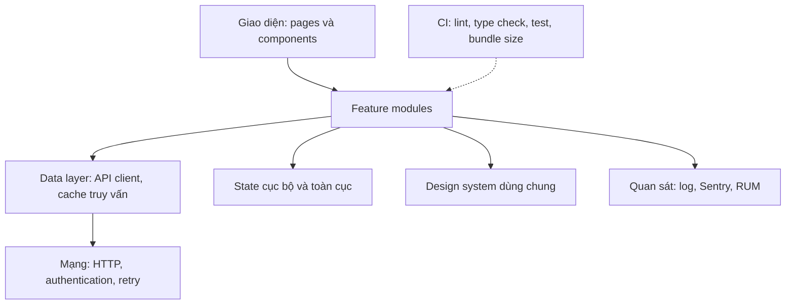
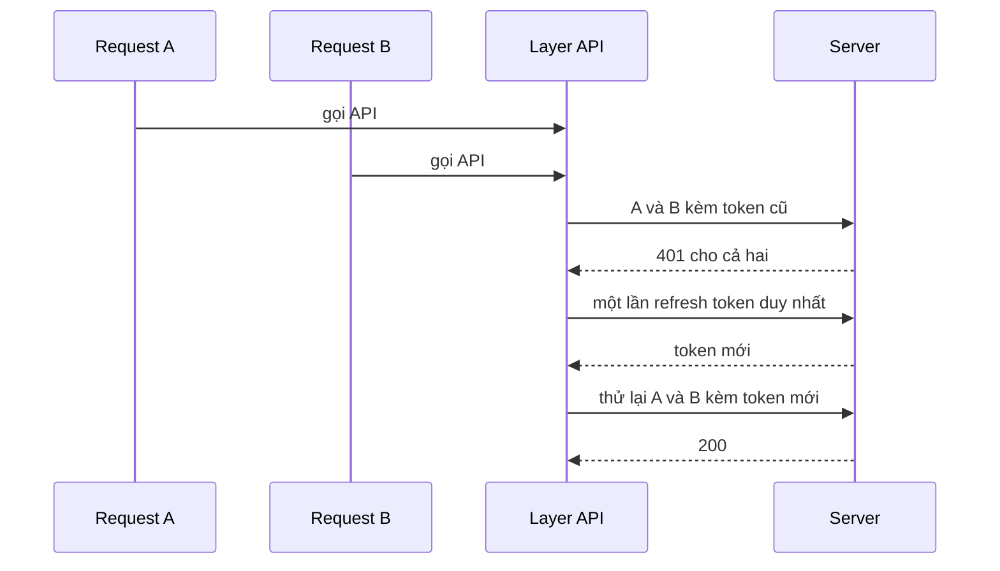

# Lý thuyết 5: Kiến trúc frontend

Bài cuối, gom các quyết định thiết kế mà senior phải đưa ra và bảo vệ được: chia state, chia module, gọi API, dùng chung UI, tách repo, tách ứng dụng, và vận hành (CI, quan sát lỗi). Nền tảng ở [Bài 1](/go?p=11-Frontend-Core%2Flt-01-javascript-runtime-event-loop.md) và [Bài 2](/go?p=11-Frontend-Core%2Flt-02-typescript-nang-cao.md); ngân sách hiệu năng ở [Bài 3](/go?p=11-Frontend-Core%2Flt-03-web-performance-core-web-vitals.md); rủi ro ở [Bài 4](/go?p=11-Frontend-Core%2Flt-04-bao-mat-frontend.md). Cách hiện thực theo framework xem [Vue](/go?p=10-Vue%2Findex.md) và [React](/go?p=09-React%2Findex.md).

## Kiến trúc frontend là gì?

Khi ứng dụng còn nhỏ, "kiến trúc" gần như chỉ là đặt file ở đâu. Khi ứng dụng lớn, bạn phải trả lời những câu như: state nào đặt ở đâu, module nào được gọi module nào, gọi API qua đâu, UI dùng chung quản lý ra sao, có nên tách repo hay tách thành nhiều ứng dụng, và vận hành thế nào (CI, theo dõi lỗi). Bài này gom các quyết định cấu trúc đó: phân loại state, ranh giới module, layer API và xử lý lỗi, design system, monorepo, micro-frontend, accessibility, i18n, feature flag, CI và quan sát lỗi.

## Vấn đề nó giải quyết

Ở quy mô lớn, độ khó chuyển từ "viết một component" sang "giữ cho nhiều người cùng sửa một codebase mà không giẫm chân nhau". Nếu thiếu kiến trúc, bạn sẽ gặp: sửa một tính năng phải chạm mười thư mục, state lệch giữa các màn hình, một lỗi nhỏ làm sập cả trang, thêm người mà tốc độ giao việc lại giảm. Phỏng vấn senior vì thế hỏi **đánh đổi** và lý do chọn, không có một đáp án đúng duy nhất.

## Khi nào cần, và nguyên tắc xuất phát

Bạn cần nghĩ tới các quyết định này khi dự án có nhiều team, nhiều tính năng, nhiều môi trường, hoặc khi codebase bắt đầu chậm phát triển vì dependency chéo. Nguyên tắc: bắt đầu đơn giản, tách theo **tính năng** và **ranh giới rõ**, chỉ thêm độ phức tạp (monorepo, micro-frontend) khi có vấn đề tổ chức thật sự cần giải quyết. Thêm sớm thì bạn trả chi phí vận hành mà chưa nhận lợi ích.

**Tóm tắt:**

- Server state không phải client state: server state có hết hạn và cần sync nên giao cho thư viện cache truy vấn; chỉ lưu dữ liệu gốc, tính phần suy diễn.
- Chia code theo feature với ranh giới rõ, ép quy tắc dependency bằng lint thay vì thỏa thuận miệng.
- Gom mọi network call vào một layer: gắn authentication, chuẩn hóa lỗi, timeout, retry có chọn lọc; chia sẻ một promise refresh để tránh bão request khi cùng nhận 401.
- Chỉ retry thao tác idempotent hoặc có idempotency key, vì retry POST bừa sẽ tạo trùng.
- Micro-frontend là giải pháp tổ chức, không phải kỹ thuật; với một team thì monorepo kèm feature module thường đủ.
- Feature flag tách deploy khỏi release nhưng sinh nợ flag: mỗi flag cần chủ sở hữu và ngày hết hạn.
- Vận hành: CI chặn lỗi sớm, quan sát lỗi bằng Sentry kèm source map và phiên bản, test theo kim tự tháp (nhiều unit, ít E2E).

## Các khái niệm cần biết

- **Server state và client state**: server state là dữ liệu thuộc về server mà UI chỉ giữ bản sao tạm (danh sách đơn hàng); client state là dữ liệu chỉ tồn tại ở UI (dropdown đang mở). Hai loại này có lifecycle khác nhau nên không nên dùng chung một chỗ chứa.
- **Derived state (state suy diễn)**: giá trị tính ra từ state gốc (tổng tiền từ danh sách món). Không lưu riêng, vì sẽ lệch khi state gốc đổi.
- **Barrel file**: file `index.ts` chỉ để re-export nhiều module. Tiện khi import nhưng có thể làm bundler kéo cả thư mục vào bundle.
- **Idempotent**: thao tác gọi một lần hay nhiều lần đều cho cùng kết quả (GET, PUT, DELETE theo thiết kế). POST tạo mới thường không idempotent, nên retry bừa có thể tạo trùng.
- **Error boundary**: component bắt lỗi xảy ra trong lúc render của cây con và hiện giao diện dự phòng thay vì làm trắng cả trang.
- **Design token**: giá trị thiết kế có tên (màu chính, khoảng cách 8px) làm nguồn duy nhất cho mọi component.
- **Headless component**: component chỉ lo hành vi và a11y, không áp kiểu giao diện, để bạn tự style.
- **Strangler (chiến lược bóp nghẹt dần)**: thay hệ thống cũ từng phần bằng hệ thống mới chạy parallel, tới khi bản cũ không còn gì để chạy.
- **Feature flag**: công tắc bật tắt tính năng lúc chạy mà không cần deploy lại.
- **i18n**: internationalization, thiết kế để hỗ trợ nhiều ngôn ngữ, định dạng số, ngày, hướng chữ.
- **a11y**: accessibility, khả năng dùng được cho người dùng khuyết tật (bàn phím, trình đọc màn hình).
- **Source map**: file ánh xạ code đã minify về code gốc, để stack trace lỗi đọc được.

Sơ đồ dưới cho thấy các layer và hướng dependency điển hình.



Đọc sơ đồ: giao diện gọi các feature module; mỗi feature dùng layer dữ liệu, state và design system; mọi thứ đều được quan sát, và CI canh chất lượng từ ngoài.

## Phân loại state

Sai lầm hay gặp là nhét mọi thứ vào một store toàn cục. Hãy phân loại trước, rồi chọn công cụ.

| Loại state | Ví dụ | Nơi đặt hợp lý |
|---|---|---|
| **UI cục bộ** | Mở/đóng dropdown, giá trị ô nhập | Trong component |
| **Dùng chung trong cây con** | Tab đang chọn, form nhiều bước | Nâng state lên, hoặc context/provide ở phạm vi hẹp |
| **Server state** | Danh sách đơn hàng, hồ sơ người dùng | Thư viện cache truy vấn (TanStack Query, SWR, hoặc tương đương) |
| **Toàn cục của app** | Người dùng hiện tại, theme, quyền | Store nhỏ hoặc context |
| **State trong URL** | Filter, trang, tab | Query string (chia sẻ được, quay lại được) |
| **Form state** | Giá trị, lỗi, touched | Thư viện form, schema validate chung (xem Zod ở Bài 2) |
| **Bền vững** | Nháp, tùy chọn | `localStorage`/IndexedDB, có phiên bản schema |

**Nền tảng:** **server state không phải client state**. Server state có hết hạn, cần sync, tải lại, xử lý lỗi và loại trùng; sao chép nó vào store rồi tự sync là nguồn bug lớn. Chỉ lưu **dữ liệu gốc**, tính ra phần suy diễn (derived state) khi cần, và chọn nơi đặt state theo phạm vi dùng.

## Ranh giới module và feature-based structure

| Cách chia | Ưu | Nhược |
|---|---|---|
| Theo loại kỹ thuật (`components/`, `hooks/`, `services/`) | Dễ bắt đầu | Một tính năng rải khắp nơi, sửa một nơi chạm nhiều thư mục |
| **Theo tính năng** (`features/orders/`, `features/auth/`) | Gom code liên quan, dễ xóa hoặc giao cho team | Cần quy ước cho phần dùng chung |

```text
src/
  app/            # khởi tạo, router, provider
  features/
    orders/
      api/        # gọi API riêng của tính năng
      components/
      model/      # kiểu, schema, logic thuần
      index.ts    # CHỈ export giao diện công khai
  shared/         # ui, utils, api-client dùng chung (không phụ thuộc vào features)
```

Quy tắc dependency: `app` biết `features`, `features` biết `shared`, **`features` không import sâu vào nhau** (chỉ qua `index.ts` công khai). Ép quy tắc bằng lint (như `eslint-plugin-boundaries`, `import/no-restricted-paths`) chứ không bằng thỏa thuận miệng. Tránh barrel file (`index.ts` re-export cả thư mục lớn) ở `shared` vì làm hại tree shaking và tốc độ build.

## Layer gọi API và xử lý lỗi

Tập trung mọi network call ở một layer để xử lý thống nhất.

```ts
// shared/api/client.ts
export class ApiError extends Error {
  constructor(public status: number, public code: string, message: string) { super(message); }
}

export async function api<T>(path: string, init: RequestInit & { signal?: AbortSignal } = {}): Promise<T> {
  const res = await fetch(`/api${path}`, {
    ...init,
    headers: { "Content-Type": "application/json", ...init.headers },
    credentials: "include",
  });
  if (res.status === 401) { /* làm mới phiên hoặc chuyển trang đăng nhập, chỉ một lần */ }
  if (!res.ok) {
    const body = await res.json().catch(() => ({}));
    throw new ApiError(res.status, body.code ?? "UNKNOWN", body.message ?? res.statusText);
  }
  return res.status === 204 ? (undefined as T) : ((await res.json()) as T);
}
```

Vấn đề khó nhất của layer này là nhiều call parallel cùng nhận 401 khi token hết hạn. Nếu mỗi call tự làm mới token, bạn tạo ra "bão" request làm mới. Cách giải quyết là chỉ cho **một** call làm mới, các call khác chờ kết quả đó rồi thử lại:



Những việc layer này nên lo: gắn authentication, chuẩn hóa lỗi, hủy request (`AbortSignal`), timeout, retry có chọn lọc (chỉ cho thao tác **idempotent** và lỗi tạm thời, kèm backoff), validate response ở biên (Zod), đồng thời làm mới token mà không tạo bão request khi nhiều call cùng nhận 401.

Phân tầng lỗi: lỗi mạng và 5xx (thử lại hoặc báo tạm thời), 4xx nghiệp vụ (hiện thông điệp cụ thể cho người dùng), 401/403 (session và quyền), lỗi không lường trước (error boundary, màn hình dự phòng, gửi lên Sentry). Lỗi trong render cần **error boundary** theo từng vùng để một widget hỏng không làm sập cả trang.

## Design system

Vấn đề: mỗi team tự làm nút bấm và ô nhập riêng, cuối cùng giao diện lệch nhau và a11y chỗ có chỗ không. Design system là bộ thành phần giao diện dùng chung có kiểm soát phiên bản. Nên dùng khi có từ hai team trở lên hoặc nhiều sản phẩm cần cùng diện mạo; với một app nhỏ một team, một thư mục `shared/ui` là đủ, đừng dựng hẳn hệ thống riêng.

| Tầng | Nội dung |
|---|---|
| Design token | Màu, khoảng cách, cỡ chữ, bo góc, bóng, lưu dạng biến (CSS custom properties) |
| Primitive | Button, Input, Dialog, có sẵn a11y và state |
| Pattern | Form, bảng dữ liệu, điều hướng |
| Tài liệu và thử nghiệm | Storybook (hoặc tương đương), kiểm thử hình ảnh, kiểm thử a11y |

Điểm đánh đổi: tự xây hay dùng thư viện có sẵn; component **có chính kiến** (ít tùy biến, nhất quán) hay **headless** (linh hoạt, tốn công style). Quản lý phiên bản bằng semver và changelog, tránh breaking change âm thầm. Theme bằng CSS variables để đổi chủ đề không cần build lại.

## Monorepo

Monorepo là một repo chứa nhiều gói hoặc ứng dụng. Dùng khi nhiều gói phải thay đổi cùng nhau (ví dụ app và thư viện UI); không dùng chỉ vì "thấy hiện đại" nếu bạn chỉ có một ứng dụng.

| Tiêu chí | Monorepo | Nhiều repo |
|---|---|---|
| Chia sẻ code | Dễ, thay đổi xuyên gói trong một PR | Phải publish và nâng phiên bản |
| Nhất quán công cụ | Một cấu hình lint, TS, CI | Dễ lệch |
| Chi phí | Cần công cụ (pnpm workspaces, Nx, Turborepo), cache build, `affected` | Đơn giản từng repo |
| Rủi ro | Build chậm nếu thiếu cache, ranh giới lỏng | Phiên bản phân mảnh |

Monorepo giải quyết chia sẻ code, **không** tự động giải quyết ranh giới. Vẫn phải có quy tắc dependency, `CODEOWNERS`, và build tăng dần (chỉ build phần bị ảnh hưởng).

## Micro-frontend và đánh đổi

Vấn đề mà nó nhắm tới là tổ chức, không phải kỹ thuật: nhiều team lớn cùng sửa một ứng dụng nên liên tục xung đột và phải phối hợp phát hành.

Micro-frontend chia ứng dụng thành các phần phát triển, deploy độc lập (theo route hoặc theo vùng trang), ghép ở runtime (Module Federation, import map, iframe, web components) hoặc build time.

| Lợi | Hại |
|---|---|
| Team deploy độc lập, công nghệ độc lập | Tải trùng thư viện, bundle lớn hơn |
| Giảm xung đột giữa team lớn | Trải nghiệm không nhất quán nếu thiếu design system |
| Nâng cấp từng phần (chiến lược strangler) | Khó chia sẻ state, định tuyến, authentication |
| | Debug và kiểm thử tích hợp phức tạp hơn |
| | Hiệu năng (nhiều lần tải, hydration lặp) |

**Phải thuộc:** micro-frontend là **giải pháp tổ chức**, không phải giải pháp kỹ thuật. Nếu chỉ có một team, monorepo kèm feature module thường đủ. Contract giữa các phần phải ổn định: event hoặc props tối thiểu, không chia sẻ store nội bộ.

## Accessibility đủ cho senior

| Nguyên tắc | Cách làm |
|---|---|
| HTML ngữ nghĩa trước | `button` cho hành động, `a` cho điều hướng, `label` gắn với input, `h1..h6` đúng cấp; tránh `div onClick` |
| Bàn phím | Mọi thứ thao tác được bằng Tab, Enter, Space, Esc; thứ tự focus hợp lý; **focus nhìn thấy được** |
| Quản lý focus | Mở dialog thì chuyển focus vào trong và giữ (trap), đóng thì trả về phần tử đã mở; trang đổi route thì chuyển focus hoặc thông báo |
| ARIA là phương án cuối | Quy tắc đầu tiên của ARIA: nếu có phần tử HTML sẵn thì dùng nó. ARIA sai còn tệ hơn không có |
| Văn bản thay thế | `alt` có nghĩa cho ảnh nội dung, `alt=""` cho ảnh trang trí |
| Thông báo động | Vùng `aria-live` cho kết quả, lỗi form |
| Tương phản và cỡ chữ | Theo WCAG 2.x (văn bản thường tỷ lệ tương phản tối thiểu 4,5:1 ở mức AA); không chỉ dùng màu để truyền thông tin |
| Giảm chuyển động | Tôn trọng `prefers-reduced-motion` |

Kiểm thử: eslint-plugin-jsx-a11y (hoặc tương đương), axe trong test và CI, thử thủ công bằng bàn phím và trình đọc màn hình. Công cụ tự động chỉ bắt được một phần vấn đề.

## i18n

- Tách chuỗi ra file bản dịch, dùng key ổn định; **không ghép chuỗi** bằng nối (`"Có " + n + " mục"`), dùng thông điệp có tham số và quy tắc số nhiều (ICU MessageFormat hoặc thư viện i18n).
- Dùng API `Intl` có sẵn: `Intl.DateTimeFormat`, `Intl.NumberFormat`, `Intl.PluralRules`, `Intl.RelativeTimeFormat`, `Intl.Collator` cho định dạng ngày, tiền, sắp xếp theo ngôn ngữ.
- Lưu thời gian dạng UTC/ISO 8601, hiển thị theo múi giờ người dùng.
- Hỗ trợ RTL bằng property logic CSS (`margin-inline-start` thay cho `margin-left`).
- Tải bản dịch theo ngôn ngữ và theo route (code splitting) để không phình bundle.
- Chừa chỗ cho chuỗi dài hơn (tiếng Đức, Việt) để tránh vỡ layout.

## Feature flag

Hãy hình dung công tắc điện: dây đã lắp xong, nhưng đèn chưa sáng cho tới khi bạn bật.

Flag cho phép tách **deploy** khỏi **release**: đưa code lên production ở trạng thái tắt, bật dần theo tỷ lệ, theo nhóm, hoặc tắt nhanh khi có sự cố (kill switch).

| Loại flag | Vòng đời |
|---|---|
| Release flag | Ngắn, xóa sau khi phát hành xong |
| Experiment (A/B) | Gắn với thí nghiệm, có số liệu |
| Ops/kill switch | Dài hạn, dùng khi sự cố |
| Permission | Gắn với gói, quyền |

Rủi ro chính là **nợ flag**: flag không xóa làm số tổ hợp tăng và khó kiểm thử. Quy tắc: mỗi flag có chủ sở hữu và ngày hết hạn, đánh giá flag ở một điểm, kiểm thử cả hai nhánh, và nếu bật ở client thì nhớ rằng người dùng có thể đọc được flag (authorization thật vẫn ở server).

## CI cho frontend

| Bước | Công cụ gợi ý | Mục đích |
|---|---|---|
| Lint, format | ESLint, Prettier | Nhất quán, bắt lỗi sớm |
| Type check | `tsc --noEmit` | Bundler thường không kiểm tra kiểu |
| Unit và component test | Vitest hoặc Jest, Testing Library | Hành vi theo góc nhìn người dùng |
| E2E | Playwright hoặc Cypress | Flow quan trọng, chạy ít mà chắc |
| Kiểm tra a11y | axe | Chặn hồi quy |
| Kích thước bundle | `size-limit`, bundle analyzer | Thực thi performance budget |
| Hiệu năng | Lighthouse CI | Cảnh báo hồi quy lab |
| Bảo mật dependency | `npm audit`, Dependabot/Renovate | Xem [Bài 4](/go?p=11-Frontend-Core%2Flt-04-bao-mat-frontend.md) |
| Preview deploy | Môi trường theo PR | Review và kiểm thử trực quan |

Thiết kế kim tự tháp kiểm thử: nhiều test nhanh ở dưới, ít E2E ở trên; test **hành vi** chứ không test chi tiết cài đặt. Giữ CI nhanh bằng cache dependency, chạy parallel, chỉ kiểm tra phần bị ảnh hưởng.

## Quan sát lỗi bằng Sentry

Lỗi ở production xảy ra trên máy người dùng nên bạn không tự thấy. Công cụ theo dõi lỗi như Sentry thu stack trace, ngữ cảnh và gom nhóm lại; nếu không có nó, bạn chỉ biết lỗi khi có người than phiền.

```js
import * as Sentry from "@sentry/browser";
Sentry.init({
  dsn: "https://<key>@o0.ingest.sentry.io/0",
  release: "web@1.4.2",            // gắn phiên bản để khớp source map
  environment: "production",
  tracesSampleRate: 0.1,            // lấy mẫu, đừng đặt 1.0 ở production lưu lượng lớn
  beforeSend(event) { /* xóa PII, token khỏi event */ return event; },
});
```

Điều cần có: **release** và **source map** (upload lúc CI, không công khai), gắn người dùng (ID ẩn danh), breadcrumb, tag môi trường/phiên bản/feature flag, gom nhóm lỗi, cảnh báo theo ngưỡng, lọc nhiễu (lỗi extension trình duyệt, `ResizeObserver loop`, lỗi script bên thứ ba). Gắn `window.onerror` và `unhandledrejection` (đã nêu ở Bài 1). Kết hợp RUM cho Web Vitals để thấy cả lỗi lẫn hiệu năng. Tên cấu hình có thể đổi theo phiên bản SDK, đối chiếu tài liệu Sentry.

## Bẫy thường gặp

| Bẫy | Hệ quả | Cách tránh |
|---|---|---|
| Store toàn cục cho mọi thứ | Re-render rộng, state lệch | Phân loại state, dùng cache truy vấn |
| Chia thư mục theo loại kỹ thuật | Sửa một tính năng chạm nhiều nơi | Feature-based |
| Import chéo giữa feature | Circular dependency | Lint ranh giới, `index.ts` công khai |
| Micro-frontend sớm | Chi phí vận hành lớn không cần thiết | Bắt đầu bằng monorepo và module |
| Design system không có chủ | Mỗi team một biến thể | Có đội sở hữu, quy trình đóng góp |
| Retry mọi request | Tạo trùng transaction (POST không idempotent) | Chỉ retry thao tác an toàn, dùng idempotency key |
| Flag không dọn | Mã chết, tổ hợp bùng nổ | Ngày hết hạn, kiểm tra tự động |
| Sentry nhận PII | Rủi ro pháp lý | `beforeSend`, scrub |
| Bỏ qua a11y đến cuối | Sửa tốn kém | Đưa vào primitive của design system |

## Câu hỏi phỏng vấn thường gặp

1. Cùng một danh sách xuất hiện ở store, component và URL rồi lệch nhau. Bạn phân loại state thế nào và vì sao tách server state khỏi client state?
   - Gợi ý suy luận: dữ liệu này thuộc về ai (server, một component, cả trang)? Có bản sao nào tính ra được từ bản gốc không?
   - Lập luận: lệch vì một dữ liệu có nhiều chủ. Server state có lifecycle riêng (cache, làm mới) nên giao cho thư viện cache truy vấn; chỉ lưu dữ liệu gốc và tính phần suy diễn thì không có bản sao để lệch.
2. Sửa một tính năng mà phải chạm năm thư mục. Feature-based structure khác chia theo loại kỹ thuật ở điểm nào, bạn ép ranh giới ra sao?
   - Gợi ý suy luận: khi chia theo loại kỹ thuật, một thay đổi nghiệp vụ nằm ở đâu? Nếu gom theo tính năng, điều gì ngăn các tính năng quấn vào nhau?
   - Lập luận: gom UI, API, logic của một tính năng vào một chỗ thì sửa một nơi; ranh giới chỉ giữ được khi chỉ lộ `index` và có lint chặn import chéo.
3. Nhiều request cùng nhận 401 lúc token hết hạn. Thiết kế layer gọi API có những trách nhiệm nào, xử lý 401 concurrent thế nào?
   - Gợi ý suy luận: việc nào lặp lại ở mọi call? Nếu 10 request cùng lỗi 401, có nên làm mới token 10 lần?
   - Lập luận: gom authentication, chuẩn hóa lỗi, hủy, timeout, retry vào một client; với 401, làm mới nhiều lần gây bão request, nên chia sẻ một promise làm mới để các request chờ chung.
4. Sếp muốn "hiện đại hóa" bằng micro-frontend. Khi nào chọn monorepo, khi nào micro-frontend? Đánh đổi của từng cái?
   - Gợi ý suy luận: vấn đề cần giải quyết là tổ chức (nhiều team deploy độc lập) hay kỹ thuật? Cái giá của việc tách rời lúc chạy là gì?
   - Lập luận: monorepo giúp chia sẻ code và đổi xuyên gói; micro-frontend giải quyết deploy độc lập nhưng đổi lại tải trùng, khó chia sẻ state và kiểm thử tích hợp, nên chỉ đáng khi có nhiều team lớn.
5. Team khác vẫn tự viết button dù đã có design system. Một design system tốt cần gì để được chấp nhận dùng?
   - Gợi ý suy luận: dùng nó dễ hơn hay khó hơn tự viết? Ai trả lời khi có lỗi?
   - Lập luận: team chọn thứ ít ma sát nhất, nên cần primitive có sẵn a11y, tài liệu sống, versioning rõ, quy trình đóng góp và đội sở hữu.
6. Review gặp `<div onClick>` làm nút. Những điều cơ bản về accessibility bạn kiểm tra trong code review?
   - Gợi ý suy luận: người chỉ dùng bàn phím hoặc trình đọc màn hình tương tác với `div` thế nào? ARIA nên dùng khi nào?
   - Lập luận: `div` không có ngữ nghĩa nút và không nhận focus, nên ưu tiên HTML ngữ nghĩa rồi kiểm tra bàn phím, focus, label, tương phản; ARIA chỉ khi HTML không đủ.
7. Phát hành tính năng rủi ro. Feature flag giúp gì và rủi ro gì? Quản lý lifecycle ra sao?
   - Gợi ý suy luận: làm sao tách deploy mã khỏi bật tính năng? Flag không dọn thì để lại gì?
   - Lập luận: flag cho bật dần và tắt nhanh khi hỏng; nhưng flag cũ thành mã chết và làm tổ hợp bùng nổ, nên cần ngày hết hạn và kiểm tra tự động để dọn.
8. Lỗi chỉ thấy khi người dùng báo. Bạn dựng pipeline CI cho FE gồm những bước nào, và quan sát lỗi production bằng gì?
   - Gợi ý suy luận: lỗi nên bị chặn ở bước nào trước khi tới người dùng? Khi vẫn lọt, stack của code đã minify có đọc được không?
   - Lập luận: CI chạy lint, kiểm tra kiểu, test, build và ngân sách kích thước để chặn sớm; production dùng Sentry kèm source map để thấy stack gốc, và scrub dữ liệu cá nhân trước khi gửi.

Đáp án gợi ý ở [Câu hỏi phỏng vấn Senior FE](/go?p=07-Interview-QA%2FFrontend%2Fhard%2Fqa-fe-phong-van.md). Quay về [mục lục](/go?p=11-Frontend-Core%2Findex.md).

