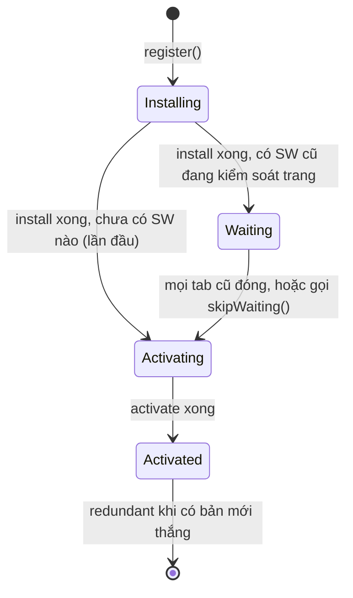

# Lý thuyết 6: Service Worker, Cache API và PWA offline-first

Bài [Hiệu năng web](/go?p=11-Frontend-Core%2Flt-03-web-performance-core-web-vitals.md) đã nói về cache HTTP và CDN — cache đó do **server và trình duyệt quyết định hộ bạn** (header `Cache-Control`, CDN edge). Bài [JavaScript runtime](/go?p=11-Frontend-Core%2Flt-01-javascript-runtime-event-loop.md) chỉ nhắc Service Worker trong một dòng bảng so sánh với Web Worker. Bài này nói về phần còn lại: một lớp proxy mạng **do chính bạn viết code điều khiển**, chạy nền ngay cả khi không có tab nào mở, quyết định request nào lấy từ cache, request nào ra mạng, và khi nào trang vẫn chạy được dù mất mạng hoàn toàn.

## Vấn đề nó giải quyết

HTTP cache trả lời đúng một câu hỏi: "response này còn mới không?" dựa trên tuổi và header. Nó không trả lời được: "mất mạng thì trang có chạy tiếp không?", "ảnh/CSS cũ có cần giữ lại khi mất mạng không, nhưng API giỏ hàng thì luôn cần dữ liệu mới nhất?", hay "người dùng có thể cài app lên màn hình chính như app thật không?". Service Worker là một script JavaScript chạy độc lập với trang, đứng giữa mọi request của trang và mạng thật, nên nó có thể tự quyết định logic cache theo từng loại tài nguyên — đúng thứ HTTP cache không làm được vì HTTP cache không có "nếu-thì" theo ngữ cảnh ứng dụng.

**Nền tảng:** Service Worker là proxy mạng lập trình được, chạy trong một thread riêng (giống Worker khác), không có quyền truy cập DOM, và vòng đời của nó **không gắn với một tab cụ thể** — nó chạy dưới một origin, phục vụ mọi tab mở trang đó, và có thể bị trình duyệt tắt đi giữa chừng để tiết kiệm tài nguyên rồi bật lại khi có việc.

## Các khái niệm cần biết

| Khái niệm | Là gì | Vì sao quan trọng |
|---|---|---|
| **Service Worker (SW)** | Script chạy nền, đứng giữa trang và mạng, bắt được mọi `fetch` | Cho phép cache tùy biến và chạy offline |
| **Scope** | Phạm vi URL mà một SW kiểm soát (mặc định là thư mục chứa file SW) | SW ở `/sw.js` kiểm soát toàn site; ở `/app/sw.js` chỉ kiểm soát `/app/*` |
| **Cache Storage API** | Kho lưu cặp Request/Response, tách biệt với HTTP cache của trình duyệt | Nơi SW chủ động lưu và đọc response theo logic riêng |
| **Lifecycle: install → waiting → activate** | Ba pha khi có SW mới: tải về, chờ, rồi kích hoạt | Hiểu đúng pha mới biết vì sao bản mới "không chịu lên" |
| **`skipWaiting()` / `clients.claim()`** | Ép SW mới bỏ qua chờ, và kiểm soát ngay các tab đang mở | Không gọi thì SW mới vẫn nằm `waiting`, tab cũ vẫn dùng SW cũ |
| **Web App Manifest** | File JSON khai báo tên, icon, màu, `display: standalone` | Điều kiện để trình duyệt coi trang là "cài được" (installable) |
| **`beforeinstallprompt`** | Sự kiện trình duyệt bắn ra khi đủ điều kiện cài app | Cho phép tự vẽ nút "Cài đặt" thay vì chờ trình duyệt tự gợi ý |
| **Background Sync** | Đăng ký một tác vụ chạy lại khi có mạng trở lại | Gửi lại request bị lỗi do mất mạng mà không cần người dùng mở lại tab |

**Tóm tắt:**

- Service Worker là một proxy mạng lập trình được, đứng giữa trang và mạng thật, nên có thể tự quyết định logic cache theo ngữ cảnh — thứ HTTP cache khai báo không làm được.
- Vòng đời SW mới luôn qua `install` → `waiting` (chờ mọi tab dùng SW cũ đóng hết) → `activate`; `skipWaiting()` + `clients.claim()` ép SW mới kiểm soát ngay mà không cần đóng tab.
- Bốn chiến lược cache chính: cache-first (asset có hash trong tên), network-first (dữ liệu cần mới nhất, fallback cache khi mất mạng), stale-while-revalidate (trả cache ngay, âm thầm cập nhật), và network-only/cache-only.
- Luôn chặn non-GET ngay đầu `fetch` handler; request/response body chỉ đọc được một lần nên phải `clone()` trước khi vừa trả vừa cache.
- Ba điều kiện tối thiểu để một trang "cài được" lên màn hình chính: Web App Manifest hợp lệ, HTTPS, và một Service Worker đã đăng ký.
- `beforeinstallprompt` cho phép tự vẽ nút "Cài đặt" thay vì chờ banner mặc định của trình duyệt.
- Background Sync là best-effort: trình duyệt có thể trễ vài phút để tiết kiệm pin, không đảm bảo chạy ngay khi có mạng trở lại.

## Vòng đời Service Worker



**Phải thuộc:** một SW mới luôn cài xong rồi **chờ** ở trạng thái `waiting` cho tới khi không còn tab nào dùng SW cũ — đây là nguyên nhân kinh điển của bug "tôi đã deploy bản mới, F5 rồi mà vẫn thấy giao diện cũ": phải đóng hết tab (hoặc gọi `skipWaiting()` + `clients.claim()`) thì SW mới mới thật sự kiểm soát trang.

```js
// sw.js — đăng ký, cài đặt và kích hoạt
const CACHE_NAME = 'app-shell-v3'; // đổi version để buộc install lại khi deploy bản mới
const SHELL_ASSETS = ['/', '/index.html', '/app.css', '/app.js'];

self.addEventListener('install', (event) => {
  event.waitUntil(
    caches.open(CACHE_NAME).then((cache) => cache.addAll(SHELL_ASSETS)),
  );
  self.skipWaiting(); // không chờ tab cũ đóng hết, lên bản mới ngay
});

self.addEventListener('activate', (event) => {
  event.waitUntil(
    caches.keys().then((keys) =>
      Promise.all(keys.filter((k) => k !== CACHE_NAME).map((k) => caches.delete(k))), // dọn cache version cũ
    ),
  );
  self.clients.claim(); // kiểm soát ngay các tab đang mở, không cần F5 lần hai
});
```

Đăng ký từ trang (chỉ chạy một lần, trình duyệt tự kiểm tra lại định kỳ):

```js
if ('serviceWorker' in navigator) {
  navigator.serviceWorker.register('/sw.js');
}
```

## Cache API và các chiến lược fetch

Service Worker tự viết, nên chiến lược cache là code bạn quyết định trong handler `fetch`, không phải cấu hình khai báo. Bốn chiến lược phổ biến, chọn theo loại tài nguyên:

| Chiến lược | Cách hoạt động | Dùng cho |
|---|---|---|
| **Cache-first** | Có trong cache thì trả luôn, không hỏi mạng; không có mới gọi mạng rồi lưu lại | Asset tĩnh có hash trong tên (JS/CSS/font đã build) |
| **Network-first** | Luôn thử mạng trước; mạng lỗi/timeout mới rơi về cache | Dữ liệu cần mới nhất nhưng chấp nhận bản cũ khi mất mạng (trang tin tức, feed) |
| **Stale-while-revalidate** | Trả cache ngay lập tức (nhanh), đồng thời âm thầm gọi mạng cập nhật cache cho lần sau | Nội dung không cần tức thời tuyệt đối, ưu tiên tốc độ cảm nhận (avatar, danh sách ít đổi) |
| **Network-only / Cache-only** | Luôn chỉ một nguồn, không fallback | Network-only cho ghi dữ liệu (POST thanh toán); cache-only cho asset app-shell không bao giờ đổi khác version |

```js
self.addEventListener('fetch', (event) => {
  const { request } = event;
  if (request.method !== 'GET') return; // không cache non-GET; để request tự đi thẳng ra mạng

  if (request.destination === 'script' || request.destination === 'style') {
    event.respondWith(cacheFirst(request));
  } else if (request.url.includes('/api/')) {
    event.respondWith(networkFirst(request));
  } else {
    event.respondWith(staleWhileRevalidate(request));
  }
});

async function cacheFirst(request) {
  const cached = await caches.match(request);
  if (cached) return cached;
  const fresh = await fetch(request);
  (await caches.open(CACHE_NAME)).put(request, fresh.clone()); // clone vì body chỉ đọc được một lần
  return fresh;
}

async function networkFirst(request) {
  try {
    const fresh = await fetch(request);
    (await caches.open(CACHE_NAME)).put(request, fresh.clone());
    return fresh;
  } catch {
    return (await caches.match(request)) ?? Response.error(); // mất mạng: rơi về cache, không có thì báo lỗi rõ ràng
  }
}

async function staleWhileRevalidate(request) {
  const cache = await caches.open(CACHE_NAME);
  const cached = await cache.match(request);
  const networkPromise = fetch(request).then((fresh) => {
    cache.put(request, fresh.clone());
    return fresh;
  });
  return cached ?? networkPromise; // có cache thì trả ngay, mạng chạy nền cập nhật cho lần sau
}
```

**Suy luận:** `request.clone()` xuất hiện vì `Response`/`Request` body chỉ đọc được **một lần** (xem [Bài fetch](/go?p=13-JavaScript%2Fhard%2Flt-13-fetch-storage-worker-observer.md) của chủ đề JavaScript) — nếu không clone trước khi vừa trả về trang vừa lưu vào cache, một trong hai thao tác đọc sẽ nhận một stream đã cạn. Chỗ dễ sai thứ hai: cache theo URL mặc định không phân biệt method hay body, nên phải tự chặn non-GET ở đầu `fetch` handler, nếu không một request POST có thể vô tình bị trả từ cache cũ.

## Web App Manifest và cài đặt lên màn hình chính

```json
{
  "name": "KemTech Học Technical",
  "short_name": "KemTech",
  "start_url": "/?source=pwa",
  "display": "standalone",
  "theme_color": "#0f172a",
  "background_color": "#0f172a",
  "icons": [{ "src": "/icon-512.png", "sizes": "512x512", "type": "image/png" }]
}
```

| Trường | Ý nghĩa |
|---|---|
| `display: standalone` | Mở không có thanh địa chỉ trình duyệt, giống app gốc |
| `start_url` | URL mở khi bấm icon từ màn hình chính; thường gắn query để đo lượng mở từ PWA |
| `icons` | Bắt buộc có ít nhất một icon lớn (192 và 512px) để đủ điều kiện cài đặt |

```js
let deferredPrompt;
window.addEventListener('beforeinstallprompt', (e) => {
  e.preventDefault();       // chặn banner mặc định của trình duyệt
  deferredPrompt = e;       // giữ lại để tự hiện nút "Cài đặt" đúng lúc người dùng muốn
  showInstallButton();
});

installButton.addEventListener('click', async () => {
  deferredPrompt.prompt();
  const { outcome } = await deferredPrompt.userChoice; // 'accepted' hoặc 'dismissed'
  deferredPrompt = null;
});
```

**Phải thuộc:** điều kiện tối thiểu để trình duyệt coi một trang là "cài được" (installable): có Web App Manifest hợp lệ, phục vụ qua HTTPS, và có Service Worker đã đăng ký (dù chỉ cache rỗng) — thiếu một trong ba thì `beforeinstallprompt` không bao giờ bắn, và nút "Cài đặt" tự vẽ sẽ không có gì để gọi.

## Background Sync: gửi lại khi có mạng

```js
// Trong trang: request thất bại vì mất mạng → đăng ký một lần đồng bộ thay vì mất luôn
async function saveNote(note) {
  try {
    await fetch('/api/notes', { method: 'POST', body: JSON.stringify(note) });
  } catch {
    await (await navigator.serviceWorker.ready).sync.register('sync-notes');
    await savePending(note); // tự lưu tạm vào IndexedDB, xem bài Storage
  }
}

// Trong sw.js: trình duyệt tự gọi lại khi thiết bị có mạng trở lại
self.addEventListener('sync', (event) => {
  if (event.tag === 'sync-notes') {
    event.waitUntil(flushPendingNotes());
  }
}
```

Background Sync không đảm bảo chạy ngay lập tức khi có mạng — trình duyệt tự quyết định thời điểm (có thể trễ vài phút để gộp với các tác vụ nền khác, tiết kiệm pin). Đây không phải lỗi, mà là thiết kế có chủ đích; nếu cần phản hồi ngay khi mạng về, phải tự lắng nghe sự kiện `online` ở phía trang như một lớp bổ sung.

## Khi nào thật sự cần PWA offline-first, khi nào không

| Tình huống | Có đáng làm không |
|---|---|
| App dùng lặp lại nhiều lần/ngày, mạng không ổn định (nội bộ xí nghiệp, vùng sóng yếu) | Có — offline-first mang lại giá trị thật |
| Trang landing/marketing, xem một lần rồi rời đi | Không — chi phí bảo trì SW không bõ |
| Dữ liệu bắt buộc phải real-time tuyệt đối (sàn giao dịch, giá chứng khoán) | Cẩn trọng — cache sai tầng dễ cho người dùng thấy dữ liệu cũ mà tưởng là mới |
| Cần nút "Cài lên màn hình chính" nhưng không cần offline | Vẫn cần Manifest + một SW tối thiểu (dù cache rỗng), nhẹ hơn nhiều so với offline đầy đủ |

## Bẫy thường gặp

| Bẫy | Hậu quả | Cách tránh |
|---|---|---|
| Quên tăng `CACHE_NAME` khi đổi logic SW | Người dùng kẹt ở bản SW cũ vô thời hạn vì cache cũ vẫn "hợp lệ" | Đổi tên cache theo version mỗi lần đổi asset hoặc chiến lược |
| Cache luôn cả API ghi dữ liệu | Request POST/PUT bị trả nhầm từ cache, hoặc cache phình vô nghĩa | Chặn non-GET ngay đầu `fetch` handler |
| Không `event.waitUntil()` quanh thao tác async trong `install`/`activate` | SW có thể bị tắt giữa chừng trước khi cache kịp ghi xong | Luôn bọc mọi promise quan trọng bằng `waitUntil` |
| Coi Background Sync là tức thời | Tưởng bug vì "sao chưa gửi lại ngay" | Hiểu đây là best-effort, trễ vài phút là bình thường |
| Dùng `cache.addAll()` với một URL 404 | Toàn bộ `install` thất bại, không cache được gì | Kiểm tra kỹ danh sách asset, hoặc tự `fetch` + `put` từng cái với try/catch riêng |

## Câu hỏi phỏng vấn thường gặp

### 1. HTTP cache (`Cache-Control`) và Service Worker Cache Storage khác nhau ở đâu?

**Gợi ý suy luận:**
- Ai ra quyết định dùng cache hay không: trình duyệt theo header, hay code của bạn?
- Cái nào chạy được khi hoàn toàn không có mạng?

**Lập luận:** HTTP cache do server khai báo qua header và trình duyệt tự áp dụng theo tuổi/điều kiện, không có chỗ cho logic tùy biến theo loại request. Cache Storage do chính SW ghi/đọc bằng code, nên có thể rẽ nhánh theo URL, method, hay tình trạng mạng — và vì SW chặn được `fetch` trước khi nó rời trang, nó hoạt động được cả khi mất mạng hoàn toàn, điều HTTP cache của trình duyệt không tự làm thay bạn được.

**Đáp án ngắn:** HTTP cache là quy tắc khai báo trình duyệt tự áp; Cache Storage là kho dữ liệu SW tự lập trình, nên mới cho phép offline thật sự.

**Nhớ:** Một cái là khai báo, một cái là code.

### 2. Deploy bản mới nhưng người dùng vẫn thấy giao diện cũ dù đã F5. Vì sao, và sửa thế nào?

**Gợi ý suy luận:**
- SW mới sau khi `install` xong có kiểm soát trang ngay không?
- Điều gì phải xảy ra để SW cũ nhường chỗ?

**Lập luận:** Vì thiết kế vòng đời cố ý để SW mới chờ ở trạng thái `waiting` cho tới khi mọi tab dùng SW cũ đóng hết — F5 vẫn giữ tab mở nên SW cũ vẫn kiểm soát. Gọi `self.skipWaiting()` trong `install` và `clients.claim()` trong `activate` ép SW mới nhận quyền kiểm soát ngay mà không cần đóng tab.

**Đáp án ngắn:** SW mới mặc định chờ tab cũ đóng hết; gọi `skipWaiting()` + `clients.claim()` để lên bản mới ngay.

**Nhớ:** `waiting` là thiết kế, không phải bug.

### 3. Vì sao phải `request.clone()` hoặc `response.clone()` khi vừa cache vừa trả về cho trang?

**Gợi ý suy luận:**
- Body của `Request`/`Response` đọc được mấy lần?
- Hai thao tác "trả cho trang" và "lưu cache" có phải đều cần đọc body không?

**Lập luận:** Vì body là một stream chỉ tiêu thụ được một lần, nên nếu cùng một object vừa được đưa vào `cache.put()` (đọc để lưu) vừa được `return` cho trang (đọc để hiển thị), thao tác đọc sau sẽ nhận stream đã cạn và lỗi hoặc rỗng. `clone()` tạo một bản sao độc lập để mỗi phía đọc một lần riêng.

**Đáp án ngắn:** Body chỉ đọc một lần; clone trước khi dùng ở hai nơi.

**Nhớ:** Đọc body hai lần thì phải clone trước.

### 4. Khi nào chọn cache-first, khi nào network-first cho một loại tài nguyên?

**Gợi ý suy luận:**
- Tài nguyên có hash trong tên file không (đổi nội dung thì đổi luôn tên)?
- Dữ liệu cũ hiện ra có gây hại gì không?

**Lập luận:** Asset build ra có hash trong tên (ví dụ `app.a1b2c3.js`) thì nội dung ứng với một tên là bất biến — cache-first an toàn tuyệt đối vì không bao giờ có chuyện "tên cũ, nội dung mới". Dữ liệu API thay đổi theo thời gian mà tên không đổi (`/api/cart`), nên phải network-first để ưu tiên dữ liệu mới, chỉ lùi về cache khi mạng thật sự không có.

**Đáp án ngắn:** Asset có hash trong tên: cache-first. Dữ liệu động cùng một URL: network-first.

**Nhớ:** Tên bất biến mới được cache-first vô điều kiện.

### 5. Ba điều kiện tối thiểu để trình duyệt coi một trang là "cài được" (installable) là gì?

**Gợi ý suy luận:**
- Trình duyệt cần biết tên, icon, chế độ hiển thị từ đâu?
- Có cần chứng minh trang "chạy được không cần server trả lời ngay" không?

**Lập luận:** Trình duyệt cần một Web App Manifest hợp lệ để biết tên/icon/display mode, cần HTTPS để đảm bảo an toàn khi chạy như app độc lập, và cần có ít nhất một Service Worker đã đăng ký — vì SW là tín hiệu cho thấy trang có khả năng hoạt động ngoài vòng đời một tab trình duyệt thông thường, dù cache có thể rỗng.

**Đáp án ngắn:** Manifest hợp lệ, HTTPS, và một Service Worker đã đăng ký.

**Nhớ:** Thiếu một trong ba thì `beforeinstallprompt` không bao giờ bắn.

### 6. Background Sync đăng ký xong mà mãi không thấy chạy lại ngay khi có mạng. Có phải bug?

**Gợi ý suy luận:**
- Trình duyệt có cam kết chạy "ngay lập tức" không?
- Vì sao có thể cố tình trễ?

**Lập luận:** Background Sync là best-effort theo thiết kế: trình duyệt gộp các tác vụ nền lại để tiết kiệm pin/dữ liệu, nên có thể trễ vài phút thay vì chạy tức khắc ngay khi có mạng. Đây không phải lỗi của code; nếu nghiệp vụ cần phản hồi tức thời hơn, phải tự lắng nghe sự kiện `online` ở tầng trang như một lớp bổ sung, không chỉ dựa vào sync.

**Đáp án ngắn:** Không phải bug; Background Sync vốn trễ có chủ đích, cần thêm lắng nghe `online` nếu cần nhanh hơn.

**Nhớ:** Best-effort nghĩa là "sẽ chạy", không phải "chạy ngay".

### 7. Một API ghi dữ liệu (POST thanh toán) vô tình bị Service Worker trả từ cache cũ. Nguyên nhân và cách chặn?

**Gợi ý suy luận:**
- `fetch` handler mặc định có lọc theo method không?
- Chặn ở đâu là sớm nhất, chắc nhất?

**Lập luận:** Nếu `fetch` handler áp một chiến lược cache chung cho mọi request mà không kiểm tra `request.method`, một request POST cũng có thể bị khớp vào logic `caches.match()`/`cache.put()` viết cho GET. Cách chắc chắn nhất là chặn ngay đầu handler: `if (request.method !== 'GET') return;` để các request ghi dữ liệu luôn đi thẳng ra mạng, không chạm vào logic cache nào cả.

**Đáp án ngắn:** Vì handler không lọc method; chặn non-GET ngay đầu `fetch` listener.

**Nhớ:** Cache chỉ nên đụng vào GET.
