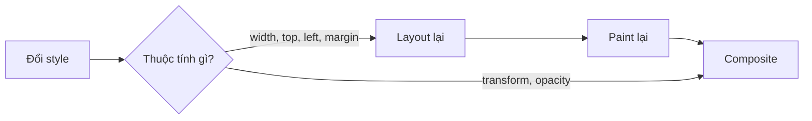
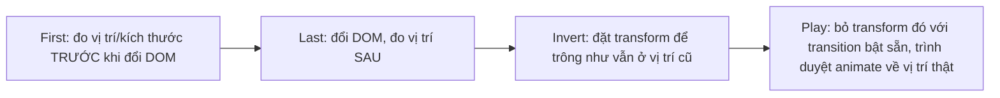

# Lý thuyết 7: Animation và motion trên web

Bài [Hiệu năng web](/go?p=11-Frontend-Core%2Flt-03-web-performance-core-web-vitals.md) đã nói CLS (layout dịch chuyển ngoài ý muốn là animation **tệ**); bài này nói về animation **có chủ đích**: chuyển trang mượt, list thêm/xóa phần tử không giật, loading skeleton, modal mở/đóng. Đây là nền tảng chung cho mọi framework — nguyên lý giống nhau dù bạn dùng React, Vue hay JavaScript thuần; phần thao tác cụ thể trong từng framework nằm ở bài riêng của React và Vue.

## Vấn đề nó giải quyết

Một thay đổi UI đột ngột (phần tử biến mất, danh sách nhảy số, modal bật ra ngay lập tức) buộc người dùng tự suy luận "cái gì vừa xảy ra, nó đi đâu". Animation đúng cách trả lời câu hỏi đó bằng mắt: phần tử trượt ra thì người dùng hiểu nó rời đi, phần tử phóng to từ đúng vị trí nút bấm thì người dùng hiểu quan hệ nhân-quả. Nhưng animation sai cách (chạy trên luồng chính, đụng vào layout liên tục) lại chính là nguyên nhân gây giật, tốn pin, và kéo điểm CLS/INP xuống — nên bài này tập trung vào hai việc: animate **cái gì** để rẻ, và animate **bằng cơ chế nào** để trình duyệt tối ưu được.

**Nền tảng:** Trình duyệt vẽ một khung hình qua các bước Style → Layout → Paint → Composite. Animate thuộc tính `transform` và `opacity` chỉ chạm bước Composite (chạy trên GPU, không cần tính lại layout hay vẽ lại pixel), nên mượt gần như luôn luôn; animate `width`, `top`, `left`, `margin` kích hoạt lại Layout cho mọi phần tử liên quan ở mỗi khung hình, dễ giật trên máy yếu.

## Các khái niệm cần biết

| Khái niệm | Là gì | Vì sao quan trọng |
|---|---|---|
| **Compositor-only properties** | `transform` và `opacity` — animate được mà không kích hoạt lại Layout/Paint | Lựa chọn mặc định an toàn cho mọi animation |
| **CSS Transition** | Nội suy tự động giữa hai giá trị khi một thuộc tính đổi | Đơn giản, khai báo, tốt cho hover/focus/trạng thái bật-tắt |
| **CSS Animation (`@keyframes`)** | Chuỗi nhiều bước trạng thái, lặp lại được, không cần JS | Hiệu ứng phức tạp hơn transition nhưng vẫn không cần JS |
| **Web Animations API (WAAPI)** | `element.animate()` — animate bằng JS nhưng vẫn chạy trên compositor | Cần điều khiển bằng code (dừng, đảo chiều, đồng bộ nhiều animation) mà không muốn animation chạy trên main thread |
| **FLIP** | Kỹ thuật animate một thay đổi layout bằng cách giả lập nó bằng transform | Animate được cả những thứ vốn không animate mượt được trực tiếp (ví dụ đổi vị trí trong danh sách) |
| **View Transitions API** | Trình duyệt tự chụp "trước/sau" rồi animate chuyển tiếp, kể cả giữa các trang | Animate chuyển trang mà không cần tự quản lý state hai phiên bản DOM |
| **`prefers-reduced-motion`** | Media query cho biết người dùng đã bật giảm hiệu ứng chuyển động ở hệ điều hành | Bắt buộc tôn trọng vì lý do khả năng tiếp cận (rối loạn tiền đình, say chuyển động) |

**Tóm tắt:**

- Animate `transform`/`opacity` chỉ chạm bước Composite (GPU), bỏ qua Layout/Paint, nên gần như luôn mượt; animate `width`/`top`/`left` kích hoạt lại Layout ở mỗi khung hình.
- CSS Transition nội suy giữa hai trạng thái khi một thuộc tính đổi; CSS Animation (`@keyframes`) chạy chuỗi nhiều bước, lặp lại được, cả hai không cần JS.
- Web Animations API (`element.animate()`) cho điều khiển bằng code (pause/reverse/Promise `.finished`) nhưng vẫn chạy trên compositor như CSS, không mất độ mượt.
- FLIP (First, Last, Invert, Play) animate một thay đổi layout bằng cách giả lập nó qua `transform` — đây là cơ chế bên dưới mọi animation "đổi vị trí trong danh sách" của framework.
- View Transitions API để trình duyệt tự chụp snapshot trạng thái trước/sau và animate crossfade, không cần tự giữ hai bản DOM như trước đây.
- `prefers-reduced-motion: reduce` chỉ nên giảm animation trang trí, không nên bỏ animation mang thông tin trạng thái (progress bar, spinner).
- Animate phần tử vừa đổi từ `display: none` không chạy transition vì không có giá trị "trước đó" để nội suy — phải tách làm hai bước.

## Compositor-only: vì sao transform và opacity là lựa chọn mặc định



**Phải thuộc:** animate `left`/`top` để di chuyển một phần tử buộc trình duyệt tính lại layout của nó và mọi phần tử bị ảnh hưởng ở **mỗi khung hình** (có thể 60 lần/giây); animate bằng `transform: translate()` đạt hiệu ứng y hệt về mặt thị giác nhưng bỏ qua hẳn hai bước Layout và Paint, chỉ còn Composite — đây là lý do duy nhất khiến nó mượt hơn, không phải vì "transform nhanh hơn" một cách bí ẩn.

```css
/* Tệ: kích hoạt Layout mỗi khung hình */
.box-slow { left: 0; transition: left 0.3s; }
.box-slow.open { left: 200px; }

/* Tốt: chỉ Composite */
.box-fast { transform: translateX(0); transition: transform 0.3s; }
.box-fast.open { transform: translateX(200px); }
```

## CSS Transition và Animation: khi khai báo là đủ

```css
/* Transition: nội suy giữa hai trạng thái khi thuộc tính đổi */
.card {
  transform: scale(1);
  transition: transform 0.2s ease-out;
}
.card:hover { transform: scale(1.03); }

/* Animation: chuỗi nhiều bước, tự lặp, không cần đổi class */
@keyframes pulse {
  0%, 100% { opacity: 1; }
  50% { opacity: 0.4; }
}
.skeleton { animation: pulse 1.2s ease-in-out infinite; }
```

| | Transition | Animation (`@keyframes`) |
|---|---|---|
| Kích hoạt | Một thuộc tính CSS đổi giá trị | Tự chạy khi class được gắn, hoặc lặp vô hạn |
| Số bước | Hai trạng thái (từ → đến) | Nhiều bước (`0%`, `50%`, `100%`...) |
| Dùng cho | Hover, focus, bật/tắt trạng thái | Skeleton loading, spinner, hiệu ứng lặp |

## Web Animations API: khi cần điều khiển bằng code

```js
const el = document.querySelector('.toast');
const anim = el.animate(
  [
    { transform: 'translateY(-20px)', opacity: 0 },
    { transform: 'translateY(0)', opacity: 1 },
  ],
  { duration: 220, easing: 'ease-out', fill: 'forwards' },
);

anim.onfinish = () => el.classList.add('shown');
// Có thể dừng, đảo chiều, hoặc đợi:
// anim.pause(); anim.reverse(); await anim.finished;
```

**Suy luận:** WAAPI tồn tại vì CSS transition/animation khai báo tốt nhưng khó phối hợp bằng code — muốn biết chính xác lúc nào animation xong để làm việc tiếp theo, CSS chỉ có sự kiện `transitionend`/`animationend` (dễ bị bắn trùng khi có nhiều thuộc tính animate cùng lúc). `element.animate()` trả về một đối tượng `Animation` có `.finished` (Promise), `.pause()`, `.reverse()` — nhưng animation vẫn chạy trên compositor thread như CSS, không chạy trên main thread như `requestAnimationFrame` thủ công, nên vẫn giữ được độ mượt.

## FLIP: animate cả những thứ không animate mượt được trực tiếp

Đổi vị trí một phần tử trong danh sách (ví dụ sort lại, hoặc một thẻ bị xóa khiến các thẻ sau dịch lên) về bản chất là đổi `layout`, không có cách animate trực tiếp mượt. FLIP (**F**irst, **L**ast, **I**nvert, **P**lay) lách qua bằng cách animate `transform`, vốn mượt, để **giả lập** hiệu ứng đổi vị trí:



```js
function flipMove(el, applyDomChange) {
  const first = el.getBoundingClientRect();     // First
  applyDomChange();                               // Last (đổi DOM thật)
  const last = el.getBoundingClientRect();
  const dx = first.left - last.left, dy = first.top - last.top;

  el.style.transform = `translate(${dx}px, ${dy}px)`; // Invert: giả vờ vẫn ở chỗ cũ
  el.style.transition = 'transform 0s';                 // tắt transition tức thời để set không bị animate
  requestAnimationFrame(() => {
    el.style.transition = 'transform 0.3s ease-out';
    el.style.transform = '';                             // Play: bỏ transform, trình duyệt animate về 0
  });
}
```

**Phải thuộc:** FLIP không animate layout thật — nó animate một `transform` giả để đánh lừa mắt người xem rằng phần tử đang "di chuyển", trong khi DOM thật đã nhảy thẳng tới vị trí mới ngay lập tức. Đây chính là cơ chế bên dưới animation list của React (`AnimatePresence`/layout animation) và Vue (`<TransitionGroup>` với `v-move`) — framework chỉ tự động hóa bốn bước FLIP giúp bạn.

## View Transitions API: animate chuyển trang mà không tự quản lý hai DOM

```js
function navigate(renderNewPage) {
  if (!document.startViewTransition) return renderNewPage(); // fallback: trình duyệt cũ, đổi luôn không animate

  document.startViewTransition(() => {
    renderNewPage(); // chỉ cần đổi DOM như bình thường; trình duyệt tự chụp ảnh trước/sau và animate chuyển tiếp
  });
}
```

```css
::view-transition-old(root), ::view-transition-new(root) {
  animation-duration: 0.25s;
}
```

Trước View Transitions API, animate chuyển giữa hai trạng thái UI khác nhau (ví dụ chuyển trang, hay mở ảnh từ grid sang full-screen) đòi hỏi tự giữ cả bản cũ và bản mới cùng lúc trong DOM rồi tự animate crossfade — phức tạp và dễ rò rỉ nếu dọn không sạch. View Transitions API để trình duyệt tự chụp ảnh chụp nhanh (snapshot) trạng thái cũ, chạy callback đổi DOM, chụp ảnh trạng thái mới, rồi tự animate crossfade giữa hai ảnh đó — kể cả animate phần tử "liên tục" giữa hai trang (named view transition) nếu cả hai phía đều gắn cùng một `view-transition-name`.

## Accessibility: `prefers-reduced-motion`

```css
.card { transition: transform 0.3s; }

@media (prefers-reduced-motion: reduce) {
  .card { transition: none; } /* hoặc rút ngắn, không tắt những animation mang ý nghĩa (ví dụ progress bar) */
}
```

```js
const prefersReduced = window.matchMedia('(prefers-reduced-motion: reduce)').matches;
anim = el.animate(keyframes, { duration: prefersReduced ? 0 : 220, easing: 'ease-out' });
```

**Phải thuộc:** `prefers-reduced-motion: reduce` không có nghĩa "tắt mọi animation" — animation mang thông tin (progress bar, trạng thái loading) vẫn nên giữ, chỉ nên bỏ animation thuần trang trí (parallax, zoom lớn, lắc). Đây là yêu cầu khả năng tiếp cận thật, không phải tùy chọn thẩm mỹ: một số người dùng bị chóng mặt/buồn nôn thật sự (rối loạn tiền đình) khi xem chuyển động lớn trên màn hình.

## Bẫy thường gặp

| Bẫy | Hậu quả | Cách tránh |
|---|---|---|
| Animate `width`/`height`/`top`/`left` cho hiệu ứng lớn, lặp lại | Giật trên máy yếu, tốn pin, điểm INP/CLS xấu | Đổi sang `transform`/`opacity`, dùng FLIP nếu cần "đổi layout" |
| Animate liên tục bằng `setTimeout`/state React mỗi khung hình | Chạy trên main thread, dễ bị chặn bởi việc khác, giật | Dùng CSS transition/animation hoặc WAAPI, để trình duyệt tự lo khung hình |
| Quên `prefers-reduced-motion` | Gây khó chịu, thậm chí triệu chứng thật cho một nhóm người dùng | Luôn thêm nhánh giảm/tắt animation trang trí |
| Animate phần tử vừa `display: none` → `block` | Transition không chạy vì không có "giá trị trước đó" để nội suy | Tách làm hai bước: hiện phần tử trước (không animate), rồi đổi thuộc tính animate ở khung hình sau |
| Dùng `transitionend` để biết animation xong khi có nhiều thuộc tính animate | Sự kiện bắn nhiều lần, hoặc không bắn nếu transition bị hủy giữa chừng | Dùng Web Animations API với `.finished`, hoặc lọc theo `event.propertyName` |

## Câu hỏi phỏng vấn thường gặp

### 1. Vì sao animate `transform`/`opacity` mượt hơn animate `width`/`left`, về mặt cơ chế?

**Gợi ý suy luận:**
- Trình duyệt vẽ một khung hình qua những bước nào?
- Thuộc tính nào bắt buộc tính lại các bước đó, thuộc tính nào không?

**Lập luận:** Đổi `width`/`left` làm thay đổi layout (vị trí/kích thước), buộc trình duyệt chạy lại Layout rồi Paint cho phần tử đó và mọi phần tử bị ảnh hưởng, ở mỗi khung hình của animation. `transform`/`opacity` không ảnh hưởng tới kích thước hay vị trí trong luồng layout — trình duyệt xử lý chúng thẳng ở bước Composite trên GPU, bỏ qua hẳn Layout và Paint.

**Đáp án ngắn:** `transform`/`opacity` chỉ chạm Composite; các thuộc tính khác kích hoạt lại Layout/Paint ở mỗi khung hình.

**Nhớ:** Composite-only là lý do, không phải "transform có phép màu".

### 2. Animate việc một thẻ bị xóa khỏi danh sách khiến các thẻ sau "nhảy lên" ngay lập tức, không mượt. Làm sao animate được chuyển động đó?

**Gợi ý suy luận:**
- Vị trí mới của một thẻ có animate trực tiếp mượt được không?
- Có cách nào biến "đổi vị trí" thành "đổi transform" không?

**Lập luận:** Đổi vị trí trong layout (do phần tử trước bị xóa) không phải thứ animate trực tiếp mượt được. Kỹ thuật FLIP đo vị trí trước khi đổi DOM, đổi DOM thật (các thẻ nhảy vị trí ngay), rồi đặt một `transform` làm thẻ trông như vẫn ở vị trí cũ, cuối cùng bỏ transform đó với transition bật sẵn — trình duyệt animate phần "bỏ transform" đó một cách mượt mà vì chỉ chạm Composite.

**Đáp án ngắn:** Dùng FLIP: đo trước, đổi DOM, giả vờ chưa đổi bằng transform, rồi animate transform về 0.

**Nhớ:** FLIP animate một ảo giác transform, không animate layout thật.

### 3. `prefers-reduced-motion: reduce` có nghĩa là tắt hết animation không?

**Gợi ý suy luận:**
- Animation nào mang thông tin, animation nào thuần trang trí?
- Người dùng bật cờ này vì lý do gì?

**Lập luận:** Không. Cờ này dành cho người dùng nhạy cảm với chuyển động lớn (chóng mặt, rối loạn tiền đình), nên mục tiêu là giảm/bỏ animation **trang trí** (zoom, lắc, parallax lớn) chứ không phải mọi phản hồi thị giác. Animation mang ý nghĩa chức năng — progress bar đang chạy, spinner loading — nên giữ lại vì mất nó làm người dùng không biết hệ thống có đang xử lý hay không.

**Đáp án ngắn:** Không; chỉ nên giảm animation trang trí, giữ animation mang thông tin trạng thái.

**Nhớ:** Giảm motion, không giảm thông tin.

### 4. Web Animations API khác CSS transition ở điểm nào, và khi nào chọn cái nào?

**Gợi ý suy luận:**
- Cả hai có chạy trên compositor giống nhau không?
- Cái nào dễ biết chính xác "animation đã xong" bằng code?

**Lập luận:** Cả hai đều có thể animate các thuộc tính compositor-only và chạy mượt như nhau — khác biệt nằm ở khả năng điều khiển. CSS transition là khai báo thuần, tốt khi chỉ cần đổi giữa hai trạng thái CSS. WAAPI (`element.animate()`) cho một đối tượng `Animation` có thể `.pause()`, `.reverse()`, và một `Promise` `.finished` đáng tin cậy hơn sự kiện `transitionend` khi có nhiều animation chạy cùng lúc hoặc cần phối hợp nhiều bước bằng code.

**Đáp án ngắn:** Giống nhau về hiệu năng; WAAPI cho điều khiển bằng code tốt hơn khi logic phức tạp.

**Nhớ:** Cần điều khiển bằng code thì WAAPI, chỉ cần đổi trạng thái thì CSS transition.

### 5. View Transitions API giải quyết vấn đề gì mà trước đây phải tự làm bằng tay?

**Gợi ý suy luận:**
- Trước đây muốn crossfade giữa hai trạng thái UI phải giữ mấy bản DOM cùng lúc?
- Ai chụp "ảnh trước/sau" trong cơ chế mới?

**Lập luận:** Animate chuyển tiếp giữa hai trạng thái UI khác nhau (chuyển trang, mở ảnh full-screen) trước đây đòi hỏi tự giữ cả DOM cũ và mới cùng lúc để crossfade bằng tay, dễ rò rỉ nếu không dọn sạch bản cũ. `document.startViewTransition()` để trình duyệt tự chụp snapshot trạng thái trước, chạy callback đổi DOM của bạn, chụp snapshot trạng thái sau, rồi tự animate crossfade — bạn chỉ cần đổi DOM như bình thường.

**Đáp án ngắn:** Tự động hóa việc chụp trạng thái trước/sau và animate crossfade, không cần tự giữ hai bản DOM.

**Nhớ:** Bạn chỉ lo đổi DOM; trình duyệt lo animate chuyển tiếp.
