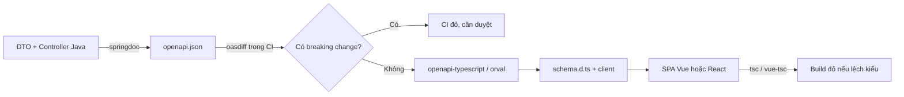
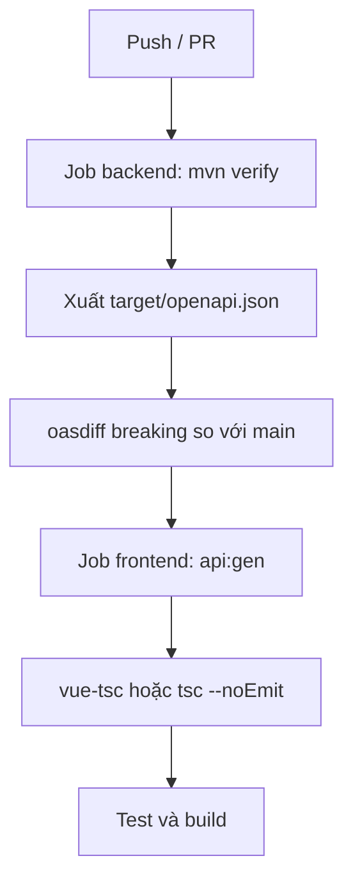
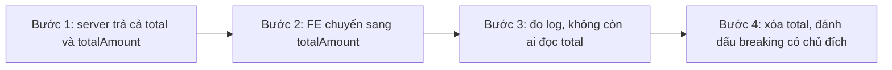

# Lý thuyết 01: API contract giữa Spring và SPA

## Vấn đề cần giải quyết

Backend Java và frontend TypeScript là hai codebase, hai ngôn ngữ, thường do hai người (hoặc hai nhóm) làm. Cách phổ biến nhất để chúng "hiểu nhau" là... truyền miệng: backend nhắn "đơn hàng có thêm trường `channel`", frontend tự sửa interface TypeScript bằng tay. Một tuần sau ai đó đổi `total` từ số nguyên sang chuỗi, không ai báo, và lỗi chỉ lộ ra khi người dùng thấy `NaN` trên màn hình thanh toán.

Gốc của vấn đề là **API contract chỉ tồn tại trong đầu người**. Cách chữa là biến nó thành một file máy đọc được (OpenAPI), sinh ra từ code backend, rồi sinh tiếp client TypeScript có kiểu từ file đó. Khi đó đổi API ở Java sẽ làm frontend **không build được** thay vì hỏng lúc chạy.

**Nền tảng:** API contract phải có một nguồn sự thật duy nhất mà máy đọc được. Code Java là nguồn, OpenAPI sinh ra từ code, kiểu TypeScript sinh ra từ OpenAPI; nhờ vậy lệch contract biến thành lỗi biên dịch lúc build thay vì lỗi lúc người dùng đang chạy.

Khi nào nên làm: dự án có SPA riêng gọi API Spring Boot, có từ hai người trở lên hoặc API sống lâu hơn vài tháng. Khi nào chưa cần: demo một người, vài endpoint, hoặc trang render phía server (Thymeleaf) nơi không có client TypeScript.

Bài này nối với [Thiết kế REST API thực chiến](/go?p=01-Spring-Boot%2Fmedium%2Flt-33-rest-api-thuc-chien.md) (quy ước API), [lỗi và phân trang xuyên tầng](/go?p=12-Fullstack%2Flt-04-loi-va-phan-trang-xuyen-tang.md) và [kiểm thử xuyên tầng](/go?p=12-Fullstack%2Flt-06-test-xuyen-tang-e2e-contract.md). Phần giao diện xem thêm [Vue: router và forms](/go?p=10-Vue%2Fmedium%2Flt-06-router-forms.md) và [React: routing, forms, data](/go?p=09-React%2Fmedium%2Flt-06-routing-forms-data.md).

**Tóm tắt:**

- API contract phải có một nguồn sự thật duy nhất mà máy đọc được: code Java sinh OpenAPI, OpenAPI sinh kiểu TypeScript, không ai sửa tay phần sinh ra.
- Schema đúng phụ thuộc DTO: khai báo `required`, dùng enum thật và đặt `operationId` ổn định.
- Xuất file OpenAPI trong CI từ build chứ không từ server production, rồi generate client trong CI để lệch contract thành build đỏ.
- Client có kiểu (openapi-typescript, Orval) giúp Vue và React bắt lỗi lúc biên dịch thay vì lúc người dùng chạy.
- Thêm trường tùy chọn là thay đổi tương thích; xóa, đổi tên, đổi kiểu, thêm trường request bắt buộc là breaking, nên đổi theo expand and contract.
- Client phải là tolerant reader: có nhánh `default` cho enum mới và bỏ qua trường lạ.
- JS `number` chỉ chính xác tới 2^53 - 1 nên id `Long` lớn và tiền `BigDecimal` phải đi qua JSON dưới dạng chuỗi hoặc số nguyên đơn vị nhỏ nhất.

## Các khái niệm cần biết

| Keyword | Là gì | Dùng khi nào |
|---|---|---|
| OpenAPI | Chuẩn mô tả API (đường dẫn, tham số, schema, mã lỗi) bằng JSON hoặc YAML | Làm nguồn sự thật chung cho tài liệu, client, mock, test |
| springdoc-openapi | Thư viện quét controller và DTO của Spring để sinh OpenAPI lúc chạy | Backend Spring Boot 3.x muốn có `/v3/api-docs` và Swagger UI |
| Schema | Mô tả một kiểu dữ liệu trong OpenAPI (tương đương DTO) | Mỗi request/response body |
| `operationId` | Tên duy nhất của một thao tác, thành tên hàm trong client sinh ra | Cần tên hàm ổn định như `getOrder` |
| openapi-typescript | Công cụ sinh file `.d.ts` chứa kiểu `paths` và `components` từ OpenAPI | Muốn kiểu thuần, không sinh code chạy |
| openapi-fetch | Wrapper `fetch` nhỏ dùng kiểu `paths` ở trên | Gọi API có kiểm tra đường dẫn, tham số, response |
| Orval | Công cụ sinh cả hàm gọi và hook (React Query, Vue Query) | Muốn hook sinh sẵn thay vì tự bọc |
| Breaking change | Thay đổi làm client cũ chạy sai | Cần phát hiện trước khi merge |
| Tolerant reader | Client chỉ đọc trường nó cần, bỏ qua trường lạ | Để server thêm trường mà không vỡ client |
| Contract test | Test kiểm tra hai bên cùng tuân một contract | Xem [bài 06](/go?p=12-Fullstack%2Flt-06-test-xuyen-tang-e2e-contract.md) |

## Flow tổng thể

Điểm mấu chốt là hướng của mũi tên: **code Java là nguồn**, OpenAPI là sản phẩm phụ, client TypeScript là sản phẩm của sản phẩm. Không ai sửa tay hai file phía sau.



## Bước 1: sinh OpenAPI từ Spring bằng springdoc

Với Spring Boot 3.x, thêm một dependency là có tài liệu. Đoạn dưới là Maven (phiên bản ví dụ, kiểm tra lại theo phiên bản Boot của bạn; Boot 4 cần dòng springdoc tương ứng, đọc bảng tương thích trên trang springdoc).

_Minh họa_

```xml
<dependency>
  <groupId>org.springdoc</groupId>
  <artifactId>springdoc-openapi-starter-webmvc-ui</artifactId>
  <version>2.8.x</version>
</dependency>
```

Chạy ứng dụng rồi mở `/v3/api-docs` (JSON) và `/swagger-ui.html` (giao diện thử). Tắt Swagger UI ở production bằng cấu hình thay vì để lộ:

_Minh họa_

```yaml
springdoc:
  api-docs:
    enabled: ${OPENAPI_ENABLED:false}
  swagger-ui:
    enabled: ${OPENAPI_ENABLED:false}
```

Bạn sẽ hỏi: tắt ở production thì CI lấy file ở đâu? CI lấy từ bản chạy test hoặc profile `ci`, không lấy từ server production. Xem bước 3.

### DTO là contract: viết sao cho schema đúng

springdoc đọc DTO và các annotation. Schema sinh ra tốt hay dở phụ thuộc vào cách bạn viết DTO. Ba quy ước dự án nên chốt:

1. **Response và request là record riêng**, không trả entity JPA (lý do: xem bài REST thực chiến, phần DTO và mass assignment).
2. **Bắt buộc hay không phải khai báo rõ**: `@NotNull`, `@NotBlank` (Bean Validation) được springdoc hiểu là `required`. Với trường response không bao giờ null, dùng `@Schema(requiredMode = REQUIRED)`; nếu không, TypeScript sinh ra `total?: number` và bạn phải kiểm tra undefined khắp nơi.
3. **Enum là kiểu enum**, không phải chuỗi tự do. Enum Java thành union `"NEW" | "PAID" | "CANCELLED"` trong TypeScript, và `switch` trong frontend sẽ được kiểm tra đầy đủ.

Ví dụ DTO cho dự án Order & Payment:

_Minh họa_

```java
public record OrderResponse(
    @Schema(requiredMode = Schema.RequiredMode.REQUIRED) Long id,
    @Schema(requiredMode = Schema.RequiredMode.REQUIRED) OrderStatus status,
    @Schema(requiredMode = Schema.RequiredMode.REQUIRED, description = "Đơn vị: VND") long total,
    @Schema(description = "Ghi chú của khách, có thể vắng") String note,
    @Schema(requiredMode = Schema.RequiredMode.REQUIRED) Instant createdAt
) {}

public record CreateOrderRequest(
    @NotEmpty List<@Valid OrderLineRequest> lines,
    @Size(max = 500) String note
) {}

public enum OrderStatus { NEW, PAID, CANCELLED }
```

Controller đặt `operationId` rõ ràng, nếu không tên hàm client sẽ là thứ springdoc tự đặt từ tên phương thức, đổi tên phương thức Java là đổi tên hàm TypeScript.

_Minh họa_

```java
@RestController
@RequestMapping("/api/orders")
class OrderController {

    @Operation(operationId = "getOrder", summary = "Lấy một đơn hàng")
    @ApiResponse(responseCode = "404", description = "Không tìm thấy",
        content = @Content(schema = @Schema(implementation = ProblemDetail.class)))
    @GetMapping("/{id}")
    OrderResponse get(@PathVariable Long id) { /* ... */ }

    @Operation(operationId = "createOrder")
    @PostMapping
    ResponseEntity<OrderResponse> create(@Valid @RequestBody CreateOrderRequest req) { /* ... */ }
}
```

Lưu ý khai báo lỗi (4xx) cũng là một phần contract. Thống nhất mọi lỗi dùng `ProblemDetail` (RFC 9457, Spring 6 có sẵn) để client chỉ cần một kiểu lỗi; chi tiết ở [bài 04](/go?p=12-Fullstack%2Flt-04-loi-va-phan-trang-xuyen-tang.md).

## Bước 2: quy ước dự án (ghi vào README của repo)

Tool chỉ tốt khi cả nhóm theo cùng một quy ước. Một bộ tối thiểu:

| Quy ước | Lý do |
|---|---|
| Mọi endpoint có `operationId` viết camelCase, dạng động từ + danh từ | Tên hàm client ổn định |
| Mọi trường không bao giờ null phải đánh `required` | Tránh `?` thừa trong TypeScript |
| Tiền là số nguyên đơn vị nhỏ nhất (hoặc chuỗi decimal), không dùng `double` | Tránh sai số, và JSON number của JS là double |
| Thời gian là `Instant` ISO 8601 UTC | Một định dạng, FE tự đổi múi giờ |
| ID số lớn hơn 2^53 phải là chuỗi | JS làm tròn số nguyên lớn (xem bẫy bên dưới) |
| Enum chỉ thêm giá trị mới ở cuối, không đổi tên | Đổi tên là breaking change |
| Mọi lỗi là `ProblemDetail` | Một kiểu lỗi duy nhất cho client |
| Phân trang dùng một kiểu `Page<T>` chung | Xem [bài 04](/go?p=12-Fullstack%2Flt-04-loi-va-phan-trang-xuyen-tang.md) |
| `openapi.json` được commit hoặc là artifact CI, không sửa tay | Nguồn duy nhất là code Java |

## Bước 3: xuất file OpenAPI trong CI

Có hai cách phổ biến. Cách thứ nhất dùng plugin Maven của springdoc: khởi động app lúc `integration-test`, tải `/v3/api-docs`, tắt app. Cách thứ hai (đơn giản hơn, không cần cổng mạng) là một test Spring Boot ghi file ra `target/`. Dưới đây là cách thứ hai; cách thứ nhất xem tài liệu `springdoc-openapi-maven-plugin` và kiểm tra lại theo phiên bản.

_Minh họa_

```java
@SpringBootTest
@AutoConfigureMockMvc
class OpenApiExportTest {

    @Autowired MockMvc mvc;

    @Test
    void exportOpenApi() throws Exception {
        String json = mvc.perform(get("/v3/api-docs"))
            .andExpect(status().isOk())
            .andReturn().getResponse().getContentAsString();
        Files.writeString(Path.of("target/openapi.json"), json);
    }
}
```

Test này chạy mỗi lần build, nên file luôn khớp code. Nếu security chặn `/v3/api-docs`, cho phép riêng trong profile test.

## Bước 4: sinh client TypeScript

### Lựa chọn 1: openapi-typescript và openapi-fetch (nhẹ, chỉ kiểu)

Lệnh dưới sinh một file kiểu duy nhất. Tệp này không chứa logic, chỉ mô tả `paths` (đường dẫn và thao tác) và `components.schemas` (DTO). Đặt vào `package.json` để dev và CI cùng chạy một lệnh.

```json
{
  "scripts": {
    "api:gen": "openapi-typescript ../backend/target/openapi.json -o src/api/schema.d.ts",
    "typecheck": "npm run api:gen && vue-tsc --noEmit"
  }
}
```

Dùng cùng `openapi-fetch`, mỗi call được kiểm tra: sai đường dẫn, thiếu tham số, đọc trường không tồn tại đều là lỗi biên dịch. Mẫu dưới theo cách dùng được ghi trong tài liệu của thư viện (kiểm tra lại theo phiên bản):

_Minh họa_

```ts
import createClient from 'openapi-fetch'
import type { paths, components } from './schema'

export type Order = components['schemas']['OrderResponse']

export const api = createClient<paths>({
  baseUrl: '/api',
  credentials: 'include',
})

export async function getOrder(id: number): Promise<Order> {
  const { data, error } = await api.GET('/api/orders/{id}', {
    params: { path: { id } },
  })
  if (error) throw error        // error có kiểu ProblemDetail nếu đã khai báo 404
  return data                   // data có kiểu OrderResponse, không phải any
}
```

### Lựa chọn 2: Orval (sinh sẵn hook)

Orval đọc OpenAPI và sinh hàm gọi kèm hook cho React Query hoặc Vue Query. Ưu điểm là ít code tay, nhược điểm là code sinh ra nhiều hơn và phụ thuộc vào bản Orval. Cấu hình mẫu:

_Minh họa_

```ts
// orval.config.ts
import { defineConfig } from 'orval'

export default defineConfig({
  orderApi: {
    input: '../backend/target/openapi.json',
    output: {
      target: 'src/api/generated.ts',
      client: 'react-query',     // hoặc 'vue-query'
      mode: 'single',
    },
  },
})
```

Chọn cách nào? Nhóm nhỏ, muốn kiểm soát cache key và xử lý lỗi: openapi-typescript cộng một layer bọc mỏng. Nhóm muốn tốc độ và chấp nhận code sinh: Orval. Dù chọn gì, quy tắc giống nhau: **file sinh ra không sửa tay** và nằm trong `.gitignore` hoặc có dòng chú thích "generated" để review bỏ qua.

## Bước 5: generate trong CI, không phải trên máy từng người

Nếu mỗi dev tự chạy generate và commit, sớm muộn hai người sinh ra hai bản khác nhau (khác phiên bản tool, quên chạy). Cho CI làm việc đó và coi lệch là lỗi:



Một workflow GitHub Actions rút gọn (minh họa, tên action và phiên bản kiểm tra lại):

_Minh họa_

```yaml
jobs:
  contract:
    runs-on: ubuntu-latest
    steps:
      - uses: actions/checkout@v4
        with: { fetch-depth: 0 }
      - uses: actions/setup-java@v4
        with: { distribution: temurin, java-version: 21 }
      - run: ./mvnw -q -Dtest=OpenApiExportTest test
      - name: Phát hiện breaking change
        run: |
          git show origin/main:api/openapi.json > /tmp/base.json
          oasdiff breaking /tmp/base.json target/openapi.json --fail-on ERR
      - uses: actions/setup-node@v4
        with: { node-version: 22 }
      - run: cd frontend && npm ci && npm run typecheck
```

Ở đây file `api/openapi.json` trên nhánh chính là "contract đã phát hành". Mỗi PR so với nó. Khi cố ý đổi (breaking có chủ đích), người làm phải cập nhật file này trong cùng PR, nhờ vậy reviewer thấy thay đổi contract ngay trong diff.

## Bước 6: dùng trong Vue và React

### Một layer mỏng chung: lỗi có kiểu

Phần này thuần TypeScript nên chạy được bằng Node. Ý tưởng: mọi call đi qua một hàm, nếu server trả lỗi thì ném `ApiError` mang `ProblemDetail`; response có trường lạ vẫn đọc bình thường (tolerant reader). Ví dụ giả lập `fetch` để chạy được mà không cần server:

```ts
type OrderStatus = 'NEW' | 'PAID' | 'CANCELLED';
interface OrderResponse { id: number; status: OrderStatus; total: number; note?: string }
interface ProblemDetail { type?: string; title: string; status: number; detail?: string }

class ApiError extends Error {
  status: number;
  problem: ProblemDetail;
  constructor(status: number, problem: ProblemDetail) {
    super(problem.title); this.status = status; this.problem = problem;
  }
}

async function request<T>(fetchFn: typeof fetch, path: string, init?: RequestInit): Promise<T> {
  const res = await fetchFn('http://x' + path, { credentials: 'include', ...init });
  if (!res.ok) throw new ApiError(res.status, await res.json() as ProblemDetail);
  return res.json() as Promise<T>;
}
```

Lưu ý: tôi tách `status` và `problem` thành property khai báo riêng vì chế độ chạy TypeScript của Node (strip types) không hỗ trợ "parameter property" (`constructor(public x)`).

_Đã chạy thử bằng Node_ (v22, cờ `--experimental-strip-types`, với `fetch` giả trả đơn hàng có thêm trường `channel` và một lỗi 404). Output thật:

```text
1 PAID 250000 false
ApiError 404 Order not found
```

Dòng đầu cho thấy trường lạ `channel` không làm hỏng client và `note` vắng mặt đúng như kiểu `note?`. Dòng sau cho thấy lỗi 404 được chuyển thành `ApiError` có kiểu.

### Vue: composable bọc client

Composable trả về `data`, `error`, `loading` dưới dạng ref, để component không tự lặp `try/catch`. Đây là minh họa tối giản; thực tế bạn có thể dùng `@tanstack/vue-query` thay cho phần tự viết (nó thêm cache, retry, dedupe).

_Minh họa_

```ts
// composables/useOrder.ts
import { ref, watchEffect, type Ref } from 'vue'
import { getOrder, type Order } from '@/api/orders'

export function useOrder(id: Ref<number>) {
  const data = ref<Order | null>(null)
  const error = ref<unknown>(null)
  const loading = ref(false)

  watchEffect(async (onCleanup) => {
    let cancelled = false
    onCleanup(() => { cancelled = true })   // tránh response cũ ghi đè response mới
    loading.value = true
    try {
      const result = await getOrder(id.value)
      if (!cancelled) data.value = result
    } catch (e) {
      if (!cancelled) error.value = e
    } finally {
      if (!cancelled) loading.value = false
    }
  })
  return { data, error, loading }
}
```

Trong template, `data.status` được kiểm tra kiểu nhờ `vue-tsc`. Gõ nhầm `data.totl` sẽ đỏ ngay khi chạy `vue-tsc --noEmit` (trong CI) và trong IDE, không đợi đến lúc người dùng thấy ô trống.

### React: TanStack Query

Với React, cách đơn giản và đáng dùng là TanStack Query, `queryKey` là mảng, `queryFn` gọi hàm có kiểu ở trên. Kiểu của `data` tự suy ra từ `getOrder`.

_Minh họa_

```tsx
import { useQuery, useMutation, useQueryClient } from '@tanstack/react-query'
import { getOrder, createOrder } from '@/api/orders'

export function useOrder(id: number) {
  return useQuery({
    queryKey: ['orders', id],
    queryFn: () => getOrder(id),
    staleTime: 30_000,
  })
}

export function useCreateOrder() {
  const qc = useQueryClient()
  return useMutation({
    mutationFn: createOrder,
    onSuccess: () => qc.invalidateQueries({ queryKey: ['orders'] }),
  })
}

function OrderView({ id }: { id: number }) {
  const { data, isPending, error } = useOrder(id)
  if (isPending) return <p>Đang tải...</p>
  if (error) return <p>Lỗi: {error.message}</p>
  return <p>{data.status}: {data.total} VND</p>
}
```

Nếu dùng Orval với `client: 'react-query'`, các hook như `useGetOrder(id)` được sinh sẵn và phần trên không cần tự viết.

### Kiểu enum giúp bắt thiếu nhánh

Khi backend thêm trạng thái `REFUNDED`, mọi `switch` trên `OrderStatus` mà quên nhánh mới sẽ lỗi biên dịch nếu bạn viết kiểm tra đầy đủ bằng `never`. Đoạn này chạy được bằng Node:

```ts
type OrderStatus = 'NEW' | 'PAID' | 'CANCELLED';

function label(s: OrderStatus): string {
  switch (s) {
    case 'NEW': return 'Mới';
    case 'PAID': return 'Đã thanh toán';
    case 'CANCELLED': return 'Đã hủy';
    default: { const _exhaustive: never = s; return _exhaustive; }
  }
}
console.log(label('PAID'));
```

_Đã chạy thử bằng Node_: in `Đã thanh toán`. Phần "bắt lỗi lúc build" cần `tsc` mà sandbox không có, nên đây là cơ chế bạn tự kiểm chứng: thêm `'REFUNDED'` vào union rồi chạy `tsc --noEmit`, dòng `never` sẽ báo lỗi.

## Giữ tương thích ngược khi đổi API

Mỗi thay đổi dưới đây thuộc một trong hai loại. Học thuộc bảng này giúp review PR nhanh hơn.

| Thay đổi | Tương thích? | Cách làm an toàn |
|---|---|---|
| Thêm trường tùy chọn vào response | Có | Client dùng tolerant reader |
| Thêm trường vào request | Có nếu tùy chọn | Server cho giá trị mặc định |
| Thêm trường bắt buộc vào request | Không | Thêm tùy chọn trước, bắt buộc sau khi mọi client đã cập nhật |
| Xóa hoặc đổi tên trường response | Không | Giữ trường cũ một thời gian (deprecated), thêm trường mới parallel |
| Đổi kiểu (`number` sang `string`) | Không | Trường mới tên khác |
| Thêm giá trị enum ở response | Có điều kiện | Client phải có nhánh mặc định (xem bẫy) |
| Xóa giá trị enum | Không (nếu client gửi nó) | Giữ chấp nhận, ngừng trả |
| Đổi URL | Không | Giữ URL cũ chuyển hướng, hoặc phiên bản `/v2` |
| Siết validation request | Không | Báo trước, đo log số client vi phạm |

Quy trình "mở rộng rồi thu hẹp" (expand and contract) cho một lần đổi tên trường `total` thành `totalAmount`:



Trong Java, đánh dấu trường cũ bằng `@Deprecated` và `@Schema(deprecated = true)` để TypeScript sinh ra chú thích `@deprecated`, IDE gạch ngang chỗ dùng. FE nhìn thấy cảnh báo mà không cần ai nhắn.

Vì web app deploy đồng thời FE và BE được (khác app mobile), bạn có thể tưởng không cần lo tương thích. Thực tế vẫn cần: có thời điểm deploy so le (BE mới, FE cũ vẫn nằm trong cache của trình duyệt), tab cũ người dùng mở từ hôm qua, và rollback một bên. Đây là lý do ngay cả SPA nội bộ cũng nên theo expand và contract.

**Phải thuộc:** Thay đổi tương thích (an toàn) là thêm trường tùy chọn ở response hoặc request, và thêm giá trị enum nếu client có nhánh mặc định. Thay đổi phá vỡ (breaking) là xóa hoặc đổi tên hoặc đổi kiểu trường, thêm trường request bắt buộc, siết validation, đổi URL. Cách đổi an toàn là expand and contract: thêm cái mới parallel, chuyển client, đo log, rồi mới xóa cái cũ.

## Bẫy thường gặp

| Bẫy | Hệ quả | Cách tránh |
|---|---|---|
| Quên `required` cho trường response | Mọi trường thành `?:`, FE rải kiểm tra undefined hoặc dùng `!` | Đánh `@NotNull` hoặc `requiredMode` |
| `Long` lớn trong JSON | JS làm tròn số trên 2^53, id sai lặng lẽ | Serialize id lớn thành chuỗi |
| `BigDecimal` thành `number` | Mất độ chính xác tiền | Tiền là số nguyên nhỏ nhất, hoặc chuỗi decimal |
| Sửa tay file sinh ra | Lần generate sau mất sạch | Cấm sửa, đặt tên thư mục `generated` |
| Không có `operationId` | Đổi tên method Java làm vỡ tên hàm FE | Đặt `operationId` tường minh |
| Swagger UI mở ở production | Lộ toàn bộ bề mặt tấn công | Tắt bằng cấu hình theo profile |
| Enum thêm giá trị mà FE không có nhánh mặc định | Màn hình trắng hoặc `undefined` khi gặp giá trị mới | Nhánh `default` hiển thị an toàn, parallel kiểm tra `never` ở build |
| Chỉ sinh client, không so sánh breaking change | Build FE vẫn xanh vì sinh theo schema mới, nhưng client cũ trong cache vỡ | Thêm `oasdiff` so với bản phát hành |
| Schema sinh từ entity | Lộ trường nhạy cảm, lazy loading nổ | Luôn dùng DTO |
| Lấy OpenAPI từ server đang chạy ở production | CI phụ thuộc mạng, file lệch code | Xuất từ build/test trong CI |

**Phải thuộc:** JavaScript `number` là double 64-bit nên chỉ chính xác với số nguyên đến 2^53 - 1 (9007199254740991, `Number.MAX_SAFE_INTEGER`). Id `Long` lớn hơn mức này, và tiền kiểu `BigDecimal`, phải đi qua JSON dưới dạng chuỗi hoặc số nguyên đơn vị nhỏ nhất.

Một điểm tinh tế đáng nhắc: bước generate trong CI bảo vệ phía FE khỏi **sự lệch giữa code BE hiện tại và code FE hiện tại**, nhưng không bảo vệ bản FE cũ đã nằm ở trình duyệt người dùng. Chỉ so sánh với bản phát hành (oasdiff) và quy trình expand and contract mới che được khoảng đó.

## Câu hỏi phỏng vấn thường gặp

**Câu hỏi 1:** Sau khi backend đổi trường `total` từ `int` sang `String`, FE vẫn build xanh, nhưng trang thanh toán hiển thị `NaN` trên môi trường staging. CI cần thay đổi gì để lỗi này dừng ở PR?

**Gợi ý suy luận:**
- FE đang dùng interface viết tay hay kiểu sinh từ OpenAPI?
- Nếu kiểu sinh từ OpenAPI, bước nào đảm bảo file OpenAPI phản ánh code BE mới nhất?
- Bước nào làm TypeScript so lại kiểu sau khi sinh?

**Lập luận:** Interface viết tay không biết BE đã đổi, nên `tsc` vẫn xanh trong khi dữ liệu thật là chuỗi; `NaN` xuất hiện lúc chạy. Nếu kiểu được sinh từ OpenAPI xuất từ code BE trong cùng pipeline, `total` trở thành `string` trong `schema.d.ts`. Mọi chỗ FE dùng `total` như số (cộng, định dạng tiền) sẽ lệch kiểu và `tsc` đỏ ngay trong PR. Thêm `oasdiff breaking` so với bản phát hành sẽ báo thay đổi kiểu là breaking change ngay cả trước khi FE kịp sửa.

**Đáp án ngắn:** Sinh OpenAPI từ code BE trong CI, sinh kiểu TS từ nó, chạy `tsc`/`vue-tsc` và `oasdiff breaking` để lệch kiểu làm PR đỏ.

**Câu hỏi 2:** Backend chỉ đổi tên method Java từ `get` thành `findById`, không đổi URL, nhưng FE đột nhiên không biên dịch được vì hàm `get` biến mất. Nguyên nhân và cách tránh?

**Gợi ý suy luận:**
- Tên hàm trong client sinh ra lấy từ đâu khi không có khai báo tường minh?
- Giá trị gì trong OpenAPI định danh một thao tác?
- Giá trị đó nên do máy tự suy hay do người quyết?

**Lập luận:** springdoc, nếu không được chỉ định, tự đặt `operationId` từ tên method (kèm hậu tố khi trùng). Công cụ sinh client như Orval dùng `operationId` làm tên hàm. Đổi tên method Java đổi `operationId`, rồi đổi tên hàm TS, nên mọi chỗ gọi hàm cũ vỡ. Khai báo `@Operation(operationId = "getOrder")` tách tên contract khỏi tên cài đặt.

**Đáp án ngắn:** `operationId` tự sinh từ tên method; hãy đặt tường minh để tên hàm client là một phần contract ổn định.

**Câu hỏi 3:** Mobile hoặc tab cũ gửi request thiếu trường mới `channel` sau khi BE nâng cấp và trả 400 hàng loạt. Vì sao đây là lỗi thiết kế và sửa thế nào?

**Gợi ý suy luận:**
- Trường mới là bắt buộc hay tùy chọn trong request?
- Client cũ biết về trường đó không?
- Có thể đặt giá trị mặc định ở server không?

**Lập luận:** Thêm trường bắt buộc vào request là breaking change vì client đã phát hành không biết trường đó. Các phiên bản FE cũ còn trong cache trình duyệt hoặc tab đang mở sẽ gửi body thiếu `channel`, validation chặn và trả 400. Cách đúng là expand and contract: trường mới ban đầu tùy chọn kèm giá trị mặc định; khi đo log thấy không còn client cũ mới cân nhắc bắt buộc.

**Đáp án ngắn:** Trường request mới phải tùy chọn và có mặc định, chỉ siết thành bắt buộc sau khi client cũ đã biến mất.

**Câu hỏi 4:** Id đơn hàng là `Long` 9007199254740993 ở BE, FE hiển thị 9007199254740992 và lệnh hủy đơn đụng vào đơn khác. Cơ chế là gì?

**Gợi ý suy luận:**
- Kiểu `number` của JavaScript là loại số gì?
- Số nguyên an toàn lớn nhất là bao nhiêu?
- JSON có giới hạn kích thước số không, và `JSON.parse` làm gì với số lớn?

**Lập luận:** `number` trong JS là double 64-bit, chỉ biểu diễn chính xác số nguyên tới 2^53 - 1 (9007199254740991). `JSON.parse` đọc số lớn hơn thành double gần nhất, nên mất chính xác lặng lẽ. FE gửi lại giá trị đã làm tròn, BE tìm id khác. Sửa bằng cách serialize id thành chuỗi trong DTO (và OpenAPI khai `type: string`), để TS có kiểu `string`.

**Đáp án ngắn:** JS double chỉ chính xác tới 2^53; id lớn phải đi qua JSON dưới dạng chuỗi.

Bước tiếp theo: [Authentication cho SPA với Spring Security](/go?p=12-Fullstack%2Flt-02-xac-thuc-spa-spring-security.md).

