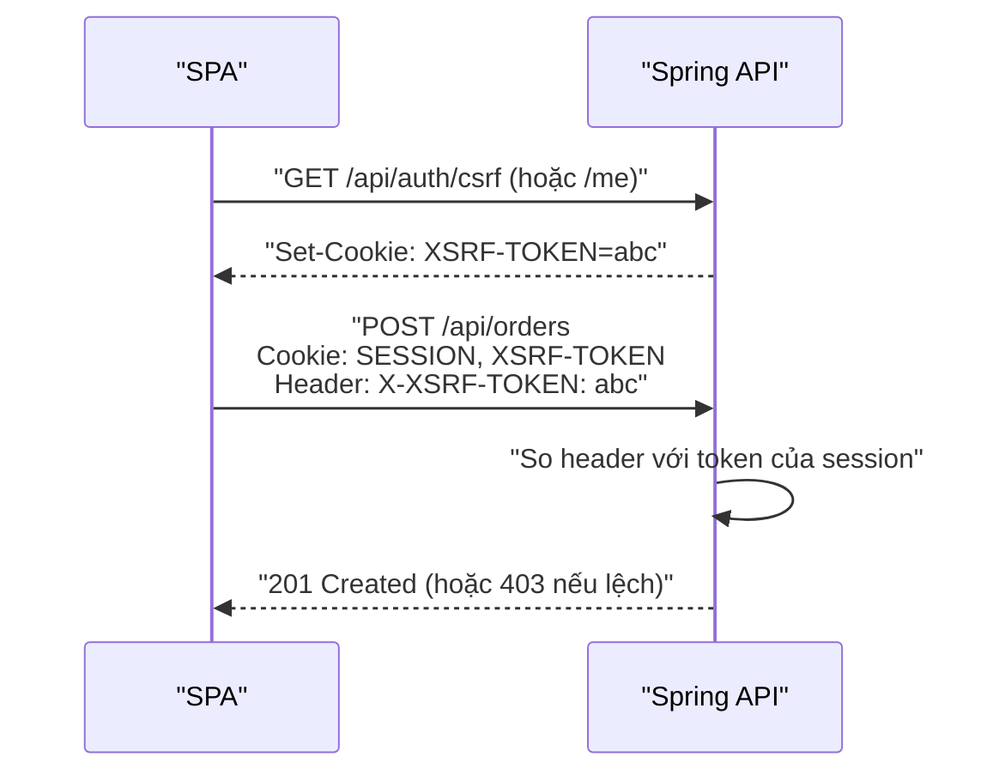
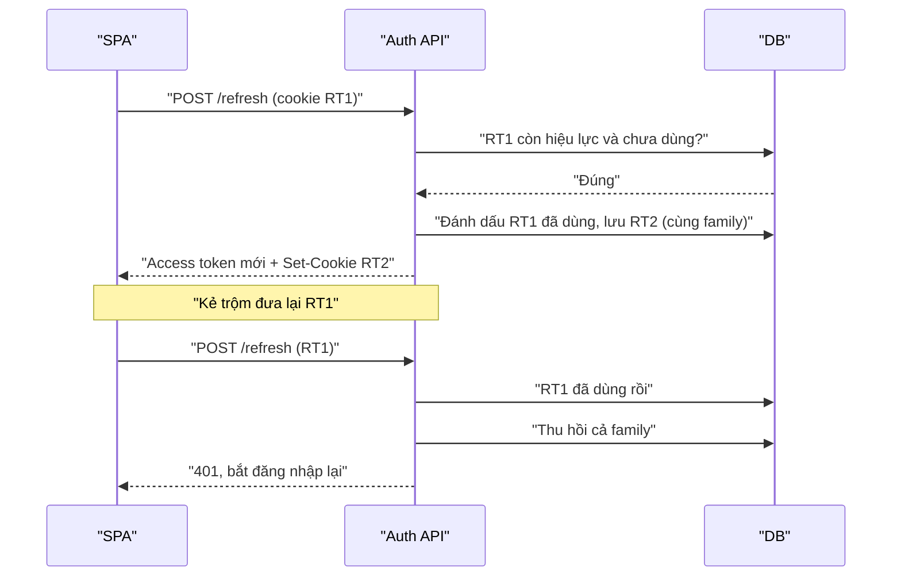
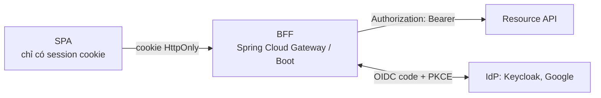

# Lý thuyết 02: Authentication cho SPA với Spring Security

## Vấn đề cần giải quyết

Với trang render phía server, đăng nhập là chuyện của trình duyệt và server: form, session cookie, xong. SPA phá vỡ mô hình đó. Trang được tải một lần, sau đó JavaScript gọi API bằng `fetch`. Ba câu hỏi nảy sinh cùng lúc: thông tin đăng nhập giữ ở đâu để JavaScript không đánh cắp được; làm sao chống một trang độc hại bắt trình duyệt gọi API thay người dùng; và khi session hết hạn giữa chừng thì giao diện xử lý ra sao mà không ném người dùng ra ngoài giữa lúc đang điền form.

Bài này đi từ đầu đến cuối: chọn cơ chế (session cookie hay JWT), cấu hình Spring Security 6 `SecurityFilterChain`, CSRF và CORS đúng cho SPA, refresh token rotation, logout, rồi phía SPA (interceptor, route guard). Cuối bài là BFF và OIDC để biết hướng đi khi hệ thống lớn lên.

Khi nào dùng cách đơn giản (session cookie): SPA và API cùng tổ chức, cùng site (hoặc qua reverse proxy cùng gốc), không có bên thứ ba. Khi nào cần hơn (OIDC, token): đăng nhập một lần cho nhiều ứng dụng, đăng nhập bằng Google hoặc Keycloak, API được gọi bởi app mobile và dịch vụ khác.

Bài này bổ sung cho các bài nền: [Spring Security và JWT](/go?p=01-Spring-Boot%2Fmedium%2Flt-06-spring-security-jwt.md), [Spring Security chuyên sâu](/go?p=01-Spring-Boot%2Fhard%2Flt-35-spring-security-chuyen-sau.md), [Authentication: session và token](/go?p=03-Network-Security%2Fmedium%2Flt-05-xac-thuc-phien-token.md), [Bảo mật frontend](/go?p=11-Frontend-Core%2Flt-04-bao-mat-frontend.md). Phần giao diện nối với [Vue: router và forms](/go?p=10-Vue%2Fmedium%2Flt-06-router-forms.md) và [React: routing, forms, data](/go?p=09-React%2Fmedium%2Flt-06-routing-forms-data.md). Các khái niệm đã giải thích kỹ ở bài nền sẽ chỉ nhắc ngắn, bài này tập trung vào chỗ SPA và Spring gặp nhau.

**Tóm tắt:**

- Mọi lựa chọn authentication cho SPA quy về một câu hỏi: credential nằm ở đâu trong trình duyệt; JS đọc được thì rủi ro XSS, cookie `HttpOnly` thì phải chống CSRF.
- SPA cùng tổ chức nên dùng session cookie `HttpOnly; Secure; SameSite=Lax` kèm CSRF token, ưu tiên cùng origin để khỏi dính CORS.
- CSRF token hiệu quả vì kẻ tấn công không đọc được giá trị token (same-origin policy) để đặt vào header `X-XSRF-TOKEN`.
- Spring Security 6: entry point trả 401, bật `http.cors()`, dùng `CookieCsrfTokenRepository.withHttpOnlyFalse()` kèm handler SPA và filter ép tải token.
- Refresh token dùng rotation và phát hiện tái sử dụng; ở SPA dùng single-flight refresh để các request cùng chờ một lần refresh.
- `401` là chưa authenticate hoặc hết session, `403` là đã đăng nhập nhưng thiếu quyền; guard ở UI chỉ là tiện ích, authorization thật kiểm ở API.
- Logout phải hủy session phía server, xóa cookie và dọn cache; khi có IdP thì dùng BFF hoặc Authorization Code với PKCE, đừng tự viết giao thức.

## Các khái niệm cần biết

| Keyword | Là gì | Dùng khi nào |
|---|---|---|
| Session cookie | Server giữ session, trình duyệt giữ mã session trong cookie (`JSESSIONID`) | Mặc định cho SPA cùng site |
| JWT | Token tự mang thông tin, ký bằng key | API stateless, nhiều dịch vụ; cần cân nhắc kỹ thu hồi |
| `HttpOnly` | Cờ cookie: JavaScript không đọc được | Cookie session, refresh token |
| `Secure` | Cờ cookie: chỉ gửi qua HTTPS | Luôn bật ở môi trường thật |
| `SameSite` | Cờ cookie: giới hạn gửi cookie trong request xuyên site (`Strict`, `Lax`, `None`) | Layer phòng thủ đầu tiên chống CSRF |
| CSRF | Trang khác lợi dụng cookie tự động gửi để thực hiện hành động thay người dùng | Mọi API dùng cookie authentication |
| CORS | Cơ chế trình duyệt cho phép trang ở origin A đọc response từ origin B | SPA và API khác origin |
| Origin | Bộ ba scheme + host + port | Xác định "khác origin" |
| Site | Miền đăng ký (ví dụ `example.com`), bỏ qua port và subdomain | `SameSite` tính theo site, không phải origin |
| Access token | Token ngắn hạn (vài phút) gửi kèm mỗi request | Gọi API |
| Refresh token | Token dài hạn đổi lấy access token mới | Giữ đăng nhập mà không giữ access token lâu |
| Rotation | Mỗi lần refresh cấp refresh token mới, token cũ bị vô hiệu | Giảm thiệt hại khi token bị lộ |
| BFF | Backend For Frontend: server nhỏ đứng giữa, giữ token, SPA chỉ có cookie | Khi dùng OIDC mà không muốn token nằm trong trình duyệt |
| OIDC | Layer danh tính trên OAuth 2.0 | Đăng nhập qua IdP (Keycloak, Google, Azure AD) |
| PKCE | Cơ chế chứng minh bên đổi mã chính là bên xin mã | Bắt buộc cho SPA dùng Authorization Code |

## Chọn cơ chế: session cookie hay JWT

Câu hỏi đầu tiên không phải "JWT hay không" mà là "token nằm ở đâu trong trình duyệt". Có hai chỗ: memory JavaScript hoặc `localStorage` (script đọc được), và cookie `HttpOnly` (script không đọc được). Phần lớn rủi ro thực tế đến từ XSS: một dòng script chèn vào trang đọc được `localStorage` và gửi token đi. Cookie `HttpOnly` không bị đọc theo cách đó (script vẫn có thể gọi API thay người dùng khi đang ở trong trang, nhưng không mang token đi nơi khác).

**Nền tảng:** Mọi lựa chọn authentication cho SPA quy về một câu hỏi: thông tin đăng nhập nằm ở đâu trong trình duyệt. Nằm ở nơi JavaScript đọc được (memory, `localStorage`) thì rủi ro là XSS lấy cắp token. Nằm trong cookie `HttpOnly` thì script không đọc được, nhưng trình duyệt tự gắn cookie vào request nên rủi ro chuyển sang CSRF. Không có lựa chọn miễn phí: cookie cần chống CSRF, header token cần chống XSS.

| Tiêu chí | Session cookie | JWT trong header |
|---|---|---|
| Nơi lưu ở trình duyệt | Cookie `HttpOnly` | Memory hoặc `localStorage` (script đọc được) |
| Thu hồi (logout, lock tài khoản) | Dễ: xóa session phía server | Khó: phải có danh sách thu hồi hoặc token rất ngắn |
| Mở rộng nhiều instance | Cần session chung (Redis, Spring Session) | Stateless, thuận tiện |
| CSRF | Có, phải chống | Không với header `Authorization` tự gắn |
| XSS lấy cắp token | Khó hơn | Dễ nếu để `localStorage` |
| Độ phức tạp | Thấp | Cao hơn (refresh, xoay key, thu hồi) |
| Hợp với | SPA cùng tổ chức | Mobile, dịch vụ gọi dịch vụ, nhiều API |

Quy tắc thực dụng cho SPA nội bộ hoặc sản phẩm một tổ chức: **dùng session cookie `HttpOnly`, kèm CSRF**. Đó là cách ít bộ phận chuyển động nhất. Chỉ chuyển sang token khi có yêu cầu thật (mobile, nhiều dịch vụ, IdP bên ngoài), và khi đó cân nhắc để token nằm ở server (BFF) thay vì trong trình duyệt. Chi tiết vì sao JWT khó thu hồi xem [bài nền JWT](/go?p=01-Spring-Boot%2Fmedium%2Flt-06-spring-security-jwt.md).

**Phải thuộc:** SPA cùng tổ chức dùng session cookie `HttpOnly; Secure; SameSite=Lax` kèm CSRF token, và ưu tiên cùng origin để khỏi dính CORS. Chỉ chuyển sang token khi có mobile, nhiều dịch vụ hoặc IdP bên ngoài; khi đó ưu tiên BFF để token ở server.

## Cookie: HttpOnly, Secure, SameSite

Cookie session đúng cho SPA có ba cờ. Spring Boot đặt qua cấu hình, không cần code:

_Minh họa_

```yaml
server:
  servlet:
    session:
      cookie:
        http-only: true
        secure: true
        # hoặc strict nếu không có liên kết đăng nhập từ trang ngoài
        same-site: lax
        name: SESSION
      timeout: 30m
```

`SameSite` hay bị hiểu nhầm. Nó tính theo **site** chứ không phải origin: `localhost:5173` (Vite) và `localhost:8080` (Spring) khác origin nhưng **cùng site**, nên cookie vẫn được gửi. Còn `app.example.com` và `api.other.com` khác site: cookie chỉ gửi nếu `SameSite=None; Secure`, và khi đó CSRF không còn được `SameSite` che chắn.

| Giá trị | Cookie có được gửi trong request xuyên site? | Ghi chú |
|---|---|---|
| `Strict` | Không bao giờ | An toàn nhất; bấm link từ email vào trang có thể bị coi như chưa đăng nhập ở lần đầu |
| `Lax` | Chỉ khi điều hướng cấp cao bằng GET (bấm link) | Mặc định hợp lý; POST từ trang khác không mang cookie |
| `None` | Có (phải kèm `Secure`) | Chỉ khi thật sự cần, ví dụ SPA và API khác site |

`SameSite` là layer phòng thủ chứ không thay thế CSRF token: nó phụ thuộc trình duyệt, không che subdomain bị chiếm quyền, và request cùng site vẫn mang cookie. Vì vậy vẫn bật CSRF token (mục sau).

**Phải thuộc:** `SameSite` tính theo site (miền đăng ký) chứ không phải origin. `Strict` không gửi cookie trong mọi request xuyên site; `Lax` chỉ gửi khi điều hướng cấp cao bằng GET; `None` gửi luôn nhưng bắt buộc kèm `Secure`. Nó bổ sung chứ không thay thế CSRF token.

## Cấu hình Spring Security 6

Dưới đây là một `SecurityFilterChain` cho API phục vụ SPA dùng session cookie. Đi từng ý trước khi xem code:

- **API không redirect về trang login**. Mặc định Spring chuyển hướng 302 tới form; `fetch` sẽ đi theo và nhận HTML. Ta muốn trả `401` JSON để SPA tự quyết định.
- **Đăng nhập qua JSON** `POST /api/auth/login`, tự viết controller gọi `AuthenticationManager`, hoặc dùng `formLogin` với handler trả 200/401. Bản dưới dùng controller để dễ kiểm soát.
- **CSRF bằng cookie** `XSRF-TOKEN` mà JavaScript đọc được, SPA gửi lại trong header `X-XSRF-TOKEN`.
- **CORS** bật qua `CorsConfigurationSource`, không dùng `*` khi có `allowCredentials`.
- **Logout** là `POST` và có CSRF.

_Minh họa_

```java
@Configuration
@EnableWebSecurity
class SecurityConfig {

    @Bean
    SecurityFilterChain api(HttpSecurity http) throws Exception {
        http
          .cors(Customizer.withDefaults())
          .csrf(csrf -> csrf
              .csrfTokenRepository(CookieCsrfTokenRepository.withHttpOnlyFalse())
              .csrfTokenRequestHandler(new SpaCsrfTokenRequestHandler()))
          .addFilterAfter(new CsrfCookieFilter(), BasicAuthenticationFilter.class)
          .authorizeHttpRequests(auth -> auth
              .requestMatchers("/api/auth/login", "/api/auth/csrf").permitAll()
              .requestMatchers("/actuator/health").permitAll()
              .requestMatchers("/api/admin/**").hasRole("ADMIN")
              .anyRequest().authenticated())
          .exceptionHandling(ex -> ex
              .authenticationEntryPoint(new HttpStatusEntryPoint(HttpStatus.UNAUTHORIZED))
              .accessDeniedHandler((req, res, e) -> res.setStatus(HttpStatus.FORBIDDEN.value())))
          .sessionManagement(s -> s
              .sessionCreationPolicy(SessionCreationPolicy.IF_REQUIRED)
              .sessionFixation(f -> f.changeSessionId())
              .maximumSessions(5))
          .logout(l -> l
              .logoutUrl("/api/auth/logout")
              .logoutSuccessHandler(new HttpStatusReturningLogoutSuccessHandler(HttpStatus.NO_CONTENT))
              .deleteCookies("SESSION", "XSRF-TOKEN"));
        return http.build();
    }

    @Bean
    CorsConfigurationSource corsConfigurationSource(
            @Value("${app.cors.allowed-origins}") List<String> origins) {
        var cfg = new CorsConfiguration();
        // ví dụ https://app.example.com
        cfg.setAllowedOrigins(origins);
        cfg.setAllowedMethods(List.of("GET", "POST", "PUT", "PATCH", "DELETE", "OPTIONS"));
        cfg.setAllowedHeaders(List.of("Content-Type", "X-XSRF-TOKEN", "Accept"));
        // bắt buộc để cookie đi cùng
        cfg.setAllowCredentials(true);
        cfg.setMaxAge(Duration.ofHours(1));
        var source = new UrlBasedCorsConfigurationSource();
        source.registerCorsConfiguration("/api/**", cfg);
        return source;
    }

    @Bean
    AuthenticationManager authenticationManager(AuthenticationConfiguration cfg) throws Exception {
        return cfg.getAuthenticationManager();
    }
}
```

Một số chi tiết quan trọng mà người mới thường sai:

- `http.cors(...)` phải có thì filter CORS mới chạy **trước** filter bảo mật. Nếu không, request preflight `OPTIONS` (không mang cookie) bị chặn 401 và trình duyệt báo lỗi CORS gây hiểu lầm.
- `allowCredentials(true)` không đi cùng `allowedOrigins("*")`. Spring ném lỗi nếu bạn thử; phải liệt kê origin cụ thể.
- `changeSessionId()` đổi mã session sau khi đăng nhập để chống session fixation (đây là mặc định của Spring Security khi dùng servlet container hiện đại, ghi tường minh cho rõ).
- Danh sách `allowedHeaders` phải gồm `X-XSRF-TOKEN`, nếu không preflight từ chối header đó.

Controller đăng nhập: authentication, lưu `SecurityContext` vào session rồi trả thông tin người dùng. Từ Spring Security 6, phải lưu context tường minh vì không còn lưu tự động ngoài các filter có sẵn.

_Minh họa_

```java
@RestController
@RequestMapping("/api/auth")
class AuthController {
    private final AuthenticationManager manager;
    private final SecurityContextRepository repo = new HttpSessionSecurityContextRepository();

    AuthController(AuthenticationManager manager) { this.manager = manager; }

    record LoginRequest(@NotBlank String username, @NotBlank String password) {}
    record MeResponse(String username, List<String> roles) {}

    @PostMapping("/login")
    MeResponse login(@Valid @RequestBody LoginRequest req,
                     HttpServletRequest request, HttpServletResponse response) {
        var token = UsernamePasswordAuthenticationToken.unauthenticated(req.username(), req.password());
        // sai mật khẩu: ném AuthenticationException, sẽ thành 401
        Authentication auth = manager.authenticate(token);
        SecurityContext ctx = SecurityContextHolder.createEmptyContext();
        ctx.setAuthentication(auth);
        SecurityContextHolder.setContext(ctx);
        repo.saveContext(ctx, request, response);                 // ghi vào session
        return toMe(auth);
    }

    @GetMapping("/me")
    MeResponse me(Authentication auth) { return toMe(auth); }

    private MeResponse toMe(Authentication auth) {
        return new MeResponse(auth.getName(),
            auth.getAuthorities().stream().map(GrantedAuthority::getAuthority).toList());
    }
}
```

Lưu ý: khi `manager.authenticate` ném `BadCredentialsException` bên trong controller, nó không đi qua `AuthenticationEntryPoint` (đó chỉ cho request chưa authentication chạm tài nguyên bảo vệ). Cần `@ExceptionHandler(AuthenticationException.class)` trả `401` ProblemDetail, nếu không bạn nhận 500. Đồng thời không phân biệt "sai tên" và "sai mật khẩu" trong thông điệp, để không lộ tài khoản nào tồn tại; và có giới hạn số lần thử (rate limit) như bài [Spring Security chuyên sâu](/go?p=01-Spring-Boot%2Fhard%2Flt-35-spring-security-chuyen-sau.md).

Endpoint `/api/auth/me` cho SPA hỏi "tôi đang đăng nhập chưa" khi tải trang. Đây là cách chuẩn: SPA không tự đoán từ biến cục bộ, nó hỏi server.

## CSRF với SPA

CSRF xảy ra vì trình duyệt tự gắn cookie vào mọi request tới miền đó, kể cả khi request do trang `evil.com` kích hoạt. Nếu API chỉ dựa vào cookie, trang độc hại có thể gửi `POST /api/orders/42/cancel` bằng trình duyệt của nạn nhân. CSRF token chặn điều này vì kẻ tấn công **không đọc được** giá trị token (same-origin policy cấm trang khác đọc cookie hay response của bạn) nên không thể đặt nó vào header.

**Nền tảng:** CSRF tồn tại vì trình duyệt tự gắn cookie vào mọi request tới miền đó, kể cả khi request do trang khác kích hoạt. CSRF token hiệu quả vì kẻ tấn công không đọc được giá trị token (same-origin policy), nên không thể đặt nó vào header `X-XSRF-TOKEN`.

Cơ chế "double submit" kiểu Spring cho SPA: server đặt cookie `XSRF-TOKEN` (JavaScript đọc được, nên `HttpOnly=false`); SPA đọc nó và gửi lại trong header `X-XSRF-TOKEN` ở mọi request thay đổi dữ liệu; server so sánh.



Từ Spring Security 6, mặc định dùng `XorCsrfTokenRequestAttributeHandler` (mask giá trị để chống tấn công BREACH) và **tải token muộn** (deferred). Hai điều này làm SPA đọc cookie rồi gửi nguyên giá trị bị từ chối, và cookie có thể chưa được ghi ở lần tải đầu. Cách xử lý được tài liệu Spring Security hướng dẫn cho SPA: một handler kết hợp, và một filter ép token được tải để cookie luôn được đặt. Kiểm tra lại theo phiên bản Spring Security bạn dùng.

_Minh họa_

```java
final class SpaCsrfTokenRequestHandler implements CsrfTokenRequestHandler {
    private final CsrfTokenRequestHandler plain = new CsrfTokenRequestAttributeHandler();
    private final CsrfTokenRequestHandler xor = new XorCsrfTokenRequestAttributeHandler();

    @Override
    public void handle(HttpServletRequest request, HttpServletResponse response,
                       Supplier<CsrfToken> csrfToken) {
        // giữ XOR cho giá trị render ra
        this.xor.handle(request, response, csrfToken);
        // ép tải token để cookie được ghi
        csrfToken.get();
    }

    @Override
    public String resolveCsrfTokenValue(HttpServletRequest request, CsrfToken csrfToken) {
        // Nếu giá trị đến từ header (SPA gửi nguyên cookie) thì so sánh dạng thô
        String headerValue = request.getHeader(csrfToken.getHeaderName());
        return (StringUtils.hasText(headerValue) ? this.plain : this.xor)
            .resolveCsrfTokenValue(request, csrfToken);
    }
}

final class CsrfCookieFilter extends OncePerRequestFilter {
    @Override
    protected void doFilterInternal(HttpServletRequest request, HttpServletResponse response,
                                    FilterChain chain) throws ServletException, IOException {
        CsrfToken token = (CsrfToken) request.getAttribute(CsrfToken.class.getName());
        if (token != null) token.getToken();   // chạm vào để cookie XSRF-TOKEN được gửi
        chain.doFilter(request, response);
    }
}
```

Phía SPA, axios làm sẵn phần việc: mặc định nó đọc cookie `XSRF-TOKEN` và gửi `X-XSRF-TOKEN` cho request cùng origin (đúng với tên mặc định của Spring). Với request khác origin, cần `withCredentials: true` và `withXSRFToken: true` (axios 1.x, kiểm tra lại theo phiên bản). Với `fetch` thuần, bạn tự đọc cookie:

_Minh họa_

```ts
function readCookie(name: string): string | undefined {
  return document.cookie.split('; ')
    .find(c => c.startsWith(name + '='))?.split('=')[1]
}

export async function apiFetch(path: string, init: RequestInit = {}) {
  const method = (init.method ?? 'GET').toUpperCase()
  const headers = new Headers(init.headers)
  if (!['GET', 'HEAD', 'OPTIONS'].includes(method)) {
    const xsrf = readCookie('XSRF-TOKEN')
    if (xsrf) headers.set('X-XSRF-TOKEN', decodeURIComponent(xsrf))
  }
  return fetch('/api' + path, { ...init, headers, credentials: 'include' })
}
```

Khi không cần CSRF? Nếu API dùng token trong header `Authorization` do JavaScript gắn thủ công (không cookie), trình duyệt không tự gắn nó, nên CSRF không áp dụng. Nhưng đổi lại token nằm ở nơi script đọc được. Không có lựa chọn miễn phí: cookie thì cần CSRF, header thì cần bảo vệ XSS.

## CORS đúng chỗ, và cách tránh CORS

CORS không phải biện pháp bảo mật phía server: nó là quy tắc **trình duyệt** áp dụng lên response. Server curl được thoải mái. Nó chỉ trả lời câu hỏi "trang ở origin A có được đọc response của origin B không".

Cách đơn giản nhất để không đau đầu vì CORS là **làm cho SPA và API cùng origin**: Nginx phục vụ file tĩnh ở `/` và chuyển `/api` tới Spring (xem [bài 05](/go?p=12-Fullstack%2Flt-05-dong-goi-deploy-docker-nginx-ci.md)); khi phát triển, Vite proxy `/api` tới `localhost:8080`. Khi đó không có CORS, cookie `SameSite=Lax` chạy tự nhiên.

Chỉ cấu hình CORS khi buộc phải khác origin. Hiện tượng gặp phổ biến:

| Triệu chứng trong DevTools | Nguyên nhân thường gặp |
|---|---|
| Preflight `OPTIONS` trả 401 hoặc 403 | Thiếu `http.cors(...)` hoặc CORS filter chạy sau security |
| "Credentials flag is true, but Access-Control-Allow-Credentials is not true" | Thiếu `allowCredentials(true)` |
| "Wildcard ... when credentials flag is true" | Dùng `*` cho origin hoặc header khi có credentials |
| Cookie không gửi dù CORS xong | Quên `credentials: 'include'` / `withCredentials`, hoặc `SameSite` chặn |
| Header tùy chỉnh bị từ chối | Chưa có trong `allowedHeaders` |
| Đọc được body nhưng không đọc được header `X-Total-Count` | Cần `exposedHeaders` |

## Refresh token rotation

Nếu chọn token, access token nên sống ngắn (5 đến 15 phút) và refresh token đổi lấy cái mới. Để refresh token an toàn hơn, có ba nguyên tắc:

1. Refresh token đặt trong cookie `HttpOnly; Secure; SameSite=Strict`, giới hạn `Path=/api/auth` để không gửi kèm các request khác.
2. **Rotation**: mỗi lần dùng refresh token, server cấp refresh token mới và vô hiệu cái cũ.
3. **Phát hiện tái sử dụng**: nếu một refresh token đã bị vô hiệu mà lại được đưa tới, nghĩa là có bản sao bị đánh cắp. Server thu hồi cả "họ" (family) token của người dùng đó, buộc đăng nhập lại.



Server chỉ lưu **hash** của refresh token (như mật khẩu), để lộ DB không lộ token. Đây là phác thảo bảng và logic:

_Minh họa_

```java
@Entity
class RefreshTokenEntity {
    @Id UUID id;
    UUID familyId;
    String tokenHash;         // SHA-256 của giá trị gửi cho client
    Long userId;
    Instant expiresAt;
    boolean used;
    boolean revoked;
}

@Transactional
public TokenPair rotate(String presented) {
    var hash = sha256(presented);
    var rt = repo.findByTokenHash(hash).orElseThrow(UnauthorizedException::new);
    if (rt.revoked || rt.expiresAt.isBefore(Instant.now())) throw new UnauthorizedException();
    if (rt.used) {                                   // tái sử dụng: có dấu hiệu bị trộm
        repo.revokeFamily(rt.familyId);
        throw new UnauthorizedException();
    }
    rt.used = true;
    var next = issueRefresh(rt.userId, rt.familyId); // token mới cùng family
    return new TokenPair(issueAccess(rt.userId), next);
}
```

Một tình huống thực tế khó chịu: người dùng mở hai tab, hai tab cùng gọi refresh gần như đồng thời với cùng RT1. Tab thứ hai thấy RT1 "đã dùng" và bị coi là trộm, cả family bị thu hồi. Hai biện pháp: phía SPA chỉ cho **một** lần refresh tại một thời điểm (single-flight, xem mục tiếp theo), và phía server cho một cửa sổ ân hạn rất ngắn (vài giây) chấp nhận lại token vừa dùng. Đây là đánh đổi giữa an toàn và độ êm; cân nhắc theo mức rủi ro của hệ thống.

Nếu dùng session cookie thì không cần phần này: session server tự gia hạn theo hoạt động và thu hồi bằng cách xóa session.

## Phía SPA: interceptor, single-flight refresh, route guard

### Gom các lần refresh về một

Khi access token hết hạn, thường nhiều request đang bay cùng lúc đều nhận 401. Nếu mỗi cái tự gọi refresh, ta gặp đúng tình huống rotation ở trên. Giải pháp là giữ một promise refresh dùng chung; các request khác đợi nó rồi thử lại **đúng một lần**. Đây là TypeScript thuần, giả lập mạng bằng hàm có độ trễ để chạy được bằng Node:

```ts
let calls = { refresh: 0 };
let valid = false;
let refreshing: Promise<void> | null = null;

async function rawFetch(path: string): Promise<{ status: number; body: string }> {
  await new Promise(r => setTimeout(r, 5));
  if (path === '/auth/refresh') { calls.refresh++; valid = true; return { status: 204, body: '' }; }
  return valid ? { status: 200, body: 'data ' + path } : { status: 401, body: '' };
}

async function refreshOnce(): Promise<void> {
  refreshing ??= rawFetch('/auth/refresh')
    .then(r => { if (r.status !== 204) throw new Error('refresh failed'); })
    .finally(() => { refreshing = null; });
  return refreshing;
}

async function api(path: string, retried = false): Promise<string> {
  const res = await rawFetch(path);
  if (res.status === 401 && !retried && path !== '/auth/refresh') {
    await refreshOnce();
    return api(path, true);
  }
  if (res.status === 401) throw new Error('UNAUTHENTICATED -> chuyen /login');
  return res.body;
}

const out = await Promise.all([api('/orders'), api('/profile'), api('/cart')]);
console.log(out, 'refresh calls =', calls.refresh);
```

_Đã chạy thử bằng Node_ (v22, `--experimental-strip-types`). Output thật:

```text
[ 'data /orders', 'data /profile', 'data /cart' ] refresh calls = 1
```

Ba request cùng nhận 401 nhưng chỉ có một lần refresh. Hai điều cần giữ khi đưa vào dự án thật: chặn vòng lặp (không tự refresh khi chính `/auth/refresh` trả 401, và chỉ thử lại một lần mỗi request), và khi refresh thất bại thì xóa state đăng nhập rồi chuyển sang trang login.

Với session cookie (không refresh), interceptor đơn giản hơn: gặp 401 thì xóa state người dùng và đưa về `/login?returnTo=...`. Ví dụ axios:

_Minh họa_

```ts
import axios from 'axios'
import { useAuthStore } from '@/stores/auth'
import router from '@/router'

export const http = axios.create({ baseURL: '/api', withCredentials: true })

http.interceptors.response.use(
  r => r,
  err => {
    const status = err.response?.status
    const url: string = err.config?.url ?? ''
    if (status === 401 && !url.includes('/auth/login')) {
      useAuthStore().clear()
      router.push({ name: 'login', query: { returnTo: router.currentRoute.value.fullPath } })
    }
    return Promise.reject(err)
  },
)
```

Phân biệt hai mã: **401** nghĩa là chưa authentication hoặc hết session, cần đăng nhập lại; **403** nghĩa là đã đăng nhập nhưng không đủ quyền, đăng nhập lại không giúp gì, hiện thông báo "không có quyền". Gộp hai cái vào một xử lý là lỗi phổ biến làm người dùng bị đá ra trang login khi chỉ thiếu quyền.

**Phải thuộc:** `401` là chưa authentication hoặc hết session, cần đăng nhập lại; `403` là đã đăng nhập nhưng không đủ quyền, đăng nhập lại không giúp gì. Guard ở giao diện chỉ là tiện ích, quyền thật luôn kiểm ở API.

### Quay lại đúng trang sau khi đăng nhập

Tham số `returnTo` là chỗ dễ dính lỗi open redirect: nếu bạn chuyển thẳng tới giá trị đó, kẻ xấu gửi link `/login?returnTo=https://evil.com`. Chỉ nhận đường dẫn nội bộ. Hàm thuần TypeScript, đã kiểm tra các trường hợp tấn công phổ biến:

```ts
function safeReturnTo(raw: unknown, fallback = '/'): string {
  if (typeof raw !== 'string') return fallback;
  if (!raw.startsWith('/') || raw.startsWith('//') || raw.includes('\\')) return fallback;
  return raw;
}
for (const t of ['/orders/5', '//evil.com', 'https://evil.com', '/\\evil.com', undefined])
  console.log(String(t), '->', safeReturnTo(t));
```

_Đã chạy thử bằng Node_ (v22). Output thật:

```text
/orders/5 -> /orders/5
//evil.com -> /
https://evil.com -> /
/\evil.com -> /
undefined -> /
```

### Route guard trong Vue

Guard là **tiện ích giao diện**, không phải bảo mật: người dùng cố ý vẫn tải được mã trang. Bảo mật thật nằm ở API trả 401/403. Guard chỉ để tránh hiển thị màn hình mà người dùng không dùng được. Trạng thái đăng nhập lấy từ `/api/auth/me` khi ứng dụng khởi động (chỉ hỏi một lần, giữ promise).

_Minh họa_

```ts
// stores/auth.ts
import { defineStore } from 'pinia'
import { http } from '@/api/http'

export const useAuthStore = defineStore('auth', {
  state: () => ({ user: null as null | { username: string; roles: string[] }, ready: null as Promise<void> | null }),
  actions: {
    init() {
      this.ready ??= http.get('/auth/me')
        .then(r => { this.user = r.data })
        .catch(() => { this.user = null })
      return this.ready
    },
    clear() { this.user = null },
    hasRole(role: string) { return !!this.user?.roles.includes(role) },
  },
})

// router/index.ts
router.beforeEach(async (to) => {
  const auth = useAuthStore()
  await auth.init()
  if (to.meta.requiresAuth && !auth.user) {
    return { name: 'login', query: { returnTo: to.fullPath } }
  }
  if (to.meta.role && !auth.hasRole(to.meta.role as string)) {
    return { name: 'forbidden' }
  }
})
```

Khai báo trong route: `{ path: '/admin', component: AdminView, meta: { requiresAuth: true, role: 'ROLE_ADMIN' } }`. Xem thêm cách tổ chức router ở [Vue: router và forms](/go?p=10-Vue%2Fmedium%2Flt-06-router-forms.md).

### Route guard trong React

Với React Router (data router), đặt kiểm tra trong `loader` để chuyển hướng trước khi render, hoặc bọc bằng một component. Dưới đây là component bọc, dùng TanStack Query để hỏi `/me`:

_Minh họa_

```tsx
import { Navigate, Outlet, useLocation } from 'react-router-dom'
import { useQuery } from '@tanstack/react-query'
import { http } from '@/api/http'

function useMe() {
  return useQuery({
    queryKey: ['me'],
    queryFn: () => http.get('/auth/me').then(r => r.data),
    retry: false,
    staleTime: 5 * 60_000,
  })
}

export function RequireAuth({ role }: { role?: string }) {
  const { data: me, isPending } = useMe()
  const location = useLocation()
  if (isPending) return <p>Đang kiểm tra phiên...</p>
  if (!me) return <Navigate to={`/login?returnTo=${encodeURIComponent(location.pathname + location.search)}`} replace />
  if (role && !me.roles.includes(role)) return <Navigate to="/forbidden" replace />
  return <Outlet />
}
```

Dùng trong cây route: một route cha `element: <RequireAuth />` chứa các route con cần đăng nhập. Chi tiết routing và loader: [React: routing, forms, data](/go?p=09-React%2Fmedium%2Flt-06-routing-forms-data.md).

## Logout cho đúng

Logout trông đơn giản nhưng có ba việc, và thiếu một việc là có lỗ hổng:

1. **Phía server**: hủy session (hoặc thu hồi cả family refresh token). Chỉ xóa token ở trình duyệt mà server vẫn chấp nhận nó thì token bị lộ vẫn dùng được.
2. **Phía trình duyệt**: cookie bị xóa (server gửi `Set-Cookie` hết hạn), memory SPA bị làm sạch.
3. **Phía cache**: dọn dữ liệu đã tải của người dùng cũ (`queryClient.clear()` trong React Query, đặt lại các store Pinia). Nếu không, người kế tiếp đăng nhập trên cùng trình duyệt thấy dữ liệu cũ thoáng qua.

Logout là `POST` kèm CSRF, không phải `GET`: nếu là `GET` thì một thẻ `` trên trang độc hại có thể đăng xuất người dùng (lỗi nhẹ nhưng có thật). Cấu hình `logoutUrl("/api/auth/logout")` ở trên mặc định chỉ nhận `POST` khi CSRF bật.

Nhiều tab: khi tab A đăng xuất, tab B vẫn tin mình đang đăng nhập đến khi gọi API và nhận 401. Nếu cần phản ứng tức thì, phát event giữa các tab bằng `BroadcastChannel` hoặc event `storage`.

## BFF: để token không nằm trong trình duyệt

Khi dùng OIDC với IdP bên ngoài, câu hỏi khó là access token và refresh token nằm đâu. Nếu để trong trình duyệt, XSS lấy được chúng. **BFF** (Backend For Frontend) đảo lại: một server nhỏ cùng origin với SPA thực hiện toàn bộ flow OIDC, giữ token trong session phía server, còn trình duyệt chỉ thấy một session cookie `HttpOnly`. Khi SPA gọi `/api/...`, BFF gắn access token rồi chuyển tiếp tới API.



Lợi ích: token không tới trình duyệt, CSRF vẫn bảo vệ bằng cơ chế ở trên, logout và thu hồi session dễ. Đổi lại thêm một thành phần phải vận hành. Nó là lựa chọn mà nhiều khuyến nghị bảo mật hiện hành ưu tiên cho SPA có OIDC (kiểm tra lại các hướng dẫn mới nhất của IETF OAuth cho ứng dụng trình duyệt). Trong Spring, BFF thường là ứng dụng dùng `oauth2Login()` cộng `spring-cloud-gateway` với filter `TokenRelay`, kiểm tra lại cấu hình theo phiên bản.

## OIDC và Authorization Code với PKCE: khái quát

Nếu bạn không dùng BFF mà để SPA tự làm "public client", chuẩn hiện hành là **Authorization Code + PKCE**. Flow ngắn gọn:

1. SPA tạo `code_verifier` (chuỗi ngẫu nhiên) và `code_challenge = BASE64URL(SHA256(code_verifier))`.
2. SPA chuyển người dùng tới IdP kèm `code_challenge`. Người dùng đăng nhập ở IdP (mật khẩu của họ không bao giờ đi qua SPA).
3. IdP chuyển về SPA kèm `code` dùng một lần.
4. SPA gửi `code` cùng `code_verifier` tới IdP để đổi lấy token. IdP hash verifier và so với challenge ban đầu.

PKCE chặn kẻ chặn được `code` (qua redirect URI độc hại hay log) vì họ không có `code_verifier`. Flow Implicit (token trả thẳng trên URL) đã bị loại bỏ khỏi khuyến nghị hiện hành. Phía Spring, API đóng vai **resource server**: `oauth2ResourceServer(o -> o.jwt(Customizer.withDefaults()))` kiểm chữ ký bằng public key của IdP (`issuer-uri` trong cấu hình). Thư viện phía SPA (`oidc-client-ts`, Keycloak JS) lo phần PKCE; đừng tự viết.

Quy tắc chọn: SPA cùng tổ chức, một API: session cookie. SPA cần đăng nhập qua IdP: OIDC với BFF (ưu tiên) hoặc public client + PKCE. Mobile: Authorization Code + PKCE, token trong keychain của hệ điều hành.

## Bẫy thường gặp

| Bẫy | Hệ quả | Cách tránh |
|---|---|---|
| Lưu JWT trong `localStorage` | XSS lấy được token, dùng ở máy khác | Cookie `HttpOnly`, hoặc BFF |
| Tắt CSRF "cho tiện" khi dùng cookie | Trang độc hại thực hiện hành động thay người dùng | Giữ CSRF; chỉ tắt cho API thuần Bearer |
| CORS `*` kèm `allowCredentials` | Lỗi cấu hình, hoặc nếu phản chiếu mọi origin thì mở cửa cho mọi trang | Liệt kê origin cụ thể |
| Thiếu `http.cors()` | Preflight bị 401, báo lỗi CORS gây hiểu lầm | Bật CORS trong security filter chain |
| Không ép tải CSRF token (Spring 6 deferred) | Cookie `XSRF-TOKEN` không xuất hiện lần đầu, POST đầu tiên 403 | `CsrfCookieFilter` như trên |
| Gộp 401 và 403 | Người thiếu quyền bị đá ra trang login | Hai nhánh xử lý riêng |
| Nhiều request cùng refresh | Rotation coi là tái sử dụng, thu hồi cả family | Single-flight ở SPA, ân hạn ngắn ở server |
| Redirect về `returnTo` tùy ý | Open redirect, lừa đảo | Chỉ nhận đường dẫn nội bộ |
| Logout chỉ xóa state ở FE | Session server còn sống, token lộ vẫn dùng được | Hủy session server, xóa cookie, dọn cache |
| `SameSite=None` mà không có CSRF | Mất cả hai layer bảo vệ | Giữ CSRF token, đặt cùng origin nếu có thể |
| Tin vào route guard | Người dùng cố ý vượt qua guard | Luôn kiểm quyền ở API |
| Lộ lỗi chi tiết ở login | Dò tài khoản tồn tại | Thông điệp chung, rate limit |

## Câu hỏi phỏng vấn thường gặp

**Câu hỏi 1:** Đăng nhập thành công, `GET` chạy tốt, nhưng mọi `POST` đều trả 403 dù session cookie có đủ. Với axios cùng origin, bạn kiểm tra gì?

**Gợi ý suy luận:**
- 403 sau khi đã đăng nhập khác 401 ở điểm nào?
- Request `GET` an toàn có cần CSRF token không?
- Cookie nào và header nào phải có trong `POST`?

**Lập luận:** Request `GET` không đổi dữ liệu nên Spring không yêu cầu token CSRF; `POST` thì có. Cookie session đủ chỉ chứng minh danh tính, không chứng minh request do SPA gửi. Nếu header `X-XSRF-TOKEN` thiếu hoặc sai, `CsrfFilter` từ chối với 403. Nguyên nhân hay gặp: cookie `XSRF-TOKEN` chưa được ghi (token tải muộn, thiếu filter ép tải), giá trị bị mask bằng XOR không khớp với giá trị thô SPA gửi (thiếu handler tùy biến), hoặc request khác origin nên axios không tự gắn header.

**Đáp án ngắn:** Mở DevTools xem `POST` có header `X-XSRF-TOKEN` khớp cookie `XSRF-TOKEN` không; nếu không, sửa cấu hình CSRF handler/filter (Spring 6) hoặc `withXSRFToken`.

**Câu hỏi 2:** Trình duyệt báo "blocked by CORS policy" nhưng bạn thấy log server nhận request và xử lý thành công. Vì sao, và có phải server lỗi?

**Gợi ý suy luận:**
- CORS được ai thực thi, server hay trình duyệt?
- Trình duyệt chặn ở bước gửi hay bước đọc response?
- Request thế nào thì kích hoạt preflight?

**Lập luận:** CORS là quy tắc trình duyệt áp lên response. Với "simple request", request vẫn được gửi và server xử lý; trình duyệt chỉ không cho mã JavaScript đọc kết quả khi thiếu header `Access-Control-Allow-Origin` phù hợp. Với request có header tùy chỉnh hoặc `Content-Type: application/json`, có preflight `OPTIONS`; nếu preflight thất bại thì request thật không được gửi. Vì vậy "server đã chạy" chỉ phản ánh loại request không cần preflight; thiết lập đúng CORS trên server (hoặc tránh CORS bằng cùng origin) mới giải quyết.

**Đáp án ngắn:** Server không lỗi; trình duyệt chặn việc đọc response, cần cấu hình CORS đúng origin, credentials, header, hoặc đưa SPA và API về cùng origin.

**Câu hỏi 3:** Người dùng báo thỉnh thoảng bị đăng xuất bất ngờ khi mở nhiều tab, chỉ ở hệ thống dùng refresh token rotation. Giải thích và sửa?

**Gợi ý suy luận:**
- Rotation làm gì với token cũ sau mỗi lần refresh?
- Hai tab cùng hết hạn token cùng lúc thì gọi gì?
- Server coi việc dùng lại token cũ là gì?

**Lập luận:** Mỗi lần refresh, token cũ bị đánh dấu đã dùng. Hai tab cùng nhận 401 và cùng gọi refresh với cùng token. Tab đầu thành công, tab hai đem token đã dùng tới, bị server hiểu là tái sử dụng (dấu hiệu bị đánh cắp) nên thu hồi cả family, mọi tab mất session. Sửa bằng cách chỉ cho một lần refresh tại một lúc trong mỗi tab (single-flight), phối hợp giữa các tab (Web Locks hoặc `BroadcastChannel`) và cho server một cửa sổ ân hạn rất ngắn.

**Đáp án ngắn:** Race condition giữa các refresh concurrent bị coi là tái sử dụng token; dùng single-flight cộng ân hạn ngắn ở server.

**Câu hỏi 4:** Đội muốn bỏ CSRF vì "đã dùng SameSite=Lax rồi". Phản biện thế nào?

**Gợi ý suy luận:**
- `SameSite` tính theo site hay origin?
- Trình duyệt cũ hoặc subdomain bị chiếm thì sao?
- `Lax` còn gửi cookie trong trường hợp nào?

**Lập luận:** `SameSite` được trình duyệt thực thi, không phải server, nên phụ thuộc phiên bản trình duyệt. Nó tính theo site: request từ subdomain khác của cùng site vẫn mang cookie, nên một subdomain bị chiếm hoặc có XSS trở thành bàn đạp tấn công. `Lax` còn gửi cookie với điều hướng `GET` cấp cao, nên endpoint đổi dữ liệu bằng `GET` vẫn bị tấn công. CSRF token là layer độc lập không phụ thuộc các giả định này, chi phí thấp, nên giữ cả hai.

**Đáp án ngắn:** `SameSite` là layer bổ sung, không thay CSRF token, vì nó phụ thuộc trình duyệt và chỉ bảo vệ ở mức site.

**Câu hỏi 5:** Vì sao nhiều hướng dẫn khuyên dùng BFF thay vì để SPA giữ access token, ngay cả khi token ngắn hạn?

**Gợi ý suy luận:**
- Token ở trong JavaScript thì XSS làm được gì?
- Token ngắn hạn giảm thiệt hại ở điểm nào, và không giảm ở điểm nào?
- BFF để cái gì ở trình duyệt thay cho token?

**Lập luận:** Nếu token nằm trong JavaScript, một đoạn XSS đọc nó và gửi ra ngoài. Hạn ngắn chỉ giới hạn thời gian dùng, kẻ tấn công vẫn hành động trong khoảng đó, và refresh token còn nguy hiểm hơn. Với BFF, trình duyệt chỉ giữ cookie `HttpOnly` mà script không đọc được, token ở server. XSS vẫn có thể gọi API ngay trong trang nạn nhân, nhưng không mang được token đi nơi khác để dùng lâu dài. Vì vậy BFF thu hẹp thiệt hại của XSS đáng kể.

**Đáp án ngắn:** BFF giữ token ở server, trình duyệt chỉ có cookie HttpOnly, nên XSS không lấy được token để dùng ngoài trang.

Tiếp theo: [Realtime: SSE và WebSocket](/go?p=12-Fullstack%2Flt-03-realtime-sse-websocket.md), nơi authentication cho kết nối dài cũng cần xử lý.

