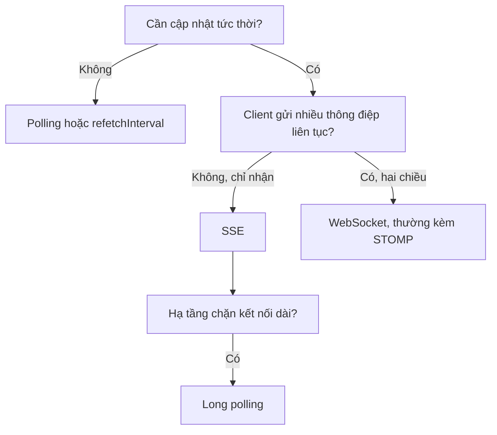
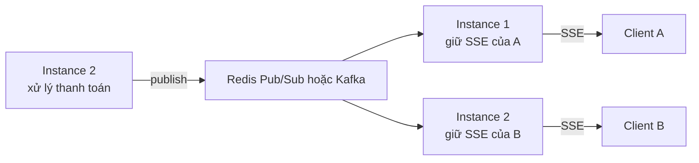

# Lý thuyết 03: Realtime với SSE và WebSocket

Màn hình danh sách đơn hàng chạy tốt cho tới khi nhân viên kho hỏi: "Khách vừa thanh toán xong, sao tôi phải bấm F5 mới thấy?". Request/response thuần của HTTP chỉ cho client hỏi, server không tự báo được. Bài này nói về bốn cách đưa thay đổi từ server xuống trình duyệt (polling, long polling, SSE, WebSocket), cách chọn, cách làm với Spring Boot, và ba chỗ hay hỏng khi đưa vào hệ thống thật: chạy nhiều instance, authentication kết nối, và phía giao diện (reconnect, dọn kết nối, hợp nhất dữ liệu với cache).

Dùng realtime khi người dùng thật sự được lợi từ độ trễ vài giây hoặc ít hơn (trạng thái thanh toán, thông báo, chat, bảng điều khiển). Không dùng khi dữ liệu đổi vài phút một lần: polling mỗi 30 giây hoặc `refetchInterval` của TanStack Query đơn giản hơn nhiều và đủ tốt.

**Tóm tắt:**

- Có bốn cách đưa thay đổi từ server xuống trình duyệt: polling, long polling, SSE, WebSocket; chọn theo chiều dữ liệu và tần suất.
- Server chỉ đẩy một chiều thì chọn SSE (HTTP thường, tự nối lại, có `Last-Event-ID`, chỉ văn bản); cần hai chiều tần suất cao mới dùng WebSocket.
- Dữ liệu đổi vài phút một lần thì polling hoặc `refetchInterval` là đủ và đơn giản hơn nhiều.
- Kết nối realtime là state trong memory từng instance, nên chạy nhiều instance cần kênh chung (Redis, Kafka, broker relay).
- `EventSource` tự nối lại khi đứt, nhưng nhận non-200 hoặc sai `Content-Type` thì chuyển `CLOSED` và dừng hẳn; UI phải tự nối lại với backoff có jitter.
- Authentication cho kết nối dài khó hơn REST: SSE dùng lại cookie, WebSocket phải tự lo (ticket ngắn hạn).
- Hợp nhất event realtime với cache phải xử lý trùng và đến muộn (gắn `version`), và luôn đóng kết nối khi component bị hủy.

## Các khái niệm cần biết

| Keyword | Là gì, dùng khi nào |
|---|---|
| Polling | Client gọi lại API theo chu kỳ. Dùng khi dữ liệu đổi chậm, muốn đơn giản nhất. |
| Long polling | Client gọi, server giữ request cho tới khi có dữ liệu hoặc hết thời gian, rồi client gọi lại. Dùng khi hạ tầng không cho SSE hoặc WebSocket. |
| SSE (Server-Sent Events) | Một response HTTP không đóng, server đẩy các event văn bản theo một chiều (server tới client). Dùng cho thông báo, tiến độ, cập nhật trạng thái. |
| WebSocket | Kết nối TCP hai chiều nâng cấp từ HTTP (`Upgrade`). Dùng khi client cũng gửi nhiều thông điệp nhỏ liên tục (chat, game, cộng tác). |
| STOMP | Giao thức nhắn tin văn bản chạy trên WebSocket, có `SUBSCRIBE`, `SEND`, đích (destination). Spring dùng nó để định tuyến thông điệp. |
| Message broker | Thành phần phân phát thông điệp tới người đăng ký. Spring có broker đơn giản trong memory, hoặc chuyển tiếp tới broker ngoài. |
| `Last-Event-ID` | Header mà `EventSource` tự gửi khi nối lại, mang `id` của event cuối đã nhận, để server gửi bù phần bị lỡ. |
| Heartbeat | Gói tin nhỏ gửi định kỳ để giữ kết nối khỏi bị proxy cắt và để hai bên phát hiện kết nối chết. |
| Backoff với jitter | Chờ lâu dần giữa các lần nối lại, cộng ngẫu nhiên để hàng nghìn client không cùng nối lại một lúc. |

## Chọn cách nào



Với phần lớn ứng dụng nghiệp vụ (đơn hàng, thanh toán, thông báo), dữ liệu chỉ chảy từ server xuống. SSE đủ dùng và rẻ hơn WebSocket nhiều mặt: là HTTP thường nên đi qua cookie, CORS, filter authentication hiện có; trình duyệt tự nối lại; có sẵn cơ chế `id` để gửi bù. Việc client gửi lên vẫn dùng REST bình thường. WebSocket đáng dùng khi hai chiều thật sự và tần suất cao, chấp nhận trả giá bằng việc tự lo authentication, nối lại, và phục hồi state.

**Phải thuộc:** Server chỉ đẩy xuống một chiều thì chọn SSE (HTTP thường, trình duyệt tự nối lại, có `Last-Event-ID` để gửi bù, chỉ văn bản). Cần hai chiều tần suất cao thì chọn WebSocket (phải tự lo authentication, nối lại, phục hồi state). Dữ liệu đổi vài phút một lần thì polling là đủ.

| Tiêu chí | Polling | SSE | WebSocket |
|---|---|---|---|
| Chiều dữ liệu | Client hỏi | Server tới client | Hai chiều |
| Độ trễ | Bằng chu kỳ | Gần tức thời | Gần tức thời |
| Tự nối lại | Không cần | Có sẵn (EventSource) | Tự viết |
| Gửi bù khi mất kết nối | Hiển nhiên (hỏi lại) | `Last-Event-ID` | Tự thiết kế |
| Qua proxy, CDN | Dễ | Cần tắt buffering | Cần cấu hình Upgrade |
| Định dạng | Tùy ý | Chỉ văn bản | Văn bản hoặc nhị phân |

Một giới hạn của SSE hay bị quên: với HTTP/1.1 trình duyệt chỉ mở khoảng 6 kết nối mỗi domain, mỗi tab giữ một kết nối SSE sẽ ăn dần hạn mức này. Dùng HTTP/2 (mỗi domain gộp nhiều stream trên một kết nối) hoặc dùng chung một stream SSE cho cả trang thay vì mỗi component một stream.

## Định dạng SSE trên đường truyền

Response có `Content-Type: text/event-stream`, gồm các khối ngăn cách bằng dòng trống. Mỗi khối có các trường `id`, `event`, `data`, `retry`; dòng bắt đầu bằng dấu hai chấm là chú thích, thường dùng làm heartbeat.

```text
: heartbeat

id: 7
event: order-updated
data: {"orderId":42,"status":"PAID","version":3}

```

Để hiểu cơ chế, đoạn Node dưới là một parser nhận chunk tùy ý (chunk có thể cắt giữa dòng) và phát ra event hoàn chỉnh, đồng thời ghi nhớ `lastEventId`. Nó cũng có hàm backoff với full jitter dùng cho phần nối lại về sau.

```js
function createSseParser(onEvent) {
  let buffer = "";
  let ev = { id: undefined, event: "message", data: [] };
  let lastEventId = "";
  return {
    get lastEventId() { return lastEventId; },
    push(chunk) {
      buffer += chunk;
      let idx;
      while ((idx = buffer.search(/\r\n|\n|\r/)) >= 0) {
        const sep = buffer.slice(idx).match(/^(\r\n|\n|\r)/)[0];
        const line = buffer.slice(0, idx);
        buffer = buffer.slice(idx + sep.length);
        if (line === "") {
          if (ev.data.length) {
            if (ev.id !== undefined) lastEventId = ev.id;
            onEvent({ id: lastEventId, event: ev.event, data: ev.data.join("\n") });
          }
          ev = { id: undefined, event: "message", data: [] };
        } else if (!line.startsWith(":")) {
          const c = line.indexOf(":");
          const field = c < 0 ? line : line.slice(0, c);
          let value = c < 0 ? "" : line.slice(c + 1);
          if (value.startsWith(" ")) value = value.slice(1);
          if (field === "data") ev.data.push(value);
          else if (field === "event") ev.event = value;
          else if (field === "id") ev.id = value;
        }
      }
    },
  };
}

function backoffDelay(attempt, { base = 500, cap = 30000, rnd = Math.random } = {}) {
  return Math.floor(rnd() * Math.min(cap, base * 2 ** attempt));
}
```

Chạy với một stream có heartbeat, một event hai dòng `data`, và cắt chunk mỗi 5 ký tự; `rnd` cố định 0.999 để thấy mức trần của backoff:

```text
[
  { id: '7', event: 'order-updated', data: '{"orderId":42,\n"status":"PAID"}' },
  { id: '8', event: 'message', data: 'hi' }
]
lastEventId = 8
[ 499, 999, 1998, 3996, 7992, 15984, 29970, 29970, 29970 ]
```

_Đã chạy thử bằng Node_ (v22). Chú thích heartbeat bị bỏ qua đúng, hai dòng `data` được nối bằng xuống dòng, và độ trễ tăng gấp đôi rồi dừng ở mức trần 30 giây.

## Phát SSE từ Spring Boot

Vấn đề cần giải: mỗi client mở một kết nối, server phải nhớ danh sách kết nối đó, gửi event khi có thay đổi, và dọn khi client đi. `SseEmitter` của Spring MVC làm đúng việc này; request thread được trả lại ngay, kết nối được giữ mở nhờ xử lý async của servlet. Ví dụ dưới có đăng ký, dọn dẹp, gửi bù theo `Last-Event-ID` và heartbeat định kỳ bằng `@Scheduled` (xem [lt-18 Scheduling và Async](/go?p=01-Spring-Boot%2Fmedium%2Flt-18-scheduling-async.md)).

_Minh họa_ (Spring Boot 3.x, cần `@EnableScheduling`):

```java
@RestController
@RequestMapping("/api/orders")
class OrderStreamController {

    private final Set<SseEmitter> emitters = ConcurrentHashMap.newKeySet();
    private final OrderEventLog eventLog; // lưu N sự kiện gần nhất để gửi bù

    OrderStreamController(OrderEventLog eventLog) { this.eventLog = eventLog; }

    @GetMapping(path = "/stream", produces = MediaType.TEXT_EVENT_STREAM_VALUE)
    SseEmitter stream(@RequestHeader(value = "Last-Event-ID", required = false) String lastEventId) {
        // 0 = không timeout phía Spring; proxy vẫn có thể cắt
        SseEmitter emitter = new SseEmitter(0L);
        emitters.add(emitter);
        emitter.onCompletion(() -> emitters.remove(emitter));
        emitter.onTimeout(() -> emitters.remove(emitter));
        emitter.onError(e -> emitters.remove(emitter));

        eventLog.after(lastEventId).forEach(ev -> send(emitter, ev)); // gửi bù phần lỡ
        return emitter;
    }

    void publish(OrderEvent ev) {
        eventLog.append(ev);
        emitters.forEach(e -> send(e, ev));
    }

    @Scheduled(fixedRate = 15_000)
    void heartbeat() {
        emitters.forEach(e -> {
            try { e.send(SseEmitter.event().comment("hb")); }
            catch (IOException | IllegalStateException ex) { emitters.remove(e); }
        });
    }

    private void send(SseEmitter emitter, OrderEvent ev) {
        try {
            emitter.send(SseEmitter.event().id(String.valueOf(ev.seq()))
                    .name("order-updated").data(ev));
        } catch (IOException | IllegalStateException ex) {
            emitters.remove(emitter);
        }
    }
}
```

Có hai lựa chọn khác. Nếu dự án dùng WebFlux (hoặc có Reactor trên classpath), trả `Flux<ServerSentEvent<OrderEvent>>` ngắn gọn hơn và tự xử lý hủy khi client đóng; `Sinks.Many` làm nguồn phát chung. Còn nếu chỉ cần gửi vài event rồi đóng (tiến độ một job), `SseEmitter` với `emitter.complete()` là đủ.

Hai điều cần để ý ở phía server. Thứ nhất, mỗi kết nối SSE chiếm một kết nối servlet mở lâu; với Tomcat và thread ảo hoặc non-blocking thì ổn, nhưng hãy đặt giới hạn và theo dõi số kết nối. Thứ hai, reverse proxy mặc định đệm (buffer) response và cắt kết nối rảnh sau 60 giây: cần `proxy_buffering off`, `proxy_read_timeout` đủ lớn, và heartbeat nhỏ hơn timeout đó (xem [bài 5](/go?p=12-Fullstack%2Flt-05-dong-goi-deploy-docker-nginx-ci.md)).

## WebSocket với STOMP trong Spring

Khi cần hai chiều, Spring cho sẵn layer STOMP: client `SUBSCRIBE /topic/orders`, server đẩy bằng `SimpMessagingTemplate`, client gửi tới `/app/...` rơi vào `@MessageMapping`. Cấu hình gồm một endpoint để bắt tay, các tiền tố đích và broker.

_Minh họa_:

```java
@Configuration
@EnableWebSocketMessageBroker
class WebSocketConfig implements WebSocketMessageBrokerConfigurer {

    @Override
    public void registerStompEndpoints(StompEndpointRegistry registry) {
        registry.addEndpoint("/ws")
                // đừng để "*" khi dùng cookie
                .setAllowedOriginPatterns("https://app.example.com");
    }

    @Override
    public void configureMessageBroker(MessageBrokerRegistry registry) {
        registry.setApplicationDestinationPrefixes("/app");
        registry.enableSimpleBroker("/topic", "/queue")
                .setHeartbeatValue(new long[] {10_000, 10_000}) // cần TaskScheduler
                .setTaskScheduler(heartbeatScheduler());
    }

    @Bean
    ThreadPoolTaskScheduler heartbeatScheduler() {
        ThreadPoolTaskScheduler s = new ThreadPoolTaskScheduler();
        s.setPoolSize(1);
        s.setThreadNamePrefix("ws-heartbeat-");
        return s;
    }
}

@Controller
class OrderWsController {
    private final SimpMessagingTemplate template;
    OrderWsController(SimpMessagingTemplate template) { this.template = template; }

    void onOrderPaid(OrderEvent ev) {
        // tới mọi người đăng ký
        template.convertAndSend("/topic/orders", ev);
        // chỉ tới một người dùng
        template.convertAndSendToUser(ev.ownerName(), "/queue/orders", ev);
    }
}
```

Broker đơn giản (`enableSimpleBroker`) nằm trong memory của từng instance. Khi cần broker ngoài, Spring có `enableStompBrokerRelay` chuyển tiếp tới broker nói được STOMP như RabbitMQ hay ActiveMQ. Redis và Kafka không nói STOMP nên không đóng vai trò này, chúng dùng theo cách ở mục kế tiếp.

## Chạy nhiều instance

Đây là chỗ bản demo chạy tốt nhưng production hỏng. Client A nối vào instance 1, đơn của A được xử lý ở instance 2; event phát từ instance 2 không có ai đăng ký ở đó, và A không thấy gì. Danh sách emitter hay session STOMP chỉ nằm trong memory của từng JVM. Cách sửa là để mọi instance cùng nghe một kênh chung rồi mỗi instance tự đẩy tới các client đang nối vào nó.

**Nền tảng:** Kết nối realtime là state nằm trong memory của từng instance (danh sách `SseEmitter`, session STOMP). Vì vậy khi chạy nhiều instance, event sinh ở instance này không tự tới client nối vào instance kia; phải có một kênh chung (Redis, Kafka, broker relay) để mọi instance cùng nghe. Sticky session không thay thế được việc này.



| Lựa chọn | Hợp khi | Lưu ý |
|---|---|---|
| Redis Pub/Sub | Đã có Redis, chấp nhận mất event khi instance đang tắt | Không lưu lại: instance nối chậm sẽ lỡ. Xem [Redis](/go?p=06-Distributed-Systems%2FRedis%2Findex.md) |
| Redis Streams | Cần lưu để gửi bù theo `Last-Event-ID` | Dùng id của stream làm `id` SSE. Xem [Redis nâng cao](/go?p=06-Distributed-Systems%2FRedis%2Fhard%2Flt-05-distributed-lock-lua-streams.md) |
| Kafka | Đã có event stream nghiệp vụ, cần lưu lâu và phát lại | Mỗi instance phải có `group.id` riêng để nhận hết (broadcast), khác với nhóm xử lý công việc. Xem [Spring Kafka](/go?p=06-Distributed-Systems%2FKafka%2Fmedium%2Flt-03-spring-kafka-thuc-chien.md) |
| STOMP broker relay | Dùng WebSocket và đã có RabbitMQ | Broker lo định tuyến giữa các instance |

Cách còn lại là sticky session, nhưng nó chỉ giải quyết việc nối lại cùng instance, không giải quyết chuyện event sinh ra ở instance khác. Dù chọn bus nào, gửi bù vẫn cần một nơi lưu event có thứ tự; nếu không có, cách an toàn là khi nối lại thì client tải lại dữ liệu bằng REST rồi mới nhận tiếp event mới.

## Authentication kết nối

`EventSource` của trình duyệt không cho đặt header `Authorization`. Có ba cách thực tế.

| Cách | Ý | Lưu ý |
|---|---|---|
| Cookie session, `new EventSource(url, { withCredentials: true })` | Dùng cùng cơ chế với REST | Phải cấu hình CORS cho credentials, chống CSRF. Xem [bài 2](/go?p=12-Fullstack%2Flt-02-xac-thuc-spa-spring-security.md) |
| Dùng thư viện fetch-based (ví dụ `@microsoft/fetch-event-source`) | Tự đặt header `Authorization` | Phải tự nối lại và tự parse |
| Vé một lần: gọi REST có authentication lấy `ticket` sống vài chục giây, rồi nối bằng `?ticket=` | Hợp khi dùng token | Vé dùng một lần, hết hạn nhanh |

Không nên đặt access token dài hạn vào query string: nó nằm lại trong log truy cập của proxy và lịch sử trình duyệt. Với WebSocket, lúc bắt tay Spring Security dùng cookie như request thường; sau đó mỗi kết nối STOMP nên được kiểm lại ở khung `CONNECT` bằng `ChannelInterceptor` gắn vào `clientInboundChannel`, và kiểm quyền cho từng `SUBSCRIBE` (người dùng A không được đăng ký `/topic/orders/của-B`). Token hết hạn giữa chừng thì kết nối đang mở vẫn sống, nên cần quy ước đóng kết nối khi session hết hạn hoặc bị thu hồi.

## Phía giao diện: nối, nối lại, dọn dẹp

`EventSource` tự nối lại khi mất kết nối, chờ theo `retry:` do server gửi (mặc định vài giây), và gửi `Last-Event-ID` nếu đã nhận `id`. Nhưng nếu server trả mã khác 200 (ví dụ 401 hoặc 503 khi deploy), `EventSource` chuyển sang `CLOSED` và không thử lại nữa. Vì vậy giao diện cần layer bọc: đóng hẳn, rồi tự nối lại với backoff có jitter (hàm `backoffDelay` ở trên), và đặt lại bộ đếm khi nhận được event đầu tiên.

**Phải thuộc:** `EventSource` tự nối lại khi đứt kết nối, nhưng nếu response không phải 200 (401, 503) hoặc sai `Content-Type` thì nó chuyển sang `CLOSED` và dừng hẳn. Giao diện phải tự nối lại với backoff có jitter, và luôn đóng kết nối khi component bị hủy.

Trước khi xem code, nguyên tắc chung cho cả Vue và React: một kết nối phải có đúng một chủ sở hữu, và chủ đó phải đóng nó khi biến mất. Quên đóng khi component bị hủy dẫn tới rò rỉ: mỗi lần chuyển trang thêm một kết nối, server thấy số kết nối tăng mãi, và event được xử lý nhiều lần.

_Minh họa_ (React + TanStack Query v5, hook nối SSE rồi cập nhật cache):

```tsx
function useOrderStream() {
  const queryClient = useQueryClient();

  useEffect(() => {
    let es: EventSource | null = null;
    let attempt = 0;
    let timer: ReturnType<typeof setTimeout> | undefined;
    let disposed = false;

    const connect = () => {
      es = new EventSource("/api/orders/stream", { withCredentials: true });
      es.onopen = () => { attempt = 0; };
      es.addEventListener("order-updated", (e) => {
        applyOrderEvent(queryClient, JSON.parse((e as MessageEvent).data));
      });
      es.onerror = () => {
        if (es?.readyState === EventSource.CLOSED && !disposed) {
          es.close();
          timer = setTimeout(connect, backoffDelay(attempt++));
        } // CONNECTING nghĩa là trình duyệt đang tự nối lại
      };
    };
    connect();

    return () => {           // dọn khi unmount hoặc khi effect chạy lại
      disposed = true;
      clearTimeout(timer);
      es?.close();
    };
  }, [queryClient]);
}
```

_Minh họa_ (Vue 3, composable cùng ý tưởng, dọn bằng `onScopeDispose`, và cập nhật store Pinia):

```ts
export function useOrderStream() {
  const store = useOrderStore();
  let es: EventSource | null = null;
  let attempt = 0;
  let timer: ReturnType<typeof setTimeout> | undefined;
  let disposed = false;

  const connect = () => {
    es = new EventSource("/api/orders/stream", { withCredentials: true });
    es.onopen = () => { attempt = 0; };
    es.addEventListener("order-updated", (e) => store.applyEvent(JSON.parse((e as MessageEvent).data)));
    es.onerror = () => {
      if (es?.readyState === EventSource.CLOSED && !disposed) {
        es.close();
        timer = setTimeout(connect, backoffDelay(attempt++));
      }
    };
  };

  connect();
  onScopeDispose(() => { disposed = true; clearTimeout(timer); es?.close(); });
}
```

Ghi chú cho React: trong chế độ phát triển với `StrictMode`, effect được chạy rồi dọn rồi chạy lại, nên bạn sẽ thấy hai lần nối; đó là cách React kiểm tra phần dọn dẹp của bạn có đúng không, không phải lỗi. Xem [React hooks cơ bản](/go?p=09-React%2Feasy%2Flt-02-hooks-co-ban.md) và [lifecycle Vue](/go?p=10-Vue%2Feasy%2Flt-03-api-styles-lifecycle.md).

Một chi tiết hay bị bỏ qua: khi tab bị ẩn lâu, nên đóng stream và nối lại khi tab hiện lại (`visibilitychange`), vừa tiết kiệm kết nối vừa tránh nhận một đống event cũ rồi vẽ lại cùng lúc.

## Hợp nhất dữ liệu realtime với cache

Event đến không phải để thay mọi thứ mà để vá dữ liệu đã có. Có hai chiến lược, và thường dùng kết hợp.

| Chiến lược | Cách làm | Hợp khi |
|---|---|---|
| Vô hiệu hóa | Nhận event rồi `invalidateQueries(["orders"])` để tải lại bằng REST | Event chỉ là tín hiệu, dữ liệu phức tạp hoặc lọc theo quyền. Đơn giản, luôn đúng, tốn thêm request |
| Vá trực tiếp | Nhận event có đủ dữ liệu rồi `setQueryData` hoặc action Pinia ghi đè phần tử | Cần phản hồi tức thì, event nhỏ. Phải xử lý trùng và sai thứ tự |

Khi vá trực tiếp, hai tình huống chắc chắn xảy ra: event trùng (nối lại rồi server gửi bù cả những cái đã nhận) và event đến muộn (bản cũ tới sau bản mới). Cách chống là gắn `version` (hoặc `updatedAt`, `seq`) vào dữ liệu và chỉ áp dụng khi mới hơn. Hàm thuần dưới đây là lõi của `applyOrderEvent` hay action Pinia:

```js
function applyEvent(list, ev) {
  const i = list.findIndex((o) => o.id === ev.id);
  if (i < 0) return [ev, ...list];                // đơn mới
  if (ev.version <= list[i].version) return list; // cũ hoặc trùng: bỏ qua
  const next = list.slice();
  next[i] = { ...list[i], ...ev };
  return next;
}
```

Chạy với chuỗi: cập nhật mới, trùng, đến muộn, rồi một đơn mới:

```text
[{"id":3,"status":"NEW","version":1},{"id":1,"status":"PAID","version":2},{"id":2,"status":"NEW","version":1}]
```

_Đã chạy thử bằng Node_. Đơn 1 chỉ lên `PAID` một lần, bản `NEW` đến muộn bị bỏ, đơn 3 được thêm lên đầu.

Với TanStack Query, hàm này nằm trong `queryClient.setQueryData(["orders"], (old) => old ? applyEvent(old, ev) : old)`. Với danh sách phân trang vô hạn (bài 4), dữ liệu nằm trong `pages`, nên thường chọn `invalidateQueries` cho an toàn, hoặc chỉ vá phần tử nếu nó đã nằm trong các trang đã tải. Mỗi lần nối lại thành công, nên `invalidateQueries` một lần để bù những gì có thể đã lỡ (nếu server không hỗ trợ gửi bù). Với Pinia, đặt logic trong action của store để mọi component dùng chung một nguồn sự thật, như trong [Pinia và composables](/go?p=10-Vue%2Fmedium%2Flt-05-composables-pinia.md) và [quản lý state React](/go?p=09-React%2Fmedium%2Flt-05-state-management.md).

## Bẫy thường gặp

| Bẫy | Hệ quả |
|---|---|
| Không đóng `EventSource` khi unmount | Kết nối rò rỉ, event xử lý trùng, server cạn kết nối |
| Proxy đệm response hoặc timeout 60 giây | Event đến thành cục sau vài chục giây, hoặc kết nối đứt đều đặn mà không rõ lý do |
| Không có heartbeat | Kết nối chết mà hai bên không biết (mạng di động, NAT), người dùng thấy dữ liệu đứng yên |
| Lưu danh sách emitter trong memory, chạy nhiều instance | Một số người dùng không bao giờ nhận được event |
| Nối lại ngay lập tức không backoff | Sau khi server khởi động lại, mọi client dội vào cùng lúc làm server sập tiếp |
| Token trong query string | Lộ token qua log và lịch sử |
| Quên kiểm quyền khi `SUBSCRIBE` | Người dùng đăng ký được kênh của người khác |
| Vá cache mà không kiểm `version` | Trạng thái nhảy ngược khi event trùng hoặc đến muộn |
| `setAllowedOriginPatterns("*")` cùng cookie | Trang lạ mở được WebSocket nhân danh người dùng |
| Mỗi component một `EventSource` trên HTTP/1.1 | Hết hạn mức 6 kết nối mỗi domain, các request REST bị chặn chờ |

## Câu hỏi phỏng vấn thường gặp

1. **Câu hỏi:** Trên môi trường test có một instance, thông báo thanh toán hiện ngay. Lên production chạy ba instance sau load balancer thì một số người dùng không bao giờ nhận được thông báo. Vì sao?

   **Gợi ý suy luận:**
   - Danh sách kết nối SSE hoặc session STOMP nằm ở đâu?
   - Event thanh toán được xử lý ở instance nào, người dùng nối vào instance nào?
   - Sticky session có giải quyết được chuyện này không?

   **Lập luận:** `SseEmitter` và broker đơn giản nằm trong memory từng JVM. Request thanh toán có thể rơi vào instance 2 trong khi người dùng đang nối SSE ở instance 1; instance 2 phát event nhưng không có emitter nào của người đó. Sticky session chỉ giữ người dùng ở cùng instance cho các request của họ, không đưa event sinh ở instance khác tới. Cần một kênh chung mà mọi instance cùng nghe, rồi mỗi instance đẩy tới client của mình.

   **Đáp án ngắn:** state kết nối nằm riêng từng instance. Dùng Redis Pub/Sub (hoặc Streams), Kafka với `group.id` riêng mỗi instance, hoặc STOMP broker relay để phát event tới mọi instance.

2. **Câu hỏi:** Giao diện dùng `EventSource`, ban đêm server deploy lại. Sáng ra nhiều người dùng báo màn hình đứng yên, không có lỗi nào hiện ra. Vì sao, và sửa thế nào?

   **Gợi ý suy luận:**
   - `EventSource` tự nối lại trong trường hợp nào và không nối lại trong trường hợp nào?
   - Điều gì xảy ra nếu lần nối lại nhận 503 hoặc 401?
   - Còn cách nào để phát hiện kết nối chết lặng?

   **Lập luận:** khi mất kết nối thì `EventSource` thử lại, nhưng nếu response không phải 200 hoặc sai `Content-Type` nó chuyển sang `CLOSED` và dừng hẳn. Đúng lúc deploy, server trả 503 nên nhiều client bị đóng vĩnh viễn. Cách sửa là bọc: khi thấy `CLOSED` thì tự nối lại với backoff và jitter, thêm heartbeat để phát hiện kết nối chết lặng, và nối lại xong thì tải lại dữ liệu bằng REST để bù phần lỡ.

   **Đáp án ngắn:** `EventSource` không nối lại sau lỗi HTTP. Tự nối lại khi `readyState` là `CLOSED` với backoff có jitter, kèm heartbeat và tải bù khi nối lại.

3. **Câu hỏi:** Sau khi thêm tính năng realtime, đơn hàng trên bảng đôi khi quay về trạng thái cũ vài giây rồi mới cập nhật lại đúng. Nguyên nhân?

   **Gợi ý suy luận:**
   - Event có thể đến theo thứ tự nào so với thứ tự phát sinh?
   - Nối lại và gửi bù gây ra hiện tượng gì với các event đã nhận?
   - Hàm vá cache cần biết thêm thông tin gì để từ chối bản cũ?

   **Lập luận:** hai nguồn dữ liệu cùng ghi vào cache là REST (có thể trả bản cũ do request bay lâu) và SSE (có thể gửi lặp sau khi nối lại). Nếu hàm vá luôn ghi đè, bản đến sau thắng bất kể nó cũ hay mới nên state nhảy ngược. Gắn `version` hoặc `seq` tăng đơn điệu vào dữ liệu và chỉ áp dụng khi lớn hơn bản đang có thì event trùng và event muộn đều bị bỏ.

   **Đáp án ngắn:** ghi đè không kiểm thứ tự. Thêm `version` tăng dần và chỉ áp dụng bản mới hơn khi vá cache.

4. **Câu hỏi:** Bạn cần màn hình theo dõi tiến độ import file lớn: server báo phần trăm, người dùng chỉ xem. Nhóm đề xuất WebSocket với STOMP. Bạn chọn gì?

   **Gợi ý suy luận:**
   - Dữ liệu chảy theo một hay hai chiều?
   - Cơ chế authentication và nối lại nào đã có sẵn nếu dùng HTTP thường?
   - Chi phí vận hành thêm của WebSocket là gì?

   **Lập luận:** chỉ có chiều server tới client, nên SSE đủ. SSE là HTTP thường nên dùng lại session cookie, CORS và filter bảo mật sẵn có, trình duyệt có nối lại và `Last-Event-ID`. WebSocket buộc tự lo authentication lúc bắt tay và từng khung STOMP, nối lại, phục hồi state, cấu hình `Upgrade` ở proxy. Không có lợi ích tương ứng khi không có chiều đi lên.

   **Đáp án ngắn:** SSE. Một chiều, tận dụng hạ tầng HTTP sẵn có; chỉ dùng WebSocket khi cần hai chiều tần suất cao.

Xem thêm: [REST API thực chiến](/go?p=01-Spring-Boot%2Fmedium%2Flt-33-rest-api-thuc-chien.md), [Fullstack: tích hợp FE và BE](/go?p=07-Interview-QA%2FFrontend%2Fhard%2Fqa-fullstack-tich-hop-fe-be.md).

