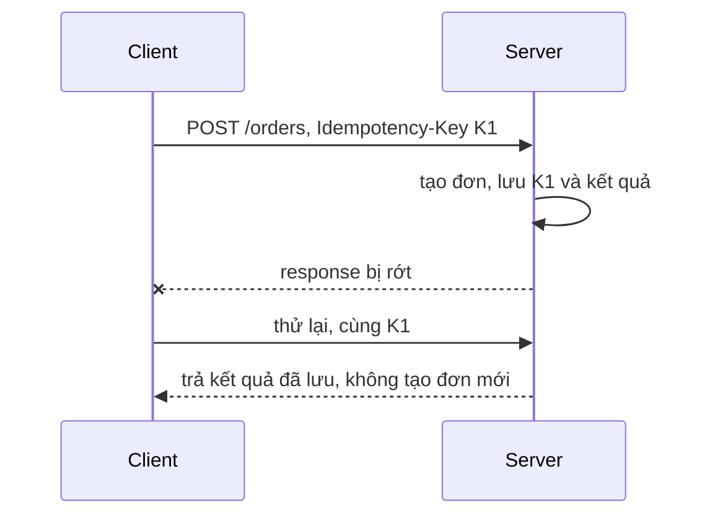

# Lý thuyết 04: Lỗi và phân trang xuyên tầng

Hai thứ này trông như chuyện riêng của backend, nhưng hỏng ở chỗ giao nhau. Server trả lỗi một kiểu, client đoán mò nội dung, người dùng thấy "Có lỗi xảy ra" thay vì ô email được tô đỏ. Server phân trang bằng offset, client cuộn vô hạn, và người dùng thấy cùng một đơn hàng hai lần. Bài này đi theo đường dữ liệu: lỗi từ `@RestControllerAdvice` tới form Vue hoặc React, cách client thử lại mà không tạo đơn trùng, rồi phân trang theo cursor ở Spring Data và infinite scroll ở giao diện, cuối cùng là sắp xếp, lọc ổn định và hai kiểu chậm kinh điển: N+1 ở server và waterfall ở client.

Phần nền về thiết kế REST (status code, `ProblemDetail`, idempotency, offset so với keyset) đã có ở [lt-33 REST API thực chiến](/go?p=01-Spring-Boot%2Fmedium%2Flt-33-rest-api-thuc-chien.md); bài này không chép lại mà nối nó với phía giao diện.

**Tóm tắt:**

- Mọi lỗi của API là một kiểu duy nhất, `ProblemDetail` (RFC 9457), kèm `code` nghiệp vụ ổn định và `errors` theo field.
- Client rẽ nhánh theo `code`, không theo câu chữ `detail`, và không bao giờ đưa stack trace hay SQL vào response.
- Chỉ retry lỗi đáng thử (mất mạng, 502, 503, 504, 429), không retry 400 hay 409; chờ tăng dần có jitter và tôn trọng `Retry-After`.
- POST chỉ được retry khi có `Idempotency-Key` sinh một lần cho mỗi ý định và giữ nguyên qua các lần thử.
- Offset phải duyệt bỏ các dòng đầu (càng sâu càng chậm) và trôi khi dữ liệu đổi; cursor (keyset) neo vào dòng cuối trang trước nên dùng được index và ổn định.
- Infinite scroll phải gắn cursor với đúng filter và sort đã sinh ra nó; đổi filter thì cuộn lại từ đầu.
- N+1 và waterfall làm tổng độ trễ tăng; gọi parallel các việc độc lập hoặc gộp dữ liệu ở server.

## Các khái niệm cần biết

| Keyword | Là gì, dùng khi nào |
|---|---|
| Problem Details (RFC 9457) | Cấu trúc JSON chuẩn cho lỗi HTTP (`type`, `title`, `status`, `detail`, `instance`, cộng trường mở rộng), kiểu media `application/problem+json`. Dùng làm contract lỗi duy nhất của toàn API. |
| Mã lỗi nghiệp vụ | Chuỗi ổn định như `INSUFFICIENT_STOCK` do bạn định nghĩa, để client rẽ nhánh và dịch thông báo mà không phụ thuộc câu chữ. |
| Lỗi theo field | Danh sách `{field, message}` trong lỗi validation, để form đánh dấu đúng ô. |
| Idempotency key | Key client sinh cho mỗi ý định, server dùng để không thực hiện lại. Dùng khi retry `POST`. |
| Cursor (keyset) | Mốc vị trí của dòng cuối trang trước, trang sau lấy các dòng "sau mốc". Dùng cho danh sách lớn và cuộn vô hạn. |
| Tie-breaker | Cột phụ duy nhất (thường là `id`) thêm vào sắp xếp để thứ tự luôn xác định. |
| N+1 | Một truy vấn lấy N dòng rồi N truy vấn nữa lấy phần phụ của từng dòng. |
| Waterfall | Chuỗi request client gọi tuần tự dù không phụ thuộc nhau, tổng thời gian bằng tổng từng cái. |

## Lỗi chuẩn từ Spring

Vấn đề: lỗi validation của Spring, lỗi nghiệp vụ tự ném và lỗi không lường trước mặc định có ba hình dạng khác nhau. Giải pháp là một `@RestControllerAdvice` biến mọi thứ thành `ProblemDetail`, kèm hai trường mở rộng: `code` (mã nghiệp vụ) và `errors` (lỗi theo field). Trong Boot 3.x có thể bật `spring.mvc.problemdetails.enabled=true` để Spring tự trả Problem Details cho các lỗi MVC chuẩn; kế thừa `ResponseEntityExceptionHandler` để tùy biến chúng (kiểm tra lại cấu hình theo phiên bản bạn dùng).

_Minh họa_ (Spring Boot 3.x):

```java
public class BusinessException extends RuntimeException {
    private final String code;
    private final HttpStatus status;
    public BusinessException(String code, HttpStatus status, String message) {
        super(message);
        this.code = code;
        this.status = status;
    }
    public String code() { return code; }
    public HttpStatus status() { return status; }
}

@RestControllerAdvice
class ApiExceptionHandler extends ResponseEntityExceptionHandler {

    @ExceptionHandler(BusinessException.class)
    ProblemDetail business(BusinessException ex, HttpServletRequest req) {
        ProblemDetail pd = ProblemDetail.forStatusAndDetail(ex.status(), ex.getMessage());
        pd.setType(URI.create("https://api.example.com/problems/" + ex.code().toLowerCase()));
        pd.setTitle(ex.code());
        pd.setProperty("code", ex.code());
        pd.setInstance(URI.create(req.getRequestURI()));
        return pd;
    }

    @Override
    protected ResponseEntity<Object> handleMethodArgumentNotValid(
            MethodArgumentNotValidException ex, HttpHeaders headers,
            HttpStatusCode status, WebRequest request) {
        ProblemDetail pd = ProblemDetail.forStatusAndDetail(HttpStatus.BAD_REQUEST, "Dữ liệu không hợp lệ");
        pd.setProperty("code", "VALIDATION_FAILED");
        pd.setProperty("errors", ex.getBindingResult().getFieldErrors().stream()
                .map(fe -> Map.of("field", fe.getField(), "message", String.valueOf(fe.getDefaultMessage())))
                .toList());
        return ResponseEntity.badRequest().body(pd);
    }

    @ExceptionHandler(Exception.class)
    ProblemDetail unexpected(Exception ex) {
        log.error("Unhandled", ex); // chi tiết chỉ vào log
        ProblemDetail pd = ProblemDetail.forStatusAndDetail(HttpStatus.INTERNAL_SERVER_ERROR, "Lỗi hệ thống");
        pd.setProperty("code", "INTERNAL_ERROR");
        return pd;
    }
}
```

Ba quy tắc quanh đoạn mã này. Thứ nhất, `code` là phần client được phép dựa vào; `detail` là câu chữ dành cho con người và có thể đổi. Thứ hai, không đưa stack trace, tên bảng hay đường dẫn nội bộ vào response. Thứ ba, tên field trong `errors` phải khớp tên field trong request (kể cả dạng `items[0].quantity`), nếu không form không biết ô nào để tô. Với lỗi 429 và 503, thêm header `Retry-After` để client biết chờ bao lâu.

**Phải thuộc:** Mọi lỗi của API là một kiểu duy nhất, `ProblemDetail` (RFC 9457, `application/problem+json`), kèm `code` nghiệp vụ ổn định và `errors` theo field. Client rẽ nhánh theo `code`, không theo câu chữ `detail`; không bao giờ đưa stack trace hay SQL vào response.

Về status code: lỗi nghiệp vụ "hết hàng" thường là `409 Conflict` hoặc `422`, còn `400` để cho dữ liệu sai cú pháp hoặc sai ràng buộc. Chọn một quy ước và ghi vào tài liệu API (xem [bài 1](/go?p=12-Fullstack%2Flt-01-hop-dong-api-openapi-client-typescript.md) để sinh kiểu TypeScript cho lỗi từ OpenAPI).

## Lỗi tới form Vue và React

Ở client, việc đầu tiên là đưa mọi lỗi mạng và lỗi HTTP về một dạng duy nhất, rồi phân loại: lỗi theo field thì đưa vào form, lỗi nghiệp vụ toàn cục thì hiện banner, lỗi 401 thì về đăng nhập, lỗi 5xx hoặc mất mạng thì hiện thông báo chung kèm nút thử lại. Hàm dưới là bước biến Problem Details thành cấu trúc dùng được cho form (gom nhiều lỗi cùng một field vào mảng).

```js
function toFormErrors(problem) {
  const fields = {};
  for (const e of problem.errors ?? []) {
    (fields[e.field] ??= []).push(e.message);
  }
  return { code: problem.code, message: problem.detail, fields };
}
```

Với một response có hai lỗi `email` và một lỗi `items[0].quantity`, kết quả:

```text
{"code":"VALIDATION_FAILED","message":"Dữ liệu không hợp lệ","fields":{"items[0].quantity":["phải lớn hơn 0"],"email":["không đúng định dạng","bắt buộc"]}}
```

_Đã chạy thử bằng Node_.

Phần gắn vào form là việc của thư viện form. _Minh họa_ với React Hook Form:

```tsx
const mutation = useMutation({
  mutationFn: createOrder,
  onError: (err) => {
    if (err instanceof ApiError && err.problem.code === "VALIDATION_FAILED") {
      const { fields } = toFormErrors(err.problem);
      for (const [name, messages] of Object.entries(fields)) {
        form.setError(name as FieldPath<OrderForm>, { type: "server", message: messages[0] });
      }
    } else {
      toast.error(messageFor(err)); // bảng mã lỗi nghiệp vụ -> câu chữ đã dịch
    }
  },
});
```

_Minh họa_ với Vue (VeeValidate: `setErrors` nhận object field tới thông báo):

```ts
try {
  await api.createOrder(values);
} catch (err) {
  if (err instanceof ApiError && err.problem.code === "VALIDATION_FAILED") {
    const { fields } = toFormErrors(err.problem);
    setErrors(Object.fromEntries(Object.entries(fields).map(([k, v]) => [k, v[0]])));
  } else {
    notify(messageFor(err));
  }
}
```

Hai điều cần giữ kỷ luật. Validate cả hai nơi: client để phản hồi tức thì, server để bảo vệ thật; lỗi server là nguồn đúng cuối cùng nên phải hiển thị được. Và dịch thông báo ở client theo `code` (hoặc để server trả theo `Accept-Language`), đừng bắt người dùng đọc câu chữ tiếng Anh của exception. Xem thêm form trong [React](/go?p=09-React%2Fmedium%2Flt-06-routing-forms-data.md) và [Vue](/go?p=10-Vue%2Fmedium%2Flt-06-router-forms.md).

## Retry và idempotency ở client

Mạng lỗi là chuyện thường, nên client phải thử lại; nhưng thử lại bừa bãi là cách nhanh nhất để tạo đơn trùng. Nguyên tắc có ba vế. Chỉ thử lại lỗi đáng thử (mất mạng, `502`, `503`, `504`, `429`), không thử `400` hay `409` vì gửi lại y nguyên sẽ lỗi y nguyên. Chờ lâu dần có jitter, và tôn trọng `Retry-After` nếu có. Với `POST`, chỉ thử lại khi có `Idempotency-Key`, và key phải được sinh một lần cho mỗi ý định của người dùng (lúc mở form hoặc lúc bấm gửi), giữ nguyên qua các lần thử, rồi bỏ khi thành công.

**Phải thuộc:** Chỉ thử lại lỗi đáng thử (mất mạng, `502`, `503`, `504`, `429`), không thử `400` hay `409`. Chờ tăng dần có jitter, tôn trọng `Retry-After`. `POST` chỉ được thử lại khi có `Idempotency-Key` sinh một lần cho mỗi ý định và giữ nguyên qua các lần thử.



Đoạn mã dưới gồm hàm `withRetry` và một server giả có bảng key idempotency, mô phỏng đúng sơ đồ trên: lần đầu server đã tạo đơn nhưng response rớt.

```js
async function withRetry(fn, { max = 4, base = 200, rnd = () => 1 } = {}) {
  for (let attempt = 0; ; attempt++) {
    try { return await fn(attempt); }
    catch (e) {
      const retryable = e.network || [502, 503, 504, 429].includes(e.status);
      if (!retryable || attempt + 1 >= max) throw e;
      const wait = e.retryAfterMs ?? Math.floor(rnd() * base * 2 ** attempt);
      await sleep(wait); // sleep(ms) = new Promise((r) => setTimeout(r, ms))
    }
  }
}

const store = new Map(); let created = 0;
function serverPostOrder(key, failResponseOnce) {
  if (store.has(key)) return { status: 200, body: store.get(key), replay: true };
  const order = { id: ++created };
  store.set(key, order);
  if (failResponseOnce.v) { failResponseOnce.v = false; throw { network: true }; }
  return { status: 201, body: order };
}
```

Trong bản chạy thử, `sleep` được thay bằng ghi lại thời gian chờ để chạy nhanh:

```text
kết quả: {"status":200,"body":{"id":1},"replay":true} | số đơn thật sự tạo: 1 | thời gian chờ: [ 200 ]
400 không retry, sleeps = 0
503 hết lượt: [ 200, 400, 800 ]
```

_Đã chạy thử bằng Node_. Dù response lần đầu rớt, chỉ có một đơn được tạo; lỗi `400` không bị thử lại; lỗi `503` được thử tối đa 4 lần với thời gian chờ gấp đôi (jitter ở đây cố định để dễ đọc).

Phía server cần bảng hoặc key Redis lưu `Idempotency-Key` với kết quả; chi tiết ở [lt-33](/go?p=01-Spring-Boot%2Fmedium%2Flt-33-rest-api-thuc-chien.md). Phía thư viện: TanStack Query mặc định thử lại truy vấn (`retry: 3`) nhưng đặt `retry: 0` cho mutation; hãy chủ động bật retry cho mutation chỉ khi đã có idempotency key. Cũng nên vô hiệu nút gửi khi đang chờ để chặn người dùng bấm đúp, vì bấm đúp tạo ra hai ý định khác nhau (hai key khác nhau) mà idempotency không cứu được.

## Phân trang cursor ở Spring Data

Offset (`limit 20 offset 4000`) có hai tật. DB vẫn phải duyệt và bỏ 4000 dòng nên càng về sau càng chậm. Và khi dữ liệu thay đổi giữa hai lần gọi, ranh giới trang xê dịch: dòng mới chèn vào đầu đẩy một dòng sang trang sau, người dùng thấy lặp hoặc mất dòng. Cursor giải quyết cả hai bằng cách hỏi "20 dòng sau mốc này", với mốc là giá trị các cột sắp xếp của dòng cuối trang trước, nên truy vấn dùng được index và không bị ảnh hưởng bởi chèn xóa phía trước.

**Nền tảng:** Offset đánh số theo vị trí nên vừa phải duyệt bỏ các dòng đầu (càng sâu càng chậm), vừa trôi khi dữ liệu đổi giữa hai lần gọi. Cursor (keyset) neo vào giá trị của dòng cuối trang trước, nên dùng được index và không bị chèn xóa phía trước ảnh hưởng. Điều kiện bắt buộc: thứ tự sắp xếp phải xác định tuyệt đối, tức có tie-breaker duy nhất như `id` trong cả `ORDER BY` lẫn điều kiện `WHERE`.

Điều kiện quan trọng: sắp xếp phải xác định tuyệt đối. Nếu sắp theo `createdAt` mà nhiều dòng trùng giá trị, mốc không phân biệt được dòng nào đã trả; thêm `id` làm tie-breaker, và điều kiện lấy trang sau là `createdAt < c OR (createdAt = c AND id < i)`. Mô phỏng thuần bằng Node với dữ liệu cố ý có nhiều dòng trùng `createdAt`, cursor là Base64 của hai giá trị đó:

```js
const enc = (o) => Buffer.from(JSON.stringify(o)).toString("base64url");
const dec = (s) => JSON.parse(Buffer.from(s, "base64url").toString());
// sort createdAt DESC, id DESC
function page(cursor, size) {
  let data = sorted;
  if (cursor) {
    const c = dec(cursor);
    data = sorted.filter((r) => r.createdAt < c.createdAt ||
                                (r.createdAt === c.createdAt && r.id < c.id));
  }
  const slice = data.slice(0, size + 1);      // lấy dư 1 dòng để biết còn trang sau
  const hasNext = slice.length > size;
  const items = slice.slice(0, size);
  const last = items[items.length - 1];
  return { items, nextCursor: hasNext ? enc({ createdAt: last.createdAt, id: last.id }) : null };
}
```

Với 10 dòng, trang 4 dòng, đi hết các trang, rồi thử chèn dòng mới (`id` 11, mới nhất) sau khi đã lấy trang 1 và so với offset:

```text
[[3,2,1,6],[5,4,9,8],[7,10]]
[ 3, 2, 1, 6 ] [ 5, 4, 9, 8 ]
offset trang 2 sau khi chèn: [ 6, 5, 4, 9 ]
```

_Đã chạy thử bằng Node_. Cursor đi hết 10 dòng không lặp, không sót, và trang 2 sau khi chèn vẫn là `[5,4,9,8]`; offset thì trang 2 bắt đầu bằng `6`, lặp lại dòng cuối của trang 1.

Trong Spring Data (3.1 trở lên, kiểm tra lại theo phiên bản) có sẵn kiểu `Window` và `ScrollPosition` cho keyset. _Minh họa_:

```java
interface OrderRepository extends JpaRepository<Order, Long> {
    Window<Order> findFirst20ByStatusOrderByCreatedAtDescIdDesc(
            OrderStatus status, ScrollPosition position);
}

// controller
Window<Order> w = repo.findFirst20ByStatusOrderByCreatedAtDescIdDesc(
        status, cursor == null ? ScrollPosition.keyset() : decode(cursor));
String next = w.hasNext() ? encode(w.positionAt(w.size() - 1)) : null;
```

Nếu muốn kiểm soát hoàn toàn (hoặc phiên bản chưa hỗ trợ), viết JPQL tường minh, nhớ có index tổng hợp khớp thứ tự sắp xếp:

_Minh họa_:

```java
@Query("""
    select o from Order o
    where o.status = :status
      and (o.createdAt < :createdAt or (o.createdAt = :createdAt and o.id < :id))
    order by o.createdAt desc, o.id desc
    """)
List<Order> nextPage(OrderStatus status, Instant createdAt, Long id, Pageable limit);
// Pageable.ofSize(size + 1) để biết còn trang sau
```

Response nên có dạng `{ "items": [...], "nextCursor": "..." | null }`. Cursor là chuỗi đục (opaque) với client: client chỉ gửi lại, không phân tích. Nên sign hoặc encrypt nhẹ và kiểm tra khi giải mã, vì client có thể sửa nó. Đánh đổi của cursor: không nhảy tới trang số 37 và khó hiển thị tổng số trang; với màn hình quản trị cần nhảy trang và dữ liệu nhỏ thì offset vẫn hợp lý.

## Infinite scroll ở giao diện

Giao diện chỉ cần giữ `nextCursor` của trang cuối và gọi tiếp khi người dùng cuộn tới gần cuối, qua một phần tử "gác" quan sát bằng `IntersectionObserver`. TanStack Query v5 có sẵn `useInfiniteQuery` cho cả React lẫn Vue (`@tanstack/vue-query`).

_Minh họa_ (React):

```tsx
const q = useInfiniteQuery({
  // filters nằm trong key: đổi bộ lọc là danh sách mới
  queryKey: ["orders", filters],
  queryFn: ({ pageParam }) => api.listOrders({ ...filters, cursor: pageParam }),
  initialPageParam: null as string | null,
  getNextPageParam: (last) => last.nextCursor, // null hoặc undefined = hết trang
});

const sentinel = useRef<HTMLDivElement>(null);
useEffect(() => {
  const el = sentinel.current;
  if (!el) return;
  const io = new IntersectionObserver(([e]) => {
    if (e.isIntersecting && q.hasNextPage && !q.isFetchingNextPage) q.fetchNextPage();
  });
  io.observe(el);
  return () => io.disconnect();
}, [q.hasNextPage, q.isFetchingNextPage, q.fetchNextPage]);

const rows = q.data?.pages.flatMap((p) => p.items) ?? [];
```

Với Vue, `useInfiniteQuery` dùng cùng tham số (đưa `filters` vào key dưới dạng ref hoặc getter), và `onMounted`/`onBeforeUnmount` quản lý observer. Vài chi tiết hay sai: đưa filter và sắp xếp vào `queryKey` để đổi filter thì cuộn lại từ đầu; chặn gọi trùng bằng `isFetchingNextPage`; khử trùng theo `id` khi gộp trang (đề phòng dữ liệu đổi giữa chừng); với danh sách rất dài, ảo hóa (virtualization) để DOM không phình; và đặt giới hạn `maxPages` nếu muốn giữ memory gọn. Khi kết hợp với realtime ở [bài 3](/go?p=12-Fullstack%2Flt-03-realtime-sse-websocket.md), event mới thường chỉ cần `invalidateQueries` thay vì vá vào các trang đã tải.

## Sắp xếp và lọc ổn định

Ba nguyên tắc để danh sách không "nhảy". Một là cho phép sắp xếp theo danh sách trắng các field (ánh xạ tên API sang cột), không nhận tên cột tự do từ client (vừa lộ cấu trúc, vừa có thể sắp theo cột không có index). Hai là mọi thứ tự phải kết thúc bằng tie-breaker duy nhất như `id`. Ba là cursor gắn với đúng filter và sắp xếp đã sinh ra nó: nhúng vào cursor một dấu vết (hash) của `sort` và `filter`, và từ chối nếu client dùng cursor của truy vấn khác, trả `400` với mã `INVALID_CURSOR`.

Ở client, `queryKey` chứa `filters` và `sort` đảm bảo đổi điều kiện thì dữ liệu cũ bị bỏ chứ không nối đuôi. Sync chúng lên URL (query string) để chia sẻ và tải lại trang vẫn giữ nguyên. Tránh sắp xếp theo cột có thể đổi trong lúc xem (như `updatedAt`) với cursor, vì dòng bị cập nhật sẽ nhảy vị trí và có thể bị lặp hoặc sót; ưu tiên cột bất biến như `createdAt` và `id`.

## N+1 và waterfall

Hai hiện tượng này khác tầng nhưng cùng cơ chế: nhiều vòng đi về lẽ ra gộp được.

N+1 ở server: lấy 20 đơn bằng một truy vấn, rồi truy cập `order.getItems()` hoặc `order.getCustomer()` lazy cho từng đơn, thành 21 truy vấn. Phát hiện bằng log SQL hoặc đếm truy vấn trong test; sửa bằng `join fetch`, `@EntityGraph`, hoặc `@BatchSize`, và tốt nhất là trả DTO chiếu (projection) chỉ gồm cột cần. Cẩn thận với `join fetch` collection kết hợp phân trang: Hibernate sẽ phân trang trong memory (có cảnh báo `HHH000104`); với cursor nên lấy trang id trước rồi nạp quan hệ cho các id đó. Chi tiết ở [lt-34 JPA hiệu năng](/go?p=01-Spring-Boot%2Fhard%2Flt-34-jpa-hieu-nang-khoa-cache.md).

Waterfall ở client: màn hình chi tiết đơn gọi `/orders/42`, đợi xong mới gọi `/customers/7`, đợi xong mới gọi `/payments?orderId=42`. Mỗi request tốn một vòng mạng, tổng thời gian là tổng ba cái. Cách chữa theo thứ tự ưu tiên: gọi parallel những thứ độc lập (`Promise.all`, hoặc các `useQuery` đứng cạnh nhau, không lồng `enabled` vô cớ); prefetch khi người dùng rê chuột vào link; để server trả kèm dữ liệu cần thiết (`?include=customer,payments` hoặc endpoint tổng hợp cho màn hình); cuối cùng mới tính tới BFF. Đừng "chữa" N+1 phía server rồi để client tạo N+1 bằng cách gọi `/customers/{id}` cho từng dòng trong danh sách; khi đó hãy nhúng thông tin tóm tắt của khách vào response danh sách.

## Bẫy thường gặp

| Bẫy | Hệ quả |
|---|---|
| Mỗi chỗ trả lỗi một kiểu | Client phải viết nhiều bộ phân tích, nhiều lỗi rơi vào "Có lỗi xảy ra" |
| Client rẽ nhánh theo câu chữ `detail` | Đổi câu chữ hoặc dịch là hỏng logic |
| Tên field lỗi không khớp tên field form | Không ô nào được tô, người dùng không biết sửa gì |
| Lộ stack trace hoặc SQL trong lỗi 500 | Lộ thông tin nội bộ, hỗ trợ tấn công |
| Retry `POST` không có idempotency key | Đơn hoặc thanh toán bị tạo trùng |
| Sinh key mới ở mỗi lần thử | Idempotency vô hiệu, trùng như không có |
| Retry cả `400` hoặc `409` | Vòng lặp vô ích, tăng tải |
| Offset cho feed thay đổi liên tục | Người dùng thấy dòng lặp hoặc sót khi cuộn |
| Sắp xếp không có tie-breaker | Cursor lặp hoặc bỏ sót dòng trùng giá trị |
| `queryKey` thiếu filter | Đổi filter mà vẫn thấy dữ liệu cũ, nối sai trang |
| N+1 ẩn sau lazy loading | Trang chậm tăng theo số dòng, nghẽn connection pool |
| Request tuần tự không cần thiết | Thời gian tải bằng tổng mọi request |

## Câu hỏi phỏng vấn thường gặp

1. **Câu hỏi:** Người dùng bấm "Đặt hàng" trên mạng yếu, thấy vòng quay mãi rồi báo lỗi. Họ bấm lại và sau đó tìm thấy hai đơn giống hệt trong lịch sử. Chuyện gì đã xảy ra và sửa ở đâu?

   **Gợi ý suy luận:**
   - Lần bấm đầu: server đã nhận chưa, client có biết không?
   - `POST` có an toàn để gửi lại không?
   - Cần định danh gì để server nhận ra "cùng một ý định"?

   **Lập luận:** request đầu đã tới server và đơn được tạo, nhưng response mất giữa đường nên client chỉ thấy lỗi. Client gửi lại thì `POST` được xử lý như yêu cầu mới, vì `POST` không idempotent. Muốn server phân biệt "lặp lại" với "yêu cầu mới", client sinh một `Idempotency-Key` cho ý định này và gửi cùng mọi lần thử; server lưu key với kết quả (ràng buộc duy nhất) và trả lại kết quả cũ khi gặp key đã có. Thêm nữa, vô hiệu nút gửi khi đang chờ.

   **Đáp án ngắn:** thiếu idempotency. Client gửi `Idempotency-Key` cố định cho mỗi ý định, server lưu key và kết quả để không tạo lại.

2. **Câu hỏi:** Form đăng ký gửi lên, server từ chối vì email trùng, nhưng giao diện chỉ hiện "Request failed with status 400" ở đầu trang. Cần thay đổi gì ở cả hai phía để ô email được tô đỏ với thông báo đúng?

   **Gợi ý suy luận:**
   - Server trả gì trong body khi lỗi?
   - Client dựa vào đâu để biết lỗi thuộc ô nào?
   - Điều gì nên ổn định để không vỡ khi đổi câu chữ?

   **Lập luận:** nếu body lỗi không có cấu trúc, client chỉ có status code. Server nên trả Problem Details với `code` (ví dụ `EMAIL_ALREADY_USED` hoặc `VALIDATION_FAILED`) và `errors` gồm `{field: "email", message}`. Client đọc `application/problem+json`, ánh xạ `errors` vào form (`setError` hoặc `setErrors`), còn lỗi không thuộc field nào thì hiện banner theo `code`. Tên field phải trùng hai bên.

   **Đáp án ngắn:** server trả `ProblemDetail` có `code` và `errors` theo field; client ánh xạ `errors` vào form và dịch thông báo theo `code`.

3. **Câu hỏi:** Màn hình cuộn vô hạn dùng `page` và `size`. Khi nhiều người đặt hàng liên tục, người dùng thấy cùng một đơn xuất hiện ở cuối trang trước và đầu trang sau. Vì sao, và cursor có luôn đúng không?

   **Gợi ý suy luận:**
   - Chuyện gì xảy ra với "vị trí" của các dòng khi có dòng mới chèn lên đầu?
   - Cursor neo vào đâu?
   - Nếu sắp theo `createdAt` mà hai đơn trùng giây thì sao?

   **Lập luận:** offset đếm theo vị trí, nên một dòng mới ở đầu đẩy mọi dòng xuống một vị trí và dòng cuối trang 1 trở thành dòng đầu trang 2. Cursor neo vào giá trị của dòng cuối nên không bị ảnh hưởng bởi chèn phía trước. Nhưng nếu cột sắp xếp không duy nhất, mốc không xác định được dòng nào đã trả; cần tie-breaker `id` trong cả `ORDER BY` lẫn điều kiện `WHERE`, và index khớp thứ tự đó.

   **Đáp án ngắn:** offset trôi khi chèn dữ liệu. Dùng keyset với cursor gồm cột sắp xếp và `id` làm tie-breaker, có index tổng hợp.

4. **Câu hỏi:** Danh sách 20 đơn kèm tên khách tải mất 3 giây; trong log thấy 21 câu SELECT. Sau khi sửa phía server, màn hình chi tiết vẫn chậm vì mạng. Hai vấn đề này là gì?

   **Gợi ý suy luận:**
   - 21 truy vấn từ đâu ra, và khi nào lazy loading kích hoạt?
   - Ở client, các request có phụ thuộc nhau thật không?
   - Mỗi vòng đi về tốn gì ngoài xử lý?

   **Lập luận:** một truy vấn lấy 20 đơn, sau đó mỗi lần truy cập `order.getCustomer()` lazy sinh thêm một truy vấn: đó là N+1, sửa bằng `join fetch`, `@EntityGraph`, `@BatchSize` hoặc DTO projection. Ở client, các request chạy tuần tự dù độc lập với nhau tạo waterfall, tổng thời gian bằng tổng độ trễ; sửa bằng gọi parallel, prefetch, hoặc để server trả kèm dữ liệu cần. Cả hai đều là "quá nhiều vòng đi về" ở hai tầng khác nhau.

   **Đáp án ngắn:** server bị N+1 (sửa bằng fetch join, entity graph, projection), client bị waterfall (gọi parallel hoặc gộp dữ liệu ở server).

Xem thêm: [lt-33 REST API thực chiến](/go?p=01-Spring-Boot%2Fmedium%2Flt-33-rest-api-thuc-chien.md), [lt-34 JPA hiệu năng](/go?p=01-Spring-Boot%2Fhard%2Flt-34-jpa-hieu-nang-khoa-cache.md), [Fullstack: tích hợp FE và BE](/go?p=07-Interview-QA%2FFrontend%2Fhard%2Fqa-fullstack-tich-hop-fe-be.md).

