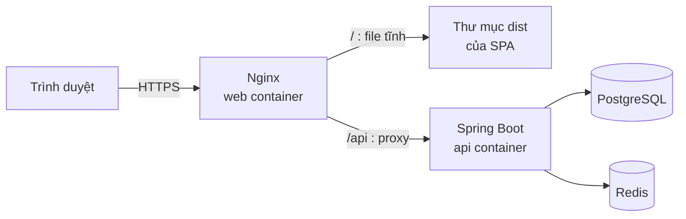
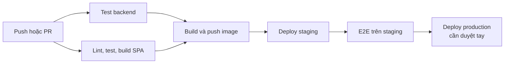

# Lý thuyết 05: Đóng gói và deploy fullstack với Docker, Nginx và CI/CD

## Bài toán cần giải quyết

Ứng dụng chạy tốt trên máy bạn nhưng "không chạy trên server" là chuyện kinh điển. Nguyên nhân thường là khác phiên bản JDK, thiếu biến môi trường, quên build lại SPA, hoặc Nginx cấu hình khác với dev server. Bài này gom cả chuỗi từ mã nguồn đến môi trường chạy: đóng gói API Spring Boot và SPA (Vue hoặc React) thành image, đặt Nginx phía trước làm reverse proxy, dựng môi trường dev bằng docker compose, và tự động hóa build, test, deploy bằng GitHub Actions.

Dùng cách này khi bạn có ít nhất một API và một SPA cần chạy cùng nhau, và muốn môi trường dev, staging, production giống nhau. Chưa cần cả bộ này nếu chỉ làm bài tập nhỏ chạy local; khi đó `docker compose up` cho database là đủ. Nếu hệ thống đã lên Kubernetes thì phần Dockerfile và healthcheck vẫn dùng nguyên, phần compose và script deploy thay bằng manifest, xem [Docker và Kubernetes](/go?p=01-Spring-Boot%2Fhard%2Flt-29-docker-kubernetes.md).

Bài này không dạy lại từ đầu Docker hay pipeline CI. Nền tảng nằm ở [DevOps](/go?p=04-DevOps%2Findex.md); ở đây tập trung vào những chỗ riêng của fullstack: SPA và API gặp nhau qua Nginx, cấu hình tách thế nào, test chạy ở đâu.

**Tóm tắt:**

- Ở production, trình duyệt chỉ nói chuyện với Nginx: file tĩnh của SPA ở `/`, còn `/api` được proxy tới Spring Boot; cùng origin nên không cần CORS.
- Spring Boot đóng gói bằng image nhiều tầng (build, tách layer, runtime) để Docker cache layer thư viện; SPA build ra file tĩnh rồi đưa vào image Nginx.
- SPA history mode cần `try_files $uri $uri/ /index.html;`; asset có hash cache một năm với `immutable`, còn `index.html` phải `no-cache`.
- Biến build-time của SPA (`VITE_*`, `REACT_APP_*`) bị nhúng cứng vào bundle lúc build, nên đổi env của container không có tác dụng; mọi thứ trong SPA đều công khai.
- JVM trong container phải được giới hạn memory (ví dụ `MaxRAMPercentage`), nếu không dễ bị OOMKilled.
- docker compose dựng môi trường dev; CI/CD với GitHub Actions build, test cả hai nửa rồi đẩy image.
- Khi rolling, blue-green hoặc canary, hai phiên bản chạy concurrent trên cùng database và API, nên thay đổi schema và API phải tương thích ngược theo expand and contract.

## Các khái niệm cần biết

| Khái niệm | Là gì | Dùng khi nào |
|---|---|---|
| Multi-stage build | Dockerfile có nhiều `FROM`; tầng build chứa công cụ nặng, tầng cuối chỉ chép kết quả | Luôn dùng cho Java và SPA để image cuối nhỏ, không chứa Maven hay Node |
| Layered jar | Spring Boot tách jar thành các layer (dependencies, loader, application) để Docker cache từng layer | Muốn build lại nhanh vì code đổi thường xuyên hơn thư viện |
| JRE nhỏ | Image chỉ có runtime (ví dụ bản `jre` của Temurin), không có trình biên dịch | Image production |
| Reverse proxy | Server đứng trước, nhận request và chuyển tiếp tới dịch vụ phía sau | Gom SPA và API về một origin, kết thúc TLS, nén, cache |
| History mode | Router của SPA dùng URL thật như `/orders/42` thay vì `#/orders/42` | Server phải trả `index.html` cho mọi đường dẫn không phải file |
| Asset có hash | File build như `app.3f9a1c.js`, nội dung đổi thì tên đổi | Cho phép cache rất lâu mà không sợ bản cũ |
| Build-time vs runtime config | Giá trị được nhúng khi build hay đọc khi chạy | Quyết định image dùng chung nhiều môi trường được hay không |
| Healthcheck | Lệnh hoặc endpoint cho biết dịch vụ đã sẵn sàng | compose chờ dependency, orchestrator quyết định có chuyển traffic không |
| Rollout, rollback | Cách đưa bản mới lên và quay về bản cũ | Mọi lần deploy |
| CORS | Cơ chế trình duyệt chặn gọi chéo origin nếu server không cho phép | Khi SPA và API khác domain, port hoặc scheme |

## Bức tranh tổng thể

Ở production, trình duyệt chỉ nói chuyện với Nginx. Nginx trả file tĩnh của SPA, còn mọi request bắt đầu bằng `/api` thì chuyển cho Spring Boot. Database và Redis không mở ra ngoài.



Điểm mấu chốt là SPA và API cùng một origin trong mắt trình duyệt. Hệ quả: không cần CORS, cookie `SameSite` hoạt động đơn giản, và URL API trong code SPA có thể là đường dẫn tương đối `/api/...`. Mục CORS ở cuối bài nói khi nào bạn buộc phải khác domain.

**Nền tảng:** Ở production, trình duyệt chỉ nói chuyện với Nginx: file tĩnh của SPA ở `/`, còn `/api` được proxy tới Spring Boot. Nhờ cùng origin nên không cần CORS, cookie `SameSite` chạy đơn giản và SPA gọi API bằng đường dẫn tương đối; đây là thiết kế mặc định, chỉ khác origin khi buộc phải vậy.

## Dockerfile cho Spring Boot

Mục tiêu có bốn điều: image nhỏ, build lại nhanh, không chạy bằng root, và JVM biết giới hạn memory của container. Dockerfile dưới đây dùng ba tầng: build jar, tách layer bằng chế độ `layertools` của Spring Boot, rồi chạy trên JRE.

_Minh họa_ (kiểm tra lại tag image và đường dẫn jar theo dự án của bạn):

```dockerfile
# syntax=docker/dockerfile:1
FROM eclipse-temurin:21-jdk AS build
WORKDIR /src
COPY mvnw pom.xml ./
COPY .mvn .mvn
RUN --mount=type=cache,target=/root/.m2 ./mvnw -q dependency:go-offline
COPY src src
RUN --mount=type=cache,target=/root/.m2 ./mvnw -q package -DskipTests

FROM eclipse-temurin:21-jdk AS layers
WORKDIR /layers
COPY --from=build /src/target/*.jar app.jar
RUN java -Djarmode=tools -jar app.jar extract --layers --destination extracted

FROM eclipse-temurin:21-jre
RUN useradd --system --uid 10001 appuser
WORKDIR /app
COPY --from=layers /layers/extracted/dependencies/ ./
COPY --from=layers /layers/extracted/spring-boot-loader/ ./
COPY --from=layers /layers/extracted/snapshot-dependencies/ ./
COPY --from=layers /layers/extracted/application/ ./
USER appuser
EXPOSE 8080
ENV JAVA_TOOL_OPTIONS="-XX:MaxRAMPercentage=65 -XX:+ExitOnOutOfMemoryError"
ENTRYPOINT ["java", "-jar", "app.jar"]
```

Đọc kỹ vài điểm trong file trên:

- Bước `dependency:go-offline` đứng trước `COPY src`. Khi chỉ sửa code, Docker dùng lại layer thư viện đã tải. Đây là cùng lý do để tách layer ở cuối: layer `dependencies` hiếm đổi nên được cache, layer `application` nhỏ và đổi thường xuyên.
- Lệnh `extract --layers` thuộc chế độ `-Djarmode=tools` của Spring Boot 3.3 trở lên. Bản 3.2 trở về trước dùng `-Djarmode=layertools extract`, và đường dẫn chạy khác (`JarLauncher`). Kiểm tra lại theo phiên bản bạn dùng, và xem tài liệu Spring Boot mục "Efficient Container Images".
- `useradd` tạo user không phải root. Nếu ai đó khai thác được lỗ hổng trong ứng dụng, họ không có quyền root trong container. Hãy thêm `readOnlyRootFilesystem` ở tầng orchestrator nếu ứng dụng không cần ghi đĩa.
- `MaxRAMPercentage=65` bảo JVM dùng tối đa 65 phần trăm memory của container thay vì của host. Phần 35 còn lại dành cho metaspace, thread stack, bộ đệm native. `ExitOnOutOfMemoryError` làm tiến trình chết hẳn khi hết heap để orchestrator khởi động lại, thay vì sống lay lắt.
- Giới hạn memory đặt ở compose hoặc orchestrator (xem phần sau), không đặt trong Dockerfile.

Nếu bạn thích buildpack, `./mvnw spring-boot:build-image` tạo image tương tự mà không cần viết Dockerfile; đổi lại bạn có ít quyền kiểm soát hơn.

## Dockerfile cho SPA

SPA sau khi build chỉ là thư mục file tĩnh. Vì vậy image cuối không cần Node, chỉ cần Nginx. Tầng đầu build bằng Node, tầng sau chép `dist` vào Nginx.

_Minh họa_ (Vue với Vite xuất ra `dist`; React với Vite cũng vậy, còn Create React App xuất ra `build`):

```dockerfile
# syntax=docker/dockerfile:1
FROM node:22-alpine AS build
WORKDIR /app
COPY package.json package-lock.json ./
RUN npm ci
COPY . .
RUN npm run build

FROM nginx:1.27-alpine
COPY nginx.conf /etc/nginx/conf.d/default.conf
COPY --from=build /app/dist /usr/share/nginx/html
EXPOSE 80
```

Dùng `npm ci` thay vì `npm install` để cài đúng theo lockfile, cho kết quả lặp lại được. Chép `package*.json` trước, `COPY . .` sau, cùng nguyên tắc cache layer như bên Java.

## Nginx: phục vụ SPA và proxy API

File cấu hình này làm bốn việc: trả `index.html` cho mọi đường dẫn của router, cache lâu cho asset có hash, nén, và chuyển `/api` sang Spring Boot. Câu dẫn quan trọng: thứ tự `location` và hành vi của `try_files` quyết định SPA có chạy được hay không.

_Minh họa_ (tên host `api` là tên service trong compose):

```nginx
server {
    listen 80;
    root /usr/share/nginx/html;
    index index.html;

    gzip on;
    gzip_types text/css application/javascript application/json image/svg+xml;
    gzip_min_length 1024;

    location /api/ {
        proxy_pass http://api:8080;
        proxy_set_header Host $host;
        proxy_set_header X-Real-IP $remote_addr;
        proxy_set_header X-Forwarded-For $proxy_add_x_forwarded_for;
        proxy_set_header X-Forwarded-Proto $scheme;
        proxy_read_timeout 60s;
    }

    location /assets/ {
        add_header Cache-Control "public, max-age=31536000, immutable";
        try_files $uri =404;
    }

    location = /index.html {
        add_header Cache-Control "no-cache";
    }

    location / {
        try_files $uri $uri/ /index.html;
    }
}
```

Giải thích từng quyết định:

- **`try_files $uri $uri/ /index.html`** là chìa khóa của history mode. Khi người dùng bấm F5 ở `/orders/42`, Nginx tìm file `orders/42`, không có thì trả `index.html`, và router phía trình duyệt lo phần còn lại. Thiếu dòng này, F5 trên mọi trang con đều ra 404.
- **Cache asset có hash**: tên file đổi theo nội dung nên cache một năm với `immutable` là an toàn. Ngược lại `index.html` phải `no-cache` (trình duyệt luôn hỏi lại), vì nó là file trỏ tới các asset mới nhất. Nếu cache cả `index.html`, người dùng bị kẹt ở bản cũ và bị lỗi 404 khi asset cũ đã bị xóa.
- **`/assets/` trả 404 khi thiếu**: nếu để rơi xuống `location /`, file JS bị mất sẽ nhận về `index.html` với mã 200, và trình duyệt báo lỗi cú pháp khó hiểu. Trả 404 đúng nghĩa giúp phát hiện sớm.
- **Header chuyển tiếp**: không có `X-Forwarded-Proto`, Spring Boot tưởng request là HTTP và sinh sai URL redirect hoặc cookie `Secure`. Phía Spring cần `server.forward-headers-strategy=framework` (hoặc `native` khi dùng Tomcat với proxy tin cậy). Kiểm tra lại theo phiên bản.
- **`proxy_pass http://api:8080;` không có dấu `/` cuối**: Nginx giữ nguyên đường dẫn `/api/orders` khi chuyển tiếp. Thêm `/` cuối sẽ cắt bỏ phần `/api/`, một lỗi hay gặp.
- **Nén**: `gzip` có sẵn trong Nginx. Brotli nén tốt hơn nhưng cần module `ngx_brotli` (không có trong image chính thức), nên có hai hướng: dùng image có sẵn module, hoặc nén sẵn lúc build (`vite-plugin-compression`) rồi bật `gzip_static` hoặc `brotli_static`. Đừng nén ảnh PNG hay JPG vì chúng đã nén.

**Phải thuộc:** Với SPA dùng history mode, Nginx cần `try_files $uri $uri/ /index.html;` (thiếu thì F5 trên trang con ra 404). Asset có hash cache một năm với `immutable`, còn `index.html` phải `no-cache`. `proxy_pass http://api:8080;` không có dấu `/` cuối thì giữ nguyên đường dẫn `/api/...`.

Với SSE hoặc WebSocket đi qua cùng Nginx, cần thêm cấu hình riêng (tắt buffering, nâng cấp kết nối). Phần này nằm ở [Realtime: SSE và WebSocket](/go?p=12-Fullstack%2Flt-03-realtime-sse-websocket.md).

## docker compose cho môi trường dev

Compose cho phép một lệnh dựng đủ database, Redis, API và web. Dùng `healthcheck` kèm `depends_on.condition` để API chỉ khởi động khi database thật sự nhận kết nối, không chỉ khi container đã bật.

_Minh họa_:

```yaml
services:
  db:
    image: postgres:16
    environment:
      POSTGRES_DB: shop
      POSTGRES_USER: shop
      POSTGRES_PASSWORD: ${DB_PASSWORD:-devpass}
    volumes:
      - dbdata:/var/lib/postgresql/data
    healthcheck:
      test: ["CMD-SHELL", "pg_isready -U shop -d shop"]
      interval: 5s
      timeout: 3s
      retries: 10

  redis:
    image: redis:7-alpine
    healthcheck:
      test: ["CMD", "redis-cli", "ping"]
      interval: 5s
      retries: 10

  api:
    build: ./backend
    environment:
      SPRING_DATASOURCE_URL: jdbc:postgresql://db:5432/shop
      SPRING_DATASOURCE_USERNAME: shop
      SPRING_DATASOURCE_PASSWORD: ${DB_PASSWORD:-devpass}
      SPRING_DATA_REDIS_HOST: redis
    depends_on:
      db: { condition: service_healthy }
      redis: { condition: service_healthy }
    mem_limit: 768m
    healthcheck:
      test: ["CMD-SHELL", "wget -qO- http://localhost:8080/actuator/health/readiness | grep -q UP"]
      interval: 10s
      start_period: 40s
      retries: 5

  web:
    build: ./frontend
    ports:
      - "8081:80"
    depends_on:
      api: { condition: service_healthy }

volumes:
  dbdata:
```

Một vài lưu ý khi đọc file:

- Biến `SPRING_DATASOURCE_URL` theo quy tắc "relaxed binding": Spring tự map `SPRING_DATASOURCE_URL` thành `spring.datasource.url`. Không cần sửa file `application.yml` cho từng môi trường, chỉ cần truyền biến môi trường.
- Image JRE `eclipse-temurin` không có sẵn `wget` ở mọi biến thể. Nếu lệnh healthcheck báo thiếu, cài thêm hoặc dùng `curl`. Ví dụ trên chỉ minh họa ý tưởng, hãy kiểm tra trong image thật của bạn.
- Endpoint `/actuator/health/readiness` cần bật `management.endpoint.health.probes.enabled=true` (tự bật khi chạy trong Kubernetes). Phân biệt **liveness** (tiến trình còn sống, nếu sai thì khởi động lại) với **readiness** (sẵn sàng nhận traffic, nếu sai thì tạm ngừng chuyển request tới). Gộp hai thứ này là bẫy kinh điển: database chậm một lúc làm liveness fail, orchestrator liên tục khởi động lại API và làm tình hình tệ hơn.
- `mem_limit` kết hợp với `MaxRAMPercentage` ở Dockerfile: JVM lấy kích thước heap từ giới hạn container. Nếu không đặt giới hạn, JVM thấy cả memory máy và có thể bị kernel giết (OOMKilled) khi các container khác tranh nhau.
- Dev thường muốn hot reload. Khi đó chạy SPA bằng `npm run dev` ở máy (cổng 5173) và cấu hình proxy của dev server (`server.proxy` trong Vite) chuyển `/api` sang cổng của API. Cách này mô phỏng Nginx và vẫn giữ cùng origin trong mắt trình duyệt.

## Cấu hình theo môi trường

### Phía Spring Boot

API đọc cấu hình lúc chạy, nên cùng một image dùng được cho mọi môi trường: chỉ đổi biến môi trường hoặc file profile. Bí mật (mật khẩu, signing key JWT) không nằm trong image hay Git; đưa vào qua secret của orchestrator, Docker secret hoặc kho bí mật như Vault. Chi tiết về profile và cấu hình nằm trong các bài Spring Boot, bài này chỉ nhắc nguyên tắc: một image, nhiều cấu hình.

### Phía SPA: build-time hay runtime

Đây là chỗ nhiều người vấp. Biến như `VITE_API_URL` (Vite) hoặc `process.env.REACT_APP_*` (CRA) bị **thay thế bằng chuỗi cố định lúc build**. Image đã build thì giá trị đã nằm trong file JS. Hệ quả: muốn dùng cho staging và production phải build hai lần, mất đi nguyên tắc "build một lần, chạy mọi nơi", và còn có nguy cơ deploy nhầm bản build staging lên production.

| Cách | Cơ chế | Ưu | Nhược |
|---|---|---|---|
| Đường dẫn tương đối `/api` | Không có biến nào cả; Nginx lo định tuyến | Đơn giản nhất, một image cho mọi môi trường | Chỉ dùng được khi SPA và API chung origin |
| Biến build-time | Truyền lúc `npm run build` | Dễ, tối ưu bundle | Mỗi môi trường một image |
| File cấu hình runtime | Nginx phục vụ `/config.js` do script entrypoint sinh từ biến môi trường; SPA đọc `window.__CONFIG__` trước khi khởi động | Một image dùng nhiều môi trường | Phải thêm bước entrypoint và tải thêm một file |

Lựa chọn thực tế: ưu tiên đường dẫn tương đối. Khi buộc cần giá trị khác nhau theo môi trường (public key của dịch vụ thứ ba, tên miền CDN), dùng file cấu hình runtime. Lưu ý quan trọng: bất cứ thứ gì trong SPA đều **công khai**. Đừng bao giờ đưa bí mật vào biến build của SPA dù tên biến có vẻ "ẩn".

**Phải thuộc:** Biến build-time của SPA (`VITE_*`, `REACT_APP_*`) bị nhúng cứng thành chuỗi trong bundle lúc build, nên đổi biến môi trường của container không có tác dụng. Cách chọn: đường dẫn tương đối `/api`, hoặc `config.js` sinh lúc khởi động container. Mọi thứ trong SPA đều công khai, không bao giờ đặt bí mật vào đó.

_Minh họa_ (entrypoint sinh `config.js` trước khi Nginx chạy; image `nginx` chính thức tự chạy các script trong `/docker-entrypoint.d/`):

```sh
#!/bin/sh
# /docker-entrypoint.d/40-config.sh
cat > /usr/share/nginx/html/config.js <<CONF
window.__CONFIG__ = { sentryDsn: "${SENTRY_DSN}", cdnUrl: "${CDN_URL}" };
CONF
```

Và `index.html` nạp `<script src="/config.js"></script>` trước bundle chính. Nhớ cho `config.js` header `no-cache`, vì nội dung đổi mà tên file không đổi.

## CORS: cùng domain hay khác domain

Hai cách bố trí và hệ quả của chúng:

| Bố trí | Ví dụ | CORS | Cookie | Ghi chú |
|---|---|---|---|---|
| Cùng origin qua Nginx | `app.example.com/` và `app.example.com/api` | Không cần | `SameSite=Lax` hoặc `Strict` chạy bình thường | Khuyến nghị mặc định |
| Cùng site, khác origin | `app.example.com` gọi `api.example.com` | Cần cấu hình, có preflight | Cần `Domain=.example.com` hoặc dùng token | Vẫn là "same-site" nên `SameSite=Lax` gửi được cookie |
| Khác site hoàn toàn | `myapp.com` gọi `vendor-api.net` | Cần, kèm `allowCredentials` nếu dùng cookie | `SameSite=None; Secure`, dễ bị chặn cookie bên thứ ba | Tránh nếu có thể |

Khi cần CORS, cấu hình ở Spring chứ không phải ở Nginx lẫn Spring cùng lúc (hai nơi cùng thêm header sẽ sinh header trùng và trình duyệt từ chối). Nguyên tắc: liệt kê origin cụ thể, không dùng `*` khi có credentials, và chỉ cho phương thức, header thực sự cần. Phần authentication cookie, CSRF cùng ảnh hưởng của `SameSite` được bàn kỹ ở [Authentication cho SPA với Spring Security](/go?p=12-Fullstack%2Flt-02-xac-thuc-spa-spring-security.md).

_Minh họa_ (Spring Security 6, bean cấu hình CORS):

```java
@Bean
CorsConfigurationSource corsConfigurationSource(
        @Value("${app.cors.allowed-origins}") List<String> origins) {
    CorsConfiguration cfg = new CorsConfiguration();
    cfg.setAllowedOrigins(origins);          // không dùng "*" khi có credentials
    cfg.setAllowedMethods(List.of("GET", "POST", "PUT", "DELETE"));
    cfg.setAllowedHeaders(List.of("Content-Type", "Authorization"));
    cfg.setAllowCredentials(true);
    cfg.setMaxAge(3600L);                    // trình duyệt nhớ kết quả preflight 1 giờ
    UrlBasedCorsConfigurationSource src = new UrlBasedCorsConfigurationSource();
    src.registerCorsConfiguration("/api/**", cfg);
    return src;
}
```

Danh sách origin đưa vào qua cấu hình (`app.cors.allowed-origins`), nhờ vậy staging và production khác nhau mà không phải build lại.

## CI/CD với GitHub Actions

Pipeline có bốn chặng: build và test hai nửa, đóng gói image, đẩy lên registry, deploy. Chạy kiểm thử trước khi tạo image để không tốn công đóng gói bản lỗi.



_Minh họa_ (rút gọn; kiểm tra lại phiên bản action và quyền theo tài liệu GitHub):

```yaml
name: ci
on:
  push: { branches: [main] }
  pull_request:

permissions:
  contents: read

jobs:
  backend:
    runs-on: ubuntu-latest
    steps:
      - uses: actions/checkout@v4
      - uses: actions/setup-java@v4
        with: { distribution: temurin, java-version: 21, cache: maven }
      - run: ./mvnw -B verify          # gồm cả test dùng Testcontainers

  frontend:
    runs-on: ubuntu-latest
    steps:
      - uses: actions/checkout@v4
      - uses: actions/setup-node@v4
        with: { node-version: 22, cache: npm }
      - run: npm ci
      - run: npm run lint && npm test -- --run
      - run: npm run build

  images:
    needs: [backend, frontend]
    if: github.ref == 'refs/heads/main'
    runs-on: ubuntu-latest
    permissions: { contents: read, packages: write }
    steps:
      - uses: actions/checkout@v4
      - uses: docker/login-action@v3
        with:
          registry: ghcr.io
          username: ${{ github.actor }}
          password: ${{ secrets.GITHUB_TOKEN }}
      - uses: docker/build-push-action@v6
        with:
          context: ./backend
          push: true
          tags: ghcr.io/${{ github.repository }}/api:${{ github.sha }}
          cache-from: type=gha
          cache-to: type=gha,mode=max
      - uses: docker/build-push-action@v6
        with:
          context: ./frontend
          push: true
          tags: ghcr.io/${{ github.repository }}/web:${{ github.sha }}

  deploy-staging:
    needs: images
    runs-on: ubuntu-latest
    environment: staging
    steps:
      - run: echo "gọi lệnh deploy với tag ${{ github.sha }}"
```

Những điểm đáng nhớ:

- **Gắn tag image bằng mã commit** (`github.sha`), không chỉ `latest`. Mã commit cho biết chính xác bản nào đang chạy và là cơ sở của rollback. Tag `latest` trôi theo thời gian, không ai biết nó là gì tại một thời điểm.
- **`permissions` tối thiểu**: mặc định chỉ đọc, job nào cần ghi package mới xin thêm. Token bị lộ sẽ gây hại ít hơn.
- **`environment: production`** trong GitHub cho phép bắt buộc người duyệt trước khi job chạy, và giới hạn secret theo môi trường. Bí mật deploy lưu ở `secrets`, không in ra log.
- **Cache** (`cache: maven`, `cache: npm`, `type=gha`) giảm thời gian chạy đáng kể. Cache chỉ là tối ưu, pipeline phải chạy đúng khi không có nó.
- Test E2E chạy trên staging sau deploy hoặc ngay trong CI với compose; cách làm ở [bài kiểm thử xuyên tầng](/go?p=12-Fullstack%2Flt-06-test-xuyen-tang-e2e-contract.md).
- Với job test backend dùng Testcontainers, runner `ubuntu-latest` có sẵn Docker nên chạy được; xem thêm [Kiểm thử nâng cao](/go?p=01-Spring-Boot%2Fhard%2Flt-27-advanced-testing.md).

## Chiến lược rollout và rollback

Deploy là lúc rủi ro cao nhất. Bốn chiến lược phổ biến:

| Chiến lược | Cách làm | Rủi ro | Phù hợp |
|---|---|---|---|
| Recreate | Tắt bản cũ rồi bật bản mới | Có thời gian ngừng | Công cụ nội bộ, ngoài giờ |
| Rolling | Thay dần từng instance, readiness xác nhận trước khi chuyển tiếp | Hai phiên bản cùng chạy một lúc | Mặc định của Kubernetes |
| Blue-green | Dựng parallel môi trường mới, chuyển traffic một lần | Tốn gấp đôi tài nguyên | Cần rollback tức thì |
| Canary | Cho một phần nhỏ traffic đi bản mới, theo dõi chỉ số rồi mở rộng | Cần hạ tầng định tuyến và giám sát | Hệ thống lớn, thay đổi rủi ro |

Với rolling, blue-green và canary, **hai phiên bản chạy concurrent**. Đây là nguồn lỗi lớn của fullstack, nên cần ba kỷ luật:

1. **Database theo kiểu mở rộng rồi thu hẹp (expand and contract)**. Migration phải tương thích với cả bản cũ lẫn bản mới. Thêm cột nullable thì được; đổi tên hay xóa cột thì làm hai đợt, đợt sau chỉ sau khi bản cũ đã biến mất. Rollback code mà schema không lùi được là cái bẫy nặng nhất.
2. **API tương thích ngược**. SPA có thể đang mở trong tab của người dùng từ bản cũ khi API đã lên bản mới. Thêm trường thì được, đổi nghĩa trường thì không. Xem lại [API contract](/go?p=12-Fullstack%2Flt-01-hop-dong-api-openapi-client-typescript.md).
3. **SPA và API deploy có thứ tự**. Khi thêm tính năng mới, thường deploy API trước (vì bản SPA cũ vẫn chạy được), SPA sau. Khi xóa tính năng, làm ngược lại.

**Nền tảng:** Khi rolling, blue-green hoặc canary, hai phiên bản code (và tab SPA cũ của người dùng) chạy concurrent trên cùng database và API. Vì vậy mọi thay đổi schema và API phải tương thích ngược theo kiểu expand and contract, nếu không rollback hoặc rolling sẽ gây lỗi dù test đều qua.

Rollback hiệu quả khi nó chỉ là "chạy lại image với tag trước đó". Nhờ tag theo commit, lệnh rollback là một dòng; nhưng nếu migration đã chạy và không tương thích thì rollback code không đủ. Hãy tập rollback ở staging định kỳ, đừng để lần đầu thử là lúc sự cố production. Dùng chỉ số (tỷ lệ lỗi 5xx, độ trễ) làm điều kiện tự động hủy rollout nếu hạ tầng cho phép.

SPA có thêm một nét riêng: sau rollout, tab cũ vẫn tham chiếu asset cũ. Nếu bạn xóa asset cũ khỏi server ngay, người dùng gặp lỗi khi tải lazy chunk. Giữ asset của một vài bản gần nhất, hoặc bắt lỗi tải chunk để buộc tải lại trang.

## Bẫy thường gặp

| Bẫy | Hệ quả |
|---|---|
| Thiếu `try_files ... /index.html` | F5 hoặc mở link sâu trả 404 |
| Cache `index.html` lâu | Người dùng kẹt ở bản cũ, lỗi 404 khi asset cũ bị xóa |
| Không cache asset có hash | Mỗi lần mở trang tải lại cả megabyte, chậm và tốn băng thông |
| Nhúng URL môi trường vào bundle rồi dùng chung image | Staging gọi nhầm API production hoặc ngược lại |
| Chạy container bằng root | Lỗ hổng ứng dụng thành chiếm quyền container |
| Không giới hạn memory hoặc không dùng `MaxRAMPercentage` | JVM đặt heap theo memory của host, bị OOMKilled không có log lỗi Java |
| `depends_on` không kèm healthcheck | API khởi động trước database, crash rồi restart liên tục |
| Gộp liveness và readiness | Database chậm làm vòng lặp khởi động lại |
| CORS cấu hình cả Nginx và Spring | Header `Access-Control-Allow-Origin` bị lặp, trình duyệt chặn |
| Tag `latest` cho production | Không biết đang chạy gì, không rollback chính xác |
| Migration phá vỡ tương thích | Bản cũ lỗi trong lúc rolling, rollback không lùi được schema |
| Bí mật đưa vào biến build của SPA hay vào image | Lộ key cho bất kỳ ai tải bundle hoặc pull image |

## Câu hỏi phỏng vấn thường gặp

**Câu hỏi 1.** Người dùng bấm F5 ở trang `/orders/42` thì thấy lỗi 404 của Nginx, nhưng vào từ trang chủ rồi bấm link thì bình thường. Nguyên nhân là gì?

**Gợi ý suy luận:**
- Khi bấm link trong SPA, ai xử lý đường dẫn: trình duyệt hay server?
- Khi F5, trình duyệt gửi gì lên server?
- Server tĩnh biết gì về route `/orders/42`?

**Lập luận:** Router history mode đổi URL bằng JavaScript nên không có request nào lên server, mọi thứ chạy tốt. F5 thì trình duyệt gửi `GET /orders/42` thật. Nginx tìm file tương ứng trong thư mục `dist`, không có, trả 404. Server phải được dặn rằng mọi đường dẫn không khớp file thì trả `index.html` để router khởi động và tự khớp route.

**Đáp án ngắn:** Thiếu fallback về `index.html`. Thêm `try_files $uri $uri/ /index.html;` vào `location /`.

**Câu hỏi 2.** Sau khi deploy bản mới, một số người dùng báo trang trắng và console có lỗi tải file JS 404, nhưng tải lại trang thì hết. Giải thích.

**Gợi ý suy luận:**
- Tên file asset thay đổi thế nào giữa hai bản build?
- Tab đang mở lúc deploy đang giữ tham chiếu tới file nào?
- Lazy chunk chỉ được tải khi nào?

**Lập luận:** Asset có hash nên bản mới có tên file khác. Tab mở từ bản cũ vẫn giữ `index.html` và mã cũ; khi người dùng điều hướng tới trang cần lazy chunk, nó xin tên file cũ, nhưng server đã xóa. Tải lại trang lấy `index.html` mới nên hết lỗi.

**Đáp án ngắn:** Tab cũ yêu cầu chunk đã bị xóa. Giữ asset của vài bản gần nhất trên server, hoặc bắt lỗi tải chunk để tự reload.

**Câu hỏi 3.** Container API chạy ổn khi test, nhưng ở production thỉnh thoảng bị khởi động lại, `docker inspect` báo OOMKilled, trong khi log Java không có `OutOfMemoryError`. Tại sao?

**Gợi ý suy luận:**
- Ai gửi tín hiệu giết: JVM hay kernel?
- Memory của tiến trình Java gồm những phần nào ngoài heap?
- JVM tính heap tối đa dựa trên con số nào nếu không cấu hình?

**Lập luận:** Heap chỉ là một phần của memory JVM; còn metaspace, thread stack, bộ đệm native, code cache. Nếu heap tối đa đặt gần bằng giới hạn container, tổng vượt giới hạn và kernel giết tiến trình, JVM không có cơ hội ném `OutOfMemoryError` hay ghi log.

**Đáp án ngắn:** Kernel giết vì tổng memory vượt giới hạn container. Đặt `-XX:MaxRAMPercentage` khoảng 65 (container nhỏ; heap từ khoảng 8 GiB mới nâng lên 75) để chừa chỗ cho phần ngoài heap, và đặt giới hạn memory rõ ràng.

**Câu hỏi 4.** Bạn build SPA một lần rồi promote cùng image từ staging lên production, nhưng production vẫn gọi API của staging. Vì sao, và sửa thế nào?

**Gợi ý suy luận:**
- Biến `VITE_*` được xử lý ở thời điểm nào?
- Thay đổi biến môi trường của container có ảnh hưởng tới file JS đã build không?
- Có cách nào để SPA không cần biết URL tuyệt đối không?

**Lập luận:** Công cụ build thay biến bằng chuỗi cố định trong bundle, nên container production chạy đúng bytes như staging. Biến môi trường runtime của container không chạm tới JS đó. Giải pháp là bỏ dependency: gọi `/api` tương đối để Nginx định tuyến, hoặc tải `config.js` sinh lúc khởi động container.

**Đáp án ngắn:** Biến build-time bị nhúng cứng. Dùng đường dẫn tương đối qua Nginx hoặc cấu hình runtime.

**Câu hỏi 5.** Trong lúc rolling update, một số request lỗi 500 với thông báo cột không tồn tại, dù mọi test đều qua. Điều gì đã xảy ra?

**Gợi ý suy luận:**
- Trong rolling, có bao nhiêu phiên bản code cùng chạy?
- Migration chạy ở thời điểm nào so với việc thay instance?
- Bản cũ biết gì về schema mới?

**Lập luận:** Migration xóa hoặc đổi tên cột chạy khi instance đầu tiên của bản mới lên. Các instance bản cũ vẫn đang phục vụ traffic và truy vấn cột cũ, nên lỗi. Test chỉ chạy một phiên bản với một schema, không tái hiện được việc hai phiên bản concurrent.

**Đáp án ngắn:** Migration không tương thích ngược. Dùng expand and contract: thêm trước, chuyển code, xóa cột ở đợt phát hành sau.

**Câu hỏi 6.** Trình duyệt báo "multiple values in Access-Control-Allow-Origin" sau khi bạn thêm CORS vào Nginx. Trước đó đã có cấu hình CORS ở Spring. Giải thích và cách xử lý.

**Gợi ý suy luận:**
- Có mấy nơi cùng thêm header cho một response?
- Trình duyệt xử lý header lặp thế nào?
- Có cần CORS hay không nếu SPA và API cùng origin?

**Lập luận:** Spring thêm header khi trả response, Nginx lại thêm header nữa khi chuyển tiếp, nên response có hai dòng giống tên. Trình duyệt coi đó là không hợp lệ. Cấu hình CORS nên có một chủ duy nhất, tốt nhất ở ứng dụng vì nó biết rõ route nào cần gì; còn nếu đặt SPA và API sau cùng một origin thì không cần CORS.

**Đáp án ngắn:** Header bị thêm hai lần. Giữ CORS ở một nơi, hoặc đưa hai bên về cùng origin để bỏ CORS.

## Đọc thêm

- [Docker và Kubernetes](/go?p=01-Spring-Boot%2Fhard%2Flt-29-docker-kubernetes.md) cho Dockerfile chuyên sâu, probe và deploy trên Kubernetes.
- [DevOps](/go?p=04-DevOps%2Findex.md) cho CI/CD, hạ tầng và giám sát tổng quát.
- [Kiểm thử xuyên tầng](/go?p=12-Fullstack%2Flt-06-test-xuyen-tang-e2e-contract.md) cho phần test chạy trong pipeline.
- Câu hỏi ôn về công cụ build phía Frontend: [Testing, tooling, build](/go?p=07-Interview-QA%2FFrontend%2Fmedium%2Fqa-fe-08-testing-tooling-build.md).

