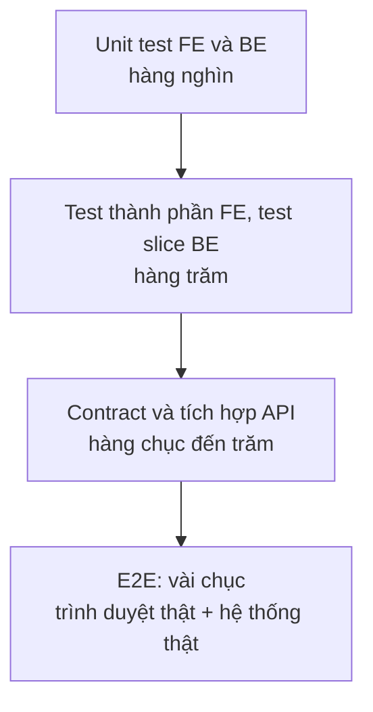
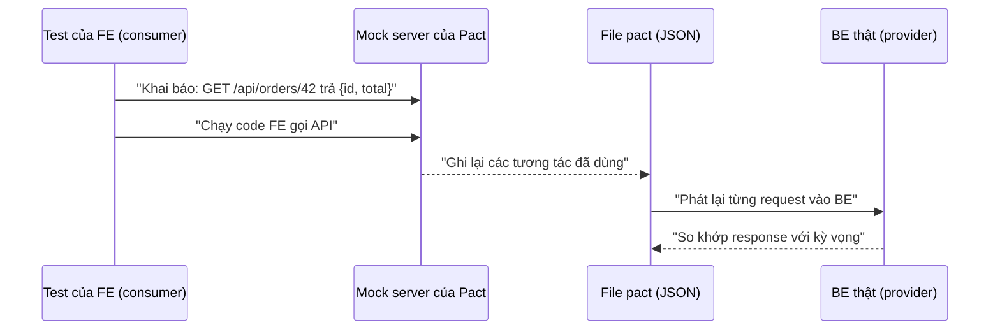
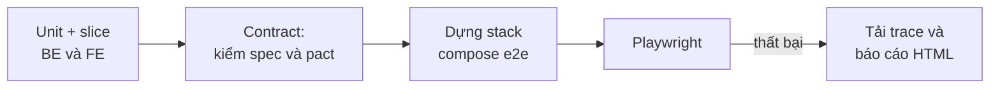

# Lý thuyết 06: Kiểm thử xuyên tầng với contract test và end-to-end

## Bài toán cần giải quyết

Backend có test xanh, frontend có test xanh, nhưng ghép lại thì hỏng: BE đổi tên trường `total` thành `totalAmount`, FE vẫn đọc `total` và hiển thị `undefined`. Mỗi nửa đều "đúng" theo hiểu biết của chính nó; lỗi nằm ở **khoảng giữa** hai nửa. Bài này nói cách kiểm thử khoảng giữa đó mà không biến cả bộ test thành một khối chậm và dễ vỡ.

Có hai công cụ chính cho khoảng giữa. Contract test kiểm tra FE và BE cùng tuân một contract mà không cần chạy cả hai cùng lúc. End-to-end (E2E) chạy cả hệ thống thật như người dùng, nhưng đắt, nên chỉ dùng cho vài flow quan trọng. Bài cũng bàn các việc làm E2E đáng tin: seed dữ liệu, chờ theo event thay cho sleep, test đăng nhập, và chạy trong CI.

Nếu bạn chỉ có một người làm cả hai nửa và API hiếm đổi, contract test có thể là thừa; vài E2E và việc sinh client từ OpenAPI ở [API contract](/go?p=12-Fullstack%2Flt-01-hop-dong-api-openapi-client-typescript.md) đã bắt phần lớn lỗi. Khi hai nhóm làm độc lập, hoặc có nhiều client (web, mobile), contract test đáng giá rõ.

**Tóm tắt:**

- Mỗi nửa (FE, BE) tự test theo niềm tin riêng về API nên đều xanh dù ghép lại hỏng; lỗi nằm ở khoảng giữa.
- Một lỗi nên bị bắt ở tầng thấp nhất có thể: nhiều unit test ở đáy, ít contract và tích hợp ở giữa, rất ít E2E ở đỉnh.
- Contract test biến niềm tin thành contract máy đọc được (OpenAPI hoặc Pact) và kiểm chứng ở cả hai phía bằng máy.
- Schema-first với OpenAPI là cổng rẻ nhất; consumer-driven với Pact sinh contract từ nhu cầu thật của FE.
- E2E chỉ dành cho lỗi chỉ lộ khi ghép cả hệ thống (proxy, cookie, migration, asset), chạy với Spring thật và Testcontainers.
- Chống flaky: không dựa vào thời gian cố định (`sleep`, `waitForTimeout`) mà chờ theo điều kiện thật; `retries` ở CI chỉ là lưới an toàn.
- Test parallel phải seed dữ liệu riêng cho mỗi test và đăng nhập một lần rồi dùng lại session state (`storageState`).

## Các khái niệm cần biết

| Khái niệm | Là gì | Dùng khi nào |
|---|---|---|
| Kim tự tháp test | Nhiều test nhỏ nhanh ở đáy, ít test lớn chậm ở đỉnh | Quyết định đầu tư vào tầng nào |
| Contract test | Kiểm tra bên gọi và bên được gọi cùng tuân một contract, mỗi bên test riêng | FE và BE phát triển độc lập |
| Consumer-driven contract | Bên dùng (FE) viết kỳ vọng, bên cung cấp (BE) phải thỏa | Muốn BE biết FE đang thực sự dùng gì |
| Provider-driven (schema-first) | BE công bố OpenAPI, mọi bên bám vào đó | API công khai, nhiều client |
| Pact | Công cụ consumer-driven: consumer sinh file pact, provider kiểm lại | Nhiều client, cần tách release |
| Spring Cloud Contract | Công cụ phía JVM: viết contract, sinh test cho provider và stub cho consumer | Cả hai phía đều JVM |
| E2E | Chạy trình duyệt thật chống hệ thống thật | Flow sống còn: đăng nhập, đặt hàng, thanh toán |
| Playwright | Thư viện tự động hóa trình duyệt, có chờ tự động | E2E cho SPA |
| Testcontainers | Thư viện bật container (Postgres, Redis) ngay trong test | Test với database thật mà không cần cài sẵn |
| Seed dữ liệu | Đưa dữ liệu khởi đầu xác định vào trước test | Mọi E2E cần state biết trước |
| Flaky test | Test lúc qua lúc hỏng với cùng mã | Kẻ giết niềm tin vào bộ test |

## Kim tự tháp test cho fullstack

Mỗi tầng trả lời một câu hỏi khác nhau. Đáy rẻ và nhanh nhưng không thấy lỗi ghép nối; đỉnh thấy được tất cả nhưng chậm và khó chẩn đoán.



| Tầng | Kiểm tra gì | Công cụ gợi ý | Tốc độ |
|---|---|---|---|
| Unit | Logic thuần: tính tiền, validator, composable hoặc hook | JUnit, Vitest | Mili giây |
| Thành phần FE, slice BE | Một component với dữ liệu giả; một controller hoặc repository | Testing Library, `@WebMvcTest`, `@DataJpaTest` | Dưới 1 giây |
| Tích hợp và contract | BE với DB thật; FE và BE khớp contract | Testcontainers, Pact, Spring Cloud Contract | Vài giây |
| E2E | Flow người dùng xuyên cả hệ thống | Playwright | Hàng chục giây mỗi test |

Quy tắc dùng: một lỗi nên bị bắt ở tầng **thấp nhất** có thể bắt được nó. Lỗi công thức tính tiền thuộc về unit test, không phải E2E. E2E dành cho thứ chỉ xuất hiện khi mọi mảnh ráp lại: proxy sai, cookie không gửi, migration thiếu, asset không tải. Kim tự tháp bị lộn ngược (nhiều E2E, ít unit) cho ra bộ test chạy cả giờ và hỏng thất thường.

**Phải thuộc:** Một lỗi nên bị bắt ở tầng thấp nhất có thể bắt được nó. Kim tự tháp test: nhiều unit test ở đáy, ít contract và tích hợp ở giữa, rất ít E2E ở đỉnh. E2E chỉ dành cho lỗi chỉ lộ khi ghép cả hệ thống (proxy, cookie, migration, asset).

Chi tiết các tầng thấp nằm ở các bài sẵn có: [Kiểm thử nâng cao trong Spring Boot](/go?p=01-Spring-Boot%2Fhard%2Flt-27-advanced-testing.md), [Testing Vue](/go?p=10-Vue%2Fmedium%2Flt-07-testing-vue.md) và [Testing React](/go?p=09-React%2Fmedium%2Flt-07-testing-react.md). Bài này chỉ làm hai tầng trên cùng.

## Contract test: giữ FE và BE khớp nhau

Vấn đề cần giải: test FE thường mock API, test BE thường không biết FE dùng gì. Mock của FE là **lời tự khai** về API, và nó lệch dần so với thực tế. Contract test biến lời khai đó thành thứ kiểm chứng được.

**Nền tảng:** Mỗi nửa (FE, BE) tự test theo niềm tin riêng về API nên đều xanh dù ghép lại hỏng; lỗi nằm ở khoảng giữa. Contract test biến niềm tin đó thành contract máy đọc được (OpenAPI hoặc file pact) và kiểm chứng ở cả hai phía bằng máy, không dựa vào việc hai người nhớ nói chuyện với nhau.

### Hướng schema-first với OpenAPI

Nếu đã dùng OpenAPI làm nguồn sự thật (xem [bài 01](/go?p=12-Fullstack%2Flt-01-hop-dong-api-openapi-client-typescript.md)), bạn có hai chốt chặn gần như miễn phí:

1. **Kiểm tra response thật khớp spec ở phía BE.** Test tích hợp gọi endpoint rồi validate response với schema trong file OpenAPI. Nếu ai đổi tên trường mà không cập nhật spec, test đỏ. Có thư viện làm việc này cho cả MockMvc lẫn REST Assured (ví dụ `swagger-request-validator`; kiểm tra lại phiên bản và API theo tài liệu thư viện).
2. **Phát hiện thay đổi phá vỡ giữa hai phiên bản spec.** Công cụ so sánh spec (như `oasdiff`) chạy trong CI trên PR: xóa trường, đổi kiểu, thêm trường bắt buộc đều bị báo là breaking. FE nhận client TypeScript sinh lại và trình biên dịch chỉ ra chỗ gãy.

Cách này nhẹ, hợp khi có một BE phục vụ các FE do cùng tổ chức làm. Điểm yếu: spec nói được **hình dạng**, nhưng không nói FE thực sự dùng trường nào, nên BE không biết xóa trường X có an toàn không.

### Hướng consumer-driven với Pact

Pact đảo chiều: FE viết ra những tương tác nó cần, sinh file contract, BE chạy lại các tương tác đó với mã thật. Flow như sau.



Điểm hay: contract chỉ chứa phần FE **thực sự dùng**. BE biết trường nào xóa được an toàn, và test của BE không cần bật FE. Phát hành độc lập được nhờ công cụ `can-i-deploy` hỏi broker "bản này có tương thích với bản đang chạy ở production không".

_Minh họa_ phía consumer bằng Pact JS (API thay đổi theo phiên bản, kiểm tra lại tài liệu Pact; ví dụ dùng `PactV3`):

```ts
import { PactV3, MatchersV3 } from '@pact-foundation/pact'
import { fetchOrder } from '../src/api/orders'

const provider = new PactV3({ consumer: 'web', provider: 'order-api' })

it('đọc được đơn hàng theo id', async () => {
  provider
    .given('đơn 42 tồn tại')
    .uponReceiving('yêu cầu lấy đơn 42')
    .withRequest({ method: 'GET', path: '/api/orders/42' })
    .willRespondWith({
      status: 200,
      headers: { 'Content-Type': 'application/json' },
      body: { id: MatchersV3.integer(42), totalAmount: MatchersV3.decimal(99.5) },
    })

  await provider.executeTest(async (mock) => {
    const order = await fetchOrder(mock.url, 42)
    expect(order.totalAmount).toBe(99.5)
  })
})
```

Dòng `given('đơn 42 tồn tại')` là **provider state**: phía BE phải có một handler để dựng state đó trước khi phát lại. Dùng matcher theo kiểu (`integer`, `decimal`) thay vì giá trị cố định để contract không quá chặt; đòi đúng từng giá trị khiến test vỡ vì lý do không đáng.

_Minh họa_ phía provider bằng Pact JVM (kiểm tra lại annotation theo phiên bản `au.com.dius.pact.provider:junit5spring`):

```java
@WebMvcTest(OrderController.class)
@Provider("order-api")
@PactFolder("pacts")
class OrderProviderPactTest {

    @Autowired MockMvc mockMvc;
    @MockBean OrderService orderService;

    @BeforeEach
    void before(PactVerificationContext context) {
        context.setTarget(new MockMvcTestTarget(mockMvc));
    }

    @State("đơn 42 tồn tại")
    void order42Exists() {
        when(orderService.find(42L)).thenReturn(new OrderDto(42L, new BigDecimal("99.50")));
    }

    @TestTemplate
    @ExtendWith(PactVerificationInvocationContextProvider.class)
    void verify(PactVerificationContext context) {
        context.verifyInteraction();
    }
}
```

Lưu ý phiên bản: từ Spring Boot 3.4 `@MockBean` bị đánh dấu deprecated, dùng `@MockitoBean` thay thế. Test phía provider chạy ở tầng controller, nhanh và không cần database. Nó chỉ chứng minh hình dạng response khớp; hành vi nghiệp vụ vẫn do test khác lo.

### Spring Cloud Contract thì sao

Spring Cloud Contract hợp với hệ thống mà **cả hai phía là JVM**: contract viết bằng Groovy hoặc YAML ở BE, công cụ sinh test cho provider và đóng gói stub (WireMock) cho consumer. Khi consumer là SPA, bạn phải tự dùng stub qua HTTP, gượng hơn so với Pact có sẵn hệ sinh thái JS. Quy tắc chọn: FE là JS hoặc TS thì ưu tiên OpenAPI hoặc Pact; microservice Java gọi nhau thì Spring Cloud Contract rất tự nhiên.

### Chọn cách nào

| Tình huống | Gợi ý |
|---|---|
| Một BE, một FE, cùng nhóm | OpenAPI + sinh client + so sánh spec trong CI |
| Nhiều client, mobile cập nhật chậm | Pact để biết client nào dùng trường nào |
| API công khai cho bên thứ ba | OpenAPI là contract chính, có kiểm tra response khớp spec |
| Dịch vụ Java gọi dịch vụ Java | Spring Cloud Contract hoặc Pact JVM |

Dù chọn gì, nguyên tắc chung là: **contract phải được kiểm chứng ở cả hai phía bằng máy**, không phải bằng việc hai người nhớ nói chuyện với nhau.

## E2E với Playwright, Spring thật và Testcontainers

E2E trả lời câu hỏi cuối cùng: người dùng thật làm flow này có chạy không. Muốn nó đáng tin, hệ thống dưới test phải thật nhất có thể (Spring Boot thật, Postgres thật), nhưng được **kiểm soát**: dữ liệu biết trước, thời gian ổn định.

### Dựng hệ thống dưới test

Có hai cách. Cách một: dựng bằng compose như bài [đóng gói và deploy](/go?p=12-Fullstack%2Flt-05-dong-goi-deploy-docker-nginx-ci.md), E2E gọi vào địa chỉ Nginx; giống production nhất, kiểm cả cấu hình Nginx. Cách hai: BE tự bật trong test với Testcontainers cho Postgres, còn SPA chạy bằng dev server hoặc file build, tiện chạy ở máy dev. Dưới đây là cách hai cho phần BE.

_Minh họa_ (Spring Boot 3.1 trở lên có `@ServiceConnection`; kiểm tra lại theo phiên bản):

```java
@SpringBootTest(webEnvironment = WebEnvironment.DEFINED_PORT,
                properties = "server.port=8080")
@Testcontainers
@ActiveProfiles("e2e")
class E2eBackendApplication {

    @Container
    @ServiceConnection
    static PostgreSQLContainer<?> postgres = new PostgreSQLContainer<>("postgres:16");

    @Test
    void keepRunning() throws InterruptedException {
        Thread.currentThread().join();   // giữ server sống cho Playwright
    }
}
```

Cách "giữ test chạy mãi" hơi thô. Cách gọn hơn là một class `main` trong thư mục test dùng `SpringApplication.from(Application::main).with(ContainersConfig.class).run(args)` (hỗ trợ từ Spring Boot 3.1); Playwright khởi động nó qua `webServer` trong cấu hình. Cả hai cách là _Minh họa_, hãy ưu tiên cách có trong tài liệu Spring Boot của phiên bản bạn dùng.

Khi hệ thống chạy, Playwright chỉ cần biết địa chỉ. Câu dẫn cho cấu hình: để Playwright tự bật và chờ server sẵn sàng, dùng `webServer`; nó chờ URL trả mã thành công thay vì chờ một khoảng cố định.

_Minh họa_ (`playwright.config.ts`):

```ts
import { defineConfig, devices } from '@playwright/test'

export default defineConfig({
  testDir: './e2e',
  fullyParallel: true,
  retries: process.env.CI ? 2 : 0,
  reporter: [['html'], ['list']],
  use: {
    baseURL: 'http://localhost:8081',
    trace: 'on-first-retry',
    screenshot: 'only-on-failure',
  },
  projects: [
    { name: 'setup', testMatch: /auth\.setup\.ts/ },
    {
      name: 'chromium',
      use: { ...devices['Desktop Chrome'], storageState: '.auth/user.json' },
      dependencies: ['setup'],
    },
  ],
  webServer: {
    command: 'docker compose -f compose.e2e.yml up --build',
    url: 'http://localhost:8081/actuator/health/readiness',
    reuseExistingServer: !process.env.CI,
    timeout: 180_000,
  },
})
```

Hai chi tiết đáng chú ý. `trace: 'on-first-retry'` ghi lại một bản trace (ảnh chụp từng bước, request mạng, console) khi test phải chạy lại; đây là công cụ chẩn đoán flaky mạnh nhất của Playwright. Còn `retries` ở CI chỉ là lưới an toàn, không phải cách chữa: test cần retry để qua thì phải điều tra, đừng che.

### Seed dữ liệu

Test E2E đáng tin cần state biết trước. Có ba cách, xếp từ tốt đến dở:

1. **Tạo dữ liệu qua API hoặc endpoint dành riêng cho test** ngay đầu mỗi test (hoặc trong fixture). Nhanh hơn thao tác giao diện, và mỗi test tự dựng cái nó cần, không phụ thuộc test khác.
2. **Script SQL hoặc migration dữ liệu mẫu** nạp một lần khi khởi động container. Phù hợp dữ liệu tham chiếu (danh mục, vai trò) bất biến.
3. **Dùng chung một bộ dữ liệu và để test sửa trực tiếp.** Dễ nhất, nhưng test phụ thuộc thứ tự chạy; chạy parallel là hỏng.

Quy tắc: mỗi test dùng dữ liệu **riêng** (ví dụ đặt hậu tố ngẫu nhiên vào email), để chạy parallel và chạy lại nhiều lần đều ổn. Endpoint seed chỉ tồn tại ở profile `e2e`, tuyệt đối không đưa lên production.

_Minh họa_ (endpoint seed chỉ có ở profile `e2e`):

```java
@RestController
@Profile("e2e")
@RequestMapping("/test-support")
class TestSupportController {

    private final OrderSeeder seeder;

    TestSupportController(OrderSeeder seeder) { this.seeder = seeder; }

    @PostMapping("/orders")
    OrderDto seedOrder(@RequestBody SeedOrderRequest request) {
        return seeder.create(request.customerEmail(), request.totalAmount());
    }

    @DeleteMapping("/data")
    void reset() { seeder.truncateAll(); }
}
```

Dùng `@Profile` để bean này không tồn tại ngoài `e2e`. Nên có thêm một test nhỏ khẳng định ở profile mặc định `/test-support/**` trả 404; đây là loại lỗi cấu hình tai hại nếu lọt production.

### Viết test E2E

Test nên đọc như một kịch bản người dùng, dùng locator theo vai trò và nhãn nhìn thấy (`getByRole`, `getByLabel`) thay vì CSS dễ vỡ. Sau đây là một flow đặt hàng: seed trước, thao tác giao diện, rồi kiểm kết quả thấy được.

_Minh họa_:

```ts
import { test, expect } from '@playwright/test'

test('người dùng xem và hủy được đơn của mình', async ({ page, request }) => {
  const email = `buyer-${Date.now()}@example.com`
  const res = await request.post('/test-support/orders', {
    data: { customerEmail: email, totalAmount: 120 },
  })
  const order = await res.json()

  await page.goto(`/orders/${order.id}`)
  await expect(page.getByRole('heading', { name: `Đơn #${order.id}` })).toBeVisible()
  await expect(page.getByText('120')).toBeVisible()

  const cancelResponse = page.waitForResponse(
    (r) => r.url().includes(`/api/orders/${order.id}/cancel`) && r.ok(),
  )
  await page.getByRole('button', { name: 'Hủy đơn' }).click()
  await cancelResponse

  await expect(page.getByText('Đã hủy')).toBeVisible()
})
```

Để ý `waitForResponse` được đặt **trước** khi bấm nút: nếu đặt sau, response có thể về trước khi bạn bắt đầu chờ, test treo hoặc hỏng ngẫu nhiên.

## Chống flaky: chờ theo event, không sleep

Flaky nghĩa là cùng mã mà kết quả khác nhau. Nguyên nhân hàng đầu là **giả định về thời gian**: "chắc 2 giây là xong". Máy CI chậm hơn máy bạn, và con số ấy sai đúng lúc bạn cần nó nhất. Thay giả định bằng điều kiện thật.

Ý tưởng cốt lõi chỉ vài dòng: lặp kiểm tra điều kiện, ra ngay khi đúng, bỏ cuộc có lý do khi hết hạn. Đây là bản thu nhỏ của cách `expect(...).toBeVisible()` của Playwright hoạt động. Script node thuần dưới đây chạy được; điều kiện "sẵn sàng" đến sau một khoảng ngẫu nhiên, và bộ chờ trả về đúng lúc nó xảy ra.

_Đã chạy thử trên Node (không phải JDK)_:

```js
async function waitFor(check, { timeout = 2000, interval = 20 } = {}) {
  const start = Date.now();
  for (;;) {
    const v = await check();
    if (v) return Date.now() - start;
    if (Date.now() - start > timeout) throw new Error('timeout');
    await new Promise(r => setTimeout(r, interval));
  }
}
let ready = false;
setTimeout(() => { ready = true; }, 137 + Math.random() * 100);
waitFor(() => ready).then(ms => console.log('san sang sau ~' + Math.round(ms/10)*10 + ' ms'));
```

Kết quả một lần chạy: `san sang sau ~190 ms`. Con số khác nhau mỗi lần, và đó đúng là điểm chính: bộ chờ không phụ thuộc vào con số đó, còn `sleep(2000)` luôn tốn đủ 2 giây khi nhanh và vẫn thiếu khi chậm.

**Phải thuộc:** Test không được dựa vào giả định thời gian: không dùng `sleep` hay `waitForTimeout` cố định, mà chờ theo điều kiện thật (assertion tự chờ như `toBeVisible`, `waitForResponse` đặt trước khi bấm nút, Awaitility ở phía BE). `retries` ở CI chỉ là lưới an toàn, không phải cách chữa flaky.

Các quy tắc cụ thể với Playwright:

- **Dùng assertion có tự chờ** (`expect(locator).toBeVisible()`, `toHaveText`, `toHaveCount`) thay vì đọc giá trị rồi so sánh ngay. Assertion kiểu web-first tự thử lại tới hạn.
- **Cấm `page.waitForTimeout`** trong test thật (chỉ dùng khi gỡ lỗi). Chờ một tín hiệu cụ thể: `waitForResponse`, `waitForURL`, một phần tử xuất hiện, hoặc spinner biến mất.
- **Chờ response mạng thay vì chờ hiệu ứng**: với hành động gửi dữ liệu, chờ đúng request hoàn tất rồi mới kiểm giao diện.
- **Đừng phụ thuộc thứ tự test hay dữ liệu chung.** Mỗi test tự seed dữ liệu riêng.
- **Cố định những thứ ngoài tầm kiểm soát**: đồng hồ (Playwright có `page.clock`), dịch vụ bên thứ ba (mock ở mức mạng bằng `page.route`), dữ liệu ngẫu nhiên (đặt seed).
- **Phía BE, async cũng cần chờ theo điều kiện.** Với xử lý nền (Kafka consumer, `@Async`), dùng thư viện như Awaitility (`await().atMost(...).until(...)`) thay cho `Thread.sleep`.
- **Cô lập bằng cách chạy lại ở môi trường sạch**: mỗi lần chạy CI dựng container mới, không dùng lại dữ liệu từ lần trước.

Khi test vẫn flaky, đừng bấm retry cho xong. Mở trace của Playwright, tìm request chậm hoặc phần tử xuất hiện muộn, rồi sửa nguyên nhân. Một test flaky cách ly (đánh dấu `test.fixme`) và có người nhận sửa tốt hơn một test flaky để nguyên làm cả đội quen với việc bỏ qua màu đỏ.

## Test authentication

Đăng nhập qua giao diện ở mỗi test vừa chậm vừa là nguồn flaky. Cách làm chuẩn: đăng nhập **một lần**, lưu session state (cookie, localStorage) ra file, rồi mọi test nạp lại file đó. Trong cấu hình ở trên, project `setup` làm việc này và các project khác phụ thuộc vào nó.

_Minh họa_ (`e2e/auth.setup.ts`):

```ts
import { test as setup, expect } from '@playwright/test'

setup('đăng nhập và lưu phiên', async ({ page }) => {
  await page.goto('/login')
  await page.getByLabel('Email').fill('alice@example.com')
  await page.getByLabel('Mật khẩu').fill(process.env.E2E_PASSWORD!)
  await page.getByRole('button', { name: 'Đăng nhập' }).click()
  await expect(page).toHaveURL('/')
  await page.context().storageState({ path: '.auth/user.json' })
})
```

Vài điểm khi test authentication:

- **Giữ một test đăng nhập qua giao diện** (đường chính, và đường nhập sai mật khẩu), các test còn lại dùng session đã lưu. Như vậy đăng nhập vẫn được kiểm, mà không lặp lại hàng trăm lần.
- **Mỗi vai trò một file session** (`admin.json`, `user.json`) để kiểm authorization: người dùng thường vào `/admin` bị chuyển hướng hoặc thấy 403, admin thấy được.
- **Kiểm tra hết hạn session**: xóa cookie trong test rồi gọi API, kỳ vọng SPA đưa về trang đăng nhập. Đây là flow hay bỏ sót và hay hỏng ở production. Cách xử lý 401 ở FE xem [bài 02](/go?p=12-Fullstack%2Flt-02-xac-thuc-spa-spring-security.md).
- **Không đặt mật khẩu thật vào mã**: dùng tài khoản tạo riêng cho môi trường E2E, mật khẩu lấy từ biến môi trường hoặc secret của CI.
- **Ở phía BE, test quyền bằng `@WithMockUser` hoặc token giả** ở tầng slice; E2E chỉ cần xác nhận session thật chạy qua cả Nginx và cookie, đúng phần mà test thấp tầng không thấy.

## Chạy test trong CI

Kết hợp các tầng thành pipeline: tầng rẻ chạy trước để lỗi báo sớm, E2E chạy cuối và chỉ khi các tầng trước qua. Với PR, chạy bộ E2E nhỏ (smoke); bản đầy đủ chạy ban đêm hoặc trước khi lên production.



_Minh họa_ (job E2E trong GitHub Actions):

```yaml
  e2e:
    needs: [backend, frontend]
    runs-on: ubuntu-latest
    timeout-minutes: 20
    steps:
      - uses: actions/checkout@v4
      - uses: actions/setup-node@v4
        with: { node-version: 22, cache: npm, cache-dependency-path: frontend/package-lock.json }
      - run: npm ci
        working-directory: frontend
      - run: npx playwright install --with-deps chromium
        working-directory: frontend
      - run: npx playwright test
        working-directory: frontend
        env:
          CI: true
          E2E_PASSWORD: ${{ secrets.E2E_PASSWORD }}
      - uses: actions/upload-artifact@v4
        if: always()
        with:
          name: playwright-report
          path: frontend/playwright-report
          retention-days: 7
```

Mấy thói quen tốt cho CI:

- **Luôn tải lên báo cáo và trace khi thất bại** (`if: always()`). Test chỉ hỏng trên CI mà không có trace thì gần như không gỡ lỗi được.
- **Đặt `timeout-minutes`** cho job để test treo không ăn hết thời lượng chạy.
- **Giữ E2E ít và quan trọng.** Mỗi E2E thêm vào là một thứ phải bảo trì; hãy tự hỏi lỗi này có thể bắt ở tầng thấp hơn không.
- **Chia nhỏ (shard)** khi bộ E2E lớn: Playwright hỗ trợ `--shard=1/4` để chạy parallel nhiều job.
- **Test contract chạy sớm**: nó nhanh, không cần dựng stack, và báo lỗi đúng chỗ (contract) thay vì một lỗi giao diện khó hiểu ở cuối.
- **Đừng quên trình duyệt**: chạy Chromium cho mọi PR là đủ; Firefox, WebKit để bản chạy đêm nếu cần hỗ trợ.

Một bộ test đáng tin có thể đọc theo thứ tự đỏ: contract đỏ nghĩa là hai bên lệch contract, E2E đỏ mà contract xanh thường là cấu hình, dữ liệu hoặc phía giao diện. Phân loại nhanh như vậy chính là giá trị của việc có nhiều tầng.

## Bẫy thường gặp

| Bẫy | Hệ quả |
|---|---|
| Mock API ở FE rồi không bao giờ kiểm mock đó với BE | Test FE xanh nhưng gọi thật thì vỡ, mock thành chuyện hư cấu |
| Contract Pact quá chặt (so từng giá trị) | Test vỡ vì lý do không liên quan, đội bỏ qua |
| Nhiều E2E hơn unit test | Pipeline chậm, flaky, khó chẩn đoán |
| `sleep` hoặc `waitForTimeout` cố định | Chậm khi nhanh, hỏng khi CI chậm |
| Đặt `waitForResponse` sau khi bấm nút | Response về trước, test treo ngẫu nhiên |
| Test dùng chung dữ liệu và phụ thuộc thứ tự | Chạy parallel hoặc chạy lại thì hỏng |
| Đăng nhập qua giao diện trong mọi test | Chậm, và một lỗi đăng nhập làm đỏ toàn bộ |
| Endpoint seed không giới hạn theo profile | Lộ cửa xóa dữ liệu ở production |
| Bật `retries` để che flaky | Lỗi thật bị che, niềm tin vào test mất dần |
| Không lưu trace, báo cáo khi CI hỏng | Không tái hiện được, sửa mò |
| Test E2E gọi dịch vụ bên thứ ba thật | Hỏng vì mạng hay hạn mức của họ |

## Câu hỏi phỏng vấn thường gặp

**Câu hỏi 1.** Test của FE và test của BE đều xanh, nhưng sau khi merge, màn hình đơn hàng hiện `undefined` ở chỗ tổng tiền. Làm sao phát hiện sớm hơn?

**Gợi ý suy luận:**
- Test FE lấy dữ liệu từ đâu: API thật hay dữ liệu giả do chính FE viết?
- Test BE có biết trường nào FE đang đọc không?
- Cần một "văn bản" mà cả hai bên đều bị kiểm chứng theo nó.

**Lập luận:** Mỗi bên test với niềm tin riêng về API; BE đổi `total` thành `totalAmount`, test BE vẫn xanh vì nó khớp với mã BE, test FE vẫn xanh vì mock cũ vẫn trả `total`. Lỗi nằm ở chỗ hai niềm tin không được đối chiếu. Biến niềm tin thành contract máy đọc được (OpenAPI hoặc file pact) và kiểm nó ở cả hai phía thì thay đổi tên trường làm đỏ ngay trong CI của BE.

**Đáp án ngắn:** Dùng contract test (OpenAPI cộng so sánh spec, hoặc Pact) để cả FE và BE bị kiểm theo cùng một contract.

**Câu hỏi 2.** Một E2E đặt hàng chạy qua trên máy bạn nhưng hỏng khoảng một lần trong năm lần ở CI, lỗi là không tìm thấy nút "Xác nhận". Bạn xử lý thế nào, và vì sao đừng chỉ thêm `sleep(3000)`?

**Gợi ý suy luận:**
- Nút xuất hiện sau điều kiện gì: dữ liệu tải xong, hay một khoảng thời gian?
- CI chậm hơn máy bạn bao nhiêu, và có đo được không?
- Công cụ có cách chờ trực tiếp điều kiện đó không?

**Lập luận:** Nút chỉ hiện khi một request hoàn tất; thời gian request phụ thuộc máy. `sleep(3000)` giả định thời gian cố định: trên máy nhanh thì lãng phí, trên CI chậm vẫn có thể thiếu. Chờ chính điều kiện (response mạng hoặc phần tử hiển thị) thì không còn giả định nào về thời gian, và dùng trace để xác định đúng request nào là điều kiện.

**Đáp án ngắn:** Chờ theo event (`waitForResponse`, assertion tự chờ như `toBeVisible`), xem trace để tìm điều kiện thật. Sleep cố định chỉ dời xác suất hỏng chứ không loại bỏ.

**Câu hỏi 3.** Bộ E2E có 300 test, mỗi test đăng nhập qua form, chạy 40 phút, và cứ khi đăng nhập có lỗi nhỏ là toàn bộ đỏ. Nên thay đổi gì?

**Gợi ý suy luận:**
- Thời gian đăng nhập nhân với 300 là bao nhiêu?
- Thứ nào thực sự cần kiểm lặp lại: form đăng nhập hay trang đang test?
- Có cách nào dùng lại session đã có?

**Lập luận:** Đăng nhập lặp lại 300 lần vừa tốn thời gian vừa gắn mọi test vào một điểm hỏng chung. Chỉ cần vài test kiểm đăng nhập qua giao diện; còn lại lưu session state một lần (`storageState`) và nạp lại. Đồng thời, 300 E2E là quá nhiều: phần lớn nên hạ xuống test thấp tầng, giữ E2E cho các flow sống còn.

**Đáp án ngắn:** Đăng nhập một lần và lưu `storageState`, giữ một vài test đăng nhập thật qua giao diện, và hạ bớt E2E xuống tầng thấp hơn.

**Câu hỏi 4.** Hai test E2E chạy parallel và thỉnh thoảng một test báo "không thấy đơn hàng của mình" hoặc thấy đơn của test kia. Nguyên nhân?

**Gợi ý suy luận:**
- Hai test đang dùng chung dữ liệu hay mỗi test có dữ liệu riêng?
- Có test nào dọn hoặc xóa toàn bộ bảng không?
- Thứ tự thực thi có được đảm bảo khi chạy parallel không?

**Lập luận:** Dữ liệu chung cộng với parallel nghĩa là test này có thể tác động vào state test kia đang dựa vào, như xóa hết bảng hay đếm số dòng. Kết quả phụ thuộc thứ tự xen kẽ, nên chỉ hỏng thỉnh thoảng. Mỗi test tự tạo dữ liệu riêng với định danh duy nhất (email ngẫu nhiên) và chỉ làm việc trên dữ liệu đó.

**Đáp án ngắn:** Chia sẻ state giữa các test parallel. Mỗi test seed dữ liệu riêng, định danh duy nhất, không xóa toàn bộ bảng.

**Câu hỏi 5.** Provider (BE) vừa xóa trường `legacyCode` khỏi response. Với OpenAPI, test vẫn xanh; với Pact, một pipeline đỏ. Cả hai đều "đúng"? Giải thích khác biệt.

**Gợi ý suy luận:**
- Spec mô tả toàn bộ API hay chỉ phần client dùng?
- Ai viết ra kỳ vọng trong Pact?
- Điều gì xảy ra nếu không client nào dùng trường đó?

**Lập luận:** Nếu spec đã cập nhật cùng lúc, OpenAPI xanh vì BE khớp spec; nó không biết client nào còn dùng trường. Pact chứa các tương tác client đã đăng ký, nên nếu một client vẫn đọc `legacyCode` thì pact đỏ, báo trước rằng xóa sẽ làm hỏng người dùng thật. Nếu không client nào dùng, pact vẫn xanh và bạn xóa an toàn.

**Đáp án ngắn:** OpenAPI kiểm BE với spec; Pact kiểm BE với việc các client thật sự dùng. Pact đỏ là cảnh báo có client còn phụ thuộc trường đó.

**Câu hỏi 6.** Endpoint `/test-support/data` (xóa sạch dữ liệu) có trong mã BE để phục vụ E2E. Rủi ro gì và kiểm soát thế nào?

**Gợi ý suy luận:**
- Nếu endpoint này tồn tại ở production, ai gọi được?
- Cơ chế nào của Spring giúp bean chỉ tồn tại ở một số môi trường?
- Làm sao đảm bảo cấu hình đó không bị bỏ sót?

**Lập luận:** Endpoint xóa dữ liệu mà lọt production là sự cố nghiêm trọng, thậm chí ngay cả khi có authentication nếu quyền cấu hình sai. `@Profile("e2e")` làm bean không được tạo ở môi trường khác, nên endpoint không tồn tại. Phải có test tự động khẳng định rằng ở profile mặc định đường dẫn này trả 404, để một thay đổi cấu hình sau này không âm thầm bật nó.

**Đáp án ngắn:** Nguy cơ xóa dữ liệu production. Giới hạn bằng `@Profile("e2e")` cộng một test khẳng định endpoint không tồn tại ở profile mặc định.

## Đọc thêm

- [Kiểm thử nâng cao trong Spring Boot](/go?p=01-Spring-Boot%2Fhard%2Flt-27-advanced-testing.md) cho `@WebMvcTest`, Testcontainers và các tầng thấp.
- [Testing Vue](/go?p=10-Vue%2Fmedium%2Flt-07-testing-vue.md) và [Testing React](/go?p=09-React%2Fmedium%2Flt-07-testing-react.md) cho test thành phần phía FE.
- [Testing, tooling, build](/go?p=07-Interview-QA%2FFrontend%2Fmedium%2Fqa-fe-08-testing-tooling-build.md) để ôn câu hỏi phỏng vấn phía FE.
- [API contract](/go?p=12-Fullstack%2Flt-01-hop-dong-api-openapi-client-typescript.md) cho OpenAPI và client có kiểu; [Đóng gói và deploy](/go?p=12-Fullstack%2Flt-05-dong-goi-deploy-docker-nginx-ci.md) cho phần dựng stack và CI.
- [DevOps](/go?p=04-DevOps%2Findex.md) cho nền tảng pipeline.

