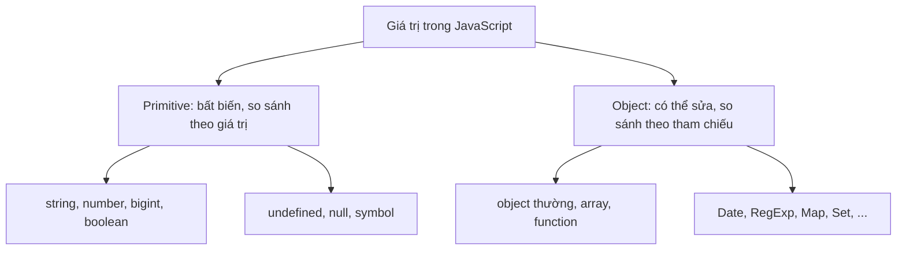

# Lý thuyết 1: Biến, kiểu dữ liệu và toán tử

Bài mở đầu của bộ JavaScript nền tảng. Mọi dòng code bạn viết sau này, từ một phép cộng đơn giản đến một component phức tạp, đều xoay quanh ba việc: đặt tên cho giá trị (biến), biết giá trị đó thuộc loại gì (kiểu dữ liệu), và kết hợp các giá trị với nhau (toán tử). Phần lớn lỗi "vô lý" của người mới, như `"5" + 3` ra `"53"` hay `0.1 + 0.2` không bằng `0.3`, đều có lời giải thích rõ ràng nếu bạn nắm chắc ba việc này.

## Biến và kiểu dữ liệu là gì?

Hãy hình dung một nhà kho có nhiều **kệ** và nhiều **món hàng**. Món hàng là giá trị (số, chữ, danh sách khách hàng...). Kệ là biến: một cái nhãn dán lên một vị trí để bạn tìm lại món hàng khi cần. Điểm đặc biệt của JavaScript là cái nhãn không quy định loại hàng: hôm nay kệ `x` đặt một con số, mai bạn đổi sang đặt một chuỗi chữ cũng được. Loại hàng (kiểu dữ liệu) **gắn với món hàng**, không gắn với cái kệ. Vì vậy ngôn ngữ này được gọi là **dynamically typed** (kiểu động).

Có thêm một điều nữa: món hàng có hai dạng. Loại nhỏ gọn như số, chữ được đưa thẳng vào tay bạn (giá trị nguyên thủy, primitive). Loại cồng kềnh như một danh sách dài thì kho chỉ đưa cho bạn **phiếu nhận hàng ghi địa chỉ** (tham chiếu). Hai người cầm cùng một phiếu thì cùng sửa một món hàng. Bài này sẽ đi từng bước để bạn thấy sự khác biệt đó gây ra những hiện tượng gì.

## Vấn đề nó giải quyết, và vì sao dev phải nắm

Nếu không hiểu mô hình "kiểu gắn với giá trị" và "primitive khác object", bạn sẽ gặp những lỗi mà chỉ biết sửa mò: tổng giỏ hàng ra `"1002"` thay vì `102`, điều kiện `if (count)` bỏ qua trường hợp `count = 0` hợp lệ, hàm sửa đổi dữ liệu của chỗ gọi mà không ai ngờ, hay số tiền lệch vài phần nghìn đồng sau một chuỗi phép tính. Các lỗi này không báo lỗi cú pháp; chương trình vẫn chạy, chỉ cho kết quả sai.

Kiến thức này đặc biệt quan trọng vì JavaScript rất "dễ dãi": nó tự ép kiểu, tự chuyển đổi, hiếm khi ném lỗi. Sự dễ dãi giúp viết nhanh, nhưng đẩy trách nhiệm kiểm soát sang bạn. Người nắm quy tắc sẽ chủ động chọn `===`, `??`, `Number.isNaN`, `BigInt`; người không nắm sẽ chờ bug lên production rồi mới biết.

**Tóm tắt:**

- `const` mặc định, `let` khi cần gán lại, tránh `var`; `const` chỉ cấm gán lại biến, không cấm sửa nội dung object.
- Có 8 kiểu: 7 primitive (`string`, `number`, `bigint`, `boolean`, `undefined`, `null`, `symbol`) và `object`; primitive bất biến và so sánh theo giá trị, object so sánh theo tham chiếu.
- `typeof` có quirk: `typeof null` là `"object"` (lỗi lịch sử), hàm cho `"function"`, mảng cho `"object"` nên cần `Array.isArray`.
- `undefined` là "chưa có giá trị" do engine gán, `null` là "chủ động không có" do dev đặt.
- Toán tử `+` ưu tiên nối chuỗi, các toán tử số học khác ép sang số; mặc định hãy ép kiểu tường minh bằng `Number()`, `String()`, `Boolean()`.
- Dùng `===` làm mặc định; `==` ép kiểu theo luật khó nhớ; `Object.is` phân biệt được `NaN` và `-0`.
- Có đúng 8 giá trị falsy; dùng `??` khi `0` hay chuỗi rỗng là giá trị hợp lệ, dùng `?.` để đọc an toàn, `||=` `&&=` `??=` để gán có điều kiện.
- Số là dấu phẩy động nhị phân nên `0.1 + 0.2 !== 0.3`; số nguyên lớn quá `2^53` dùng `BigInt` và không trộn với `number`.

## Các khái niệm cần biết

- **Biến (variable)**: một tên trỏ tới một giá trị. Khai báo bằng `let`, `const` (hoặc `var` kiểu cũ).
- **Primitive**: giá trị đơn giản, bất biến, so sánh theo nội dung. Có 7 loại: `string`, `number`, `bigint`, `boolean`, `undefined`, `null`, `symbol`.
- **Object**: tập hợp key-value; mảng, hàm, `Date`, `Map`... đều là object. Biến chứa tham chiếu tới object chứ không chứa chính object.
- **Scope khối (block scope)**: phạm vi sống của biến `let`/`const` chỉ trong cặp `{}` chứa nó.
- **TDZ (temporal dead zone)**: đoạn từ đầu khối tới dòng khai báo `let`/`const`, trong đó truy cập biến ném `ReferenceError`.
- **Ép kiểu (coercion)**: chuyển giá trị sang kiểu khác. Ngầm (do engine tự làm khi gặp toán tử) hoặc tường minh (do bạn gọi `Number()`, `String()`...).
- **Truthy/falsy**: giá trị coi là đúng/sai khi nằm trong ngữ cảnh boolean như `if`. Có đúng 8 giá trị falsy.
- **Short-circuit**: `&&`, `||`, `??` dừng ngay khi đã biết kết quả và trả về **chính toán hạng**, không nhất thiết là boolean.
- **NaN (Not a Number)**: giá trị `number` đặc biệt biểu diễn kết quả tính toán vô nghĩa, và nó không bằng chính nó.
- **IEEE 754 double**: chuẩn 64 bit mà `number` dùng; mọi số thập phân không biểu diễn chính xác được trong nhị phân đều bị làm tròn.
- **Value vs reference**: gán primitive thì sao chép giá trị; gán object thì sao chép địa chỉ.

## Tám kiểu dữ liệu và `typeof`

Chuẩn ngôn ngữ định nghĩa **8 kiểu**: 7 primitive và 1 object. Primitive gồm `string`, `number`, `bigint`, `boolean`, `undefined`, `null`, `symbol`. Mọi thứ còn lại (mảng, hàm, `Date`, `RegExp`, `Map`, `Set`...) đều thuộc kiểu `object`.

**Cốt lõi:** trong JavaScript, **kiểu thuộc về giá trị, không thuộc về biến**, và giá trị chia làm hai họ có cách cư xử khác nhau hoàn toàn: primitive (bất biến, so sánh và sao chép theo giá trị) và object (có thể sửa, biến chỉ giữ tham chiếu). Hầu hết hiện tượng lạ của bài này, từ so sánh `{} === {}` cho `false` tới việc hàm sửa được dữ liệu của chỗ gọi, đều suy ra từ sự phân đôi này.

- Vì kiểu gắn với giá trị, nên một biến `let` có thể lần lượt giữ số, chuỗi, object và không có lỗi biên dịch nào nhắc bạn, bạn phải tự kiểm soát bằng quy ước hoặc TypeScript.
- Vì primitive bất biến, nên mọi thao tác "sửa" chuỗi hay số thực chất tạo giá trị mới, và hai biến chứa cùng giá trị primitive luôn độc lập nhau.
- Vì object được truy cập qua tham chiếu, nên gán, truyền vào hàm hay đặt vào mảng đều chỉ chép địa chỉ, và hai tham chiếu cùng trỏ một object sẽ thấy thay đổi của nhau.



Mô hình tư duy: mỗi khi gặp một giá trị, hãy tự hỏi "nó thuộc họ nào?". Họ primitive thì cứ nghĩ như đang cầm tờ tiền mặt: đưa cho ai là họ có bản riêng. Họ object thì nghĩ như tờ phiếu địa chỉ: ai cầm cũng chỉ về cùng một món hàng.

Toán tử `typeof` cho biết nhóm kiểu của một giá trị dưới dạng chuỗi:

```javascript
const values = [42, "chữ", true, undefined, null, 10n, Symbol("id"), {}, [], () => {}, NaN];
for (const v of values) {
  console.log(typeof v);
}
```

```text
number
string
boolean
undefined
object
bigint
symbol
object
object
function
number
```

_Đã chạy thử trên Node 22._

Đối chiếu từng dòng: `null` cho `"object"` (dòng thứ 5), mảng cho `"object"`, hàm cho `"function"`, và `NaN` cho `"number"`. Ba kết quả đầu nghe lạ nhưng đều có lý do.

```javascript
console.log(typeof null);
console.log(typeof [] , Array.isArray([]));
console.log(typeof NaN);
console.log(typeof function () {});
console.log(typeof undeclaredName);
console.log(Object.prototype.toString.call(null));
console.log(Object.prototype.toString.call([]));
console.log(Object.prototype.toString.call(new Date(0)));
```

```text
object
object true
number
function
undefined
[object Null]
[object Array]
[object Date]
```

_Đã chạy thử trên Node 22._

Giải thích các quirk:

- `typeof null === "object"` là lỗi từ những phiên bản JavaScript đầu tiên (giá trị `null` mang nhãn kiểu trùng với object). Đặc tả giữ nguyên để không phá các website cũ. Kiểm tra null phải viết `value === null`.
- Hàm cho `"function"` dù về bản chất hàm là object; đây là sự tiện lợi của `typeof`, không phải một kiểu thứ chín.
- `typeof` một biến **chưa khai báo** cho `"undefined"` thay vì ném lỗi, nên có thể dùng để kiểm tra biến toàn cục có tồn tại không.
- Muốn phân biệt kiểu object cụ thể, dùng `Array.isArray`, `value instanceof Date`, hoặc `Object.prototype.toString.call(value)` như ở trên.

**Phải thuộc:** 7 primitive: `string`, `number`, `bigint`, `boolean`, `undefined`, `null`, `symbol`; còn lại là `object`. `typeof null` là `"object"`, `typeof` hàm là `"function"`, `typeof` mảng là `"object"` (dùng `Array.isArray`).

**Nhớ:** `typeof` chỉ cho biết "họ" của giá trị, không tách được null hay mảng khỏi object; cần kiểm tra thêm.

## Khai báo biến: let, const, var

JavaScript có ba từ khóa khai báo. Hai từ khóa hiện đại là `let` và `const`, đều có **phạm vi khối** và đều có TDZ. `var` là kiểu cũ trước ES2015, có phạm vi theo hàm và có hành vi hoisting gây bất ngờ (xem thêm [Lý thuyết 5](/go?p=13-JavaScript%2Feasy%2Flt-05-scope-hoisting-closure.md) khi bài đó ra).

```javascript
const PI = 3.14;
let count = 0;
count += 1;
try {
  PI = 3;
} catch (e) {
  console.log(e.name + ": " + e.message);
}
console.log(count);
console.log(typeof daVar);
var daVar = 1;
try {
  console.log(tdz);
} catch (e) {
  console.log(e.name + ": " + e.message);
}
let tdz = 2;
```

```text
TypeError: Assignment to constant variable.
1
undefined
ReferenceError: Cannot access 'tdz' before initialization
```

_Đã chạy thử trên Node 22._

Đọc kết quả: `const` không cho gán lại. `var` bị "kéo" lên đầu phạm vi nên đọc trước dòng khai báo vẫn không lỗi mà ra `undefined`. Còn `let` đọc trước dòng khai báo thì rơi vào TDZ và báo lỗi rõ ràng. Báo lỗi sớm như vậy là điều tốt: bug lộ ngay thay vì âm thầm cho `undefined`.

Về phạm vi:

```javascript
if (true) {
  var a = "var lọt ra ngoài";
  let b = "let ở trong khối";
}
console.log(a);
try {
  console.log(b);
} catch (e) {
  console.log(e.name + ": " + e.message);
}
```

```text
var lọt ra ngoài
ReferenceError: b is not defined
```

_Đã chạy thử trên Node 22._

Nhiều người hiểu nhầm `const` là "hằng số bất biến". Thực tế `const` chỉ ràng buộc **cái nhãn**: nhãn không thể dán sang món hàng khác. Món hàng nếu là object thì vẫn sửa được bên trong.

```javascript
const user = { name: "An" };
user.name = "Bình";
console.log(user);
try {
  user = { name: "Chi" };
} catch (e) {
  console.log(e.message);
}
```

```text
{ name: 'Bình' }
Assignment to constant variable.
```

_Đã chạy thử trên Node 22._

**Phải thuộc:** quy tắc thực dụng: dùng `const` cho mọi biến; chỉ đổi sang `let` khi thật sự cần gán lại (bộ đếm, tích lũy); không dùng `var` trong code mới. Biến `let`/`const` sống trong khối `{}` gần nhất và không đọc được trước dòng khai báo (TDZ).

**Lưu ý:** `const` không làm object bất biến. Muốn chặn sửa đổi (nông) phải dùng `Object.freeze` (xem [Lý thuyết 3](/go?p=13-JavaScript%2Feasy%2Flt-03-object-va-array.md)).

**Nhớ:** `const` khóa cái nhãn, không khóa món hàng. Mặc định `const`, khi cần mới `let`, bỏ `var`.

## null và undefined

Cả hai đều biểu diễn "không có gì", nhưng khác nguồn gốc và khác ý nghĩa:

- `undefined`: chưa có giá trị. Engine tự gán khi biến khai báo mà chưa khởi tạo, khi đọc thuộc tính không tồn tại, khi hàm không `return`, khi thiếu tham số.
- `null`: **chủ động** nói rằng "ở đây cố ý để trống". Do người viết code đặt.

```javascript
let x;
console.log(x);
const o = {};
console.log(o.missing);
function f() {}
console.log(f());
let y = null;
console.log(y);
console.log(null == undefined, null === undefined);
console.log(JSON.stringify({ a: undefined, b: null }));
```

```text
undefined
undefined
undefined
null
true false
{"b":null}
```

_Đã chạy thử trên Node 22._

Quan hệ: `null == undefined` là `true` (đây là trường hợp hiếm mà `==` được nhiều team chấp nhận, vì viết `value == null` kiểm tra cả hai một lượt), nhưng `===` thì phân biệt. Trong `JSON.stringify`, thuộc tính `undefined` bị bỏ qua còn `null` được giữ lại: một chi tiết hay gây mất dữ liệu khi gửi API.

**Nền tảng:** quy ước dễ nhớ: `undefined` là "chưa ai gán", `null` là "có người gán rỗng". Một API trả về `null` cho trường không có dữ liệu là cách nói rõ ràng "trường này tồn tại nhưng trống", khác với trường vắng mặt hoàn toàn (`undefined`).

**Nhớ:** kiểm tra cả hai bằng `value == null` hoặc `value === null || value === undefined`; đừng kiểm tra bằng truthy vì sẽ nuốt luôn `0` và chuỗi rỗng.

## Ép kiểu: ngầm và tường minh

Khi bạn dùng một toán tử với giá trị không đúng kiểu mà nó cần, engine sẽ **tự ép** thay vì ném lỗi. Có ba hướng ép: sang chuỗi, sang số, sang boolean. Quy tắc chính của toán tử `+`: nếu một vế là chuỗi (hoặc có thể thành chuỗi, như mảng và object) thì **nối chuỗi**; ngược lại cộng số. Các toán tử `-`, `*`, `/` luôn ép sang số.

```javascript
console.log("5" + 3);
console.log("5" - 3);
console.log("5" * "2");
console.log(true + 1);
console.log([] + {});
console.log([] + []);
console.log(+"");
console.log(+"abc");
console.log(Number("12px"), parseInt("12px"), parseFloat("3.5kg"));
console.log(String(123), (123).toString(), 123 + "");
console.log(Boolean("0"), Boolean(""), !!NaN);
console.log(Number(null), Number(undefined), Number([]), Number([7]));
```

```text
53
2
10
2
[object Object]

0
NaN
NaN 12 3.5
123 123 123
true false false
0 NaN 0 7
```

_Đã chạy thử trên Node 22._

Các điểm đáng chú ý:

- `"5" + 3` ra `"53"` (nối), nhưng `"5" - 3` ra `2` (trừ). Cùng một người viết mà hai dấu cho hai kết quả khác loại.
- `[] + []` là chuỗi rỗng (dòng trống trong output), vì mỗi mảng rỗng chuyển thành chuỗi rỗng rồi nối.
- `Number("12px")` cho `NaN` vì `Number` đòi cả chuỗi phải là số hợp lệ, còn `parseInt`/`parseFloat` đọc phần đầu hợp lệ rồi dừng.
- `Number(null)` là `0` nhưng `Number(undefined)` là `NaN`: một bất đối xứng dễ quên.
- Chuỗi `"0"` là **truthy** (`Boolean("0")` là `true`) vì mọi chuỗi không rỗng đều truthy.

Thói quen tốt là ép **tường minh** ngay tại biên (input người dùng, dữ liệu từ API, query string): `Number(value)`, `String(value)`, `Boolean(value)` (hoặc `!!value`). Đọc code thấy ngay ý đồ, không phụ thuộc luật ngầm.

**Phải thuộc:** `+` nối chuỗi nếu có vế là chuỗi; `-`, `*`, `/` ép sang số. `Number()` nghiêm khắc (cả chuỗi phải hợp lệ), `parseInt`/`parseFloat` đọc phần đầu hợp lệ. Ép sang boolean chỉ có 8 giá trị falsy.

**Lưu ý:** dữ liệu từ ô nhập liệu, `localStorage`, query string luôn là chuỗi. Cộng `input.value + 1` sẽ nối chữ chứ không cộng số; ép sang số trước khi tính.

**Nhớ:** ép ngầm tiện nhưng khó đoán; ép tường minh ở biên dữ liệu để kết quả luôn rõ ràng.

## So sánh: `==`, `===`, `Object.is`

Ba cách so sánh bằng, với ba mức "nghiêm khắc" khác nhau:

- `===` (strict equality): so sánh kiểu và giá trị, **không ép kiểu**. Đây là mặc định nên dùng.
- `==` (loose equality): nếu khác kiểu thì ép về cùng kiểu theo một bộ luật rồi mới so sánh.
- `Object.is`: gần giống `===` nhưng coi `NaN` bằng `NaN` và phân biệt `0` với `-0`.

```javascript
console.log(0 == "", 0 == "0", "" == "0");
console.log(null == 0, null >= 0, null > 0);
console.log(NaN == NaN, NaN === NaN, Object.is(NaN, NaN));
console.log(0 === -0, Object.is(0, -0));
console.log([] == false, [1] == 1);
console.log({} === {}, Object.is({}, {}));
```

```text
true true false
false true false
false false true
true false
true true
false false
```

_Đã chạy thử trên Node 22._

Đọc từng dòng: `0 == ""` đúng, `0 == "0"` đúng nhưng `"" == "0"` lại sai, tức quan hệ `==` **không bắc cầu**. Dòng hai là ví dụ kinh điển: `null == 0` sai, `null > 0` sai, nhưng `null >= 0` lại đúng, vì `==` có luật riêng cho `null` còn `>=` ép `null` sang `0`. Dòng cuối: hai object `{}` khác nhau không bao giờ bằng nhau theo cả `===` lẫn `Object.is`, vì so sánh theo **tham chiếu**.

Bảng chọn nhanh:

| Cần | Dùng |
|---|---|
| So sánh thông thường | `===` và `!==` |
| Kiểm tra `null` hoặc `undefined` một lượt | `value == null` (ngoại lệ chấp nhận được) |
| Kiểm tra `NaN` | `Number.isNaN(value)` hoặc `Object.is(value, NaN)` |
| Phân biệt `0` và `-0` | `Object.is` |
| So sánh nội dung hai object | Tự so từng trường hoặc dùng thư viện; không có toán tử sẵn |

**Phải thuộc:** mặc định `===`. `==` ép kiểu theo luật phức tạp và không bắc cầu. `Object.is(NaN, NaN)` là `true`, `Object.is(0, -0)` là `false`. Object so sánh theo tham chiếu.

**Nhớ:** khi không chắc, `===`. Ngoại lệ duy nhất đáng giữ: `value == null`.

## Truthy, falsy và các toán tử logic

Trong ngữ cảnh boolean (`if`, `while`, `!`, toán hạng của `&&` `||`), mọi giá trị đều được xem là đúng hoặc sai. Chỉ có **8 giá trị falsy**: `false`, `0`, `-0`, `0n`, `""`, `null`, `undefined`, `NaN`. Tất cả còn lại là truthy, kể cả những thứ gây bất ngờ như `"0"`, `"false"`, `[]`, `{}`.

```javascript
const falsy = [false, 0, -0, 0n, "", null, undefined, NaN];
console.log(falsy.map(Boolean));
console.log(Boolean("false"), Boolean([]), Boolean({}), Boolean(" "), Boolean("0"));
```

```text
[
  false, false,
  false, false,
  false, false,
  false, false
]
true true true true true
```

_Đã chạy thử trên Node 22._

Các toán tử logic của JavaScript không trả về boolean thuần mà trả về **chính một trong hai toán hạng**:

- `a || b`: trả `a` nếu `a` truthy, ngược lại trả `b`.
- `a && b`: trả `a` nếu `a` falsy, ngược lại trả `b`.
- `a ?? b`: trả `a` nếu `a` **không phải** `null`/`undefined`, ngược lại trả `b`.
- `a?.b`, `a?.[i]`, `a?.()`: optional chaining, nếu `a` là `null`/`undefined` thì cả biểu thức ra `undefined` thay vì ném `TypeError`.
- `a ||= b`, `a &&= b`, `a ??= b`: gán `b` cho `a` chỉ khi điều kiện tương ứng thỏa (gán ngắn mạch).

```javascript
console.log(0 || "mặc định");
console.log(0 ?? "mặc định");
console.log("" || "rỗng", "" ?? "rỗng");
console.log(1 && 2 && 3, 1 && 0 && 3);
const cfg = { retries: 0, nested: null };
console.log(cfg.retries || 3, cfg.retries ?? 3);
console.log(cfg.nested?.deep?.value);
console.log(cfg.fn?.());
const arr = null;
console.log(arr?.[0]);
let a = null, b = 5, c = 0;
a ??= 10;
b ||= 99;
c &&= 7;
console.log(a, b, c);
```

```text
mặc định
0
rỗng 
3 0
3 0
undefined
undefined
undefined
10 5 0
```

_Đã chạy thử trên Node 22._

Điểm cốt yếu là sự khác nhau giữa `||` và `??`. Với `cfg.retries` bằng `0` (một giá trị hợp lệ: "không thử lại"), `||` coi `0` là falsy nên ghi đè thành `3` sai ý, còn `??` chỉ thay khi giá trị thật sự "vắng mặt" nên giữ `0`. Quy tắc: dùng `??` để đặt giá trị mặc định cho dữ liệu có thể là `0`, `""` hay `false` hợp lệ; dùng `||` khi thật sự muốn "bất kỳ giá trị falsy nào cũng thay".

Về `c &&= 7` trong ví dụ: `c` là `0` (falsy) nên không gán, kết quả vẫn `0`. `a ??= 10` gán vì `a` là `null`. `b ||= 99` không gán vì `b` đã truthy.

**Lưu ý:** không trộn `??` với `||` hoặc `&&` trong cùng biểu thức mà không có ngoặc, cú pháp sẽ báo lỗi (`a ?? b || c` không hợp lệ). Optional chaining chỉ chặn `null`/`undefined`, không che được lỗi do giá trị sai kiểu (ví dụ gọi `?.()` trên một số).

**Nhớ:** `||` thay mọi falsy; `??` chỉ thay `null`/`undefined`. Giá trị trả về của `&&`/`||` là toán hạng, không phải boolean.

## NaN, số dấu phẩy động và BigInt

Kiểu `number` dùng chuẩn IEEE 754 64 bit cho **mọi** số: không có `int` riêng. Hệ quả có hai mặt: tiện (một kiểu dùng chung) nhưng có giới hạn về độ chính xác và về phạm vi số nguyên.

### NaN

`NaN` xuất hiện khi một phép tính số học không có kết quả hợp lệ: `0 / 0`, `Math.sqrt(-1)`, `Number("abc")`, `undefined + 1`. Nó là giá trị duy nhất không bằng chính nó, và "lây": mọi phép tính với `NaN` đều ra `NaN`.

```javascript
console.log(0 / 0, Math.sqrt(-1), parseInt("x"));
const r = NaN;
console.log(r === r, Number.isNaN(r), isNaN("abc"), Number.isNaN("abc"));
console.log([NaN].includes(NaN), [NaN].indexOf(NaN));
console.log(1 / 0, -1 / 0);
```

```text
NaN NaN NaN
false true true false
true -1
Infinity -Infinity
```

_Đã chạy thử trên Node 22._

Hai hàm kiểm tra khác nhau: `isNaN` toàn cục tự ép đối số sang số trước (nên `isNaN("abc")` ra `true`), còn `Number.isNaN` chỉ đúng khi giá trị **thực sự là** `NaN`. Hãy dùng `Number.isNaN`. Với mảng, `includes` tìm được `NaN` còn `indexOf` thì không, vì `indexOf` dùng `===`. Chia cho `0` không ném lỗi mà ra `Infinity`.

### Số dấu phẩy động

Máy tính lưu số dưới dạng nhị phân. Giống như `1/3` không viết hết được bằng hệ thập phân, `0.1` và `0.2` không viết hết được bằng hệ nhị phân, nên bị làm tròn tới số gần nhất biểu diễn được. Cộng hai con số làm tròn ra tổng hơi lệch.

```javascript
console.log(0.1 + 0.2);
console.log(0.1 + 0.2 === 0.3);
console.log(Math.abs(0.1 + 0.2 - 0.3) < Number.EPSILON);
console.log((0.1 + 0.2).toFixed(2));
console.log(1.005 * 1000, 19.99 * 100);
console.log(Math.round(19.99 * 100));
console.log(Number.MAX_SAFE_INTEGER, 2 ** 53 === 2 ** 53 + 1);
```

```text
0.30000000000000004
false
true
0.30
1004.9999999999999 1998.9999999999998
1999
9007199254740991 true
```

_Đã chạy thử trên Node 22._

Đây không phải lỗi riêng của JavaScript mà của mọi ngôn ngữ dùng double. Cách xử lý thực tế:

- So sánh hai số thực bằng một **dung sai** (`Math.abs(a - b) < Number.EPSILON` cho số cỡ 1, hoặc dung sai tự chọn).
- Với tiền tệ, làm việc bằng **đơn vị nhỏ nhất** (đồng, xu) dưới dạng số nguyên, chỉ chia khi hiển thị; hoặc dùng thư viện decimal.
- `toFixed` trả về **chuỗi** và chỉ để hiển thị, đừng dùng kết quả làm tiếp phép tính quan trọng.
- Số nguyên chỉ chính xác trong khoảng `±(2^53 - 1)` (`Number.MAX_SAFE_INTEGER`). Vượt qua đó, `2 ** 53 === 2 ** 53 + 1` đã thành `true`.

### BigInt

`BigInt` là kiểu số nguyên **độ lớn tùy ý**. Viết bằng hậu tố `n` hoặc `BigInt(...)`. Dùng cho id 64 bit, bộ đếm lớn, tính toán mật mã.

```javascript
const big = 9007199254740993n;
console.log(big, big + 1n, big * 2n);
console.log(typeof big, 10n / 3n);
try {
  console.log(1n + 1);
} catch (e) {
  console.log(e.name + ": " + e.message);
}
console.log(1n + BigInt(1), Number(10n) + 1);
console.log(2n == 2, 2n === 2);
console.log(BigInt(Number.MAX_SAFE_INTEGER) + 2n);
```

```text
9007199254740993n 9007199254740994n 18014398509481986n
bigint 3n
TypeError: Cannot mix BigInt and other types, use explicit conversions
2n 11
true false
9007199254740993n
```

_Đã chạy thử trên Node 22._

Quy tắc: không trộn `BigInt` với `number` trong phép toán số học (ném `TypeError`), phép chia cắt phần thập phân (`10n / 3n` là `3n`), `2n == 2` đúng nhưng `2n === 2` sai vì khác kiểu. `JSON.stringify` không hỗ trợ BigInt mặc định (ném lỗi), nên truyền qua API thường chuyển sang chuỗi.

**Phải thuộc:** `NaN !== NaN`, kiểm tra bằng `Number.isNaN`. `0.1 + 0.2 !== 0.3` do dấu phẩy động nhị phân. Số nguyên an toàn tối đa là `2^53 - 1`; lớn hơn dùng `BigInt` và không trộn với `number`.

**Nhớ:** tiền thì dùng số nguyên đơn vị nhỏ nhất; so sánh số thực bằng dung sai; số nguyên rất lớn dùng `BigInt`.

## Giá trị và tham chiếu

Đây là mục quan trọng nhất để chuẩn bị cho bài về object và array. Quy tắc chỉ có một: **gán là sao chép nội dung của biến**. Với primitive nội dung là giá trị; với object nội dung là địa chỉ. Do đó sao chép primitive tạo bản độc lập, còn sao chép object tạo thêm một cái tên cùng trỏ vào một object.

```javascript
let p = 10;
let q = p;
q = 20;
console.log(p, q);
const o1 = { n: 1 };
const o2 = o1;
o2.n = 2;
console.log(o1.n, o1 === o2);
function tang(obj, num) {
  obj.n += 1;
  num += 1;
}
let num = 5;
tang(o1, num);
console.log(o1.n, num);
function gan(obj) {
  obj = { n: 100 };
}
gan(o1);
console.log(o1.n);
const s = "abc";
s[0] = "X";
console.log(s);
```

```text
10 20
2 true
3 5
3
abc
```

_Đã chạy thử trên Node 22._

Giải thích: `q = 20` không ảnh hưởng `p`. Nhưng `o2.n = 2` đổi luôn `o1.n` vì cùng một object. Truyền đối số vào hàm cũng là **gán**: hàm `tang` nhận bản sao địa chỉ nên sửa được nội dung object của chỗ gọi (`n` tăng lên 3), còn số `num` thì chỉ tăng bản sao cục bộ (vẫn là `5`). Trong hàm `gan`, việc đổi `obj` sang object khác chỉ đổi cái nhãn cục bộ, object bên ngoài không bị ảnh hưởng. Cuối cùng, chuỗi là primitive bất biến: `s[0] = "X"` bị bỏ qua (trong strict mode sẽ ném lỗi).

Ngôn ngữ vì vậy thường được mô tả là "truyền theo giá trị, nhưng với object thì giá trị đó là một tham chiếu" (có người gọi là call by sharing). Đừng nhầm với "truyền tham chiếu" thật sự (nơi gán lại tham số sẽ đổi biến bên ngoài), JavaScript không có kiểu đó.

**Nền tảng:** primitive: bản sao độc lập, so sánh theo nội dung. Object: nhiều tên có thể cùng trỏ một object, so sánh theo địa chỉ, nên `{} === {}` là `false` và sửa qua tên này thì tên kia thấy. Chủ đề sao chép nông và sâu sẽ đi tiếp trong [Lý thuyết 3: Object và Array](/go?p=13-JavaScript%2Feasy%2Flt-03-object-va-array.md).

**Lưu ý:** hàm sửa trực tiếp object nhận vào gây "tác dụng phụ" khó truy vết. Nếu cần, trả về bản sao đã chỉnh sửa thay vì sửa tại chỗ.

**Nhớ:** gán và truyền tham số đều sao chép "nội dung biến": giá trị với primitive, địa chỉ với object.

## Bẫy thường gặp

| Bẫy | Biểu hiện | Cách tránh |
|---|---|---|
| Dùng `var` | Biến lọt ra khỏi khối, đọc trước khi khai báo vẫn ra `undefined` | Dùng `const`/`let` |
| Tin `const` là bất biến | Object khai báo `const` vẫn bị sửa | `Object.freeze` (nông), hoặc quy ước không sửa |
| `typeof null` | Kiểm tra `typeof x === "object"` vẫn cho phép `null` | So sánh `x !== null` kèm theo |
| `"5" + 3` | Ra `"53"` thay vì `8` | Ép `Number()` tường minh tại biên dữ liệu |
| `==` | `0 == ""` đúng, `"" == "0"` sai | Dùng `===` |
| `if (count)` | Bỏ qua `0` hợp lệ | So sánh tường minh hoặc `??` |
| `value \|\| default` | Ghi đè `0`, `""`, `false` hợp lệ | Dùng `??` |
| `isNaN("abc")` | Ra `true` do ép kiểu | `Number.isNaN` |
| `0.1 + 0.2` | `0.30000000000000004` | Dung sai, số nguyên đơn vị nhỏ, thư viện decimal |
| Trộn BigInt và number | `TypeError` | Chuyển kiểu tường minh |
| Sửa object nhận vào hàm | Dữ liệu chỗ gọi bị đổi | Trả về bản sao, không sửa tại chỗ |
| So sánh object bằng `===` | `{} === {}` là `false` | So sánh từng trường hoặc dùng thư viện |

## Câu hỏi phỏng vấn thường gặp

Mỗi câu có chuỗi: gợi ý suy luận, lập luận, đáp án ngắn, điều cần nhớ. Thử tự đi theo gợi ý trước khi đọc tiếp.

### 1. `typeof null` trả về gì và vì sao? Làm sao kiểm tra đúng một giá trị là object thật sự?

**Câu hỏi:** giải thích `typeof null`, và viết điều kiện kiểm tra "là object, không phải null, không phải mảng".

**Gợi ý suy luận:**
- Nếu `typeof null` cho `"object"`, một điều kiện chỉ dựa vào `typeof` có đủ chặt không?
- Mảng và hàm được `typeof` báo cáo thế nào?
- Có cách nào đọc "nhãn nội bộ" của một giá trị chính xác hơn không?

**Lập luận:** `typeof null` là `"object"` do lỗi từ những phiên bản JavaScript đầu, được giữ nguyên để không phá web cũ. Vì thế `typeof x === "object"` chấp nhận cả `null`. Mảng cũng ra `"object"`, hàm ra `"function"`. Muốn chặt hơn phải thêm vế kiểm tra `null` và loại mảng bằng `Array.isArray`.

**Đáp án ngắn:** `typeof null === "object"` (lỗi lịch sử). Kiểm tra object thật: `x !== null && typeof x === "object" && !Array.isArray(x)`. Muốn biết loại cụ thể có thể dùng `Object.prototype.toString.call(x)`.

**Nhớ:** `typeof` không đủ cho `null` và mảng; luôn thêm `x !== null` và `Array.isArray`.

### 2. Khác nhau giữa `==`, `===` và `Object.is`? Khi nào dùng cái nào?

**Câu hỏi:** so sánh ba toán tử về ép kiểu và về `NaN`, `-0`; nêu nguyên tắc chọn.

**Gợi ý suy luận:**
- Nếu hai vế khác kiểu, mỗi toán tử xử lý ra sao?
- `NaN === NaN` cho kết quả gì, và có cách nào để kiểm tra giá trị là `NaN`?
- Vì sao `0 == "0"` đúng, `"0" == ""` sai mà `0 == ""` lại đúng?

**Lập luận:** `==` ép về cùng kiểu theo bộ luật phức tạp, nên cho kết quả không bắc cầu và khó đoán. `===` không ép: khác kiểu là `false` ngay. `Object.is` giống `===` nhưng coi `NaN` bằng `NaN` và phân biệt `+0` với `-0`, tức đúng theo thuật toán "SameValue". Vì độ rõ ràng, code nên mặc định dùng `===`.

**Đáp án ngắn:** `===` là mặc định, không ép kiểu. `==` ép kiểu, chỉ nên dùng cho `value == null`. `Object.is` dùng khi cần coi `NaN` là bằng chính nó hoặc phân biệt `0` và `-0`.

**Nhớ:** mặc định `===`; ngoại lệ chấp nhận được là `== null`; `Object.is` cho trường hợp đặc biệt.

### 3. Vì sao `0.1 + 0.2 !== 0.3`? Bạn xử lý tiền tệ thế nào?

**Câu hỏi:** giải thích nguyên nhân và nêu cách tính toán tiền không bị lệch.

**Gợi ý suy luận:**
- `number` lưu theo hệ thập phân hay nhị phân, và `0.1` có biểu diễn hữu hạn trong hệ đó không?
- Kết quả cuối của phép cộng là số đúng hay số gần đúng?
- Nếu chỉ dùng số nguyên thì sai số còn xuất hiện không?

**Lập luận:** `number` là double nhị phân; `0.1` và `0.2` là phân số vô hạn tuần hoàn trong nhị phân nên đều bị làm tròn. Tổng của hai số đã làm tròn không trùng đúng với số `0.3` làm tròn. Số nguyên (trong khoảng an toàn) biểu diễn chính xác, nên nếu quy mọi khoản tiền về đơn vị nhỏ nhất (đồng, xu) thì phép cộng trừ không sai số.

**Đáp án ngắn:** do dấu phẩy động nhị phân (IEEE 754) làm tròn. Với tiền: lưu và tính bằng số nguyên đơn vị nhỏ nhất, chỉ định dạng khi hiển thị; hoặc dùng thư viện decimal. So sánh số thực bằng dung sai.

**Nhớ:** sai số là bản chất của double, không phải bug; né bằng số nguyên hoặc decimal, đừng `===` số thực.

### 4. Khác nhau giữa `||` và `??`, và `a?.b` làm gì?

**Câu hỏi:** cho `const n = cfg.retries || 3` với `retries = 0`, kết quả là gì và sửa thế nào?

**Gợi ý suy luận:**
- Giá trị `0` là truthy hay falsy?
- Có những giá trị nào được `??` coi là "vắng mặt"?
- Nếu `cfg.nested` là `null`, đọc `cfg.nested.value` sẽ xảy ra gì?

**Lập luận:** `||` thay thế mọi giá trị falsy, mà `0` là falsy, nên kết quả là `3`: ghi đè một giá trị hợp lệ. `??` chỉ thay khi vế trái là `null` hoặc `undefined`, nên giữ được `0`, `""`, `false`. Optional chaining `?.` dừng và trả `undefined` thay vì ném `TypeError` khi gặp `null`/`undefined` giữa chuỗi truy cập.

**Đáp án ngắn:** kết quả là `3`; sửa bằng `cfg.retries ?? 3`. `||` thay mọi falsy, `??` chỉ thay `null`/`undefined`, `?.` truy cập an toàn qua giá trị vắng mặt.

**Nhớ:** có giá trị mặc định cho dữ liệu có thể là `0`, `""`, `false`: dùng `??`.

### 5. Truyền object vào hàm là "truyền tham chiếu" hay "truyền giá trị"? Vì sao hàm sửa được object nhưng không "gán lại" được nó?

**Câu hỏi:** giải thích kết quả của hàm sửa thuộc tính so với hàm gán `obj = {...}` trong thân hàm.

**Gợi ý suy luận:**
- Khi gọi hàm, tham số được tạo ra bằng cách nào: tham chiếu thật tới biến ngoài hay một bản sao của nội dung biến?
- Nội dung của biến chứa object là gì?
- Gán lại tham số thay đổi cái gì: object hay chỉ tên cục bộ?

**Lập luận:** tham số là một biến cục bộ mới, được khởi tạo bằng bản sao nội dung của đối số. Với object, nội dung đó là địa chỉ, nên cả hai biến cùng trỏ một object và sửa thuộc tính qua biến nào cũng thấy. Nhưng `obj = {...}` chỉ đổi biến cục bộ sang trỏ object khác, biến bên ngoài vẫn trỏ object cũ. Đây là "truyền giá trị, mà giá trị là một tham chiếu".

**Đáp án ngắn:** JavaScript luôn truyền theo giá trị; với object thì giá trị là địa chỉ. Hàm sửa được nội dung object nhưng gán lại tham số không ảnh hưởng bên ngoài.

**Nhớ:** muốn tránh tác dụng phụ, đừng sửa object nhận vào; trả về bản sao mới.

Bài kế tiếp: [Lý thuyết 2: Hàm và điều khiển luồng](/go?p=13-JavaScript%2Feasy%2Flt-02-ham-va-dieu-khien-luong.md).

