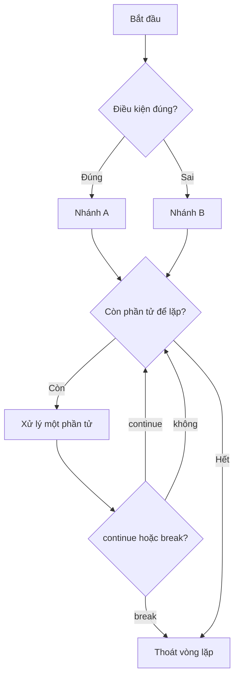

# Lý thuyết 2: Hàm và điều khiển luồng

Bài trước nói về dữ liệu: biến, kiểu, toán tử. Bài này nói về **hành động**: chương trình đi theo con đường nào (rẽ nhánh, lặp), và làm sao đóng gói một đoạn logic thành khối có tên để dùng lại (hàm). Trong JavaScript hàm còn đặc biệt hơn ở nhiều ngôn ngữ khác: nó là một **giá trị** như số hay chuỗi, có thể đặt vào biến, truyền đi, trả về. Hiểu điều này mở ra gần như toàn bộ phong cách lập trình JavaScript hiện đại: callback, `map/filter`, closure, async.

## Luồng điều khiển và hàm là gì?

Hãy hình dung bạn đang nấu ăn theo công thức. Mặc định bạn làm từng bước từ trên xuống. Nhưng có lúc công thức bảo "nếu nước sôi thì thả mì, nếu chưa thì chờ" (**rẽ nhánh**), có lúc bảo "khuấy cho tới khi sệt" hay "lặp lại với từng quả trứng" (**vòng lặp**). Và có những bước đã quen tay, như "làm nước sốt", bạn không muốn chép lại cả đoạn mỗi lần mà chỉ ghi "làm nước sốt (với 2 quả cà chua)". Đoạn công thức có tên, nhận nguyên liệu vào và trả thành phẩm ra chính là **hàm**.

Vậy luồng điều khiển (control flow) là thứ quyết định **dòng nào chạy, chạy mấy lần, theo thứ tự nào**. Hàm là cách gói một khối luồng thành đơn vị có tên, có đầu vào (tham số), có đầu ra (giá trị trả về).

## Vấn đề nó giải quyết, và vì sao dev phải nắm

Không có rẽ nhánh và lặp thì chương trình chỉ chạy một đường thẳng, không phản ứng được với dữ liệu. Không có hàm thì mọi logic lặp lại phải chép tay, sửa một chỗ phải sửa nhiều chỗ. Với JavaScript còn một lý do thực tế hơn: gần như mọi thứ bạn viết là **hàm được truyền vào hàm khác**: handler sự kiện, callback `setTimeout`, `arr.map(...)`, `fetch().then(...)`, hook của React. Nếu chưa nắm "hàm là giá trị", bạn sẽ thấy các đoạn code đó như phép thuật.

Những lỗi hay gặp ở mức này: `switch` quên `break` nên chạy tràn sang nhánh sau; dùng `for...in` cho mảng và nhận về chỉ số dạng chuỗi; `return` xuống dòng mới nên hàm trả `undefined`; tham số mặc định tính lại ở mỗi lần gọi; đệ quy không điểm dừng làm tràn stack; gọi hàm khai báo bằng `const` trước dòng định nghĩa. Mỗi lỗi đều có một quy tắc đơn giản đứng sau, bài này gom chúng lại.

**Tóm tắt:**

- Ba cấu trúc nền: tuần tự, rẽ nhánh (`if`, `switch`, toán tử ba ngôi), lặp (`for`, `while`, `do...while`, `for...of`, `for...in`).
- `for...of` duyệt **giá trị** của iterable (mảng, chuỗi, `Map`, `Set`); `for...in` duyệt **tên thuộc tính** (kể cả thừa kế), chủ yếu dành cho object và tránh dùng với mảng.
- `break` thoát vòng, `continue` bỏ lượt hiện tại, nhãn (label) cho phép thoát hoặc bỏ qua vòng ngoài; `return` mới thoát được một hàm callback, `break` thì không.
- Hàm khai báo (`function f() {}`) được hoisting trọn vẹn, hàm biểu thức và arrow function chỉ dùng được sau dòng định nghĩa; arrow function ngắn gọn và không có `this`, `arguments` riêng.
- Tham số mặc định chỉ kích hoạt khi đối số là `undefined` (không phải `null`) và được tính lại mỗi lần gọi; `...rest` gom đối số thành mảng, `...spread` bung iterable ra.
- Hàm là giá trị hạng nhất nên làm được callback và hàm bậc cao; hàm thuần (cùng đầu vào cùng đầu ra, không tác dụng phụ) dễ test và dễ suy luận.
- Đệ quy cần điểm dừng và bị giới hạn bởi call stack (`RangeError: Maximum call stack size exceeded`); có thể đổi sang vòng lặp hoặc memoization.
- IIFE là hàm gọi ngay để tạo phạm vi riêng; ngày nay module và khối `{}` thay phần lớn vai trò đó, nhưng `async` IIFE vẫn hữu ích.

## Các khái niệm cần biết

- **Control flow (luồng điều khiển)**: thứ tự các câu lệnh được thực thi, do rẽ nhánh, vòng lặp và lời gọi hàm quyết định.
- **Iterable**: giá trị có thể duyệt từng phần tử bằng `for...of` (mảng, chuỗi, `Map`, `Set`). Object thường **không** phải iterable.
- **Label (nhãn)**: tên đặt trước một vòng lặp (`outer:`) để `break`/`continue` nhắm tới vòng đó.
- **Function declaration**: `function ten() {}`, được hoisting cả tên lẫn thân hàm.
- **Function expression**: hàm là một biểu thức, thường gán vào biến, `const f = function () {}`.
- **Arrow function**: cú pháp `(a, b) => a + b`; không có `this`, `arguments`, và không dùng làm constructor.
- **Default parameter**: giá trị dự phòng cho tham số khi đối số là `undefined`.
- **Rest parameter**: `...args` ở danh sách tham số, gom các đối số còn lại thành một mảng thật.
- **Spread syntax**: `...x` ở lời gọi hàm hoặc literal, bung phần tử của iterable (hoặc thuộc tính của object) ra.
- **First-class function**: hàm là giá trị bình thường, được lưu, truyền và trả về như mọi giá trị khác.
- **Callback / higher-order function**: callback là hàm được truyền cho hàm khác để gọi lại; hàm bậc cao là hàm nhận hoặc trả về hàm.
- **Pure function (hàm thuần)**: kết quả chỉ phụ thuộc đối số và không gây tác dụng phụ (không sửa biến ngoài, không I/O).
- **Recursion (đệ quy)**: hàm tự gọi lại chính nó với bài toán nhỏ hơn, bắt buộc có điều kiện dừng.
- **IIFE (Immediately Invoked Function Expression)**: hàm được định nghĩa và gọi ngay trong một biểu thức.

## Rẽ nhánh và vòng lặp

Mọi chương trình đều ghép từ ba cấu trúc: chạy tuần tự, rẽ nhánh, và lặp. Dùng đúng cấu trúc nào cho tình huống nào, cùng với việc biết rõ vòng lặp dừng ở đâu, là kỹ năng nền.

**Cốt lõi:** luồng điều khiển của JavaScript chỉ có ba nhánh tư duy: chạy tiếp, rẽ sang nhánh khác dựa vào một điều kiện, hoặc quay lại đầu một khối để lặp, và hàm là cách gói một khối như vậy thành đơn vị gọi lại được. Khi đọc hoặc viết code, hãy luôn xác định ba điều: điều kiện nào được kiểm tra, khối nào lặp tới khi nào, và lệnh nào thoát khỏi chỗ nào.

- Vì `if` và `switch` kiểm tra điều kiện theo kiểu truthy/falsy hoặc so sánh `===`, nên bạn phải biết rõ giá trị nào được coi là "đúng" (xem [Lý thuyết 1](/go?p=13-JavaScript%2Feasy%2Flt-01-bien-kieu-du-lieu-toan-tu.md)) trước khi tin vào kết quả rẽ nhánh.
- Vì mỗi loại vòng lặp duyệt một thứ khác nhau (chỉ số, giá trị, tên thuộc tính), nên chọn sai loại sẽ cho dữ liệu sai chứ không báo lỗi.
- Vì `break`, `continue` và `return` mỗi lệnh thoát một tầng khác nhau, nên đặt sai lệnh làm vòng lặp hay hàm kết thúc sớm hoặc không kết thúc.



Mô hình tư duy: coi chương trình là một bản đồ có ngã rẽ và vòng xoay. `if` là ngã rẽ, vòng lặp là vòng xoay có biển báo "còn phần tử không", `continue` là "quay lại cửa vòng xoay", `break` là "ra khỏi vòng xoay".

### if, else và toán tử ba ngôi

`if` kiểm tra điều kiện theo truthy/falsy. Chuỗi `else if` chạy theo thứ tự từ trên xuống và dừng ở nhánh đầu tiên khớp. Dùng **return sớm** (guard clause) để tránh lồng nhau quá sâu. Khi chỉ cần chọn một giá trị, dùng toán tử ba ngôi `điều_kiện ? a : b`.

### switch

`switch` so sánh biểu thức với từng `case` bằng `===`. Nếu không có `break` (hoặc `return`), luồng **chạy tràn** (fall-through) sang case kế. Đôi khi đó là chủ ý (gom nhiều case chung một xử lý), nhưng thường là lỗi.

```javascript
function phanLoai(diem) {
  if (diem >= 8) {
    return "Giỏi";
  } else if (diem >= 6.5) {
    return "Khá";
  } else if (diem >= 5) {
    return "Trung bình";
  }
  return "Yếu";
}
console.log([9, 7, 5.5, 3].map(phanLoai));

function ngay(n) {
  switch (n) {
    case 1:
    case 7:
      return "cuối tuần";
    case 2:
      console.log("(đầu tuần)");
    case 3:
      return "ngày làm việc";
    default:
      return "không rõ";
  }
}
console.log(ngay(1), ngay(2), ngay(3), ngay(9));
const sw = 5;
switch (sw) {
  case "5": console.log("chuỗi"); break;
  case 5: console.log("số"); break;
}
```

```text
[ 'Giỏi', 'Khá', 'Trung bình', 'Yếu' ]
(đầu tuần)
cuối tuần ngày làm việc ngày làm việc không rõ
số
```

_Đã chạy thử trên Node 22._

Xem `ngay(2)`: in thêm "(đầu tuần)" rồi tràn xuống `case 3` và trả "ngày làm việc", vì `case 2` không có `break`. Còn `case 1` và `case 7` cố ý gộp chung. Dòng cuối cho thấy `switch` dùng `===`: số `5` không khớp `"5"`.

**Phải thuộc:** `switch` so sánh bằng `===` và **chạy tràn** nếu thiếu `break`/`return`. `else if` dừng ở nhánh khớp đầu tiên.

**Nhớ:** muốn gộp nhiều case thì để trống phần thân; còn lại hãy kết thúc mỗi case bằng `break` hoặc `return`.

### for, while, do...while

Dùng `for` khi biết số lần lặp (hoặc cần chỉ số), `while` khi lặp tới khi một điều kiện đổi, `do...while` khi cần chạy thân ít nhất một lần.

```javascript
for (let i = 0; i < 3; i++) console.log("for", i);
let n = 3;
while (n > 0) { n--; }
console.log("while xong, n =", n);
let k = 10;
do { k++; } while (k < 5);
console.log("do...while chạy ít nhất 1 lần, k =", k);
```

```text
for 0
for 1
for 2
while xong, n = 0
do...while chạy ít nhất 1 lần, k = 11
```

_Đã chạy thử trên Node 22._

### for...of và for...in: chọn đúng loại

Đây là chỗ nhiều người mới nhầm. Hai vòng lặp trông giống nhau nhưng duyệt hai thứ khác nhau:

| Vòng lặp | Duyệt cái gì | Dùng cho | Lưu ý |
|---|---|---|---|
| `for...of` | **Giá trị** của iterable | Mảng, chuỗi, `Map`, `Set`, `arguments` | Object thường không dùng được (ném `TypeError`) |
| `for...in` | **Tên thuộc tính** (chuỗi) có thể liệt kê, kể cả thừa kế | Object dạng từ điển | Với mảng cho chỉ số dạng chuỗi và cả thuộc tính thêm vào |

```javascript
const arr = ["a", "b", "c"];
arr.extra = "thêm";
for (const x of arr) console.log("of:", x);
for (const i in arr) console.log("in:", i, typeof i);
for (const ch of "Hi𝒜") console.log("ký tự:", ch);
const m = new Map([["x", 1], ["y", 2]]);
for (const [key, val] of m) console.log(key, val);
for (const [i, v] of arr.entries()) console.log(i, v);
```

```text
of: a
of: b
of: c
in: 0 string
in: 1 string
in: 2 string
in: extra string
ký tự: H
ký tự: i
ký tự: 𝒜
x 1
y 2
0 a
1 b
2 c
```

_Đã chạy thử trên Node 22._

Quan sát: `for...of` chỉ cho ba phần tử thật; `for...in` cho cả chỉ số (kiểu chuỗi) lẫn thuộc tính `extra` ta vừa gắn. `for...of` trên chuỗi xử lý đúng ký tự ngoài BMP như chữ toán học 𝒜 (một "ký tự" gồm hai đơn vị UTF-16) vì duyệt theo code point. Muốn có cả chỉ số lẫn giá trị: `arr.entries()` kết hợp destructuring.

Còn với object, `for...in` có thêm bẫy thừa kế:

```javascript
const base = { kThua: 1 };
const obj = Object.create(base);
obj.a = 1;
obj.b = 2;
for (const key in obj) console.log("in:", key);
for (const key of Object.keys(obj)) console.log("keys:", key);
for (const [key, val] of Object.entries(obj)) console.log("entries:", key, val);
try {
  for (const x of obj) {}
} catch (e) {
  console.log(e.name + ": " + e.message);
}
```

```text
in: a
in: b
in: kThua
keys: a
keys: b
entries: a 1
entries: b 2
TypeError: obj is not iterable
```

_Đã chạy thử trên Node 22._

`for...in` kéo cả thuộc tính `kThua` từ prototype vào, còn `Object.keys` và `Object.entries` chỉ trả thuộc tính riêng. Vì vậy cách làm hiện đại cho object là `for (const [k, v] of Object.entries(obj))`. Object thường không phải iterable nên `for...of` trực tiếp báo lỗi.

**Phải thuộc:** `for...of` cho **giá trị** của iterable; `for...in` cho **tên thuộc tính** (kể cả thừa kế). Mảng dùng `for...of` (hoặc method như `forEach`, `map`); object dùng `Object.keys/values/entries`.

**Lưu ý:** `for...in` trên mảng trả chỉ số dạng chuỗi (`"0"`, `"1"`) nên `i + 1` thành `"01"`, và thứ tự không được đảm bảo theo ý bạn cho trường hợp bất thường.

**Nhớ:** "of = giá trị, in = tên". Hầu như chỉ dùng `for...of`; `for...in` chỉ khi thật sự muốn thuộc tính thừa kế.

### break, continue và label

`break` thoát vòng lặp (hoặc `switch`) gần nhất. `continue` bỏ phần còn lại của lượt hiện tại và sang lượt kế. Muốn tác động tới vòng **ngoài**, đặt nhãn trước vòng đó rồi viết `break nhãn` hoặc `continue nhãn`. Nhãn nên dùng rất hiếm, thường chỉ khi thoát khỏi vòng lặp lồng nhau; nhiều khi tách thành hàm rồi `return` sẽ dễ đọc hơn.

```javascript
for (let i = 1; i <= 6; i++) {
  if (i % 2 === 0) continue;
  if (i > 4) break;
  console.log("i =", i);
}
outer: for (let i = 0; i < 3; i++) {
  for (let j = 0; j < 3; j++) {
    if (j === 2) continue outer;
    if (i === 2) break outer;
    console.log(i, j);
  }
}
[1, 2, 3].forEach((x) => {
  if (x === 2) return;
  console.log("forEach", x);
});
```

```text
i = 1
i = 3
0 0
0 1
1 0
1 1
forEach 1
forEach 3
```

_Đã chạy thử trên Node 22._

Vòng đầu: các số chẵn bị bỏ qua, gặp `5` thì dừng hẳn nên in `1` và `3`. Vòng lồng: `continue outer` nhảy sang lượt kế của vòng `i`, còn `break outer` (khi `i === 2`) thoát cả hai vòng. Với `forEach`, thân là một **hàm**, nên chỉ `return` mới bỏ qua một phần tử (tương đương `continue`); không có cách `break` khỏi `forEach` (cần thoát sớm thì dùng `for...of`, `some`, `every` hoặc `find`).

**Lưu ý:** viết `break` bên trong callback của `forEach`/`map` là lỗi cú pháp, vì `break` không thoát được ranh giới của hàm.

**Nhớ:** `break`/`continue` tác động lên vòng lặp gần nhất (hoặc vòng có nhãn); trong callback chỉ có `return`.

## Ba cách viết hàm

Có ba cách phổ biến để tạo một hàm. Chúng làm cùng một việc cơ bản nhưng khác ở **thời điểm dùng được** (hoisting) và vài hành vi đi kèm.

```javascript
console.log(tong(2, 3));
function tong(a, b) { return a + b; }
try {
  console.log(nhan(2, 3));
} catch (e) {
  console.log(e.name + ": " + e.message);
}
const nhan = function (a, b) { return a * b; };
try {
  console.log(chia(6, 3));
} catch (e) {
  console.log(e.name + ": " + e.message);
}
var chia = (a, b) => a / b;
console.log(tong.name, nhan.name, chia.name, tong.length);
```

```text
5
ReferenceError: Cannot access 'nhan' before initialization
TypeError: chia is not a function
tong nhan chia 2
```

_Đã chạy thử trên Node 22._

Đọc kết quả:

- **Function declaration** (`function tong() {}`): được hoisting cả tên lẫn thân hàm nên gọi **trước** dòng định nghĩa vẫn chạy (dòng 1 ra `5`).
- **Function expression** gán vào `const`: nằm trong TDZ trước dòng khai báo, nên gọi sớm ném `ReferenceError`.
- **Arrow function** gán vào `var`: biến `chia` được hoisting nhưng giá trị là `undefined` tới khi chạy tới dòng gán, nên gọi sớm ném `TypeError: chia is not a function`.
- Mọi hàm có `name` (tên suy ra từ biến) và `length` (số tham số khai báo trước tham số mặc định/rest).

Khác biệt chính của arrow function so với hàm thường:

| Tiêu chí | Hàm thường | Arrow function |
|---|---|---|
| `this` | Do cách gọi quyết định | Lấy từ phạm vi bao ngoài lúc định nghĩa |
| `arguments` | Có | Không (dùng rest `...args`) |
| Dùng với `new` | Được | Không |
| Làm method của object (cần `this` là object) | Phù hợp | Không phù hợp |
| Ngắn gọn cho callback | Dài hơn | `x => x * 2`, dùng tốt |

Arrow function trả về luôn biểu thức nếu viết không có `{}`: `(a, b) => a + b`. Nếu muốn trả về một object literal, phải bọc ngoặc đơn: `() => ({ ok: true })`, vì không có ngoặc thì `{` bị hiểu là khối lệnh. Chi tiết về `this` nằm trong [Lý thuyết 6](/go?p=13-JavaScript%2Fmedium%2Flt-06-this-va-property-descriptor.md).

**Phải thuộc:** declaration hoisting trọn vẹn; expression và arrow chỉ dùng được sau dòng định nghĩa. Arrow không có `this`/`arguments` riêng và không `new` được.

**Nhớ:** mặc định viết function declaration cho hàm cấp cao và arrow cho callback ngắn; đừng dùng arrow làm method cần `this`.

## Tham số: mặc định, rest và spread

**Tham số mặc định** gán giá trị dự phòng khi đối số là `undefined`. Hai chi tiết hay bị bỏ sót: chỉ `undefined` kích hoạt (không phải `null`, `0`, `""`), và biểu thức mặc định được **tính lại ở mỗi lần gọi**, có thể dùng tham số đứng trước.

```javascript
function chao(ten = "bạn", loiChao = `Xin chào ${ten}`) {
  return loiChao;
}
console.log(chao(), chao("An"), chao(undefined, "Hi"), chao(null));
let dem = 0;
function f(x = ++dem) { return x; }
console.log(f(), f(), f(10), dem);
function g(a, b = a * 2) { return [a, b]; }
console.log(g(3), g(3, 0));
```

```text
Xin chào bạn Xin chào An Hi Xin chào null
1 2 10 2
[ 3, 6 ] [ 3, 0 ]
```

_Đã chạy thử trên Node 22._

`chao(null)` cho "Xin chào null": `null` không phải `undefined` nên mặc định không chạy. `f()` tăng `dem` mỗi lần gọi vì mặc định tính lại; `f(10)` không chạm vào `dem`. `g(3, 0)` giữ `0` vì `0` không phải `undefined`.

**Rest** và **spread** dùng cùng ký hiệu `...` nhưng ngược chiều: rest **gom** nhiều thứ thành một mảng (ở danh sách tham số, hoặc trong destructuring), spread **bung** một iterable ra thành nhiều thứ (ở lời gọi hàm, trong mảng, trong object literal).

```javascript
function tong(...so) {
  return so.reduce((s, x) => s + x, 0);
}
console.log(tong(), tong(1, 2, 3));
function dauCuoi(dau, ...conLai) {
  return { dau, conLai };
}
console.log(dauCuoi(1, 2, 3));
const nums = [5, 1, 9];
console.log(Math.max(...nums));
console.log([0, ...nums, 10]);
console.log({ ...{ a: 1, b: 2 }, b: 99, c: 3 });
console.log([..."abc"]);
function cu() { return arguments.length; }
console.log(cu(1, 2, 3));
```

```text
0 6
{ dau: 1, conLai: [ 2, 3 ] }
9
[ 0, 5, 1, 9, 10 ]
{ a: 1, b: 99, c: 3 }
[ 'a', 'b', 'c' ]
3
```

_Đã chạy thử trên Node 22._

Rest luôn đứng **cuối** danh sách tham số và chỉ có một. Khác với object `arguments` cũ (giống mảng nhưng không phải mảng thật), rest cho bạn một mảng thật có `map`, `filter`. Với spread trong object, thuộc tính đứng sau ghi đè thuộc tính đứng trước (`b: 99` thắng `b: 2`). Lưu ý spread chỉ sao chép **nông** (xem [Lý thuyết 3](/go?p=13-JavaScript%2Feasy%2Flt-03-object-va-array.md)).

**Nền tảng:** rest = gom (ở bên nhận), spread = bung (ở bên gửi). Tham số mặc định trả lời câu "khi không truyền (undefined) thì dùng gì", tính lúc gọi.

**Nhớ:** tham số mặc định chỉ bắt `undefined`; muốn xử lý cả `null` hãy dùng `??` trong thân hàm.

## Giá trị trả về

Hàm kết thúc khi chạm `return` (trả giá trị đi kèm) hoặc khi hết thân hàm (trả `undefined`). Mỗi hàm chỉ trả **một** giá trị; muốn trả nhiều, gói vào object hoặc mảng rồi destructuring bên nhận.

```javascript
function khongReturn() {}
console.log(khongReturn());
function bay() {
  return
  {
    ok: true
  };
}
console.log(bay());
function nhieuGiaTri() {
  return { min: 1, max: 9 };
}
const { min, max } = nhieuGiaTri();
console.log(min, max);
function sớm(x) {
  if (x == null) return "thiếu";
  return "có: " + x;
}
console.log(sớm(), sớm(0));
```

```text
undefined
undefined
1 9
thiếu có: 0
```

_Đã chạy thử trên Node 22._

Ví dụ `bay()` là bẫy ASI (automatic semicolon insertion): JavaScript tự chèn dấu chấm phẩy ngay sau `return` khi xuống dòng, nên hàm trả `undefined` và khối `{ ok: true }` phía sau trở thành code không bao giờ chạy. Luôn đặt giá trị trả về **cùng dòng** với `return`.

**Lưu ý:** hàm có nhánh trả giá trị, nhánh không trả (rơi xuống cuối) sẽ cho `undefined` ở nhánh sau. Hãy để mọi đường đi đều `return` rõ ràng, hoặc dùng return sớm cho trường hợp đặc biệt rồi return kết quả chính ở cuối.

**Nhớ:** không `return` nghĩa là trả `undefined`; `return` và giá trị phải cùng một dòng.

## Hàm là giá trị hạng nhất, callback và hàm bậc cao

"Hạng nhất" (first-class) nghĩa là hàm không bị đối xử đặc biệt: bạn gán nó vào biến, đặt vào mảng hoặc object, truyền làm đối số, và trả về từ hàm khác. Hai hệ quả lớn:

- **Callback**: hàm bạn đưa cho một hàm khác để nó "gọi lại" vào lúc thích hợp (khi duyệt xong một phần tử, khi hết giờ, khi người dùng bấm).
- **Hàm bậc cao (higher-order function)**: hàm nhận hàm làm đối số hoặc trả về hàm. `map`, `filter`, `sort` đều là hàm bậc cao.

```javascript
function ganTen(ten) { return () => "Xin chào " + ten; }
const a = ganTen("An");
console.log(a());
const ops = { cong: (x, y) => x + y, tru: (x, y) => x - y };
for (const [ten, fn] of Object.entries(ops)) console.log(ten, fn(5, 3));
function thuLai(fn, lan) {
  for (let i = 1; i <= lan; i++) {
    try { return fn(i); } catch (e) { console.log("lần", i, "lỗi:", e.message); }
  }
  return "bỏ cuộc";
}
console.log(thuLai((i) => { if (i < 3) throw new Error("hỏng"); return "ok ở lần " + i; }, 5));
```

```text
Xin chào An
cong 8
tru 2
lần 1 lỗi: hỏng
lần 2 lỗi: hỏng
ok ở lần 3
```

_Đã chạy thử trên Node 22._

`ganTen` trả về một hàm (hàm bậc cao); hàm trả về vẫn "nhớ" được `ten` (đó là closure, nói kỹ ở [Lý thuyết 5](/go?p=13-JavaScript%2Feasy%2Flt-05-scope-hoisting-closure.md)). `ops` là bảng tra cứu hàm theo tên. `thuLai` nhận một hàm và quyết định gọi nó bao nhiêu lần: logic "thử lại" được tách khỏi việc "làm gì".

Callback có hai loại cần phân biệt, vì chúng khác nhau ở **thời điểm chạy**:

```javascript
console.log("1 bắt đầu");
[1, 2].forEach((x) => console.log("callback đồng bộ", x));
setTimeout(() => console.log("callback bất đồng bộ"), 0);
console.log("2 kết thúc");
console.log([3, 1, 2].sort((a, b) => a - b));
```

```text
1 bắt đầu
callback đồng bộ 1
callback đồng bộ 2
2 kết thúc
[ 1, 2, 3 ]
callback bất đồng bộ
```

_Đã chạy thử trên Node 22._

Callback của `forEach` được gọi ngay trong lúc `forEach` chạy (đồng bộ). Callback của `setTimeout` được hẹn cho sau, nên in sau cùng dù hẹn 0 ms. Cơ chế vì sao như vậy là chủ đề của [event loop](/go?p=11-Frontend-Core%2Flt-01-javascript-runtime-event-loop.md).

**Nền tảng:** truyền hàm đi mà **không** có dấu ngoặc: `setTimeout(chay, 1000)` truyền hàm, còn `setTimeout(chay(), 1000)` gọi `chay` ngay rồi truyền kết quả của nó.

**Nhớ:** hàm là giá trị: lưu được, truyền được, trả về được. Tên hàm không có `()` là "bản thân hàm", có `()` là "kết quả lời gọi".

## Hàm thuần và tác dụng phụ

Một **hàm thuần** thỏa hai điều: cùng đối số luôn cho cùng kết quả, và không làm gì ngoài việc tính ra kết quả (không sửa biến bên ngoài, không sửa đối số, không I/O, không phụ thuộc giờ hay số ngẫu nhiên). Hàm có làm thêm việc khác gọi là có **tác dụng phụ** (side effect).

```javascript
const gioHang = [10, 20];
function themBanSao(arr, x) { return [...arr, x]; }
function themTaiCho(arr, x) { arr.push(x); return arr; }
const kq1 = themBanSao(gioHang, 30);
console.log(gioHang, kq1);
const kq2 = themTaiCho(gioHang, 30);
console.log(gioHang, kq2 === gioHang);
let tongToanCuc = 0;
function congDon(x) { tongToanCuc += x; return tongToanCuc; }
console.log(congDon(5), congDon(5));
```

```text
[ 10, 20 ] [ 10, 20, 30 ]
[ 10, 20, 30 ] true
5 10
```

_Đã chạy thử trên Node 22._

`themBanSao` là hàm thuần: giỏ hàng gốc nguyên vẹn. `themTaiCho` có tác dụng phụ: đổi mảng của chỗ gọi (và kết quả trả về chính là mảng đó). `congDon` cùng đối số `5` nhưng cho `5` rồi `10` vì phụ thuộc biến toàn cục, nên không thuần.

Hàm thuần dễ test (chỉ cần đối số và kết quả), dễ cache, dễ chạy song song, và là nền tảng cho các thư viện quản lý state như Redux hay `reduce`. Không phải hàm nào cũng phải thuần (ghi file, gọi API thì phải có tác dụng phụ), nhưng nên **dồn tác dụng phụ ra rìa** và giữ phần tính toán ở lõi là hàm thuần.

**Nhớ:** cùng vào cùng ra, không đụng ngoài; tác dụng phụ để ở rìa chương trình.

## Đệ quy và giới hạn stack

Đệ quy là hàm tự gọi mình với bài toán nhỏ hơn cho tới khi chạm **điều kiện dừng** (base case). Mỗi lời gọi đặt thêm một khung (frame) lên **call stack**; stack có kích thước hữu hạn, nên chuỗi lời gọi quá sâu hoặc không điều kiện dừng sẽ ném `RangeError: Maximum call stack size exceeded`.

```javascript
function giaiThua(n) {
  if (n < 0) throw new RangeError("n phải >= 0");
  if (n <= 1) return 1;
  return n * giaiThua(n - 1);
}
console.log(giaiThua(5), giaiThua(20));
function dem(n) { return dem(n + 1); }
try {
  dem(0);
} catch (e) {
  console.log(e instanceof RangeError, e.message);
}
function fibMemo(n, nho = new Map()) {
  if (n < 2) return n;
  if (nho.has(n)) return nho.get(n);
  const v = fibMemo(n - 1, nho) + fibMemo(n - 2, nho);
  nho.set(n, v);
  return v;
}
console.log(fibMemo(50));
function giaiThuaLap(n) {
  let r = 1;
  for (let i = 2; i <= n; i++) r *= i;
  return r;
}
console.log(giaiThuaLap(5));
function tongMang(a) {
  let s = 0;
  const st = [a];
  while (st.length) {
    const cur = st.pop();
    if (Array.isArray(cur)) st.push(...cur); else s += cur;
  }
  return s;
}
console.log(tongMang([1, [2, [3, [4]]]]));
```

```text
120 2432902008176640000
true Maximum call stack size exceeded
12586269025
120
10
```

_Đã chạy thử trên Node 22._

Các điểm rút ra:

- `giaiThua` có điều kiện dừng (`n <= 1`), nên kết thúc. `dem` không có điều kiện dừng nên tràn stack; ta bắt được lỗi này vì nó là `RangeError` thường.
- Độ sâu tối đa phụ thuộc engine và kích thước khung, thường vài nghìn tới vài chục nghìn lời gọi; đừng dựa vào một con số cụ thể.
- `fibMemo` dùng **memoization**: lưu kết quả đã tính vào `Map` để không tính lại. Không có `nho`, `fib(50)` theo cách đệ quy ngây thơ sẽ gọi hàng chục tỉ lần.
- Bài toán duyệt cây hoặc mảng lồng nhau rất tự nhiên với đệ quy, nhưng khi dữ liệu có thể rất sâu thì nên đổi sang vòng lặp với stack tự quản lý (như `tongMang`). Đặc tả có "tail call optimization" nhưng gần như chỉ Safari hỗ trợ, nên đừng trông chờ vào nó.

**Phải thuộc:** mọi đệ quy cần điều kiện dừng và mỗi bước phải tiến gần điều kiện đó. Độ sâu bị giới hạn bởi call stack; vượt ngưỡng là `RangeError`. Hai lối thoát: đổi sang vòng lặp (kèm stack tự quản), hoặc memoization để cắt bớt lời gọi trùng.

**Nhớ:** viết điều kiện dừng trước, rồi mới viết bước đệ quy; với dữ liệu sâu và lớn, nghĩ tới vòng lặp.

## IIFE

IIFE là hàm được định nghĩa rồi gọi ngay trong một biểu thức. Mục đích lịch sử: tạo một **phạm vi riêng** để biến bên trong không rò ra toàn cục, vào thời `var` chưa có phạm vi khối và chưa có module. Hai cặp ngoặc: một cặp bọc hàm để nó thành biểu thức, một cặp gọi nó.

```javascript
(function () {
  var rieng = "ẩn";
  console.log("IIFE chạy ngay, rieng =", rieng);
})();
console.log(typeof rieng);
const boDem = (() => {
  let c = 0;
  return { tang: () => ++c, xem: () => c };
})();
boDem.tang(); boDem.tang();
console.log(boDem.xem());
const kqIife = (() => 6 * 7)();
console.log(kqIife);
(async () => {
  const v = await Promise.resolve("async IIFE");
  console.log(v);
})();
```

```text
IIFE chạy ngay, rieng = ẩn
undefined
2
42
async IIFE
```

_Đã chạy thử trên Node 22._

Dùng được vào việc gì hôm nay: (1) đóng gói trạng thái riêng như `boDem`: `c` không ai đụng được từ ngoài trừ qua hai hàm trả về (đây là closure); (2) tính một giá trị cần nhiều câu lệnh rồi gán cho `const`; (3) chạy `await` ở nơi chưa hỗ trợ top-level await, bằng một async IIFE. Phần còn lại, vai trò "tạo phạm vi" đã được `let`/`const` trong khối `{}` và module ES thay thế.

**Lưu ý:** IIFE nên đứng sau câu lệnh có dấu `;` rõ ràng. Nếu dòng trước thiếu chấm phẩy, dấu `(` mở đầu IIFE có thể bị hiểu là lời gọi hàm của dòng trước.

**Nhớ:** IIFE = định nghĩa và gọi trong một nhát; giá trị còn lại hôm nay là đóng gói trạng thái và async IIFE.

## Bẫy thường gặp

| Bẫy | Biểu hiện | Cách tránh |
|---|---|---|
| `switch` thiếu `break` | Chạy tràn sang case sau | Kết thúc mỗi case bằng `break`/`return`, ghi chú nếu cố ý fall-through |
| `for...in` với mảng | Chỉ số dạng chuỗi, dính thuộc tính thừa kế | Dùng `for...of` hoặc `entries()` |
| `for...of` với object thường | `TypeError: obj is not iterable` | `Object.entries(obj)` |
| `break` trong `forEach` | Lỗi cú pháp, hoặc tưởng thoát được | `for...of`, `some`, `every`, `find` |
| Gọi hàm `const`/arrow trước dòng định nghĩa | `ReferenceError` hoặc `is not a function` | Định nghĩa trước khi dùng, hoặc dùng function declaration |
| `return` rồi xuống dòng | Hàm trả `undefined` do ASI | Giá trị cùng dòng với `return` |
| Mặc định chỉ bắt `undefined` | `f(null)` không dùng mặc định | `??` trong thân hàm |
| Arrow làm method cần `this` | `this` không phải object chứa | Dùng method viết rút gọn hoặc hàm thường |
| Trả object literal từ arrow | `() => { ok: true }` trả `undefined` | `() => ({ ok: true })` |
| Truyền `chay()` thay vì `chay` làm callback | Hàm chạy ngay, callback là kết quả | Chỉ truyền tên hàm |
| Đệ quy không điều kiện dừng hoặc quá sâu | `Maximum call stack size exceeded` | Điều kiện dừng, đổi sang vòng lặp |
| Hàm sửa đối số | Dữ liệu chỗ gọi bị đổi | Trả bản sao, giữ hàm thuần |

## Câu hỏi phỏng vấn thường gặp

Mỗi câu có chuỗi: gợi ý suy luận, lập luận, đáp án ngắn, điều cần nhớ. Thử tự đi theo gợi ý trước khi đọc tiếp.

### 1. `for...of` và `for...in` khác nhau thế nào? Khi nào dùng cái nào?

**Câu hỏi:** giải thích hai vòng lặp duyệt cái gì, và chọn loại nào để duyệt mảng, object.

**Gợi ý suy luận:**
- Biến vòng lặp của `for...in` nhận kiểu gì khi duyệt một mảng?
- Nếu object có prototype mang thêm thuộc tính, `for...in` có thấy không?
- Object thường có phải iterable không?

**Lập luận:** `for...of` dựa vào giao thức iterable nên lần lượt cho **giá trị** của mảng, chuỗi, `Map`, `Set`. `for...in` liệt kê **tên thuộc tính** có thể liệt kê, gồm cả thuộc tính thừa kế từ prototype, và tên luôn là chuỗi. Vì thế dùng cho mảng sẽ nhận chỉ số dạng chuỗi và có thể dính thuộc tính thêm vào. Object thường không iterable nên `for...of` trực tiếp ném `TypeError`.

**Đáp án ngắn:** `for...of` cho giá trị của iterable, `for...in` cho tên thuộc tính (kể cả thừa kế). Mảng thì `for...of`; object thì `Object.entries(obj)` kết hợp `for...of`.

**Nhớ:** "of = giá trị, in = tên"; hiện đại hầu như chỉ cần `for...of`.

### 2. Khác nhau giữa function declaration, function expression và arrow function? Điều gì xảy ra khi gọi chúng trước dòng định nghĩa?

**Câu hỏi:** so sánh ba cách viết hàm về hoisting và hành vi, và dự đoán kết quả khi gọi sớm.

**Gợi ý suy luận:**
- Engine xử lý tên hàm và thân hàm lúc nào: trước khi chạy hay lúc chạy tới dòng đó?
- Biến `const` trước dòng khai báo ở trạng thái gì (TDZ)? Biến `var` thì sao?
- Arrow function thiếu những gì mà hàm thường có?

**Lập luận:** function declaration được hoisting trọn vẹn nên gọi trước vẫn chạy. Function expression hay arrow function là **giá trị gán vào biến**, nên số phận của chúng theo biến: `const`/`let` trong TDZ báo `ReferenceError`, `var` đang là `undefined` nên báo `TypeError: ... is not a function`. Arrow function còn không có `this` và `arguments` riêng, không `new` được.

**Đáp án ngắn:** declaration gọi sớm được; expression và arrow thì không (lỗi `ReferenceError` với `const`/`let`, `TypeError` với `var`). Arrow không có `this`/`arguments` riêng, không dùng làm constructor.

**Nhớ:** hàm biểu thức chỉ tồn tại sau dòng gán; arrow cho callback ngắn, declaration cho hàm cấp cao.

### 3. Tham số mặc định hoạt động ra sao? `f(null)` có dùng giá trị mặc định không?

**Câu hỏi:** cho `function f(x = 5)`, dự đoán `f()`, `f(undefined)`, `f(null)`, `f(0)`; và giá trị mặc định được tính khi nào.

**Gợi ý suy luận:**
- Điều kiện kích hoạt giá trị mặc định là gì: falsy hay `undefined`?
- Nếu mặc định là một biểu thức như `[]` hay `++dem`, nó được tính mấy lần?
- Tham số sau có dùng được tham số trước trong biểu thức mặc định không?

**Lập luận:** mặc định chỉ kích hoạt khi đối số là `undefined` (không truyền hoặc truyền `undefined` rõ ràng). `null`, `0`, `""` là giá trị có thật nên được giữ. Biểu thức mặc định được tính **mỗi lần gọi**, nên mặc định `[]` cho mỗi lần gọi một mảng mới (khác Python), và có thể tham chiếu tham số đứng trước.

**Đáp án ngắn:** `f()` và `f(undefined)` dùng `5`; `f(null)` ra `null`, `f(0)` ra `0`. Mặc định tính lại mỗi lần gọi, và dùng được tham số đứng trước.

**Nhớ:** mặc định chỉ bắt `undefined`; muốn bắt cả `null` dùng `x ?? 5` trong thân hàm.

### 4. Hàm thuần là gì và vì sao nên ưu tiên? Cho ví dụ hàm không thuần.

**Câu hỏi:** định nghĩa hàm thuần, nêu lợi ích, và chỉ ra vì sao một hàm cụ thể không thuần.

**Gợi ý suy luận:**
- Nếu gọi hai lần với cùng đối số mà kết quả khác nhau, nguyên nhân có thể là gì?
- Hàm có làm gì ngoài trả kết quả (sửa đối số, ghi biến ngoài, ghi log, gọi mạng)?
- Hàm như thế khó test ở điểm nào?

**Lập luận:** hàm thuần chỉ phụ thuộc đối số và không gây tác dụng phụ, nên kết quả dự đoán được: dễ test (không cần dựng môi trường), dễ cache, dễ gỡ lỗi vì không có trạng thái ẩn. Hàm `congDon` cộng vào biến toàn cục, hay hàm `push` vào mảng nhận vào, hay hàm đọc `Date.now()` đều không thuần vì phụ thuộc hoặc làm thay đổi thứ nằm ngoài đối số.

**Đáp án ngắn:** hàm thuần: cùng đối số cùng kết quả, không tác dụng phụ. Ưu tiên vì dễ test, dễ suy luận và dễ cache. Ví dụ không thuần: hàm sửa mảng nhận vào hoặc đọc/ghi biến toàn cục.

**Nhớ:** dồn tính toán vào hàm thuần, đẩy tác dụng phụ (I/O, DOM, mạng) ra rìa.

### 5. Đệ quy có giới hạn gì ở JavaScript? Làm sao tránh tràn stack và tính trùng lặp?

**Câu hỏi:** khi nào đệ quy gây `Maximum call stack size exceeded`, và nêu hai cách xử lý.

**Gợi ý suy luận:**
- Mỗi lời gọi hàm để lại gì trên call stack cho tới khi hàm trả về?
- Nếu điều kiện dừng sai hoặc dữ liệu rất sâu thì chuyện gì xảy ra?
- Nếu cùng một bài toán con được tính nhiều lần thì làm sao tránh?

**Lập luận:** mỗi lời gọi chiếm một khung trên call stack và chỉ được giải phóng khi hàm trả về. Chuỗi lời gọi lồng quá sâu (do thiếu điều kiện dừng hoặc dữ liệu sâu) làm đầy stack và ném `RangeError`. Có hai hướng: chuyển sang vòng lặp kèm cấu trúc stack tự quản trong heap, và dùng memoization để không tính lại bài toán con (như Fibonacci).

**Đáp án ngắn:** giới hạn bởi kích thước call stack, vượt là `RangeError: Maximum call stack size exceeded`. Giải pháp: điều kiện dừng đúng, đổi sang vòng lặp (stack tự quản), và memoization để cắt lời gọi trùng. Không nên trông cậy vào tail call optimization vì hầu hết engine không hỗ trợ.

**Nhớ:** đệ quy đẹp cho cây và mảng lồng nhau vừa phải; dữ liệu sâu rất lớn thì dùng vòng lặp.

Bài kế tiếp: [Lý thuyết 3: Object và Array](/go?p=13-JavaScript%2Feasy%2Flt-03-object-va-array.md).

