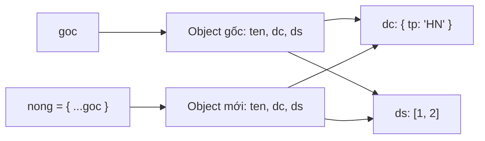

# Lý thuyết 3: Object và Array

Hai bài đầu bạn đã biết giá trị primitive và cách điều khiển luồng. Nhưng dữ liệu thật hiếm khi là một số lẻ loi: một người dùng có tên, tuổi, địa chỉ; một giỏ hàng có nhiều sản phẩm; một phản hồi từ API là cây lồng nhau của cả hai. Object và Array là hai cấu trúc để chứa loại dữ liệu đó, và hầu hết thời gian làm việc với JavaScript là biến đổi chúng qua lại. Bài này đi từ cách tạo và truy cập, qua destructuring, sao chép, bất biến, tới bộ method của mảng và các cấu trúc chuyên dụng `Map`, `Set`, `WeakMap`.

## Object và Array là gì?

Hãy hình dung một **tủ hồ sơ**. Mỗi ngăn dán một nhãn (tên, tuổi, địa chỉ) và bên trong là một tờ giấy: đó là **object**, tra cứu theo **tên nhãn**. Còn một **hàng ghế** đánh số 0, 1, 2, ... là **array**, tra cứu theo **vị trí**. Ghế nào cũng ngồi được bất kỳ thứ gì, kể cả cả một tủ hồ sơ nhỏ hơn, nên hai thứ lồng vào nhau thoải mái.

Điều cần ghi nhớ từ bài 1: cả hai đều thuộc họ **object**, nên biến chỉ giữ **địa chỉ** của tủ hay hàng ghế đó, không giữ cả tủ. Mọi chủ đề khó trong bài này (sao chép, bất biến, method làm biến đổi) đều quay về điều đó.

## Vấn đề nó giải quyết, và vì sao dev phải nắm

Không có cấu trúc dữ liệu thì bạn phải dùng hàng chục biến rời (`ten1`, `ten2`, `ten3`...) và không thể viết code chung cho "một danh sách bất kỳ". Có object và array rồi, vấn đề chuyển sang cách **dùng đúng**: lấy dữ liệu ra gọn (destructuring), sao chép mà không vô tình dùng chung (shallow vs deep copy), biến đổi danh sách bằng `map/filter/reduce` thay cho vòng lặp thủ công, và chọn đúng cấu trúc (object, `Map`, `Set`) cho từng bài toán.

Các lỗi thực tế gặp rất nhiều: sao chép bằng `{ ...obj }` rồi sửa object lồng bên trong làm hỏng bản gốc; `sort()` mảng số cho ra `[1, 10, 2, 9]`; `sort()` làm biến đổi mảng gốc mà state của component dựa vào; `Object.freeze` tưởng đóng băng hết nhưng object lồng vẫn sửa được; dùng object làm từ điển rồi dính `toString`, `constructor`. Nắm quy tắc đứng sau là cách duy nhất để khỏi bị bất ngờ.

**Tóm tắt:**

- Object là tập key-value (key là chuỗi hoặc symbol), đọc bằng `obj.key` hoặc `obj[expr]`; literal hỗ trợ shorthand `{ ten }`, computed key `[expr]` và method viết rút gọn.
- Key số của object được sắp xếp tăng dần trước, rồi mới tới key chuỗi theo thứ tự thêm vào; `in` kiểm tra cả thừa kế, `Object.hasOwn` chỉ kiểm tra thuộc tính riêng.
- Destructuring lấy dữ liệu ra theo mẫu: đổi tên `{ a: x }`, mặc định `{ a = 1 }`, lồng nhau, và `...rest`; mặc định chỉ kích hoạt khi giá trị là `undefined`.
- Spread `{ ...obj }`, `[...arr]` và `Object.assign` chỉ sao chép **nông**; cần sao chép sâu dùng `structuredClone` (không clone được hàm), còn `JSON.parse(JSON.stringify())` làm mất `Date`, `Map`, `Set`, `undefined`.
- `Object.freeze` chỉ đóng băng **một tầng**; muốn bất biến sâu phải đệ quy hoặc quy ước cập nhật bằng bản sao mới.
- `Object.keys/values/entries` và `Object.fromEntries` là cặp công cụ để biến đổi object: chuyển thành mảng cặp, dùng method mảng, rồi ghép lại.
- Bộ method mảng chính: `map`, `filter`, `reduce`, `find`, `some`, `every`, `flat`, `flatMap`; `sort` mặc định so sánh theo **chuỗi** nên cần comparator cho số, và hiện là sort ổn định (stable).
- Method biến đổi mảng gốc: `push`, `pop`, `shift`, `unshift`, `splice`, `sort`, `reverse`; bản không biến đổi: `slice`, `concat`, `map`, `toSorted`, `toReversed`, `toSpliced`, `with`. `Map`, `Set`, `WeakMap` hợp hơn object/array khi key không phải chuỗi, cần đếm/khử trùng nhanh, hoặc cần tham chiếu yếu.

## Các khái niệm cần biết

- **Object literal**: cú pháp `{ key: value }` để tạo object trực tiếp.
- **Property (thuộc tính)**: một cặp key-value của object. Key là chuỗi hoặc symbol; key số được chuyển thành chuỗi.
- **Computed key**: key tính từ biểu thức, viết trong ngoặc vuông `{ [expr]: value }`.
- **Shorthand property**: viết `{ ten }` thay cho `{ ten: ten }` khi tên biến trùng tên key.
- **Destructuring (phân rã)**: cú pháp lấy giá trị từ object hoặc mảng ra thành các biến theo một "mẫu".
- **Shallow copy (sao chép nông)**: tạo object/mảng mới nhưng các giá trị con là object vẫn dùng chung tham chiếu với bản gốc.
- **Deep copy (sao chép sâu)**: sao chép đệ quy, mọi tầng đều là bản mới; `structuredClone` làm việc này cho các kiểu hỗ trợ.
- **Immutability (bất biến)**: cách làm việc không sửa dữ liệu hiện có mà tạo bản mới với thay đổi.
- **Higher-order array method**: method nhận callback như `map`, `filter`, `reduce`.
- **Stable sort**: sắp xếp giữ nguyên thứ tự ban đầu của các phần tử có khóa so sánh bằng nhau.
- **Mutating method**: method sửa trực tiếp mảng gốc (và thường trả về giá trị khác như độ dài hay phần tử bị lấy ra).
- **Map / Set**: cấu trúc có sẵn: `Map` là từ điển nhận key bất kỳ kiểu, `Set` là tập hợp giá trị không trùng.
- **WeakMap / WeakSet**: như `Map`/`Set` nhưng key là object và được giữ **yếu**: nếu không còn ai tham chiếu key thì GC được phép thu hồi cả mục đó.

## Object: tạo, đọc, ghi, kiểm tra

**Cốt lõi:** object trong JavaScript là một bảng ánh xạ từ key (chuỗi hoặc symbol) sang giá trị, và biến chứa object chỉ giữ **tham chiếu** tới bảng đó. Từ đó suy ra hai nhóm hành vi cần nhớ: cách đọc/ghi/kiểm tra thuộc tính (dấu chấm, ngoặc vuông, `in`, `hasOwn`, `delete`) và việc mọi bản "sao chép" đơn giản chỉ chép địa chỉ hoặc chép được một tầng.

- Vì biến giữ tham chiếu, nên gán `b = a` không tạo object mới mà chỉ thêm một cái tên, và sửa qua tên nào cũng thấy.
- Vì key là chuỗi hoặc symbol, nên key số bị đổi thành chuỗi và key kiểu object cũng bị đổi thành chuỗi `"[object Object]"`, cần `Map` nếu muốn key thật sự là object.
- Vì spread và `Object.assign` chỉ chép giá trị của mỗi key, nên giá trị con là object vẫn là cùng một tham chiếu, đây là gốc của lỗi sao chép nông.



Mô hình tư duy: sao chép nông giống photocopy tờ giấy ghi địa chỉ nhà: bạn có hai tờ giấy, nhưng cả hai vẫn dẫn tới cùng một căn nhà. Tầng ngoài là bản mới, mọi thứ lồng bên trong vẫn là đồ chung.

```javascript
const ten = "An";
const tuoi = 30;
const khoa = "email";
const user = {
  ten,
  tuoi,
  [khoa]: "an@example.com",
  [`${khoa}Verified`]: true,
  "ho-lot": "Nguyễn",
  chao() { return "Xin chào, " + this.ten; },
};
console.log(user);
console.log(user.ten, user["ho-lot"], user[khoa]);
console.log(user.chao());
console.log(user.diaChi, user.diaChi?.thanhPho);
console.log("ten" in user, "diaChi" in user, Object.hasOwn(user, "toString"), "toString" in user);
delete user.tuoi;
console.log(user.tuoi, Object.keys(user));
```

```text
{
  ten: 'An',
  tuoi: 30,
  email: 'an@example.com',
  emailVerified: true,
  'ho-lot': 'Nguyễn',
  chao: [Function: chao]
}
An Nguyễn an@example.com
Xin chào, An
undefined undefined
true false false true
undefined [ 'ten', 'email', 'emailVerified', 'ho-lot', 'chao' ]
```

_Đã chạy thử trên Node 22._

Các điểm trong ví dụ:

- **Shorthand**: `ten` và `tuoi` lấy tên biến làm key.
- **Computed key**: `[khoa]` và `` [`${khoa}Verified`] `` tính key từ biến và template string.
- **Key có ký tự đặc biệt** như `"ho-lot"` phải để trong nháy và đọc bằng ngoặc vuông.
- **Method rút gọn** `chao() {}`; `this` là object gọi nó (chi tiết ở [Lý thuyết 6](/go?p=13-JavaScript%2Fmedium%2Flt-06-this-va-property-descriptor.md)).
- Đọc thuộc tính không tồn tại cho `undefined` (không lỗi), nhưng đọc sâu hơn (`user.diaChi.thanhPho`) sẽ ném `TypeError`; dùng `?.` như ở bài 1.
- `"toString" in user` là `true` vì `in` đi theo cả chuỗi prototype, còn `Object.hasOwn(user, "toString")` là `false`. Muốn biết thuộc tính **riêng**, dùng `Object.hasOwn` (thay cho `hasOwnProperty` cũ).
- `delete` gỡ hẳn thuộc tính; gán `undefined` thì key vẫn còn.

**Thứ tự key** là một chi tiết ít người biết: key dạng số nguyên không âm luôn được xếp **tăng dần trước**, sau đó tới key chuỗi theo thứ tự thêm vào, rồi tới symbol.

```javascript
const o = { b: 1, 2: "hai", a: 2, 1: "một", [Symbol("s")]: "sym" };
console.log(Object.keys(o));
console.log(JSON.stringify(o));
```

```text
[ '1', '2', 'b', 'a' ]
{"1":"một","2":"hai","b":1,"a":2}
```

_Đã chạy thử trên Node 22._

Nếu thứ tự thêm vào quan trọng với dữ liệu có key dạng số (như id), object không giữ được ý đồ của bạn; đó là một lý do chọn `Map`.

**Phải thuộc:** key của object chỉ là chuỗi hoặc symbol (số bị đổi thành chuỗi). `in` tính cả thừa kế, `Object.hasOwn` chỉ tính thuộc tính riêng. Key số nguyên luôn được xếp trước theo thứ tự tăng dần.

**Nhớ:** biến giữ tham chiếu tới object; đọc key thiếu cho `undefined`, đọc sâu hơn thì phải `?.`.

## Destructuring

Destructuring cho phép viết "mẫu" bên trái dấu `=` và lấy giá trị ra tương ứng, thay cho hàng loạt dòng `const a = obj.a`. Với object, khớp theo **tên key**; với mảng, khớp theo **vị trí**.

```javascript
const nv = {
  ten: "An",
  tuoi: 30,
  diaChi: { thanhPho: "Hà Nội", quan: { ten: "Cầu Giấy" } },
  kyNang: ["js", "sql", "css"],
};
const { ten: hoTen, tuoi: age = 18, luong = 0, diaChi: { thanhPho, quan: { ten: tenQuan } } } = nv;
console.log(hoTen, age, luong, thanhPho, tenQuan);
const { ten: _t, ...conLai } = nv;
console.log(Object.keys(conLai));
const [dau, , thu3 = "mặc định", ...duoi] = nv.kyNang;
console.log(dau, thu3, duoi);
let a = 1, b = 2;
[a, b] = [b, a];
console.log(a, b);
function hienThi({ ten, tuoi = 0, vaiTro = "user" } = {}) {
  return `${ten ?? "?"}-${tuoi}-${vaiTro}`;
}
console.log(hienThi(nv), hienThi());
try {
  const { x: { y } } = {};
} catch (e) {
  console.log(e.name + ": " + e.message);
}
const { n = 5 } = { n: null };
console.log(n);
```

```text
An 30 0 Hà Nội Cầu Giấy
[ 'tuoi', 'diaChi', 'kyNang' ]
js css []
2 1
An-30-user ?-0-user
TypeError: Cannot read properties of undefined (reading 'y')
null
```

_Đã chạy thử trên Node 22._

Giải nghĩa từng chỗ:

- **Đổi tên**: `ten: hoTen` đọc key `ten` rồi lưu vào biến `hoTen` (dấu hai chấm nghĩa là "đổi tên", không phải kiểu).
- **Giá trị mặc định**: `tuoi: age = 18` (nhưng `nv.tuoi` có sẵn nên giữ `30`), `luong = 0` vì `nv` không có `luong`.
- **Lồng nhau**: `diaChi: { thanhPho, quan: { ten: tenQuan } }` đi vào sâu hai tầng. Lưu ý `diaChi` và `quan` ở đây chỉ là đường dẫn, không tạo biến.
- **Rest trong object**: `...conLai` gom các key còn lại (ở đây loại bỏ `ten`): một cách "bỏ một key" gọn gàng.
- **Mảng**: dấu phẩy trống bỏ qua phần tử thứ hai (`"sql"`); `thu3 = "mặc định"` chỉ được dùng nếu phần tử thứ ba là `undefined`, ở đây nó là `"css"` nên giữ `css`; `...duoi` rỗng vì đã hết phần tử.
- **Hoán đổi** hai biến không cần biến tạm: `[a, b] = [b, a]`.
- **Tham số hàm**: destructuring ngay ở tham số, kèm `= {}` để gọi hàm không đối số không bị lỗi.
- **Lỗi thường gặp**: destructuring lồng nhau vào giá trị `undefined`/`null` ném `TypeError`. Và mặc định chỉ kích hoạt khi giá trị là `undefined`; với `{ n = 5 } = { n: null }` thì `n` vẫn là `null`.

**Nền tảng:** destructuring chỉ là cú pháp đọc, nó không sao chép sâu: biến lấy ra từ một giá trị con là object vẫn là tham chiếu tới object gốc.

**Nhớ:** object khớp theo **tên**, mảng khớp theo **vị trí**; mặc định chỉ bắt `undefined`.

## Sao chép: nông và sâu

Bởi vì gán chỉ chép tham chiếu, muốn có bản độc lập bạn phải **chủ động** tạo object mới. Công cụ đơn giản nhất là spread (`{ ...obj }`, `[...arr]`), tương đương `Object.assign({}, obj)` và `arr.slice()`. Nhưng chúng chỉ sao chép **nông**: tầng ngoài là mới, giá trị con là object thì vẫn dùng chung.

```javascript
const goc = { ten: "An", dc: { tp: "HN" }, ds: [1, 2] };
const nong = { ...goc };
nong.ten = "Bình";
nong.dc.tp = "HCM";
nong.ds.push(3);
console.log(goc);
console.log(nong.dc === goc.dc);
const arrA = [{ v: 1 }];
const arrB = [...arrA];
arrB[0].v = 99;
console.log(arrA[0].v, Object.assign({}, goc).dc === goc.dc);
```

```text
{ ten: 'An', dc: { tp: 'HCM' }, ds: [ 1, 2, 3 ] }
true
99 true
```

_Đã chạy thử trên Node 22._

Đổi `ten` không ảnh hưởng bản gốc (primitive nằm ở tầng ngoài), nhưng đổi `dc.tp` và `ds.push(3)` lại làm hỏng bản gốc vì `dc` và `ds` dùng chung. Mảng cũng vậy: `[...arrA]` tạo mảng mới nhưng phần tử vẫn là cùng object.

Muốn sao chép **sâu**, hiện đại nhất là `structuredClone`. Nó chép đệ quy nhiều kiểu (object, mảng, `Date`, `Map`, `Set`, ...), xử lý cả tham chiếu vòng. Nó **không** chép được hàm, và không giữ prototype/class.

```javascript
const goc = { ten: "An", dc: { tp: "HN" }, ngay: new Date(0), tap: new Set([1, 2]), m: new Map([["k", 1]]) };
const sau = structuredClone(goc);
sau.dc.tp = "HCM";
console.log(goc.dc.tp, sau.dc.tp, sau.ngay instanceof Date, sau.tap, sau.m);
const viaJson = JSON.parse(JSON.stringify(goc));
console.log(viaJson);
try {
  structuredClone({ f() {} });
} catch (e) {
  console.log(e.name + ": " + e.message);
}
const vong = { ten: "x" };
vong.self = vong;
const cp = structuredClone(vong);
console.log(cp.self === cp, cp !== vong);
```

```text
HN HCM true Set(2) { 1, 2 } Map(1) { 'k' => 1 }
{
  ten: 'An',
  dc: { tp: 'HN' },
  ngay: '1970-01-01T00:00:00.000Z',
  tap: {},
  m: {}
}
DataCloneError: f() {} could not be cloned.
true true
```

_Đã chạy thử trên Node 22._

So sánh hai cách sâu:

| Tiêu chí | `structuredClone` | `JSON.parse(JSON.stringify(x))` |
|---|---|---|
| `Date` | Giữ là `Date` | Thành chuỗi ISO |
| `Map`, `Set` | Giữ nguyên | Thành `{}` |
| `undefined`, hàm, symbol | Hàm: ném `DataCloneError` | Bị bỏ hoặc đổi thành `null` |
| Tham chiếu vòng | Xử lý được | Ném lỗi |
| Instance của class | Mất prototype, thành object thường | Mất prototype, thành object thường |

**Lưu ý:** cả hai đều không giữ method và prototype của class instance. Với dữ liệu thuần (JSON-like) cả hai đủ dùng, nhưng ưu tiên `structuredClone` vì ít làm mất dữ liệu một cách im lặng. Một lựa chọn thứ ba hợp với state UI: không sao chép sâu mà chỉ **tạo mới đường đi bị thay đổi**: `{ ...state, dc: { ...state.dc, tp: "HCM" } }`.

**Phải thuộc:** spread, `Object.assign`, `slice` đều là sao chép nông. Sao chép sâu dùng `structuredClone` (không chép hàm). `JSON.parse(JSON.stringify())` làm mất `Date`, `Map`, `Set`, `undefined`.

**Nhớ:** trước khi sửa một object lồng nhau đã sao chép, tự hỏi "bản sao này nông hay sâu?"

## Tham chiếu và bất biến

Vì object bị chia sẻ dễ dàng, một đoạn code ở xa có thể sửa dữ liệu của bạn lúc nào không hay. Hai cách phòng thủ: **bất biến theo quy ước** (không sửa, luôn tạo bản mới) và **bất biến cưỡng chế** bằng `Object.freeze`.

`Object.freeze(obj)` cấm thêm, xóa, sửa thuộc tính **của chính obj**. Nhưng nó chỉ đóng băng **một tầng**: object lồng bên trong vẫn sửa được.

```javascript
const cauHinh = Object.freeze({ port: 80, db: { host: "a" } });
cauHinh.port = 81;
cauHinh.db.host = "b";
console.log(cauHinh, Object.isFrozen(cauHinh), Object.isFrozen(cauHinh.db));
(function () {
  "use strict";
  try {
    cauHinh.port = 82;
  } catch (e) {
    console.log(e.name + ": " + e.message);
  }
  try {
    cauHinh.moi = 1;
  } catch (e) {
    console.log(e.name + ": " + e.message);
  }
})();
function deepFreeze(o) {
  Object.values(o).forEach((v) => { if (typeof v === "object" && v !== null) deepFreeze(v); });
  return Object.freeze(o);
}
const sau = deepFreeze({ a: { b: { c: 1 } } });
sau.a.b.c = 2;
console.log(sau.a.b.c);
```

```text
{ port: 80, db: { host: 'b' } } true false
TypeError: Cannot assign to read only property 'port' of object '#<Object>'
TypeError: Cannot add property moi, object is not extensible
1
```

_Đã chạy thử trên Node 22._

Quan sát: `port = 81` bị **bỏ qua im lặng** ở sloppy mode (giá trị vẫn `80`), nhưng `db.host` đổi được thành `"b"`, và `Object.isFrozen(cauHinh.db)` là `false`. Trong strict mode (ví dụ trong module hoặc sau `"use strict"`), cùng thao tác ném `TypeError`, thế nên đừng nhầm "không có lỗi" với "đã được ghi". `deepFreeze` đệ quy để đóng băng mọi tầng, nên `sau.a.b.c` giữ `1`.

Nhóm họ hàng: `Object.seal` (cấm thêm/xóa, vẫn sửa được giá trị), `Object.preventExtensions` (chỉ cấm thêm mới). `freeze` cũng không bảo vệ `Map`, `Set` hay mảng khỏi method nội bộ của chúng một cách đầy đủ theo ý bạn (với mảng, `freeze` chặn `push`, nhưng với `Map` thì `set` vẫn chạy).

**Nền tảng:** bất biến nghĩa là "cập nhật bằng cách tạo bản mới": thư viện state như Redux hay React so sánh bằng `===` (tham chiếu) để biết có thay đổi hay không, nên sửa tại chỗ khiến chúng không nhận ra thay đổi.

**Lưu ý:** `freeze` là kiểm tra lúc chạy, không phải bảo vệ kiểu như `readonly` của TypeScript (xem [TypeScript nâng cao](/go?p=11-Frontend-Core%2Flt-02-typescript-nang-cao.md)). Và có chi phí hiệu năng nhỏ, nên thường chỉ dùng cho cấu hình và hằng.

**Nhớ:** `Object.freeze` là nông; bất biến sâu cần đệ quy hoặc, tốt hơn, quy ước chỉ cập nhật bằng bản sao mới.

## Object.keys, values, entries, fromEntries

Object không có `map` hay `filter` như mảng. Cách chuẩn: **đổi object thành mảng, xử lý bằng method mảng, đổi ngược về object**.

- `Object.keys(o)`: mảng tên key riêng, có thể liệt kê.
- `Object.values(o)`: mảng giá trị.
- `Object.entries(o)`: mảng các cặp `[key, value]`.
- `Object.fromEntries(iterable)`: ngược lại, từ các cặp tạo ra object (nhận cả `Map`).
- `Object.groupBy(items, fn)`: nhóm phần tử thành object theo khóa trả về (Node 21+; trình duyệt cần bản đủ mới, nên kiểm tra bảng tương thích).

```javascript
const gia = { tao: 10, cam: 20, le: 5 };
console.log(Object.keys(gia), Object.values(gia));
console.log(Object.entries(gia));
const giamGia = Object.fromEntries(Object.entries(gia).map(([k, v]) => [k, v * 0.9]));
console.log(giamGia);
const dat = Object.fromEntries(Object.entries(gia).filter(([, v]) => v >= 10));
console.log(dat);
console.log(Object.fromEntries(new Map([["a", 1], ["b", 2]])));
console.log(Object.assign({}, { a: 1 }, { b: 2 }));
const sp = [{ ten: "A", loai: "x" }, { ten: "B", loai: "y" }, { ten: "C", loai: "x" }];
console.log(Object.groupBy(sp, (s) => s.loai));
```

```text
[ 'tao', 'cam', 'le' ] [ 10, 20, 5 ]
[ [ 'tao', 10 ], [ 'cam', 20 ], [ 'le', 5 ] ]
{ tao: 9, cam: 18, le: 4.5 }
{ tao: 10, cam: 20 }
{ a: 1, b: 2 }
{ a: 1, b: 2 }
[Object: null prototype] {
  x: [ { ten: 'A', loai: 'x' }, { ten: 'C', loai: 'x' } ],
  y: [ { ten: 'B', loai: 'y' } ]
}
```

_Đã chạy thử trên Node 22._

Mẫu quen thuộc: `Object.fromEntries(Object.entries(o).map(...))` để biến đổi giá trị, `.filter(...)` để lọc key. Phần destructuring `[, v]` bỏ qua key. Kết quả của `Object.groupBy` là object **không có prototype** (`[Object: null prototype]`), nên an toàn dùng như từ điển nhưng không có `toString` hay `hasOwnProperty`.

**Phải thuộc:** `entries` + method mảng + `fromEntries` là cách "map/filter cho object". Chỉ trả thuộc tính riêng, có thể liệt kê, và key số xếp trước.

**Nhớ:** object thành mảng bằng `entries`, mảng thành object bằng `fromEntries`.

## Array: method hay dùng

Mảng là object có key là chỉ số 0, 1, 2... và thuộc tính `length`. Phần lớn công việc không cần vòng lặp thủ công mà dùng các method bậc cao: mỗi method diễn đạt một **ý định** (biến đổi, lọc, gom, tìm, kiểm tra), làm code dễ đọc hơn.

| Method | Làm gì | Trả về |
|---|---|---|
| `map(fn)` | Biến đổi từng phần tử | Mảng mới cùng độ dài |
| `filter(fn)` | Giữ phần tử thỏa điều kiện | Mảng mới (có thể ngắn hơn) |
| `reduce(fn, init)` | Gom cả mảng thành một giá trị | Giá trị tích lũy |
| `find(fn)` / `findIndex` / `findLast` | Tìm phần tử (hoặc chỉ số) đầu tiên/cuối cùng thỏa | Phần tử hoặc `undefined` (chỉ số hoặc `-1`) |
| `some(fn)` / `every(fn)` | Có ít nhất một / tất cả thỏa | `boolean` |
| `includes(x)` / `indexOf(x)` / `at(i)` | Có chứa / vị trí / phần tử theo chỉ số (`-1` là cuối) | `boolean` / số / phần tử |
| `flat(depth)` | San phẳng mảng lồng | Mảng mới |
| `flatMap(fn)` | `map` rồi `flat` một tầng | Mảng mới |

```javascript
const so = [3, 1, 4, 1, 5, 9, 2, 6];
console.log(so.map((x) => x * 2));
console.log(so.filter((x) => x % 2 === 0));
console.log(so.reduce((tong, x) => tong + x, 0));
console.log(so.find((x) => x > 4), so.findIndex((x) => x > 4), so.findLast((x) => x < 4));
console.log(so.some((x) => x > 8), so.every((x) => x > 0), [].every(() => false), [].some(() => true));
console.log(so.includes(9), so.indexOf(1), so.at(-1));
console.log([1, [2, [3, [4]]]].flat(), [1, [2, [3, [4]]]].flat(Infinity));
console.log(["a b", "c d"].flatMap((s) => s.split(" ")));
console.log([1, 2, 3].flatMap((x) => (x === 2 ? [] : [x, x * 10])));
const nhom = ["an", "bình", "anh"].reduce((acc, s) => {
  (acc[s[0]] ??= []).push(s);
  return acc;
}, {});
console.log(nhom);
try {
  [].reduce((a, b) => a + b);
} catch (e) {
  console.log(e.name + ": " + e.message);
}
console.log(["1", "2", "3"].map(parseInt));
console.log(["1", "2", "3"].map(Number));
console.log(Array.from({ length: 3 }, (_, i) => i * i), Array.of(7), new Array(3));
```

```text
[
   6,  2, 8,  2,
  10, 18, 4, 12
]
[ 4, 2, 6 ]
31
5 4 2
true true true false
true 1 6
[ 1, 2, [ 3, [ 4 ] ] ] [ 1, 2, 3, 4 ]
[ 'a', 'b', 'c', 'd' ]
[ 1, 10, 3, 30 ]
{ a: [ 'an', 'anh' ], b: [ 'bình' ] }
TypeError: Reduce of empty array with no initial value
[ 1, NaN, NaN ]
[ 1, 2, 3 ]
[ 0, 1, 4 ] [ 7 ] [ <3 empty items> ]
```

_Đã chạy thử trên Node 22._

Những điểm cần để ý trong output:

- `reduce` luôn nên có **giá trị khởi tạo** (đối số thứ hai): không có thì mảng rỗng ném `TypeError`, và kiểu của accumulator bị phụ thuộc vào phần tử đầu.
- `reduce` rất mạnh (có thể làm thay `map`, `filter`, nhóm dữ liệu như ví dụ `nhom`), nhưng đừng dùng khi `map`/`filter`/`flatMap` diễn đạt ý rõ hơn.
- `every` trên mảng rỗng là `true` ("không có phản ví dụ"), `some` trên mảng rỗng là `false`.
- `flatMap` có thể vừa biến đổi, vừa loại phần tử (trả mảng rỗng) hoặc nhân phần tử (trả nhiều).
- Bẫy kinh điển `["1","2","3"].map(parseInt)` ra `[1, NaN, NaN]`, vì `map` truyền cho callback ba đối số `(giá trị, chỉ số, mảng)` và `parseInt` hiểu chỉ số là **cơ số**. Dùng `Number` hoặc arrow tường minh.
- `new Array(3)` tạo mảng **thưa** với 3 ô trống (empty), khác với `[undefined, undefined, undefined]`; hãy dùng `Array.from({ length: n }, fn)` khi cần khởi tạo.

**Phải thuộc:** `map` biến đổi 1-1, `filter` lọc, `reduce` gom (luôn có giá trị khởi tạo), `find` trả phần tử, `some`/`every` trả boolean, `flatMap` = `map` + `flat(1)`.

**Nhớ:** chọn method theo ý định muốn nói; `map`, `filter`, `flatMap` trả mảng mới và không sửa mảng gốc.

## sort: ổn định, và bẫy so sánh theo chuỗi

`sort()` không có đối số **chuyển phần tử thành chuỗi rồi so sánh theo thứ tự đơn vị mã UTF-16**. Với số, `10` đứng trước `9` vì chuỗi `"10"` nhỏ hơn `"9"` theo từng ký tự. Với chữ có dấu hay chữ hoa, thứ tự cũng không như từ điển. Muốn đúng, truyền **comparator** `(a, b) => số`: âm nghĩa là `a` đứng trước, dương nghĩa là `b` đứng trước, `0` là coi như bằng nhau.

```javascript
console.log([10, 9, 1, 2].sort());
console.log(["b", "a", "C", "ä"].sort());
console.log([10, 9, 1, 2].sort((a, b) => a - b));
console.log(["b", "a", "C", "ä"].sort((x, y) => x.localeCompare(y, "vi")));
const ds = [
  { ten: "An", tuoi: 30 },
  { ten: "Bình", tuoi: 25 },
  { ten: "Chi", tuoi: 30 },
  { ten: "Dũng", tuoi: 25 },
];
console.log(ds.sort((x, y) => x.tuoi - y.tuoi).map((x) => x.ten));
console.log([3, undefined, 1, , 2].sort());
const goc = [3, 1, 2];
const daSap = goc.toSorted((a, b) => a - b);
console.log(goc, daSap);
```

```text
[ 1, 10, 2, 9 ]
[ 'C', 'a', 'b', 'ä' ]
[ 1, 2, 9, 10 ]
[ 'a', 'ä', 'b', 'C' ]
[ 'Bình', 'Dũng', 'An', 'Chi' ]
[ 1, 2, 3, undefined, <1 empty item> ]
[ 3, 1, 2 ] [ 1, 2, 3 ]
```

_Đã chạy thử trên Node 22._

Đọc kết quả:

- `[10, 9, 1, 2].sort()` ra `[1, 10, 2, 9]`: sai với ý đồ số. Chữ hoa `"C"` đứng trước `"a"` vì mã Unicode của chữ hoa nhỏ hơn; `"ä"` đứng cuối vì mã lớn. Với chuỗi có dấu hay đa ngôn ngữ, dùng `localeCompare` (hoặc `Intl.Collator`).
- **Sort ổn định**: từ ES2019, `sort` bắt buộc ổn định. Ở ví dụ `ds`, sắp theo tuổi thì Bình và Dũng (cùng 25) giữ thứ tự ban đầu, An và Chi (cùng 30) cũng vậy. Nhờ đó sắp xếp **nhiều tầng** làm được bằng cách sắp theo khóa phụ trước, khóa chính sau.
- `undefined` luôn bị đẩy về cuối, ô trống (empty) còn sau nữa, bất kể comparator.
- `sort` **sửa mảng gốc** và trả về chính mảng đó. Muốn giữ gốc, dùng `toSorted` (Node 20+, trình duyệt mới) hoặc `[...arr].sort(...)`.
- Comparator `a - b` chỉ an toàn với số hữu hạn; với chuỗi hãy dùng `localeCompare`, với boolean/khóa tùy ý hãy trả `-1/0/1` rõ ràng.

**Phải thuộc:** `sort()` mặc định so sánh theo **chuỗi**. Số phải truyền `(a, b) => a - b`. `sort` ổn định và **sửa mảng gốc**.

**Lưu ý:** comparator không nhất quán (ví dụ trả `true/false` thay vì số) cho kết quả khó đoán, vì `true`/`false` bị ép thành `1`/`0` và không bao giờ âm.

**Nhớ:** quên comparator khi sắp xếp số là lỗi kinh điển; muốn giữ mảng gốc dùng `toSorted`.

## Method làm biến đổi mảng và method không

Phân loại này quan trọng vì mảng truyền đi bằng tham chiếu: một method sửa tại chỗ sẽ lan ra mọi chỗ đang dùng mảng đó (state của UI, tham số hàm, cache).

| Nhóm | Method | Ghi chú |
|---|---|---|
| **Sửa tại chỗ** | `push`, `pop`, `shift`, `unshift`, `splice`, `sort`, `reverse`, `fill`, `copyWithin` | Mảng gốc đổi; `push`/`unshift` trả độ dài mới, `pop`/`shift` trả phần tử bị lấy |
| **Không sửa, trả bản mới** | `map`, `filter`, `slice`, `concat`, `flat`, `flatMap`, `[...arr]` | Luôn an toàn với dữ liệu dùng chung |
| **Bản "không sửa" của method sửa** (ES2023) | `toSorted`, `toReversed`, `toSpliced`, `with` | Cùng ý với `sort`, `reverse`, `splice`, gán theo chỉ số nhưng trả mảng mới |

```javascript
const a = [1, 2, 3, 4, 5];
console.log(a.push(6), a);
console.log(a.pop(), a.shift(), a.unshift(0), a);
console.log(a.splice(1, 2), a);
a.reverse();
console.log(a);
const b = [1, 2, 3, 4];
console.log(b.slice(1, 3), b.concat([5]), [...b, 6], b);
console.log(b.toReversed(), b.toSpliced(1, 2), b.with(0, 99), b);
const copy = b;
copy.push(5);
console.log(b.length);
```

```text
6 [ 1, 2, 3, 4, 5, 6 ]
6 1 5 [ 0, 2, 3, 4, 5 ]
[ 2, 3 ] [ 0, 4, 5 ]
[ 5, 4, 0 ]
[ 2, 3 ] [ 1, 2, 3, 4, 5 ] [ 1, 2, 3, 4, 6 ] [ 1, 2, 3, 4 ]
[ 4, 3, 2, 1 ] [ 1, 4 ] [ 99, 2, 3, 4 ] [ 1, 2, 3, 4 ]
5
```

_Đã chạy thử trên Node 22._

Đọc dòng hai: `pop()` lấy `6`, `shift()` lấy `1`, `unshift(0)` thêm phần tử đầu và trả độ dài mới `5`; mảng cuối là `[0, 2, 3, 4, 5]`. `splice(1, 2)` xóa hai phần tử từ chỉ số 1 và trả mảng các phần tử bị xóa. Dòng cuối chứng minh `const copy = b` không tạo bản sao: `copy.push(5)` làm `b.length` thành `5`.

Một mẹo nhỏ: tên `slice` (cắt, không sửa) và `splice` (nối/cắt tại chỗ, sửa) chỉ khác một chữ `p`, rất dễ nhầm. Thêm vào đó, `shift`/`unshift` ở đầu mảng tốn O(n) vì phải dịch mọi phần tử, nên với hàng đợi lớn hãy cân nhắc cấu trúc khác.

**Phải thuộc:** sửa tại chỗ: `push pop shift unshift splice sort reverse fill`. Không sửa: `map filter slice concat flat` và nhóm ES2023 `toSorted toReversed toSpliced with`.

**Nhớ:** khi mảng là dữ liệu dùng chung (state, tham số), chỉ dùng nhóm không sửa hoặc sao chép trước.

## Map, Set, WeakMap: khi nào dùng thay object và array

Object và array đủ cho phần lớn việc. Nhưng có những bài toán mà một cấu trúc chuyên dụng cho code đúng hơn và nhanh hơn.

| Nhu cầu | Dùng | Lý do |
|---|---|---|
| Từ điển với key bất kỳ kiểu (object, số, `NaN`) | `Map` | Key giữ nguyên kiểu, không bị ép thành chuỗi |
| Từ điển có thêm xóa liên tục, cần `size` | `Map` | Có `size`, thứ tự theo lúc thêm, tối ưu cho thao tác thêm xóa nhiều |
| Từ điển với key lạ (`toString`, `__proto__`) | `Map` (hoặc `Object.create(null)`) | Không dính thuộc tính thừa kế của object |
| Khử trùng, kiểm tra thuộc về nhanh | `Set` | `has` trung bình O(1), tự loại trùng |
| Gắn dữ liệu phụ vào object mà không giữ nó sống | `WeakMap` | Key giữ yếu, GC thu hồi được cùng object |
| Cấu trúc bản ghi cố định (user, sản phẩm), cần JSON | Object | Cú pháp literal, serialize `JSON` trực tiếp |
| Danh sách có thứ tự, duyệt theo chỉ số | Array | Chỉ số, method phong phú |

```javascript
const m = new Map();
const k1 = { id: 1 };
m.set(k1, "đối tượng").set("1", "chuỗi").set(1, "số").set(NaN, "nan");
console.log(m.get(k1), m.get("1"), m.get(1), m.get(NaN), m.size, m.has({ id: 1 }));
console.log([...m.keys()]);
const d = {};
d[k1] = "x";
d[1] = "số";
d["1"] = "chuỗi";
console.log(d, Object.keys(d).length);
const s = new Set([1, 2, 2, 3, 3, 3]);
console.log(s, s.size, s.has(2), [...new Set("hello")].join(""));
const A = new Set([1, 2, 3]), B = new Set([2, 3, 4]);
console.log([...A].filter((x) => B.has(x)), [...new Set([...A, ...B])]);
const tuDien = {};
console.log("toString" in tuDien, tuDien["constructor"] === Object);
const sach = new Map();
console.log(sach.has("toString"));
const dem = new Map();
for (const w of "a b a c a b".split(" ")) dem.set(w, (dem.get(w) ?? 0) + 1);
console.log(dem, [...dem].sort((x, y) => y[1] - x[1])[0]);
```

```text
đối tượng chuỗi số nan 4 false
[ { id: 1 }, '1', 1, NaN ]
{ '1': 'chuỗi', '[object Object]': 'x' } 2
Set(3) { 1, 2, 3 } 3 true helo
[ 2, 3 ] [ 1, 2, 3, 4 ]
true true
false
Map(3) { 'a' => 3, 'b' => 2, 'c' => 1 } [ 'a', 3 ]
```

_Đã chạy thử trên Node 22._

Điểm cần thấy:

- `Map` phân biệt `"1"` và `1`, nhận cả `NaN` và object làm key. `m.has({ id: 1 })` là `false` vì object mới là khác tham chiếu với `k1`. Trên object, `d[1]` và `d["1"]` trùng nhau (chỉ còn một key `"1"`), còn `d[k1]` biến thành key chuỗi `"[object Object]"`, hai key object khác nhau sẽ đè nhau.
- `Set` dùng để khử trùng (`new Set("hello")` bỏ chữ `l` lặp) và làm phép giao, hợp. Kiểm tra `has` nhanh hơn `includes` trên mảng lớn.
- Object `{}` có sẵn `toString`, `constructor` (`"toString" in tuDien` là `true`), nên dùng làm từ điển cho chuỗi do người dùng nhập sẽ có bẫy; `Map` thì sạch.
- Đếm tần suất bằng `Map` khá tự nhiên: `dem.set(w, (dem.get(w) ?? 0) + 1)`.
- `Map` và `Set` duyệt được bằng `for...of`, `forEach`, spread. `JSON.stringify` không tuần tự hóa chúng trực tiếp (ra `{}`), cần chuyển qua `Object.fromEntries(map)` hoặc `[...set]`.

**WeakMap và WeakSet** có key phải là **object** và giữ key một cách yếu: khi chương trình không còn tham chiếu nào khác tới key, GC được phép thu hồi cả mục. Vì vậy chúng không có `size`, không duyệt được (không iterable). Công dụng điển hình là gắn dữ liệu phụ hoặc dữ liệu riêng tư lên object mà không gây rò rỉ bộ nhớ.

```javascript
const rieng = new WeakMap();
class User {
  constructor(ten, mk) {
    this.ten = ten;
    rieng.set(this, { mk });
  }
  kiemTra(x) { return rieng.get(this).mk === x; }
}
let u = new User("An", "bí mật");
console.log(u.kiemTra("bí mật"), u.kiemTra("sai"), Object.keys(u));
console.log(rieng.has(u));
u = null;
try {
  rieng.set("chuỗi", 1);
} catch (e) {
  console.log(e.name + ": " + e.message);
}
console.log(typeof rieng.size, typeof rieng[Symbol.iterator]);
const ws = new WeakSet();
const nút = {};
ws.add(nút);
console.log(ws.has(nút));
```

```text
true false [ 'ten' ]
true
TypeError: Invalid value used as weak map key
undefined undefined
true
```

_Đã chạy thử trên Node 22._

Mật khẩu `mk` không nằm trong `Object.keys(u)` mà vẫn tra được qua `rieng`. Khi `u = null` và không còn ai giữ object `User`, mục tương ứng trong `rieng` đủ điều kiện để GC thu hồi (thời điểm thu hồi do engine quyết, không quan sát được trực tiếp). Key phải là object: dùng chuỗi ném `TypeError`. Không có `size` và không iterable, vì nội dung có thể biến mất bất kỳ lúc nào.

**Nền tảng:** chọn cấu trúc theo cách truy cập: tra theo tên cố định, hình dạng cố định: object; tra theo key động hoặc không phải chuỗi: `Map`; chỉ cần biết "có hay không" và loại trùng: `Set`; gắn dữ liệu phụ vào object mà không giữ nó sống: `WeakMap`.

**Lưu ý:** `WeakMap` không thay `Map` để "tự dọn cache theo thời gian"; nó chỉ gắn vòng đời mục theo vòng đời của key. Cache cần giới hạn kích thước hay hết hạn phải tự cài đặt.

**Nhớ:** `Map` khi key động hoặc không phải chuỗi, `Set` khi cần duy nhất, `WeakMap` khi key là object và không muốn giữ nó sống.

## Bẫy thường gặp

| Bẫy | Biểu hiện | Cách tránh |
|---|---|---|
| Sao chép bằng spread rồi sửa object lồng | Bản gốc bị đổi theo | `structuredClone`, hoặc tạo mới từng tầng đã đổi |
| `JSON.parse(JSON.stringify())` để deep copy | Mất `Date`, `Map`, `Set`, `undefined` | `structuredClone` |
| `Object.freeze` tưởng đóng băng sâu | Object lồng vẫn sửa được | `deepFreeze` hoặc bất biến theo quy ước |
| Gán vào object bị freeze ở sloppy mode | Không lỗi nhưng không ghi | Dùng strict mode/module để lỗi hiện ra |
| `sort()` cho mảng số | `[1, 10, 2, 9]` | `sort((a, b) => a - b)` |
| `sort` sửa mảng gốc | State bị đổi ngoài ý muốn | `toSorted` hoặc `[...arr].sort()` |
| `map(parseInt)` | `[1, NaN, NaN]` | `map(Number)` hoặc arrow tường minh |
| `reduce` không có giá trị khởi tạo | Mảng rỗng ném `TypeError` | Luôn truyền đối số thứ hai |
| `new Array(n)` | Mảng thưa các ô trống, `map` bỏ qua | `Array.from({ length: n }, fn)` |
| Dùng object làm từ điển cho key tùy ý | Dính `toString`, `__proto__` | `Map` hoặc `Object.create(null)` |
| Key object trong object thường | Mọi key thành `"[object Object]"` | `Map` |
| `for...in` và `in` trên object có prototype | Dính thuộc tính thừa kế | `Object.keys`, `Object.hasOwn` |
| Đọc sâu thuộc tính của giá trị vắng | `TypeError: Cannot read properties of undefined` | `?.`, giá trị mặc định |
| `JSON.stringify(map)` | Ra `{}` | `Object.fromEntries(map)` hoặc `[...map]` |

## Câu hỏi phỏng vấn thường gặp

Mỗi câu có chuỗi: gợi ý suy luận, lập luận, đáp án ngắn, điều cần nhớ. Thử tự đi theo gợi ý trước khi đọc tiếp.

### 1. Sao chép nông và sao chép sâu khác nhau thế nào? Bạn sao chép sâu một object bằng cách nào?

**Câu hỏi:** cho `const b = { ...a }` với `a` có object lồng bên trong, sửa `b.x.y` có ảnh hưởng `a` không? Sao chép sâu làm thế nào, và có giới hạn gì?

**Gợi ý suy luận:**
- Khi spread chép một thuộc tính mà giá trị là object, nó chép cái gì: object hay địa chỉ?
- Nếu hai object cùng giữ một địa chỉ, sửa qua bên nào thì bên kia thấy không?
- Có kiểu dữ liệu nào (hàm, `Date`, `Map`) mà một cách sao chép sâu có thể không xử lý đúng?

**Lập luận:** spread, `Object.assign`, `slice` chỉ tạo tầng ngoài mới và chép giá trị của từng key; với giá trị con là object thì chép **địa chỉ**, nên `a.x` và `b.x` là cùng một object và sửa `b.x.y` làm `a.x.y` đổi theo. Sao chép sâu phải đi đệ quy và tạo bản mới ở mọi tầng. `structuredClone` làm điều đó, giữ được `Date`, `Map`, `Set`, xử lý cả tham chiếu vòng, nhưng không chép được hàm (ném `DataCloneError`) và làm mất prototype của class.

**Đáp án ngắn:** có, `a` bị ảnh hưởng vì spread chỉ sao chép nông. Sao chép sâu dùng `structuredClone`; tránh `JSON.parse(JSON.stringify())` vì làm mất `Date`, `Map`, `Set`, `undefined`. Với state UI, cập nhật bất biến từng tầng cũng là lựa chọn.

**Nhớ:** trước khi sửa dữ liệu lồng nhau đã sao chép, hỏi bản sao đó nông hay sâu.

### 2. `Object.freeze` có làm object bất biến hoàn toàn không?

**Câu hỏi:** cho `const c = Object.freeze({ db: { host: "a" } })`, `c.db.host = "b"` có chạy không? Làm sao đóng băng sâu?

**Gợi ý suy luận:**
- Freeze tác động lên những thuộc tính nào của object được truyền vào: chỉ tầng đầu hay mọi tầng?
- Giá trị của `c.db` là gì: một primitive hay một tham chiếu tới object khác?
- Trong sloppy mode, gán vào thuộc tính bị freeze báo lỗi hay im lặng?

**Lập luận:** `freeze` đặt các thuộc tính trực tiếp của object thành read-only và cấm thêm xóa. Nhưng giá trị `c.db` là một tham chiếu, và tham chiếu đó không đổi; object mà nó trỏ tới là object khác chưa bị freeze, nên sửa `host` vẫn được. Để đóng băng sâu phải duyệt đệ quy các giá trị là object rồi freeze từng cái. Ở sloppy mode phép gán vi phạm bị bỏ qua im lặng, strict mode ném `TypeError`.

**Đáp án ngắn:** không hoàn toàn: `freeze` chỉ nông, `c.db.host = "b"` vẫn chạy. Đóng băng sâu cần `deepFreeze` đệ quy. Sloppy mode bỏ qua gán im lặng, strict mode ném `TypeError`.

**Nhớ:** freeze là một tầng; bất biến thực sự dựa vào quy ước tạo bản mới hoặc deep freeze.

### 3. Vì sao `[10, 9, 1, 2].sort()` ra kết quả lạ, và `sort` ổn định nghĩa là gì?

**Câu hỏi:** giải thích kết quả, cách sửa, ý nghĩa của "ổn định", và việc `sort` có sửa mảng gốc không.

**Gợi ý suy luận:**
- Khi không có comparator, các phần tử được so sánh dưới dạng gì?
- `"10"` và `"9"` so sánh ký tự đầu thì cái nào đứng trước?
- Hai phần tử bằng nhau theo khóa sắp xếp thì thứ tự giữa chúng sau khi sắp xếp là gì nếu sort ổn định?

**Lập luận:** mặc định `sort` chuyển phần tử thành chuỗi và so sánh theo mã UTF-16, nên `"10"` đứng trước `"9"` vì `"1"` nhỏ hơn `"9"`, cho `[1, 10, 2, 9]`. Cần comparator `(a, b) => a - b` để so sánh theo số. Sort ổn định (bắt buộc từ ES2019) nghĩa là phần tử bằng nhau giữ nguyên thứ tự ban đầu, nhờ vậy sắp xếp nhiều tiêu chí bằng cách sắp tiêu chí phụ trước rồi tiêu chí chính sau. `sort` sửa mảng gốc; muốn giữ mảng gốc dùng `toSorted` hoặc sao chép trước.

**Đáp án ngắn:** vì mặc định so sánh theo chuỗi; sửa bằng `sort((a, b) => a - b)`. Ổn định nghĩa là các phần tử bằng khóa giữ thứ tự cũ. `sort` sửa mảng gốc; `toSorted` thì không.

**Nhớ:** sắp số luôn kèm comparator; muốn giữ mảng gốc thì `toSorted` hoặc `[...arr].sort()`.

### 4. Khi nào dùng `Map` thay vì object thường? `Set` và `WeakMap` dùng vào việc gì?

**Câu hỏi:** nêu các tình huống chọn `Map`, `Set`, `WeakMap` thay vì object hoặc array.

**Gợi ý suy luận:**
- Key của object bị ép thành kiểu gì? Nếu key là object khác nhau thì chuyện gì xảy ra?
- Một object `{}` rỗng có thật sự rỗng không (nghĩ tới `toString`)?
- Nếu bạn gắn dữ liệu phụ lên một object bằng `Map`, khi object đó hết dùng thì ai giữ nó sống?

**Lập luận:** key của object chỉ là chuỗi hoặc symbol, nên key kiểu object bị ép thành `"[object Object]"` và đè nhau; `Map` giữ nguyên kiểu key, có `size`, thứ tự theo lúc thêm, tối ưu cho thêm xóa nhiều, và không dính thuộc tính thừa kế. `Set` lưu giá trị duy nhất với `has` nhanh, hợp khử trùng và các phép giao, hợp. `Map` thông thường giữ key mạnh nên dùng nó để gắn dữ liệu phụ vào object sẽ giữ object sống mãi; `WeakMap` giữ key yếu nên GC thu hồi được cùng object.

**Đáp án ngắn:** `Map` khi key không phải chuỗi, key động nhiều, cần `size` và thứ tự; `Set` khi cần khử trùng hoặc kiểm tra thuộc về; `WeakMap` khi gắn dữ liệu phụ vào object mà không muốn giữ nó sống. Object thường hợp cho bản ghi có hình dạng cố định và cần JSON.

**Nhớ:** key lạ hoặc động: `Map`; duy nhất: `Set`; gắn vào object không giữ sống: `WeakMap`.

### 5. `map`, `filter`, `reduce` khác nhau thế nào và mảng nào bị sửa? Vì sao `["1","2","3"].map(parseInt)` cho kết quả lạ?

**Câu hỏi:** phân biệt ba method, nêu method nào sửa mảng gốc, và giải thích `map(parseInt)`.

**Gợi ý suy luận:**
- Mỗi method trả về cái gì và có thay đổi độ dài kết quả không?
- Callback của `map` nhận những đối số nào?
- `parseInt` nhận đối số thứ hai là gì?

**Lập luận:** `map` biến đổi từng phần tử, kết quả cùng độ dài; `filter` giữ lại phần tử thỏa điều kiện, kết quả ngắn hơn hoặc bằng; `reduce` gom thành một giá trị tùy ý và nên có giá trị khởi tạo. Cả ba đều **không** sửa mảng gốc, khác với `push`, `splice`, `sort`, `reverse`. `map` gọi callback với ba đối số `(phần tử, chỉ số, mảng)`; `parseInt(chuỗi, cơ số)` hiểu chỉ số là cơ số, nên `parseInt("2", 1)` và `parseInt("3", 2)` ra `NaN`.

**Đáp án ngắn:** `map` 1-1, `filter` lọc, `reduce` gom; không sửa mảng gốc, còn `push/splice/sort/reverse` thì sửa. `map(parseInt)` ra `[1, NaN, NaN]` vì chỉ số bị truyền thành cơ số; dùng `map(Number)`.

**Nhớ:** truyền hàm có nhiều tham số tùy chọn trực tiếp vào `map` là bẫy; bọc bằng arrow để chỉ truyền đúng đối số.

Bài kế tiếp: [Lý thuyết 4: String, Number, Date và JSON](/go?p=13-JavaScript%2Feasy%2Flt-04-string-number-date-json.md).

