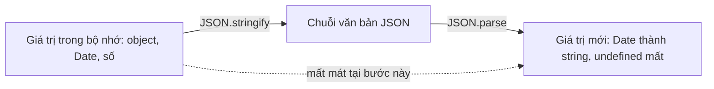
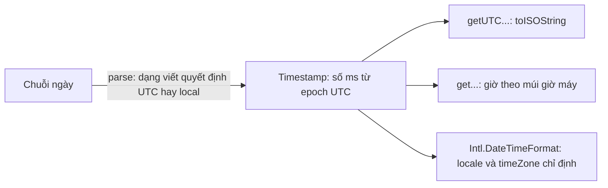

# Lý thuyết 4: String, Number, Date và JSON

Bốn kiểu dữ liệu này có mặt trong gần như mọi dòng code thực tế: tên người dùng, giá tiền, ngày đặt hàng, payload gửi lên server. Chúng trông đơn giản nhưng ẩn nhiều bẫy: emoji có độ dài 2, `0.1 + 0.2` khác `0.3`, cùng một chuỗi ngày parse ra hai thời điểm khác nhau, và `JSON.stringify` lặng lẽ bỏ mất dữ liệu. Bài này đi từng kiểu, giải thích **vì sao** chúng hành xử như vậy và cách dùng cho đúng. Bài trước nói về object và array, xem [Lý thuyết 3](/go?p=13-JavaScript%2Feasy%2Flt-03-object-va-array.md).

## String, Number, Date và JSON là gì?

Hãy hình dung bốn món đồ trong một văn phòng. **String** là tờ giấy đã đóng dấu: bạn chỉ có thể photo ra một bản mới có chỉnh sửa, không thể tẩy xóa tờ gốc. **Number** là chiếc máy tính bỏ túi dùng một cỡ màn hình cố định cho mọi phép tính: nó đủ cho hầu hết việc, nhưng làm tròn theo cách của máy chứ không theo cách của kế toán. **Date** là một con số duy nhất trên đồng hồ treo tường toàn cầu (số mili giây tính từ một mốc), còn "giờ địa phương" chỉ là cách mỗi nơi đọc con số đó. **JSON** là cái thùng carton dùng để chuyển hàng: mọi thứ phải xếp vào dạng chuẩn (chữ, số, mảng, object) thì mới đóng được, và món nào không vừa thùng sẽ bị bỏ lại hoặc làm hỏng quá trình đóng gói.

Về kỹ thuật:

- **String** là chuỗi các đơn vị mã UTF-16, bất biến.
- **Number** là số thực dấu phẩy động 64 bit theo chuẩn IEEE 754, kiểu duy nhất cho cả số nguyên lẫn số thực (trừ `BigInt`).
- **Date** là object bọc một timestamp, tức số mili giây tính từ `1970-01-01T00:00:00Z`.
- **JSON** là định dạng văn bản để trao đổi dữ liệu, chỉ là chuỗi; `JSON.stringify` và `JSON.parse` là hai hàm chuyển qua lại.

**Cốt lõi:** cả bốn kiểu đều là một "biểu diễn" của thứ bạn muốn nói, và biểu diễn luôn có giới hạn: chuỗi biểu diễn chữ bằng đơn vị 16 bit, Number biểu diễn số bằng nhị phân, Date biểu diễn thời điểm bằng một con số, JSON biểu diễn dữ liệu bằng văn bản. Hầu hết lỗi nảy sinh ở chỗ biểu diễn không khớp với điều ta nghĩ trong đầu.

- Vì chuỗi đếm theo đơn vị mã UTF-16 chứ không theo ký tự người đọc, nên `"😀".length` là 2.
- Vì Number lưu theo nhị phân, nên nhiều số thập phân như 0,1 không biểu diễn chính xác và phép cộng bị lệch rất nhỏ.
- Vì Date chỉ là một timestamp còn chuỗi ngày thiếu múi giờ phải được "đoán", nên cùng một chuỗi có thể ra hai thời điểm khác nhau tùy dạng viết.



Mô hình tư duy: mọi lần "đổi dạng" (số sang chuỗi, thời điểm sang chuỗi ngày, object sang JSON) đều là một phép biến đổi có thể mất thông tin, nên hãy luôn hỏi "dạng ngược lại có trả về đúng thứ ban đầu không?".

## Vấn đề nó giải quyết, và vì sao dev phải nắm

Dữ liệu đời thực rất lộn xộn: tên có dấu tiếng Việt, tiền có phần thập phân, ngày giờ ở nhiều múi giờ, payload đi qua mạng. Bốn kiểu này là công cụ để mô tả và chuyển các dữ liệu đó. Nếu chỉ nhớ "cách gọi hàm" mà không hiểu mô hình bên dưới, bạn sẽ gặp các lỗi kiểu: hóa đơn lệch một xu, báo cáo ngày bị lùi một ngày ở máy khách ở Mỹ, tên người dùng bị cắt giữa chừng một emoji, API trả về `{}` thay vì dữ liệu vì quên `toJSON`.

Bạn sẽ cần kiến thức này mỗi khi làm form nhập liệu, hiển thị tiền tệ và ngày giờ theo locale, sắp xếp danh sách tiếng Việt, gọi API và lưu `localStorage`. Phương pháp xuyên suốt: với mỗi giá trị, hãy biết nó đang ở dạng nào (chuỗi hay số, local hay UTC, đã serialize hay chưa), và chuyển đổi một cách có chủ đích ở biên của hệ thống thay vì rải rác khắp nơi.

**Tóm tắt:**

- String bất biến: mọi method như `toUpperCase`, `slice`, `replace` đều trả chuỗi mới, không sửa chuỗi cũ.
- `length` đếm đơn vị mã UTF-16, không đếm ký tự người đọc; dùng `[...s]` để đếm code point và `Intl.Segmenter` để đếm grapheme.
- So sánh chuỗi bằng `<` hoặc `sort()` mặc định theo mã UTF-16, không đúng tiếng Việt; dùng `localeCompare` hoặc `Intl.Collator`.
- Number là IEEE 754 nên `0.1 + 0.2 !== 0.3`; `toFixed` trả chuỗi và làm tròn theo giá trị nhị phân thực, tiền tệ nên tính bằng số nguyên đơn vị nhỏ nhất.
- `Number("12px")` là `NaN` còn `parseInt("12px")` là `12`; `map(parseInt)` là bẫy kinh điển.
- Date chỉ là timestamp: chuỗi `"2024-03-10"` được hiểu là UTC còn `"2024-03-10T00:00:00"` là giờ địa phương; luôn lưu và truyền dạng ISO có `Z`, hiển thị bằng `Intl.DateTimeFormat`.
- `JSON.stringify` bỏ `undefined`, hàm, symbol trong object; biến `NaN` thành `null`; `Date` thành chuỗi; `BigInt` và tham chiếu vòng gây `TypeError`.
- `JSON.parse(JSON.stringify(x))` không phải deep clone đáng tin; dùng `structuredClone` khi cần.

## Các khái niệm cần biết

- **Đơn vị mã UTF-16 (code unit)**: đơn vị 16 bit mà `length` và chỉ số `s[i]` làm việc trên. Ký tự ngoài BMP như emoji chiếm hai đơn vị (một cặp surrogate).
- **Code point**: một ký tự Unicode đầy đủ, có số hiệu riêng (ví dụ U+1F600). `for...of` và `[...s]` duyệt theo code point.
- **Grapheme cluster**: "một ký tự theo mắt người", có thể gồm nhiều code point (chữ kèm dấu, emoji gia đình). `Intl.Segmenter` tách theo đơn vị này.
- **Normalization (chuẩn hóa)**: Unicode cho phép cùng một chữ có nhiều dạng mã hóa (`é` dựng sẵn hay `e` cộng dấu sắc rời). `normalize()` đưa về một dạng thống nhất (NFC, NFD).
- **Template literal**: chuỗi viết bằng dấu backtick, hỗ trợ chèn biểu thức `${...}` và xuống dòng thật.
- **Locale**: ngôn ngữ cộng vùng (`vi-VN`, `en-US`) quyết định cách xếp thứ tự chữ, dấu phân cách số, định dạng ngày.
- **IEEE 754 double**: chuẩn số thực 64 bit mà Number dùng; có `NaN`, `Infinity`, `-0` và độ chính xác hữu hạn.
- **Safe integer**: số nguyên trong khoảng ±(2^53 - 1), nơi mọi số nguyên đều biểu diễn chính xác.
- **Timestamp (epoch milliseconds)**: số mili giây từ `1970-01-01T00:00:00Z`, độc lập với múi giờ.
- **ISO 8601**: định dạng chuỗi ngày giờ chuẩn như `2024-03-10T17:30:00Z`; chữ `Z` nghĩa là UTC.
- **Serialization**: biến cấu trúc dữ liệu trong bộ nhớ thành chuỗi hoặc byte để lưu hay gửi đi.
- **Replacer / Reviver**: hàm tùy biến cho `JSON.stringify` (lọc, đổi giá trị đi ra) và `JSON.parse` (khôi phục giá trị đi vào).

## String: bất biến và Unicode

**Bất biến** nghĩa là một khi chuỗi đã tạo, không có thao tác nào làm thay đổi nội dung của chính nó. Việc gán `s[0] = "H"` không báo lỗi ở sloppy mode mà chỉ bị bỏ qua (ở strict mode mới ném `TypeError`). Mọi method trả về chuỗi mới.

```javascript
const s = "hello";
s[0] = "H"; // sloppy mode: bị bỏ qua im lặng
console.log(s);
const t = s.toUpperCase();
console.log(s, t);
```

```text
hello
hello HELLO
```

_Đã chạy thử trên Node 22._

Tại sao thiết kế như vậy? Chuỗi bất biến cho phép engine chia sẻ bộ nhớ an toàn (hai biến cùng trỏ một chuỗi mà không sợ nhau sửa), dùng chuỗi làm key của object/Map ổn định, và tối ưu như nối chuỗi bằng cấu trúc "rope". Hệ quả thực tế: nối chuỗi trong vòng lặp lớn nên gom vào mảng rồi `join`, hoặc để engine tự tối ưu `+=` (engine hiện đại làm khá tốt), và đừng kỳ vọng "sửa tại chỗ".

**Nhớ:** chuỗi bất biến, mọi method trả giá trị mới. Quên gán lại kết quả (`s.trim();` rồi dùng `s`) là lỗi thường gặp nhất.

### Unicode và UTF-16

JavaScript lưu chuỗi dưới dạng các đơn vị mã 16 bit. Ký tự trong BMP (hầu hết chữ cái, kể cả tiếng Việt dựng sẵn) chiếm một đơn vị. Ký tự ngoài BMP như emoji chiếm **hai** đơn vị, gọi là cặp surrogate. `length` và `s[i]` làm việc theo đơn vị mã, không theo ký tự.

```javascript
const e = "😀";
console.log(e.length, [...e].length, e.codePointAt(0).toString(16));
console.log(e.charCodeAt(0).toString(16), e.charCodeAt(1).toString(16));

const fam = "👨‍👩‍👧";
console.log(fam.length, [...fam].length);
const seg = new Intl.Segmenter("vi", { granularity: "grapheme" });
console.log([...seg.segment(fam)].length);

const a = "caf\u00e9";
const b = "cafe\u0301";
console.log(a === b, a.length, b.length);
console.log(a.normalize() === b.normalize());
console.log(b.normalize("NFD").replace(/\p{Diacritic}/gu, ""));
```

```text
2 1 1f600
d83d de00
8 5
1
false 4 5
true
cafe
```

_Đã chạy thử trên Node 22._

Đọc kết quả: emoji cười có `length` 2 nhưng chỉ là 1 code point. Emoji gia đình ghép từ nhiều emoji và ký tự nối không độ rộng nên `length` là 8, 5 code point, nhưng người nhìn thấy đúng 1 hình, và `Intl.Segmenter` đếm đúng 1. Hai chuỗi `café` trông giống hệt nhau nhưng `===` cho `false` vì một chuỗi dựng sẵn `é`, chuỗi kia là `e` cộng dấu sắc rời. `normalize()` đưa chúng về cùng dạng nên so sánh đúng. Chuẩn hóa sang NFD rồi loại ký tự dấu là cách quen thuộc để "bỏ dấu tiếng Việt" khi tìm kiếm (riêng chữ `đ` không phân rã, cần xử lý thêm).

**Phải thuộc:** `length` đếm đơn vị mã UTF-16; `[...s]` và `for...of` đếm theo code point; `Intl.Segmenter` đếm theo grapheme (ký tự người đọc); so sánh chuỗi người dùng nhập nên `normalize()` trước.

**Lưu ý:** cắt chuỗi bằng `slice(0, n)` có thể chặt đôi một cặp surrogate và tạo ra ký tự hỏng. Khi giới hạn độ dài hiển thị (tên, tweet), hãy cắt theo grapheme bằng `Intl.Segmenter`.

## Template literal và các method hay dùng

Template literal dùng dấu backtick. Nó cho phép chèn biểu thức, xuống dòng thật, và "tagged template" để tự xử lý các phần chữ và giá trị.

```javascript
const name = "An";
const n = 3;
console.log(`Xin chào ${name}, bạn có ${n * 2} thông báo`);
const lines = `dòng 1
dòng 2`;
console.log(lines.split("\n").length);
function tag(strings, ...values) {
  return strings.raw.map((s, i) => s + (values[i] !== undefined ? `[${values[i]}]` : "")).join("");
}
console.log(tag`a=${1}, b=${2}!`);
console.log(String.raw`C:\new\table`);
console.log(`${{}}`, `${[1, 2]}`, `${null}`);
```

```text
Xin chào An, bạn có 6 thông báo
2
a=[1], b=[2]!
C:\new\table
[object Object] 1,2 null
```

_Đã chạy thử trên Node 22._

Dòng cuối là một lời nhắc: `${}` gọi `String(value)`, nên object phẳng thành `[object Object]` và `null` thành chữ `null`. Tagged template là nền của các thư viện như styled-components hay công cụ chống SQL injection (hàm tag nhận phần chữ cố định và phần giá trị tách riêng, nên có thể tham số hóa thay vì nối chuỗi).

Các method cần dùng thành thạo, nhóm theo mục đích:

```javascript
const s = "JavaScript";
console.log(s.slice(4), s.slice(-6, -3), s.slice(4, 2));
console.log(s.substring(4, 2), s.substring(-3, 4));
console.log(s.at(-1), s[s.length - 1]);
console.log(s.includes("Script"), s.startsWith("Java"), s.endsWith("pt"));
console.log(s.indexOf("a"), s.lastIndexOf("a"), s.indexOf("z"));
const t = "a-b-c-b";
console.log(t.replace("b", "X"), t.replaceAll("b", "X"));
console.log(t.replace(/b/g, (m, offset) => `<${offset}>`));
console.log("7".padStart(3, "0"), "abc".padEnd(6, "."), "x".repeat(3));
console.log("  hi  ".trim() + "|", "  hi  ".trimStart() + "|");
console.log("a,b,,c".split(","), "a,b,c".split(",", 2), "abc".split(""));
console.log("a1b22c".split(/\d+/), "one  two".split(" "));
console.log("Hello".toUpperCase(), "İ".toLowerCase().length);
```

```text
Script Scr 
va Java
t t
true true true
1 3 -1
a-X-c-b a-X-c-X
a-<2>-c-<6>
007 abc... xxx
hi| hi  |
[ 'a', 'b', '', 'c' ] [ 'a', 'b' ] [ 'a', 'b', 'c' ]
[ 'a', 'b', 'c' ] [ 'one', '', 'two' ]
HELLO 2
```

_Đã chạy thử trên Node 22._

Những điểm cần để ý trong kết quả trên:

- `slice` cho phép chỉ số âm (đếm từ cuối) và trả chuỗi rỗng nếu `start >= end`. `substring` coi số âm là 0 và **tự hoán đổi** hai tham số nếu `start > end`, nên `substring(4, 2)` ra `"va"`. Ưu tiên `slice` vì hành vi nhất quán với `Array.prototype.slice`.
- `replace` với chuỗi chỉ thay **lần xuất hiện đầu tiên**. `replaceAll` thay tất cả, và ném lỗi nếu truyền regex không có cờ `g`.
- Callback của `replace` nhận `(match, ...groups, offset, string)`, tiện để biến đổi từng kết quả khớp.
- `split` với chuỗi rỗng tách theo đơn vị mã (nên sẽ chặt đôi emoji); với `limit` thì dừng sớm; hai khoảng trắng liên tiếp tạo ra phần tử rỗng.
- `padStart` cực tiện để định dạng số có số 0 đứng đầu hoặc căn bảng văn bản.
- `at(-1)` lấy phần tử cuối gọn hơn `s[s.length - 1]`.
- Chuyển hoa thường phụ thuộc ngôn ngữ: chữ `İ` (I có chấm của tiếng Thổ) khi hạ xuống thành hai code point. Khi cần đúng locale hãy dùng `toLocaleUpperCase("tr")`.

**Nhớ:** method của chuỗi trả giá trị mới; `slice` thay `substring`; `replaceAll` khi cần thay hết; kiểm tra tồn tại dùng `includes`, không dùng `indexOf(...) !== -1` trừ khi cần vị trí.

## So sánh và sắp xếp chuỗi

Toán tử `<`, `>` và `sort()` mặc định so sánh chuỗi theo **giá trị đơn vị mã UTF-16** từng vị trí. Điều này không khớp với thứ tự từ điển của bất kỳ ngôn ngữ nào: chữ hoa đứng trước chữ thường, chữ có dấu bị đẩy về cuối, và `"10" < "9"` là đúng vì ký tự `'1'` nhỏ hơn `'9'`. Muốn đúng từ điển theo ngôn ngữ, dùng `localeCompare` hoặc `Intl.Collator`.

```javascript
console.log("a" < "B", "a" < "b", "10" < "9", 10 < 9);
const words = ["Đà", "Dũng", "An", "Âu", "Zebra", "apple", "Bình"];
console.log([...words].sort());
console.log([...words].sort((x, y) => x.localeCompare(y, "vi")));
const coll = new Intl.Collator("vi", { sensitivity: "base" });
console.log(coll.compare("a", "A"), coll.compare("a", "á"), "a".localeCompare("A"));
const files = ["file10", "file2", "file1"];
console.log([...files].sort());
console.log([...files].sort(new Intl.Collator(undefined, { numeric: true }).compare));
```

```text
false true true false
[
  'An',    'Bình',
  'Dũng',  'Zebra',
  'apple', 'Âu',
  'Đà'
]
[
  'An',    'apple',
  'Âu',    'Bình',
  'Dũng',  'Đà',
  'Zebra'
]
0 0 -1
[ 'file1', 'file10', 'file2' ]
[ 'file1', 'file2', 'file10' ]
```

_Đã chạy thử trên Node 22._

`sort()` mặc định đặt `"Âu"` và `"Đà"` sau `"apple"`, vì mã của `Â` và `Đ` lớn hơn mọi chữ ASCII. Với `localeCompare("vi")` thứ tự đúng từ điển. `Intl.Collator` có hai lợi thế so với gọi `localeCompare` nhiều lần: tạo một lần dùng lại (nhanh hơn rõ rệt khi sort mảng lớn) và có tùy chọn `sensitivity` (`"base"` coi `a`, `A`, `á` là như nhau) cùng `numeric: true` để so sánh chuỗi số tự nhiên (`file2` trước `file10`).

**Lưu ý:** kết quả của `localeCompare` và `Collator` phụ thuộc dữ liệu ICU của môi trường chạy (trình duyệt, phiên bản Node), nên đừng viết test so sánh chính xác thứ tự các ký tự đặc biệt giữa các môi trường.

## Number: ép kiểu, làm tròn và giới hạn

Có ba cách biến chuỗi thành số, và chúng khác nhau ở độ "khắt khe".

```javascript
console.log(parseInt("42px"), parseInt("px42"), parseInt("0x1f"), parseInt("101", 2));
console.log(parseFloat("3.14abc"), parseFloat(".5"), parseInt("1e3"), parseFloat("1e3"));
console.log(Number("42px"), Number(""), Number("  12  "), Number(null), Number(undefined), Number("0b11"));
console.log(["1", "2", "3"].map(parseInt));
console.log(["1", "2", "3"].map(Number));
console.log(parseInt(0.0000005), +"3.5", Number(true), Number([5]), Number([1, 2]));
```

```text
42 NaN 31 5
3.14 0.5 1 1000
NaN 0 12 0 NaN 3
[ 1, NaN, NaN ]
[ 1, 2, 3 ]
5 3.5 1 5 NaN
```

_Đã chạy thử trên Node 22._

Cách nhớ:

- `Number(x)` và toán tử `+x` **khắt khe**: toàn bộ chuỗi phải là số hợp lệ (sau khi bỏ khoảng trắng hai đầu), nếu không là `NaN`. Chuỗi rỗng ra `0`, `null` ra `0`, `undefined` ra `NaN`.
- `parseInt` và `parseFloat` **đọc tiền tố**: đọc tới khi gặp ký tự không hợp lệ rồi dừng. `parseInt("42px")` ra 42. `parseInt` nhận tham số thứ hai là cơ số, nên `map(parseInt)` truyền chỉ số phần tử làm cơ số và cho kết quả `[1, NaN, NaN]`. Luôn truyền cơ số tường minh (`parseInt(s, 10)`) hoặc dùng `Number`.
- `parseInt(0.0000005)` ra `5` vì số bị đổi thành chuỗi `"5e-7"` trước khi đọc. Đừng dùng `parseInt` để cắt phần thập phân của số, hãy dùng `Math.trunc`.

**Phải thuộc:** dữ liệu từ form là chuỗi; dùng `Number(...)` khi muốn khắt khe, kiểm tra `Number.isNaN(...)` sau đó, chỉ dùng `parseInt/parseFloat` khi cố ý đọc tiền tố (như `"16px"`).

### Số thực và bẫy làm tròn của toFixed

Number lưu số dưới dạng nhị phân. Giống như 1/3 không viết hữu hạn được trong hệ thập phân, 0,1 không viết hữu hạn được trong hệ nhị phân. Máy lưu giá trị xấp xỉ gần nhất, và sai số hiện ra khi cộng trừ.

```javascript
console.log(0.1 + 0.2, 0.1 + 0.2 === 0.3);
console.log(Math.abs(0.1 + 0.2 - 0.3) < Number.EPSILON);
console.log((1.005).toFixed(2), (1.45).toFixed(1), (8.345).toFixed(2), (2.5).toFixed(0), (1.255).toFixed(2));
console.log(typeof (3.14159).toFixed(2));
console.log(Math.round(1.005 * 100) / 100);
console.log(Math.round((1.005 + Number.EPSILON) * 100) / 100);
const cents = Math.round(19.99 * 100);
console.log(cents, (cents * 3) / 100);
console.log((0.000001234).toFixed(8), (1e21).toFixed(2));
```

```text
0.30000000000000004 false
true
1.00 1.4 8.35 3 1.25
string
1
1.01
1999 59.97
0.00000123 1e+21
```

_Đã chạy thử trên Node 22._

`(1.005).toFixed(2)` ra `"1.00"` chứ không phải `"1.01"` vì giá trị thực lưu cho 1.005 hơi nhỏ hơn 1.005 một chút, nên làm tròn xuống. `toFixed` luôn **trả chuỗi**, không phải số, và với số rất lớn (từ 1e21) nó trả dạng khoa học. Mẹo `+ Number.EPSILON` chỉ là cách chữa tạm, không đúng cho mọi trường hợp. So sánh số thực nên dùng ngưỡng sai số (`Math.abs(a - b) < Number.EPSILON` chỉ hợp với số cỡ 1; số lớn hơn cần ngưỡng tương đối).

**Lưu ý:** với tiền, đừng lưu và tính bằng số thực. Quy ước chuẩn là dùng **số nguyên của đơn vị nhỏ nhất** (xu, đồng) rồi chia khi hiển thị, hoặc dùng thư viện decimal, hoặc `BigInt`. Hiển thị dùng `Intl.NumberFormat` thay vì `toFixed` nối chuỗi.

### Số nguyên an toàn, NaN, -0

```javascript
console.log(Number.isInteger(5), Number.isInteger(5.0), Number.isInteger("5"), Number.isInteger(5.1));
console.log(Number.MAX_SAFE_INTEGER, Number.isSafeInteger(2 ** 53), Number.isSafeInteger(2 ** 53 - 1));
console.log(2 ** 53 === 2 ** 53 + 1, 9007199254740993, 9007199254740993n);
console.log(isNaN("abc"), Number.isNaN("abc"), Number.isNaN(NaN), NaN === NaN, Object.is(NaN, NaN));
console.log(Object.is(0, -0), 0 === -0, 1 / -0);
console.log(Number.isFinite("5"), isFinite("5"), 1 / 0, Number.MAX_VALUE * 2);
```

```text
true true false false
9007199254740991 false true
true 9007199254740992 9007199254740993n
true false true false true
false true -Infinity
false true Infinity Infinity
```

_Đã chạy thử trên Node 22._

Khoảng an toàn là ±(2^53 - 1) (khoảng 9 triệu tỷ). Ngoài khoảng này, các số nguyên liền kề không còn biểu diễn riêng biệt (`2 ** 53 === 2 ** 53 + 1`), nên ID 64 bit từ server (như Snowflake ID) sẽ bị sai lặng lẽ nếu parse thành Number; hãy để ID dạng chuỗi hoặc dùng `BigInt`. `NaN` là giá trị duy nhất không bằng chính nó, và hàm toàn cục `isNaN("abc")` ép kiểu trước rồi mới kiểm tra, còn `Number.isNaN` thì không. Dùng phiên bản `Number.*` cho đỡ bất ngờ.

**Nhớ:** `Number.isInteger`, `Number.isSafeInteger`, `Number.isNaN`, `Number.isFinite` không ép kiểu; các hàm toàn cục cùng tên thì có.

## Math và Intl.NumberFormat

```javascript
console.log(Math.round(2.5), Math.round(-2.5), Math.round(-2.6), Math.trunc(-2.7), Math.floor(-2.7), Math.ceil(-2.2));
console.log(Math.max(), Math.min(), Math.max(1, "3", 2), Math.max(1, NaN), Math.max(...[4, 9, 2]));
console.log(Math.sign(-8), Math.hypot(3, 4), Math.cbrt(27), 2 ** 10, Math.PI.toFixed(4));
function randomInt(min, max) { return Math.floor(Math.random() * (max - min + 1)) + min; }
const r = randomInt(1, 6);
console.log(r >= 1 && r <= 6 && Number.isInteger(r));
console.log(Math.min(Math.max(15, 0), 10));
```

```text
3 -2 -3 -2 -3 -2
-Infinity Infinity 3 NaN 9
-1 5 3 1024 3.1416
true
10
```

_Đã chạy thử trên Node 22._

Điểm đáng nhớ: `Math.round` làm tròn nửa về phía `+Infinity` (`-2.5` ra `-2`, khác kiểu "làm tròn xa số 0"); `Math.trunc` bỏ phần thập phân, `floor` về phía âm vô cực, `ceil` về phía dương. `Math.max()` không đối số ra `-Infinity`, và chỉ cần một đối số là `NaN` thì cả kết quả là `NaN`. `Math.random()` trả số trong `[0, 1)` và **không an toàn về mật mã**; sinh token hay mật khẩu dùng `crypto.getRandomValues`. Kẹp giá trị vào khoảng bằng `Math.min(Math.max(x, lo), hi)`.

Khi cần **hiển thị** số cho người đọc, `Intl.NumberFormat` lo dấu phân cách, ký hiệu tiền, đơn vị theo locale:

```javascript
const price = 1234567.891;
console.log(new Intl.NumberFormat("vi-VN", { style: "currency", currency: "VND" }).format(price));
console.log(new Intl.NumberFormat("en-US", { style: "currency", currency: "USD" }).format(price));
console.log(new Intl.NumberFormat("de-DE").format(price));
console.log(new Intl.NumberFormat("vi-VN", { maximumFractionDigits: 1 }).format(price));
console.log(new Intl.NumberFormat("en", { notation: "compact" }).format(1530000));
console.log(new Intl.NumberFormat("en", { style: "percent", minimumFractionDigits: 1 }).format(0.256));
console.log(new Intl.NumberFormat("en", { style: "unit", unit: "kilometer-per-hour" }).format(72));
console.log((1234.5).toLocaleString("en-US"));
```

```text
1.234.568 ₫
$1,234,567.89
1.234.567,891
1.234.567,9
1.5M
25.6%
72 km/h
1,234.5
```

_Đã chạy thử trên Node 22._

Lưu ý VND không có phần lẻ nên tự làm tròn thành `1.234.568 ₫`, còn tiếng Việt dùng dấu chấm ngăn nghìn và dấu phẩy thập phân. Tạo `Intl.NumberFormat` tốn kém hơn gọi `format`, nên khi định dạng nhiều giá trị hãy tạo một lần và dùng lại. Chuỗi kết quả chỉ để hiển thị: đừng parse ngược để tính toán.

## Date: một timestamp và nhiều cách đọc

Object `Date` bên trong chỉ chứa **một con số**: số mili giây từ mốc epoch (UTC). Múi giờ chỉ xuất hiện khi bạn đọc ra thành năm, tháng, giờ (`getHours`) hoặc đổi sang chuỗi. Nhờ vậy, so sánh và trừ hai `Date` luôn đúng bất kể múi giờ.



Tạo và thao tác (đã chạy với `TZ=UTC node`):

```javascript
const d = new Date(2024, 0, 31, 8, 30);
console.log(d.toISOString(), d.getMonth(), d.getDay());
d.setMonth(1); // 31/2 không tồn tại: tràn sang tháng 3
console.log(d.toISOString());
console.log(new Date(2024, 1, 30).toISOString().slice(0, 10), new Date(2024, 0, 0).toISOString().slice(0, 10));
console.log(new Date(0).toISOString(), new Date(86400000).getTime());
console.log(Date.UTC(2024, 0, 1), new Date(Date.UTC(2024, 0, 1)).toISOString());
const bad = new Date("khong phai ngay");
console.log(String(bad), bad.getTime(), Number.isNaN(bad.getTime()));
console.log(typeof Date.now(), Date.now() > 1.7e12);
console.log(new Date(2024, 0, 1) - new Date(2023, 0, 1));
```

```text
2024-01-31T08:30:00.000Z 0 3
2024-03-02T08:30:00.000Z
2024-03-01 2023-12-31
1970-01-01T00:00:00.000Z 86400000
1704067200000 2024-01-01T00:00:00.000Z
Invalid Date NaN true
number true
31536000000
```

_Đã chạy thử trên Node 22 với `TZ=UTC`._

Những điều bất ngờ nên thuộc:

- **Tháng đếm từ 0** (`0` là tháng 1) nhưng ngày trong tháng đếm từ 1. `getDay()` trả thứ trong tuần (0 là Chủ nhật), còn `getDate()` trả ngày trong tháng.
- Giá trị vượt phạm vi **tràn** sang đơn vị lớn hơn, không báo lỗi: ngày 30 tháng 2 thành 1 tháng 3, ngày 0 là ngày cuối tháng trước. Đặt `setMonth(1)` khi đang là ngày 31 làm nhảy sang tháng 3. Trick `new Date(y, m + 1, 0).getDate()` lấy số ngày của tháng.
- Chuỗi không hợp lệ cho ra `Invalid Date`, không ném lỗi. Kiểm tra bằng `Number.isNaN(d.getTime())`.
- Trừ hai `Date` ra số mili giây. Chia cho `86400000` để ra số ngày, nhưng với ngày chuyển giờ mùa hè, một "ngày" địa phương có thể dài 23 hay 25 giờ, nên tính "số ngày lịch" nên làm trên UTC hoặc thư viện chuyên dụng.
- Date có thể thay đổi (mutable), khác với chuỗi. Hàm nhận Date rồi `setDate` sẽ sửa luôn object của người gọi; hãy sao chép bằng `new Date(d)` trước.

**Phải thuộc:** tháng tính từ 0; Date là timestamp; `Invalid Date` kiểm tra bằng `getTime()`; lưu và gửi thời điểm dưới dạng ISO UTC hoặc timestamp, chỉ đổi sang giờ địa phương lúc hiển thị.

### Bẫy parse chuỗi ngày và múi giờ

Cùng là ngày 10/3/2024 nhưng hai chuỗi sau được hiểu khác nhau theo đặc tả: dạng chỉ có ngày (`"2024-03-10"`) được hiểu là **UTC 00:00**, còn dạng có giờ mà không có phần múi giờ (`"2024-03-10T00:00:00"`) được hiểu là **giờ địa phương**.

```javascript
const a = new Date("2024-03-10");
const b = new Date("2024-03-10T00:00:00");
console.log(a.toISOString());
console.log(b.toISOString());
console.log(a.getDate(), a.getHours(), "|", b.getDate(), b.getHours());
console.log(new Date("2024-03-10T00:00:00Z").getTime() === a.getTime());
console.log(new Date("2024-03-10T00:00:00+07:00").toISOString());
```

Chạy với `TZ=Asia/Ho_Chi_Minh` (UTC+7):

```text
2024-03-10T00:00:00.000Z
2024-03-09T17:00:00.000Z
10 7 | 10 0
true
2024-03-09T17:00:00.000Z
```

Chạy với `TZ=America/New_York` (ngày 10/3/2024 vẫn là UTC-5, trước khi chuyển giờ mùa hè lúc 2 giờ sáng cùng ngày):

```text
2024-03-10T00:00:00.000Z
2024-03-10T05:00:00.000Z
9 19 | 10 0
true
2024-03-09T17:00:00.000Z
```

_Đã chạy thử trên Node 22 với hai giá trị `TZ` như ghi trên._

Ở New York, `a.getDate()` trả `9`: người dùng chọn "10/3" nhưng báo cáo hiện ngày 9, vì UTC nửa đêm ngày 10 vẫn là tối ngày 9 tại đó. Đây là nguồn lỗi "lùi một ngày" kinh điển. Các chuỗi không theo ISO như `"2024/03/10"` hay `"March 10, 2024"` thì do từng engine tự quyết định, nên không nên dựa vào.

**Lưu ý:** quy tắc thực dụng: (1) API luôn trao đổi chuỗi ISO có `Z` hoặc offset rõ ràng; (2) với "ngày thuần" như ngày sinh, hoặc lưu dạng chuỗi `YYYY-MM-DD` và đừng đổi sang Date, hoặc nhất quán dùng các hàm `getUTC...`; (3) không bao giờ parse chuỗi định dạng tự do bằng `new Date(chuoi)`.

### Định dạng bằng Intl.DateTimeFormat

Đừng tự ghép chuỗi bằng `getMonth() + 1`. `Intl.DateTimeFormat` định dạng theo locale và cho phép chỉ định **múi giờ hiển thị** độc lập với múi giờ máy:

```javascript
const t = new Date("2024-03-10T17:30:00Z");
console.log(new Intl.DateTimeFormat("vi-VN", { dateStyle: "short", timeStyle: "short", timeZone: "Asia/Ho_Chi_Minh" }).format(t));
console.log(new Intl.DateTimeFormat("en-US", { dateStyle: "medium", timeStyle: "short", timeZone: "America/New_York" }).format(t));
console.log(new Intl.DateTimeFormat("vi-VN", { year: "numeric", month: "2-digit", day: "2-digit", timeZone: "UTC" }).format(t));
console.log(t.toLocaleDateString("en-GB", { timeZone: "UTC" }), t.toLocaleTimeString("en-US", { timeZone: "UTC" }));
console.log(t.getTimezoneOffset());
console.log(new Intl.RelativeTimeFormat("vi", { numeric: "auto" }).format(-1, "day"));
console.log(Intl.DateTimeFormat().resolvedOptions().timeZone);
```

```text
00:30 11/3/24
Mar 10, 2024, 1:30 PM
10/03/2024
10/03/2024 5:30:00 PM
0
Hôm qua
UTC
```

_Đã chạy thử trên Node 22 với `TZ=UTC` (dòng 1 và 2 độc lập với `TZ` nhờ tùy chọn `timeZone`)._

Cùng một thời điểm 17:30 UTC hiện là 00:30 ngày hôm sau ở Việt Nam và 1:30 chiều ở New York. Chuỗi hiển thị thay đổi theo phiên bản ICU nên đừng so sánh chuỗi đã định dạng trong test. `getTimezoneOffset()` trả số phút chênh lệch của máy so với UTC, với dấu **ngược** thường lệ (UTC+7 trả `-420`).

Về tương lai: `Date` có nhiều hạn chế (mutable, thiếu múi giờ, API khó dùng). **Temporal** là đề xuất chuẩn mới (`Temporal.PlainDate`, `Temporal.ZonedDateTime`, ...) để thay thế; thời điểm bạn đọc bài này, hãy kiểm tra bảng tương thích trên MDN và dùng thư viện hoặc polyfill nếu chưa được hỗ trợ rộng rãi. Phần còn lại của bài vẫn dùng `Date` vì đó là thứ có sẵn ở mọi nơi.

**Nhớ:** lưu UTC, hiển thị bằng `Intl.DateTimeFormat` kèm `timeZone` mong muốn; Temporal mới là đề xuất, chưa nên mặc định có sẵn.

## JSON: stringify và parse

JSON chỉ có sáu loại giá trị: object, array, chuỗi (nháy kép), số, `true/false` và `null`. Không có `undefined`, hàm, `Date`, `Map`, `Set`, `NaN`, `BigInt`, và không có chú thích hay dấu phẩy thừa. `JSON.stringify` cố biến mọi giá trị JavaScript về các loại trên, theo những quy tắc mà bạn cần thuộc.

```javascript
const user = {
  name: "An", age: undefined, greet() {}, id: Symbol("x"),
  tags: ["a", undefined, () => 1, NaN], score: Infinity,
  born: new Date("2024-03-10T00:00:00Z"), nested: { ok: true },
};
console.log(JSON.stringify(user));
console.log(JSON.stringify({ a: 1, b: [1, 2] }, null, 2));
console.log(JSON.stringify({ a: 1, b: 2, c: 3 }, ["a", "c"]));
console.log(JSON.stringify({ a: 1, secret: "x", b: "2" }, (k, v) => (k === "secret" ? undefined : typeof v === "number" ? v * 10 : v)));
console.log(JSON.stringify(undefined), JSON.stringify(() => 1), JSON.stringify(null), JSON.stringify("hi"));
console.log(JSON.stringify(new Map([[1, 2]])), JSON.stringify(new Set([1])), JSON.stringify([...new Map([[1, 2]])]));
console.log(JSON.stringify({ z: 1, 10: "a", b: 2, 2: "b", a: 3 }));
```

```text
{"name":"An","tags":["a",null,null,null],"score":null,"born":"2024-03-10T00:00:00.000Z","nested":{"ok":true}}
{
  "a": 1,
  "b": [
    1,
    2
  ]
}
{"a":1,"c":3}
{"a":10,"b":"2"}
undefined undefined null "hi"
{} {} [[1,2]]
{"2":"b","10":"a","z":1,"b":2,"a":3}
```

_Đã chạy thử trên Node 22._

Rút ra từ kết quả:

- Trong **object**, thuộc tính có giá trị `undefined`, hàm hoặc symbol bị **bỏ hẳn**. Trong **array**, chúng bị thay bằng `null` để giữ vị trí. `NaN` và `Infinity` luôn thành `null`.
- `Date` thành chuỗi ISO nhờ method `toJSON` có sẵn của nó. `Map` và `Set` thành `{}` (mất hết dữ liệu), nên phải chuyển sang mảng trước.
- Tham số thứ hai của `stringify` là **replacer**: mảng thì làm danh sách key được giữ, hàm thì chạy cho mọi cặp key và value (trả `undefined` để loại). Tham số thứ ba là thụt lề (số khoảng trắng hoặc chuỗi) cho dễ đọc.
- Dòng cuối cho thấy **thứ tự key**: key dạng số nguyên không âm được xếp tăng dần trước, rồi các key chuỗi theo thứ tự chèn. Đây là quy tắc của chính object, không riêng JSON (xem [Lý thuyết 6](/go?p=13-JavaScript%2Fmedium%2Flt-06-this-va-property-descriptor.md)). Đừng dựa vào thứ tự key khi so sánh hai JSON bằng chuỗi.
- `JSON.stringify(undefined)` trả về `undefined` chứ không phải chuỗi, cẩn thận khi ghi thẳng ra `localStorage`.

### toJSON, reviver và hai hướng đi

Nếu giá trị có method `toJSON`, `stringify` gọi nó và dùng kết quả. Ngược lại, `JSON.parse` chỉ trả về kiểu thuần (chuỗi, số, object, array), nên `Date` quay về là chuỗi. Muốn khôi phục, dùng tham số **reviver**.

```javascript
class Money {
  constructor(amount, cur) { this.amount = amount; this.cur = cur; }
  toJSON() { return `${this.amount} ${this.cur}`; }
}
console.log(JSON.stringify({ price: new Money(5, "USD") }));

const text = '{"name":"An","born":"2024-03-10T00:00:00.000Z","n":1}';
const plain = JSON.parse(text);
console.log(typeof plain.born);
const revived = JSON.parse(text, (key, value) =>
  key === "born" ? new Date(value) : value);
console.log(revived.born instanceof Date, revived.born.getUTCFullYear());
console.log(JSON.parse("[1,2]"), JSON.parse('"x"'), JSON.parse("null"));
for (const bad of ["{'a':1}", '{"a":1,}', "{a:1}", ""]) {
  try { JSON.parse(bad); } catch (e) { console.log(e.name); }
}
```

```text
{"price":"5 USD"}
string
true 2024
[ 1, 2 ] x null
SyntaxError
SyntaxError
SyntaxError
SyntaxError
```

_Đã chạy thử trên Node 22._

`JSON.parse` ném `SyntaxError` với nháy đơn, dấu phẩy thừa, key không có nháy, hoặc chuỗi rỗng, nên mọi chỗ parse dữ liệu từ bên ngoài (response, `localStorage`, input của người dùng) cần `try/catch`. Reviver duyệt từ giá trị lồng sâu nhất ra ngoài; trả `undefined` sẽ xóa thuộc tính đó.

### BigInt, tham chiếu vòng và deep clone

```javascript
try { JSON.stringify({ big: 10n }); } catch (e) { console.log(e.name + ": " + e.message); }
console.log(JSON.stringify({ big: 10n }, (k, v) => (typeof v === "bigint" ? v.toString() : v)));

const a = { name: "a" };
a.self = a;
try { JSON.stringify(a); } catch (e) { console.log(e.name + ": " + e.message.split("\n")[0]); }
const seen = new WeakSet();
console.log(JSON.stringify(a, (k, v) => {
  if (typeof v === "object" && v !== null) {
    if (seen.has(v)) return "[Circular]";
    seen.add(v);
  }
  return v;
}));
const src = { d: new Date(0), m: new Map([[1, 2]]), u: undefined };
const viaJson = JSON.parse(JSON.stringify(src));
console.log(viaJson);
const viaClone = structuredClone(src);
console.log(viaClone);
```

```text
TypeError: Do not know how to serialize a BigInt
{"big":"10"}
TypeError: Converting circular structure to JSON
{"name":"a","self":"[Circular]"}
{ d: '1970-01-01T00:00:00.000Z', m: {} }
{ d: 1970-01-01T00:00:00.000Z, m: Map(1) { 1 => 2 }, u: undefined }
```

_Đã chạy thử trên Node 22._

JSON từ chối `BigInt` vì không có cách biểu diễn số lớn chuẩn; bạn tự chọn (thường là chuỗi) qua replacer. Tham chiếu vòng (`a.self = a`) làm `stringify` ném `TypeError` vì không thể in ra hữu hạn; replacer với `WeakSet` là cách cắt vòng. Cuối cùng, `JSON.parse(JSON.stringify(x))` **không phải deep clone**: `Date` thành chuỗi, `Map` thành `{}`, `undefined` biến mất. `structuredClone` giữ lại `Date`, `Map`, `Set` và cả tham chiếu vòng (nhưng không sao chép được hàm và class instance mất prototype).

**Phải thuộc:** JSON không có `undefined`, hàm, `Date`, `Map`, `Set`, `BigInt`; `stringify` bỏ hoặc đổi chúng thành `null`, `parse` không tự khôi phục. Dữ liệu từ ngoài luôn `try/catch` quanh `JSON.parse` và validate hình dạng sau khi parse.

## Bẫy thường gặp

| Bẫy | Biểu hiện | Cách tránh |
|---|---|---|
| Quên gán lại kết quả method chuỗi | `s.trim();` nhưng `s` không đổi | `s = s.trim()` |
| Dùng `length` để đếm "ký tự" | Emoji tính là 2, `é` rời tính là 2 | `[...s]` hoặc `Intl.Segmenter`, và `normalize()` |
| `sort()` mặc định với chuỗi có dấu | Chữ `Â`, `Đ` xuống cuối, `file10` trước `file2` | `localeCompare` hoặc `Intl.Collator` kèm `numeric: true` |
| `["1","2","3"].map(parseInt)` | `[1, NaN, NaN]` | `map(Number)` hoặc `parseInt(x, 10)` trong arrow |
| `0.1 + 0.2 !== 0.3` | So sánh bằng với số thực sai | So sánh với ngưỡng sai số, tính tiền bằng số nguyên |
| `toFixed` tưởng trả số và làm tròn "đúng" | `(1.005).toFixed(2)` ra `"1.00"`, kết quả là chuỗi | Làm tròn số nguyên đơn vị nhỏ, hiển thị bằng `Intl.NumberFormat` |
| ID 64 bit parse thành Number | ID sai ở các chữ số cuối | Giữ ID dạng chuỗi hoặc `BigInt` |
| `new Date("2024-03-10")` | Hiện lùi một ngày ở múi giờ âm | Truyền ISO có `Z`/offset, hoặc xử lý `YYYY-MM-DD` như chuỗi |
| Tháng bắt đầu từ 0 | `new Date(2024, 3, 1)` là 1 tháng 4 | Ghi chú rõ, hoặc dùng chuỗi ISO |
| `Invalid Date` không ném lỗi | Hiện `NaN` ở giao diện | `Number.isNaN(d.getTime())` |
| `JSON.stringify` mất dữ liệu | `undefined`, hàm biến mất; `Map` thành `{}`; `NaN` thành `null` | Chuyển đổi trước, hoặc dùng replacer/`toJSON` |
| `JSON.parse(JSON.stringify(x))` làm deep clone | `Date` thành chuỗi | `structuredClone(x)` |
| Quên `try/catch` quanh `JSON.parse` | App sập vì dữ liệu hỏng trong `localStorage` | Bọc `try/catch`, validate sau khi parse |

## Câu hỏi phỏng vấn thường gặp

Mỗi câu có chuỗi: gợi ý suy luận, lập luận, đáp án ngắn, điều cần nhớ. Thử tự đi theo gợi ý trước khi đọc tiếp.

### 1. Vì sao `0.1 + 0.2 !== 0.3`, và bạn xử lý tính toán tiền tệ như thế nào?

**Câu hỏi:** giải thích hiện tượng, nói rõ nó có phải lỗi của JavaScript không, và đề xuất cách làm đúng khi tính tổng hóa đơn.

**Gợi ý suy luận:**
- Number lưu số theo hệ nhị phân hay thập phân, và 0,1 có viết hữu hạn được trong hệ đó không?
- Ngôn ngữ nào dùng số thực 64 bit chuẩn IEEE 754 cũng gặp hiện tượng này?
- Nếu tránh số thực hoàn toàn thì bạn lưu giá trị gì thay cho "19,99 đô"?

**Lập luận:** 0,1 và 0,2 không có biểu diễn nhị phân hữu hạn, nên máy lưu giá trị xấp xỉ gần nhất. Tổng hai xấp xỉ khác xấp xỉ của 0,3 ở chữ số cuối, nên `===` cho `false`. Đây là tính chất của IEEE 754 chứ không riêng JavaScript. Với tiền, sai số tích lũy qua nhiều phép tính là không chấp nhận được, nên ta chuyển sang số nguyên của đơn vị nhỏ nhất (1999 xu), cộng trừ nhân trên số nguyên, chỉ chia khi hiển thị.

**Đáp án ngắn:** do biểu diễn nhị phân xấp xỉ của số thập phân. So sánh số thực bằng ngưỡng sai số; tiền thì lưu số nguyên đơn vị nhỏ nhất (hoặc thư viện decimal) và hiển thị bằng `Intl.NumberFormat`.

**Nhớ:** `toFixed` chỉ để hiển thị, trả chuỗi và có thể làm tròn "sai" như `(1.005).toFixed(2)` là `"1.00"`.

### 2. `"😀".length` bằng 2. Làm sao đếm và cắt chuỗi theo "ký tự" đúng như người dùng nhìn thấy?

**Câu hỏi:** nêu nguyên nhân, và phân biệt ba cấp độ: code unit, code point, grapheme.

**Gợi ý suy luận:**
- `length` đo theo đơn vị nào của UTF-16?
- `[...s]` và `for...of` duyệt theo đơn vị nào, và nó đã đủ cho emoji gia đình chưa?
- Cần công cụ nào của `Intl` để tách "ký tự mắt người"?

**Lập luận:** chuỗi JavaScript là dãy đơn vị mã 16 bit. Emoji ngoài BMP cần hai đơn vị (surrogate pair) nên `length` là 2. Iterator của chuỗi duyệt theo code point nên `[...s].length` ra 1 cho emoji đơn. Nhưng một hình emoji gia đình ghép nhiều code point bằng ký tự nối, nên chỉ `Intl.Segmenter` với `granularity: "grapheme"` mới đếm đúng 1. Cắt chuỗi bằng `slice` có thể chặt đôi cặp surrogate.

**Đáp án ngắn:** `length` đếm code unit; `[...s]` đếm code point; `Intl.Segmenter` (grapheme) đếm ký tự người đọc. Khi giới hạn độ dài hiển thị hoặc cắt chuỗi, dùng grapheme, và `normalize()` trước khi so sánh chuỗi người dùng nhập.

**Nhớ:** `é` dựng sẵn và `e` cộng dấu rời nhìn giống nhau nhưng `===` cho `false` cho tới khi `normalize()`.

### 3. `new Date("2024-03-10")` và `new Date("2024-03-10T00:00:00")` khác nhau thế nào, vì sao dễ gây lỗi "lùi một ngày"?

**Câu hỏi:** nêu quy tắc parse của chuỗi ISO và hệ quả ở các múi giờ khác nhau.

**Gợi ý suy luận:**
- Chuỗi chỉ có ngày thì đặc tả hiểu là UTC hay giờ địa phương? Còn chuỗi có giờ nhưng không có `Z`?
- Khi đọc bằng `getDate()` ở múi giờ UTC-5, nửa đêm UTC hiện là ngày nào?
- Cách nào để dữ liệu truyền đi không còn mơ hồ?

**Lập luận:** đặc tả quy định dạng "chỉ ngày" là UTC 00:00, còn dạng "ngày và giờ không có offset" là giờ địa phương, hai thời điểm này lệch nhau đúng bằng offset múi giờ. Ở máy UTC-5, UTC 00:00 ngày 10 là 19:00 ngày 9 theo giờ địa phương, nên `getDate()` ra 9. Cách tránh là luôn dùng chuỗi ISO có `Z` hoặc offset khi trao đổi, và xử lý ngày thuần (ngày sinh) dưới dạng chuỗi `YYYY-MM-DD` hoặc dùng nhất quán hàm `getUTC...`.

**Đáp án ngắn:** dạng chỉ ngày là UTC, dạng có giờ không offset là local. Đọc bằng getter local ở múi giờ âm sẽ lùi ngày. Dùng ISO đầy đủ và hiển thị qua `Intl.DateTimeFormat` với `timeZone` rõ ràng.

**Nhớ:** Date chỉ là timestamp; lỗi nằm ở bước parse và bước đọc ra, không nằm ở bản thân con số.

### 4. `JSON.stringify` làm gì với `undefined`, hàm, `Date`, `NaN`, `Map`, và `BigInt`? Có dùng nó để deep clone được không?

**Câu hỏi:** liệt kê hành vi của từng loại giá trị và đưa ra phương án thay thế cho deep clone.

**Gợi ý suy luận:**
- Cùng giá trị `undefined` nằm trong object và trong array thì bị đối xử có giống nhau không?
- Quy tắc nào cho phép `Date` thành chuỗi mà không cần bạn viết gì (nghĩ tới `toJSON`)?
- Sau `parse`, kiểu của `Date` còn lại là gì, và cách nào đưa nó trở về?

**Lập luận:** JSON chỉ có sáu loại giá trị nên những gì ngoài đó phải bị bỏ hoặc đổi. `undefined`, hàm, symbol bị bỏ khỏi object và thành `null` trong array; `NaN` và `Infinity` thành `null`; `Date` có `toJSON` nên thành chuỗi ISO; `Map` và `Set` thành `{}`; `BigInt` và tham chiếu vòng ném `TypeError`. Vì mất thông tin ở chiều đi và `parse` không khôi phục kiểu ở chiều về, vòng `parse(stringify(x))` không phải deep clone đáng tin.

**Đáp án ngắn:** bỏ `undefined`/hàm/symbol trong object, `null` trong array, `NaN` thành `null`, `Date` thành chuỗi, `Map/Set` thành `{}`, `BigInt` và vòng ném lỗi. Deep clone nên dùng `structuredClone`; khôi phục kiểu khi parse bằng reviver.

**Nhớ:** muốn kiểm soát đầu ra, dùng replacer hoặc `toJSON`; muốn khôi phục đầu vào, dùng reviver.

### 5. Sắp xếp danh sách tên tiếng Việt và danh sách `file1, file2, file10` cho đúng thì làm thế nào?

**Câu hỏi:** giải thích vì sao `sort()` mặc định sai và cách sửa, kèm lý do nên tạo `Intl.Collator`.

**Gợi ý suy luận:**
- `sort()` mặc định đổi phần tử thành chuỗi và so sánh theo đơn vị mã nào?
- Mã của `Đ` và `Â` so với `z` thế nào?
- Khi sort một mảng lớn, bạn muốn khởi tạo bộ so sánh một lần hay mỗi phép so sánh?

**Lập luận:** `sort()` mặc định so sánh theo mã UTF-16 nên chữ hoa đứng trước chữ thường, chữ có dấu đứng sau mọi chữ ASCII, và `"10"` đứng trước `"2"` vì so từng ký tự. Muốn đúng từ điển cần dữ liệu locale: `localeCompare(b, "vi")` hoặc `new Intl.Collator("vi")`. Collator tạo một lần rồi truyền `collator.compare` làm hàm so sánh sẽ nhanh hơn gọi `localeCompare` ở mỗi cặp, và hỗ trợ `numeric: true` để `file2` đứng trước `file10`.

**Đáp án ngắn:** `arr.sort(new Intl.Collator("vi", { numeric: true }).compare)`.

**Nhớ:** thứ tự so sánh là chuyện của locale, đừng viết tay bảng thứ tự chữ cái; và đừng kỳ vọng kết quả giống hệt nhau giữa các môi trường có ICU khác nhau.

Bài kế tiếp: [Lý thuyết 5: Scope, hoisting và closure](/go?p=13-JavaScript%2Feasy%2Flt-05-scope-hoisting-closure.md).

