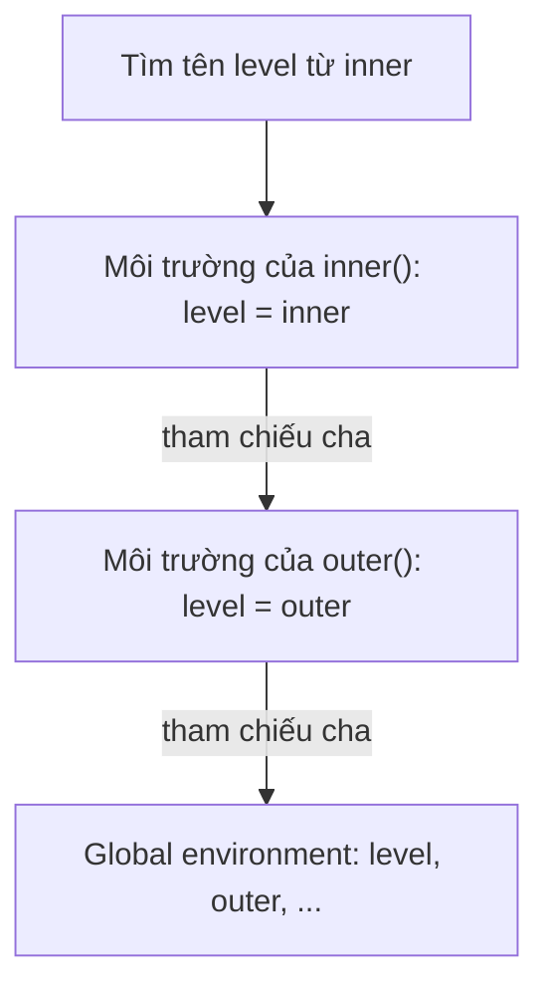
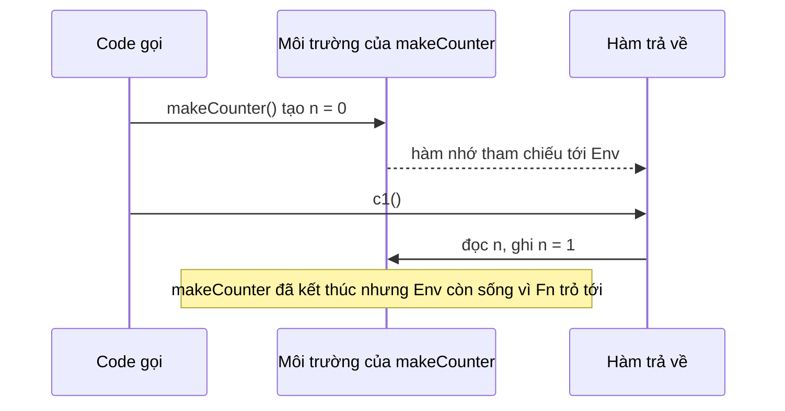

# Lý thuyết 5: Scope, hoisting và closure

Câu hỏi "biến này có nhìn thấy ở đây không, và lúc này nó đang giữ giá trị gì" là nền của mọi lỗi kiểu `undefined` bất ngờ, `ReferenceError` lạ, hay vòng lặp in ra toàn số 3. Bài này xây mô hình để trả lời chính xác câu hỏi đó: scope (phạm vi), lexical environment, scope chain, hoisting, vùng chết tạm thời (TDZ), rồi closure, thứ mọc ra từ các quy tắc đó. Bài trước là [Lý thuyết 4](/go?p=13-JavaScript%2Feasy%2Flt-04-string-number-date-json.md); bài này chuẩn bị nền cho cách hoạt động của `this` ở [Lý thuyết 6](/go?p=13-JavaScript%2Fmedium%2Flt-06-this-va-property-descriptor.md).

## Scope, hoisting và closure là gì?

Hãy hình dung một tòa nhà văn phòng. Mỗi phòng có **bảng tin riêng** ghi những thứ chỉ người trong phòng thấy (biến cục bộ). Nếu bạn cần một thông tin mà phòng mình không có, bạn bước ra hành lang, hỏi phòng bên ngoài, rồi tầng trên, cho tới sảnh chung (global). Bạn không bao giờ đi xuống phòng con hay sang phòng song song. Đó là **scope** và **scope chain**: quy tắc "nhìn thấy gì" được cố định theo **vị trí bạn viết code**, không theo nơi hàm được gọi.

Còn **closure** giống một chiếc cặp tài liệu: khi một nhân viên rời phòng để đi họp ở nơi khác, anh ta mang theo cái cặp chứa bản sao tham chiếu tới bảng tin của phòng cũ. Dù phòng cũ đã đóng cửa, anh vẫn mở cặp ra đọc và cập nhật bảng tin đó. Còn **hoisting** là việc "ban quản lý tòa nhà" đọc danh sách khai báo của từng phòng trước khi mở cửa, nên bảng tin đã có sẵn tên các biến ngay từ đầu, dù giá trị có thể chưa điền.

Về kỹ thuật:

- **Scope** là vùng code mà một tên biến có hiệu lực. JavaScript có global scope, module scope, function scope và block scope.
- **Lexical environment** là cấu trúc engine tạo ra cho mỗi scope: một bảng ánh xạ tên biến sang giá trị, kèm tham chiếu tới môi trường bao ngoài.
- **Hoisting** là hiện tượng khai báo được "đăng ký" vào scope trước khi dòng code đầu tiên chạy.
- **Closure** là hàm cộng với tham chiếu tới lexical environment nơi nó được tạo.

**Cốt lõi:** mỗi lần một scope được vào, engine tạo một lexical environment chứa các biến của scope đó cùng liên kết tới môi trường bao ngoài; tìm biến là đi dọc chuỗi liên kết này. Một hàm khi được tạo sẽ nhớ môi trường nơi nó sinh ra, và đó chính là closure: biến còn sống chừng nào còn hàm tham chiếu được tới nó.

- Vì phạm vi nhìn thấy được cố định theo vị trí viết code (lexical scoping), nên bạn đọc code là biết hàm truy cập biến nào, không cần biết ai gọi nó.
- Vì hàm giữ tham chiếu tới môi trường chứ không chép giá trị, nên hàm trả về từ một hàm khác vẫn đọc và ghi được biến của hàm cha dù hàm cha đã kết thúc.
- Vì mỗi lần gọi hàm tạo một môi trường mới, nên hai closure sinh từ hai lần gọi có biến độc lập, không dùng chung trạng thái.



Mô hình tư duy: biến được tìm từ trong ra ngoài theo chuỗi môi trường cố định lúc viết code; closure đơn giản là chuỗi đó không bị cắt khi hàm rời khỏi nơi sinh ra.

## Vấn đề nó giải quyết, và vì sao dev phải nắm

Nếu mọi biến đều là global thì hai module không thể cùng dùng tên `i` hay `count` mà không đè nhau. Scope cho phép mỗi đoạn code có "không gian tên" riêng, còn closure cho phép hàm mang theo dữ liệu riêng mà không cần class hay biến toàn cục. Đây là nền để làm module, private state, callback giữ ngữ cảnh, và hầu hết pattern hàm bậc cao (memoize, debounce).

Bạn sẽ gặp kiến thức này khi debug lỗi `Cannot access 'x' before initialization`, khi giải thích vì sao vòng lặp với `var` in ra cùng một giá trị, khi viết hook hoặc event handler giữ state, và khi truy tìm memory leak do closure giữ dữ liệu lớn. Phương pháp xuyên suốt: với mọi biến, hỏi hai câu: (1) nó được khai báo ở scope nào (vị trí viết code), (2) nó đã được khởi tạo chưa ở thời điểm đọc (hoisting và TDZ).

**Tóm tắt:**

- Scope là phạm vi biến có hiệu lực: global, module, function, và block (chỉ với `let`, `const`, `class`); `var` chỉ có function scope nên "rò" ra khỏi khối `if` hay `for`.
- JavaScript dùng lexical scoping: biến được tìm theo scope chain xác định lúc viết code, không theo nơi hàm được gọi.
- Hoisting: mọi khai báo được đăng ký trước khi code chạy; `var` được khởi tạo là `undefined`, function declaration có sẵn thân hàm, còn `let`, `const`, `class` ở trạng thái chưa khởi tạo (TDZ) nên truy cập sớm ném `ReferenceError`.
- Shadowing là khai báo cùng tên ở scope trong, che biến ngoài mà không sửa nó; dễ gây nhầm nếu vô tình.
- Closure là hàm kèm môi trường nơi nó được tạo; nó giữ biến sống và cho phép đọc, ghi biến đó sau khi hàm cha kết thúc.
- Vòng lặp `for` với `let` tạo binding mới mỗi lượt nên callback thấy đúng giá trị của lượt đó; `var` dùng một binding chung nên cho kết quả cuối.
- Ứng dụng: private state, factory, `once`, memoize, debounce, currying; cái giá là closure giữ dữ liệu sống lâu hơn dự kiến nên có thể gây rò rỉ bộ nhớ.
- Strict mode biến nhiều lỗi im lặng thành lỗi rõ ràng (gán biến chưa khai báo, `this` là `undefined` trong hàm gọi trơn); module ES luôn ở strict mode.

## Các khái niệm cần biết

- **Scope (phạm vi)**: vùng code trong đó một tên biến có thể được tham chiếu.
- **Global scope**: phạm vi ngoài cùng. Trong trình duyệt, `var` và function declaration ở top-level của script cổ điển trở thành thuộc tính của `window`; `let` và `const` thì không. Trong module ES hoặc file CommonJS của Node, top-level là scope của module chứ không phải global.
- **Function scope**: mỗi hàm tạo một scope; `var` bị giới hạn ở đây.
- **Block scope**: cặp ngoặc `{}` của `if`, `for`, `while`, `try`, hay khối trần tạo scope cho `let`, `const`, `class`.
- **Lexical environment**: bảng biến của một scope kèm tham chiếu `outer` tới môi trường bao ngoài.
- **Scope chain**: chuỗi môi trường từ trong ra ngoài mà engine duyệt khi tìm một tên.
- **Hoisting**: khai báo được xử lý trước lúc thực thi dòng đầu tiên của scope.
- **TDZ (Temporal Dead Zone)**: khoảng từ đầu scope tới dòng khai báo `let`/`const`/`class`, trong đó biến tồn tại nhưng chưa khởi tạo, mọi truy cập ném `ReferenceError`.
- **Shadowing**: biến ở scope trong trùng tên với biến scope ngoài và che nó.
- **Closure**: hàm cộng với tham chiếu tới lexical environment nơi nó được tạo.
- **IIFE (Immediately Invoked Function Expression)**: hàm được gọi ngay khi định nghĩa, từng dùng để tạo scope riêng trước khi có module và `let`.
- **Strict mode**: chế độ bật bằng `"use strict"` giúp bắt các lỗi mà chế độ thường bỏ qua.

## Global, function và block scope

Ba loại khai báo cho ba kết quả khác nhau khi đặt trong một khối `if`:

```javascript
function demo() {
  if (true) {
    var a = 1;
    let b = 2;
    const c = 3;
  }
  console.log(a);
  try { console.log(b); } catch (e) { console.log(e.name + ": " + e.message); }
  try { console.log(c); } catch (e) { console.log(e.name + ": " + e.message); }
}
demo();
{
  let inBlock = "chỉ thấy trong khối";
  console.log(inBlock);
}
console.log(typeof inBlock);
```

```text
1
ReferenceError: b is not defined
ReferenceError: c is not defined
chỉ thấy trong khối
undefined
```

_Đã chạy thử trên Node 22._

`var a` khai báo trong khối `if` vẫn thấy được ở cả hàm `demo`, vì `var` chỉ biết tới function scope. `let` và `const` bị nhốt trong khối. Dòng cuối cho thấy `typeof` với tên chưa khai báo ở scope hiện tại trả `"undefined"` thay vì ném lỗi (khác hẳn khi biến nằm trong TDZ, xem dưới).

Về global scope, trong trình duyệt với script cổ điển:

```javascript
var legacy = 1;
let modern = 2;
console.log(window.legacy, window.modern);
// 1 undefined: var gắn vào window, let thì không
```

_Minh họa, chưa chạy thử (cần trình duyệt, script không phải module)._

Gắn tên vào `window` là lý do `var` toàn cục dễ đụng độ với thư viện khác. Một lý do nữa để ưu tiên `const` mặc định, `let` khi cần gán lại, và không dùng `var` trong code mới.

**Phải thuộc:** `var` có function scope, `let`/`const`/`class` có block scope; khối `{}` của `if`, `for`, `try` và khối trần đều tạo scope cho `let/const`; top-level của module ES không phải global.

**Lưu ý:** trong một `switch`, tất cả các `case` dùng chung một khối, nên khai báo `let x` ở hai `case` khác nhau bị lỗi trùng tên. Bọc thân mỗi `case` bằng `{ ... }` nếu cần biến riêng.

## Lexical environment và scope chain

Khi một hàm được gọi, engine tạo một lexical environment mới cho lần gọi đó, gồm các tham số, biến cục bộ và một liên kết `outer` tới môi trường **nơi hàm được định nghĩa**. Để tìm một tên, engine kiểm tra môi trường hiện tại; không có thì đi theo `outer`, và cứ thế tới global; không thấy thì ném `ReferenceError`.

```javascript
const level = "global";
function outer() {
  const level = "outer";
  function inner() {
    const level = "inner";
    return level;
  }
  return [inner(), level];
}
console.log(outer(), level);

const name = "toàn cục";
function show() { return name; }
function run() {
  const name = "cục bộ trong run";
  return show();
}
console.log(run());

let count = 0;
{
  let count = 100;
  count++;
}
console.log(count);
```

```text
[ 'inner', 'outer' ] global
toàn cục
0
```

_Đã chạy thử trên Node 22._

Ví dụ thứ hai là phép thử quan trọng nhất của lexical scoping: `show` được viết ở top-level nên `outer` của nó là global, bất kể nó được gọi từ trong `run`. Vì thế `show()` thấy `name` toàn cục, không phải `name` cục bộ của `run`. Một số ngôn ngữ (dynamic scoping) cho kết quả ngược lại, JavaScript thì không. Ví dụ thứ ba cho thấy **shadowing**: `count` trong khối là biến khác hoàn toàn, tăng nó không làm `count` ngoài đổi.

Shadowing là con dao hai lưỡi. Nó hữu ích khi bạn muốn tên ngắn gọn trong phạm vi nhỏ (tham số `item` trong callback), nhưng tạo lỗi khi bạn tưởng đang sửa biến ngoài mà thực ra khai báo lại biến trong. Nhiều công cụ lint có luật `no-shadow` để bắt trường hợp này.

**Nền tảng:** phạm vi nhìn thấy của một biến được quyết định bởi **vị trí khai báo trong mã nguồn** (lexical scoping), và engine tra cứu theo chuỗi `outer` đã cố định lúc hàm được tạo. Mọi bài sau (closure, module, `this` của arrow function) đều dựa trên sự thật này.

**Nhớ:** tên được tìm từ trong ra ngoài; biến trong che biến ngoài chứ không sửa nó; hàm nhìn thấy scope nơi nó được viết, không phải nơi nó được gọi.

## Hoisting và vùng chết tạm thời

Trước khi chạy bất kỳ dòng nào của một scope, engine quét các khai báo và đăng ký tên vào môi trường. Điều gì xảy ra với giá trị phụ thuộc loại khai báo:

| Khai báo | Được đăng ký lúc đầu scope | Giá trị trước dòng khai báo |
|---|---|---|
| `var x` | Có, ở function scope | `undefined` |
| `function f() {}` | Có, kèm cả thân hàm | Dùng được ngay |
| `let`, `const` | Có, ở block scope | Chưa khởi tạo (TDZ), truy cập ném `ReferenceError` |
| `class C {}` | Có, ở block scope | Chưa khởi tạo (TDZ) |
| `var f = function () {}` | Chỉ tên `f` | `undefined`, gọi sẽ `TypeError` |

```javascript
console.log(v);            // undefined, không phải lỗi
var v = 10;
console.log(v);

console.log(sayHi());      // gọi được trước dòng khai báo
function sayHi() { return "hi"; }

try { sayBye(); } catch (e) { console.log(e.name + ": " + e.message); }
var sayBye = function () { return "bye"; };

try { new Dog(); } catch (e) { console.log(e.name + ": " + e.message); }
class Dog {}
console.log(typeof Dog);
```

```text
undefined
10
hi
TypeError: sayBye is not a function
ReferenceError: Cannot access 'Dog' before initialization
function
```

_Đã chạy thử trên Node 22._

Hãy đọc từng dòng. `var v` được hoist với giá trị `undefined`, nên đọc trước khi gán cho `undefined` thay vì lỗi (vì thế dễ che giấu bug). Function declaration được hoist **trọn vẹn**, nên gọi trước dòng khai báo vẫn chạy: nhiều dev tận dụng điều này để đặt hàm phụ ở cuối file. Function expression gán cho `var` thì chỉ tên được hoist, nên `sayBye()` là gọi `undefined`, ra `TypeError: ... is not a function`. Cuối cùng `class` ở trạng thái TDZ.

"Hoisting" là cách nói quen thuộc nhưng dễ gây hiểu nhầm là code bị di chuyển lên đầu. Thực tế không có gì bị di chuyển: engine tạo môi trường, đăng ký tên rồi mới chạy code theo thứ tự.

### Temporal Dead Zone

`let`, `const`, `class` **có** được hoist (tên đã tồn tại từ đầu khối), nhưng bị giữ ở trạng thái chưa khởi tạo cho tới khi dòng khai báo chạy xong. Khoảng thời gian đó là TDZ. Điểm quan trọng: vì tên đã tồn tại trong scope, nó **che** biến cùng tên ở scope ngoài, ngay cả ở các dòng trước khai báo.

```javascript
const x = "ngoài";
function f() {
  try { console.log(x); } catch (e) { console.log(e.name + ": " + e.message); }
  let x = "trong";
  return x;
}
console.log(f());

try { console.log(typeof later); } catch (e) { console.log(e.name + ": " + e.message); }
let later = 1;
console.log(typeof neverDeclared);

function g(a = b, b = 2) { return a + b; }
try { g(); } catch (e) { console.log(e.name + ": " + e.message); }
console.log(g(1));
```

```text
ReferenceError: Cannot access 'x' before initialization
trong
ReferenceError: Cannot access 'later' before initialization
undefined
ReferenceError: Cannot access 'b' before initialization
3
```

_Đã chạy thử trên Node 22._

Trong `f`, dòng đầu không in `"ngoài"` mà lỗi: `let x` ở dưới đã che `x` ngoài suốt cả thân hàm. `typeof` thường an toàn với tên chưa khai báo (`typeof neverDeclared` ra `"undefined"`) nhưng **không** an toàn với tên đang ở TDZ. Tham số mặc định cũng có TDZ theo thứ tự trái sang phải: `a = b` đọc `b` khi `b` chưa khởi tạo.

TDZ là tính năng, không phải lỗi thiết kế: nó biến lỗi "dùng biến trước khi khởi tạo" từ `undefined` im lặng (với `var`) thành lỗi rõ ràng, nhờ vậy bug bị bắt sớm.

**Phải thuộc:** `var` hoist với `undefined`; function declaration hoist trọn vẹn; `let`/`const`/`class` hoist nhưng ở TDZ nên truy cập trước dòng khai báo ném `ReferenceError`, và vẫn che biến ngoài cùng tên.

**Lưu ý:** hai function declaration cùng tên trong một scope thì cái sau thắng; khai báo `var` trùng tên được phép, `let` trùng tên ném `SyntaxError`. Đây là lý do code dùng `var` dễ ghi đè nhau mà không biết.

## Closure là gì và vì sao nó giữ biến sống

Closure hình thành mỗi khi một hàm được tạo trong một scope khác. Hàm lưu tham chiếu tới môi trường ngoài của nó. Môi trường đó là một object trong bộ nhớ, nên nó chỉ bị thu hồi khi không còn ai tham chiếu. Chừng nào hàm con còn sống (được trả về, gán vào biến, đăng ký làm callback), môi trường của hàm cha còn sống, kể cả khi hàm cha đã xong từ lâu.

```javascript
function makeCounter() {
  let n = 0;
  return function () { n += 1; return n; };
}
const c1 = makeCounter();
const c2 = makeCounter();
console.log(c1(), c1(), c1(), c2());

function makeAdder(x) { return (y) => x + y; }
const add5 = makeAdder(5);
console.log(add5(1), add5(10));
```

```text
1 2 3 1
6 15
```

_Đã chạy thử trên Node 22._

`makeCounter` chạy xong sau lần gọi đầu, nhưng `n` không biến mất vì hàm trả về còn tham chiếu tới nó. `c1` và `c2` đến từ hai lần gọi nên có hai môi trường, hai biến `n` riêng, vì thế `c2()` bắt đầu lại từ 1. Closure giữ **tham chiếu tới biến**, không phải bản chép giá trị: khi `c1` tăng `n`, nó sửa chính biến đó.



**Nền tảng:** closure không phải là một cú pháp đặc biệt. Nó là hệ quả tự nhiên của hai điều: hàm là giá trị có thể đem đi nơi khác, và hàm luôn nhớ môi trường nơi nó được tạo. Mọi hàm trong JavaScript đều là closure; ta chỉ gọi tên khi nó "mang theo" biến từ scope ngoài đã kết thúc.

**Nhớ:** closure giữ biến, không giữ giá trị. Mỗi lần gọi hàm cha tạo một môi trường mới và độc lập.

## Closure trong vòng lặp: var và let

Đây là câu hỏi phỏng vấn kinh điển và là lý do `let` được thiết kế như hiện nay.

```javascript
for (var i = 0; i < 3; i++) setTimeout(() => console.log("var", i));
for (let j = 0; j < 3; j++) setTimeout(() => console.log("let", j));
for (var k = 0; k < 3; k++) {
  ((copy) => setTimeout(() => console.log("iife", copy)))(k);
}
const fns = [];
for (let m = 0; m < 3; m++) {
  fns.push(() => m);
  m++; // sửa m trong thân vòng
}
console.log(fns.map((f) => f()));
```

```text
[ 1, 3 ]
var 3
var 3
var 3
let 0
let 1
let 2
iife 0
iife 1
iife 2
```

_Đã chạy thử trên Node 22._

Các dòng `setTimeout` chạy sau cùng vì callback là task chưa tới lượt khi code sync còn chạy (xem [event loop](/go?p=11-Frontend-Core%2Flt-01-javascript-runtime-event-loop.md)); vì vậy dòng `[ 1, 3 ]` in ra đầu tiên.

- Với `var i`, cả vòng lặp dùng **một** biến `i` ở function scope. Khi các callback chạy, vòng đã kết thúc và `i` là 3, nên cả ba in 3.
- Với `let j`, đặc tả tạo một **binding mới cho mỗi lượt lặp**, sao chép giá trị từ lượt trước rồi mới tăng. Mỗi callback closure trên binding của lượt mình nên thấy 0, 1, 2.
- Trước khi có `let`, người ta dùng IIFE để tạo scope mới mỗi lượt và truyền `i` vào tham số (`copy`). Kết quả giống `let`.
- Ví dụ cuối `fns` cho thấy "binding riêng mỗi lượt" không có nghĩa "giá trị đóng băng": closure thấy giá trị **cuối cùng của binding trong lượt đó**. Lượt đầu `m` là 0, bị `m++` trong thân thành 1; đóng gói lại thì closure đầu đọc ra 1. Lượt kế bắt đầu từ bản sao 1, tăng lên 2 rồi bị `m++` thành 3, nên closure thứ hai đọc 3.

**Phải thuộc:** `var` trong vòng lặp dùng một biến chung cho mọi lượt; `let` tạo binding mới cho mỗi lượt. Gặp lỗi "toàn số cuối" trong callback, hãy nghĩ ngay tới `var` chia sẻ binding.

## Ứng dụng của closure

Private state: dữ liệu mà bên ngoài không truy cập trực tiếp được, chỉ qua các hàm bạn cho phép.

```javascript
function createAccount(initial) {
  let balance = initial;            // private: bên ngoài không chạm tới
  return {
    deposit(n) { if (n <= 0) throw new RangeError("n phải > 0"); balance += n; return balance; },
    get balance() { return balance; },
  };
}
const acc = createAccount(100);
acc.deposit(50);
console.log(acc.balance, acc.hasOwnProperty("balance"), Object.keys(acc));
acc.balance = 0; // getter không có setter: bị bỏ qua (sloppy)
console.log(acc.balance);

function once(fn) {
  let done = false, result;
  return (...args) => (done ? result : ((done = true), (result = fn(...args))));
}
const init = once(() => { console.log("khởi tạo"); return 42; });
console.log(init(), init());
```

```text
150 true [ 'deposit', 'balance' ]
150
khởi tạo
42 42
```

_Đã chạy thử trên Node 22._

Biến `balance` thật sự là biến cục bộ của `createAccount`, nên không có cách nào đọc hay ghi nó ngoài `deposit` và getter. Thuộc tính `balance` trên object chỉ là cửa sổ đọc; gán vào nó không đổi gì (getter không có setter, sloppy mode bỏ qua im lặng, strict mode ném `TypeError`). Đây là **factory function** với dữ liệu riêng, một lựa chọn thay cho class khi bạn muốn tránh `this` (xem [Lý thuyết 6](/go?p=13-JavaScript%2Fmedium%2Flt-06-this-va-property-descriptor.md) và [lt-07](/go?p=13-JavaScript%2Fmedium%2Flt-07-prototype-va-class.md)). Pattern `once` dùng closure giữ hai biến `done` và `result`.

Memoize và debounce là hai ứng dụng đáng nhớ nhất, vì chúng nhận một hàm và trả về hàm mới "có nhớ":

```javascript
function memoize(fn) {
  const cache = new Map();
  return (arg) => {
    if (cache.has(arg)) return cache.get(arg);
    const r = fn(arg);
    cache.set(arg, r);
    return r;
  };
}
let calls = 0;
const slowSquare = (n) => { calls++; return n * n; };
const fast = memoize(slowSquare);
console.log(fast(9), fast(9), fast(9), "số lần tính:", calls);

function debounce(fn, ms) {
  let timer;
  return (...args) => {
    clearTimeout(timer);
    timer = setTimeout(() => fn(...args), ms);
  };
}
const log = debounce((x) => console.log("chạy với", x), 30);
log("a"); log("b"); log("c");
setTimeout(() => log("d"), 10);
```

```text
81 81 81 số lần tính: 1
chạy với d
```

_Đã chạy thử trên Node 22._

Hàm `memoize` giữ `cache` trong closure: lần gọi đầu tính, hai lần sau lấy từ cache, nên `calls` là 1. Lưu ý cache này tăng vô hạn nếu có nhiều đối số khác nhau; trong ứng dụng thật cần giới hạn kích thước, và chỉ memoize hàm thuần (cùng đầu vào luôn cùng đầu ra). `debounce` giữ `timer` trong closure: mỗi lần gọi hủy hẹn cũ và đặt hẹn mới, nên chỉ lần gọi cuối cùng (sau khi yên lặng đủ `ms`) mới thực sự chạy. Trong ví dụ, ba lần gọi liên tiếp rồi một lần thứ tư sau 10 ms, kết quả chỉ chạy một lần với `"d"`. Dùng `debounce` cho ô tìm kiếm, `resize`; `throttle` là họ hàng gần cho scroll.

Một ứng dụng nữa là **currying** và **partial application**: hàm nhận một phần đối số và trả về hàm chờ phần còn lại, như `makeAdder` ở trên. Và **module pattern** bằng IIFE từng là cách tạo module trước ES modules:

```javascript
const counter = (function () {
  let n = 0;
  return { inc: () => ++n, reset: () => { n = 0; } };
})();
counter.inc(); counter.inc();
console.log(counter.inc());
console.log(typeof n);

function curry(a) { return (b) => (c) => a + b + c; }
console.log(curry(1)(2)(3));
```

```text
3
undefined
6
```

_Đã chạy thử trên Node 22._

**Nhớ:** closure cho bạn dữ liệu riêng gắn với hàm. Dùng khi cần private state, hàm "có cấu hình sẵn" (factory, curry), hoặc hàm bao hàm khác (memoize, debounce, once).

## Closure và rò rỉ bộ nhớ

Closure không tự gây rò rỉ, nhưng nó **giữ sống** những gì nó tham chiếu. Rò rỉ xảy ra khi một closure sống lâu (đăng ký làm listener, nằm trong timer chưa clear, nằm trong cache toàn cục) nắm tới dữ liệu lớn mà bạn không còn cần. Garbage collector chỉ thu hồi thứ không còn truy cập được từ root, và closure là một đường truy cập.

```javascript
function attach(button) {
  const bigData = new Array(1e6).fill("x");   // dữ liệu lớn
  button.addEventListener("click", () => {
    console.log(bigData.length);               // closure giữ bigData
  });
}
// Sau khi component bị gỡ, nếu listener không được removeEventListener
// thì bigData vẫn truy cập được từ button và từ listener.
```

_Minh họa, chưa chạy thử (cần DOM)._

Cách giảm rủi ro: chỉ giữ trong closure những gì cần (tính sẵn `bigData.length` ngoài rồi để mảng ra khỏi phạm vi), gỡ listener và clear timer khi hủy, đặt giới hạn cho cache, và dùng `WeakMap` nếu key là object có vòng đời riêng. Cách chẩn đoán bằng heap snapshot và các nguồn rò rỉ khác được trình bày ở [bài runtime và event loop](/go?p=11-Frontend-Core%2Flt-01-javascript-runtime-event-loop.md).

**Lưu ý:** các engine hiện đại tối ưu để closure chỉ giữ biến mà nó thực sự dùng, nhưng không có gì đảm bảo trong mọi trường hợp (đặc biệt khi có `eval` hoặc nhiều closure cùng chia sẻ một môi trường). Đừng dựa vào tối ưu đó, hãy cắt tham chiếu một cách chủ động.

## Strict mode

Strict mode bật bằng chỉ thị `"use strict"` ở đầu file hay đầu hàm. Mã trong module ES và trong thân `class` tự động ở strict mode. Nó không thay đổi cú pháp nhiều nhưng biến nhiều lỗi im lặng thành lỗi rõ. So sánh hai chế độ:

```javascript
"use strict";
function leak() { undeclared = 5; }
try { leak(); } catch (e) { console.log(e.name + ": " + e.message); }
function who() { return this; }
console.log(who());
try { Object.freeze({ a: 1 }).a = 2; } catch (e) { console.log(e.name + ": " + e.message); }
```

```text
ReferenceError: undeclared is not defined
undefined
TypeError: Cannot assign to read only property 'a' of object '#<Object>'
```

_Đã chạy thử trên Node 22 (file bắt đầu bằng `"use strict"`)._

Cùng logic ở chế độ thường (sloppy):

```javascript
function leak() { undeclared = 5; }
leak();
console.log(undeclared, typeof globalThis.undeclared);
function who() { return this === globalThis; }
console.log(who());
Object.freeze({ a: 1 }).a = 2;
console.log("không lỗi");
```

```text
5 number
true
không lỗi
```

_Đã chạy thử trên Node 22 (không có `"use strict"`, file CommonJS)._

Ở sloppy mode, gán vào tên chưa khai báo **tạo biến global** (lỗi chính tả của bạn thành biến toàn cục), `this` trong hàm gọi trơn là `globalThis`, và ghi vào thuộc tính chỉ đọc bị bỏ qua. Strict mode đổi cả ba thành lỗi hoặc `undefined`. Một số điều khác của strict mode: tham số trùng tên bị cấm, `with` bị cấm, `arguments` không đồng bộ với tham số, số bát phân kiểu cũ như `010` bị cấm.

**Phải thuộc:** luôn viết code ở strict mode (dùng ES module hoặc thêm `"use strict"`); strict mode biến gán biến chưa khai báo thành `ReferenceError` và `this` của hàm gọi trơn thành `undefined`.

## Bẫy thường gặp

| Bẫy | Biểu hiện | Cách tránh |
|---|---|---|
| `var` trong vòng lặp có callback | Mọi callback thấy giá trị cuối | Dùng `let` (hoặc IIFE) |
| Dùng biến `let`/`const` trước dòng khai báo | `ReferenceError: Cannot access ... before initialization` | Khai báo ở đầu scope, bật lint `no-use-before-define` |
| Nhầm TDZ với "chưa khai báo" | `typeof x` ném lỗi dù `x` có `let` ở dưới | Hiểu TDZ che cả biến ngoài cùng tên |
| Function expression gán cho `var` gọi sớm | `TypeError: ... is not a function` | Gọi sau dòng gán, hoặc dùng function declaration |
| Gán biến chưa khai báo ở sloppy mode | Tạo biến global âm thầm | Dùng strict mode, ESLint `no-undef` |
| Shadowing vô ý | Sửa biến trong nhưng biến ngoài không đổi | Đặt tên khác, bật `no-shadow` |
| Tin rằng closure giữ "giá trị tại lúc tạo" | Closure đọc giá trị mới nhất của biến | Truyền giá trị qua tham số hoặc dùng `const` cục bộ mỗi lượt |
| Closure nắm dữ liệu lớn trong listener | RAM tăng dần | Gỡ listener, giữ ít, dùng `AbortController` |
| Cache của memoize tăng vô hạn | Rò rỉ chậm | Giới hạn kích thước (LRU) hoặc `WeakMap` |
| Khai báo `let` trùng nhau giữa các `case` | `SyntaxError` | Bọc từng `case` trong `{}` |

## Câu hỏi phỏng vấn thường gặp

Mỗi câu có chuỗi: gợi ý suy luận, lập luận, đáp án ngắn, điều cần nhớ. Thử tự đi theo gợi ý trước khi đọc tiếp.

### 1. Đoạn `for (var i = 0; i < 3; i++) setTimeout(() => console.log(i))` in gì, vì sao, và có mấy cách sửa?

**Câu hỏi:** dự đoán đầu ra, giải thích bằng mô hình scope và closure, nêu ít nhất hai cách sửa.

**Gợi ý suy luận:**
- `var i` được tạo ở scope nào, và có bao nhiêu biến `i` cho cả vòng lặp?
- Callback của `setTimeout` chạy lúc nào so với khi vòng lặp kết thúc?
- Cách nào tạo ra một biến riêng cho mỗi lượt lặp?

**Lập luận:** `var` có function scope nên chỉ có một biến `i` cho cả vòng. Callback là closure tham chiếu tới biến đó chứ không chép giá trị, và nó chạy sau khi vòng đã kết thúc (sau code sync), lúc `i` là 3. Do đó in `3 3 3`. Sửa bằng cách tạo binding riêng mỗi lượt: đổi sang `let` (đặc tả tạo binding mới mỗi lượt), hoặc bọc IIFE truyền `i` làm tham số, hoặc dùng `forEach` trên mảng.

**Đáp án ngắn:** in `3 3 3`. Đổi `var` thành `let` để mỗi lượt có binding riêng; hoặc dùng IIFE; hoặc truyền giá trị qua tham số của `setTimeout`.

**Nhớ:** closure giữ biến chứ không giữ giá trị; "toàn số cuối" là dấu hiệu binding bị chia sẻ.

### 2. Hoisting khác nhau thế nào giữa `var`, function declaration, `let/const` và `class`? TDZ là gì?

**Câu hỏi:** mô tả trạng thái của từng loại khai báo trước dòng khai báo, và vì sao TDZ có ích.

**Gợi ý suy luận:**
- Engine làm gì với các khai báo trước khi chạy dòng đầu của scope?
- Giá trị ban đầu của `var` và của function declaration khác nhau ra sao?
- Nếu `let` không được hoist thì một `let x` ở dưới có che được `x` ngoài ở các dòng trước không?

**Lập luận:** mọi khai báo đều được đăng ký lúc tạo môi trường. `var` được khởi tạo bằng `undefined`; function declaration có sẵn cả thân hàm; `let`, `const`, `class` được đăng ký nhưng chưa khởi tạo, nằm trong TDZ cho tới dòng khai báo, truy cập sớm ném `ReferenceError`. Việc `let x` che `x` ngoài ở cả các dòng trước chính là bằng chứng nó đã được hoist. TDZ có ích vì biến lỗi "dùng trước khi khởi tạo" thành lỗi rõ ràng thay vì `undefined` im lặng.

**Đáp án ngắn:** `var`: có, giá trị `undefined`. Function declaration: có, dùng được ngay. `let/const/class`: có tên nhưng ở TDZ, truy cập ném `ReferenceError`.

**Nhớ:** "hoisting" không phải là di chuyển code; đó là việc đăng ký khai báo trước khi chạy.

### 3. Closure là gì? Cho một ví dụ có ích và nói hai điều cần lưu ý khi dùng.

**Câu hỏi:** định nghĩa, minh họa bằng một pattern (private state, memoize hay debounce), nêu rủi ro.

**Gợi ý suy luận:**
- Hàm con nhớ cái gì của hàm cha sau khi hàm cha kết thúc?
- Hai lần gọi hàm cha tạo ra biến dùng chung hay riêng?
- Ai là thứ giữ cho môi trường đó không bị garbage collector thu hồi?

**Lập luận:** closure là hàm kèm tham chiếu tới lexical environment nơi nó được tạo. Môi trường là một object nên còn sống chừng nào còn đường tham chiếu, ví dụ hàm được trả về hoặc đăng ký làm listener. Mỗi lần gọi hàm cha tạo một môi trường mới nên các closure từ các lần gọi khác nhau độc lập. Ví dụ `makeCounter`, `memoize`, `debounce`. Hai lưu ý: closure giữ biến chứ không giữ giá trị tại thời điểm tạo, và nó giữ sống mọi thứ nó tham chiếu nên có thể gây rò rỉ nếu closure sống lâu.

**Đáp án ngắn:** closure là hàm cộng với môi trường từ vựng nơi nó sinh ra, nên truy cập và sửa được biến của hàm cha sau khi hàm cha kết thúc. Ví dụ bộ đếm `makeCounter`. Cẩn thận: giá trị là "mới nhất" chứ không phải lúc tạo, và có thể giữ dữ liệu lớn sống lâu.

**Nhớ:** closure = hàm + môi trường; dùng để có dữ liệu riêng, nhưng nhớ dọn listener, timer, cache.

### 4. Lexical scope khác dynamic scope thế nào? Nếu hàm `show` được định nghĩa ở top-level nhưng được gọi từ trong hàm `run` có biến cùng tên thì `show` thấy biến nào?

**Câu hỏi:** giải thích lexical scoping, và nêu kết quả của phép thử trên kèm lý do.

**Gợi ý suy luận:**
- Liên kết `outer` của môi trường hàm được thiết lập lúc định nghĩa hay lúc gọi?
- `show` được viết ở đâu trong file?
- Nếu quy tắc theo nơi gọi thì kết quả khác thế nào?

**Lập luận:** môi trường của một hàm liên kết tới môi trường nơi hàm được **tạo**, và liên kết này cố định. `show` được tạo ở top-level nên chuỗi scope của nó là global, bất kể gọi từ đâu. Do đó `show()` thấy biến toàn cục, không phải biến cục bộ của `run`. Dynamic scope (như một số ngôn ngữ shell hay Lisp cũ) sẽ tìm theo chuỗi gọi hàm và cho kết quả ngược.

**Đáp án ngắn:** JavaScript dùng lexical scope: phạm vi quyết định bởi vị trí viết code. `show` thấy biến toàn cục. Chỉ `this` mới phụ thuộc cách gọi.

**Nhớ:** biến theo nơi viết, `this` theo nơi gọi (trừ arrow function); xem tiếp ở [Lý thuyết 6](/go?p=13-JavaScript%2Fmedium%2Flt-06-this-va-property-descriptor.md).

### 5. Strict mode thay đổi gì và vì sao nên luôn dùng?

**Câu hỏi:** nêu ít nhất ba khác biệt giữa strict và sloppy mode, và cách bật.

**Gợi ý suy luận:**
- Gán vào tên chưa khai báo xảy ra gì ở mỗi chế độ?
- `this` trong hàm gọi trơn là gì ở mỗi chế độ?
- Ghi vào thuộc tính chỉ đọc của object đã `freeze` thì sao?

**Lập luận:** sloppy mode ưu tiên "đừng làm sập code cũ" nên che lỗi: gán biến chưa khai báo tạo global, `this` trơn là `globalThis`, ghi vào thuộc tính chỉ đọc bị bỏ qua. Strict mode đổi các tình huống này thành `ReferenceError`, `undefined` và `TypeError`, giúp phát hiện lỗi chính tả và hiểu nhầm `this` sớm. Nó bật bằng `"use strict"` ở đầu file hoặc hàm, và tự bật trong module ES và thân class.

**Đáp án ngắn:** strict mode biến lỗi im lặng thành lỗi rõ: không còn biến global ngầm, `this` trơn là `undefined`, ghi thuộc tính chỉ đọc ném `TypeError`. Dùng ES module để có sẵn.

**Nhớ:** code mới viết ở strict mode; bắt lỗi ở dev thay vì ở production.

Bài kế tiếp: [Lý thuyết 6: this, call/apply/bind và property descriptor](/go?p=13-JavaScript%2Fmedium%2Flt-06-this-va-property-descriptor.md).

