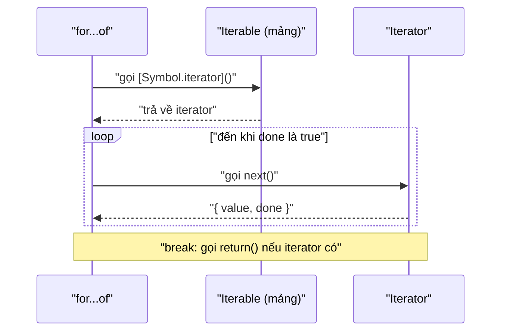
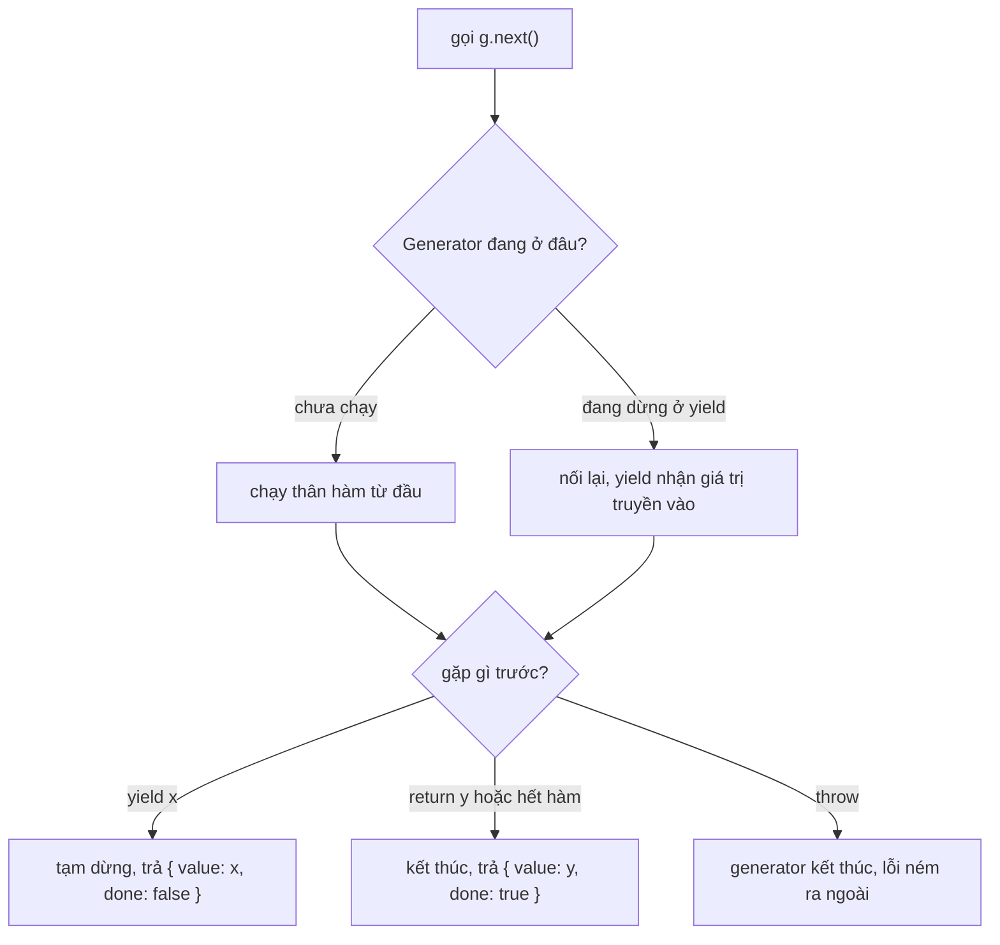
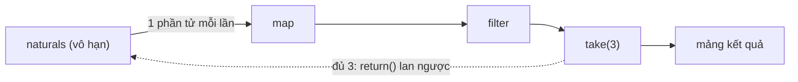
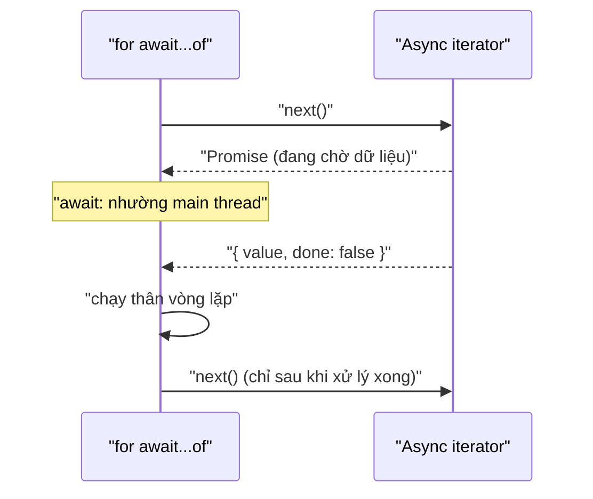

# Lý thuyết 11: Iterator, generator và vòng lặp bất đồng bộ

Bài này nói về cách JavaScript "đi qua" một tập giá trị từng phần tử một, và cách bạn tự viết ra những chuỗi giá trị được sinh dần theo nhu cầu. Chúng ta sẽ đi từ giao thức iterator (nền móng của `for...of`, spread, destructuring), sang generator (hàm có thể tạm dừng), rồi sang phiên bản bất đồng bộ (`for await...of`, async generator) và cuối cùng so sánh với các method của array và iterator helpers.

## Iterator là gì?

Hãy hình dung một **máy phát số thứ tự** ở quầy giao dịch. Bạn không cần biết phía sau có bao nhiêu người đang chờ, cũng không cần biết họ xếp hàng bằng cách nào. Bạn chỉ nhấn nút "tiếp theo" và máy trả về một phiếu, hoặc báo "hết người". Iterator là chiếc máy đó: một object biết cách đưa ra **giá trị kế tiếp** mỗi khi được hỏi, và biết báo khi đã hết. Iterable là thứ (mảng, chuỗi, Map, Set, hoặc object của bạn) biết **sản xuất ra** một chiếc máy như vậy khi có người cần duyệt qua nó.

## Vấn đề nó giải quyết, và vì sao dev phải nắm

Trước khi có giao thức này, mỗi cấu trúc dữ liệu có một kiểu duyệt riêng: mảng dùng chỉ số, object dùng `for...in` hoặc `Object.keys`, danh sách liên kết dùng con trỏ `next`. Mọi hàm "xử lý một dãy" phải biết trước dãy đó thuộc loại nào. Giao thức iterator đưa ra **một hợp đồng chung**: ai tuân theo thì `for...of`, spread `[...x]`, destructuring, `Array.from`, `new Set(x)`, `Promise.all(x)` đều dùng được ngay.

Bạn cần nắm sâu phần này vì ba lý do thực tế. Thứ nhất, nhiều lỗi "lạ" (spread một object bị lỗi `is not iterable`, `break` trong `for...of` mà tài nguyên không đóng) đều bắt nguồn từ giao thức. Thứ hai, generator là nền tảng của kiểu lập trình "tạm dừng và nối lại", từng là xương sống của các thư viện như Redux-Saga và là tiền thân của `async/await`. Thứ ba, dữ liệu lớn (file, stream, phân trang API) thường nên được xử lý **từng phần** thay vì nạp hết vào bộ nhớ, và `for await...of` cùng async generator là cách viết tự nhiên nhất cho việc đó.

**Cốt lõi:** iteration protocol là hai hợp đồng nhỏ. Một **iterable** là object có method `[Symbol.iterator]()` trả về một **iterator**; một iterator là object có method `next()` trả về `{ value, done }`. Mọi cú pháp duyệt (`for...of`, spread, destructuring) chỉ làm một việc: lấy iterator ra rồi gọi `next()` lặp lại cho tới khi `done` là `true`.

- Vì iterable chỉ cần `[Symbol.iterator]()`, nên mảng, chuỗi, Map, Set và class của bạn đều có thể dùng chung cú pháp duyệt mà không cần biết nhau.
- Vì iterator chỉ cần `next()` và giữ trạng thái "đang ở đâu" bên trong, nên giá trị có thể được tính khi được hỏi (lazy) thay vì tính sẵn cả dãy.
- Vì `next()` trả về `done: true` để báo kết thúc, nên dãy có thể vô hạn mà người dùng vẫn dừng được bằng `break` hay `take`.



Mô hình tư duy: iterable là cái "cửa hàng", iterator là "phiếu số thứ tự đang cầm trên tay"; mỗi lần duyệt là xin một phiếu mới, nên có thể duyệt cùng một iterable nhiều lần.

```javascript
const arr = [10, 20];
const it = arr[Symbol.iterator]();
console.log(it.next());
console.log(it.next());
console.log(it.next());
console.log(typeof it[Symbol.iterator], it[Symbol.iterator]() === it);
```

```text
{ value: 10, done: false }
{ value: 20, done: false }
{ value: undefined, done: true }
function true
```

_Đã chạy thử trên Node 22._

Dòng cuối cho thấy một chi tiết đáng chú ý: iterator dựng sẵn của JavaScript **cũng là iterable** (nó có `[Symbol.iterator]()` trả về chính nó). Nhờ vậy bạn có thể đưa thẳng một iterator vào `for...of`.

**Phải thuộc:** iterable có `[Symbol.iterator]()`; iterator có `next()` trả `{ value, done }`; khi `done` là `true` thì `value` thường bị bỏ qua (kể cả với `for...of`). Iterator có thể có thêm `return()` (được gọi khi duyệt bị dừng sớm) và `throw()`.

**Tóm tắt:**

- Iterable là object có `[Symbol.iterator]()`; iterator là object có `next()` trả `{ value, done }`.
- `for...of`, spread, destructuring, `Array.from`, `new Set/Map` đều dùng iterator ngầm; object thường không phải iterable nên spread vào mảng bị lỗi.
- Generator function (`function*`) trả về generator object vừa là iterator vừa là iterable; `yield` tạm dừng, `next(v)` nối lại và đưa `v` vào làm kết quả của `yield`.
- Generator chạy lười (lazy): thân hàm không chạy cho tới lần `next()` đầu, nên biểu diễn được dãy vô hạn và pipeline xử lý từng phần tử.
- `yield*` ủy quyền cho iterable khác và nhận giá trị `return` của generator con; dùng để duyệt đệ quy và ghép generator.
- Dừng sớm (`break`, `return`, lỗi) sẽ gọi `return()` của iterator, nên generator có `try/finally` dọn dẹp được.
- `for await...of` duyệt async iterable (có `[Symbol.asyncIterator]()`); async generator (`async function*`) là cách viết dễ nhất, rất hợp với phân trang và stream đọc theo chunk.
- Array method là eager (tính hết, tạo mảng trung gian); iterator helpers (`map`, `filter`, `take`...) là lazy và có sẵn ở Node 22, nhưng với trình duyệt cần kiểm tra bảng tương thích.

## Các khái niệm cần biết

- **Iterable**: object có method khóa `Symbol.iterator`, method này trả về một iterator. Mảng, chuỗi, `Map`, `Set`, `arguments`, `NodeList` là iterable dựng sẵn; object thường thì không.
- **Iterator**: object có `next()` trả `{ value, done }`. Nó giữ trạng thái "đang ở đâu" và dùng một lần (hết thì hết).
- **Iterator result**: object `{ value, done }` mà `next()` trả về. `done: true` nghĩa là kết thúc.
- **Generator function**: hàm khai báo bằng `function*`, gọi nó không chạy thân hàm mà trả về generator object.
- **`yield`**: biểu thức tạm dừng generator, trả một giá trị ra ngoài, và (ở lần `next(v)` sau) nhận lại `v` làm giá trị của chính biểu thức đó.
- **`yield*`**: ủy quyền cho một iterable khác, lần lượt phát ra từng phần tử của nó và trả về giá trị `return` của generator con.
- **Lazy evaluation**: chỉ tính giá trị khi có người hỏi. Ngược lại là eager: tính hết ngay.
- **Async iterable / async iterator**: phiên bản mà `next()` trả về Promise của `{ value, done }`, khóa là `Symbol.asyncIterator`.
- **Async generator**: `async function*`, kết hợp `await` bên trong và `yield` ra ngoài, trả về async generator object.
- **Backpressure**: người tiêu thụ chậm thì người sản xuất phải chờ. Với `for await...of` điều này đến tự nhiên: nguồn chỉ được hỏi giá trị kế tiếp khi vòng lặp xử lý xong phần tử hiện tại.
- **Iterator helpers**: các method như `map`, `filter`, `take`, `drop`, `toArray` nằm trên `Iterator.prototype`, đưa kiểu xử lý lười vào chính iterator.

## Tự viết một iterable

Cách thẳng nhất là tạo class có `[Symbol.iterator]()` trả về một object có `next()`. Trạng thái duyệt (con trỏ hiện tại) nằm trong closure của mỗi iterator, nên mỗi lần duyệt độc lập với nhau.

```javascript
class Range {
  constructor(from, to) { this.from = from; this.to = to; }
  [Symbol.iterator]() {
    let cur = this.from;
    const to = this.to;
    return {
      next: () => cur <= to ? { value: cur++, done: false } : { value: undefined, done: true },
    };
  }
}
const r = new Range(1, 5);
console.log([...r]);
const [a, b, ...rest] = r;
console.log(a, b, rest);
console.log(Math.max(...r));
for (const x of r) { if (x > 2) break; console.log("x =", x); }
console.log(new Set(r).size, Array.from(r, n => n * n));
```

```text
[ 1, 2, 3, 4, 5 ]
1 2 [ 3, 4, 5 ]
5
x = 1
x = 2
5 [ 1, 4, 9, 16, 25 ]
```

_Đã chạy thử trên Node 22._

Chỉ với một method `[Symbol.iterator]()`, `Range` đã dùng được với spread, destructuring (kể cả phần `...rest`), `Math.max(...r)`, `for...of`, `Set` và `Array.from`. Lưu ý destructuring `[a, b]` không duyệt hết dãy: nó chỉ gọi `next()` đủ số lần cần, rồi gọi `return()` nếu có.

**Nền tảng:** object thường (`{ a: 1 }`) không có `Symbol.iterator`, nên `[...obj]` và `for (const x of obj)` ném `TypeError`. Muốn duyệt object thì dùng `Object.keys/values/entries` (trả về mảng, vốn là iterable), hoặc tự gắn `[Symbol.iterator]`. Còn spread **object** `{ ...obj }` là cú pháp khác hẳn, không dùng iterator mà sao chép các property liệt kê được.

### Dừng sớm và method return()

Khi vòng `for...of` kết thúc **không phải do hết dữ liệu** (do `break`, `return`, `throw` bên trong, hoặc destructuring lấy đủ), engine gọi `iterator.return()` nếu nó tồn tại. Đây là cơ hội để đóng file, giải phóng khóa, ngắt kết nối.

```javascript
const src = {
  [Symbol.iterator]() {
    let i = 0;
    return {
      next() { return { value: i++, done: i > 5 }; },
      return() { console.log("dọn dẹp (return được gọi)"); return { done: true }; },
    };
  },
};
for (const v of src) { if (v === 2) break; console.log(v); }
const [first] = src;
console.log("first =", first);
```

```text
0
1
dọn dẹp (return được gọi)
dọn dẹp (return được gọi)
first = 0
```

_Đã chạy thử trên Node 22._

Lần dọn dẹp đầu đến từ `break`, lần hai đến từ destructuring `[first]` vì nó chỉ lấy một phần tử rồi dừng. Nếu bạn tự viết iterator giữ tài nguyên mà quên `return()`, tài nguyên sẽ không được giải phóng khi người dùng thoát sớm. Generator làm việc này miễn phí qua `try/finally` (xem phần sau).

**Lưu ý:** iterator thường **dùng một lần**. Gọi `[...it]` hai lần trên cùng một iterator (không phải iterable sản xuất iterator mới) thì lần hai ra mảng rỗng. Mảng, Map, Set là iterable "sản xuất iterator mới mỗi lần", còn generator object và `array.values()` là iterator dùng một lần.

**Nhớ:** muốn một class duyệt được, cài `[Symbol.iterator]()`; nếu giữ tài nguyên, cài thêm `return()`; mỗi lần duyệt nên cho ra một iterator mới.

## Generator: hàm có thể tạm dừng

Viết iterator bằng tay phải tự quản lý trạng thái, rất dài dòng. Generator cho phép bạn viết như hàm bình thường, rồi **trình biên dịch lo phần trạng thái**. Hàm khai báo bằng `function*`; khi gặp `yield` nó dừng tại chỗ, giữ nguyên biến cục bộ, và lần `next()` sau chạy tiếp từ đúng điểm đó. Hình dung một cuốn sách có **dấu trang**: bạn đọc đến chỗ có `yield` thì kẹp dấu trang, gấp sách lại; lần sau mở ra đọc tiếp từ dấu trang.



### Chạy từng bước và truyền giá trị vào

`next(v)` không chỉ lấy giá trị ra mà còn **đưa giá trị vào**: `v` trở thành kết quả của biểu thức `yield` đang dừng. Giá trị truyền vào lần `next()` đầu tiên luôn bị bỏ qua, vì lúc đó chưa có `yield` nào đang chờ.

```javascript
function* demo() {
  console.log("bắt đầu");
  const a = yield 1;
  console.log("nhận a =", a);
  const b = yield a * 2;
  console.log("nhận b =", b);
  return "xong";
}
const g = demo();
console.log("tạo generator, chưa chạy gì");
console.log(g.next("bị bỏ qua"));
console.log(g.next(10));
console.log(g.next(7));
console.log(g.next());
```

```text
tạo generator, chưa chạy gì
bắt đầu
{ value: 1, done: false }
nhận a = 10
{ value: 20, done: false }
nhận b = 7
{ value: 'xong', done: true }
{ value: undefined, done: true }
```

_Đã chạy thử trên Node 22._

Hãy đọc theo từng dòng: gọi `demo()` không in gì, chứng tỏ thân hàm chưa chạy. `next("bị bỏ qua")` chạy tới `yield 1` thì dừng. `next(10)` đưa `10` vào làm giá trị của `yield 1`, nên `a` là `10`, rồi chạy tới `yield a * 2` và dừng ở `20`. Giá trị `return` của generator xuất hiện với `done: true`. Sau khi kết thúc, `next()` chỉ trả `{ value: undefined, done: true }`.

**Phải thuộc:** gọi generator function không chạy thân hàm; `next(v)` chạy tới `yield` kế tiếp; `v` thành giá trị của `yield` đang dừng; giá trị của `next()` đầu tiên bị bỏ; `return x` cho `{ value: x, done: true }`. Hầu hết cú pháp duyệt (`for...of`, spread) **bỏ qua** giá trị `return` vì chúng dừng khi `done` là `true`.

### Kết thúc từ bên ngoài: return() và throw()

Ngoài `next()`, generator object còn có `return(v)` (ép kết thúc, vẫn chạy các khối `finally`) và `throw(err)` (ném lỗi vào đúng điểm đang dừng, bên trong có thể `catch` và đi tiếp).

```javascript
function* withCleanup() {
  try {
    yield 1;
    yield 2;
  } catch (e) {
    console.log("bắt:", e.message);
    yield "đã xử lý";
  } finally {
    console.log("finally chạy");
  }
}
const g1 = withCleanup();
console.log(g1.next());
console.log(g1.throw(new Error("lỗi bên ngoài")));
console.log(g1.next());
const g2 = withCleanup();
g2.next();
console.log(g2.return("dừng sớm"));
console.log(g2.next());
```

```text
{ value: 1, done: false }
bắt: lỗi bên ngoài
{ value: 'đã xử lý', done: false }
finally chạy
{ value: undefined, done: true }
finally chạy
{ value: 'dừng sớm', done: true }
{ value: undefined, done: true }
```

_Đã chạy thử trên Node 22._

`throw` ném lỗi tại điểm `yield 1` đang dừng; `catch` bắt được và generator còn sống tiếp. `return("dừng sớm")` cũng buộc `finally` chạy trước khi generator đóng. Đây là lý do `break` trong `for...of` trên generator vẫn dọn dẹp đúng: vòng lặp gọi `return()`, và `finally` được thực thi.

**Nhớ:** generator là máy trạng thái do engine viết hộ. Ba cửa vào là `next(v)`, `throw(e)`, `return(v)`; ba cửa ra là `yield`, `return`, lỗi chưa bắt. Dọn dẹp luôn đặt trong `finally`.

**Lưu ý:** viết `function*` chứ không có "generator arrow". Mũi tên không thể là generator. Method trong object hoặc class thì dùng `*name() {}` hoặc `*[Symbol.iterator]() {}`, và đây là cách gọn nhất để làm class duyệt được: thân method chỉ cần `yield` từng phần tử.

## Lazy evaluation và dãy vô hạn

Vì generator chỉ tính khi được hỏi, bạn có thể mô tả **dãy vô hạn** mà không tốn bộ nhớ: nó chỉ là "công thức", còn giá trị sinh ra lúc cần. Khi nối nhiều generator thành pipeline, mỗi phần tử đi qua toàn bộ các bước rồi mới tới phần tử sau, thay vì xử lý hết dãy ở bước một rồi mới sang bước hai.

```javascript
function* naturals() { let n = 1; while (true) yield n++; }
function* map(it, fn) { for (const x of it) yield fn(x); }
function* filter(it, fn) { for (const x of it) if (fn(x)) yield x; }
function* take(it, n) { if (n <= 0) return; let i = 0; for (const x of it) { yield x; if (++i >= n) return; } }
const log = [];
const pipeline = take(filter(map(naturals(), x => { log.push("map " + x); return x * x; }), x => x % 2 === 1), 3);
console.log([...pipeline]);
console.log(log.join(", "));
```

```text
[ 1, 9, 25 ]
map 1, map 2, map 3, map 4, map 5
```

_Đã chạy thử trên Node 22._

Ta lấy 3 số chính phương lẻ đầu tiên từ dãy tự nhiên vô hạn. Nhật ký cho thấy `map` chỉ chạy đúng 5 lần (số 1 đến 5), vì `take` dừng ngay khi đủ 3 kết quả. Nếu `naturals` là một mảng "tất cả số tự nhiên" thì không thể tồn tại; nếu là mảng 1 triệu phần tử thì `map` phải chạy 1 triệu lần trước khi `filter` bắt đầu.



**Nền tảng:** lazy không có nghĩa là nhanh hơn trong mọi trường hợp. Nó thắng ở ba tình huống: dãy rất lớn hoặc vô hạn, chỉ cần một phần kết quả (`take`, `find`, `some`), và dữ liệu đến dần (file, mạng). Với mảng nhỏ, array method gọn và thường nhanh hơn vì không có chi phí của generator.

## yield*: ủy quyền và đệ quy

`yield*` nhận một iterable và phát ra lần lượt từng phần tử của nó, như thể bạn viết vòng `for...of` kèm `yield`. Điều thú vị: nếu vế phải là generator, biểu thức `yield*` có **giá trị** bằng giá trị `return` của generator con, và các giá trị bạn truyền bằng `next(v)` được chuyển thẳng xuống generator con.

```javascript
function* inner() { const got = yield "i1"; console.log("inner nhận", got); return "kết quả inner"; }
function* outer() {
  yield "o1";
  const r = yield* inner();
  console.log("outer nhận return của inner:", r);
  yield* [100, 200];
}
const g = outer();
console.log(g.next());
console.log(g.next());
console.log(g.next("X"));
console.log(g.next());
console.log(g.next());
function* walk(node) { if (!node) return; yield* walk(node.left); yield node.v; yield* walk(node.right); }
const tree = { v: 2, left: { v: 1 }, right: { v: 3 } };
console.log([...walk(tree)]);
```

```text
{ value: 'o1', done: false }
{ value: 'i1', done: false }
inner nhận X
outer nhận return của inner: kết quả inner
{ value: 100, done: false }
{ value: 200, done: false }
{ value: undefined, done: true }
[ 1, 2, 3 ]
```

_Đã chạy thử trên Node 22._

Ví dụ `walk` duyệt cây nhị phân theo thứ tự giữa (in-order) chỉ bằng ba dòng, nhờ `yield*` đệ quy. Viết bằng mảng sẽ cần truyền mảng tích lũy hoặc nối mảng nhiều lần.

**Lưu ý:** `[...walk(tree)]` chỉ nhận các `yield`, không nhận giá trị `return` của generator. Nếu cần giá trị `return`, hãy gọi `next()` bằng tay hoặc dùng `yield*` trong generator cha như ở trên.

### Generator làm state machine

Vì generator nhớ "đang ở bước nào", nó là cách viết gọn cho các quy trình nhiều bước hoặc vòng quay trạng thái: đèn giao thông, wizard nhiều bước, tuần tự hóa các bước animation.

```javascript
function* trafficLight() {
  while (true) { yield "xanh"; yield "vàng"; yield "đỏ"; }
}
const light = trafficLight();
const seq = [];
for (let i = 0; i < 7; i++) seq.push(light.next().value);
console.log(seq.join(" > "));

function* wizard() {
  const name = yield "Tên là gì?";
  const age = yield `Chào ${name}, bao nhiêu tuổi?`;
  return { name, age };
}
const w = wizard();
console.log(w.next().value);
console.log(w.next("Lan").value);
console.log(w.next(30));
```

```text
xanh > vàng > đỏ > xanh > vàng > đỏ > xanh
Tên là gì?
Chào Lan, bao nhiêu tuổi?
{ value: { name: 'Lan', age: 30 }, done: true }
```

_Đã chạy thử trên Node 22._

Cách viết "đường thẳng" (code đọc từ trên xuống dưới, nhưng chạy xen kẽ với bên ngoài) chính là ý tưởng mà `async/await` thừa hưởng: `await` giống `yield` một Promise, và một bộ chạy (runner) nối lại hàm khi Promise xong. Redux-Saga dùng đúng ý tưởng đó với `yield call(...)`.

**Nhớ:** generator hợp với ba việc: duyệt tùy biến (`*[Symbol.iterator]`), dãy lười hoặc vô hạn, và quy trình nhiều bước có trạng thái. Đừng dùng nó khi một mảng hay vòng `for` đã đủ rõ.

## Vòng lặp bất đồng bộ: async iterator và for await...of

Có những nguồn dữ liệu mà **từng phần tử** cũng phải chờ: trang kế tiếp của API, từng dòng của file lớn, từng chunk từ mạng. Với chúng, `next()` không thể trả về `{ value, done }` ngay được; nó trả về **Promise** của kết quả đó. Đó chính là async iterator, và khóa tương ứng là `Symbol.asyncIterator`. Cú pháp duyệt là `for await (const x of source)`, chỉ dùng được trong hàm `async` hoặc module cấp cao nhất (top-level await).



Sơ đồ nhấn mạnh tính tuần tự: nguồn chỉ được hỏi phần tử kế sau khi thân vòng lặp xử lý xong phần tử hiện tại. Đó là backpressure tự nhiên, nên người tiêu thụ chậm sẽ không bị nguồn "dội" dữ liệu.

```javascript
const sleep = (ms) => new Promise(r => setTimeout(r, ms));
const asyncIterable = {
  async *[Symbol.asyncIterator]() {
    for (let i = 1; i <= 3; i++) { await sleep(10); yield i; }
  },
};
(async () => {
  for await (const v of asyncIterable) console.log("nhận", v);
  for await (const v of [Promise.resolve("a"), "b"]) console.log("từ mảng:", v);
  const ai = asyncIterable[Symbol.asyncIterator]();
  const p = ai.next();
  console.log(p instanceof Promise);
  console.log(await p);
})();
```

```text
nhận 1
nhận 2
nhận 3
từ mảng: a
từ mảng: b
true
{ value: 1, done: false }
```

_Đã chạy thử trên Node 22._

Hai điểm đáng chú ý. Một, `for await...of` còn duyệt được **iterable đồng bộ** (như mảng chứa Promise), nó tự `await` từng phần tử, nhưng chạy tuần tự chứ không song song như `Promise.all`. Hai, `next()` của async iterator đúng là trả về Promise (dòng `true`).

**Lưu ý:** `for await...of` **tuần tự**. Nếu bạn có 100 URL cần tải và không có ràng buộc thứ tự, vòng `for await` sẽ chậm hơn nhiều so với `Promise.all` hay một pool có giới hạn song song. Dùng nó khi thứ tự và backpressure quan trọng, hoặc khi nguồn vốn là luồng dữ liệu đến dần.

**Phải thuộc:** async iterable có `[Symbol.asyncIterator]()`, `next()` trả Promise của `{ value, done }`; `for await...of` gọi `await` ở mỗi vòng; `break` cũng gọi `return()` của async iterator (có thể là async) để dọn dẹp.

### Async generator

`async function*` cho phép dùng cả `await` bên trong lẫn `yield` ra ngoài, nên viết nguồn bất đồng bộ cũng dễ như generator thường. Ví dụ điển hình là phân trang API: nguồn tự tải trang kế tiếp khi được hỏi, và dừng tải khi người dùng thoát vòng lặp.

```javascript
const sleep = (ms) => new Promise(r => setTimeout(r, ms));
async function* pages() {
  let page = 1;
  while (page <= 5) {
    await sleep(5);
    console.log("[nguồn] tải trang", page);
    yield { page, items: [page * 10, page * 10 + 1] };
    page++;
  }
}
(async () => {
  for await (const p of pages()) {
    console.log("[dùng]", p.page, p.items);
    if (p.page === 2) { console.log("dừng sớm"); break; }
  }
})();
```

```text
[nguồn] tải trang 1
[dùng] 1 [ 10, 11 ]
[nguồn] tải trang 2
[dùng] 2 [ 20, 21 ]
dừng sớm
```

_Đã chạy thử trên Node 22._

Trang 3, 4, 5 không bao giờ được tải: vì `break` làm generator dừng tại `yield`, và nguồn không được hỏi thêm. Đây là lợi thế so với cách "tải tất cả rồi lọc". Với `Array.fromAsync` (có ở Node 22) bạn cũng gom được một async iterable thành mảng nếu thật sự cần hết.

### Đọc stream theo chunk

Trong Node, `ReadableStream` (Web Streams) và nhiều stream của thư viện chuẩn là async iterable. Trình duyệt hiện đại cũng đang hỗ trợ dần việc duyệt `ReadableStream` bằng `for await`, nhưng tính tương thích khác nhau giữa các trình duyệt, nên với code chạy ở browser hãy kiểm tra bảng tương thích hoặc dùng `getReader()` làm phương án dự phòng.

```javascript
const enc = new TextEncoder();
const stream = new ReadableStream({
  start(c) { for (const s of ["xin ch", "ào th", "ế giới"]) c.enqueue(enc.encode(s)); c.close(); },
});
(async () => {
  const dec = new TextDecoder();
  let text = "", n = 0;
  for await (const chunk of stream) { n++; text += dec.decode(chunk, { stream: true }); }
  console.log(n, "chunk ->", text);
})();
```

```text
3 chunk -> xin chào thế giới
```

_Đã chạy thử trên Node 22._

Ví dụ cố ý cắt chuỗi giữa chừng một từ để minh họa: ranh giới chunk **không trùng** ranh giới của dữ liệu logic. Với văn bản UTF-8, một ký tự nhiều byte có thể bị cắt đôi giữa hai chunk, nên phải dùng `TextDecoder` với `{ stream: true }` thay vì ghép chuỗi từng chunk một cách ngây thơ. Cùng nguyên tắc với JSON lines hay CSV: gom đệm đến khi đủ một đơn vị logic rồi mới xử lý.

**Nhớ:** async generator là cách ngắn nhất để biến "nguồn dữ liệu đến dần" thành thứ duyệt được bằng `for await...of`, có backpressure và dọn dẹp khi dừng sớm.

## So sánh với array method và iterator helpers

Array method (`map`, `filter`, `slice`...) là **eager**: mỗi bước tạo ra một mảng trung gian đầy đủ rồi mới sang bước sau. Với mảng nhỏ điều này không đáng kể. Với mảng lớn hoặc khi chỉ cần vài phần tử đầu, chi phí tăng. **Iterator helpers** (chuẩn ES2025) đưa các method quen thuộc lên `Iterator.prototype` theo kiểu lười, nên bạn có thể viết chuỗi `map().filter().take()` trên generator hay trên `array.values()` mà không cần tự viết `map`, `filter`, `take` như phần trên.

Về trạng thái hỗ trợ: tôi đã kiểm tra trực tiếp trên môi trường Node 22 (v22.23.4) khi viết bài này, và `Iterator`, `Iterator.from`, cùng các method helper đều **có sẵn**, không cần cờ hay polyfill. Với trình duyệt, tính sẵn sàng phụ thuộc phiên bản, nên trước khi dùng trong code front-end hãy tra bảng tương thích trên MDN, hoặc cân nhắc polyfill/transpile nếu cần hỗ trợ trình duyệt cũ.

```javascript
console.log(typeof Iterator, typeof Iterator.from);
function* naturals() { let n = 1; while (true) yield n++; }
const r = naturals().filter(x => x % 2).map(x => x * x).take(4);
console.log(r.toArray());
console.log([1,2,3].values().drop(1).toArray());
console.log(Iterator.from({ next() { return { done: false, value: 1 }; } }).take(2).toArray());
console.log(naturals().take(3).reduce((a, b) => a + b, 0), naturals().some(x => x > 5));
```

```text
function function
[ 1, 9, 25, 49 ]
[ 2, 3 ]
[ 1, 1 ]
6 true
```

_Đã chạy thử trên Node 22._

`Iterator.from` bọc một object chỉ có `next()` thành iterator đầy đủ helper. Lưu ý các helper này **không** thay cho `async`: chúng áp dụng cho iterator đồng bộ. Với async iterator, bạn vẫn dùng `for await...of` hoặc async generator tự viết (phần helper cho async iterator là một đề xuất khác, chưa nên dựa vào).

Hãy xem sự khác biệt về số lần gọi hàm khi chỉ cần 3 kết quả đầu từ 1 triệu phần tử:

```javascript
const big = Array.from({ length: 1e6 }, (_, i) => i);
let calls = 0;
const eager = big.map(x => { calls++; return x * 2; }).filter(x => x % 3 === 0).slice(0, 3);
console.log(eager, "map gọi", calls);
calls = 0;
const lazy = big.values().map(x => { calls++; return x * 2; }).filter(x => x % 3 === 0).take(3).toArray();
console.log(lazy, "map gọi", calls);
```

```text
[ 0, 6, 12 ] map gọi 1000000
[ 0, 6, 12 ] map gọi 7
```

_Đã chạy thử trên Node 22._

Cùng kết quả, nhưng phiên bản lười chỉ gọi `map` 7 lần so với 1.000.000 lần.

| Tiêu chí | Array method | Iterator helpers / generator |
|---|---|---|
| Thời điểm tính | Eager, ngay lập tức | Lazy, khi có người lấy |
| Bộ nhớ trung gian | Một mảng mới mỗi bước | Không có mảng trung gian |
| Dãy vô hạn | Không | Được |
| Truy cập theo chỉ số, `length` | Có | Không |
| Dùng lại nhiều lần | Có | Không (iterator dùng một lần) |
| Độ phổ biến, công cụ debug | Rất cao | Thấp hơn, cần kiểm tra tương thích |

**Nhớ:** mặc định cứ dùng array method vì rõ ràng và quen thuộc. Chuyển sang iterator/generator khi dãy lớn hoặc vô hạn, khi chỉ cần đầu dãy, hoặc khi dữ liệu đến dần.

## Bẫy thường gặp

| Bẫy | Hiện tượng | Cách tránh |
|---|---|---|
| Spread hoặc `for...of` trên object thường | `TypeError: ... is not iterable` | Dùng `Object.entries(obj)` hoặc cài `[Symbol.iterator]` |
| Duyệt lại một iterator đã dùng | Lần hai ra rỗng | Giữ iterable gốc, hoặc gọi lại `[Symbol.iterator]()` để lấy iterator mới |
| Quên `return()`/`finally` khi giữ tài nguyên | Tài nguyên không đóng khi `break` | Dùng generator với `try/finally`, hoặc cài `return()` |
| Kỳ vọng giá trị `return` của generator xuất hiện trong spread | Giá trị bị mất vì `done: true` | Dùng `yield*` hoặc gọi `next()` bằng tay |
| Truyền giá trị vào `next()` đầu tiên | Giá trị bị bỏ qua | Lần đầu chỉ để "khởi động" tới `yield` đầu |
| Dùng `for await` cho việc nên chạy song song | Chậm vì chạy tuần tự | `Promise.all` hoặc pool giới hạn song song |
| Ghép chuỗi chunk byte bằng `+` | Ký tự UTF-8 nhiều byte bị hỏng | `TextDecoder` với `{ stream: true }` |
| Dùng iterator helpers không kiểm tra môi trường | `map is not a function` ở trình duyệt cũ | Kiểm tra bảng tương thích MDN, polyfill hoặc tự viết helper |
| Viết `async` trong `forEach` thay vì `for...of` | Không chờ, thứ tự rối | Dùng `for...of` (hoặc `for await`) để chờ tuần tự |

Phần liên quan đến Promise và thứ tự chạy của microtask được giải thích kỹ ở [Lý thuyết 8: Promise và async/await](/go?p=13-JavaScript%2Fmedium%2Flt-08-promise-va-async-await.md) và [JavaScript runtime và event loop](/go?p=11-Frontend-Core%2Flt-01-javascript-runtime-event-loop.md).

## Câu hỏi phỏng vấn thường gặp

### 1. Phân biệt iterable và iterator. Một object cần gì để dùng được với `for...of`?

**Câu hỏi:** Giải thích iteration protocol và vì sao `[...{ a: 1 }]` lỗi nhưng `[..."abc"]` thì không.

**Gợi ý suy luận:**
- `for...of` thực sự gọi method nào trên giá trị bên phải?
- Method đó trả về cái gì, và cái đó phải có gì?
- Chuỗi và object thường khác nhau ở điểm nào về mặt này?

**Lập luận:** `for...of` tìm `value[Symbol.iterator]`. Nếu không có thì ném `TypeError`. Nếu có, gọi nó để lấy iterator, rồi lặp gọi `next()`, đọc `{ value, done }` cho tới khi `done` là `true`. Chuỗi có sẵn `Symbol.iterator` (duyệt theo code point), object thường thì không, nên spread vào mảng lỗi. Spread vào object literal `{ ...obj }` là cú pháp khác, không dùng iterator.

**Đáp án ngắn:** iterable là object có `[Symbol.iterator]()` trả về iterator; iterator có `next()` trả `{ value, done }`. Object cần cài `[Symbol.iterator]` mới dùng được với `for...of`; chuỗi có sẵn nên duyệt được, object thường thì không.

**Nhớ:** iterable sản xuất iterator; iterator sinh giá trị; `done: true` là dấu chấm hết.

### 2. Generator chạy thế nào? Điều gì xảy ra khi gọi `gen.next(5)` lần đầu và lần thứ hai?

**Câu hỏi:** Mô tả luồng chạy của một generator có hai `yield`, và vai trò của đối số truyền vào `next`.

**Gợi ý suy luận:**
- Gọi `gen()` đã chạy thân hàm chưa?
- Khi generator đang dừng ở một `yield`, biểu thức `yield` đó nhận gì?
- Lần `next()` đầu tiên có `yield` nào đang chờ không?

**Lập luận:** gọi generator function chỉ tạo generator object, chưa chạy thân hàm. `next(5)` đầu tiên chạy từ đầu tới `yield` thứ nhất rồi dừng; đối số `5` bị bỏ qua vì chưa có `yield` nào chờ nhận. `next(x)` thứ hai nối lại tại `yield` thứ nhất, biểu thức `yield` có giá trị `x`, chạy tới `yield` thứ hai rồi dừng. Khi hết hàm hoặc gặp `return`, kết quả là `done: true`.

**Đáp án ngắn:** `next()` đầu chạy tới `yield` đầu tiên và bỏ qua đối số; các `next(v)` sau đưa `v` vào làm giá trị của `yield` đang dừng rồi chạy tới `yield` kế; hết hàm thì `done: true`.

**Nhớ:** generator lười: không `next()` thì không chạy; đối số của `next` đi vào, giá trị của `yield` đi ra.

### 3. Khi nào dùng generator thay vì mảng? Cho ví dụ dãy vô hạn.

**Câu hỏi:** Vì sao generator biểu diễn được dãy vô hạn và nó có lợi gì so với `map/filter` trên mảng?

**Gợi ý suy luận:**
- Mảng cần chứa gì trong bộ nhớ trước khi gọi `map`?
- Với generator, một phần tử đi qua bao nhiêu bước trước khi phần tử kế được tính?
- Khi chỉ cần 3 phần tử đầu, ai dừng pipeline?

**Lập luận:** mảng phải tồn tại đầy đủ nên không thể vô hạn, và mỗi method eager tạo thêm một mảng trung gian. Generator chỉ tính khi được hỏi nên dãy vô hạn như `while (true) yield n++` hợp lệ. Khi nối `map`, `filter`, `take`, mỗi phần tử đi qua cả chuỗi rồi mới tới phần tử sau; `take(3)` đủ kết quả thì `return`, dừng toàn bộ chuỗi nên không tính thừa. Đổi lại generator dùng một lần, không truy cập theo chỉ số, và với mảng nhỏ không nhanh hơn.

**Đáp án ngắn:** dùng generator cho dãy rất lớn, vô hạn, hoặc dữ liệu đến dần, đặc biệt khi chỉ cần đầu dãy. Ví dụ: `function* naturals() { let n = 1; while (true) yield n++; }` kết hợp `take`. Với mảng nhỏ, array method đơn giản và đủ tốt.

**Nhớ:** lazy tiết kiệm công việc và bộ nhớ khi bạn không cần tất cả; không phải thuốc tiên cho mọi vòng lặp.

### 4. `for await...of` khác `for...of` thế nào, và khi nào dùng async generator?

**Câu hỏi:** So sánh hai vòng lặp, nêu một tình huống thực tế phù hợp với async generator, và một bẫy về hiệu năng.

**Gợi ý suy luận:**
- `next()` của async iterator trả về gì, và vòng lặp phải làm gì với nó?
- Nguồn dữ liệu nào mà từng phần tử phải chờ mới có?
- Duyệt 100 request độc lập bằng `for await` thì chạy tuần tự hay song song?

**Lập luận:** `for await...of` dùng `[Symbol.asyncIterator]()` (hoặc rơi về `[Symbol.iterator]()`), và `await` kết quả của mỗi lần `next()`, nên chỉ chạy trong hàm `async` hay module top-level. Async generator (`async function*`) cho phép vừa `await` bên trong vừa `yield` ra ngoài, hợp với phân trang API, đọc stream theo chunk, đọc từng dòng file lớn. Vì mỗi vòng chờ xong mới hỏi phần tử kế, nó tuần tự và có backpressure tự nhiên, nhưng cũng nghĩa là không dùng nó khi cần chạy song song để tăng tốc.

**Đáp án ngắn:** `for await...of` duyệt async iterable và `await` từng lần `next()`; dùng async generator cho nguồn dữ liệu đến dần như phân trang hay stream. Bẫy: nó tuần tự, các việc độc lập nên dùng `Promise.all` hoặc pool giới hạn song song.

**Nhớ:** async iterator cho nguồn đến dần có kiểm soát nhịp; song song thì dùng công cụ khác.

### 5. Iterator helpers (`map`, `take`...) có dùng được ngay không? Chúng khác `Array.prototype.map` ra sao?

**Câu hỏi:** Nêu trạng thái hỗ trợ và sự khác biệt giữa `arr.map(...)` và `arr.values().map(...)`.

**Gợi ý suy luận:**
- Làm sao kiểm tra một tính năng có sẵn trong môi trường của bạn?
- Hai cách khác nhau thế nào về việc tạo mảng trung gian và thời điểm chạy callback?
- Kết quả cuối của helper là mảng hay iterator?

**Lập luận:** có thể kiểm tra bằng `typeof Iterator` và `typeof Iterator.prototype.map`; trên Node 22 (v22.23.4) cả hai đều là `function`. Với trình duyệt phải tra bảng tương thích, không nên giả định. `arr.map` chạy hết ngay và trả mảng; `arr.values().map` trả một iterator lười, callback chỉ chạy khi có người lấy giá trị (`toArray`, `for...of`, `next`), và kết hợp với `take` thì dừng sớm. Muốn có mảng thì gọi `.toArray()` ở cuối.

**Đáp án ngắn:** Node 22 có sẵn (đã kiểm tra); trình duyệt thì cần tra tương thích. `arr.map` là eager và trả mảng; iterator helper là lazy, trả iterator, rất hợp khi chỉ cần một phần dãy lớn hoặc vô hạn.

**Nhớ:** kiểm tra tính năng trước khi dựa vào; lười thì nhớ chốt kết quả bằng `toArray()` hoặc vòng lặp.

Bài kế tiếp: [Lý thuyết 12: Proxy, Reflect, Symbol và WeakRef](/go?p=13-JavaScript%2Fhard%2Flt-12-proxy-reflect-symbol-weakref.md).

