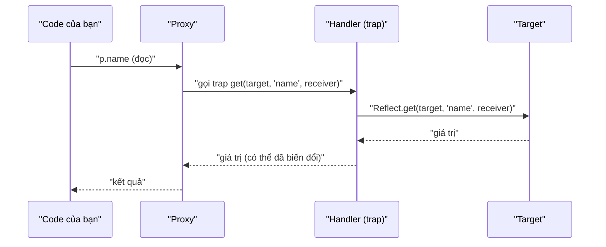
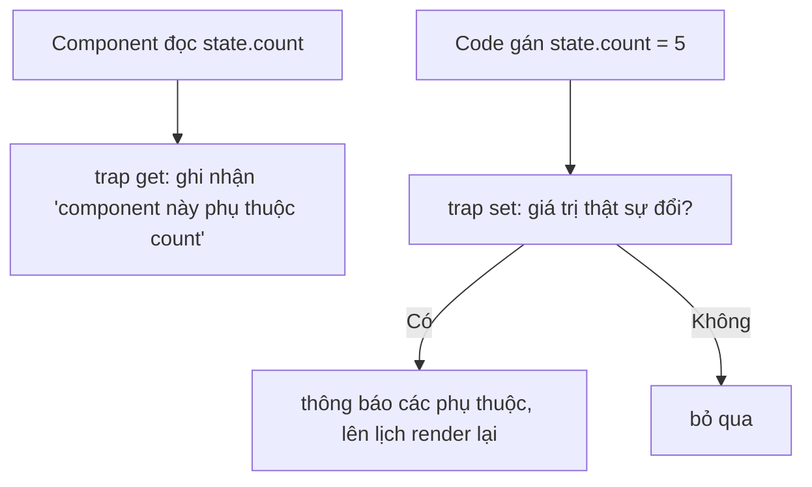
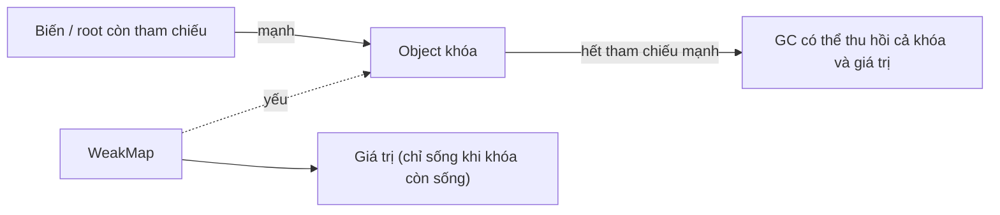

# Lý thuyết 12: Proxy, Reflect, Symbol và WeakRef

Bài này gom bốn công cụ "metaprogramming" của JavaScript: Symbol (khóa định danh duy nhất và các điểm móc của ngôn ngữ), Proxy (chặn các thao tác trên object), Reflect (bản "chuẩn hóa" của các thao tác đó dưới dạng hàm), và nhóm tham chiếu yếu (WeakMap, WeakSet, WeakRef, FinalizationRegistry). Chúng ít xuất hiện trong code nghiệp vụ hằng ngày, nhưng nằm bên dưới các framework bạn dùng mỗi ngày: Vue 3 dựa vào Proxy để làm reactivity, nhiều thư viện dựa vào Symbol để tránh đụng tên, và mọi cuộc trò chuyện về memory leak sớm muộn cũng chạm tới tham chiếu yếu.

## Proxy là gì?

Hãy hình dung một **lễ tân tòa nhà**. Khách (code của bạn) không bao giờ vào thẳng văn phòng (object thật); họ nói với lễ tân: "cho tôi xem hồ sơ A", "ghi thêm hồ sơ B", "xóa hồ sơ C". Lễ tân có thể đưa luôn, từ chối, ghi sổ lại, hoặc đưa giá trị mặc định nếu hồ sơ không có. Proxy chính là người lễ tân đó: một object bọc ngoài object khác (gọi là **target**) và có một bộ quy tắc (gọi là **handler**) quyết định điều gì xảy ra mỗi khi ai đó đọc, ghi, xóa, liệt kê property hay gọi hàm. Reflect là cuốn sổ quy trình chuẩn: cách "làm đúng như bình thường" cho từng thao tác, để lễ tân chỉ phải tùy biến chỗ cần tùy biến.

## Vấn đề nó giải quyết, và vì sao dev phải nắm

Có những yêu cầu không thể làm sạch bằng getter/setter thông thường: kiểm tra dữ liệu mọi property kể cả property mới thêm, tự phát hiện "ai vừa đổi cái gì" để cập nhật giao diện, trả giá trị mặc định cho khóa chưa tồn tại, ghi log mọi truy cập. Getter/setter phải định nghĩa **từng property đã biết trước**; Proxy chặn được **mọi thao tác trên mọi khóa**, kể cả khóa chưa tồn tại và thao tác như `in`, `delete`, `Object.keys`.

Bạn cần hiểu phần này vì ba lý do. Một, khi debug reactivity của Vue 3 hoặc state library dùng Proxy (Immer, MobX, Valtio), bạn phải hiểu vì sao `this` hoặc identity của object "lạ" so với bình thường. Hai, Proxy có chi phí và bẫy (private field, `Map`, so sánh `===`) mà dùng bừa sẽ gây lỗi khó thấy. Ba, kiến thức về Symbol và tham chiếu yếu giúp bạn lý giải memory leak, cache, và vì sao có những thứ trong runtime bạn **không** nên dựa vào (xem [JavaScript runtime và event loop](/go?p=11-Frontend-Core%2Flt-01-javascript-runtime-event-loop.md), mục memory).

**Cốt lõi:** Proxy cho phép bạn chặn các thao tác nội tại (internal method) của một object như `[[Get]]`, `[[Set]]`, `[[Delete]]`, `[[OwnPropertyKeys]]`, `[[Call]]` bằng các hàm "trap" trong handler, còn Reflect cung cấp đúng các thao tác đó dưới dạng hàm để trap có thể chuyển tiếp hành vi mặc định một cách chính xác. Trap chỉ tùy biến, không được phá các bất biến (invariants) mà target đã cam kết.

- Vì trap bắt thao tác ở mức engine (kể cả `in`, `delete`, `Object.keys`), nên Proxy làm được những việc getter/setter không làm được như bắt khóa chưa tồn tại.
- Vì Reflect có hàm tương ứng 1-1 với từng trap và nhận cả `receiver`, nên chuyển tiếp bằng `Reflect.get(t, k, receiver)` giữ đúng `this` trong getter và kế thừa, còn `t[k]` thì không.
- Vì engine kiểm tra invariants sau mỗi trap, nên trap không thể "nói dối" về property không-ghi-không-cấu-hình hay mở rộng object bị khóa; vi phạm sẽ ném `TypeError`.



Mô hình tư duy: Proxy là "lễ tân", handler là "quy định của lễ tân", Reflect là "cách làm chuẩn khi không có quy định riêng". Không có trap cho thao tác nào thì thao tác đó đi thẳng xuống target.

**Phải thuộc:** `new Proxy(target, handler)`; handler là object chứa các trap (`get`, `set`, `has`, `deleteProperty`, `ownKeys`, `apply`, `construct`...); trap vắng mặt thì thao tác chuyển thẳng xuống target; trong trap luôn ưu tiên chuyển tiếp bằng `Reflect.<tên trap>` với đủ đối số, kể cả `receiver`.

**Tóm tắt:**

- Symbol là kiểu nguyên thủy tạo ra giá trị duy nhất, dùng làm khóa property không đụng tên và không lộ ra qua `Object.keys` hay `JSON.stringify`.
- Well-known symbols (`Symbol.iterator`, `Symbol.toPrimitive`, `Symbol.toStringTag`, `Symbol.hasInstance`...) là các "điểm móc" để tùy biến hành vi mà ngôn ngữ đã định sẵn; `Symbol.for(key)` lấy symbol dùng chung toàn cục.
- Proxy gồm target và handler; trap `get`, `set`, `has`, `deleteProperty`, `ownKeys`, `apply`, `construct` chặn các thao tác tương ứng; thiếu trap thì chuyển thẳng xuống target.
- Invariants buộc trap không được mâu thuẫn với trạng thái non-configurable hay non-extensible của target; vi phạm là `TypeError`.
- Reflect là tập hàm tương ứng với các trap; trong `get`/`set` hãy dùng `Reflect.get/set(target, key, ..., receiver)` để getter, setter và kế thừa chạy đúng.
- Ứng dụng điển hình: validation, giá trị mặc định, reactivity (Vue 3), logging, chỉ số âm; nhược điểm: chậm hơn, identity khác target, `this` hỏng với private field `#x` và built-in như `Map`.
- `WeakMap`/`WeakSet` giữ khóa bằng tham chiếu yếu nên không cản GC, hợp để gắn metadata hoặc đánh dấu "đã thấy" mà không gây leak.
- `WeakRef` và `FinalizationRegistry` phụ thuộc thời điểm GC, vốn không xác định; chỉ dùng cho cache tối ưu, tuyệt đối không dùng để dọn dẹp bắt buộc hay quyết định logic.

## Các khái niệm cần biết

- **Symbol**: kiểu nguyên thủy (primitive) duy nhất cho mỗi lần gọi `Symbol()`, kể cả khi mô tả giống nhau. Dùng làm khóa property.
- **Description**: chuỗi mô tả truyền vào `Symbol("mô tả")`, chỉ để gỡ lỗi, không ảnh hưởng tính duy nhất.
- **Well-known symbols**: các symbol dựng sẵn của ngôn ngữ như `Symbol.iterator`, `Symbol.asyncIterator`, `Symbol.toPrimitive`, `Symbol.toStringTag`, `Symbol.hasInstance`; định nghĩa chúng trên object để thay đổi hành vi của cú pháp.
- **Global symbol registry**: bảng tra do `Symbol.for(key)` dùng; cùng `key` luôn cho cùng một symbol, kể cả giữa các iframe hay realm khác.
- **Target / handler / trap**: object bị bọc, object chứa các quy tắc, và từng hàm chặn thao tác trong handler.
- **Receiver**: đối tượng mà thao tác "đang được thực hiện trên đó" (thường là chính proxy, hoặc object kế thừa từ proxy). Quyết định `this` khi chạy getter/setter.
- **Invariants**: ràng buộc mà kết quả của trap phải thỏa, được engine kiểm tra để tránh Proxy phá vỡ các cam kết cơ bản của object.
- **Revocable proxy**: proxy tạo bằng `Proxy.revocable`, có thể thu hồi để mọi thao tác sau đó ném lỗi.
- **WeakMap / WeakSet**: collection mà khóa phải là object (hoặc symbol không đăng ký) và được giữ yếu: không cản GC, không duyệt được, không có `size`.
- **WeakRef**: object giữ tham chiếu yếu tới một object khác; `deref()` trả object nếu còn, `undefined` nếu đã bị thu hồi.
- **FinalizationRegistry**: đăng ký callback chạy "sau khi" một object bị GC; callback có thể chạy muộn hoặc không chạy.

## Symbol

Symbol sinh ra để giải bài toán "khóa property không thể trùng". Chuỗi thì ai cũng gõ lại được, nên hai thư viện cùng dùng khóa `"id"` sẽ đè lên nhau. Mỗi `Symbol()` là một giá trị duy nhất, như một **con dấu riêng**: mô tả giống nhau không có nghĩa là cùng một con dấu.

```javascript
const s1 = Symbol("id"), s2 = Symbol("id");
console.log(s1 === s2, s1.description, s1.toString(), typeof s1);
const user = { name: "An", [s1]: 42 };
console.log(Object.keys(user), JSON.stringify(user), user[s1]);
console.log(Object.getOwnPropertySymbols(user), Reflect.ownKeys(user));
const g1 = Symbol.for("app.token"), g2 = Symbol.for("app.token");
console.log(g1 === g2, Symbol.keyFor(g1), Symbol.keyFor(s1));
try { `${s1}`; } catch (e) { console.log(e.constructor.name + ": " + e.message); }
```

```text
false id Symbol(id) symbol
[ 'name' ] {"name":"An"} 42
[ Symbol(id) ] [ 'name', Symbol(id) ]
true app.token undefined
TypeError: Cannot convert a Symbol value to a string
```

_Đã chạy thử trên Node 22._

Đọc kết quả: hai symbol cùng mô tả vẫn khác nhau (`false`). Property khóa bằng symbol **không xuất hiện** trong `Object.keys` và `JSON.stringify` (nên hợp để gắn metadata "ẩn"), nhưng vẫn lấy ra được bằng `Object.getOwnPropertySymbols` hoặc `Reflect.ownKeys`. `Symbol.for("app.token")` tra bảng chung nên hai lần gọi cho cùng một symbol, còn `Symbol.keyFor` chỉ trả khóa cho symbol đã đăng ký. Cuối cùng, nối symbol vào chuỗi bằng template là lỗi, vì ngôn ngữ cố ý không cho chuyển ngầm.

**Nền tảng:** symbol là "ẩn" chứ không "riêng tư". Ai có tham chiếu tới object đều liệt kê được symbol của nó. Muốn riêng tư thật sự dùng private field `#x` (xem [Lý thuyết 7: Prototype và class](/go?p=13-JavaScript%2Fmedium%2Flt-07-prototype-va-class.md)). Symbol phù hợp để tránh đụng tên và để móc vào hành vi của ngôn ngữ.

### Well-known symbols

Ngôn ngữ dành sẵn một nhóm symbol làm "ổ cắm": bạn định nghĩa method có khóa là symbol đó và cú pháp tương ứng sẽ dùng nó. Bạn đã gặp `Symbol.iterator` ở [Lý thuyết 11](/go?p=13-JavaScript%2Fhard%2Flt-11-iterator-generator.md). Hai ví dụ nữa dưới đây là `Symbol.toPrimitive` (cách object chuyển sang giá trị nguyên thủy) và `Symbol.toStringTag` (nhãn trong `Object.prototype.toString`).

```javascript
class Money {
  constructor(v, cur) { this.v = v; this.cur = cur; }
  [Symbol.toPrimitive](hint) {
    if (hint === "number") return this.v;
    if (hint === "string") return `${this.v} ${this.cur}`;
    return `default:${this.v}`;
  }
  get [Symbol.toStringTag]() { return "Money"; }
}
const m = new Money(50, "USD");
console.log(+m, `${m}`, m + "", m * 2);
console.log(Object.prototype.toString.call(m));
class Even { static [Symbol.hasInstance](n) { return n % 2 === 0; } }
console.log(4 instanceof Even, 3 instanceof Even);
```

```text
50 50 USD default:50 100
[object Money]
true false
```

_Đã chạy thử trên Node 22._

`hint` cho biết ngữ cảnh: `+m` và `m * 2` yêu cầu `"number"`, template literal yêu cầu `"string"`, còn `m + ""` dùng `"default"`. `Symbol.hasInstance` thậm chí cho phép tùy biến cả toán tử `instanceof`.

**Phải thuộc:** `Symbol()` luôn duy nhất; `Symbol.for(key)` dùng chung theo `key`; khóa symbol không hiện trong `Object.keys`, `for...in`, `JSON.stringify`; well-known symbols là điểm móc của ngôn ngữ (`iterator`, `asyncIterator`, `toPrimitive`, `toStringTag`, `hasInstance`).

**Lưu ý:** `Symbol.for` biến symbol thành **toàn cục dùng chung**, nên đặt khóa kiểu `"app.token"` có tiền tố để tránh đụng với thư viện khác. Còn nếu muốn duy nhất thật sự thì dùng `Symbol()` thường và giữ nó trong module.

**Nhớ:** symbol để tránh đụng tên và để móc vào hành vi ngôn ngữ; không phải cơ chế bảo mật.

## Proxy và các trap

Proxy tạo bằng `new Proxy(target, handler)`. Mỗi trap tương ứng một thao tác nội tại: `get` (đọc), `set` (ghi), `has` (toán tử `in`), `deleteProperty` (`delete`), `ownKeys` (`Object.keys`, `for...in`, `Reflect.ownKeys`), `apply` (gọi hàm), `construct` (`new`). Ví dụ đầu tiên chỉ ghi lại thao tác rồi chuyển tiếp, để thấy trap nào ứng với cú pháp nào.

```javascript
const target = { name: "An", age: 30 };
const logs = [];
const p = new Proxy(target, {
  get(t, key, receiver) { logs.push(`get ${String(key)}`); return Reflect.get(t, key, receiver); },
  set(t, key, value, receiver) { logs.push(`set ${String(key)}=${value}`); return Reflect.set(t, key, value, receiver); },
  has(t, key) { logs.push(`has ${String(key)}`); return Reflect.has(t, key); },
  deleteProperty(t, key) { logs.push(`delete ${String(key)}`); return Reflect.deleteProperty(t, key); },
  ownKeys(t) { logs.push("ownKeys"); return Reflect.ownKeys(t); },
});
p.name; p.age = 31; "age" in p; delete p.name; Object.keys(p);
console.log(logs);
console.log(target);
```

```text
[ 'get name', 'set age=31', 'has age', 'delete name', 'ownKeys' ]
{ age: 31 }
```

_Đã chạy thử trên Node 22._

Năm cú pháp khác nhau (đọc, ghi, `in`, `delete`, `Object.keys`) kích hoạt năm trap khác nhau, và target bị thay đổi thật (`age` thành 31, `name` bị xóa) vì mọi thao tác đã được chuyển tiếp bằng Reflect. Proxy là **lớp bọc trong suốt**: target vẫn là nơi lưu dữ liệu.

**Nền tảng:** `Object.keys(p)` thực ra gọi `ownKeys` rồi hỏi tiếp thuộc tính của từng khóa (qua trap `getOwnPropertyDescriptor`) để lọc ra khóa liệt kê được. Khi tùy biến `ownKeys` bạn thường phải xử lý cả `getOwnPropertyDescriptor`, nếu không khóa "ảo" sẽ bị lọc mất.

### Reflect và vì sao truyền receiver

Reflect là object chứa các hàm tĩnh trùng tên với trap: `Reflect.get`, `set`, `has`, `deleteProperty`, `ownKeys`, `apply`, `construct`, `defineProperty`... Có ba lợi ích: trả về `true/false` thay vì ném lỗi (như `Reflect.set`, `Reflect.defineProperty`), có dạng hàm của các thao tác vốn là toán tử (`in`, `delete`), và quan trọng nhất là hỗ trợ tham số `receiver`.

Lý do dùng `receiver` nằm ở getter và kế thừa. Khi property là getter, `this` bên trong nó phải là receiver (đối tượng đang được truy cập), không phải target. Viết `t[k]` làm mất thông tin này.

```javascript
const base = { _name: "gốc", get name() { return this._name; } };
const naive = new Proxy(base, { get(t, k) { return t[k]; } });
const good = new Proxy(base, { get(t, k, r) { return Reflect.get(t, k, r); } });
const child = Object.create(naive); child._name = "con";
const child2 = Object.create(good); child2._name = "con";
console.log(child.name, child2.name);
const seen = [];
const spy = new Proxy(base, { get(t, k, r) { seen.push(k); return Reflect.get(t, k, r); } });
spy.name;
console.log(seen);
```

```text
gốc con
[ 'name', '_name' ]
```

_Đã chạy thử trên Node 22._

`child` và `child2` đều kế thừa từ một proxy, đều có `_name` riêng là `"con"`. Với trap viết `t[k]`, getter chạy với `this` là `base` nên trả `"gốc"` (sai). Với `Reflect.get(t, k, r)`, `this` là receiver nên trả `"con"` (đúng). Dòng thứ hai còn cho thấy một hệ quả hay: khi getter đọc `this._name` thông qua proxy (receiver là proxy), trap `get` được gọi **lần nữa** cho `_name`. Đó là cơ chế cho phép Vue 3 theo dõi phụ thuộc (dependency) bên trong getter, tức computed property.

**Phải thuộc:** trong trap `get` và `set`, chuyển tiếp bằng `Reflect.get(target, key, receiver)` và `Reflect.set(target, key, value, receiver)`; trap `set` phải trả `true` khi thành công, nếu trả giá trị falsy thì ở strict mode sẽ ném `TypeError`.

### Invariants: trap không được nói dối

Engine kiểm tra kết quả của trap với trạng thái của target. Ví dụ: property không-ghi-được và không-cấu-hình-được thì `get` phải trả đúng giá trị thật; object đã `preventExtensions` thì `ownKeys` không được thêm khóa mới; trap `set` trả `false` thì trong strict mode là lỗi. Nhờ đó bạn không thể dùng Proxy để phá cam kết `Object.freeze`.

```javascript
const frozen = {};
Object.defineProperty(frozen, "x", { value: 1, writable: false, configurable: false });
const bad = new Proxy(frozen, { get() { return 999; } });
try { bad.x; } catch (e) { console.log(e.constructor.name + ": " + e.message); }
const sealedTarget = Object.preventExtensions({ a: 1 });
const bad2 = new Proxy(sealedTarget, { ownKeys() { return ["a", "b"]; } });
try { Object.keys(bad2); } catch (e) { console.log(e.constructor.name + ": " + e.message); }
const rejecting = new Proxy({}, { set() { return false; } });
rejecting.a = 1;
console.log("sloppy: im lặng", rejecting.a);
(function () { "use strict"; try { rejecting.a = 1; } catch (e) { console.log("strict:", e.constructor.name + ": " + e.message); } })();
```

```text
TypeError: 'get' on proxy: property 'x' is a read-only and non-configurable data property on the proxy target but the proxy did not return its actual value (expected '1' but got '999')
TypeError: 'ownKeys' on proxy: trap returned extra keys but proxy target is non-extensible
sloppy: im lặng undefined
strict: TypeError: 'set' on proxy: trap returned falsish for property 'a'
```

_Đã chạy thử trên Node 22._

Ví dụ cuối là một bẫy phổ biến: trap `set` quên `return true` (hoặc trả `false`) thì ở chế độ sloppy việc ghi bị **âm thầm bỏ qua**, nhưng ở strict mode (mặc định trong module và class) thì ném lỗi.

**Lưu ý:** quên `return` ở trap `set` là lỗi phổ biến nhất khi mới học Proxy. Hãy kết thúc trap `set` bằng `return Reflect.set(...)` hoặc `return true`.

**Nhớ:** target vẫn giữ luật; Proxy chỉ được tùy biến trong khuôn khổ luật đó.

## Ứng dụng thực tế

### Validation, giá trị mặc định, chỉ số âm

```javascript
const validator = {
  set(t, key, value, receiver) {
    if (key === "age") {
      if (!Number.isInteger(value)) throw new TypeError("age phải là số nguyên");
      if (value < 0) throw new RangeError("age không được âm");
    }
    return Reflect.set(t, key, value, receiver);
  },
};
const person = new Proxy({}, validator);
person.age = 20;
console.log(person.age);
try { person.age = "hai mươi"; } catch (e) { console.log(e.name, e.message); }
try { person.age = -1; } catch (e) { console.log(e.name, e.message); }
const withDefault = (obj, def) => new Proxy(obj, { get: (t, k, r) => (k in t ? Reflect.get(t, k, r) : def) });
const stock = withDefault({ apple: 3 }, 0);
console.log(stock.apple, stock.banana);
const neg = (arr) => new Proxy(arr, { get(t, k, r) { if (typeof k === "string" && /^-\d+$/.test(k)) k = String(t.length + Number(k)); return Reflect.get(t, k, r); } });
const a = neg([10, 20, 30]);
console.log(a[-1], a[-3], a[0], a.length);
```

```text
20
TypeError age phải là số nguyên
RangeError age không được âm
3 0
30 10 10 3
```

_Đã chạy thử trên Node 22._

Ba mẫu quen thuộc: kiểm tra dữ liệu ngay lúc ghi (lỗi nổ đúng chỗ gán sai, không đợi tới lúc dùng), giá trị mặc định cho khóa vắng (thay cho `obj[k] ?? 0` rải khắp nơi), và chỉ số âm kiểu Python (`a[-1]` là phần tử cuối). Lưu ý ở chỉ số âm, mọi khóa property đều là chuỗi, nên ta kiểm tra bằng regex rồi quy đổi.

### Chặn gọi hàm và khởi tạo

Hai trap `apply` và `construct` dùng cho target là hàm: đo thời gian, ghi log đối số, cache kết quả, hoặc chặn tạo instance.

```javascript
const calls = [];
function sum(a, b) { return a + b; }
const traced = new Proxy(sum, {
  apply(t, thisArg, args) { calls.push(args); return Reflect.apply(t, thisArg, args); },
});
console.log(traced(1, 2), traced(3, 4), calls);
class User { constructor(n) { this.n = n; } }
const Tracked = new Proxy(User, {
  construct(t, args, newTarget) { console.log("new với", args); return Reflect.construct(t, args, newTarget); },
});
const u = new Tracked("An");
console.log(u instanceof User, u.n);
```

```text
3 7 [ [ 1, 2 ], [ 3, 4 ] ]
new với [ 'An' ]
true An
```

_Đã chạy thử trên Node 22._

Truyền `newTarget` vào `Reflect.construct` giữ nguyên chuỗi prototype và hỗ trợ kế thừa class đúng cách.

### Observable và reactivity

Đây là ứng dụng nổi tiếng nhất: bọc state bằng Proxy, bắt `set` để biết "cái gì vừa đổi" và kích hoạt cập nhật. Vue 3 dùng đúng ý tưởng này (kèm cơ chế theo dõi phụ thuộc trong trap `get`), thay cho `Object.defineProperty` của Vue 2, vốn không phát hiện được thêm hoặc xóa property mới. Bản mô phỏng tối giản dưới đây tự bọc đệ quy các object con khi chúng được đọc (lazy).

```javascript
function reactive(obj, onChange) {
  return new Proxy(obj, {
    get(t, k, r) {
      const v = Reflect.get(t, k, r);
      return v && typeof v === "object" ? reactive(v, onChange) : v;
    },
    set(t, k, v, r) {
      const old = t[k];
      const ok = Reflect.set(t, k, v, r);
      if (old !== v) onChange(String(k), old, v);
      return ok;
    },
  });
}
const state = reactive({ count: 0, user: { name: "An" } }, (k, o, n) => console.log(`đổi ${k}: ${JSON.stringify(o)} -> ${JSON.stringify(n)}`));
state.count++;
state.count = 1;
state.user.name = "Bình";
```

```text
đổi count: 0 -> 1
đổi name: "An" -> "Bình"
```

_Đã chạy thử trên Node 22._

Dòng `state.count = 1` không in gì vì giá trị không đổi (đã là 1), còn thay đổi ở object lồng nhau (`user.name`) vẫn bắt được nhờ bọc đệ quy. Bản thật phải lo thêm nhiều thứ: cache proxy để mỗi object chỉ có một proxy, mảng, `Map`/`Set`, batching cập nhật. Tuy vậy lõi ý tưởng chỉ có vậy.



**Nhớ:** Proxy cho validation, mặc định, logging, reactivity; luôn chuyển tiếp bằng Reflect, và xem Proxy như lớp bọc thêm chứ không thay thế cho thiết kế dữ liệu rõ ràng.

## Nhược điểm và bẫy của Proxy

Proxy không miễn phí và cũng không "trong suốt hoàn toàn". Ba nhóm vấn đề cần nhớ: hiệu năng, identity, và `this` với slot nội bộ.

**Hiệu năng.** Mỗi thao tác qua proxy phải đi qua hàm trap, và engine khó tối ưu (inline, hidden class) trên object bị bọc. Với state nhỏ thì không đáng kể, nhưng với vòng lặp nóng hoặc mảng hàng trăm nghìn phần tử, chi phí rõ rệt. Hãy đo trước khi quyết định.

**Identity.** Proxy và target là hai object khác nhau, nên `proxy === target` là `false`; đưa proxy vào `Set` hoặc `WeakMap` rồi tra bằng target (hoặc ngược lại) sẽ không thấy. Đây là lý do thư viện reactivity phải duy trì ánh xạ target tới proxy, và vì sao bạn nên chọn một "phiên bản" (luôn dùng proxy hoặc luôn dùng bản gốc) rồi dùng thống nhất.

**`this` với private field và built-in.** Các built-in như `Map`, `Set`, `Date` và private field `#x` lưu dữ liệu trong **internal slot** gắn với object thật. Proxy không có các slot đó. Khi method chạy với `this` là proxy, nó không tìm thấy slot và ném lỗi. Cách khắc phục là gọi method với `this` là target (bind lại), như ví dụ:

```javascript
const m = new Map([["a", 1]]);
const pm = new Proxy(m, {});
try { pm.get("a"); } catch (e) { console.log(e.constructor.name + ": " + e.message); }
const fixed = new Proxy(m, { get(t, k) { const v = Reflect.get(t, k, t); return typeof v === "function" ? v.bind(t) : v; } });
console.log(fixed.get("a"), fixed.size);
class Counter { #n = 0; inc() { return ++this.#n; } }
const c = new Counter();
const pc = new Proxy(c, {});
try { pc.inc(); } catch (e) { console.log(e.constructor.name + ": " + e.message); }
const pc2 = new Proxy(c, { get(t, k) { const v = Reflect.get(t, k, t); return typeof v === "function" ? v.bind(t) : v; } });
console.log(pc2.inc());
const t = {}; const p = new Proxy(t, {});
console.log(p === t, new Set([t]).has(p), new WeakMap([[t, 1]]).has(p));
const { proxy, revoke } = Proxy.revocable({ a: 1 }, {});
console.log(proxy.a); revoke();
try { proxy.a; } catch (e) { console.log(e.constructor.name + ": " + e.message); }
```

```text
TypeError: Method Map.prototype.get called on incompatible receiver #<Map>
1 1
TypeError: Cannot read private member #n from an object whose class did not declare it
1
false false false
1
TypeError: Cannot perform 'get' on a proxy that has been revoked
```

_Đã chạy thử trên Node 22._

Đọc kết quả: `pm.get("a")` lỗi vì `this` là proxy; bind về target thì chạy. Tương tự cho private field `#n`. Ba giá trị `false` ở dòng giữa nhắc lại vấn đề identity: proxy không bằng target và không tra được trong `Set`/`WeakMap`. Cuối cùng là `Proxy.revocable`: tạo proxy có thể thu hồi (hữu ích khi cấp quyền truy cập tạm thời), sau khi `revoke()` mọi thao tác đều lỗi.

**Lưu ý:** cách bind như trên chỉ là chữa cháy; nó làm `this` bên trong method không đi qua proxy nữa, nên thay đổi gây ra từ trong method sẽ không được trap bắt (reactivity bỏ sót). Vue 3 xử lý riêng cho `Map`/`Set` bằng cách ghi đè từng method của collection. Nếu bạn chỉ cần theo dõi một class có private field, cân nhắc gọi hook trong chính method của class thay vì bọc Proxy.

**Nền tảng:** các cảnh báo đó giải thích vì sao Proxy hợp với **plain object và array** (dữ liệu thuần), nhưng nên thận trọng với object có slot nội bộ hoặc class có private field.

## WeakMap, WeakSet

Collection thường (`Map`, `Set`) giữ khóa bằng **tham chiếu mạnh**: chừng nào khóa còn nằm trong collection, GC không thu hồi nó, kể cả khi mọi nơi khác đã bỏ nó. Với `WeakMap`/`WeakSet`, khóa được giữ yếu: nếu không còn đường tham chiếu mạnh nào khác tới khóa thì entry biến mất theo. Hình dung `WeakMap` như một **tờ giấy ghi chú dán lên đồ vật**: khi đồ vật bị vứt, tờ ghi chú đi theo mà bạn không phải dọn.

```javascript
let key = { id: 1 };
const wm = new WeakMap([[key, "meta"]]);
console.log(wm.get(key), wm.has({}), typeof wm.size, typeof wm[Symbol.iterator]);
try { wm.set("chuỗi", 1); } catch (e) { console.log(e.constructor.name + ": " + e.message); }
const priv = new WeakMap();
class Account { constructor(b) { priv.set(this, { balance: b }); } get balance() { return priv.get(this).balance; } }
console.log(new Account(100).balance);
const visited = new WeakSet(); const n = {}; visited.add(n); console.log(visited.has(n));
```

```text
meta false undefined undefined
TypeError: Invalid value used as weak map key
100
true
```

_Đã chạy thử trên Node 22._

API cố ý nghèo: chỉ `get/set/has/delete` (WeakMap) và `add/has/delete` (WeakSet). Không có `size`, không có iterator, vì nội dung phụ thuộc vào thời điểm GC, nếu cho đếm hay duyệt thì kết quả sẽ không xác định. Khóa phải là object (hoặc symbol không đăng ký bằng `Symbol.for`), nên khóa kiểu chuỗi bị từ chối.

Ứng dụng đúng chỗ: gắn dữ liệu phụ cho object bạn không sở hữu (ví dụ metadata của một DOM node, trạng thái của một instance) mà không sợ leak khi object đó bị bỏ; đánh dấu "đã duyệt" khi duyệt đồ thị có vòng; và mô phỏng dữ liệu riêng tư (cũ, ngày nay ưu tiên `#field`). Trong [JavaScript runtime và event loop](/go?p=11-Frontend-Core%2Flt-01-javascript-runtime-event-loop.md) bạn đã thấy cache bằng `Map` gây giữ DOM node đã tách: đổi sang `WeakMap` khóa theo node là cách sửa gọn nhất.



**Phải thuộc:** WeakMap/WeakSet giữ khóa yếu; khóa phải là object; không `size`, không duyệt, không `clear`. Chọn chúng khi vòng đời của dữ liệu phụ nên đi theo vòng đời của object khóa.

## WeakRef và FinalizationRegistry

`WeakRef` cho bạn giữ một tham chiếu tới object **mà không ngăn GC**. `deref()` trả object nếu còn sống, `undefined` nếu đã bị thu hồi. `FinalizationRegistry` cho đăng ký một callback "sau khi object bị thu hồi". Cả hai nghe hấp dẫn nhưng bị ràng buộc bởi một sự thật: **thời điểm GC do engine quyết định**, không xác định, và có thể không bao giờ xảy ra trước khi chương trình kết thúc.

```javascript
const ref = new WeakRef({ big: "dữ liệu" });
console.log(typeof ref.deref(), ref.deref().big);
const reg = new FinalizationRegistry((held) => console.log("dọn", held));
reg.register({}, "token-1");
const cache = new Map();
function getCached(key, make) {
  const hit = cache.get(key)?.deref();
  if (hit) return hit;
  const v = make(); cache.set(key, new WeakRef(v)); return v;
}
console.log(getCached("a", () => ({ v: 1 })) === getCached("a", () => ({ v: 2 })));
console.log(typeof globalThis.gc);
```

```text
object dữ liệu
true
undefined
```

_Đã chạy thử trên Node 22._

Hàm `getCached` là mẫu dùng hợp lý: cache các object tốn kém để tạo, nhưng cho phép GC thu hồi khi bộ nhớ căng. Cache "hết hạn" thì tạo lại. Chú ý trong lần chạy này không có dòng `dọn token-1` nào: finalizer **không được đảm bảo chạy**, nhất là khi tiến trình thoát sớm. Để quan sát GC thật, phải chạy Node với cờ `--expose-gc` và gọi `gc()` thủ công. Thử riêng một đoạn theo cách đó:

```javascript
let o = { x: 1 };
const w = new WeakRef(o);
const reg = new FinalizationRegistry((h) => console.log("finalizer:", h));
reg.register(o, "o");
o = null;
console.log("trước GC deref:", w.deref() !== undefined);
setTimeout(() => { gc(); setTimeout(() => console.log("sau GC deref:", w.deref() !== undefined), 50); }, 10);
```

```text
trước GC deref: true
sau GC deref: false
```

_Đã chạy thử trên Node 22 với cờ --expose-gc (`node --expose-gc file.js`)._

Hai điều rút ra. Một, `WeakRef` bị thu hồi sau khi ép GC (`false`). Hai, dù vậy callback của `FinalizationRegistry` **vẫn không in** trong khoảng quan sát này, đúng như đặc tả cho phép: callback chạy bất đồng bộ, chậm hơn, hoặc không chạy. Ngoài ra còn một chi tiết nhỏ: `deref()` được gọi trong cùng một lượt chạy đồng bộ sẽ giữ object sống tới hết lượt đó, nên đừng viết code phụ thuộc vào việc "vừa `deref()` xong là object còn".

**Lưu ý:** **không** dùng `FinalizationRegistry` để đóng file, ngắt kết nối, giải phóng khóa hay bất cứ việc bắt buộc nào. Chúng phải được dọn bằng cách tường minh (`close()`, `try/finally`, `AbortController`, và các mẫu như `using` ở [Lý thuyết 14](/go?p=13-JavaScript%2Fhard%2Flt-14-javascript-hien-dai.md) nếu môi trường hỗ trợ). Không dùng `WeakRef` để quyết định logic, vì kết quả `deref()` khác nhau giữa các engine, các lần chạy và các mức tải bộ nhớ. Hãy xem chúng là **tối ưu hóa bộ nhớ**, không phải một phần của tính đúng đắn.

**Nhớ:** ưu tiên WeakMap/WeakSet, tới khi cần cache co giãn thì mới nghĩ tới WeakRef; FinalizationRegistry chỉ là biện pháp cuối cho cảnh báo hoặc dọn phụ, không bao giờ cho việc bắt buộc.

## Bẫy thường gặp

| Bẫy | Hiện tượng | Cách tránh |
|---|---|---|
| Trap `set` quên `return true` | Sloppy: ghi bị bỏ qua im lặng; strict: `TypeError` | Kết thúc bằng `return Reflect.set(...)` |
| Trong trap `get` dùng `t[k]` thay vì `Reflect.get(t, k, receiver)` | Getter và kế thừa chạy với `this` sai | Luôn truyền `receiver` |
| Bọc `Map`, `Set`, `Date` hoặc class có `#field` bằng Proxy trần | `TypeError ... incompatible receiver` hoặc "private member" | Bind method về target, hoặc không bọc loại object này |
| So sánh `proxy === target` hoặc tra proxy trong `Set` bằng target | Luôn `false` | Chọn một phiên bản và dùng thống nhất; giữ ánh xạ target tới proxy |
| Trap nói dối về property non-configurable hoặc object non-extensible | `TypeError` do vi phạm invariants | Tôn trọng trạng thái của target |
| Dùng Proxy trong vòng lặp nóng | Chậm đáng kể | Đo (profiling) trước; dùng dữ liệu thường ở đường nóng |
| `Object.keys(proxy)` trả thiếu khóa "ảo" | Bị lọc vì thiếu `getOwnPropertyDescriptor` | Cài cả `ownKeys` và `getOwnPropertyDescriptor` |
| Nối symbol vào chuỗi bằng template hoặc `+` | `TypeError: Cannot convert a Symbol value to a string` | Dùng `.toString()` hoặc `.description` |
| Dựa vào `WeakRef.deref()` hoặc finalizer để chạy logic bắt buộc | Hành vi khác nhau theo engine, không chạy | Dọn dẹp tường minh bằng `try/finally`, `close()` |
| Cho rằng Symbol là private | Vẫn đọc được qua `getOwnPropertySymbols` | Dùng private field `#x` nếu cần riêng tư thật |

## Câu hỏi phỏng vấn thường gặp

### 1. Proxy khác `Object.defineProperty` (getter/setter) ở điểm nào? Vì sao Vue 3 chuyển sang Proxy?

**Câu hỏi:** Giải thích vì sao Proxy phù hợp hơn cho reactivity so với cách của Vue 2.

**Gợi ý suy luận:**
- `defineProperty` phải biết trước tên property; điều gì xảy ra với property thêm sau?
- Thao tác nào (`in`, `delete`, thêm khóa mới, chỉ số mảng) getter/setter không bắt được?
- Proxy bắt thao tác ở mức nào của object?

**Lập luận:** `defineProperty` gắn getter/setter cho từng property đã tồn tại lúc khởi tạo, nên thêm hoặc xóa property mới, gán theo chỉ số mảng, hoặc `delete` đều không được phát hiện (Vue 2 phải dùng `Vue.set`, `Vue.delete` như phương án vá). Proxy bắt thao tác ở mức object nên thấy được cả thêm/xóa khóa, `in`, `Object.keys`, và không cần duyệt đệ quy trước mọi property (có thể bọc lazy khi truy cập). Đổi lại, Proxy không hỗ trợ trình duyệt rất cũ (không polyfill đầy đủ được) và gây vấn đề identity/`this` như đã nêu.

**Đáp án ngắn:** Proxy chặn mọi thao tác trên mọi khóa (kể cả khóa chưa tồn tại, `delete`, `in`), còn `defineProperty` chỉ bọc từng property đã biết. Vì thế Vue 3 dùng Proxy để reactivity đầy đủ hơn và không cần `Vue.set`.

**Nhớ:** getter/setter canh từng cánh cửa đã có; Proxy canh cả tòa nhà.

### 2. Vì sao trong trap `get` nên viết `Reflect.get(target, key, receiver)` thay vì `target[key]`?

**Câu hỏi:** Cho ví dụ cụ thể về việc `target[key]` sai.

**Gợi ý suy luận:**
- Khi property là một getter, `this` bên trong lấy từ đâu?
- Nếu object khác kế thừa từ proxy, `receiver` là ai?
- Truyền `receiver` thì các thao tác bên trong getter có đi qua trap nữa không?

**Lập luận:** `target[key]` gọi getter với `this` là `target`; còn đúng ngữ nghĩa là `this` phải là receiver (đối tượng đang truy cập, có thể là proxy hoặc object con kế thừa từ proxy). Trong ví dụ có getter `name` đọc `this._name`, object con kế thừa từ proxy có `_name` riêng: dùng `t[k]` trả giá trị của target, dùng `Reflect.get` với `receiver` trả đúng giá trị của object con. Thêm nữa, với receiver là proxy, các truy cập trong getter đi qua trap, nên reactivity theo dõi được phụ thuộc bên trong computed.

**Đáp án ngắn:** để getter và kế thừa chạy với đúng `this`: `Reflect.get(t, k, receiver)` truyền receiver, `t[k]` thì buộc `this` về target và làm sai kết quả cùng phụ thuộc bị bỏ sót.

**Nhớ:** chuyển tiếp trap bằng Reflect, đủ tham số, kể cả `receiver`.

### 3. Dùng Proxy để bọc một `Map` hoặc một class có private field `#x` thì lỗi gì? Sửa thế nào?

**Câu hỏi:** Giải thích nguyên nhân gốc và nêu một cách xử lý cùng đánh đổi của nó.

**Gợi ý suy luận:**
- Dữ liệu của `Map` và private field nằm ở đâu: trong property thông thường hay trong slot nội bộ?
- Khi gọi `proxy.get(...)`, `this` bên trong method là ai?
- Nếu bind `this` về target thì mất gì?

**Lập luận:** `Map` và private field lưu trạng thái trong internal slot gắn với object thật; proxy không có slot nên method chạy với `this` là proxy sẽ ném `TypeError` (incompatible receiver, hoặc cannot read private member). Cách chữa là trong trap `get`, lấy method rồi `bind(target)`. Đánh đổi: bên trong method `this` là target nên các thay đổi do method gây ra không đi qua trap, dẫn tới bỏ sót khi theo dõi thay đổi; các thư viện như Vue phải viết lại từng method của `Map`/`Set` để vừa chạy đúng vừa theo dõi được.

**Đáp án ngắn:** do `this` là proxy không có internal slot. Bind method về target trong trap `get` (hoặc tránh bọc loại object đó); đánh đổi là mất khả năng bắt thay đổi bên trong method.

**Nhớ:** Proxy hợp với plain object và array; thận trọng với built-in có slot và class có private field.

### 4. WeakMap khác Map ở đâu? Khi nào dùng, và vì sao không duyệt hay đếm được?

**Câu hỏi:** Nêu khác biệt, một tình huống dùng, và lý do thiết kế.

**Gợi ý suy luận:**
- Ai giữ khóa của `Map` sống, ai giữ khóa của `WeakMap`?
- Nếu cho phép `size` hoặc `for...of`, kết quả phụ thuộc vào điều gì?
- Dữ liệu phụ gắn theo object nên có vòng đời giống ai?

**Lập luận:** `Map` giữ khóa mạnh nên entry tồn tại tới khi bạn xóa; `WeakMap` giữ khóa yếu nên khi object khóa không còn tham chiếu mạnh nào thì entry (và giá trị) bị thu hồi. Vì thời điểm GC không xác định, nếu cho đếm hay duyệt thì kết quả sẽ khác nhau theo thời điểm, nên API cố ý chỉ có `get/set/has/delete`. Dùng khi cần gắn dữ liệu phụ vào object không do mình quản lý (metadata của DOM node, trạng thái instance, cờ "đã duyệt") mà không gây leak.

**Đáp án ngắn:** WeakMap giữ khóa yếu, khóa phải là object, không `size` và không duyệt, entry tự biến mất khi khóa bị thu hồi. Dùng để gắn metadata theo object mà không rò rỉ bộ nhớ.

**Nhớ:** vòng đời dữ liệu phụ đi theo vòng đời khóa thì chọn WeakMap.

### 5. Có nên dựa vào `WeakRef` hay `FinalizationRegistry` không?

**Câu hỏi:** Nêu một trường hợp dùng hợp lý và những điều tuyệt đối không nên làm.

**Gợi ý suy luận:**
- Ai quyết định lúc nào GC chạy, và nó có đảm bảo chạy không?
- Callback finalizer có chắc chắn được gọi, và gọi vào lúc nào?
- Việc nào bắt buộc phải xảy ra (đóng kết nối) thì nên giao cho cơ chế nào?

**Lập luận:** GC do engine quyết định, thời điểm không xác định và không đảm bảo chạy trước khi tiến trình kết thúc; finalizer có thể chạy muộn hoặc không chạy (đã thử: ép `gc()` thì `WeakRef` bị thu hồi nhưng callback vẫn chưa in). Vì thế chúng chỉ phù hợp cho tối ưu như cache co giãn theo áp lực bộ nhớ (cache `WeakRef` tới object tốn kém, tạo lại khi bị thu hồi). Tuyệt đối không dùng để dọn tài nguyên bắt buộc hay để quyết định logic nghiệp vụ.

**Đáp án ngắn:** không nên dựa vào cho tính đúng đắn. Chỉ dùng cho cache tối ưu; việc dọn dẹp bắt buộc phải tường minh (`try/finally`, `close()`), vì GC và finalizer không có thời điểm bảo đảm.

**Nhớ:** tham chiếu yếu là tối ưu bộ nhớ, không phải cơ chế quản lý vòng đời.

Bài kế tiếp: [Lý thuyết 13: Fetch, storage, worker và observer](/go?p=13-JavaScript%2Fhard%2Flt-13-fetch-storage-worker-observer.md).

