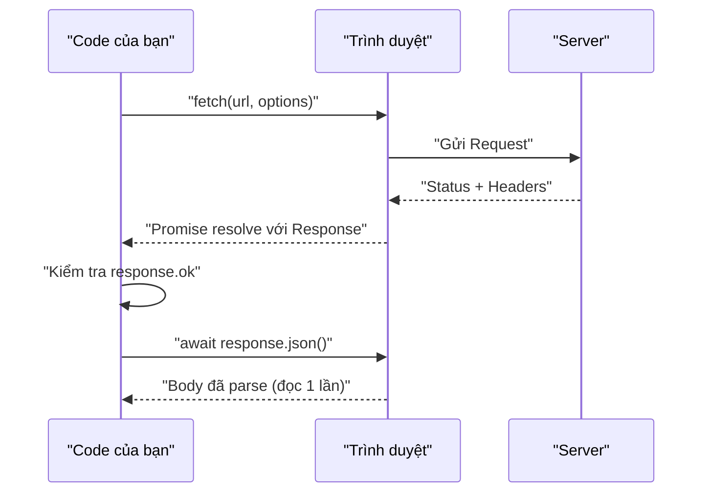
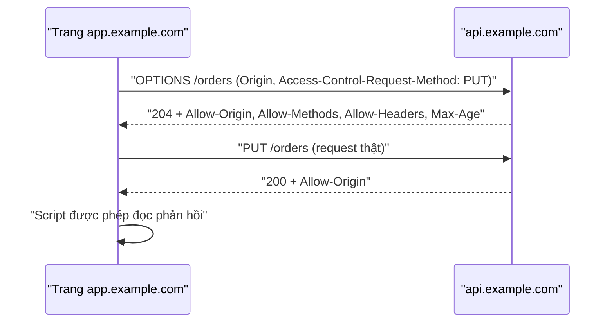
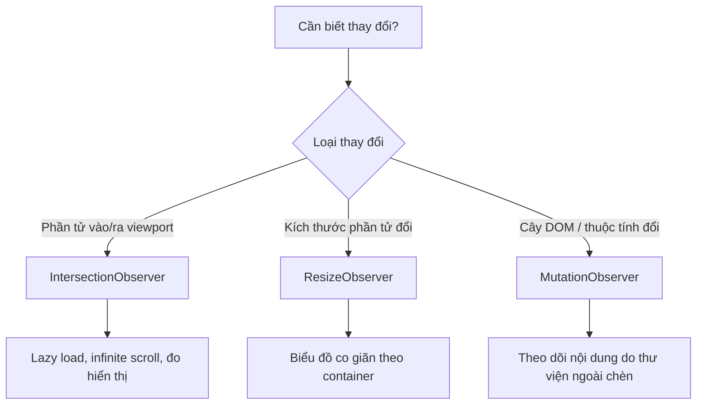

# Lý thuyết 13: Fetch, lưu trữ, Worker và Observer

Bài này đi ra khỏi "ngôn ngữ thuần" để nói về các API mà trình duyệt (và một phần Node) trao cho JavaScript: gọi mạng bằng `fetch`, hủy và đặt thời hạn cho request, lưu dữ liệu phía client, chạy việc nặng ở thread khác, và quan sát thay đổi của trang bằng các Observer. Đây là những thứ mọi ứng dụng web thật đều dùng hằng ngày, và cũng là nơi sinh ra nhiều lỗi "chạy trên máy tôi" nhất.

## Fetch là gì?

Hãy hình dung bạn gửi một **bưu kiện** qua bưu điện. Bạn điền phiếu gửi (địa chỉ, loại hàng, ghi chú: đó là `Request`), bưu điện nhận hàng, và một lúc sau bạn nhận lại **phiếu phản hồi** (`Response`): đã giao, người nhận từ chối, hay không tìm thấy địa chỉ. Điểm quan trọng: dù người nhận từ chối thì bưu điện vẫn "hoàn thành nhiệm vụ", họ chỉ báo kết quả. Chỉ khi xe bưu điện hỏng giữa đường (mất mạng) thì bạn mới nhận thông báo "không giao được". `fetch` cư xử y như vậy.

`fetch(url, options)` trả về một Promise. Promise đó **fulfill** khi trình duyệt nhận được phản hồi HTTP, kể cả 404 hay 500, và chỉ **reject** khi không thể hoàn tất việc gửi nhận (mất mạng, DNS lỗi, bị CORS chặn, bị hủy).

**Cốt lõi:** `fetch` tách "có nói chuyện được với server hay không" khỏi "server trả lời tốt hay xấu". Promise chỉ phản ánh vế đầu; vế sau nằm ở `response.status` và `response.ok`, và dev phải tự kiểm tra. Body của response là một luồng dữ liệu chỉ đọc được một lần, nên việc đọc nó cũng là một thao tác async riêng.

- Vì HTTP 404 vẫn là một phản hồi hợp lệ về mặt giao thức, nên `fetch` resolve với `ok === false` thay vì reject, và code phải kiểm tra `response.ok`.
- Vì body là một stream chỉ chạy một chiều, nên gọi `res.json()` lần thứ hai sẽ lỗi, và muốn đọc hai lần phải `clone()` trước.
- Vì request có thể treo vô thời hạn nếu server không trả lời, nên phải tự đặt thời hạn bằng `AbortSignal`.



Mô hình tư duy: `fetch` giống nhận phiếu phản hồi trước (status, header), còn nội dung bưu kiện (body) phải mở thêm một bước và chỉ mở được một lần.

## Vấn đề nó giải quyết, và vì sao dev phải nắm

Trước `fetch`, người ta dùng `XMLHttpRequest` với callback lồng nhau, khó đọc và khó hủy. `fetch` cho một API dựa trên Promise, tích hợp với `async/await`, dùng chung kiểu `Request`/`Response`/`Headers` với Service Worker, và hỗ trợ stream. Nhưng thiết kế "không reject khi 4xx/5xx" khiến vô số ứng dụng hiển thị trang trắng hoặc `undefined` vì đã parse JSON của một trang lỗi như thể đó là dữ liệu hợp lệ.

Bạn cần nắm bài này khi viết lớp gọi API, khi debug lỗi CORS, khi xử lý request chậm hoặc bị người dùng bỏ đi giữa chừng, khi quyết định lưu token và dữ liệu ở đâu, và khi chọn giữa polling, Observer hay Worker. Với phần bảo mật của lưu trữ (XSS, CSRF), bài này chỉ đủ để chọn nơi lưu; chi tiết nằm ở [Bảo mật frontend](/go?p=11-Frontend-Core%2Flt-04-bao-mat-frontend.md).

**Tóm tắt:**

- `fetch` chỉ reject khi lỗi mạng, CORS hoặc bị hủy; với 4xx/5xx nó vẫn resolve, nên luôn kiểm tra `response.ok` trước khi đọc body.
- Body chỉ đọc được một lần (`json()`, `text()`, `blob()` đều tiêu thụ nó); cần hai lần thì `clone()` trước khi đọc.
- Gửi JSON phải tự `JSON.stringify` và đặt `Content-Type: application/json`; gửi `FormData` thì để trình duyệt tự đặt header kèm boundary.
- CORS do trình duyệt thực thi dựa trên header của server; request "không đơn giản" kích hoạt preflight `OPTIONS`; cookie chỉ đi kèm khi bật `credentials`.
- Hủy và timeout dùng `AbortController` hoặc `AbortSignal.timeout(ms)`; retry chỉ nên áp dụng cho lỗi tạm thời, kèm backoff và jitter.
- `localStorage` và `sessionStorage` đồng bộ, chỉ lưu chuỗi, đọc được bởi mọi script cùng origin; cookie có cờ `HttpOnly`, `Secure`, `SameSite` để giảm rủi ro.
- IndexedDB lưu dữ liệu có cấu trúc, bất đồng bộ, dung lượng lớn; Web Worker chạy việc nặng ngoài main thread.
- IntersectionObserver, ResizeObserver, MutationObserver thay cho polling và scroll handler; `URL` và `URLSearchParams` thay cho ghép chuỗi query thủ công.

## Các khái niệm cần biết

- **Request / Response / Headers**: ba kiểu chuẩn mô tả một lần gọi HTTP. `Headers` là tập cặp tên-giá trị không phân biệt hoa thường.
- **Body mixin**: nhóm phương thức đọc body (`json()`, `text()`, `blob()`, `arrayBuffer()`, `formData()`). Mỗi lần gọi tiêu thụ stream, nên `bodyUsed` chuyển sang `true`.
- **Same-origin policy**: quy tắc trình duyệt chỉ cho script đọc dữ liệu từ cùng origin (scheme, host, port). Origin khác phải được server cho phép qua CORS.
- **CORS (Cross-Origin Resource Sharing)**: cơ chế dùng header như `Access-Control-Allow-Origin` để server nói "origin này được đọc phản hồi của tôi". Server nhận request bình thường; trình duyệt mới là bên chặn việc đọc kết quả.
- **Preflight**: request `OPTIONS` mà trình duyệt gửi trước để hỏi server có chấp nhận phương thức/header "không đơn giản" (như `PUT`, `Content-Type: application/json`, `Authorization`) hay không.
- **AbortController / AbortSignal**: cặp đối tượng để hủy tác vụ. Controller phát lệnh `abort()`, signal được truyền vào `fetch` và các API khác để lắng nghe.
- **Backoff và jitter**: chờ lâu dần giữa các lần thử lại (thường nhân đôi), cộng ngẫu nhiên để các client không thử lại cùng lúc.
- **Storage (Web Storage)**: `localStorage` giữ lâu dài, `sessionStorage` sống theo tab. Cả hai là kho key-value dạng chuỗi, đồng bộ.
- **Cookie**: dữ liệu nhỏ do server hoặc script đặt, tự đi kèm request cùng site. Có các cờ `HttpOnly`, `Secure`, `SameSite`.
- **IndexedDB**: cơ sở dữ liệu hướng đối tượng trong trình duyệt, async, lưu được object, Blob, và hỗ trợ index và transaction.
- **Web Worker**: thread nền chạy script riêng, không chạm DOM, giao tiếp bằng `postMessage`.
- **Observer**: nhóm API đăng ký callback để trình duyệt báo khi có thay đổi (giao cắt viewport, kích thước, cây DOM) thay vì bạn tự hỏi liên tục.

## Request, Response và body đọc một lần

Mọi ví dụ Node trong bài dùng chung một server nhỏ trên localhost để chạy thật. Nó chỉ gồm vài đường dẫn: `/ok` trả JSON, `/missing` trả 404, `/slow` trả lời sau 1 giây, `/echo` trả lại những gì nhận, `/stream` ghi ba đợt, `/flaky` lỗi 503 hai lần đầu. Lưu thành `srv.mjs`:

```javascript
import http from 'node:http';

export function start() {
  let dem = 0;
  const server = http.createServer(async (req, res) => {
    const u = new URL(req.url, 'http://x');
    if (u.pathname === '/ok') {
      res.setHeader('content-type', 'application/json');
      res.setHeader('x-demo', 'hello');
      res.end(JSON.stringify({ id: 1, name: 'An' }));
    } else if (u.pathname === '/missing') {
      res.statusCode = 404;
      res.setHeader('content-type', 'application/json');
      res.end(JSON.stringify({ error: 'not found' }));
    } else if (u.pathname === '/slow') {
      setTimeout(() => res.end('xong'), 1000);
    } else if (u.pathname === '/echo') {
      let b = '';
      for await (const c of req) b += c;
      res.setHeader('content-type', 'application/json');
      res.end(JSON.stringify({ method: req.method, ctype: req.headers['content-type'], body: b }));
    } else if (u.pathname === '/stream') {
      res.write('dong 1\n');
      await new Promise((r) => setTimeout(r, 50));
      res.write('dong 2\n');
      await new Promise((r) => setTimeout(r, 50));
      res.end('dong 3\n');
    } else if (u.pathname === '/flaky') {
      dem++;
      if (dem < 3) { res.statusCode = 503; res.end('busy'); }
      else res.end('ok lan ' + dem);
    } else {
      res.statusCode = 404;
      res.end('?');
    }
  });
  return new Promise((r) =>
    server.listen(0, () => r({ server, base: `http://localhost:${server.address().port}` })));
}
```

Ví dụ đầu tiên: đọc status, header, body, rồi thử đọc lần hai.

```javascript
import { start } from './srv.mjs';
const { server, base } = await start();

const res = await fetch(base + '/ok');
console.log(res.status, res.ok, res.headers.get('content-type'), res.headers.get('x-demo'));
const data = await res.json();
console.log(data);
try {
  await res.json();
} catch (e) {
  console.log(e.name + ': ' + e.message);
}
console.log(res.bodyUsed);
server.close();
```

```text
200 true application/json hello
{ id: 1, name: 'An' }
TypeError: Body is unusable: Body has already been read
true
```

_Đã chạy thử trên Node 22._

Thông báo lỗi ở dòng thứ ba có thể khác chữ giữa Node và trình duyệt (Chrome nói "body stream already read"), nhưng bản chất giống nhau: body đã bị tiêu thụ. Khi cần hai lần, hãy `clone()` response **trước** khi đọc bản gốc:

```javascript
import { start } from './srv.mjs';
const { server, base } = await start();

const r3 = await fetch(base + '/ok');
const c = r3.clone();
console.log((await r3.json()).name, await c.text());
server.close();
```

```text
An {"id":1,"name":"An"}
```

_Đã chạy thử trên Node 22._

**Phải thuộc:** `fetch` resolve với mọi phản hồi HTTP (kể cả 404, 500) và chỉ reject khi lỗi mạng, bị CORS chặn hoặc bị hủy. Điều kiện thành công phải tự kiểm tra bằng `response.ok` (status 200 đến 299). Body chỉ đọc được một lần.

Đây là hai hành vi bạn nên đóng gói một lần thành hàm tiện ích để cả dự án dùng chung:

```javascript
import { start } from './srv.mjs';
const { server, base } = await start();

// Lỗi mạng: reject
try {
  await fetch('http://localhost:1/x');
} catch (e) {
  console.log(e.name + ': ' + e.message, e.cause instanceof Error);
}

// 404: KHÔNG reject
const r2 = await fetch(base + '/missing');
console.log('404 resolve?', r2.status, r2.ok);

async function getJson(url, opts) {
  const res = await fetch(url, opts);
  if (!res.ok) throw new Error(`HTTP ${res.status}`);
  return res.json();
}
try {
  await getJson(base + '/missing');
} catch (e) {
  console.log(e.message);
}
console.log(await getJson(base + '/ok'));
server.close();
```

```text
TypeError: fetch failed true
404 resolve? 404 false
HTTP 404
{ id: 1, name: 'An' }
```

_Đã chạy thử trên Node 22._

Trong trình duyệt, lỗi mạng cũng là `TypeError` nhưng thông điệp khác ("Failed to fetch"); đừng so khớp chuỗi thông điệp, hãy dựa vào `name` hoặc việc lỗi đó rơi vào `catch`.

**Lưu ý:** gọi `res.json()` trên phản hồi lỗi có thể vừa ném lỗi parse (server trả HTML) vừa che mất lỗi thật. Hãy kiểm tra `ok` trước, và nếu cần thông điệp lỗi từ server thì đọc `res.text()` rồi tự thử parse.

**Nhớ:** "mạng thông" và "server hài lòng" là hai chuyện khác nhau; `fetch` chỉ báo chuyện thứ nhất bằng Promise, chuyện thứ hai bằng `response.ok`.

## Gửi dữ liệu: JSON, FormData, URLSearchParams

Body của request có thể là chuỗi, `Blob`, `FormData`, `URLSearchParams`, hoặc stream. Trình duyệt tự suy ra `Content-Type` cho `FormData` và `URLSearchParams`, còn JSON bạn phải tự khai báo.

```javascript
import { start } from './srv.mjs';
const { server, base } = await start();

// 1. JSON: tự stringify và đặt header
const r4 = await fetch(base + '/echo', {
  method: 'POST',
  headers: { 'Content-Type': 'application/json' },
  body: JSON.stringify({ a: 1 }),
});
console.log(await r4.json());

// 2. FormData: KHÔNG tự đặt Content-Type (cần boundary do trình duyệt sinh)
const fd = new FormData();
fd.append('ten', 'An');
const r5 = await fetch(base + '/echo', { method: 'POST', body: fd });
const j5 = await r5.json();
console.log(j5.ctype.split(';')[0], j5.body.includes('name="ten"'));

// 3. URLSearchParams: gửi dạng form urlencoded
const r6 = await fetch(base + '/echo', {
  method: 'POST',
  body: new URLSearchParams({ q: 'a b', x: '1' }),
});
console.log(await r6.json());
server.close();
```

```text
{ method: 'POST', ctype: 'application/json', body: '{"a":1}' }
multipart/form-data true
{
  method: 'POST',
  ctype: 'application/x-www-form-urlencoded;charset=UTF-8',
  body: 'q=a+b&x=1'
}
```

_Đã chạy thử trên Node 22._

Lỗi hay gặp nhất: tự đặt `Content-Type: multipart/form-data` thủ công cho `FormData`. Header đó thiếu `boundary`, server không tách được các phần. Hãy bỏ trống header và để trình duyệt điền. Lỗi thứ hai: truyền thẳng object vào `body` mà quên `JSON.stringify`, kết quả server nhận chuỗi `[object Object]`.

**Nền tảng:** `Content-Type` cho server biết cách đọc body. JSON thì `application/json`; form thuần thì `application/x-www-form-urlencoded`; upload file thì `multipart/form-data` (có boundary). Quyết định định dạng nào là chuyện hợp đồng với server, không phải sở thích.

## CORS, preflight và credentials

Giả sử trang `https://app.example.com` gọi `https://api.example.com`. Hai origin khác nhau, nên trình duyệt áp **same-origin policy**: request vẫn có thể được gửi đi, nhưng script **không được đọc** phản hồi trừ khi server cho phép bằng CORS. Hiểu đúng: CORS bảo vệ người dùng khỏi trang độc hại đọc dữ liệu của họ ở site khác, nó không bảo vệ server khỏi request. Vì vậy `curl` không bị CORS, chỉ trình duyệt mới bị.

Request được chia hai loại. **Request đơn giản** (GET/HEAD/POST với header cơ bản và `Content-Type` thuộc `text/plain`, `application/x-www-form-urlencoded`, `multipart/form-data`) đi thẳng, trình duyệt chỉ kiểm tra header `Access-Control-Allow-Origin` của phản hồi. Request **không đơn giản** (phương thức `PUT`/`DELETE`/`PATCH`, header tùy chỉnh, `Authorization`, `Content-Type: application/json`) bị chặn lại: trình duyệt gửi trước một `OPTIONS` (preflight) để hỏi, và chỉ gửi request thật nếu server đồng ý.



Về `credentials`: mặc định `fetch` dùng `credentials: 'same-origin'`, nghĩa là cookie chỉ đi kèm khi gọi cùng origin. Gọi cross-origin mà muốn gửi cookie thì phải đặt `credentials: 'include'`, và server phải trả `Access-Control-Allow-Credentials: true` cùng `Access-Control-Allow-Origin` là **origin cụ thể** (không được dùng `*`).

```javascript
// Gọi API khác origin, kèm cookie phiên
const res = await fetch('https://api.example.com/me', {
  method: 'GET',
  credentials: 'include',
  headers: { Accept: 'application/json' },
});
if (!res.ok) throw new Error(`HTTP ${res.status}`);
const me = await res.json();
```

_Minh họa, chưa chạy thử._

**Phải thuộc:** lỗi CORS xuất hiện ở console trình duyệt nhưng **cách sửa nằm ở server** (thêm header phản hồi), không phải ở code `fetch`. Chế độ `mode: 'no-cors'` không sửa được gì: nó trả về response "opaque" mà bạn không đọc được. Ở môi trường phát triển, dùng proxy của dev server để cùng origin là cách gọn nhất.

**Lưu ý:** `Access-Control-Allow-Origin: *` không đi cùng được với `credentials: 'include'`. Và phản hồi 5xx từ server thường thiếu header CORS, khiến bạn thấy lỗi CORS trong khi nguyên nhân thật là server sập. Luôn kiểm tra tab Network trước khi đổ lỗi cho CORS.

**Nhớ:** CORS do trình duyệt thực thi, server chỉ khai báo chính sách. Preflight là câu hỏi trước khi gửi, và cookie chéo origin cần cả hai phía đồng ý.

## Hủy request và timeout

Promise không hủy được, nhưng `fetch` nhận một `signal` để lắng nghe lệnh hủy. Có ba cách thường dùng: `AbortController` (hủy thủ công, ví dụ khi người dùng đổi trang), `AbortSignal.timeout(ms)` (hết giờ tự hủy), và `AbortSignal.any([...])` để gộp nhiều nguồn hủy.

```javascript
import { start } from './srv.mjs';
const { server, base } = await start();
const sleep = (ms) => new Promise((r) => setTimeout(r, ms));

// 1. Timeout: lỗi có name là TimeoutError
const t0 = performance.now();
try {
  await fetch(base + '/slow', { signal: AbortSignal.timeout(100) });
} catch (e) {
  console.log(e.name, Math.round((performance.now() - t0) / 100) * 100 + 'ms');
}

// 2. Hủy thủ công: lỗi có name là AbortError
const ac = new AbortController();
setTimeout(() => ac.abort(), 50);
try {
  await fetch(base + '/slow', { signal: ac.signal });
} catch (e) {
  console.log(e.name, ac.signal.aborted, ac.signal.reason.name);
}

// 3. Hủy kèm lý do tùy ý
const ac2 = new AbortController();
ac2.abort(new Error('nguoi dung doi trang'));
try {
  await fetch(base + '/slow', { signal: ac2.signal });
} catch (e) {
  console.log(e.name, e.message);
}

// 4. Gộp nhiều nguồn hủy
const s = AbortSignal.any([AbortSignal.timeout(2000), ac2.signal]);
console.log(s.aborted, s.reason.message);

// 5. abort() nhiều lần chỉ có tác dụng lần đầu
const ac3 = new AbortController();
ac3.signal.addEventListener('abort', () => console.log('listener: da huy'));
ac3.abort();
ac3.abort();
console.log(ac3.signal.aborted, ac3.signal.reason.name);
try {
  ac3.signal.throwIfAborted();
} catch (e) {
  console.log(e.name);
}
server.close();
```

```text
TimeoutError 100ms
AbortError true AbortError
Error nguoi dung doi trang
true nguoi dung doi trang
listener: da huy
true AbortError
AbortError
```

_Đã chạy thử trên Node 22._

Có hai điểm cần để ý. Thứ nhất, lỗi do timeout mang tên `TimeoutError`, còn hủy thủ công là `AbortError`; code xử lý nên phân biệt hai trường hợp (hủy do người dùng thì im lặng, hết giờ thì báo lỗi). Thứ hai, nếu `abort(reason)` được gọi với một giá trị, `fetch` reject với chính giá trị đó (ví dụ trên cho `Error` với message tự đặt).

Một mẫu rất hay gặp trong giao diện: tìm kiếm khi gõ. Mỗi lần gõ phải hủy request trước để kết quả cũ không đè kết quả mới (race condition).

```javascript
let current; // AbortController của lần gọi gần nhất

async function search(q) {
  current?.abort();
  current = new AbortController();
  try {
    const res = await fetch('/api/search?q=' + encodeURIComponent(q), {
      signal: current.signal,
    });
    if (!res.ok) throw new Error(`HTTP ${res.status}`);
    render(await res.json());
  } catch (e) {
    if (e.name === 'AbortError') return; // bị thay thế, không phải lỗi thật
    showError(e);
  }
}
```

_Minh họa, chưa chạy thử._

**Nhớ:** mọi request có thể treo đều cần signal. `AbortSignal.timeout` cho thời hạn, `AbortController` cho quyền hủy của người dùng. Hủy `fetch` không hủy việc server đã làm, chỉ ngừng chờ ở phía client.

## Streaming response và retry với backoff

Body của `Response` là một `ReadableStream`, nên bạn có thể xử lý dữ liệu khi nó đang về thay vì chờ đủ. Hữu ích cho tệp lớn, log trực tiếp, hay hiển thị tiến độ tải.

```javascript
import { start } from './srv.mjs';
const { server, base } = await start();

// Cách 1: reader qua TextDecoderStream
const r7 = await fetch(base + '/stream');
const reader = r7.body.pipeThrough(new TextDecoderStream()).getReader();
for (;;) {
  const { done, value } = await reader.read();
  if (done) break;
  console.log('chunk:', JSON.stringify(value));
}

// Cách 2: for await trực tiếp trên body (mỗi chunk là Uint8Array)
const r8 = await fetch(base + '/stream');
let total = 0;
for await (const ch of r8.body) total += ch.length;
console.log('bytes', total);
server.close();
```

```text
chunk: "dong 1\n"
chunk: "dong 2\n"
chunk: "dong 3\n"
bytes 21
```

_Đã chạy thử trên Node 22._

Chú ý: ranh giới chunk phụ thuộc mạng, không đảm bảo trùng ranh giới dòng như trong ví dụ cục bộ này; khi parse theo dòng hãy tự gom đệm. `for await` trên `response.body` chạy được ở Node 22 và các trình duyệt hiện đại, nhưng một số trình duyệt cũ chưa hỗ trợ, nên với web hãy kiểm tra bảng tương thích hoặc dùng `getReader()`.

**Retry với backoff.** Một số lỗi là tạm thời (mất mạng chốc lát, 503, 429) và thử lại có ích; lỗi như 400, 401, 404 thì thử lại chỉ tốn thêm. Quy tắc: chỉ retry lỗi tạm thời, chỉ với thao tác **idempotent** (GET, hoặc PUT/DELETE an toàn; POST tạo mới thì cẩn thận vì có thể tạo trùng), giới hạn số lần, và tăng thời gian chờ theo cấp số nhân cộng một chút ngẫu nhiên (jitter) để đám đông client không đồng loạt gõ cửa lại.

```javascript
import { start } from './srv.mjs';
const { server, base } = await start();
const sleep = (ms) => new Promise((r) => setTimeout(r, ms));

async function fetchRetry(url, { retries = 3, baseMs = 20 } = {}) {
  for (let lan = 0; ; lan++) {
    try {
      const res = await fetch(url);
      if (res.status >= 500) throw new Error('HTTP ' + res.status);
      return res;
    } catch (err) {
      if (lan >= retries) throw err;
      console.log(`lần ${lan + 1} lỗi (${err.message}), thử lại`);
      const cho = baseMs * 2 ** lan * (0.5 + Math.random() / 2); // backoff + jitter
      await sleep(cho);
    }
  }
}

const r = await fetchRetry(base + '/flaky');
console.log(await r.text());
server.close();
```

```text
lần 1 lỗi (HTTP 503), thử lại
lần 2 lỗi (HTTP 503), thử lại
ok lan 3
```

_Đã chạy thử trên Node 22._

Trong thực tế, hãy tôn trọng header `Retry-After` nếu server gửi, và kết hợp với `AbortSignal` để việc chờ giữa các lần thử cũng hủy được khi người dùng rời trang.

**Lưu ý:** retry không có giới hạn hoặc không có jitter có thể biến một lần server chậm thành bão request làm sập hẳn. Và retry một `POST` thanh toán mà không có khóa idempotency có thể trừ tiền hai lần.

## Lưu trữ phía client

Có bốn chỗ chính để giữ dữ liệu ở trình duyệt. Bảng dưới giúp chọn nhanh.

| Nơi lưu | Vòng đời | Dung lượng thường gặp | Đồng bộ? | Script đọc được? | Tự gửi lên server? |
|---|---|---|---|---|---|
| `localStorage` | Đến khi xóa | khoảng 5 MB mỗi origin | Có (chặn main thread) | Có | Không |
| `sessionStorage` | Hết khi đóng tab | khoảng 5 MB mỗi origin | Có | Có | Không |
| Cookie | Theo `Expires`/`Max-Age` | khoảng 4 KB mỗi cookie | Có | Không nếu `HttpOnly` | Có, mỗi request cùng site |
| IndexedDB | Đến khi xóa | Lớn, tùy trình duyệt và ổ đĩa | Không (async) | Có | Không |

Con số dung lượng là mức thường gặp, khác nhau giữa trình duyệt và có thể bị trình duyệt xóa khi thiếu chỗ; muốn biết ước lượng thực tế, gọi `navigator.storage.estimate()`.

**Web Storage** có API rất nhỏ nhưng nhiều bẫy:

```javascript
// localStorage chỉ lưu chuỗi: object phải stringify, đọc ra phải parse
const prefs = { theme: 'dark', lang: 'vi' };
localStorage.setItem('prefs', JSON.stringify(prefs));

function readPrefs() {
  try {
    const raw = localStorage.getItem('prefs'); // null nếu chưa có
    return raw ? JSON.parse(raw) : {};
  } catch {
    return {}; // JSON hỏng, hoặc storage bị chặn ở chế độ riêng tư
  }
}

// Lắng nghe thay đổi từ TAB KHÁC cùng origin (không bắn ở tab vừa ghi)
window.addEventListener('storage', (e) => {
  if (e.key === 'prefs') applyPrefs(readPrefs());
});
```

_Minh họa, chưa chạy thử._

Điểm cần nhớ về Web Storage: giá trị luôn là chuỗi (`localStorage.setItem('n', 1)` đọc lại ra `"1"`); gọi đồng bộ nên ghi nhiều dữ liệu lớn có thể làm đơ trang; ghi có thể ném `QuotaExceededError` khi đầy; mọi script chạy trên cùng origin (kể cả script bên thứ ba hay mã bị chèn do XSS) đều đọc được.

**Cookie và các cờ bảo mật.** Cookie đặc biệt vì được trình duyệt tự gắn vào request, nên cờ của nó quyết định mức an toàn:

- **`HttpOnly`**: script (`document.cookie`) không đọc được. Dùng cho cookie phiên, để XSS không lấy được.
- **`Secure`**: chỉ gửi qua HTTPS.
- **`SameSite`**: `Strict` (chỉ gửi khi request xuất phát từ cùng site), `Lax` (gửi thêm khi người dùng bấm link điều hướng cấp cao, là mặc định ở nhiều trình duyệt hiện đại), `None` (luôn gửi, bắt buộc kèm `Secure`). Đây là lớp phòng thủ chính chống CSRF.
- **`Domain`, `Path`, `Max-Age`/`Expires`**: phạm vi và thời hạn.

```text
Set-Cookie: sid=abc123; HttpOnly; Secure; SameSite=Lax; Path=/; Max-Age=3600
```

**Phải thuộc:** không lưu token nhạy cảm (phiên, refresh token) ở `localStorage`, vì chỉ cần một lỗ XSS là bị đọc hết. Cookie `HttpOnly; Secure; SameSite` là lựa chọn mặc định cho phiên đăng nhập, đổi lại cần chống CSRF. Cách phân tích mối đe dọa và chọn giữa hai hướng nằm ở [Bảo mật frontend](/go?p=11-Frontend-Core%2Flt-04-bao-mat-frontend.md).

**IndexedDB tổng quan.** Khi dữ liệu lớn, có cấu trúc (danh sách offline, bộ nhớ đệm API, tệp Blob) thì `localStorage` không còn phù hợp. IndexedDB là CSDL key-value có object store, index và transaction, hoàn toàn async. API gốc dùng sự kiện nên khá dài dòng; ví dụ dưới bọc thành Promise tối thiểu.

```javascript
function openDb() {
  return new Promise((resolve, reject) => {
    const req = indexedDB.open('app', 1);
    req.onupgradeneeded = () => {
      req.result.createObjectStore('notes', { keyPath: 'id' });
    };
    req.onsuccess = () => resolve(req.result);
    req.onerror = () => reject(req.error);
  });
}

async function putNote(note) {
  const db = await openDb();
  return new Promise((resolve, reject) => {
    const tx = db.transaction('notes', 'readwrite');
    tx.objectStore('notes').put(note); // structured clone: lưu được Date, Map, Blob
    tx.oncomplete = () => resolve();
    tx.onerror = () => reject(tx.error);
  });
}

await putNote({ id: 1, text: 'xin chào', at: new Date() });
```

_Minh họa, chưa chạy thử._

Trong dự án thực, thường dùng thư viện bọc gọn như `idb`, hoặc `Dexie`, thay vì tự viết như trên. Nhớ rằng schema đổi phải tăng version và xử lý trong `onupgradeneeded`.

**Nhớ:** chọn nơi lưu theo ba câu hỏi: dữ liệu có nhạy cảm không (nếu có thì không ở nơi script đọc được), có cần server nhận tự động không (cookie), và lớn đến đâu (lớn thì IndexedDB). Mọi dữ liệu ở client là dữ liệu không đáng tin khi quay lại server.

## Web Worker và BroadcastChannel

Việc tính toán nặng chạy trên main thread sẽ làm đơ giao diện. **Web Worker** cho bạn một thread nền riêng: không có DOM, giao tiếp bằng `postMessage`, dữ liệu được sao chép bằng structured clone. Cơ chế vì sao main thread bị chặn, chi phí sao chép, `Transferable` và khi nào Worker đáng dùng đã được giải thích ở [JavaScript runtime và event loop](/go?p=11-Frontend-Core%2Flt-01-javascript-runtime-event-loop.md), nên ở đây chỉ nhắc cú pháp gọn nhất:

```javascript
// main.js
const worker = new Worker(new URL('./sum-worker.js', import.meta.url), { type: 'module' });
worker.postMessage({ n: 50_000_000 });
worker.onmessage = (e) => console.log('tổng:', e.data);

// sum-worker.js
self.onmessage = (e) => {
  let s = 0;
  for (let i = 0; i < e.data.n; i++) s += i;
  self.postMessage(s);
};
```

_Minh họa, chưa chạy thử._

Node 22 không có `Worker` toàn cục kiểu trình duyệt (dùng `node:worker_threads`), nên đoạn trên chỉ để minh họa cho trình duyệt.

**BroadcastChannel** là phần "nhắc qua": một kênh đặt tên cho phép các tab, iframe và worker **cùng origin** gửi tin cho nhau, tiện để đồng bộ đăng xuất hoặc làm mới dữ liệu giữa nhiều tab mà không cần server.

```javascript
const kenh = new BroadcastChannel('auth');
kenh.postMessage({ type: 'logout' });           // các tab khác nhận được, tab này thì không
kenh.onmessage = (e) => {
  if (e.data.type === 'logout') location.href = '/login';
};
```

_Minh họa, chưa chạy thử._

Node 22 có `BroadcastChannel` trong phạm vi worker thread của nó, còn trình duyệt thì dùng được ở mọi tab cùng origin.

## IntersectionObserver, ResizeObserver, MutationObserver

Thay vì lắng nghe `scroll` hay chạy `setInterval` để hỏi "phần tử này đã thấy chưa, đã đổi kích thước chưa, DOM có đổi không", ba Observer cho phép đăng ký một lần rồi để trình duyệt báo khi có thay đổi, hiệu quả hơn vì được gom và đồng bộ với chu kỳ render.



**IntersectionObserver** báo khi phần tử giao cắt với viewport (hoặc một container) vượt các ngưỡng `threshold`. Dùng cho lazy loading ảnh, infinite scroll, đo "đã xem" của quảng cáo.

```javascript
const io = new IntersectionObserver(
  (entries, obs) => {
    for (const entry of entries) {
      if (!entry.isIntersecting) continue;
      const img = entry.target;
      img.src = img.dataset.src; // tải ảnh khi gần vào tầm nhìn
      obs.unobserve(img);        // xong việc thì ngừng theo dõi
    }
  },
  { rootMargin: '200px', threshold: 0 } // tải sớm 200px trước khi lọt vào màn hình
);
document.querySelectorAll('img[data-src]').forEach((img) => io.observe(img));
```

_Minh họa, chưa chạy thử._

**ResizeObserver** báo khi kích thước hộp của phần tử đổi, kể cả khi nguyên nhân không phải cửa sổ resize (container co lại vì sidebar mở). Phù hợp cho component phải tự thích ứng như biểu đồ hay canvas. Tránh thay đổi kích thước chính phần tử đang quan sát trong callback, vì dễ gây vòng lặp (trình duyệt sẽ báo lỗi "ResizeObserver loop").

```javascript
const ro = new ResizeObserver((entries) => {
  for (const { target, contentRect } of entries) {
    target.dataset.wide = contentRect.width > 600 ? 'yes' : 'no';
  }
});
ro.observe(document.querySelector('#chart'));
```

_Minh họa, chưa chạy thử._

**MutationObserver** báo khi cây DOM hoặc thuộc tính thay đổi. Callback của nó là một microtask (xem [event loop](/go?p=11-Frontend-Core%2Flt-01-javascript-runtime-event-loop.md)), nên chạy trước lần render kế. Hay dùng để phản ứng với nội dung do thư viện bên ngoài chèn vào, nhưng dễ bị lạm dụng.

```javascript
const mo = new MutationObserver((records) => {
  for (const r of records) console.log(r.type, r.addedNodes.length);
});
mo.observe(document.querySelector('#list'), { childList: true, subtree: true });
// Khi hết dùng:
// mo.disconnect();
```

_Minh họa, chưa chạy thử._

**Lưu ý:** Observer giữ tham chiếu tới phần tử và callback, nên khi component bị gỡ hãy gọi `unobserve` hoặc `disconnect`, nếu không sẽ rò rỉ bộ nhớ. Với `MutationObserver`, đừng thay đổi DOM bên trong callback theo cách tự kích hoạt lại chính nó. Tất cả đều là API của trình duyệt, Node 22 không có.

**Nhớ:** quan sát hiển thị thì dùng IntersectionObserver, quan sát kích thước thì ResizeObserver, quan sát cấu trúc thì MutationObserver. Đăng ký thì phải có chỗ hủy.

## URL và URLSearchParams

Ghép query string bằng nối chuỗi dễ quên mã hóa ký tự đặc biệt (`&`, dấu cách, tiếng Việt có dấu) và sinh lỗi bảo mật. `URL` và `URLSearchParams` parse và dựng URL đúng chuẩn.

```javascript
const u = new URL('/api/users?page=2&tag=a&tag=b#top', 'https://example.com:8080');
console.log(u.origin, u.pathname, u.search, u.hash, u.port);
console.log(u.searchParams.get('page'), u.searchParams.getAll('tag'));

u.searchParams.set('q', 'xin chào & hi');
u.searchParams.delete('tag');
console.log(u.href);

const p = new URLSearchParams({ a: '1' });
p.append('a', '2');
console.log(p.toString(), [...p]);

try {
  new URL('khong hop le');
} catch (e) {
  console.log(e.name, e.code);
}
console.log(URL.canParse('https://a.b'), URL.canParse('xx'));
```

```text
https://example.com:8080 /api/users ?page=2&tag=a&tag=b #top 8080
2 [ 'a', 'b' ]
https://example.com:8080/api/users?page=2&q=xin+ch%C3%A0o+%26+hi#top
a=1&a=2 [ [ 'a', '1' ], [ 'a', '2' ] ]
TypeError ERR_INVALID_URL
true false
```

_Đã chạy thử trên Node 22._

Hai chi tiết: `URLSearchParams` mã hóa dấu cách thành `+` (dạng form), còn `encodeURIComponent` mã hóa thành `%20`; cả hai server đều hiểu nhưng đừng trộn lẫn trong cùng một chuỗi. Và mã `e.code` (`ERR_INVALID_URL`) là riêng của Node, trình duyệt chỉ có `TypeError`. `URL.canParse` là cách kiểm tra gọn mà không cần `try/catch`, có từ Node 19.9 và các trình duyệt hiện đại.

**Nền tảng:** URL gồm `origin` (scheme + host + port), `pathname`, `search`, `hash`. Chỉ `origin` quyết định same-origin policy. Dựng URL bằng đối tượng, đừng ghép chuỗi.

## Bẫy thường gặp

| Bẫy | Biểu hiện | Cách tránh |
|---|---|---|
| Không kiểm tra `response.ok` | Parse JSON của trang lỗi, dữ liệu `undefined` | Hàm tiện ích ném lỗi khi `!ok` |
| Đọc body hai lần | `Body is unusable` / "body stream already read" | `clone()` trước khi đọc |
| Tự đặt `Content-Type` cho `FormData` | Server không tách được các phần (thiếu boundary) | Bỏ trống, để trình duyệt điền |
| Quên `JSON.stringify` | Server nhận `[object Object]` | Stringify và đặt `application/json` |
| Request không có timeout | Giao diện quay mãi khi server treo | `AbortSignal.timeout(ms)` |
| Race condition khi gõ tìm kiếm | Kết quả cũ đè kết quả mới | Hủy request trước bằng `AbortController` |
| Retry mù quáng | Bão request, thanh toán trùng | Backoff, jitter, giới hạn, chỉ thao tác idempotent |
| Lưu token ở `localStorage` | XSS đọc được token | Cookie `HttpOnly; Secure; SameSite` |
| `localStorage` lưu object trực tiếp | Đọc ra `"[object Object]"` | `JSON.stringify` và `JSON.parse` có `try/catch` |
| Dùng `no-cors` để "sửa" CORS | Response opaque, không đọc được | Sửa header ở server hoặc dùng proxy |
| Quên `disconnect` Observer | Rò rỉ bộ nhớ, callback chạy cho phần tử đã gỡ | Hủy trong cleanup của component |
| Ghép query bằng nối chuỗi | Sai mã hóa, lỗ hổng injection | `URL` và `URLSearchParams` |

## Câu hỏi phỏng vấn thường gặp

Mỗi câu có chuỗi: gợi ý suy luận, lập luận, đáp án ngắn, điều cần nhớ. Thử tự đi theo gợi ý trước khi đọc tiếp.

### 1. Vì sao `fetch` không reject khi server trả 404 hoặc 500? Bạn xử lý lỗi thế nào cho đúng?

**Câu hỏi:** Một đồng nghiệp bọc `fetch` trong `try/catch` và tin rằng mọi lỗi API sẽ rơi vào `catch`. Điều đó sai ở đâu và bạn sửa ra sao?

**Gợi ý suy luận:**
- Với giao thức HTTP, một phản hồi 404 có phải là "việc gửi nhận thất bại" không?
- Những tình huống nào khiến trình duyệt không nhận được phản hồi nào cả?
- Bạn đặt chỗ kiểm tra trạng thái ở đâu để cả dự án dùng chung?

**Lập luận:** `fetch` mô hình hóa "hoàn tất trao đổi HTTP", không phải "nghiệp vụ thành công". 404 và 500 đều là phản hồi hợp lệ nên Promise resolve. Chỉ khi không có phản hồi (mất mạng, DNS, CORS chặn, bị hủy) thì mới reject. Vì thế `catch` chỉ thấy nhóm sau, và nhóm đầu lọt qua nếu không kiểm tra.

**Đáp án ngắn:** `fetch` resolve với mọi phản hồi HTTP và chỉ reject khi lỗi mạng, CORS hoặc bị hủy. Phải kiểm tra `response.ok` (hoặc `status`) rồi tự ném lỗi, tốt nhất trong một hàm tiện ích dùng chung.

**Nhớ:** `try/catch` bắt lỗi mạng, `if (!res.ok)` bắt lỗi HTTP; cần cả hai.

### 2. Một trang gọi API khác origin bị lỗi CORS. Giải thích nguyên nhân và cách khắc phục. Preflight là gì?

**Câu hỏi:** Request `PUT` có header `Authorization` tới `api.example.com` bị chặn, trong khi gọi bằng `curl` chạy bình thường. Vì sao?

**Gợi ý suy luận:**
- Ai là bên thực thi same-origin policy: server hay trình duyệt?
- Request nào bị coi là "không đơn giản" và vì sao trình duyệt hỏi trước?
- Server phải trả những header nào để cho phép?

**Lập luận:** CORS là cơ chế trình duyệt, nên `curl` không bị. Do `PUT` và `Authorization` là không đơn giản, trình duyệt gửi `OPTIONS` hỏi quyền; nếu server không trả `Access-Control-Allow-Methods`/`Allow-Headers`/`Allow-Origin` phù hợp thì request thật không được gửi hoặc phản hồi không được đọc. Sửa nằm ở server (hoặc proxy cùng origin khi dev).

**Đáp án ngắn:** Trình duyệt chặn đọc phản hồi cross-origin nếu server không cấp phép bằng header CORS. Preflight là `OPTIONS` hỏi trước cho request không đơn giản. Sửa bằng cách cấu hình header ở server; cookie chéo origin cần thêm `credentials: 'include'` và `Allow-Credentials` với origin cụ thể.

**Nhớ:** lỗi hiện ở trình duyệt, cách sửa nằm ở server.

### 3. Làm sao hủy một request đang chạy và đặt timeout cho `fetch`? Chọn `AbortController` hay `AbortSignal.timeout`?

**Câu hỏi:** Ô tìm kiếm của bạn đôi lúc hiện kết quả của từ khóa cũ. Nguyên nhân và cách chữa là gì, và bạn thêm timeout thế nào?

**Gợi ý suy luận:**
- Hai request chạy song song có đảm bảo trả về đúng thứ tự gửi không?
- Ai nắm quyền hủy trong từng trường hợp: người dùng hay đồng hồ?
- Lỗi do timeout và do hủy tay có cùng `name` không?

**Lập luận:** Mạng không đảm bảo thứ tự, nên response cũ có thể về sau cùng và ghi đè. Giữ một `AbortController` cho lần gọi gần nhất và `abort()` nó trước khi tạo lần mới. Timeout thuần thời gian dùng `AbortSignal.timeout(ms)`; cần cả hai thì gộp bằng `AbortSignal.any`. Lỗi lần lượt có `name` là `TimeoutError` và `AbortError`, nên phân biệt được.

**Đáp án ngắn:** Truyền `signal` vào `fetch`. Dùng `AbortController` khi con người hoặc logic ứng dụng quyết định hủy, `AbortSignal.timeout(ms)` khi chỉ cần giới hạn thời gian, `AbortSignal.any` để kết hợp.

**Nhớ:** mọi request đều cần một lối thoát; hủy chỉ ngừng chờ ở client.

### 4. Nên lưu token đăng nhập ở `localStorage`, `sessionStorage` hay cookie? Giải thích các cờ của cookie.

**Câu hỏi:** Đội bạn đang lưu JWT trong `localStorage`. Bạn có đề xuất đổi không, và đổi sang gì?

**Gợi ý suy luận:**
- Script nào trên trang đọc được `localStorage`, và một lỗ XSS cho kẻ tấn công làm được gì?
- Cờ nào ngăn script đọc cookie, cờ nào ngăn gửi cookie qua HTTP thường?
- Điều gì thay thế phải được bổ sung để chống request giả mạo từ site khác?

**Lập luận:** `localStorage` đọc được bởi mọi script cùng origin nên XSS lấy được token. Cookie `HttpOnly` không đọc được từ JS, `Secure` chỉ đi qua HTTPS, `SameSite` hạn chế gửi chéo site và là lớp chính chống CSRF. Đổi lại, cookie tự gắn vào request nên cần chiến lược chống CSRF (SameSite, token CSRF).

**Đáp án ngắn:** Với phiên đăng nhập, ưu tiên cookie `HttpOnly; Secure; SameSite=Lax/Strict`. `localStorage` chỉ cho dữ liệu không nhạy cảm như giao diện, ngôn ngữ. Chi tiết đánh đổi xem bài bảo mật frontend.

**Nhớ:** nơi lưu quyết định bề mặt tấn công; dữ liệu nhạy cảm không nên ở nơi script đọc được.

### 5. Khi nào dùng IntersectionObserver thay vì lắng nghe sự kiện `scroll`?

**Câu hỏi:** Bạn cần lazy load ảnh và tải thêm danh sách khi cuộn xuống cuối. Vì sao Observer tốt hơn handler `scroll`?

**Gợi ý suy luận:**
- Handler `scroll` chạy bao nhiêu lần mỗi giây và chạy ở thread nào?
- Đo vị trí phần tử trong handler có thể gây hậu quả gì với layout?
- Việc dọn dẹp cần làm khi component bị gỡ là gì?

**Lập luận:** `scroll` bắn dày đặc trên main thread, và đọc `getBoundingClientRect` trong đó có thể gây forced reflow. IntersectionObserver để trình duyệt tính giao cắt và chỉ gọi callback khi vượt ngưỡng, rẻ hơn nhiều. Vì Observer giữ tham chiếu nên cần `unobserve` hoặc `disconnect`.

**Đáp án ngắn:** Dùng IntersectionObserver cho lazy load, infinite scroll và đo hiển thị: ít tốn CPU hơn, không tự đo layout, và hủy được khi xong.

**Nhớ:** để trình duyệt báo cho bạn thay vì bạn hỏi liên tục; có đăng ký thì có hủy.

Bài kế tiếp: [Bài 14: JavaScript hiện đại (ES2020 đến ES2025)](/go?p=13-JavaScript%2Fhard%2Flt-14-javascript-hien-dai.md).

