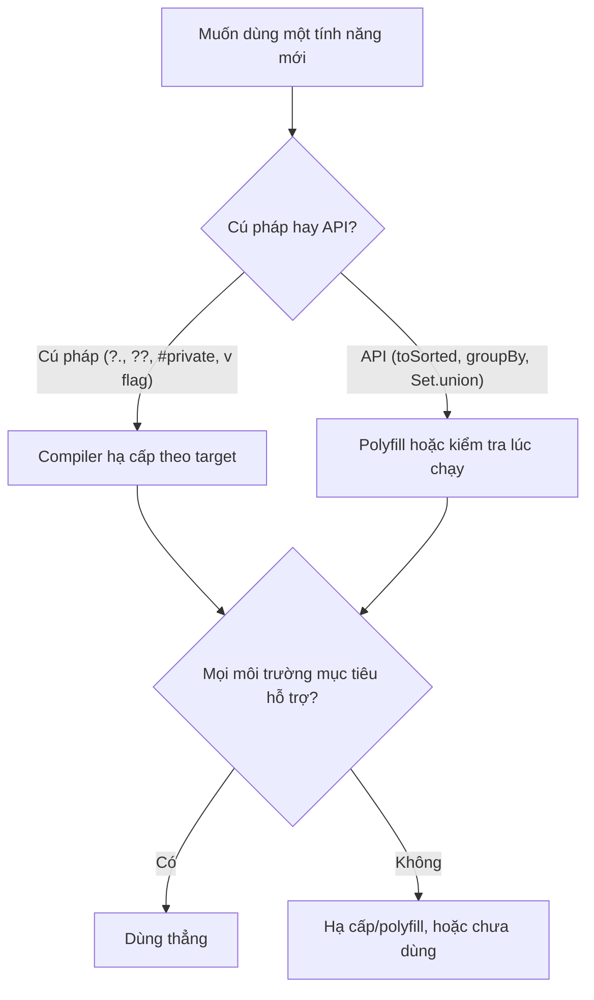

# Lý thuyết 14: JavaScript hiện đại (ES2020 đến ES2025)

Bài cuối của bộ JavaScript tổng hợp những tính năng ngôn ngữ và thư viện chuẩn xuất hiện từ khoảng 2020 đến 2025: cái nào đã thành thói quen hằng ngày, cái nào còn mới, cái nào Node 22 chưa có, và quan trọng nhất là cách kiểm tra hỗ trợ trước khi dùng trong dự án thật. Mọi tính năng trong bảng đều được thử trực tiếp trên Node 22.

## JavaScript hiện đại là gì?

Hãy nghĩ đến một **bộ dụng cụ nhà bếp** được bổ sung đều đặn mỗi năm. Bộ cũ vẫn nấu được mọi món, nhưng món nào cũng cần ba bốn bước phụ: kiểm tra từng cấp có null không, tự dựng bản sao mảng trước khi sắp xếp, tự viết hàm nhóm phần tử. Mỗi bản bổ sung (ES2020, ES2021, ...) thêm một dụng cụ chuyên dụng làm đúng việc đó trong một dòng. Dụng cụ mới tiện, nhưng chỉ dùng được nếu nhà bếp (trình duyệt, Node, môi trường build của bạn) có sẵn nó.

Mỗi năm Ủy ban TC39 chốt một bản **ECMAScript** (ES) gồm các đề xuất đã đi qua các giai đoạn, và đã đến **Stage 4** (hoàn thiện, có test, có ít nhất hai bản cài đặt). Tên "ES2022" chỉ là nhãn năm của bản đặc tả; điều quyết định bạn có dùng được hay không là **engine mục tiêu** của bạn đã cài tính năng đó chưa.

**Cốt lõi:** JavaScript hiện đại không phải ngôn ngữ khác mà là cùng một ngôn ngữ với ít nghi lễ hơn: nhiều thao tác phổ biến đã có cú pháp hoặc hàm chuẩn, bất biến hơn, an toàn hơn. Nhưng "có trong đặc tả" không có nghĩa "chạy ở mọi nơi bạn triển khai". Mỗi tính năng có hai câu hỏi độc lập: nó là cú pháp (cần compiler như Babel/TypeScript chuyển đổi, nếu không engine cũ sẽ báo `SyntaxError` ngay khi tải file) hay là API (chỉ thiếu một hàm, có thể polyfill)?

- Vì cú pháp mới mà engine không hiểu sẽ làm hỏng cả file ngay lúc parse, nên cú pháp phải được compiler hạ cấp theo target build, và không polyfill được.
- Vì API mới chỉ là một hàm hay object bị thiếu, nên thường bù được bằng polyfill (core-js) hoặc kiểm tra tính năng lúc chạy.
- Vì mỗi môi trường (Node, Chrome, Safari, WebView cũ) có tốc độ cập nhật khác nhau, nên phải đối chiếu tính năng với danh sách môi trường dự án cam kết hỗ trợ, thay vì với bản đặc tả.



Mô hình tư duy: trước khi dùng, hỏi hai điều, "đây là cú pháp hay API" và "môi trường nhỏ nhất tôi phải chạy trên đó là gì". Câu trả lời quyết định dùng thẳng, nhờ compiler, nhờ polyfill hay chờ.

## Vấn đề nó giải quyết, và vì sao dev phải nắm

Các tính năng này loại bỏ những đoạn code rườm rà dễ sai (`a && a.b && a.b.c`, `Object.prototype.hasOwnProperty.call`, `JSON.parse(JSON.stringify(x))`) và những lỗi kinh điển (`||` nuốt số 0, `sort()` làm hỏng mảng gốc). Quan trọng hơn, chúng là thứ bạn gặp trong code review, trong thư viện mới và trong câu hỏi phỏng vấn, nên không biết tên và hành vi chính xác sẽ khiến bạn đọc code chậm hoặc viết lại theo cách cũ.

Mặt khác, dùng tính năng mới thiếu kiểm tra là nguồn sự cố thật: trang trắng trên Safari cũ vì một cú pháp, hay lỗi `x.toSorted is not a function` trên Node đời cũ ở server. Bạn cần nắm cả hai vế: biết tính năng, và biết cách xác minh hỗ trợ.

**Tóm tắt:**

- `?.` và `??` xử lý null/undefined an toàn; `??` khác `||` ở chỗ giữ lại `0`, `''`, `false`; `??=`, `||=`, `&&=` gộp phép gán có điều kiện.
- `BigInt` cho số nguyên lớn (hậu tố `n`), không trộn với `Number`; `globalThis` là tên chung cho đối tượng toàn cục ở mọi môi trường.
- `Promise.allSettled` chờ tất cả, `Promise.any` lấy cái thành công đầu tiên, `Promise.withResolvers` tách `resolve`/`reject` ra ngoài.
- `at`, `findLast`, `Object.hasOwn`, `replaceAll`, `structuredClone`, `Error` với `cause` thay cho nhiều đoạn tự viết.
- `toSorted`, `toReversed`, `toSpliced`, `with` là bản bất biến của `sort`, `reverse`, `splice`, gán theo chỉ số; `Object.groupBy` và `Map.groupBy` nhóm phần tử.
- Class có field công khai, `#private`, `static {}`; module có top-level await và import attributes (JSON modules).
- Set methods (`union`, `intersection`...) và iterator helpers (`map`, `filter`, `take`...) có sẵn trên Node 22; `Promise.try`, `RegExp.escape`, cờ modifier regex, `Temporal` thì chưa.
- Kiểm tra hỗ trợ bằng MDN, caniuse, browserslist và Babel; cú pháp dựa vào compiler, API dựa vào polyfill, và target build là quyết định của dự án.

## Các khái niệm cần biết

- **ECMAScript (ES)**: đặc tả ngôn ngữ do TC39 duy trì. JavaScript là cách cài đặt phổ biến của nó.
- **TC39 stage**: các giai đoạn của một đề xuất: Stage 0 (ý tưởng), 1 (đề xuất), 2 (bản nháp), 2.7 (đã duyệt, chờ test), 3 (ứng viên, chờ phản hồi cài đặt), 4 (hoàn thiện, vào bản đặc tả kế tiếp).
- **Engine**: V8 (Chrome, Node), SpiderMonkey (Firefox), JavaScriptCore (Safari). Mỗi engine cài tính năng vào thời điểm khác nhau.
- **Cú pháp mới vs API mới**: cú pháp mới (như `?.`) làm engine cũ lỗi lúc parse; API mới (như `toSorted`) chỉ lỗi lúc gọi nếu thiếu.
- **Transpile**: chuyển cú pháp mới sang cú pháp cũ tương đương, bởi Babel, TypeScript, SWC hay esbuild.
- **Polyfill**: đoạn code bổ sung một API còn thiếu ở môi trường cũ, ví dụ qua `core-js`.
- **Target build**: danh sách môi trường mà sản phẩm sau khi build phải chạy được (qua `browserslist`, hoặc `target` của TypeScript/esbuild).
- **Immutable method (bản bất biến)**: phương thức trả về bản sao đã thay đổi, giữ nguyên mảng gốc.
- **Feature detection**: kiểm tra tính năng lúc chạy (`typeof Array.prototype.toSorted === 'function'`) thay vì đoán theo tên trình duyệt.

## Bảng tổng hợp: tính năng, bản ES, ví dụ, khi nào dùng

Cột Node 22 phản ánh kết quả thử thật trên Node v22.23.4. "Có" nghĩa là chạy đúng; "Chưa" nghĩa là không có hoặc báo lỗi cú pháp. Cột bản ES theo mốc đặc tả đã công bố (tính năng có thể đã được trình duyệt cài sớm hơn nhiều); với mục ghi "Web API", tính năng thuộc đặc tả HTML hoặc môi trường chứ không thuộc ECMAScript.

| Tính năng | Bản ES | Ví dụ ngắn | Khi nào dùng | Node 22 |
|---|---|---|---|---|
| Optional chaining | ES2020 | `u.profile?.name` | Truy cập sâu có thể thiếu | Có |
| Nullish coalescing | ES2020 | `x ?? 5` | Giá trị mặc định mà `0`/`''` là hợp lệ | Có |
| BigInt | ES2020 | `2n ** 64n` | Số nguyên vượt `2^53`, ID lớn | Có |
| globalThis | ES2020 | `globalThis.fetch` | Code chạy cả Node lẫn trình duyệt | Có |
| Promise.allSettled | ES2020 | `await Promise.allSettled(ps)` | Chạy song song, cần kết quả từng cái kể cả lỗi | Có |
| Logical assignment | ES2021 | `a ??= 9` | Gán mặc định có điều kiện | Có |
| Promise.any | ES2021 | `await Promise.any(ps)` | Lấy nguồn nhanh/thành công đầu tiên | Có |
| replaceAll | ES2021 | `s.replaceAll('-', '+')` | Thay mọi lần xuất hiện, không cần regex | Có |
| Array.prototype.at | ES2022 | `arr.at(-1)` | Lấy phần tử từ cuối | Có |
| Object.hasOwn | ES2022 | `Object.hasOwn(o, 'k')` | Kiểm tra key riêng, thay `hasOwnProperty.call` | Có |
| Error cause | ES2022 | `new Error('a', { cause: e })` | Bọc lỗi mà giữ lỗi gốc | Có |
| Class fields, `#private`, `static {}` | ES2022 | `#pin = '1'` | Đóng gói thật sự, khởi tạo static phức tạp | Có |
| Top-level await | ES2022 | `const x = await f()` (trong module) | Khởi tạo bất đồng bộ ở cấp module | Có (chỉ ESM) |
| structuredClone | Web API | `structuredClone(o)` | Sao chép sâu `Date`, `Map`, `Set` | Có |
| findLast, findLastIndex | ES2023 | `arr.findLast(p)` | Tìm từ cuối mảng | Có |
| toSorted, toReversed, toSpliced, with | ES2023 | `arr.toSorted()` | Sắp xếp/sửa mà không đổi mảng gốc (state bất biến) | Có |
| Object.groupBy, Map.groupBy | ES2024 | `Object.groupBy(xs, f)` | Nhóm theo khóa | Có |
| Promise.withResolvers | ES2024 | `const { promise, resolve } = Promise.withResolvers()` | Resolve từ ngoài callback | Có |
| RegExp `v` flag | ES2024 | `/[\p{L}--[a-z]]/v` | Phép trừ/giao tập ký tự Unicode | Có |
| Named groups | ES2018 | `(?<nam>\d{4})` | Đặt tên cho nhóm bắt | Có |
| Set methods | ES2025 | `a.union(b)` | Phép toán tập hợp | Có |
| Iterator helpers | ES2025 | `it.map(f).take(2).toArray()` | Xử lý lazy trên iterator/generator | Có |
| Import attributes (JSON modules) | ES2025 | `import c from './c.json' with { type: 'json' }` | Nạp JSON như module | Có |
| Array.fromAsync | ES2026 (dự kiến) | `await Array.fromAsync(gen)` | Gom async iterable thành mảng | Có |
| Duplicate named groups | ES2025 | `(?<y>..)\|(?<y>..)` | Cùng tên nhóm ở nhánh `\|` khác nhau | Chưa |
| RegExp modifiers | ES2025 | `(?i:a)b` | Bật/tắt cờ cho một phần regex | Chưa |
| Promise.try | ES2025 | `Promise.try(fn)` | Bọc hàm sync/async thành Promise | Chưa |
| RegExp.escape | ES2025 | `RegExp.escape(s)` | Thoát ký tự đặc biệt khi dựng regex | Chưa |

Lưu ý về cột bản ES: các mốc năm của vài mục gần đây (ES2025, ES2026) có thể được TC39 xếp lại; hãy đối chiếu danh sách "Finished Proposals" của TC39 khi cần chính xác. Còn cột Node 22 là sự thật đã đo, nhưng sẽ đổi theo bản Node bạn dùng.

**Phải thuộc:** cú pháp mới không polyfill được, API mới thì có thể. Cú pháp mà engine không hiểu làm hỏng cả file lúc parse, vì vậy tính năng cú pháp (`?.`, `??`, `#private`, `static {}`, cờ `v`, `with { type }`) phải do compiler chuyển đổi nếu target cần.

Các mục dưới đây đi qua từng nhóm, kèm ví dụ chạy thật.

## Toán tử và giá trị cơ bản

```javascript
const user = { profile: null, tags: ['a'] };
console.log(user.profile?.name, user.tags?.[0], user.greet?.());

console.log(0 ?? 5, null ?? 5, '' || 'mac dinh', '' ?? 'mac dinh');

let a = null, b = 0, c = 1;
a ??= 9;   // gán nếu a là null/undefined
b ||= 7;   // gán nếu b là falsy
c &&= 3;   // gán nếu c là truthy
console.log(a, b, c);

console.log(Number.MAX_SAFE_INTEGER + 2);
console.log(BigInt(Number.MAX_SAFE_INTEGER) + 2n);
console.log(2n ** 64n, typeof 1n);
try { 1n + 1; } catch (e) { console.log(e.name + ': ' + e.message); }
console.log(globalThis === global, 1_000_000);
```

```text
undefined a undefined
0 5 mac dinh 
9 7 3
9007199254740992
9007199254740993n
18446744073709551616n bigint
TypeError: Cannot mix BigInt and other types, use explicit conversions
true 1000000
```

_Đã chạy thử trên Node 22._

Một dòng ghi chú về kết quả: ở dòng thứ hai, `'' ?? 'mac dinh'` in ra chuỗi rỗng (nên cuối dòng có khoảng trắng), trong khi `'' || 'mac dinh'` lấy giá trị mặc định. Đó là khác biệt cốt lõi giữa `??` và `||`: `??` chỉ thay khi giá trị là `null` hoặc `undefined`.

`BigInt` giải quyết trường hợp số nguyên vượt `Number.MAX_SAFE_INTEGER` (khoảng 9 triệu tỷ): ở ví dụ trên, `Number` cho ra `9007199254740992` (sai, phải là `...994`), còn `BigInt` cho `9007199254740993n`. Nhưng `BigInt` không trộn với `Number` (lỗi `TypeError`), không dùng được với `Math.*`, và `JSON.stringify` không tuần tự hóa được nó nếu không tự xử lý. Chỉ dùng khi thật sự cần số nguyên lớn (ID 64 bit, tiền tính theo đơn vị nhỏ nhất rất lớn).

`globalThis` giúp code thư viện không phải đoán `window`, `self`, `global`. Dấu gạch dưới trong số (`1_000_000`) chỉ để dễ đọc.

**Lưu ý:** `?.` chỉ bảo vệ khỏi `null`/`undefined`, không phải mọi giá trị "rỗng". Và đừng lạm dụng: nếu thuộc tính bắt buộc phải có, để lỗi nổ lên còn hơn lặng lẽ trả `undefined` rồi hỏng ở chỗ khác.

**Nhớ:** `??` cho mặc định đúng nghĩa, `||` chỉ khi bạn muốn coi mọi falsy là "thiếu".

## Promise và bất đồng bộ

```javascript
const kq = await Promise.allSettled([Promise.resolve(1), Promise.reject(new Error('x')), 3]);
console.log(kq.map((r) => r.status));
console.log(await Promise.any([Promise.reject(1), Promise.resolve(2)]));
try {
  await Promise.any([Promise.reject(1), Promise.reject(2)]);
} catch (e) {
  console.log(e.name, e.errors);
}
const { promise, resolve } = Promise.withResolvers();
setTimeout(() => resolve('xong'), 10);
console.log(await promise);

async function* nguon() { yield 1; yield 2; }
console.log(await Array.fromAsync(nguon()));
console.log(await Array.fromAsync([Promise.resolve('a'), 'b']));
```

```text
[ 'fulfilled', 'rejected', 'fulfilled' ]
2
AggregateError [ 1, 2 ]
xong
[ 1, 2 ]
[ 'a', 'b' ]
```

_Đã chạy thử trên Node 22._

Cách chọn: `Promise.all` khi một lỗi là đủ để hủy cả việc; `Promise.allSettled` khi muốn biết kết quả từng việc (ví dụ gửi nhiều thông báo, báo cáo cái nào lỗi); `Promise.any` khi chỉ cần một nguồn thành công (gọi nhiều mirror), và nếu tất cả lỗi thì nhận `AggregateError` chứa mọi lý do. Ba hàm này đã giải thích chi tiết ở [Promise và async/await](/go?p=13-JavaScript%2Fmedium%2Flt-08-promise-va-async-await.md).

`Promise.withResolvers()` thay cho mẫu cũ `let resolve; new Promise((r) => { resolve = r; })`, hữu ích khi việc hoàn thành do một sự kiện bên ngoài quyết định. `Array.fromAsync` gom async iterable (hoặc iterable chứa Promise) thành mảng và chờ từng phần tử; với Node 22 nó đã có, nhưng một số trình duyệt cũ thì chưa, nên cần kiểm tra bảng tương thích.

**Top-level await** cho phép `await` ngay ở cấp module, không cần bọc trong hàm `async`. Nó chỉ dùng được trong **ES module**: ở file CommonJS, đoạn `await 1` báo `SyntaxError` (đã thử trên Node 22). Module chứa top-level await làm các module import nó phải chờ, nên tránh dùng cho thao tác chậm ở module được import khắp nơi. Chi tiết về module nằm ở [Module và xử lý lỗi](/go?p=13-JavaScript%2Fmedium%2Flt-09-module-va-xu-ly-loi.md).

```javascript
// config.mjs
const res = await fetch('https://example.com/config.json');
export const config = await res.json();
```

_Minh họa, chưa chạy thử._

**Nhớ:** chọn theo câu hỏi "cần mọi thứ", "cần mọi kết quả", hay "cần một cái đúng". Top-level await chỉ có trong ESM và làm module chờ.

## Chuỗi, mảng, object và lỗi

```javascript
console.log('a-b-c'.replaceAll('-', '+'), [1, 2, 3].at(-1), 'abc'.at(-2));
console.log(Object.hasOwn({ a: 1 }, 'a'), Object.hasOwn({}, 'toString'));
console.log([1, 2, 3, 4].findLast((x) => x % 2), [1, 2, 3, 4].findLastIndex((x) => x > 9));

const goc = [3, 1, 2];
console.log(goc.toSorted(), goc.toReversed(), goc.toSpliced(1, 1), goc.with(0, 9));
console.log(goc);

console.log(Object.groupBy([1, 2, 3, 4], (x) => (x % 2 ? 'le' : 'chan')));
console.log(Map.groupBy([1, 2, 3, 4], (x) => (x % 2 ? 'le' : 'chan')));

const o = { d: new Date(0), m: new Map([[1, 2]]) };
const sao = structuredClone(o);
console.log(sao.d instanceof Date, sao.m.get(1), sao !== o);
try { structuredClone({ f() {} }); } catch (e) { console.log(e.name); }

const loi = new Error('không đọc được cấu hình', { cause: new Error('file thiếu') });
console.log(loi.cause.message);
```

```text
a+b+c 3 b
true false
3 -1
[ 1, 2, 3 ] [ 2, 1, 3 ] [ 3, 2 ] [ 9, 1, 2 ]
[ 3, 1, 2 ]
[Object: null prototype] { le: [ 1, 3 ], chan: [ 2, 4 ] }
Map(2) { 'le' => [ 1, 3 ], 'chan' => [ 2, 4 ] }
true 2 true
DataCloneError
file thiếu
```

_Đã chạy thử trên Node 22._

Vài điểm đáng nhớ từ kết quả:

- `toSorted`, `toReversed`, `toSpliced`, `with` trả về mảng mới và mảng gốc `goc` vẫn là `[3, 1, 2]`. Trong React hay Redux, nơi state phải bất biến, đây là cách sửa danh sách không cần sao chép tay. Ngược lại `sort()` và `reverse()` cũ **đổi mảng gốc**, một nguồn lỗi kinh điển. Các phương thức này mới hơn (2023), nên với trình duyệt cũ cần polyfill hoặc dùng `[...arr].sort()`.
- `Object.groupBy` trả về object **không có prototype** (`[Object: null prototype]`), an toàn với khóa như `toString` nhưng không có `hasOwnProperty`; dùng `Object.hasOwn` hoặc `in`. `Map.groupBy` dùng được khi khóa không phải chuỗi.
- `structuredClone` sao chép sâu và giữ đúng `Date`, `Map`, `Set` (khác `JSON.parse(JSON.stringify(x))` làm mất kiểu), nhưng **không clone được hàm** (ném `DataCloneError`) và không giữ prototype của class. Nó thuộc Web API/môi trường chứ không thuộc ECMAScript, nhưng có trong Node 17 trở lên và mọi trình duyệt hiện đại.
- `Error` với `cause` giữ chuỗi nguyên nhân khi bọc lỗi. Đây là cách ghi lại "lỗi tầng trên vì lỗi tầng dưới" mà không mất stack gốc; xem thêm trong [Module và xử lý lỗi](/go?p=13-JavaScript%2Fmedium%2Flt-09-module-va-xu-ly-loi.md).

**Lưu ý:** `Object.hasOwn(obj, key)` thay `obj.hasOwnProperty(key)` vì an toàn với object tạo bằng `Object.create(null)` và với object có ghi đè `hasOwnProperty`.

**Nhớ:** muốn bất biến thì chọn bản `to...`/`with`, muốn nhóm thì `groupBy`, muốn sao chép sâu dữ liệu thuần thì `structuredClone`.

## Class và module hiện đại

```javascript
class TaiKhoan {
  so = 0;                 // class field công khai
  #pin = '1234';          // private field
  static soLuong = 0;
  static { TaiKhoan.soLuong = 5; }   // static block
  kiemTra(pin) { return pin === this.#pin; }
  static laTaiKhoan(o) { return #pin in o; }  // ergonomic brand check
}
const t = new TaiKhoan();
console.log(t.so, t.kiemTra('1234'), TaiKhoan.soLuong);
console.log(TaiKhoan.laTaiKhoan(t), TaiKhoan.laTaiKhoan({}));
console.log(Object.keys(t), t.pin);
```

```text
0 true 5
true false
[ 'so' ] undefined
```

_Đã chạy thử trên Node 22._

Field `#pin` nằm hẳn bên trong class: không hiện ở `Object.keys`, không truy cập được từ bên ngoài, và truy cập bằng cách khác ngoài class là `SyntaxError`, khác với quy ước `_pin` chỉ là thỏa thuận. `static {}` cho phép chạy code khởi tạo phức tạp một lần cho class (ví dụ đọc cấu hình, đăng ký). Kiểm tra `#pin in o` cho biết object có thật sự được tạo bởi class đó. Nguyên lý class và prototype xem ở [Prototype và class](/go?p=13-JavaScript%2Fmedium%2Flt-07-prototype-va-class.md).

**Import attributes** (trước đây gọi là import assertions) cho phép nạp JSON như một module với khai báo kiểu tường minh:

```javascript
import cfg from './data.json' with { type: 'json' };
console.log(cfg);
const m = await import('./data.json', { with: { type: 'json' } });
console.log(m.default.name);
```

```text
{ name: 'demo', v: 1 }
demo
```

_Đã chạy thử trên Node 22._

Nếu bỏ phần `with { type: 'json' }`, Node 22 báo `ERR_IMPORT_ATTRIBUTE_MISSING` (đã thử). Lý do thuộc về bảo mật: server không được phép lừa trình duyệt thực thi một file JSON như JavaScript, nên kiểu phải được khai báo rõ. Cú pháp cũ `assert { type: 'json' }` đã bị thay bởi `with`; nếu bạn thấy `assert` trong tài liệu cũ thì nên đổi.

## Set methods, iterator helpers và regex

```javascript
const a = new Set([1, 2, 3]), b = new Set([2, 3, 4]);
console.log(a.union(b), a.intersection(b), a.difference(b));
console.log(a.symmetricDifference(b), a.isSubsetOf(b), a.isDisjointFrom(new Set([9])));

const ketQua = [1, 2, 3, 4, 5].values()
  .filter((x) => x % 2 === 1)
  .map((x) => x * 10)
  .take(2)
  .toArray();
console.log(ketQua);

function* vohan() { let i = 0; while (true) yield i++; }
console.log(vohan().drop(3).take(3).toArray());
console.log(typeof Iterator, vohan().some((x) => x > 5));
```

```text
Set(4) { 1, 2, 3, 4 } Set(2) { 2, 3 } Set(1) { 1 }
Set(2) { 1, 4 } false true
[ 10, 30 ]
[ 3, 4, 5 ]
function true
```

_Đã chạy thử trên Node 22._

Set methods thay cho vòng lặp thủ công khi cần hợp, giao, hiệu của hai tập. **Iterator helpers** là điểm đáng chú ý: chúng xử lý **lazy** (từng phần tử khi cần), nên áp được lên generator vô hạn như `vohan()` mà không treo, điều không thể làm với `Array.prototype.map` vì phải có mảng hữu hạn trước. Nền tảng về iterator và generator nằm ở [Iterator và generator](/go?p=13-JavaScript%2Fhard%2Flt-11-iterator-generator.md). Hai nhóm này mới vào ES2025 nên trình duyệt cũ chưa có, và nên kiểm tra bảng tương thích trước khi dùng cho web.

```javascript
const re = /(?<nam>\d{4})-(?<thang>\d{2})/;
const { nam, thang } = '2025-03-09'.match(re).groups;
console.log(nam, thang);
console.log('2025-03'.replace(re, '$<thang>/$<nam>'));

const chuHoaKhongPhaiAscii = new RegExp('[\\p{L}--[a-z]]', 'v');
console.log(chuHoaKhongPhaiAscii.test('a'), chuHoaKhongPhaiAscii.test('Đ'));
console.log(new RegExp('[\\p{L}&&\\p{ASCII}]', 'v').test('é'));

for (const [ten, mau] of [['trùng tên group', '(?<y>\\d{4})-\\d\\d|\\d\\d-(?<y>\\d{4})'], ['modifier (?i:...)', '(?i:a)b']]) {
  try { new RegExp(mau); console.log(ten, 'chạy được'); }
  catch (e) { console.log(ten, '->', e.name); }
}
```

```text
2025 03
03/2025
false true
false
trùng tên group -> SyntaxError
modifier (?i:...) -> SyntaxError
```

_Đã chạy thử trên Node 22._

Named groups cho phép truy cập qua `groups` và dùng `$<tên>` khi thay thế, dễ đọc hơn `$1`, `$2`. Cờ `v` (unicodeSets) thêm phép trừ `--`, giao `&&` giữa các tập ký tự Unicode, ví dụ "chữ cái nhưng không phải a đến z". Hai tính năng regex ES2025 là tên nhóm trùng nhau ở các nhánh `|` khác nhau và modifier `(?i:...)`: Node 22 **chưa hỗ trợ** (cả hai báo `SyntaxError` khi tạo regex). Vì là cú pháp regex, polyfill không cứu được; chỉ có thể tránh dùng, hoặc viết cách khác.

**Phải thuộc:** có tính năng ở đặc tả và có tính năng ở engine bạn đang dùng là hai việc khác nhau. Luôn thử trên đúng môi trường mục tiêu hoặc tra bảng tương thích.

## Chưa có trên Node 22

Một số mục đã vào hoặc sắp vào đặc tả nhưng chưa có ở Node 22.23.4:

```javascript
const kiem = {
  'Promise.try': typeof Promise.try,
  'RegExp.escape': typeof RegExp.escape,
  'Error.isError': typeof Error.isError,
  'Math.sumPrecise': typeof Math.sumPrecise,
  'Uint8Array.prototype.toBase64': typeof Uint8Array.prototype.toBase64,
  'Intl.DurationFormat': typeof Intl.DurationFormat,
  'Temporal': typeof Temporal,
  'Symbol.dispose': typeof Symbol.dispose,
};
console.table(kiem);
```

```text
┌───────────────────────────────┬─────────────┐
│ (index)                       │ Values      │
├───────────────────────────────┼─────────────┤
│ Promise.try                   │ 'undefined' │
│ RegExp.escape                 │ 'undefined' │
│ Error.isError                 │ 'undefined' │
│ Math.sumPrecise               │ 'undefined' │
│ Uint8Array.prototype.toBase64 │ 'undefined' │
│ Intl.DurationFormat           │ 'undefined' │
│ Temporal                      │ 'undefined' │
│ Symbol.dispose                │ 'symbol'    │
└───────────────────────────────┴─────────────┘
```

_Đã chạy thử trên Node 22._

Kết quả `'undefined'` chỉ nói rằng **Node 22 này** chưa có; trình duyệt mới có thể đã có từ lâu và Node bản mới hơn cũng có thể đã có. Đó là lý do bạn phải kiểm tra theo môi trường, không theo bài viết. (`Symbol.dispose` có mặt vì Node bổ sung sớm cho tính năng quản lý tài nguyên tường minh, nhưng cú pháp `using` đi kèm không nằm trong phạm vi bài này.)

## Temporal và Decorators: đề xuất và giai đoạn

Hai đề xuất lớn mà bạn sẽ nghe nhiều. Vì trạng thái giai đoạn và hỗ trợ trình duyệt thay đổi theo từng quý, phần này chỉ nêu bản chất, còn giai đoạn hiện hành hãy tra tại kho `tc39/proposals` và bảng tương thích MDN.

**Temporal** là API ngày giờ thay cho `Date`. Vấn đề của `Date` là mutable, múi giờ lẫn lộn, tháng đếm từ 0, parse không nhất quán. Temporal tách rõ các kiểu: `Temporal.PlainDate` (ngày không múi giờ), `Temporal.ZonedDateTime` (có múi giờ), `Temporal.Instant` (một thời điểm tuyệt đối), `Temporal.Duration` (khoảng thời gian), và các object bất biến. Ở thời điểm thử, **Node 22 chưa có `Temporal`** (`typeof Temporal` là `'undefined'`). Trình duyệt mới có thể đã phát hành; nếu cần dùng sớm, dùng polyfill (ví dụ `@js-temporal/polyfill`) và chấp nhận kích thước bundle tăng. Đừng viết thêm nhiều logic dựa trên `Date` nếu bạn đang thiết kế phần xử lý thời gian lớn. Nền tảng `Date` xem ở [String, Number, Date, JSON](/go?p=13-JavaScript%2Feasy%2Flt-04-string-number-date-json.md).

**Decorators** là cú pháp `@ten` gắn lên class, method, accessor để bọc hoặc thay đổi hành vi, ví dụ logging, binding, đo thời gian. Đề xuất decorators chuẩn đã ở giai đoạn cuối (Stage 3) trong thời gian dài; nó khác bản "experimental decorators" cũ mà Angular và một số thư viện (NestJS, TypeORM) từng dựa vào bằng TypeScript. TypeScript 5.0 trở lên hỗ trợ decorators theo chuẩn mới, còn cờ `experimentalDecorators` giữ cho hành vi cũ. Hai bản **không tương thích** nhau, nên khi dự án dùng framework dựa vào decorators, hãy theo cấu hình mà framework yêu cầu.

**Nhớ:** Stage 3 trở xuống chưa phải chuẩn, có thể đổi; Stage 4 mới vào đặc tả. Dùng đề xuất chưa chuẩn trong sản phẩm lâu dài đồng nghĩa nhận rủi ro đổi cú pháp.

## Cách kiểm tra hỗ trợ: MDN, caniuse, Babel và browserslist

Quy trình đáng tin cậy gồm bốn bước:

1. **Tra MDN** (mục "Browser compatibility" cuối trang tính năng): cho biết từng trình duyệt, từng bản Node bắt đầu hỗ trợ từ phiên bản nào, kèm cờ thử nghiệm và ghi chú khác biệt. Đây là nguồn chi tiết nhất cho cả cú pháp lẫn API.
2. **Tra caniuse** để xem tỷ lệ người dùng toàn cầu có hỗ trợ, và so sánh với số liệu truy cập thực tế của sản phẩm bạn (analytics) để quyết định.
3. **Khai báo target bằng `browserslist`** (trong `package.json` hoặc `.browserslistrc`) để các công cụ như Babel, Autoprefixer, `eslint-plugin-compat` cùng đọc một danh sách môi trường.
4. **Kiểm tra thật** ở môi trường đích (trình duyệt cũ nhất cần hỗ trợ, bản Node chạy server), vì bảng tương thích đôi khi không phản ánh bug hoặc hỗ trợ một phần.

```javascript
// package.json (rút gọn)
// "browserslist": [">0.5%", "last 2 versions", "not dead", "Safari >= 15"]

// Feature detection lúc chạy cho một API mới
const sapXep = typeof Array.prototype.toSorted === 'function'
  ? (xs) => xs.toSorted()
  : (xs) => [...xs].sort();
```

_Minh họa, chưa chạy thử._

**Babel và polyfill.** Babel (qua `@babel/preset-env`) đọc `browserslist` và **chuyển đổi cú pháp** (`?.`, `??`, class fields...) sang dạng cũ tương đương. Nó không tự thêm API còn thiếu; phần đó do **polyfill** đảm nhiệm, thường là `core-js`. Với `preset-env`, tùy chọn `useBuiltIns: 'usage'` chỉ nạp polyfill cho API mà code của bạn thật sự dùng, và `corejs` khai báo phiên bản. Giới hạn cần biết: có những thứ polyfill không thể mô phỏng đúng (ví dụ các tính năng cần hỗ trợ sâu từ engine như một số thuộc tính của `Temporal`, `WeakRef`, hay hành vi regex ở mức cú pháp), nên đôi khi đáp án là "chưa dùng".

**Nền tảng:** compiler giải quyết cú pháp, polyfill giải quyết API, `browserslist` là nguồn sự thật chung cho cả hai. Tính năng nào không thuộc hai nhóm trên cần được kiểm tra lúc chạy hoặc tránh dùng.

## Chọn cú pháp mới trong dự án thực tế

Nguyên tắc: tính năng nào chọn dùng cũng phải trả lời được "ai chạy nó". Hãy tách ba kiểu môi trường chạy khác nhau vì chúng có quy tắc khác nhau.

- **Server (Node)**: bạn kiểm soát bản Node, nên cứ dùng những gì bản Node đó chạy được, không cần Babel. Ghi bản Node tối thiểu ở `engines` trong `package.json` và CI. Ví dụ trên Node 22 bạn dùng thoải mái `toSorted`, `groupBy`, Set methods, iterator helpers, nhưng chưa dùng `Promise.try`.
- **Frontend chạy ở trình duyệt người dùng**: bạn không kiểm soát bản trình duyệt, nên mọi thứ qua `browserslist`. Đặt target hợp lý (ví dụ các bản trình duyệt hiện đại đã hỗ trợ ES2020 hoặc ES2022) để bundler giảm bớt chuyển đổi, bundle nhỏ hơn. Target càng cũ thì bundle càng nặng và chạy càng chậm.
- **Thư viện phát hành cho người khác**: xuất ra mức cú pháp thấp vừa đủ (thường ES2018 đến ES2020), đừng tự gói polyfill vào thư viện; tài liệu hóa API nào cần polyfill để người dùng cuối quyết định.

**TypeScript target.** Trong `tsconfig.json`, `target` quyết định mức cú pháp output (TypeScript hạ cấp cú pháp như `?.` nếu target thấp), còn `lib` quyết định API nào **type-check chấp nhận** (ví dụ `lib: ["ES2023"]` mới cho phép gọi `toSorted` mà không báo lỗi). Điều quan trọng: `lib` chỉ là khai báo kiểu, **không thêm API vào runtime**, nên bạn vẫn phải bảo đảm runtime có API đó (hoặc polyfill). Hai cờ này lệch nhau là nguồn lỗi hay gặp: code type-check xong, build xong, rồi nổ ở môi trường cũ. Chi tiết cấu hình nằm ở bài TypeScript nâng cao cuối bài.

```json
{
  "compilerOptions": {
    "target": "ES2022",
    "lib": ["ES2023", "DOM"],
    "module": "ESNext",
    "moduleResolution": "Bundler"
  }
}
```

_Minh họa, chưa chạy thử._

Một checklist ngắn khi muốn dùng tính năng mới:

1. Đó là cú pháp hay API? (quyết định compiler hay polyfill)
2. Môi trường cũ nhất cần hỗ trợ có nó không? (MDN, caniuse, thử thật)
3. Nếu không: hạ cấp bằng compiler, thêm polyfill, hay chưa dùng?
4. Giá phải trả là gì? (kích thước bundle, độ phức tạp build)
5. Đã khai báo ở một chỗ duy nhất chưa (`browserslist`, `engines`, `tsconfig`)?

**Lưu ý:** đừng nâng `target` chỉ vì "nghe mới". Mỗi mức hạ cấp tốn kích thước bundle, nhưng nâng quá đà làm hỏng người dùng ở trình duyệt cũ mà bạn cam kết hỗ trợ. Quyết định bằng số liệu truy cập thực tế.

**Nhớ:** tính năng mới chỉ có giá trị khi chạy được ở nơi bạn triển khai. Khai báo môi trường mục tiêu một lần, rồi để công cụ lo phần còn lại.

## Bẫy thường gặp

| Bẫy | Biểu hiện | Cách tránh |
|---|---|---|
| Dùng `\|\|` làm mặc định | `0`, `''`, `false` bị thay nhầm | Dùng `??` |
| Trộn `BigInt` và `Number` | `TypeError: Cannot mix BigInt...` | Chuyển đổi tường minh, hoặc chỉ dùng một kiểu |
| `JSON.stringify` với `BigInt` | Ném lỗi serialize | Chuyển sang chuỗi trước |
| Quen `sort()` | Mảng gốc bị đổi, state hỏng | `toSorted()` hoặc `[...arr].sort()` |
| `structuredClone` với hàm/class | `DataCloneError`, mất prototype | Chỉ clone dữ liệu thuần |
| `await` ở file CommonJS | `SyntaxError` | Dùng ESM, hoặc bọc trong hàm `async` |
| Quên `with { type: 'json' }` | `ERR_IMPORT_ATTRIBUTE_MISSING` | Khai báo import attribute |
| Dùng API mới, `lib` cho phép nhưng runtime thiếu | Type-check qua, chạy lỗi `is not a function` | Polyfill hoặc feature detection |
| Dùng cú pháp mới mà không transpile | `SyntaxError` làm trắng cả trang | Đặt `browserslist`, để compiler xử lý |
| Tin bảng bản ES thay vì thử thật | Tính năng ES2025 nhưng engine chưa có | Thử trên môi trường đích, tra MDN |
| Dựa vào đề xuất chưa Stage 4 | Cú pháp đổi giữa chừng | Chờ chuẩn hoặc chấp nhận rủi ro có kiểm soát |

## Câu hỏi phỏng vấn thường gặp

Mỗi câu có chuỗi: gợi ý suy luận, lập luận, đáp án ngắn, điều cần nhớ. Thử tự đi theo gợi ý trước khi đọc tiếp.

### 1. `??` khác `||` ở điểm nào? Khi nào chọn cái nào?

**Câu hỏi:** Cấu hình `pageSize` cho phép người dùng nhập `0` làm giá trị hợp lệ. Bạn viết `pageSize = input || 10` và gặp lỗi. Vì sao và sửa thế nào?

**Gợi ý suy luận:**
- Những giá trị nào được coi là falsy trong JavaScript?
- Giá trị nào mà `??` coi là "thiếu"?
- Có trường hợp nào bạn thật sự muốn thay cả `''` hay `0` bằng mặc định không?

**Lập luận:** `||` trả về vế phải khi vế trái là falsy (`0`, `''`, `false`, `null`, `undefined`, `NaN`), nên `0` bị thay nhầm. `??` chỉ thay khi vế trái là `null` hoặc `undefined`, nên `0` được giữ. Ví dụ đã chạy: `0 ?? 5` ra `0`, còn `'' || 'mac dinh'` ra `'mac dinh'`.

**Đáp án ngắn:** dùng `??` khi `0`, `''`, `false` là giá trị hợp lệ; dùng `||` khi muốn coi mọi falsy là thiếu. Phiên bản gán tương ứng là `??=` và `||=`.

**Nhớ:** `??` kiểm tra "có giá trị hay không", `||` kiểm tra "có truthy hay không".

### 2. Vì sao nên dùng `toSorted()` thay vì `sort()` trong code React/Redux? Có rủi ro tương thích không?

**Câu hỏi:** Component của bạn gọi `items.sort(...)` trên prop và danh sách ở nơi khác bỗng đổi thứ tự. Nguyên nhân là gì và `toSorted` giúp thế nào?

**Gợi ý suy luận:**
- `sort()` trả về mảng mới hay chính mảng gốc đã bị sắp xếp?
- Prop và state có được phép bị sửa trực tiếp trong mô hình bất biến không?
- `toSorted` có sẵn ở mọi môi trường bạn hỗ trợ không?

**Lập luận:** `sort()` sắp xếp tại chỗ và trả về chính mảng gốc, nên mọi nơi giữ cùng tham chiếu đều thấy thay đổi, phá nguyên tắc bất biến và gây render sai. `toSorted()` trả mảng mới và giữ nguyên gốc (đã thấy: `goc` vẫn là `[3, 1, 2]`). Nhưng nó thuộc ES2023, nên môi trường cũ cần polyfill hoặc dùng `[...arr].sort()`.

**Đáp án ngắn:** `toSorted` (cùng `toReversed`, `toSpliced`, `with`) không đổi mảng gốc nên hợp state bất biến. Kiểm tra target hỗ trợ, nếu thiếu thì dùng `[...arr].sort()` hoặc polyfill.

**Nhớ:** muốn bất biến thì sao chép trước khi sắp xếp, hoặc dùng bản `to...`.

### 3. Cú pháp mới và API mới khác nhau thế nào về cách hỗ trợ môi trường cũ?

**Câu hỏi:** Vì sao `a?.b` cần Babel còn `arr.toSorted()` thì có thể dùng polyfill? Một tính năng nào đó polyfill được, tính năng nào thì không?

**Gợi ý suy luận:**
- Điều gì xảy ra khi engine gặp một ký hiệu mà nó không biết ngay ở bước parse?
- Một hàm bị thiếu có thể được định nghĩa thêm bằng code không?
- Compiler có thể viết lại `a?.b` thành cú pháp cũ tương đương không?

**Lập luận:** engine phải parse toàn bộ file trước khi chạy dòng đầu tiên; gặp cú pháp lạ thì ném `SyntaxError` và cả file không chạy. Vì vậy cú pháp phải được compiler viết lại trước (`a == null ? undefined : a.b`). API mới chỉ là một hàm hoặc object bị thiếu, nên code bổ sung (polyfill) có thể định nghĩa nó trước khi dùng. Có vài tính năng cú pháp cũng không có bản viết lại thuần (ví dụ cờ regex mới) và vài API cần hỗ trợ sâu từ engine nên polyfill không đủ.

**Đáp án ngắn:** cú pháp: transpile bằng Babel/TypeScript theo target; API: polyfill (core-js) hoặc feature detection. Tính năng nào mà không viết lại hay mô phỏng đúng được thì chưa dùng cho đến khi mọi môi trường đích có sẵn.

**Nhớ:** cú pháp hỏng ở lúc parse, API hỏng ở lúc gọi.

### 4. Top-level await dùng được ở đâu và có hệ quả gì?

**Câu hỏi:** Bạn viết `const cfg = await loadConfig()` ở đầu file `.js` CommonJS thì báo lỗi. Sửa thế nào, và có điều gì cần cân nhắc khi dùng trong module dùng chung?

**Gợi ý suy luận:**
- Loại module nào hỗ trợ `await` ngoài hàm `async`?
- Module khác import file đó sẽ phải làm gì trong lúc `await` đang chờ?
- Với thao tác chậm, điều đó ảnh hưởng thời gian khởi động thế nào?

**Lập luận:** top-level await chỉ có trong ES module; ở CommonJS nó là `SyntaxError` (đã thử trên Node 22). Module chứa nó trở thành "async module", mọi module phụ thuộc phải chờ nó xong mới chạy tiếp, nên một lời gọi mạng chậm ở module được import khắp nơi sẽ làm chậm toàn bộ khởi động.

**Đáp án ngắn:** chuyển sang ESM (`.mjs` hoặc `"type": "module"`), hoặc bọc trong hàm `async`. Dùng vừa phải, tránh đặt thao tác chậm ở module nền tảng.

**Nhớ:** top-level await làm module chờ; chỉ dùng cho khởi tạo thật sự cần.

### 5. Bạn quyết định target build cho một dự án frontend và dùng tính năng mới như thế nào?

**Câu hỏi:** Sản phẩm của bạn có người dùng trên cả Safari cũ lẫn Chrome mới. Bạn chọn `browserslist`, `tsconfig` và polyfill ra sao để dùng được `toSorted`, `?.` và `#private`?

**Gợi ý suy luận:**
- Số liệu truy cập thực tế cho biết bạn thật sự phải hỗ trợ những môi trường nào?
- Tính năng nào trong ba cái là cú pháp, tính năng nào là API?
- `lib` và `target` trong TypeScript mỗi cái đảm bảo điều gì và không đảm bảo điều gì?

**Lập luận:** khai báo `browserslist` làm nguồn chung dựa trên analytics. `?.` và `#private` là cú pháp nên để Babel/TypeScript/esbuild chuyển đổi theo target; `toSorted` là API nên cần polyfill (hoặc dùng khi mọi môi trường đích đã có). TypeScript `target` điều khiển cú pháp output, `lib` chỉ cho phép type-check các API nhưng không thêm chúng vào runtime, nên phải đảm bảo runtime hoặc polyfill bổ sung.

**Đáp án ngắn:** `browserslist` dựa trên số liệu người dùng; transpile cú pháp theo target; polyfill API còn thiếu (core-js với `useBuiltIns: 'usage'`); TypeScript `target` và `lib` khớp với runtime thật; kiểm thử trên môi trường cũ nhất.

**Nhớ:** target là quyết định sản phẩm dựa trên người dùng, không phải sở thích của dev.

Đây là bài cuối của bộ JavaScript. Bài kế tiếp trong lộ trình là [Lý thuyết 2: TypeScript nâng cao](/go?p=11-Frontend-Core%2Flt-02-typescript-nang-cao.md).

