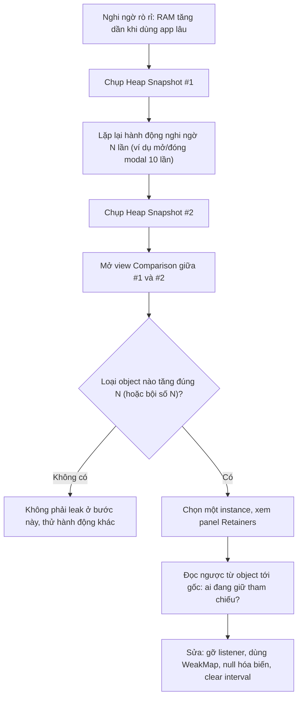

# Lý thuyết 16: Chẩn đoán rò rỉ bộ nhớ bằng heap snapshot và retainer

Bài [Proxy, Reflect, Symbol và WeakRef](/go?p=13-JavaScript%2Fhard%2Flt-12-proxy-reflect-symbol-weakref.md) đã chỉ ra **một** cách sửa kinh điển (đổi `Map` sang `WeakMap` khi cache theo DOM node), và [JavaScript runtime và event loop](/go?p=11-Frontend-Core%2Flt-01-javascript-runtime-event-loop.md) đã nhắc "RAM của tab tăng mãi" như một triệu chứng cần hiểu mô hình thực thi mới giải thích được. Bài này là mắt xích còn thiếu giữa hai bài đó: khi RAM thật sự tăng dần trên production, bạn **tìm** ra chỗ rò rỉ bằng cách nào, trước khi biết phải đổi sang `WeakMap` hay gỡ listener ở đâu. Trọng tâm là quy trình dùng tab Memory của Chrome DevTools, không phải lặp lại danh sách công cụ ngôn ngữ đã học.

**Tóm tắt:**

- "Rò rỉ bộ nhớ" trong ngôn ngữ có garbage collector không có nghĩa là bộ nhớ không bao giờ được cấp phát lại; nó nghĩa là một object **đáng lẽ đã chết** vẫn còn một đường tham chiếu sống dẫn tới nó, nên GC không dám thu hồi.
- Bốn nguồn rò rỉ phổ biến nhất trong code frontend: quên gỡ event listener/timer, closure vô tình giữ một scope lớn hơn cần thiết, cache/map lớn dần không bao giờ bị xóa bớt, và giữ tham chiếu tới DOM node đã bị gỡ khỏi trang (detached node).
- Quy trình chẩn đoán chuẩn trong DevTools: chụp heap snapshot, lặp lại hành động nghi ngờ N lần, chụp snapshot thứ hai, rồi xem view "Comparison" để tìm loại object có số lượng tăng đều theo N mà không bao giờ giảm.
- Panel "Retainers" đọc **từ dưới lên**: chọn một object nghi ngờ, nó cho biết chính xác biến/thuộc tính nào đang giữ tham chiếu tới nó, lần ngược lên tới gốc (thường là `window` hoặc một closure còn sống).
- Bộ lọc "Detached" trong view object của Chrome liệt kê thẳng các DOM node đã rời cây DOM nhưng vẫn bị JS giữ tham chiếu — đây gần như luôn là dấu hiệu rò rỉ, không cần suy luận gián tiếp.
- Allocation instrumentation timeline cho biết object được cấp phát **ở đoạn code nào theo thời gian thực**, hữu ích khi bạn biết hành động nào gây leak nhưng chưa biết dòng code nào.
- Không phải RAM tăng là leak: tăng rồi **giảm lại** khi không dùng nữa (cache hợp lý, dữ liệu đang xử lý) là bình thường; dấu hiệu leak thật là tăng **đều đặn theo số lần lặp hành động** và không bao giờ giảm dù đã gọi GC thủ công.

## Rò rỉ nghĩa là gì khi có garbage collector

Nhiều người mới nghe "memory leak" trong JavaScript thấy lạ: không có `malloc`/`free` thì sao lại rò rỉ được? Garbage collector chỉ thu hồi những object **không còn đường tham chiếu nào dẫn tới** từ gốc (roots: biến toàn cục, call stack hiện tại, closure đang sống). "Rò rỉ" trong ngôn ngữ có GC nghĩa là: bạn vô tình để lại một đường tham chiếu mà bạn **không biết** là nó vẫn còn, nên GC vẫn coi object đó là "đang dùng" dù về mặt logic chương trình nó đã vô dụng từ lâu.

**Cốt lõi:** GC không đọc được ý định của bạn, nó chỉ đọc được đồ thị tham chiếu còn sống. Một object bị "rò rỉ" không phải vì GC hỏng, mà vì code của bạn vô tình nối một sợi dây tham chiếu từ một thứ sống rất lâu (`window`, một closure toàn cục, một mảng tích lũy) tới một thứ đáng lẽ phải chết sớm.

## Bốn nguồn rò rỉ hay gặp nhất

| Nguồn | Cơ chế | Ví dụ |
|---|---|---|
| **Listener/timer quên gỡ** | `addEventListener`/`setInterval` đăng ký vào một target sống lâu (`window`, `document`); target đó giữ tham chiếu tới callback mãi mãi nếu không `removeEventListener`/`clearInterval` | Component React/Vue gắn `window.addEventListener('resize', fn)` ở mount nhưng quên gỡ ở unmount |
| **Closure giữ scope thừa** | Hàm closure chỉ cần một biến nhỏ nhưng được tạo trong cùng scope với dữ liệu lớn; toàn bộ scope (kể cả dữ liệu lớn không dùng tới) sống chừng nào closure còn sống | Xem ví dụ đo RAM thật bên dưới |
| **Cache không giới hạn** | `Map`/object dùng làm cache nhưng không bao giờ xóa entry cũ, lớn dần vô hạn theo thời gian chạy | Cache kết quả theo key là object/DOM node mà không dùng `WeakMap` (xem [bài WeakMap](/go?p=13-JavaScript%2Fhard%2Flt-12-proxy-reflect-symbol-weakref.md)) |
| **Detached DOM node** | Node đã bị `removeChild`/thay thế khỏi cây DOM, nhưng một biến JS (hoặc một closure) vẫn giữ tham chiếu tới nó; trình duyệt không thể giải phóng vùng nhớ của node đó | Lưu `const row = table.rows[0]` rồi sau đó xóa `table` khỏi DOM mà quên `row = null` |

**Phải thuộc:** cả bốn nguồn đều có chung một hình dạng: **ai đó sống lâu đang giữ tham chiếu tới thứ đáng lẽ chết sớm**. Khi debug, luôn đặt câu hỏi "ai đang giữ cái này sống", không phải "tại sao cái này không tự chết".

## Đo thật một closure giữ scope thừa

Thay vì chỉ mô tả, hãy đo RSS (bộ nhớ tiến trình) trước và sau khi dọn tham chiếu, để thấy "giữ tham chiếu" ảnh hưởng RAM thật như thế nào:

```js
function mb(bytes) { return Math.round(bytes / 1024 / 1024); }

// Mô phỏng: một "handler" được đăng ký vào danh sách sống lâu (giống addEventListener trên window),
// nhưng handler đóng gói một mảng lớn không cần thiết trong closure của nó.
const leakedCallbacks = [];

function attachLeaky() {
  const bigData = new Array(1_000_000).fill('x'); // dữ liệu lớn, chỉ cần dùng tức thời
  const handler = () => bigData.length;            // closure vô tình giữ cả bigData sống
  leakedCallbacks.push(handler);                    // không bao giờ gỡ ra -> leak
}

for (let i = 0; i < 20; i++) attachLeaky();
global.gc();
console.log('Sau 20 lần attachLeaky, RSS ~', mb(process.memoryUsage().rss), 'MB');

leakedCallbacks.length = 0; // dọn hết tham chiếu, giống gọi removeEventListener cho mọi handler
global.gc();
console.log('Sau khi dọn và gc(), RSS ~', mb(process.memoryUsage().rss), 'MB');
```

*Đã chạy thử bằng Node (`node --expose-gc`):*

```text
Sau 20 lần attachLeaky, RSS ~ 208 MB
Sau khi dọn và gc(), RSS ~ 55 MB
```

**Suy luận:** `handler` chỉ cần `bigData.length`, nhưng vì nó được định nghĩa cùng scope với `bigData`, closure giữ **toàn bộ** `bigData` sống, không chỉ con số `length`. Mỗi lần gọi `attachLeaky`, một mảng triệu phần tử mới bị giữ sống vĩnh viễn trong `leakedCallbacks` — đúng cơ chế một listener quên gỡ giữ sống mọi thứ nó đóng gói. Khi `leakedCallbacks.length = 0`, không còn đường tham chiếu nào tới các `handler` đó nữa, nên toàn bộ `bigData` đủ điều kiện bị thu hồi, và `global.gc()` (chỉ gọi được khi chạy với cờ `--expose-gc`, bình thường GC tự quyết định thời điểm) xác nhận ngay bằng con số RSS giảm hẳn.

## Quy trình chẩn đoán bằng DevTools

Trên trình duyệt thật (không có `--expose-gc` tiện tay như Node), quy trình chuẩn trong tab **Memory** của Chrome DevTools:



Vài kỹ thuật cụ thể trong quy trình trên:

- **So sánh theo đúng N lần lặp**: nếu bạn mở/đóng modal 10 lần và thấy đúng 10 (hoặc 10 × số object mỗi modal tạo ra) instance của một class tăng lên giữa hai snapshot, gần như chắc chắn đó là leak — con số trùng khớp với số lần lặp là bằng chứng mạnh hơn nhiều so với "RAM có vẻ tăng".
- **Bộ lọc "Detached"**: gõ "Detached" vào ô filter trong view object để liệt kê thẳng các DOM node đã rời cây DOM nhưng JS vẫn giữ — đây gần như luôn là bug, không cần suy luận thêm.
- **Panel Retainers đọc từ dưới lên**: chọn một object nghi ngờ, panel này không cho biết object đó giữ gì, mà cho biết **ai đang giữ nó**; đi theo chuỗi đó tới khi gặp một gốc quen mặt (`window`, một Map toàn cục, một closure của component đã unmount) chính là nơi cần sửa.
- **Allocation instrumentation timeline**: ghi lại việc cấp phát theo thời gian thực trong khi bạn thao tác; hữu ích khi biết hành động nào gây leak nhưng chưa biết dòng code nào, vì mỗi cột trong timeline tương ứng với một khoảng thời gian cấp phát cụ thể, click vào xem ngay các object sinh ra lúc đó.

**Nền tảng:** hai snapshot không bao giờ đủ để kết luận chắc chắn; luôn cần **ba** snapshot trở lên trong thực hành (snapshot khởi động, snapshot sau lần lặp đầu, snapshot sau lần lặp thứ hai) để loại trừ việc tăng RAM chỉ là cache "ấm" lên lần đầu rồi ổn định, không phải leak thật sự tăng vô hạn.

## Bẫy thường gặp

| Bẫy | Biểu hiện | Cách tránh |
|---|---|---|
| Kết luận leak chỉ từ một snapshot | Nhầm bộ nhớ đang dùng bình thường (cache ấm lên) với leak | Luôn so sánh ít nhất hai snapshot sau các lần lặp hành động, không nhìn một snapshot đơn lẻ |
| Quên gỡ listener khi unmount component | RAM tăng dần mỗi lần mount/unmount, nhất là với target sống lâu như `window` | Luôn cặp `addEventListener`/`removeEventListener`, `setInterval`/`clearInterval` trong cùng lifecycle hook |
| Coi object trong DevTools Console là "miễn phí" | Gán kết quả `$0`/biến tạm trong Console cũng tạo tham chiếu, làm sai lệch phép đo | Đóng DevTools Console giữa các lần đo, hoặc gán `undefined` sau khi dùng xong |
| Chỉ nhìn tổng RAM của tab, bỏ qua loại object | Không biết sửa ở đâu vì chỉ thấy "RAM cao", không thấy object nào đang tăng | Dùng view Comparison để lọc đúng loại/class object tăng theo N lần lặp |
| Mảng tích lũy không giới hạn (log, lịch sử, cache) | RAM tăng đều, tuyến tính theo thời gian chạy, không liên quan GC | Giới hạn kích thước (giữ N phần tử gần nhất) hoặc chuyển sang `WeakMap`/TTL nếu key là object |
| Tưởng gọi `delete obj.field` là giải phóng toàn bộ object | `field` bị xóa khỏi object, nhưng nếu còn biến khác giữ tham chiếu tới chính `obj`, `obj` vẫn sống nguyên | Dọn **mọi** đường tham chiếu tới object, không chỉ một thuộc tính của nó |

## Câu hỏi phỏng vấn thường gặp

Mỗi câu có chuỗi: gợi ý suy luận, lập luận, đáp án ngắn, điều cần nhớ. Thử tự đi theo gợi ý trước khi đọc tiếp.

### 1. "Rò rỉ bộ nhớ" trong JavaScript nghĩa là gì, khi ngôn ngữ đã có garbage collector?

**Câu hỏi:** Nếu GC tự động thu hồi object không dùng, tại sao vẫn có khái niệm memory leak trong JS?

**Gợi ý suy luận:**
- GC quyết định một object "chết" dựa trên điều gì — ý định của lập trình viên, hay cấu trúc tham chiếu thực tế?
- Nếu một object vẫn còn một đường tham chiếu, dù lập trình viên không cố ý, GC có thu hồi được không?

**Lập luận:** GC chỉ thu hồi object không còn đường tham chiếu nào dẫn tới từ gốc (roots). Nó không biết và không quan tâm "logic chương trình có còn cần object này không" — nó chỉ nhìn đồ thị tham chiếu. "Leak" xảy ra khi lập trình viên vô tình để lại một đường tham chiếu (qua closure, listener, cache, biến toàn cục) mà họ không nhận ra, khiến object sống lâu hơn nhu cầu thật sự dù về logic nó đã vô dụng.

**Đáp án ngắn:** Leak trong ngôn ngữ có GC là tình trạng một object vẫn **có thể truy cập được** (reachable) dù về logic chương trình nó đã nên "chết"; nguyên nhân luôn là một đường tham chiếu còn sót, không phải lỗi của GC.

**Nhớ:** câu hỏi debug đúng luôn là "ai đang giữ cái này sống", đọc bằng panel Retainers, không phải "tại sao GC không dọn nó".

### 2. Làm sao phân biệt RAM tăng do leak thật với RAM tăng do cache hoạt động bình thường?

**Câu hỏi:** Một ứng dụng có RAM tăng khi dùng. Bạn cần chứng minh đó là leak chứ không phải cache đang "ấm" lên hợp lý. Làm thế nào?

**Gợi ý suy luận:**
- Cache hợp lý có đặc điểm gì về việc tăng rồi dừng lại, so với leak?
- Lặp lại cùng một hành động N lần, bạn kỳ vọng thấy gì ở số lượng object nếu đó là cache tốt, và nếu đó là leak?

**Lập luận:** cache hoạt động đúng sẽ tăng rồi **ổn định** (hoặc tăng rất chậm, có giới hạn/eviction), không tăng tuyến tính mãi theo số lần thao tác. Để chứng minh leak, chụp heap snapshot, lặp lại chính xác một hành động N lần, chụp snapshot nữa, rồi xem trong view Comparison: nếu một loại object tăng đúng theo bội số của N và không bao giờ giảm dù lặp lại GC thủ công, đó là bằng chứng mạnh cho leak, không phải cache.

**Đáp án ngắn:** Lặp lại hành động N lần rồi so sánh snapshot; cache hợp lý ổn định lại, leak thật tăng tuyến tính đúng theo N và không giảm kể cả sau GC.

**Nhớ:** một snapshot không chứng minh được gì; luôn cần phép so sánh có kiểm soát số lần lặp.

### 3. Vì sao giữ tham chiếu tới một DOM node đã bị xóa khỏi trang vẫn gây tốn bộ nhớ?

**Câu hỏi:** Code gọi `table.remove()` để xóa một bảng khỏi trang, nhưng RAM không giảm như mong đợi. Tại sao?

**Gợi ý suy luận:**
- "Xóa khỏi DOM" (rời cây hiển thị) và "object của node đó không còn tồn tại trong bộ nhớ" có phải luôn là một?
- Nếu còn một biến JS giữ tham chiếu tới node đó, trình duyệt có tự ý giải phóng nó không?

**Lập luận:** `remove()` chỉ gỡ node khỏi **cây DOM đang hiển thị**, không xóa object JavaScript đại diện cho node đó khỏi bộ nhớ. Nếu một biến (hoặc một closure, một entry trong `Map`) vẫn giữ tham chiếu tới node, node trở thành "detached": không còn trên trang nhưng vẫn reachable từ code, nên GC vẫn coi nó đang sống, cùng với mọi node con bên trong nó và mọi listener gắn trên nó.

**Đáp án ngắn:** `remove()` chỉ tách node khỏi cây hiển thị; node vẫn chiếm bộ nhớ chừng nào còn ít nhất một tham chiếu JS trỏ tới nó (biến, closure, entry trong cache) — đây gọi là detached DOM node, và DevTools có bộ lọc riêng để tìm chúng.

**Nhớ:** sau khi xóa một phần tử khỏi DOM mà trước đó có lưu tham chiếu riêng (`const row = ...`), hãy gán lại biến đó về `null` hoặc để nó ra khỏi scope, hoặc tốt hơn là lưu trong `WeakMap`/`WeakRef` ngay từ đầu nếu phải cache theo DOM node.
