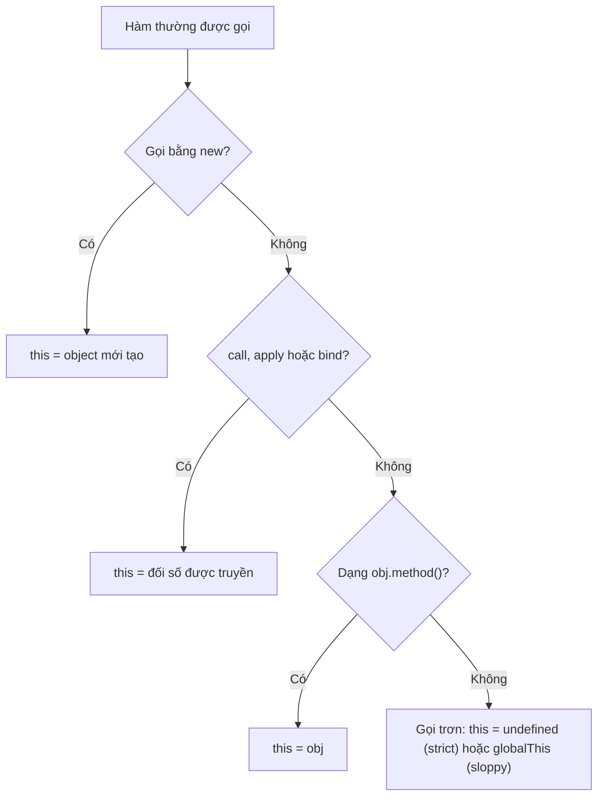

# Lý thuyết 6: this, call/apply/bind và property descriptor

Bài này gom hai chủ đề trả lời cùng một câu hỏi lớn: "object này đang hành xử theo luật gì?". Phần đầu là `this`, thứ khiến cùng một hàm lúc trỏ đúng lúc `undefined`. Phần sau là property descriptor, bộ "công tắc" mô tả từng thuộc tính của object có ghi được, liệt kê được, xóa được hay không. Cả hai đều dựa trên mô hình môi trường ở [Lý thuyết 5](/go?p=13-JavaScript%2Feasy%2Flt-05-scope-hoisting-closure.md) và là bước đệm trước khi học prototype và class ở [Lý thuyết 7](/go?p=13-JavaScript%2Fmedium%2Flt-07-prototype-va-class.md). Nếu cần ôn cách object lưu thuộc tính, xem [Lý thuyết 3](/go?p=13-JavaScript%2Feasy%2Flt-03-object-va-array.md).

## this và property descriptor là gì?

Hãy hình dung một nhân viên tên "Tôi". Khi bạn nói "Tôi sẽ gửi báo cáo", câu đó chỉ có nghĩa khi biết **ai đang nói**. Nếu An nói thì là An, nếu Bình nói thì là Bình. Từ `this` trong JavaScript hoạt động như đại từ "tôi": nó không gắn cứng với hàm, mà tùy **ai gọi** hàm đó ở lúc gọi. Ngoại lệ là arrow function, giống một chiếc loa phát lại: nó không có "tôi" riêng, nó lặp lại "tôi" của người đã tạo ra nó.

Còn property descriptor giống **thẻ quy định gắn trên từng ngăn tủ** trong một cái tủ hồ sơ (object). Mỗi ngăn có thẻ ghi: có được thay hồ sơ bên trong không (`writable`), có hiện trong danh sách liệt kê không (`enumerable`), có được tháo ngăn hoặc đổi thẻ không (`configurable`). Mặc định mọi ngăn bạn tạo ra đều mở thoải mái, nhưng bạn có thể khóa từng ngăn một, hoặc khóa cả tủ.

Về kỹ thuật:

- `this` là một giá trị đặc biệt có sẵn trong mỗi lần gọi hàm thường, do **cách gọi** quyết định.
- **Property descriptor** là một object mô tả thuộc tính: thuộc tính dữ liệu có `value`, `writable`, `enumerable`, `configurable`; thuộc tính accessor có `get`, `set`, `enumerable`, `configurable`.
- Hai chủ đề dùng chung một ý: JavaScript cho phép bạn kiểm soát "luật chơi" chứ không chỉ "giá trị".

**Cốt lõi:** với hàm thường, `this` không được gán lúc viết hàm mà được tính ra tại **thời điểm gọi** từ hình dạng của lời gọi; chỉ có arrow function là chốt `this` từ scope bao ngoài lúc định nghĩa. Còn mỗi thuộc tính của object ngoài giá trị còn có bốn cờ điều khiển, và các tính năng như `Object.freeze`, getter/setter, thuộc tính ẩn khỏi `for...in` đều chỉ là cách thao tác các cờ đó.

- Vì `this` do lời gọi quyết định, nên tách một method ra khỏi object rồi gọi trơn sẽ làm mất `this`.
- Vì arrow function không có `this` riêng mà lấy từ scope bao ngoài, nên nó làm callback an toàn nhưng không thích hợp làm method cần `this` động.
- Vì mọi thuộc tính đều có cờ `writable/enumerable/configurable`, nên "chỉ đọc", "ẩn" hay "đóng băng" là hành vi có thể cấu hình, không phải phép màu của ngôn ngữ.



Mô hình tư duy: để biết `this`, đừng nhìn chỗ hàm được viết, hãy nhìn chỗ nó được gọi và đi qua bốn câu hỏi theo thứ tự: `new`, rồi `call/apply/bind`, rồi `obj.method()`, rồi gọi trơn; còn với arrow function thì bỏ qua các câu hỏi đó và nhìn scope bao ngoài.

## Vấn đề nó giải quyết, và vì sao dev phải nắm

`this` cho phép **một hàm duy nhất phục vụ nhiều object**: method `greet` viết một lần, mọi `user` đều dùng được và mỗi lần nói về chính user đó. Đây là nền của class, constructor và cơ chế kế thừa. Property descriptor giải quyết vấn đề khác: bảo vệ dữ liệu, giấu chi tiết nội bộ, và tạo thuộc tính tính toán sẵn (getter), điều mà thư viện, framework và chính ngôn ngữ (ví dụ `Array.prototype.length`, `Math.PI`) dùng liên tục.

Bạn sẽ cần kiến thức này khi truyền method làm callback cho `setTimeout` hay event handler và thấy `this` mất, khi đọc code framework dùng `defineProperty` (Vue 2 reactivity là ví dụ nổi tiếng), khi cần dữ liệu cấu hình bất biến, và khi giải thích vì sao `Object.keys` trả thứ tự lạ. Phương pháp xuyên suốt: với `this`, hỏi "hàm này được gọi thế nào"; với thuộc tính, hỏi "cờ nào đang bật".

**Tóm tắt:**

- `this` của hàm thường được quyết định lúc gọi theo bốn quy tắc: `new`, `call/apply/bind`, gọi như method `obj.f()`, và gọi trơn.
- Gọi trơn cho `this` là `undefined` ở strict mode (module, class) và `globalThis` ở sloppy mode; vì vậy tách method khỏi object rồi gọi sẽ mất `this`.
- Arrow function không có `this` riêng mà dùng `this` của scope bao ngoài lúc định nghĩa, và `call/apply/bind` không đổi được nó.
- Ba cách sửa mất `this` khi truyền method làm callback: `bind`, bọc bằng arrow function, hoặc class field kiểu arrow.
- Mỗi thuộc tính có descriptor: `value`, `writable`, `enumerable`, `configurable`; `Object.defineProperty` mặc định đặt cả ba cờ là `false`, khác với gán thông thường.
- Getter/setter là thuộc tính accessor (`get`/`set` thay cho `value`/`writable`), dùng cho thuộc tính tính toán, validation và lazy evaluation.
- `preventExtensions` cấm thêm key; `seal` cấm thêm và xóa; `freeze` cấm thêm, xóa và đổi giá trị; cả ba đều nông (shallow).
- Thứ tự duyệt key: số nguyên không âm tăng dần trước, rồi key chuỗi theo thứ tự chèn, rồi symbol; áp dụng cho `Object.keys`, `for...in`, `JSON.stringify`.

## Các khái niệm cần biết

- **Receiver (người nhận)**: object đứng trước dấu chấm trong lời gọi `obj.method()`; chính là `this` của method.
- **Gọi trơn (plain call)**: gọi hàm không qua object, không `new`, không `call/apply/bind`, ví dụ `f()`.
- **Sloppy mode và strict mode**: hai chế độ thực thi; `this` của lời gọi trơn khác nhau giữa chúng (xem [Lý thuyết 5](/go?p=13-JavaScript%2Feasy%2Flt-05-scope-hoisting-closure.md)).
- **`globalThis`**: tên chuẩn cho global object ở mọi môi trường (`window` ở trình duyệt, `global` ở Node).
- **`call`, `apply`, `bind`**: ba method của hàm; `call` và `apply` gọi ngay với `this` chỉ định, `bind` trả về hàm mới đã cố định `this`.
- **Bound function**: hàm do `bind` tạo ra; `this` của nó không đổi được nữa.
- **Data property và accessor property**: thuộc tính chứa giá trị, và thuộc tính chạy hàm khi đọc hoặc ghi.
- **`writable`**: có được gán giá trị mới hay không.
- **`enumerable`**: có hiện trong `Object.keys`, `for...in`, spread, `JSON.stringify` hay không.
- **`configurable`**: có được xóa thuộc tính hoặc đổi descriptor của nó hay không.
- **Extensible (có thể mở rộng)**: object còn cho phép thêm thuộc tính mới hay không.
- **Integer-like key**: key chuỗi biểu diễn một số nguyên không âm chuẩn (như `"2"`, `"10"`, nhưng không phải `"01"`), được xếp riêng khi duyệt.

## Bốn quy tắc xác định this

Bốn quy tắc, đọc theo thứ tự ưu tiên từ cao xuống thấp: `new`, rồi `call/apply/bind`, rồi gọi dạng method, rồi gọi trơn.

```javascript
"use strict";
const user = {
  name: "An",
  hi() { return this && this.name; },
};
console.log(user.hi());            // 1. gọi method: this là user
const f = user.hi;
console.log(f());                  // 2. gọi trơn (strict): this là undefined

function Person(name) { this.name = name; }
const p = new Person("Bình");      // 3. new: this là object mới
console.log(p.name);

function intro(greet, punct) { return `${greet}, ${this.name}${punct}`; }
console.log(intro.call({ name: "Chi" }, "Chào", "!"));       // 4. call
console.log(intro.apply({ name: "Dũng" }, ["Hi", "?"]));     // 4. apply
const bound = intro.bind({ name: "Em" }, "Hello");
console.log(bound("."));
console.log(bound.name, bound.length);
```

```text
An
undefined
Bình
Chào, Chi!
Hi, Dũng?
Hello, Em.
bound intro 1
```

_Đã chạy thử trên Node 22._

Đọc kết quả:

- `user.hi()`: dạng `obj.method()` nên `this` là `user`. Điều quyết định là **hình dạng của lời gọi** (có `user.` đứng trước), không phải việc `hi` được viết trong `user`.
- `f()`: cùng một hàm, nhưng lời gọi không còn `user.` đứng trước nên là gọi trơn. Ở strict mode `this` là `undefined` (ở sloppy mode sẽ là `globalThis`, và `this.name` lấy ra giá trị không mong muốn). Dòng `this && this.name` chỉ để ví dụ không ném lỗi.
- `new Person(...)`: JavaScript tạo object mới, đặt nó làm `this`, chạy hàm rồi trả object đó.
- `call` truyền đối số lần lượt, `apply` truyền một mảng; cả hai gọi **ngay**. `bind` không gọi mà trả về hàm mới, có thể cố định luôn một số đối số đầu (partial application). Hàm bound có `name` là `"bound intro"` và `length` giảm đi số đối số đã cố định.

Một phần quan trọng của việc "gọi dạng method" là nó xét theo **biểu thức ngay trước dấu ngoặc gọi**. `(user.hi)()` vẫn là method call, nhưng `(0, user.hi)()` hay `const g = user.hi; g()` thì không, vì kết quả của biểu thức đã mất liên kết với `user`.

**Phải thuộc:** thứ tự ưu tiên của `this` cho hàm thường: (1) `new` thì là object mới tạo; (2) `call/apply/bind` thì là đối số truyền; (3) `obj.method()` thì là `obj`; (4) gọi trơn thì là `undefined` ở strict mode hoặc `globalThis` ở sloppy mode.

### new, bind và các góc khuất

Một vài hành vi hay bị hỏi, đều đã chạy thử:

```javascript
"use strict";
function Person(name) { this.name = name; }
try { Person("X"); } catch (e) { console.log(e.name + ": " + e.message); }

function Weird() { this.a = 1; return { b: 2 }; }
function Prim() { this.a = 1; return 5; }
console.log(new Weird(), new Prim());
function Who() { return new.target === undefined ? "gọi trơn" : "gọi bằng new"; }
console.log(Who(), new Who() instanceof Who);

const b1 = function () { return this.v; }.bind({ v: 1 });
const b2 = b1.bind({ v: 2 });
console.log(b1(), b2(), b1.call({ v: 3 }));
function Pt(x, y) { this.x = x; this.y = y; }
const Pt1 = Pt.bind(null, 1);
console.log(new Pt1(9));
console.log(Math.max.apply(null, [3, 7, 2]), Math.max.call(null, 3, 7, 2));
const arrLike = { 0: "a", 1: "b", length: 2 };
console.log(Array.prototype.map.call(arrLike, (x) => x.toUpperCase()));
```

```text
TypeError: Cannot set properties of undefined (setting 'name')
{ b: 2 } Prim { a: 1 }
gọi trơn true
1 1 1
Pt { x: 1, y: 9 }
7 7
[ 'A', 'B' ]
```

_Đã chạy thử trên Node 22._

- Quên `new` khi gọi constructor ở strict mode ném `TypeError` (vì `this` là `undefined`); ở sloppy mode nó âm thầm gắn thuộc tính lên `globalThis`. Class luôn ở strict mode và từ chối gọi không `new`.
- Nếu constructor `return` một **object** thì object đó thay cho `this`; nếu `return` giá trị nguyên thủy thì bị bỏ qua. `new.target` cho biết hàm có được gọi bằng `new` hay không.
- `bind` chỉ có hiệu lực **một lần**: `b2` bind lại không đổi được, và `call` lên hàm bound cũng không đổi `this`. Chỉ `new` mới "thắng" được `bind`: `new Pt1(9)` tạo object mới nhưng vẫn áp dụng đối số `1` đã cố định.
- `Math.max.apply(null, mảng)` là cách cũ để trải mảng thành đối số (thời nay dùng `Math.max(...mảng)`). `Array.prototype.map.call(arrayLike, ...)` mượn method của array cho object giống array.

**Nhớ:** `call` và `apply` gọi ngay, `bind` trả hàm mới; hàm bound không đổi `this` được nữa; `new` thắng mọi thứ.

## Arrow function và this

Arrow function **không có** `this`, `arguments`, `super` hay `new.target` riêng. Khi bạn dùng `this` trong arrow, engine tra theo scope chain như một biến thường và lấy `this` của scope bao ngoài lúc arrow được tạo. Hệ quả: `call/apply/bind` không đổi được `this` của arrow, và arrow không thể là constructor.

```javascript
"use strict";
const timer = {
  seconds: 0,
  startWrong() { return [1, 2].map(function () { return this; }); },
  startRight() { return [1, 2].map(() => this.seconds); },
};
console.log(timer.startWrong());
console.log(timer.startRight());

const arrow = () => this;
console.log(arrow() === module.exports);
const obj = { n: 1, arrowMethod: () => typeof this.n, normal() { return this.n; } };
console.log(obj.arrowMethod(), obj.normal());
const a2 = () => this === module.exports;
console.log(a2.call({ x: 1 }), a2.bind({ x: 1 })());
try { new (() => {})(); } catch (e) { console.log(e.name + ": " + e.message); }
```

```text
[ undefined, undefined ]
[ 0, 0 ]
true
undefined 1
true true
TypeError: (intermediate value) is not a constructor
```

_Đã chạy thử trên Node 22 (file CommonJS, nên `this` ở top-level là `module.exports`)._

- Hàm thường làm callback của `map` được gọi trơn, nên `this` là `undefined` (strict), vì vậy `startWrong` trả `undefined`. Arrow lấy `this` của `startRight`, tức `timer`, nên đọc được `seconds`.
- Arrow ở top-level lấy `this` của module (ở Node/CommonJS là `module.exports`, ở ES module là `undefined`, ở script trình duyệt là `window`). Đây là lý do `arrowMethod: () => this.n` **không** trỏ tới object chứa nó.
- `call` và `bind` lên arrow không có tác dụng với `this`.
- Arrow không `new` được.

Quy tắc chọn: dùng **arrow** cho callback bên trong method (map, setTimeout, promise `then`) để giữ `this` của method; dùng **method shorthand** (`hi() {}`) hoặc `function` cho method của object và prototype; không dùng arrow làm method cần `this` động, constructor, hay hàm cần `arguments`.

**Nền tảng:** hàm thường: `this` do **lời gọi** quyết định (động). Arrow function: `this` do **vị trí viết** quyết định (từ vựng, giống mọi biến khác). Đây cũng là chỗ nối giữa bài scope và bài này: arrow "chỉ là closure bình thường trên `this`".

**Lưu ý:** trong event handler của DOM, hàm thường nhận `this` là phần tử gắn handler, còn arrow thì không; nếu bạn cần `event.currentTarget` hãy dùng tham số event thay vì dựa vào `this`.

## Mất this khi truyền method làm callback, và ba cách sửa

Đây là lỗi `this` phổ biến nhất trong thực tế: bạn viết `button.addEventListener("click", obj.method)` hay `setTimeout(obj.method, 100)`, và trong method `this` không còn là `obj`. Lý do: truyền `obj.method` chỉ truyền **hàm**, còn "người nhận" `obj` ở lại; khi môi trường gọi callback là gọi trơn.

```javascript
"use strict";
class Button {
  constructor(label) { this.label = label; }
  click() { return "bấm " + this.label; }
}
const b = new Button("OK");
const handler = b.click;
try { handler(); } catch (e) { console.log(e.name + ": " + e.message); }

function run(cb) { return cb(); }
try { run(b.click); } catch (e) { console.log(e.name); }
console.log(run(b.click.bind(b)));            // cách 1: bind
console.log(run(() => b.click()));            // cách 2: arrow bao ngoài
class Button2 {
  constructor(label) { this.label = label; }
  click = () => "bấm " + this.label;           // cách 3: arrow class field
}
const b2 = new Button2("Gửi");
console.log(run(b2.click));
console.log(Object.hasOwn(b2, "click"), Object.hasOwn(Button2.prototype, "click"));
```

```text
TypeError: Cannot read properties of undefined (reading 'label')
TypeError
bấm OK
bấm OK
bấm Gửi
true false
```

_Đã chạy thử trên Node 22._

Ba cách sửa và khi nào chọn:

| Cách | Cú pháp | Ưu điểm | Nhược điểm |
|---|---|---|---|
| `bind` | `run(b.click.bind(b))` | Rõ ràng, tách biệt chỗ truyền | Tạo hàm mới mỗi lần; không gỡ listener được nếu không giữ lại tham chiếu |
| Arrow bao ngoài | `run(() => b.click())` | Linh hoạt, đổi đối số được | Cũng tạo hàm mới mỗi lần |
| Arrow class field | `click = () => ...` | Một hàm cố định cho mỗi instance, tiện với `removeEventListener` | Mỗi instance có bản sao riêng của hàm (dòng cuối: nằm trên instance, không nằm trên prototype), tốn bộ nhớ hơn và khó mock ở prototype |

**Lưu ý:** hàm `bind` mới được tạo mỗi lần nên `removeEventListener("click", obj.method.bind(obj))` **không gỡ được** gì cả. Hãy lưu hàm đã bind vào biến (hoặc dùng class field, hoặc `AbortController`) rồi mới đăng ký.

**Nhớ:** "mất `this`" nghĩa là lời gọi đã trở thành gọi trơn. Sửa bằng `bind`, bọc arrow, hoặc class field; thường chọn arrow bao ngoài cho tính linh hoạt, class field cho handler cần gỡ.

## globalThis và strict mode

Với lời gọi trơn, giá trị `this` phụ thuộc chế độ chạy:

```javascript
function plain() { return this === globalThis; }
console.log(plain());
console.log(this === module.exports, typeof globalThis, typeof window);
function strictFn() { "use strict"; return this; }
console.log(strictFn());
console.log(typeof globalThis.setTimeout, globalThis === global);
function sloppyPrim() { return typeof this; }
function strictPrim() { "use strict"; return typeof this; }
console.log(sloppyPrim.call(5), strictPrim.call(5));
function Person(name) { this.name = name; }
const lost = Person("X");
console.log(lost, typeof name, globalThis.name);
```

```text
true
true object undefined
undefined
function true
object number
undefined string X
```

_Đã chạy thử trên Node 22 (file CommonJS, không bật strict mode)._

- Ở sloppy mode, lời gọi trơn cho `this` là `globalThis`. `globalThis` là tên chuẩn thống nhất: ở trình duyệt nó là `window` (hoặc `self` trong worker), ở Node là `global`. Dùng `globalThis` thay cho `window` khi viết code chạy nhiều môi trường.
- Ở strict mode, `this` của lời gọi trơn là `undefined`, nên quên `new` hay tách method không còn âm thầm đọc ghi lên global.
- Với `call` ở sloppy mode, nguyên thủy bị **bọc** thành object (`typeof this` là `"object"`); ở strict mode giữ nguyên (`"number"`).
- Dòng cuối là hậu quả của việc quên `new` ở sloppy mode: `Person("X")` gán `name` thẳng lên global, `lost` là `undefined`. Đây là cách sloppy mode che lỗi.
- `this` ở top-level phụ thuộc loại file: CommonJS của Node là `module.exports`, ES module là `undefined`, script cổ điển ở trình duyệt là `window`.

Module ES và thân `class` luôn ở strict mode, nên code hiện đại gần như không gặp `this` là global ngoài ý muốn; tuy vậy khi đọc code cũ hoặc script nhúng, bạn cần nhận ra nó.

**Phải thuộc:** gọi trơn: `this` là `undefined` ở strict mode (module, class, `"use strict"`), `globalThis` ở sloppy mode; `globalThis` là tên chuẩn của global object mọi môi trường.

## Property descriptor

Mọi thuộc tính của object có một descriptor. Gán thông thường (`o.x = 1`, literal `{ x: 1 }`) tạo thuộc tính với cả ba cờ bật. `Object.defineProperty` lại mặc định **tắt** các cờ bạn không nêu.

```javascript
"use strict";
const o = { name: "An", get upper() { return this.name.toUpperCase(); } };
console.log(Object.getOwnPropertyDescriptor(o, "name"));
console.log(Object.getOwnPropertyDescriptor(o, "upper"));
const d = Object.defineProperty({}, "id", { value: 7 });
console.log(Object.getOwnPropertyDescriptor(d, "id"));
console.log(Object.getOwnPropertyDescriptor(Math, "PI"));
console.log(Object.getOwnPropertyDescriptor([], "length"));
```

```text
{ value: 'An', writable: true, enumerable: true, configurable: true }
{
  get: [Function: get upper],
  set: undefined,
  enumerable: true,
  configurable: true
}
{ value: 7, writable: false, enumerable: false, configurable: false }
{
  value: 3.141592653589793,
  writable: false,
  enumerable: false,
  configurable: false
}
{ value: 0, writable: true, enumerable: false, configurable: false }
```

_Đã chạy thử trên Node 22._

Đọc kết quả: `name` là data property đầy đủ cờ. `upper` là accessor (có `get`/`set`, không có `value`/`writable`). `id` định nghĩa chỉ với `value` nên cả ba cờ là `false`. `Math.PI` chỉ đọc, ẩn và không xóa được. `length` của array ghi được nhưng ẩn và không xóa được. Hãy nhìn các thuộc tính "có sẵn" của ngôn ngữ như ví dụ sống về cách dùng cờ.

Ý nghĩa của từng cờ, kiểm chứng trong một ví dụ:

```javascript
"use strict";
const o = {};
Object.defineProperty(o, "ro", { value: 1, enumerable: true });          // writable: false
Object.defineProperty(o, "hidden", { value: 2, writable: true });         // enumerable: false
Object.defineProperty(o, "fixed", { value: 3, writable: true, enumerable: true, configurable: false });
o.visible = 4;

try { o.ro = 99; } catch (e) { console.log(e.name + ": " + e.message); }
o.hidden = 22;
console.log(o.hidden, Object.keys(o), JSON.stringify(o));
for (const k in o) console.log("for-in:", k);
console.log(Object.getOwnPropertyNames(o), o.propertyIsEnumerable("hidden"));
try { delete o.fixed; } catch (e) { console.log(e.name + ": " + e.message); }
try { Object.defineProperty(o, "fixed", { enumerable: false }); } catch (e) { console.log(e.name + ": " + e.message); }
Object.defineProperty(o, "fixed", { writable: false });   // được phép: siết chặt hơn
try { o.fixed = 0; } catch (e) { console.log(e.name + ": " + e.message); }
delete o.visible;
console.log({ ...o }, Object.assign({}, o));
```

```text
TypeError: Cannot assign to read only property 'ro' of object '#<Object>'
22 [ 'ro', 'fixed', 'visible' ] {"ro":1,"fixed":3,"visible":4}
for-in: ro
for-in: fixed
for-in: visible
[ 'ro', 'hidden', 'fixed', 'visible' ] false
TypeError: Cannot delete property 'fixed' of #<Object>
TypeError: Cannot redefine property: fixed
TypeError: Cannot assign to read only property 'fixed' of object '#<Object>'
{ ro: 1, fixed: 3 } { ro: 1, fixed: 3 }
```

_Đã chạy thử trên Node 22._

- **`writable: false`**: gán giá trị mới thất bại. Ở strict mode ném `TypeError`, ở sloppy mode im lặng bỏ qua (nên lỗi dễ bị che).
- **`enumerable: false`**: thuộc tính vẫn đọc ghi bình thường (`hidden` được gán 22) nhưng **biến mất** khỏi `Object.keys`, `for...in`, spread, `Object.assign` và `JSON.stringify`. `Object.getOwnPropertyNames` vẫn thấy nó. Đây là cách giấu thuộc tính "kỹ thuật" khỏi việc liệt kê và serialize (các method trên class prototype cũng ẩn nhờ cờ này).
- **`configurable: false`**: không xóa được, không đổi kiểu hay đổi `enumerable`/`configurable` được nữa. Ngoại lệ: được phép đổi `writable` từ `true` sang `false` (siết chặt), nhưng không đảo ngược lại, và đổi `value` vẫn được nếu còn `writable`.
- Spread `{ ...o }` và `Object.assign` chỉ chép thuộc tính **own, enumerable**; `hidden` không được chép và các cờ không được sao chép (bản chép lại có cả ba cờ bật).

**Phải thuộc:** bốn thuộc tính của descriptor dữ liệu là `value`, `writable`, `enumerable`, `configurable`; `defineProperty` mặc định `false` cho cờ không nêu; `enumerable: false` ẩn khỏi `keys/for-in/JSON/spread`; `configurable: false` là một chiều, không thể mở lại.

**Lưu ý:** `writable: false` chỉ ngăn **gán lại** thuộc tính, không làm giá trị đối tượng bên trong bất biến: nếu `value` là một object thì bạn vẫn sửa được các thuộc tính của nó.

## Getter và setter

Thuộc tính accessor thay `value`/`writable` bằng hàm `get` và/hoặc `set`. Đọc thuộc tính chạy `get`, gán chạy `set`, và bạn dùng cú pháp như thuộc tính thường. Viết bằng literal hoặc class (`get x() {}`), hoặc bằng `defineProperty`.

```javascript
"use strict";
const temp = {
  _c: 25,
  get f() { return this._c * 9 / 5 + 32; },
  set f(v) { if (typeof v !== "number") throw new TypeError("cần số"); this._c = (v - 32) * 5 / 9; },
};
console.log(temp.f);
temp.f = 212;
console.log(temp._c);
try { temp.f = "x"; } catch (e) { console.log(e.name + ": " + e.message); }

const lazy = {
  get data() {
    console.log("tính 1 lần");
    const v = [1, 2, 3];
    Object.defineProperty(this, "data", { value: v, enumerable: true });
    return v;
  },
};
console.log(lazy.data, lazy.data);

const ro = { get x() { return 1; } };
try { ro.x = 2; } catch (e) { console.log(e.name + ": " + e.message); }

class Circle {
  #r;
  constructor(r) { this.#r = r; }
  get area() { return +(Math.PI * this.#r ** 2).toFixed(2); }
  set radius(v) { if (v <= 0) throw new RangeError("r phải > 0"); this.#r = v; }
}
const c = new Circle(2);
console.log(c.area, Object.keys(c), Object.getOwnPropertyNames(Circle.prototype));
c.radius = 3;
console.log(c.area);
```

```text
77
100
TypeError: cần số
tính 1 lần
[ 1, 2, 3 ] [ 1, 2, 3 ]
TypeError: Cannot set property x of #<Object> which has only a getter
12.57 [] [ 'constructor', 'area', 'radius' ]
28.27
```

_Đã chạy thử trên Node 22._

Các công dụng thường gặp: **thuộc tính tính toán** (`f` suy ra từ `_c`, luôn đồng bộ, không phải nhớ cập nhật), **validation** khi gán (setter từ chối giá trị sai), **lazy evaluation** (tính ở lần đọc đầu rồi thay accessor bằng data property để lần sau không phải tính), và **chỉ đọc** (chỉ có `get`; ghi ở strict mode ném `TypeError`, ở sloppy mode bị bỏ qua). Trong class, getter/setter nằm trên prototype và không hiện trong `Object.keys(instance)`. Dấu gạch dưới `_c` chỉ là quy ước "đừng đụng vào", không phải bảo vệ thật; muốn private thật dùng trường `#r` như ví dụ `Circle`.

Hãy cẩn thận ở hai chỗ: getter chạy mỗi lần đọc nên đừng đặt việc nặng hoặc có tác dụng phụ vào; và `this` trong getter/setter tuân theo quy tắc `obj.prop` ở trên, nên với object kế thừa nó là object **đang được đọc**, không nhất thiết là nơi getter được định nghĩa.

**Nhớ:** accessor = hàm trá hình thành thuộc tính; hữu ích cho thuộc tính suy ra, validation, lazy; không đặt việc nặng trong getter.

## Object.freeze, seal và preventExtensions

Ba hàm này thay đổi mức độ khóa của cả object, theo thứ tự chặt dần:

```javascript
"use strict";
const base = { a: 1, nested: { x: 1 } };
const ext = Object.preventExtensions({ ...base });
const sealed = Object.seal({ ...base });
const frozen = Object.freeze({ ...base });
for (const [name, o] of [["preventExtensions", ext], ["seal", sealed], ["freeze", frozen]]) {
  const r = [];
  try { o.newProp = 1; r.push("thêm ok"); } catch { r.push("thêm lỗi"); }
  try { o.a = 2; r.push("sửa ok"); } catch { r.push("sửa lỗi"); }
  try { delete o.a; r.push("xóa ok"); } catch { r.push("xóa lỗi"); }
  console.log(name.padEnd(17), r.join(", "));
}
console.log(Object.isExtensible(ext), Object.isSealed(sealed), Object.isFrozen(frozen), Object.isFrozen(sealed));
frozen.nested.x = 99;
console.log(frozen.nested.x);
function deepFreeze(o) {
  Object.values(o).forEach((v) => typeof v === "object" && v !== null && deepFreeze(v));
  return Object.freeze(o);
}
const df = deepFreeze({ a: { b: { c: 1 } }, list: [1, 2] });
try { df.a.b.c = 2; } catch (e) { console.log(e.name); }
try { df.list.push(3); } catch (e) { console.log(e.name + ": " + e.message); }
const sc = structuredClone(frozen);
console.log(Object.isFrozen(sc));
console.log(Object.isFrozen("abc"), Object.isFrozen(Object.preventExtensions({})));
```

```text
preventExtensions thêm lỗi, sửa ok, xóa ok
seal              thêm lỗi, sửa ok, xóa lỗi
freeze            thêm lỗi, sửa lỗi, xóa lỗi
false true true false
99
TypeError
TypeError: Cannot add property 2, object is not extensible
false
true true
```

_Đã chạy thử trên Node 22._

Đọc kết quả: `preventExtensions` chỉ chặn thêm key (sửa và xóa vẫn được); `seal` chặn thêm và xóa nhưng vẫn cho sửa giá trị; `freeze` chặn cả ba. Dòng `isFrozen(sealed)` ra `false` vì thuộc tính của object bị seal vẫn còn `writable: true`. Tóm lại:

| Hàm | Thêm key | Xóa key | Sửa giá trị | Đổi descriptor |
|---|---|---|---|---|
| `preventExtensions` | Cấm | Cho phép | Cho phép | Cho phép |
| `seal` | Cấm | Cấm | Cho phép | Cấm (đặt `configurable: false`) |
| `freeze` | Cấm | Cấm | Cấm (đặt `writable: false`) | Cấm |

**Lưu ý quan trọng:** cả ba đều **nông** (shallow). `frozen.nested.x = 99` vẫn thành công vì chỉ lớp ngoài bị đóng băng. Muốn bất biến sâu phải đệ quy như `deepFreeze` ở trên. Mảng đóng băng không `push` được (`TypeError`). `structuredClone` của object đóng băng cho ra bản **không** đóng băng. `Object.isFrozen` trả `true` với nguyên thủy (không có gì để khóa) và với object rỗng không mở rộng được. Ở sloppy mode, các thao tác bị cấm thất bại **im lặng**, nên hãy dùng strict mode để thấy lỗi.

`freeze` thích hợp để bảo vệ hằng số cấu hình, enum giả (`Object.freeze({ A: "a", B: "b" })`) và dữ liệu chia sẻ không được sửa. Đừng dùng nó như công cụ bảo mật (code khác vẫn có thể thay object khác vào biến) và cũng đừng đóng băng object lớn trên đường nóng mà không đo, vì engine có thể xử lý chúng khác đi.

**Nhớ:** `preventExtensions` khóa việc thêm; `seal` khóa thêm và xóa; `freeze` khóa luôn việc sửa; cả ba đều nông; `freeze` không phải bất biến sâu.

## Thứ tự duyệt key của object

Object không phải "túi đồ ngẫu nhiên": từ ES2015 trở đi, các thao tác như `Object.keys`, `Object.entries`, `for...in`, `JSON.stringify`, `Reflect.ownKeys` đều duyệt key theo một thứ tự xác định. Quy tắc cho key của chính object (own keys): **(1)** các key là số nguyên không âm ở dạng chuẩn, xếp **tăng dần theo giá trị số**; **(2)** các key chuỗi còn lại theo **thứ tự chèn**; **(3)** các key symbol theo thứ tự chèn (chỉ `Reflect.ownKeys` và `getOwnPropertySymbols` mới thấy).

```javascript
const o = { b: 1, 2: "two", a: 2, 1: "one", [Symbol("s")]: 0, "-1": "neg", "01": "zero-one", 1.5: "frac", 10: "ten" };
console.log(Object.keys(o));
console.log(Reflect.ownKeys(o));
o.c = 3; o[0] = "zero"; delete o.b; o.b = 9;
console.log(Object.keys(o));
console.log(JSON.stringify(o));
const proto = { inherited: 1, 5: "p5" };
const child = Object.create(proto);
child.own = 1; child[3] = "c3";
const seen = []; for (const k in child) seen.push(k);
console.log(seen);
const m = new Map([["b", 1], [2, "x"], [1, "y"]]);
console.log([...m.keys()]);
console.log(Object.entries("ab"), Object.keys([7, 8]));
```

```text
[
  '1',  '2',   '10',
  'b',  'a',   '-1',
  '01', '1.5'
]
[
  '1',       '2',
  '10',      'b',
  'a',       '-1',
  '01',      '1.5',
  Symbol(s)
]
[
  '0',  '1',   '2',
  '10', 'a',   '-1',
  '01', '1.5', 'c',
  'b'
]
{"0":"zero","1":"one","2":"two","10":"ten","a":2,"-1":"neg","01":"zero-one","1.5":"frac","c":3,"b":9}
[ '3', 'own', '5', 'inherited' ]
[ 'b', 2, 1 ]
[ [ '0', 'a' ], [ '1', 'b' ] ] [ '0', '1' ]
```

_Đã chạy thử trên Node 22._

Điểm cần rút ra từ ví dụ trên:

- Dù khai báo `b` trước `2`, kết quả vẫn đặt `1, 2, 10` đầu tiên: số nguyên tăng dần, và so sánh theo **giá trị số** (10 sau 2), không phải theo chuỗi. Các key `"-1"`, `"01"`, `"1.5"` **không** phải số nguyên chuẩn nên được coi là key chuỗi thường, xếp theo thứ tự chèn.
- Xóa `b` rồi thêm lại làm nó nhảy xuống cuối nhóm chuỗi, vì thứ tự chèn tính theo lần thêm gần nhất.
- `for...in` duyệt key của chính object trước (theo quy tắc trên), rồi tới key kế thừa từ prototype.
- `Map` thì khác: nó luôn giữ **thứ tự chèn** cho mọi loại key, kể cả số. Nếu bạn cần thứ tự chèn tuyệt đối với key có thể là số (ví dụ ID), dùng `Map` thay vì object.
- Hệ quả thực tế: dùng object làm từ điển với key kiểu số sẽ bị sắp xếp lại ngoài ý muốn; nhiều dev bị bất ngờ khi `JSON.stringify` ra thứ tự khác lúc viết.

**Phải thuộc:** thứ tự duyệt key của object: số nguyên không âm tăng dần, rồi chuỗi theo thứ tự chèn, rồi symbol. Muốn thứ tự chèn thuần túy cho mọi key, dùng `Map`.

Phần sâu hơn về cách các thao tác này được can thiệp (trap `ownKeys`, `defineProperty` của Proxy) nằm ở [Lý thuyết 12](/go?p=13-JavaScript%2Fhard%2Flt-12-proxy-reflect-symbol-weakref.md).

## Bẫy thường gặp

| Bẫy | Biểu hiện | Cách tránh |
|---|---|---|
| Truyền `obj.method` làm callback | `this` là `undefined` hoặc `globalThis` | `bind`, arrow bao ngoài, hoặc class field |
| Dùng arrow function làm method | `this` trỏ ra ngoài, `this.x` là `undefined` | Dùng method shorthand hoặc `function` |
| Dùng `function` làm callback bên trong method | `this` mất ở callback lồng | Dùng arrow để thừa hưởng `this` của method |
| Quên `new` khi gọi constructor | Strict: `TypeError`; sloppy: gắn thuộc tính lên global | Dùng `class` (bắt buộc `new`), strict mode |
| Bind lại hàm đã bound | `this` không đổi | Giữ hàm gốc, bind một lần |
| `removeEventListener` với `bind` mới | Listener không được gỡ | Lưu hàm đã bind vào biến |
| Ghi vào thuộc tính chỉ đọc ở sloppy mode | Im lặng thất bại | Dùng strict mode để thấy `TypeError` |
| Tưởng `defineProperty` mặc định bật cờ | Thuộc tính vừa tạo bị ẩn, không ghi được | Khai báo tường minh `writable/enumerable/configurable` |
| `freeze` rồi tưởng bất biến sâu | Object lồng bên trong vẫn sửa được | `deepFreeze` hoặc dữ liệu bất biến theo cách khác |
| `configurable: false` rồi muốn mở lại | `TypeError: Cannot redefine property` | Cân nhắc kỹ, vì không thể đảo ngược |
| Dựa vào thứ tự key của object có key số | `JSON.stringify` xếp lại key số lên đầu | Dùng `Map` hoặc mảng cặp key-value |
| Đặt việc nặng vào getter | Chậm khi đọc nhiều lần | Cache vào data property (lazy), hoặc dùng method |

## Câu hỏi phỏng vấn thường gặp

Mỗi câu có chuỗi: gợi ý suy luận, lập luận, đáp án ngắn, điều cần nhớ. Thử tự đi theo gợi ý trước khi đọc tiếp.

### 1. Các quy tắc xác định `this` là gì, và thứ tự ưu tiên giữa chúng?

**Câu hỏi:** liệt kê các cách `this` được gán cho hàm thường, nêu thứ tự ưu tiên, và chỉ ra arrow function nằm ở đâu.

**Gợi ý suy luận:**
- `this` được gán lúc định nghĩa hàm hay lúc gọi hàm?
- Lời gọi `new F()`, `f.call(x)`, `obj.f()`, `f()` khác nhau chỗ nào về "ai là người nhận"?
- Nếu một hàm vừa là hàm bound vừa được gọi bằng `new` thì cái nào thắng?

**Lập luận:** với hàm thường, `this` tính ra từ hình dạng lời gọi: `new` tạo object mới và gán làm `this`; `call/apply/bind` gán rõ ràng; `obj.f()` gán `obj`; gọi trơn gán `undefined` ở strict mode hoặc `globalThis` ở sloppy mode. Thứ tự ưu tiên giảm dần là `new`, rồi `call/apply/bind`, rồi method call, rồi gọi trơn. Hàm bound không đổi `this` khi `call` nữa, nhưng `new` vẫn tạo object mới, nên `new` thắng cả `bind`. Arrow function đứng ngoài bốn quy tắc: nó không có `this` riêng mà lấy `this` của scope bao ngoài lúc tạo.

**Đáp án ngắn:** `new` > `call/apply/bind` > `obj.method()` > gọi trơn (`undefined` ở strict, `globalThis` ở sloppy). Arrow: `this` từ vựng, không đổi được.

**Nhớ:** `this` hàm thường theo **nơi gọi**, arrow theo **nơi viết**.

### 2. Vì sao truyền `obj.method` vào `setTimeout` hoặc event listener làm mất `this`? Nêu cách sửa và khác biệt giữa chúng.

**Câu hỏi:** giải thích cơ chế, và so sánh ba cách sửa.

**Gợi ý suy luận:**
- Khi viết `obj.method` không có ngoặc, bạn truyền cái gì: hàm hay cả cặp "object và hàm"?
- Môi trường gọi callback đó theo dạng lời gọi nào?
- Cách sửa nào cho phép gỡ listener về sau, cách nào tạo hàm mới mỗi lần?

**Lập luận:** `obj.method` chỉ cho giá trị là hàm, "người nhận" `obj` không đi kèm. Khi `setTimeout` hay event system gọi callback, nó là lời gọi trơn nên `this` không còn là `obj` (hoặc là phần tử DOM với handler hàm thường). Cách sửa: `obj.method.bind(obj)` (tạo hàm bound mới), arrow bao ngoài `() => obj.method()` (linh hoạt và truyền thêm đối số được), hoặc class field arrow (một hàm cố định cho mỗi instance, tiện gỡ listener nhưng tốn bộ nhớ hơn vì không dùng chung trên prototype). Với bind và arrow bao ngoài, cần lưu tham chiếu hàm nếu muốn `removeEventListener`.

**Đáp án ngắn:** callback bị gọi trơn nên mất người nhận. Sửa bằng `bind`, arrow bao ngoài, hoặc class field arrow.

**Nhớ:** mỗi lần `bind` hoặc viết arrow inline là một hàm mới, nên đừng dùng chúng trực tiếp trong `removeEventListener`.

### 3. Arrow function khác hàm thường thế nào về `this`, và khi nào không nên dùng arrow?

**Câu hỏi:** nêu khác biệt cốt lõi và các trường hợp không dùng được.

**Gợi ý suy luận:**
- Arrow có tự tạo `this` khi được gọi không, hay tra từ scope ngoài như một biến?
- `call` hoặc `bind` có tác dụng gì lên `this` của arrow?
- Arrow có dùng với `new` hoặc cần `arguments` không?

**Lập luận:** arrow function không có `this`, `arguments`, `super`, `new.target` của riêng mình; khi dùng `this` nó tra scope chain như biến thường và lấy giá trị từ scope bao ngoài lúc định nghĩa. Vì thế `call/bind` không đổi được `this` của nó, và nó không thể là constructor. Nó tuyệt vời làm callback trong method, nhưng không dùng làm method của object hay prototype (vì `this` sẽ trỏ ra scope ngoài chứ không phải object), không dùng làm constructor, và không dùng khi cần `this` động hay `arguments`.

**Đáp án ngắn:** arrow lấy `this` từ scope bao ngoài tại nơi viết; không đổi được bằng `call/bind`, không `new` được. Không dùng làm method hay constructor.

**Nhớ:** arrow trong method để giữ `this`; `function` hoặc method shorthand cho chính method.

### 4. Property descriptor gồm những gì? `Object.defineProperty` khác gán `obj.x = 1` thế nào, và `freeze` khác `seal` ra sao?

**Câu hỏi:** mô tả bốn cờ, mặc định của `defineProperty`, và bảng so sánh ba mức khóa.

**Gợi ý suy luận:**
- Khi tạo thuộc tính bằng `obj.x = 1`, các cờ được đặt thế nào? Còn khi dùng `defineProperty` mà không nêu cờ?
- Cờ nào ảnh hưởng tới `Object.keys` và `JSON.stringify`?
- `freeze` có làm cho object lồng bên trong bất biến không?

**Lập luận:** descriptor dữ liệu có `value`, `writable`, `enumerable`, `configurable`; descriptor accessor có `get`, `set` thay cho hai cái đầu. Gán thông thường tạo thuộc tính với cả ba cờ là `true`, còn `defineProperty` đặt cờ không nêu là `false`, nên thuộc tính tạo ra mặc định bị ẩn, chỉ đọc và không xóa được. `enumerable: false` ẩn khỏi `Object.keys`, `for...in`, spread và `JSON.stringify`. `preventExtensions` cấm thêm key; `seal` cấm thêm và xóa nhưng vẫn sửa được giá trị; `freeze` cấm cả sửa giá trị. Cả ba nông, nên object lồng bên trong vẫn sửa được trừ khi đóng băng đệ quy.

**Đáp án ngắn:** bốn cờ `value/writable/enumerable/configurable` (hoặc `get/set`); `defineProperty` mặc định `false`; `freeze` > `seal` > `preventExtensions` về độ chặt; đều shallow.

**Nhớ:** `configurable: false` không đảo ngược được; ghi vào thuộc tính bị khóa ở sloppy mode thất bại im lặng, strict mode ném `TypeError`.

### 5. Thứ tự key khi duyệt một object được xác định thế nào? Khi nào nên dùng `Map` thay vì object?

**Câu hỏi:** nêu quy tắc, dự đoán `Object.keys` của `{ b: 1, 2: 'x', a: 2, 1: 'y' }`, và chọn cấu trúc dữ liệu phù hợp.

**Gợi ý suy luận:**
- Key `2` và `1` là số hay chuỗi khi đã làm key của object, và đặc tả đối xử chúng đặc biệt thế nào?
- Key chuỗi như `b`, `a` được xếp theo tiêu chí nào?
- Nếu cần giữ đúng thứ tự thêm vào cho cả key số thì dùng cấu trúc nào?

**Lập luận:** đặc tả quy định thứ tự own keys: trước hết các key là số nguyên không âm ở dạng chuẩn, tăng dần theo giá trị số; sau đó các key chuỗi theo thứ tự chèn; cuối cùng các key symbol theo thứ tự chèn. Vì vậy ví dụ cho `['1', '2', 'b', 'a']`. Quy tắc này áp dụng cho `Object.keys/entries`, `for...in` và `JSON.stringify`. Khi dữ liệu có key là số (ID) mà bạn muốn giữ đúng thứ tự thêm vào, object sẽ xếp lại ngoài ý muốn, nên dùng `Map` (luôn giữ thứ tự chèn cho mọi loại key).

**Đáp án ngắn:** số nguyên không âm tăng dần, rồi chuỗi theo thứ tự chèn, rồi symbol. Ví dụ ra `['1','2','b','a']`. Cần thứ tự chèn thuần túy thì dùng `Map`.

**Nhớ:** đừng dựa vào thứ tự key của object khi key có thể là số; xóa rồi thêm lại làm key chuyển xuống cuối nhóm chuỗi.

Bài kế tiếp: [Lý thuyết 7: Prototype và class](/go?p=13-JavaScript%2Fmedium%2Flt-07-prototype-va-class.md).

