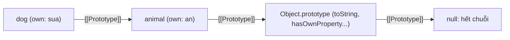
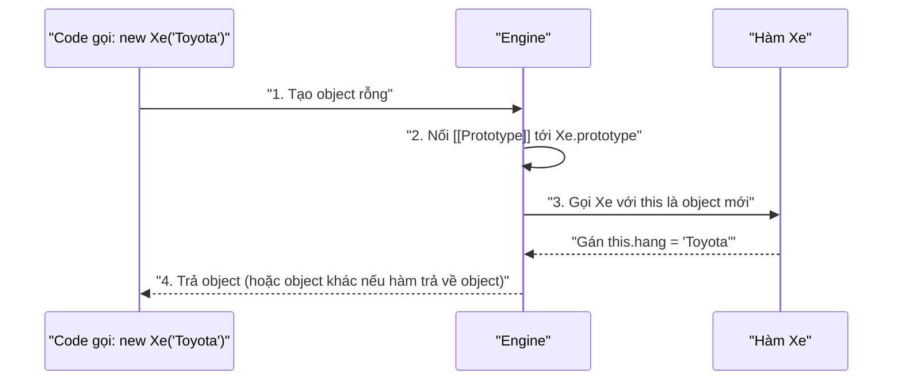
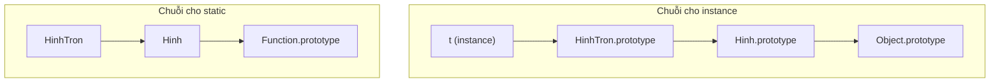

# Lý thuyết 7: Prototype và class

Bài này đi từ cơ chế nền của JavaScript (mỗi object trỏ tới một object "cha" để tra cứu property) lên tới cú pháp `class` quen thuộc, rồi chốt lại bằng các mẫu tổ chức code (mixin, composition) và những cái bẫy hay gặp. Bạn nên đọc [Lý thuyết 6](/go?p=13-JavaScript%2Fmedium%2Flt-06-this-va-property-descriptor.md) về `this` và property descriptor trước, vì nhiều ví dụ ở đây dựa vào hai thứ đó.

## Prototype là gì?

Hãy hình dung bạn là nhân viên mới. Gặp việc không biết làm, bạn hỏi người hướng dẫn. Nếu người đó cũng không biết, họ hỏi người hướng dẫn của họ, cứ thế lên tới giám đốc; hỏi tới đỉnh mà không ai biết thì câu trả lời là "không có ai biết". Prototype hoạt động y như vậy: mỗi object giữ một liên kết tới **một object khác** làm "người hướng dẫn", gọi là prototype của nó. Khi bạn đọc `obj.x` mà `obj` không có `x`, engine không báo lỗi ngay, mà hỏi tiếp prototype, rồi prototype của prototype, cho tới khi gặp `x` hoặc hết chuỗi (`null`) thì trả `undefined`.

**Cốt lõi:** JavaScript không sao chép method cho từng object như nhiều ngôn ngữ khác, mà để các object **liên kết** với nhau qua `[[Prototype]]` rồi tra cứu property dọc theo liên kết đó. Cú pháp `class`, `extends`, `super` chỉ là cách viết gọn dễ đọc trên đúng cơ chế liên kết này.

- Vì tra cứu đi dọc chuỗi `[[Prototype]]`, nên nhiều object có thể dùng chung một bản method duy nhất nằm trên prototype.
- Vì ghi (`obj.x = 1`) luôn tạo hoặc sửa property trên chính `obj`, nên property cùng tên trên prototype bị che chứ không bị sửa.
- Vì `class` chỉ là cú pháp trên prototype, nên hiểu chuỗi prototype là hiểu được `extends`, `super`, `instanceof` và các lỗi liên quan.



Mô hình tư duy: đọc property là "đi lên từng bậc cho tới khi thấy", ghi property là "đặt ngay tại chỗ mình đang đứng".

## Vấn đề nó giải quyết, và vì sao dev phải nắm

Nếu mỗi object tự giữ một bản sao mọi method, một nghìn object `User` sẽ có một nghìn bản của `User.greet`: tốn bộ nhớ, và sửa một method thì phải sửa ở mọi nơi. Prototype cho phép đặt method **một lần** ở một chỗ, mọi instance cùng nhìn thấy. Đó cũng là cách mọi kiểu có sẵn hoạt động: mảng của bạn gọi được `map` vì `Array.prototype.map` nằm trên chuỗi của nó.

Bạn cần nắm kiến thức này khi đọc lỗi `Cannot read properties of undefined`, khi một method "mất" sau khi truyền làm callback, khi viết thư viện có kế thừa, khi debug `instanceof` cho kết quả lạ, hoặc khi phỏng vấn (câu hỏi về prototype gần như luôn xuất hiện). Người chỉ thuộc cú pháp `class` sẽ bí khi gặp code cũ dùng hàm constructor, hoặc khi `class` hành xử khác trực giác.

**Tóm tắt:**

- Mỗi object có liên kết nội bộ `[[Prototype]]`; đọc property đi dọc chuỗi này tới `null`, ghi property luôn đặt trên chính object.
- `prototype` là property của **hàm** (làm khuôn cho object tạo bằng `new`), còn `[[Prototype]]` là liên kết của **object**; đọc bằng `Object.getPrototypeOf`, tránh `__proto__` trong code mới.
- `new F()` làm bốn việc: tạo object rỗng, nối `[[Prototype]]` tới `F.prototype`, chạy `F` với `this` là object đó, rồi trả object (trừ khi hàm trả về một object khác).
- `Object.create(proto)` tạo object có prototype chỉ định; `Object.create(null)` tạo object không có prototype.
- `class` là cú pháp trên prototype: method nằm trên `Class.prototype`, `extends` nối hai chuỗi prototype, `super` gọi lên bậc trên; nhưng `class` bắt buộc dùng `new` và có vùng chết tạm thời (TDZ).
- Field riêng `#x` được engine bảo vệ thật sự, khác quy ước `_x`; `static` thuộc về class, `static { }` chạy một lần để khởi tạo.
- Method khai báo trong class nằm trên prototype (một bản chung); field dạng arrow nằm trên từng instance (mỗi object một bản) nhưng giữ được `this`.
- Ưu tiên composition (ghép khả năng) khi quan hệ là "có", dùng kế thừa khi thật sự là "là một"; mixin là cách mượn thêm hành vi.

## Các khái niệm cần biết

- **`[[Prototype]]`**: liên kết nội bộ của mọi object tới object khác hoặc `null`. Không truy cập trực tiếp bằng tên này, mà qua `Object.getPrototypeOf` và `Object.setPrototypeOf`.
- **Prototype chain**: chuỗi các object nối nhau qua `[[Prototype]]`, kết thúc ở `null`. Tra cứu property đi dọc chuỗi này.
- **Own property**: property nằm trực tiếp trên object (kiểm tra bằng `Object.hasOwn`), khác với property thừa hưởng từ prototype.
- **`F.prototype`**: property có sẵn trên hàm thường và class; là object sẽ làm `[[Prototype]]` cho mọi instance tạo bằng `new F()`.
- **`__proto__`**: accessor cũ (getter/setter) trên `Object.prototype` để đọc và ghi `[[Prototype]]`. Tồn tại vì tương thích, không nên dùng.
- **Constructor function**: hàm thường được thiết kế để gọi với `new`, theo quy ước đặt tên viết hoa chữ đầu.
- **`new.target`**: giá trị đặc biệt trong hàm, cho biết hàm có được gọi bằng `new` hay không.
- **Class field**: khai báo `ten = 1` trong thân class; được gán lên từng instance lúc khởi tạo.
- **Private field `#x`**: field chỉ truy cập được bên trong thân class, do engine thực thi, không liệt kê và không đọc được từ ngoài.
- **Static member**: property hay method gắn lên chính class (hàm constructor) thay vì lên instance.
- **Mixin**: kỹ thuật chép hoặc "chèn" thêm hành vi vào class mà không dùng kế thừa đơn.
- **Composition**: ghép đối tượng lớn từ các đối tượng nhỏ có khả năng riêng, thay vì kế thừa.

## Prototype chain và [[Prototype]]

Cách nhanh nhất để thấy chuỗi là tự dựng nó. Ví dụ dưới nối `dog` vào `animal`, rồi kiểm tra tra cứu, ghi che, xóa và độ dài chuỗi.

```javascript
const animal = { an() { return "ăn"; } };
const dog = { sua() { return "gâu"; } };
Object.setPrototypeOf(dog, animal);

console.log(dog.sua(), dog.an());
console.log(Object.keys(dog));
console.log("an" in dog, Object.hasOwn(dog, "an"));

dog.an = function () { return "ăn xương"; };
console.log(dog.an(), animal.an());
delete dog.an;
console.log(dog.an());

let p = dog;
let bac = 0;
while (p) {
  console.log(bac++, p === Object.prototype ? "Object.prototype" : Object.getOwnPropertyNames(p));
  p = Object.getPrototypeOf(p);
}
```

```text
gâu ăn
[ 'sua' ]
true false
ăn xương ăn
ăn
0 [ 'sua' ]
1 [ 'an' ]
2 Object.prototype
```

_Đã chạy thử trên Node 22._

Đọc kết quả: `dog.an()` chạy được dù `dog` không có `an`, vì engine tìm thấy ở `animal`. `Object.keys` chỉ liệt kê own property nên không thấy `an`, còn toán tử `in` đi dọc cả chuỗi nên thấy. Gán `dog.an = ...` tạo property **mới** trên `dog` che đi bản của `animal` (bản gốc vẫn nguyên), và `delete` xóa bản che thì bản gốc lại lộ ra. Vòng `while` cho thấy chuỗi có ba bậc rồi tới `null`.

**Nền tảng:** đọc property là tra cứu dọc chuỗi, ghi property luôn tác động lên chính object (trừ khi trên chuỗi có setter hoặc property chỉ đọc, xem bài 6). Vì vậy "sửa" một property thừa hưởng thực chất là tạo property che.

Hệ quả hay gây lỗi nhất của quy tắc này là dữ liệu **tham chiếu** đặt trên prototype. Mảng hay object ở đó được mọi instance dùng chung.

```javascript
function Gio() {}
Gio.prototype.mon = [];

const g1 = new Gio();
const g2 = new Gio();
g1.mon.push("táo");
console.log(g2.mon);

g1.mon = ["cam"];
console.log(g1.mon, g2.mon, Gio.prototype.mon);
```

```text
[ 'táo' ]
[ 'cam' ] [ 'táo' ] [ 'táo' ]
```

_Đã chạy thử trên Node 22._

Lệnh `g1.mon.push("táo")` là **đọc** `mon` (ra mảng chung trên prototype) rồi sửa tại chỗ, nên `g2` cũng thấy. Chỉ phép gán `g1.mon = [...]` mới tạo own property che. Quy tắc thực dụng: method đặt trên prototype, còn dữ liệu của từng object thì khởi tạo trong constructor.

**Lưu ý:** đừng đặt mảng hay object thay đổi được lên prototype. Một lần `push` ở một instance sẽ lan sang mọi instance.

**Nhớ:** chuỗi dài vô hạn không tồn tại (engine chặn vòng tròn), và chuỗi càng dài thì tra cứu property không tìm thấy càng tốn bước. Giữ chuỗi nông.

## `__proto__`, `prototype` và `Object.getPrototypeOf`

Ba cái tên này là nguồn nhầm lẫn lớn nhất. Cách phân biệt nằm ở **ai sở hữu** chúng.

| Tên | Thuộc về | Ý nghĩa |
|---|---|---|
| `[[Prototype]]` | Mọi object | Liên kết nội bộ tới prototype của object đó |
| `Object.getPrototypeOf(o)` | Hàm tiện ích | Cách chuẩn để **đọc** `[[Prototype]]` của `o` |
| `o.__proto__` | Accessor trên `Object.prototype` | Cách cũ để đọc và ghi `[[Prototype]]` |
| `F.prototype` | Chỉ hàm (và class) | Object sẽ làm `[[Prototype]]` của instance tạo bằng `new F()` |

```javascript
function Nguoi(ten) { this.ten = ten; }
Nguoi.prototype.chao = function () { return "Chào " + this.ten; };
const an = new Nguoi("An");

console.log(Object.getPrototypeOf(an) === Nguoi.prototype);
console.log(an.__proto__ === Nguoi.prototype);
console.log(Nguoi.prototype.constructor === Nguoi);
console.log(Object.getPrototypeOf(Nguoi) === Function.prototype);
console.log(typeof an.prototype, typeof Nguoi.prototype);
console.log(Object.getPrototypeOf(Nguoi.prototype) === Object.prototype);
```

```text
true
true
true
true
undefined object
true
```

_Đã chạy thử trên Node 22._

Điểm mấu chốt: `an` là **instance** nên không có `prototype` (kết quả `undefined`), nó chỉ có `[[Prototype]]` và liên kết đó trỏ tới `Nguoi.prototype`. Bản thân `Nguoi` cũng là object (hàm là object), nên nó có `[[Prototype]]` riêng trỏ tới `Function.prototype`; đó là lý do hàm gọi được `.call`, `.bind`. `Nguoi.prototype.constructor` trỏ ngược về `Nguoi`, một vòng tham chiếu hai chiều.

**Phải thuộc:** `F.prototype` là thứ **hàm** đưa cho instance tương lai; `Object.getPrototypeOf(instance)` là thứ **instance** đang nhìn lên. Với `an = new Nguoi()` thì hai thứ này là cùng một object.

`__proto__` có hai điều cần biết. Thứ nhất, đây là accessor nằm trên `Object.prototype`, nên object tạo bằng `Object.create(null)` không có nó. Thứ hai, dùng làm key động rất nguy hiểm (dữ liệu độc hại `{"__proto__": ...}` có thể làm bẩn prototype, gọi là prototype pollution). Trong code mới hãy dùng `Object.getPrototypeOf`, `Object.setPrototypeOf` hoặc tốt hơn là `Object.create`, vì đổi prototype của object đã tồn tại làm engine khó tối ưu.

**Nhớ:** `prototype` (của hàm) khác `[[Prototype]]` (của object). Đọc bằng `Object.getPrototypeOf`, đừng dùng `__proto__` trong code mới.

## Hàm constructor và `new`

Trước khi có `class`, người ta tạo "kiểu" bằng một hàm thường gọi với `new`. Toán tử `new` thực hiện bốn bước, và bạn có thể tự viết lại chúng để thấy nó không có gì huyền bí.



```javascript
function Xe(hang) { this.hang = hang; }
Xe.prototype.in = function () { return "Xe " + this.hang; };

function myNew(Ctor, ...args) {
  const obj = Object.create(Ctor.prototype);
  const kq = Ctor.apply(obj, args);
  const laObject = (typeof kq === "object" && kq !== null) || typeof kq === "function";
  return laObject ? kq : obj;
}

const x = myNew(Xe, "Toyota");
console.log(x.in(), x instanceof Xe);

function La() { this.a = 1; return { b: 2 }; }
console.log(new La());
function Thuong() { this.a = 1; return 42; }
console.log(new Thuong());

function Quen(ten) { "use strict"; this.ten = ten; }
try { Quen("An"); } catch (e) { console.log(e.name + ": " + e.message); }
```

```text
Xe Toyota true
{ b: 2 }
Thuong { a: 1 }
TypeError: Cannot set properties of undefined (setting 'ten')
```

_Đã chạy thử trên Node 22._

Kết quả cho thấy hai chi tiết: nếu constructor trả về một **object**, `new` bỏ object vừa tạo và trả object đó (`La`); nếu trả về giá trị nguyên thủy như `42`, nó bị bỏ qua (`Thuong`). Ví dụ cuối quên `new` (hàm đặt ở strict mode): `this` là `undefined` nên ném `TypeError`; ở sloppy mode thì `this` là global object và code lặng lẽ ghi property bậy lên global, còn tệ hơn. Hàm thường có thể tự phòng bằng `new.target`; `class` thì tự động cấm gọi thiếu `new`.

**Phải thuộc:** bốn bước của `new`: (1) tạo object rỗng, (2) nối `[[Prototype]]` tới `F.prototype`, (3) chạy `F` với `this` là object đó, (4) trả object đó, trừ khi `F` trả về một object khác.

**Nhớ:** method đặt trên `F.prototype`, dữ liệu riêng gán vào `this` trong constructor.

## `Object.create` và kế thừa bằng prototype

`Object.create(proto)` là cách thẳng nhất để nói "tạo object có prototype là `proto`". Nó cũng nhận tham số thứ hai là các property descriptor (xem [bài 6](/go?p=13-JavaScript%2Fmedium%2Flt-06-this-va-property-descriptor.md)).

```javascript
const base = { xin() { return "xin " + this.ten; } };
const o = Object.create(base, { ten: { value: "Lan", enumerable: true } });
console.log(o.xin(), Object.keys(o));

const dict = Object.create(null);
dict.toString = "chỉ là một key";
console.log("toString" in dict, Object.getPrototypeOf(dict));
console.log("toString" in {});
```

```text
xin Lan [ 'ten' ]
true null
true
```

_Đã chạy thử trên Node 22._

`Object.create(null)` cho object "trắng": không có `toString`, `hasOwnProperty`, `__proto__`, nên làm từ điển an toàn khi key đến từ người dùng. Với object thường `{}`, key như `toString` hay `constructor` có thể va chạm với thứ thừa hưởng (xem dòng cuối).

Kế thừa kiểu cũ giữa hai "lớp" cần ba bước: gọi constructor cha để khởi tạo phần dữ liệu, nối prototype con vào prototype cha, và sửa lại `constructor`.

```javascript
function Animal(ten) { this.ten = ten; }
Animal.prototype.noi = function () { return this.ten + " phát ra tiếng"; };

function Cho(ten) { Animal.call(this, ten); }
Cho.prototype = Object.create(Animal.prototype);
Cho.prototype.constructor = Cho;
Cho.prototype.noi = function () {
  return Animal.prototype.noi.call(this) + ": gâu";
};

const c = new Cho("Mực");
console.log(c.noi());
console.log(c instanceof Cho, c instanceof Animal);
console.log(Object.keys(Cho.prototype));
```

```text
Mực phát ra tiếng: gâu
true true
[ 'constructor', 'noi' ]
```

_Đã chạy thử trên Node 22._

Phiên bản này nhiều nghi thức dễ sai: quên `Animal.call(this, ...)` thì mất dữ liệu; quên sửa `constructor` thì `c.constructor` trỏ nhầm về `Animal`; và `constructor` gán thẳng như trên trở thành enumerable (xuất hiện trong `Object.keys`), khác với class. Chính những nghi thức này là lý do cú pháp `class` ra đời.

**Lưu ý:** viết `Cho.prototype = Animal.prototype` (gán thẳng) là sai nặng, vì mọi method thêm cho `Cho` sẽ chui ngược vào `Animal`. Phải dùng `Object.create`.

## `class` là cú pháp trên prototype

`class` không thêm mô hình đối tượng mới. Dưới nắp, nó vẫn là một hàm, vẫn có `F.prototype`, vẫn nối chuỗi prototype. Điểm khác là cú pháp gọn và vài ràng buộc chặt hơn. Ví dụ sau gom `extends`, `super`, `static`, getter và setter vào một chỗ.

```javascript
class Hinh {
  static soLuong = 0;
  constructor(ten) { this.ten = ten; Hinh.soLuong++; }
  dienTich() { return 0; }
  mota() { return `${this.ten}: ${this.dienTich()}`; }
  static tao(...args) { return new this(...args); }
}

class HinhTron extends Hinh {
  constructor(r) { super("tròn"); this.r = r; }
  dienTich() { return +(Math.PI * this.r ** 2).toFixed(2); }
  mota() { return "Hình " + super.mota(); }
  get duongKinh() { return this.r * 2; }
  set duongKinh(v) { this.r = v / 2; }
}

const t = HinhTron.tao(2);
console.log(t.mota(), t.duongKinh);
t.duongKinh = 10;
console.log(t.r, Hinh.soLuong, HinhTron.soLuong);
console.log(typeof Hinh, Object.getPrototypeOf(HinhTron) === Hinh);
console.log(Object.getPrototypeOf(HinhTron.prototype) === Hinh.prototype);
console.log(Object.keys(Hinh.prototype), Object.getOwnPropertyNames(Hinh.prototype));
try { Hinh(); } catch (e) { console.log(e.name + ": " + e.message); }
```

```text
Hình tròn: 12.57 4
5 1 1
function true
true
[] [ 'constructor', 'dienTich', 'mota' ]
TypeError: Class constructor Hinh cannot be invoked without 'new'
```

_Đã chạy thử trên Node 22._

Cách đọc từng dòng kết quả:

- `HinhTron.tao(2)` dùng `new this(...)`: trong static method, `this` là class đang gọi, nên `tao` thừa hưởng được và tạo đúng `HinhTron`.
- `super.mota()` gọi method cùng tên ở bậc trên (`Hinh.prototype.mota`) nhưng vẫn giữ `this` là instance hiện tại, nên `this.dienTich()` bên trong vẫn chạy bản của `HinhTron`.
- `typeof Hinh` là `"function"`: class là hàm. `extends` nối **hai chuỗi**: `HinhTron.prototype` nối tới `Hinh.prototype` (cho instance), và `HinhTron` nối tới `Hinh` (cho static, nên `HinhTron.soLuong` đọc được).
- `Object.keys(Hinh.prototype)` rỗng: method của class là **non-enumerable**, khác với cách gán `F.prototype.x = ...`.
- Gọi `Hinh()` thiếu `new` ném `TypeError`.



**Nền tảng:** `class A extends B` làm hai việc: nối `A.prototype` vào `B.prototype` (để instance thừa hưởng method) và nối `A` vào `B` (để static thừa hưởng). Cả `super.method()` lẫn `super(...)` đều dựa vào hai liên kết này.

**Nhớ:** getter và setter trong class nằm trên prototype như method; từ bên ngoài chúng trông như property thường (`t.duongKinh`), nhưng thực chất là hàm chạy mỗi lần đọc hoặc ghi.

## Field riêng `#x` và static block

Quy ước `_ten` chỉ là lời nhắc, ai cũng đọc được. Field riêng `#ten` khác hẳn: engine từ chối truy cập từ ngoài class, kể cả bằng `Object.keys` hay `JSON.stringify`.

```javascript
class TaiKhoan {
  #soDu = 0;
  static #tong = 0;
  static cauHinh;
  static { TaiKhoan.cauHinh = { toiThieu: 10 }; }

  constructor(ban) { this.#soDu = ban; TaiKhoan.#tong += ban; }
  nap(n) { this.#soDu += n; TaiKhoan.#tong += n; return this; }
  #kiemTra() { return this.#soDu >= TaiKhoan.cauHinh.toiThieu; }
  get hopLe() { return this.#kiemTra(); }
  static laTaiKhoan(o) { return #soDu in o; }
  static get tong() { return TaiKhoan.#tong; }
}

const a = new TaiKhoan(5);
console.log(a.hopLe, a.nap(20).hopLe, TaiKhoan.tong);
console.log(a.soDu, Object.keys(a), JSON.stringify(a));
console.log(TaiKhoan.laTaiKhoan(a), TaiKhoan.laTaiKhoan({}));
console.log(TaiKhoan.cauHinh);
try { TaiKhoan.prototype.nap.call({}, 1); } catch (e) { console.log(e.name); }
```

```text
false true 25
undefined [] {}
true false
{ toiThieu: 10 }
TypeError
```

_Đã chạy thử trên Node 22._

Điểm cần nhớ: `#soDu` không xuất hiện trong `Object.keys` hay JSON, `a.soDu` chỉ là một property khác tên (nên `undefined`), và gọi method trên object không phải instance (`.call({}, 1)`) ném `TypeError` vì object đó không có field riêng. Có thể có private method (`#kiemTra`), private static (`static #tong`), và `#soDu in o` là cách kiểm tra "o có phải được tạo bởi class này không" mà không ném lỗi. Khối `static { ... }` chạy **một lần** lúc class được định nghĩa, hữu ích khi khởi tạo static cần nhiều câu lệnh (try/catch, tính toán) mà một biểu thức không đủ.

**Lưu ý:** field riêng gắn với **class khai báo**, không với chuỗi prototype. Lớp con không đọc được `#x` của lớp cha; hãy cung cấp getter hoặc method protected-kiểu-quy-ước nếu con cần. Ngoài ra proxy bọc instance sẽ không truy cập được field riêng (xem [bài 12](/go?p=13-JavaScript%2Fhard%2Flt-12-proxy-reflect-symbol-weakref.md)).

## `instanceof` và `Symbol.hasInstance`

`a instanceof F` hỏi: "`F.prototype` có nằm trên chuỗi prototype của `a` không?". Nó không kiểm tra object được tạo thế nào, chỉ nhìn chuỗi.

```javascript
class Chan {}
console.log(Object.create(Chan.prototype) instanceof Chan);

class Duck {
  static [Symbol.hasInstance](o) { return typeof o?.quack === "function"; }
}
console.log({ quack() {} } instanceof Duck, {} instanceof Duck);

console.log([] instanceof Array, [] instanceof Object, Array.isArray([]));

function F() {}
const f = new F();
F.prototype = {};
console.log(f instanceof F);
```

```text
true
true false
true true true
false
```

_Đã chạy thử trên Node 22._

Dòng đầu cho `true` dù không có `new Chan()`, vì chỉ có chuỗi mới tính. `Symbol.hasInstance` cho phép class tự định nghĩa phép kiểm tra (ở đây là "duck typing"); đa số dev không cần dùng, nhưng nên biết để hiểu vì sao `instanceof` đôi khi trả kết quả lạ. Dòng cuối: đổi `F.prototype` sang object khác sau khi tạo `f` khiến `f instanceof F` thành `false`, vì chuỗi của `f` vẫn trỏ về prototype cũ. Ngoài ra `instanceof` không đáng tin giữa các realm khác nhau (iframe, worker), nên dùng `Array.isArray` cho mảng.

**Nhớ:** `instanceof` kiểm tra chuỗi prototype chứ không kiểm tra "được tạo bởi ai". Cần nhận diện chắc chắn giữa các realm thì dùng hàm chuyên dụng như `Array.isArray`.

## Method trên prototype và trên instance

Class có hai cách đưa hành vi vào object, và chúng khác nhau về bộ nhớ lẫn hành vi.

```javascript
class A { hi() { return 1; } }
class B { hi = () => 1; }

const a1 = new A(), a2 = new A();
const b1 = new B(), b2 = new B();

console.log(a1.hi === a2.hi, b1.hi === b2.hi);
console.log(Object.hasOwn(a1, "hi"), Object.hasOwn(b1, "hi"));
console.log(Object.keys(a1), Object.keys(b1));
```

```text
true false
false true
[] [ 'hi' ]
```

_Đã chạy thử trên Node 22._

Method kiểu `hi() {}` được tạo **một lần** trên `A.prototype` nên mọi instance dùng chung (`a1.hi === a2.hi` là `true`). Field kiểu `hi = () => 1` chạy lại cho **mỗi** instance, tạo một hàm mới và gán thành own property, nên mỗi object một bản (`false`). Với một nghìn object, nghĩa là một nghìn closure. Đổi lại, arrow field giữ `this` cố định, tiện làm event handler (xem mục bẫy `this` bên dưới). Còn một khác biệt nữa: test double hay `jest.spyOn(A.prototype, "hi")` hoạt động với method trên prototype, nhưng không "bắt" được arrow field vì mỗi instance có bản riêng.

**Phải thuộc:** method thường trong class nằm trên prototype (một bản chung, non-enumerable); field arrow nằm trên từng instance (mỗi object một bản, enumerable). Dùng arrow field khi cần `this` cố định và số instance không lớn.

## Mixin

JavaScript chỉ cho kế thừa **một** class cha. Khi cần thêm khả năng từ nhiều nguồn (phát sự kiện, ghi log, serialize), có hai kiểu mixin phổ biến: hàm nhận class cha và trả class con mở rộng, hoặc chép method từ object thuần vào prototype.

```javascript
const CoSuKien = (Base) => class extends Base {
  #ds = new Map();
  on(ten, fn) {
    if (!this.#ds.has(ten)) this.#ds.set(ten, []);
    this.#ds.get(ten).push(fn);
    return this;
  }
  emit(ten, ...args) { (this.#ds.get(ten) ?? []).forEach((fn) => fn(...args)); }
};

const CoLog = { log(m) { console.log(`[${this.ten}] ${m}`); } };

class Nguoi { constructor(ten) { this.ten = ten; } }
class NguoiDung extends CoSuKien(Nguoi) {}
Object.assign(NguoiDung.prototype, CoLog);

const u = new NguoiDung("An");
u.on("vao", (x) => u.log("vào " + x));
u.emit("vao", "phòng");
console.log(u instanceof Nguoi, Object.keys(NguoiDung.prototype));
```

```text
[An] vào phòng
true [ 'log' ]
```

_Đã chạy thử trên Node 22._

Kiểu thứ nhất (`CoSuKien`) chèn thêm một bậc vào chuỗi prototype và dùng được `super`, field riêng. Kiểu thứ hai (`Object.assign`) đơn giản hơn nhưng chỉ chép method, không chép getter đúng nghĩa (nó đọc giá trị rồi gán), và nếu hai mixin trùng tên thì cái sau đè cái trước mà không báo gì.

**Lưu ý:** mixin che giấu nguồn gốc method; khi debug khó biết method đến từ đâu. Dùng ít, đặt tên rõ, tránh trùng tên giữa các mixin.

## Composition so với inheritance

Kế thừa mô tả quan hệ "là một" (`HinhTron` là một `Hinh`). Nhưng nó cũng buộc con dính chặt vào cha: đổi cha là có thể vỡ con, và cây kế thừa sâu rất khó sửa. Composition mô tả quan hệ "có một" hoặc "làm được": ghép đối tượng từ các mảnh nhỏ độc lập.

```javascript
const canBay = (s) => ({ bay: () => `${s.ten} bay` });
const canBoi = (s) => ({ boi: () => `${s.ten} bơi` });

function taoVit(ten) { const s = { ten }; return Object.assign(s, canBay(s), canBoi(s)); }
function taoCaVoi(ten) { const s = { ten }; return Object.assign(s, canBoi(s)); }

const v = taoVit("Vịt");
console.log(v.bay(), v.boi(), typeof taoCaVoi("Cá").bay);

class Logger { constructor(ghi) { this.ghi = ghi; } log(m) { this.ghi(m); } }
class DichVu {
  constructor(logger) { this.logger = logger; }
  chay() { this.logger.log("dịch vụ đang chạy"); }
}
new DichVu(new Logger(console.log)).chay();
```

```text
Vịt bay Vịt bơi undefined
dịch vụ đang chạy
```

_Đã chạy thử trên Node 22._

Nếu làm bằng kế thừa, "vịt" vừa bay vừa bơi còn "cá voi" chỉ bơi sẽ buộc bạn dựng cây `ChimBay`, `ChimBoi`, rồi lúng túng với loài cần cả hai. Với composition, mỗi khả năng là một mảnh và ghép tùy ý. Ví dụ `DichVu` ở nửa dưới **nhận** `logger` từ ngoài thay vì kế thừa nó, nên dễ thay bằng bản giả khi test.

**Nền tảng:** hỏi "có phải là một không?" trước khi dùng `extends`. Nếu chỉ muốn tái sử dụng code, hoặc mối quan hệ là "có", hãy giữ đối tượng kia như một field (composition).

## Ba bẫy kinh điển: quên `super()`, TDZ của class, `this` bị mất

**Bẫy 1: quên `super()` hoặc gọi sau khi dùng `this`.** Trong constructor của class con, `this` chỉ tồn tại sau khi `super()` chạy, vì chính constructor cha tạo ra object.

```javascript
class Cha { constructor() { this.a = 1; } }

class Con1 extends Cha { constructor() { this.b = 2; super(); } }
try { new Con1(); } catch (e) { console.log(e.name + ": " + e.message); }

class Con2 extends Cha { constructor() { super(); this.b = 2; } }
console.log(new Con2());

class Con3 extends Cha {}
console.log(new Con3());

class Con4 extends Cha { constructor() { } }
try { new Con4(); } catch (e) { console.log(e.name + ": " + e.message); }
```

```text
ReferenceError: Must call super constructor in derived class before accessing 'this' or returning from derived constructor
Con2 { a: 1, b: 2 }
Con3 { a: 1 }
ReferenceError: Must call super constructor in derived class before accessing 'this' or returning from derived constructor
```

_Đã chạy thử trên Node 22._

Con3 không khai báo constructor thì engine tự thêm `constructor(...args) { super(...args); }`. Nhưng một khi bạn **khai báo** constructor trong class con, bạn phải gọi `super()` trước khi chạm `this` và không được bỏ nó (Con4).

**Bẫy 2: class có hoisting nhưng không dùng được trước dòng khai báo.** Tên class được ghi nhận từ đầu phạm vi (nên không "lọt" sang biến bên ngoài cùng tên), nhưng nằm trong vùng chết tạm thời tới khi chạy qua khai báo, giống `let`. Khác với `function` khai báo, vốn dùng được trước.

```javascript
try { new Muon(); } catch (e) { console.log(e.name + ": " + e.message); }
class Muon {}
console.log(typeof Muon);

console.log(typeof hamKhaiBao, hamKhaiBao());
function hamKhaiBao() { return "gọi được trước dòng khai báo"; }
```

```text
ReferenceError: Cannot access 'Muon' before initialization
function
function gọi được trước dòng khai báo
```

_Đã chạy thử trên Node 22._

**Bẫy 3: `this` biến mất khi truyền method đi.** Method tách khỏi object thì mất đối tượng bên trái dấu chấm, và thân class luôn chạy ở strict mode nên `this` là `undefined` (gốc rễ ở [bài 6](/go?p=13-JavaScript%2Fmedium%2Flt-06-this-va-property-descriptor.md)).

```javascript
class Dem {
  n = 0;
  tang() { this.n++; return this.n; }
  tangMui = () => { this.n++; return this.n; };
}

const d = new Dem();
const t1 = d.tang;
try { t1(); } catch (e) { console.log(e.name + ": " + e.message); }

const t2 = d.tangMui;
console.log(t2(), t2());

const t3 = d.tang.bind(d);
console.log(t3(), d.n);
```

```text
TypeError: Cannot read properties of undefined (reading 'n')
1 2
3 3
```

_Đã chạy thử trên Node 22._

Ba cách xử lý: bọc trong arrow khi truyền (`() => d.tang()`), `bind` một lần, hoặc arrow field như `tangMui` (đánh đổi bộ nhớ đã nói ở trên). Truyền thẳng `d.tang` vào `addEventListener` hay `setTimeout` là nguồn lỗi này phổ biến nhất.

**Lưu ý:** cả ba bẫy đều được engine báo lỗi rõ ràng (`ReferenceError`, `TypeError`), nên đọc đúng message là gần như tìm ra nguyên nhân.

## Bẫy thường gặp

| Bẫy | Biểu hiện | Cách tránh |
|---|---|---|
| Mảng hoặc object đặt trên `F.prototype` | Sửa ở một instance, mọi instance đổi theo | Khởi tạo dữ liệu trong constructor |
| Quên `new` với hàm constructor | `this` là `undefined` hoặc global bị ghi bậy | Dùng `class`, hoặc kiểm tra `new.target` |
| `Cho.prototype = Animal.prototype` | Method của con lọt vào cha | `Object.create(Animal.prototype)` hoặc `extends` |
| Dùng `this` trước `super()` | `ReferenceError` trong constructor con | Gọi `super()` dòng đầu tiên |
| Truyền method làm callback | `TypeError`, `this` là `undefined` | `bind`, arrow bọc, hoặc arrow field |
| `obj.hasOwnProperty(k)` với object tự tạo | Lỗi khi object không có prototype hoặc có key trùng tên | `Object.hasOwn(obj, k)` |
| Key động `__proto__` từ dữ liệu ngoài | Prototype pollution | `Object.create(null)`, `Map`, kiểm tra key |
| Đổi `F.prototype` sau khi đã tạo instance | `instanceof` sai, instance cũ không nhận method mới | Chỉ gán prototype một lần, trước khi tạo instance |
| Kế thừa sâu nhiều tầng | Đổi cha làm vỡ con, khó test | Composition, giữ cây nông |
| Dùng `#x` rồi mong lớp con truy cập | `SyntaxError` hoặc `TypeError` | Cung cấp getter hoặc method công khai |

## Câu hỏi phỏng vấn thường gặp

Mỗi câu có chuỗi: gợi ý suy luận, lập luận, đáp án ngắn, điều cần nhớ. Thử tự đi theo gợi ý trước khi đọc tiếp.

### 1. Prototype chain là gì và engine tra cứu một property như thế nào?

**Câu hỏi:** Giải thích prototype chain. Khi gọi `obj.x` mà `obj` không có `x` thì điều gì xảy ra, và khi gán `obj.x = 1` thì sao?

**Gợi ý suy luận:**
- Mỗi object giữ liên kết tới ai, và liên kết đó dừng ở đâu?
- Đọc property và ghi property có đi cùng một hướng trên chuỗi không?
- Nếu prototype đã có `x`, gán `obj.x` sửa prototype hay tạo mới?

**Lập luận:** mỗi object có `[[Prototype]]` trỏ tới object khác hoặc `null`. Đọc `obj.x` kiểm tra own property, nếu thiếu thì đi lên prototype, lặp lại tới khi gặp hoặc hết chuỗi (`undefined`). Ghi `obj.x = 1` thì khác: nó tạo hoặc cập nhật own property trên `obj` (trừ khi gặp setter hoặc property chỉ đọc), do đó che property cùng tên ở prototype mà không sửa prototype.

**Đáp án ngắn:** prototype chain là chuỗi các object nối nhau qua `[[Prototype]]` kết thúc ở `null`. Đọc property tra cứu dọc chuỗi, ghi property luôn đặt trên chính object.

**Nhớ:** đọc đi lên, ghi đặt tại chỗ. Vì vậy dữ liệu tham chiếu đặt trên prototype bị dùng chung ngoài ý muốn.

### 2. `__proto__`, `prototype` và `Object.getPrototypeOf` khác nhau thế nào?

**Câu hỏi:** Phân biệt ba thứ này, và cho biết với `const o = new F()` thì chúng liên hệ ra sao.

**Gợi ý suy luận:**
- Thứ nào thuộc về hàm, thứ nào thuộc về mọi object?
- Thứ nào là cách chuẩn để đọc `[[Prototype]]`, thứ nào là di sản?
- `o.prototype` có giá trị gì, và vì sao?

**Lập luận:** `prototype` là property chỉ có trên hàm và class, chứa object sẽ được dùng làm prototype cho instance. `[[Prototype]]` là liên kết nội bộ của mọi object. `Object.getPrototypeOf(o)` là cách chuẩn để đọc nó, còn `o.__proto__` là accessor cũ làm cùng việc nhưng có nhược điểm. Sau `new F()`, `Object.getPrototypeOf(o) === F.prototype`, còn `o.prototype` là `undefined` vì instance không phải hàm.

**Đáp án ngắn:** `F.prototype` là khuôn do hàm nắm giữ; `[[Prototype]]` là liên kết của từng object; `Object.getPrototypeOf` đọc liên kết đó chuẩn mực, `__proto__` là cách cũ nên tránh. Với `o = new F()` thì `getPrototypeOf(o) === F.prototype`.

**Nhớ:** "`prototype` của hàm" trao cho instance, "`[[Prototype]]` của instance" nhìn lên.

### 3. `new` thực sự làm những gì?

**Câu hỏi:** Mô tả các bước của `new F(args)`. Điều gì xảy ra nếu constructor có `return`?

**Gợi ý suy luận:**
- Object mới được tạo ở bước nào và nó nối tới đâu?
- Trong thân `F`, `this` trỏ tới gì?
- Nếu `F` trả về số, và nếu trả về object, kết quả khác nhau ra sao?

**Lập luận:** engine tạo một object rỗng, nối `[[Prototype]]` của nó tới `F.prototype`, gọi `F` với `this` là object đó, rồi trả về object ấy. Ngoại lệ ở bước cuối: nếu `F` trả về một object (hoặc hàm), kết quả của `new` là giá trị đó và object vừa tạo bị bỏ; nếu trả về giá trị nguyên thủy thì bị phớt lờ. Bạn có thể tự viết lại `new` bằng `Object.create` và `apply` như ví dụ trong bài.

**Đáp án ngắn:** tạo object, nối prototype tới `F.prototype`, chạy `F` với `this` là object mới, trả object (hoặc object khác nếu `F` return object).

**Nhớ:** bốn bước, và constructor trả object sẽ ghi đè kết quả của `new`.

### 4. `class` trong JavaScript có khác hàm constructor không?

**Câu hỏi:** Có phải JavaScript có "class thật" như Java không? So `class` với hàm constructor cộng prototype.

**Gợi ý suy luận:**
- `typeof` một class cho ra gì, và chuỗi prototype của instance có khác không?
- Gọi class thiếu `new` thì sao, còn dùng nó trước dòng khai báo?
- Method trong class có liệt kê được bằng `Object.keys` không?

**Lập luận:** về cơ chế, class là hàm và vẫn dựa trên prototype, nên không phải class kiểu Java (nơi class là khuôn đúc kiểu tĩnh). Nhưng `class` không chỉ là đường tắt: nó cấm gọi thiếu `new`, chạy thân ở strict mode, có TDZ như `let`, method là non-enumerable, hỗ trợ `super` qua liên kết nội bộ chuẩn, có field riêng `#x` thực sự và `static` block. Vài việc trong số đó (field riêng) không bắt chước được hoàn toàn bằng hàm thường.

**Đáp án ngắn:** class là cú pháp trên prototype, cùng cơ chế với hàm constructor, nhưng chặt hơn: bắt buộc `new`, strict mode, có TDZ, method non-enumerable, và có field riêng và `super` chuẩn.

**Nhớ:** dùng `class` cho code mới, nhưng hiểu prototype để đọc được code cũ và debug.

### 5. Khi nào để method trên prototype, khi nào dùng arrow field?

**Câu hỏi:** Hai cách viết `hi() {}` và `hi = () => {}` trong class khác nhau gì về bộ nhớ và về `this`? Chọn cái nào khi nào?

**Gợi ý suy luận:**
- Có bao nhiêu bản hàm được tạo khi có 1000 instance trong mỗi cách?
- Cách nào giữ nguyên `this` khi tách method ra khỏi object?
- Cách nào cho phép lớp con ghi đè và gọi `super.hi()`?

**Lập luận:** method thường nằm trên prototype, một bản dùng chung, `this` do cách gọi quyết định, lớp con ghi đè và gọi `super.hi()` được. Arrow field là own property của từng instance, mỗi object một closure, `this` bị khóa vào instance. Đổi lại tốn bộ nhớ, khó spy trên prototype, và `super.hi` không dùng được cho field. Vì vậy mặc định chọn method thường, và chỉ dùng arrow field cho những hàm hay bị truyền đi (handler), nơi số instance không lớn.

**Đáp án ngắn:** method thường: tiết kiệm (một bản chung), `this` động, hỗ trợ `super`. Arrow field: mỗi instance một bản, `this` cố định. Mặc định dùng method thường, dùng arrow field cho handler.

**Nhớ:** tiết kiệm và kế thừa được thì prototype; cần `this` cố định thì arrow field hoặc `bind`.

Bài kế tiếp: [Lý thuyết 8: Promise và async/await](/go?p=13-JavaScript%2Fmedium%2Flt-08-promise-va-async-await.md)

